# 大模型学习笔记：从参数、注意力到完整推理流程

> 整理范围：本次学习会话的知识点与追问，覆盖参数、张量、QKV、多头多层、Prefill、Decode、KV Cache、MoE、架构设计、数值精度与量化、Hugging Face 模型包，以及 BERT 领域适配与搜索应用。  
> 首次整理：2026-11-01。  
> 最近更新：2026-11-02，上海时间。  
> 当前版本：18 章、67 个复习问答。模型规模均指明具体版本与统计口径，不代表当前性能排名。\
> 格式说明：Markdown 表格、Mermaid 流程图、LaTeX 公式；代码区分教学伪代码、数值复现与未实跑的工程接口。  
> 阅读目标：能分清“哪些是训练好的参数，哪些是当前输入的状态”，并串起从模型设计、训练保存到加载推理的全过程。

- 类型：原创学习笔记，非逐字对话存档、非外部文章全文归档。
- 来源：用户在本次学习对话中的问题，由 AI 辅助整理，技术事实参考文末原始资料。
- 标签：LLM、Transformer、BERT、参数、张量、MoE、FP8、量化、QKV、Attention、FFN、残差连接、Prefill、KV-Cache、架构设计、模型包、搜索排序。
- 导航：[知识索引](index.md) · [变更日志](log.md) · [仓库首页](../README.md)。

## 阅读导航

按“基础对象 → 推理机制 → 模型工程 → 编码器应用 → 复习”组织。第一次理解生成原理，可先读第 1、3—8 章，再回看第 2 章并进入第 9—12 章；复习时可从第 16 章问答定位。

| 章节 | 解决的问题 |
| --- | --- |
| [1. 模型、参数与训练](#ch1) | 参数、权重、偏置、超参数与神经元是什么？ |
| [2. 总参数、激活参数与 MoE](#ch2) | 专家怎样选择？为什么不能用激活参数直接按专家数放大？ |
| [3. Token、位置与五种容易混淆的对象](#ch3) | ID、嵌入、隐藏状态、QKV 与输出权重怎样区分？ |
| [4. QKV 与注意力](#ch4) | 谁发起读取，匹配谁，融合出的数值是什么？ |
| [5. 多头、多层与残差连接](#ch5) | 头和层怎样分工？层间到底传递什么？ |
| [6. 从最终状态到下一个 Token](#ch6) | 怎样给词表打分、选择编号并还原文本？ |
| [7. Prefill 的完整过程](#ch7) | Prompt 怎样并行经过各层，得到首个 Token？ |
| [8. Decode 与 KV Cache](#ch8) | 为什么只处理新位置，为什么缓存 KV 而不缓存旧 Q？ |
| [9. 模型结构代码](#architecture-code) | 几行程序如何定义上千万参数？核心逻辑与工程复杂性是什么？ |
| [10. 架构设计](#architecture-design) | 层数、头数、状态与前馈维度怎样取舍？ |
| [11. 数值精度与量化](#precision-quantization) | 文件大小怎样预估？FP32、FP16、BF16、FP8 有什么区别？ |
| [12. Hugging Face 模型包](#hf-package) | 真实十个文件的用途、加载方式与参数检查方法 |
| [13. BERT、FinBERT 与 BioBERT](#ch9) | 预训练权重如何用于领域继续训练和任务微调？ |
| [14. BERT 在搜索中的使用](#ch10) | 双塔召回、交叉编码精排怎样给条目打分？ |
| [15. M6 与 BERT 的关系](#ch11) | 共用基础部件、采用相近架构与继承权重有什么区别？ |
| [16. 学习过程中的问答归档](#ch12) | 67 个问答，保留疑问并统一纠正后的解释 |
| [17. 公式与术语速查](#ch13) | 快速查公式、符号与容易混淆的边界 |
| [18. 来源、自测与更新记录](#ch14) | 查原始资料、做复习自测、追踪整理范围 |

**四个对象贯穿全文：结构规定怎么算，参数决定变换的具体数值，输入决定本次计算材料，运行状态记录本次计算结果。**

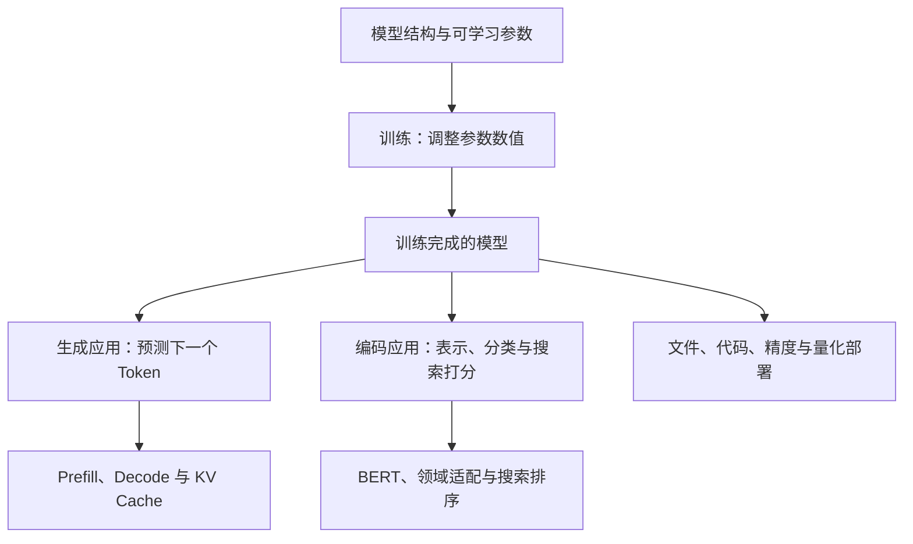

**贯穿全文的一条边界：训练改变模型参数；普通推理主要改变当前输入对应的中间状态。** 后文说一个位置“吸收了前文信息”，指它的表示被计算更新，并不表示模型当场修改了权重。

说明：旧版已有的显式章节锚点继续保留。例如 `#ch9` 仍指向 BERT 章节，尽管本版显示编号为第 13 章，方便旧链接继续使用。

基础术语也可以按下面的入口直接复习：

| 概念 | 先理解成什么 | 阅读位置 |
| --- | --- | --- |
| 超参数 Hyperparameter | 决定模型结构、训练过程等的配置 | [1.7 节](#sec1-7) |
| 神经元 Neuron | 读取多个数、计算一个输出的基本单元 | [1.8 节](#sec1-8) |
| 偏置 Bias | 可学习的基准偏移，与权重一起影响输出 | [1.9 节](#sec1-9) |
| 量化 Quantization | 用较少位数近似表示权重或中间数值 | [1.10 节](#sec1-10) |
| 张量 Tensor | 按形状组织起来的数值数据 | [3.5 节](#sec3-5) |
| 残差连接 Residual Connection | 当前状态加上子网络计算的更新 | [5.3 节](#sec5-3) |
| 前馈网络 FFN | 对每个位置的特征分别做非线性加工 | [5.6 节](#sec5-6) |


<a id="ch1"></a>
## 1. 模型、参数与训练

<a id="sec1-1"></a>
### 1.1 一个模型不只是一份代码

可以把模型理解为：**一套计算结构，加上一组训练得到的数值。** 真正运行还需要分词器和配置信息等。

| 对象 | 通俗解释 | 例子 |
| --- | --- | --- |
| 模型架构 Architecture | 规定有哪些部件、怎样连接 | 多少层、隐藏维度多大、是否使用 MoE |
| 实现代码 | 把结构变成可执行程序 | Attention、训练循环、推理循环 |
| 参数 Parameters | 计算中可通过训练调整的数值 | 权重矩阵、偏置、嵌入表中的数值 |
| 配置 Configuration | 描述结构和运行约定 | 层数、头数、词表大小 |
| 分词器 Tokenizer | 文字与 Token ID 之间的转换规则 | 一段文字对应哪些 ID |
| 训练数据 | 用来学习的样本 | 通用文本、金融新闻、医学文献 |
| 当前输入与中间状态 | 本次计算现场产生的数据 | Prompt、QKV、隐藏状态、KV Cache |

代码公开、权重公开、训练数据公开，是不同的问题；许可证也可能分别适用。

<a id="sec1-2"></a>
### 1.2 参数是一个个可学习的数

先看一个只有三个参数的小模型：

$$
z=w_1x_1+w_2x_2+b
$$

其中，$x_1,x_2$ 是输入；$w_1,w_2$ 是权重；$b$ 是偏置。假设训练之后：

$$
w_1=2,\quad w_2=-1,\quad b=0.5
$$

输入 $x_1=3,x_2=4$，得到：

$$
z=2\times3-1\times4+0.5=2.5
$$

这里有 **3 个参数**。把 $w_1$ 从 2 调成 200，参数仍然是 3 个，只是其中一个数的值改变了。

大模型做的是大量矩阵计算。一个有 $a$ 行、$b$ 列的可学习矩阵，就包含 $a\times b$ 个标量参数。所谓“70 亿参数”，可以先理解成“模型里存着约 70 亿个可学习的数”。

但不能理解成“一参数对应一个知识点”：知识与能力通常分布在许多参数以及它们的组合中，同一组参数也会参与许多任务。

<a id="sec1-3"></a>
### 1.3 B、M、T 是数量单位

| 单位 | 英文 | 数量 | 中文读法示例 |
| --- | --- | --- | --- |
| M | Million | $10^6$ | 110M = 1.1 亿 |
| B | Billion | $10^9$ | 7B = 70 亿；70B = 700 亿 |
| T | Trillion | $10^{12}$ | 1T = 1 万亿 |

参数数量不是文件大小。只计算权重的原始存储量时，可以粗略估算：

$$
\text{权重字节数}\approx\text{参数数量}\times\frac{\text{每个参数的位数}}8
$$

例如，7B 个参数按每个 2 字节存储，约为 14 GB，使用十进制单位。实际运行还需要 KV Cache、临时张量等空间；量化和文件格式也会影响大小。

<a id="sec1-4"></a>
### 1.4 参数在训练前设计，还是训练时学到？

**参数的数量与形状，通常由训练前选定的架构决定；参数的具体数值，主要在训练中学到。**

例如，一个输入 8 维、输出 4 维、带偏置的线性层：

$$
y=xW+b
$$

权重 $W$ 包含 $8\times4=32$ 个数，偏置包含 4 个数，所以共 36 个参数。开始训练之前，就能算出这个数量。

整个模型的参数量，就是把各部件中独立的可学习数值加起来。若两个部件共享同一组权重，计数时不重复计算。

| 项目 | 什么时候确定 | 训练时通常发生什么 |
| --- | --- | --- |
| 层数、隐藏维度、FFN 宽度 | 架构设计时 | 标准训练中保持不变 |
| 注意力头数、专家数、路由设置 | 架构设计时 | 标准训练中保持不变 |
| 权重矩阵的形状 | 创建模型时 | 标准训练中保持不变 |
| 权重矩阵中的数值 | 初始化，然后训练 | 通过梯度持续调整 |
| 当前文本的 QKV、隐藏状态 | 每次前向计算时 | 随输入、位置、层而变化 |

从零预训练时，许多权重会随机初始化，另一些按固定规则初始化；继续训练已有模型时，则加载已有权重作为起点。

训练的简化过程是：用当前参数预测，计算与正确目标的差距，再调整参数。用公式表示一次最基础的梯度更新：

$$
\theta\leftarrow\theta-\eta\nabla_\theta\mathcal L
$$

$\theta$ 表示所有可学习参数，$\mathcal L$ 是损失函数 Loss，$\eta$ 是学习率 Learning Rate。真实训练通常使用更复杂的优化器，但“利用误差调整参数”这个核心不变。

<a id="sec1-5"></a>
### 1.5 事先怎样决定训练多少参数？

这是一项受约束的设计工作，通常要一起考虑：

1. **用途与部署目标**：做轻量搜索编码器，还是通用生成模型？最终部署硬件能承受多大模型？
2. **训练预算**：GPU 数量、训练时间和资金能支持多大的计算量？
3. **数据**：有多少高质量训练 Token，覆盖什么领域，是否足以把模型训练好？
4. **结构选择**：深度、宽度、稠密或 MoE、共享参数等怎样搭配？
5. **小规模实验与预测**：先做较小模型的实验，结合 Scaling Laws（缩放规律）估计更大规模的效果，再确定方案。

因此，通常不是“模型发现知识装不下，于是在训练中自动多长几层”。训练更多样本，也不等于自动增加参数数量。

Chinchilla 的研究提供了一个值得记住的例子：在特定训练预算下，70B 模型通过更充分的数据训练，表现可以超过训练不足的更大模型。它说明参数、数据与算力要协调，不能只看参数越大越好。[S16](#s16)

<a id="sec1-6"></a>
### 1.6 怎样理解“目前最先进模型有多少参数”？

这是一个带日期、带评测口径的问题。“最先进”不能只用参数量定义，不少闭源模型也不公开准确参数。

下面只记录**有明确版本的规模例子**，用于建立数量感；它们不构成 2026 年的最新模型榜单。

| 模型版本 | 结构或用途 | 公开的规模信息 | 阅读时要注意 |
| --- | --- | --- | --- |
| BERT-Base | 编码器 | 约 110M，即 1.1 亿 | 原始经典配置 |
| BERT-Large | 编码器 | 约 340M，即 3.4 亿 | 原始经典配置 |
| Llama 3.1 405B | 稠密生成模型 | 405B，即 4050 亿 | 公开权重，使用其专门许可证 |
| DeepSeek-V3 主模型 | MoE 生成模型 | 总计 671B，每 Token 激活约 37B | 总参数与激活参数是两种口径 |
| GPT-4，原始技术报告 | 闭源模型 | 未披露精确参数规模 | 不能把网络传闻写成官方数值 |

来源：[S1](#s1)、[S14](#s14)、[S17](#s17)、[S18](#s18)。以后复习或比较新模型时，至少同时记下：**模型版本、公开日期、总参数、每 Token 激活参数、是否公开权重及许可证**。

<a id="sec1-7"></a>
### 1.7 模型的超参数：怎样搭建、怎样训练的配置

**Hyperparameter，超参数**，是控制模型结构或训练过程的设置，通常由开发者预先选择，或通过实验搜索确定。它与通过训练数据学到的权重、偏置不同。[S21](#s21)

把建模理解为“先搭计算结构，再学习计算中的数值”：

| 类型 | 例子 | 决定什么 |
| --- | --- | --- |
| 架构超参数 | 层数、隐藏维度、头数、FFN 中间宽度、专家数 | 计算结构，以及参数的数量与形状 |
| 训练超参数 | 学习率、批次大小、训练步数、权重衰减系数 | 怎样利用数据调整参数 |
| 推理与解码设置，广义上也常称推理超参数 | 温度、Top-k、Top-p、最大生成长度 | 怎样使用训练好的分布选择输出 |
| 可学习参数 | $W_Q$ 的每个数、FFN 权重、偏置 | 训练具体调整的数值 |

例如，“搭 24 层、隐藏维度设为 1024”是在选择架构；“某个权重由 0.12 调整成 0.15”是在学习参数。

**超参数不是“数值特别大”或“特别高级”的参数。** 它的区别在于作用层面：它配置学习过程或计算结构，而非像普通权重那样在同一次标准训练中直接作为待优化变量更新。

超参数也不是永远只能手工固定：学习率可以按预设规则变化，架构与训练配置也可用自动搜索比较。搜索多个方案，与在一个方案中学习权重，是两个层面的优化。

<a id="sec1-8"></a>
### 1.8 神经元：从多个输入算出一个输出

**Neuron，人工神经元**，可以先理解为一个小计算单元。经典写法是：

$$
z=\sum_{i=1}^{n}w_ix_i+b,\qquad a=\phi(z)
$$

其中：$x_i$ 是输入，$w_i$ 是权重，$b$ 是偏置，$\phi$ 是激活函数，$a$ 是这个神经元本次算出的输出。[S22](#s22)

复用前面的数字例子：

$$
x=[3,4],\quad w=[2,-1],\quad b=0.5
$$

先算加权和：

$$
z=2\times3-1\times4+0.5=2.5
$$

若激活函数取 ReLU，则 $a=\max(0,2.5)=2.5$。

| 对象 | 在这个例子里是什么 |
| --- | --- |
| 一个神经元 | 完成加权和、加偏置、激活这一计算的单元 |
| 三个可学习参数 | 两个权重 $w_1,w_2$，一个偏置 $b$ |
| 一个激活值 | 对当前输入算出的 $a=2.5$ |

**一个神经元通常包含多个参数，并在一次处理某个位置时产生一个标量输出。** 神经元不是一个参数，也不天然对应一个 Token 或一条知识。

将多个这样的单元放在一层，就会得到一组输出，也就是一个向量；用矩阵乘法，可以同时算完这些单元。某些输出层不再接非线性激活，现代门控结构也会更复杂，这里描述的是建立直觉的经典单元。

<a id="sec1-9"></a>
### 1.9 偏置：可学习的基准偏移

**Bias，偏置**，是加权和之后额外加上的可学习数值。在最简单的式子里：

$$
z=wx+b
$$

$w$ 决定输入变化时输出如何变化，$b$ 决定这条关系的基准位置。即使输入 $x=0$，输出仍可以是 $b$。

例如，固定 $w=2$：

可以把 $z=2x+3$ 看成一个教学收费规则：“基础费 3 元，加上每小时 2 元”。权重 2 决定每增加一小时的变化，偏置 3 提供整体基准。偏置可以为正、负或零；它由训练学习，普通推理时固定使用。

| 输入 $x$ | 无偏置：$z=2x$ | 偏置为 3：$z=2x+3$ |
| --- | --- | --- |
| 0 | 0 | 3 |
| 1 | 2 | 5 |
| 2 | 4 | 7 |

如果后面接 ReLU，偏置还可以改变开始产生正输出的位置：

$$
a=\max(0,2x-1)
$$

这里 $b=-1$；当 $x>0.5$ 时输出才为正。这样，模型可以学习“基准与门槛放在哪里”，而不必让所有关系都经过原点。

对于输入 $n$ 维、输出 $m$ 维的普通全连接层，通常每个输出有一个偏置：

$$
N_{\text{parameters}}=nm+m
$$

因此，“8 个输入、4 个输出”有 32 个权重、4 个偏置，共 36 个参数。PyTorch 的线性层文档也将偏置作为可选项；有些模型会选择不使用它。[S23](#s23)

需要区分：这里的 Bias 是计算中的参数，不是社会偏见；它也不同于残差连接。偏置在普通推理时是固定参数，残差连接加回的是随当前输入变化的状态向量。

<a id="sec1-10"></a>
### 1.10 量化：用更少位数近似表示数值

**Quantization，量化**，是在模型部署中用较低精度的表示，近似保存或处理权重、激活值等数值，以减少存储、内存传输或计算成本。[S26](#s26)

可以先借用尺子的比喻：原来用较密的刻度记录长度，改成较疏的刻度后，记录更省，但一些长度只能取附近的刻度。真实量化用的是二进制表示，不是简单删去十进制小数位。

以一个简化的、缩放因子 $s=0.01$、零点 $z_0=0$ 的整数方案为例：

$$
w=0.123\ \longrightarrow\ q=\operatorname{round}(0.123/0.01)=12
$$

近似还原时：

$$
\hat w=0.01\times12=0.12
$$

实际需要保存低比特编码和相应的缩放信息，并控制编码范围。常见仿射整数量化的简化公式为：

$$
q=\operatorname{clip}\left(\operatorname{round}(w/s)+z_0,\ q_{\min},\ q_{\max}\right),
\qquad \hat w=s(q-z_0)
$$

$s$ 是缩放因子，$z_0$ 是零点；$\operatorname{clip}$ 将编码限制在所用类型的范围内。它们可以按张量、通道或分组配置。这里只解释一种整数方案，其他格式可能使用不同规则。[S27](#s27)

对一个 7B 参数模型，仅计算所有权重都以对应位数紧凑保存的理想容量：

| 权重表示 | 每个参数占用 | 理想权重容量，十进制 GB |
| --- | --- | --- |
| FP32，32-bit Floating Point，32 位浮点 | 4 字节 | 28 GB |
| FP16，16-bit Floating Point，16 位浮点；或 BF16，Brain Floating Point，脑浮点格式 | 2 字节 | 14 GB |
| INT8，8-bit Integer，8 位整数 | 1 字节 | 7 GB |
| 紧凑的 4 位编码 | 0.5 字节 | 3.5 GB |

实际文件与运行内存还要考虑缩放元数据、未量化部件、缓存及临时空间，不能直接把表里的数字当成部署总显存。

**量化通常保留原有网络中的权重位置和主要参数数量，改变的是数值表示与近似值。** 7B 模型量化到 4 位，仍然是约 7B 参数；减少的是每个数所占的位数，不是把参数删成原来四分之一。

| 方案 | 全称 | 发生在哪个阶段 |
| --- | --- | --- |
| PTQ | Post-Training Quantization，训练后量化 | 训练完成后转换；有的方法会用校准数据 |
| QAT | Quantization-Aware Training，量化感知训练 | 训练或微调时模拟量化影响，让参数适应近似误差 |

“提前转换后保存量化文件”和“加载时转换”是不同执行安排，都可能用于训练后量化；不能仅靠发生在加载前还是加载时区分 PTQ 与 QAT。[S26](#s26)

另外要分清三个边界：

- **位数与格式**：INT8 是整数编码；FP8 是 8 位浮点。位数相同，不代表数值分布和计算方式相同。
- **低精度转换与整数方案**：FP32 转 FP16 是常见浮点类型转换，也会有舍入和范围变化；实际讨论“量化方法”时，还需说明具体格式、缩放和实现，不能一概等同。
- **存储精度与计算精度**：权重可以低比特保存，再按需要转换为较高精度参与计算，不能从文件格式断言所有运算都用同一位数。

量化可能引入效果损失，速度收益也依赖硬件和算子支持。更高数值精度主要减少一部分表示与计算误差，并不保证回答的语义质量必然更好；应以目标任务评估为准。

<a id="sec1-11"></a>
### 1.11 参数与广义“模型权重”的边界

| 术语 | 全称与含义 | 是否通常由普通梯度训练直接调整 |
| --- | --- | --- |
| Parameter | 参数：可学习数值的统称 | 是，例如矩阵元素、偏置、归一化缩放系数 |
| Weight | 权重：常指线性变换中的乘法系数 | 是 |
| Bias | 偏置：线性变换中的加法项 | 如果该模块设计了偏置，则是 |
| Hyperparameter | 超参数：规定结构或训练方法的设置 | 通常不是，例如层数、学习率、批次大小 |
| Activation | 激活值：本次前向计算的中间结果 | 它是计算结果；反向传播经过它，但不把它当持久参数更新 |

对于 $y=wx+b$，$w$ 决定输入变化怎样影响输出，$b$ 允许整体平移输出。若 $x=0$，有偏置的层仍可输出 $b$。偏置也是训练出来的数，但不额外对应一个输入 Token。

在“下载模型权重”“开放权重”的日常说法中，**权重往往是广义用法，指整套训练好的参数**，不仅指狭义乘法矩阵。不能据此认为偏置、归一化参数都不在模型包里。

并非所有模块都有偏置。例如本文 Qwen3 例子的 Q/K/V 投影不使用加法偏置，但仍有投影权重与归一化参数。[S30](#s30)[S32](#s32)


<a id="sec1-12"></a>
### 1.12 从训练结果到运行状态：什么保留，什么现场生成？

| 内容 | 通常在哪里 | 换一段 Prompt 时 |
| --- | --- | --- |
| 参数张量：嵌入、投影、FFN、归一化等 | 权重文件；加载后在内存或显存 | 普通推理中保持不变 |
| 网络连接与前向计算规则 | 实现代码与结构配置 | 通常保持不变 |
| 分词规则、词元编号映射、聊天模板 | 分词器及相关文件 | 规则固定，编码结果变化 |
| Token ID、隐藏状态、QKV、词表分数 | 本次请求的计算过程 | 重新计算或按前缀规则复用 |
| KV Cache | 本次上下文的运行缓存 | 不能只因词相同就随意复用 |
| 优化器状态、训练步数 | 完整训练检查点中可能保存 | 普通推理通常不需要 |

“法国的首都是”和“日本的首都是”使用同一套参数，却产生不同的隐藏状态和预测分数。参数提供训练得到的变换规律，输入提供这次计算的具体线索。模型包、运行代码与训练检查点的文件边界，详见[第 12 章](#hf-package)。


<a id="sec1-13"></a>
### 1.13 神经元与层：从房价预测例子数清单元和参数

神经元是计算单元，层负责组织这些单元。在普通全连接网络中，一层通常可以先看成多个单元并排工作。[S22](#s22)

假设输入房屋面积、房龄、距离地铁站的距离三个数，设计一个教学网络来预测房价：

$$
3\text{ 个输入}\longrightarrow4\text{ 个隐藏单元}
\longrightarrow2\text{ 个隐藏单元}\longrightarrow1\text{ 个输出单元}
$$

这里没有预先给隐藏单元安排“面积专家”等职责。各单元通过自己的参数，学习对任务有用的输入组合。

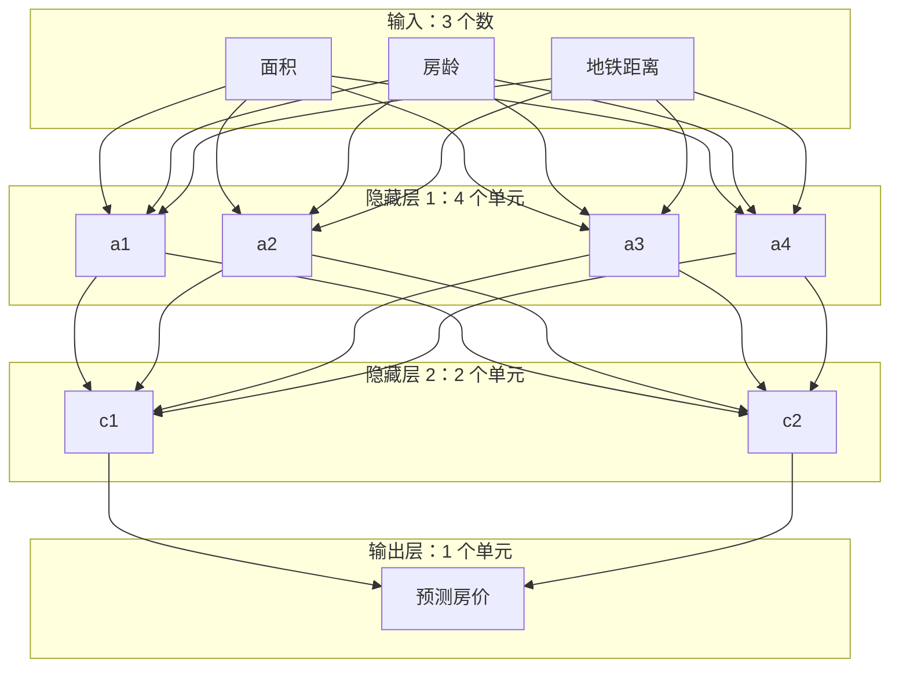

图中每条输入连接对应一个权重，偏置为简洁起见未画出。第一隐藏层的一个单元，例如 $a_1$：

$$
a_1=\phi(w_1x_1+w_2x_2+w_3x_3+b)
$$

它接收三个输入，使用三个权重与一个偏置，产生一个标量输出。同层其他单元读取相同输入，但参数不同；四个输出合起来形成四维向量。

按“隐藏层和输出层中的计算单元”统计，单元数为：

$$
4+2+1=7
$$

三个输入是输入节点，本例不将它们计入可学习计算单元。若把输入节点也算进去，会得到 10 个节点；两个数字使用了不同口径，应明确区分。

假设三个计算层都有偏置，参数计数如下：

| 计算层 | 每个输出读取几个输入 | 输出单元数 | 权重数 | 偏置数 | 合计 |
| --- | --- | --- | --- | --- | --- |
| 第一隐藏层 | 3 | 4 | $3\times4=12$ | 4 | 16 |
| 第二隐藏层 | 4 | 2 | $4\times2=8$ | 2 | 10 |
| 输出层 | 2 | 1 | $2\times1=2$ | 1 | 3 |

总计：

$$
N_{\text{parameters}}=4(3+1)+2(4+1)+1(2+1)=29
$$

**7 个计算单元、29 个参数、一次前向计算产生的中间数值，是三种不同的统计对象。** 这些单元通常由矩阵运算批量实现，不要求程序为每一个单元创建一个独立对象。

通常在训练前先确定层数、宽度、连接方式和激活函数，再通过训练调整这里的 29 个数。训练主要改变各单元的响应及其协同方式，而非在普通训练循环里自动长出更多单元。

<a id="sec1-14"></a>
### 1.14 Transformer 每层多少神经元？为什么需要先定义统计口径？

普通全连接网络中的“一层”，可以指一组并排输出的单元；Transformer 的“一层”通常指整个 Block，包含注意力、FFN、残差和归一化等多个部件。

因此，隐藏维度 $D=8$，表示每个位置的状态有 8 个分量，不能直接推出整个块只有 8 个神经元。

仍以普通两层 FFN 的玩具结构为例：

$$
8\longrightarrow32\longrightarrow8
$$

其中 32 个中间输出，可以按经典用法称为 32 个 FFN 隐藏单元。如果有两个相同宽度、各自独立参数的 Transformer 块，那么：

$$
N_{\text{FFN hidden units}}=2\times32=64
$$

这只统计两块里的 FFN 中间单元，未把其他线性投影、输出头等按某个规则计入，不能直接称作“模型的全部神经元”。门控 FFN、MoE 及其他结构还会使统计更依赖约定。

需要特别区分“结构中的单元”和“本次产生的激活值”：一个 FFN 的 32 个中间单元处理四个 Token，会产生 $4\times32=128$ 个中间数值，但仍在复用同一套参数。批次与序列长度改变了执行次数，不会让每个 Token 获得一套独立的新单元参数。

阅读真实模型时，可按以下步骤核对：

1. 读取配置中的层数、隐藏宽度和 FFN 中间宽度。常见字段包括 `num_hidden_layers`、`hidden_size`、`intermediate_size`，具体以该模型为准。
2. 查看结构实现，确认一个 Block 包含哪些子层，有无门控、专家或参数共享。
3. 先声明口径，例如“只统计各层 FFN 中间单元”，再按结构计算。MoE 还需区分全部专家内的单元与每 Token 实际调用路径。
4. 将结构单元数、独立参数量和输入对应的激活值数量分别记录。

**只知道模型有 7B 参数，不能唯一反推出它有多少神经元。** 多种层数、宽度和连接方式可能具有接近的参数量；跨架构比较时，参数数目通常比“总神经元数”更容易明确统一口径。[S23](#s23)[S32](#s32)

<a id="ch2"></a>
## 2. 总参数、激活参数与激活函数

<a id="sec2-1"></a>
### 2.1 稠密模型与 MoE

在常见的稠密模型 Dense Model 中，每个 Token 基本都经过同一套主要网络。

MoE 的全称是 **Mixture of Experts，混合专家模型**。在一些层里，模型设置多个专家网络，由 Router（路由器）根据当前输入，选择少数专家参与计算。专家常用于替换或扩展 FFN 部分；Attention 等部分仍可能共享使用。

“专家”是一个个可学习的子网络，不必对应人类预先命名的“金融专家”“医学专家”。它们的分工是在训练中形成的，而且可能不容易用一个领域标签描述。

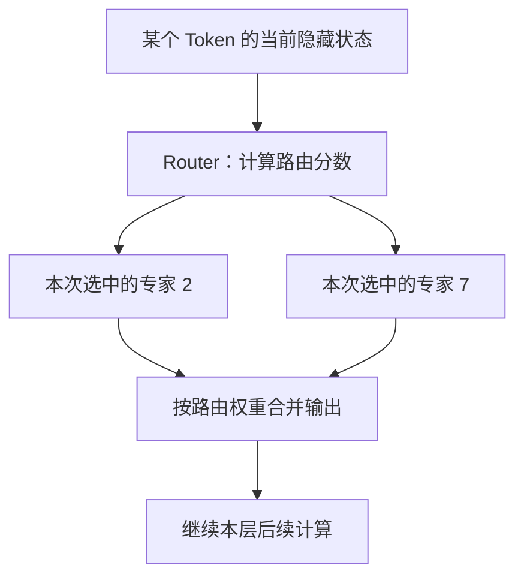

图中专家编号只是例子。下一 Token、下一层，都可能选择其他专家。

<a id="sec2-2"></a>
### 2.2 总参数 X、激活参数 Y 分别是什么意思？

**总参数 Total Parameters**：整个模型拥有的参数数量，包括本次没有使用的专家参数。

**激活参数 Active / Activated Parameters**：通常指处理一个 Token 时，其所走计算路径涉及的参数规模。准确统计仍要看发布方的口径。

用一个简化模型理解。假设全部 MoE 层合计可以抽象为：

- 共享部分：20B 参数；
- 专家部分：8 份，每份 100B；
- 每个 Token 在相应路由中使用其中 2 份。

那么：

$$
N_{\text{total}}=20+8\times100=820\text{B}
$$

$$
N_{\text{active}}\approx20+2\times100=220\text{B}
$$

更一般的玩具公式是：

$$
N_{\text{total}}\approx S+EP,\qquad
N_{\text{active}}\approx S+kP
$$

$S$ 是共享部分参数量，$E$ 是专家总份数，$P$ 是每份专家参数量，$k$ 是每 Token 选中的份数。真实模型需要逐层统计，可能还有共享专家、不同类型层以及不同统计约定。

这里的“激活”通常是**按 Token**说的。整段 Prompt 包含很多 Token，它们合起来可能使用更多专家，甚至覆盖全部专家。

DeepSeek-V3 公布的 671B 总参数、37B 每 Token 激活参数，就是理解这两个口径的真实例子。[S14](#s14)

<a id="sec2-3"></a>
### 2.3 激活少，是否只需存那一小部分参数？

不能这样直接推断。

不同 Token 可能调用不同专家，所以服务系统需要能访问模型的全部相关权重。权重可以分布在多张 GPU、多个节点，或通过卸载等方式管理，具体显存占用取决于部署方案。

因此：

- **总参数**有助于理解模型总体存储规模；
- **每 Token 激活参数**有助于理解一次 Token 计算的规模；
- **实际速度与成本**还受显存带宽、跨设备通信、批处理和实现影响，不能简单按两者比例换算。

对稠密模型说“基本全部参数参与”也是工程上的概括，并不表示每个 Token 都会逐项使用嵌入表中每一行。

<a id="sec2-4"></a>
### 2.4 激活参数和激活函数有关系吗？

这是两个不同层面的概念。

**激活函数 Activation Function** 是对中间数值进行变换的函数，用来引入非线性。例如：

$$
\operatorname{ReLU}(z)=\max(0,z)
$$

输入 $-2$，输出 0；输入 3，输出 3。Transformer 的 FFN 中也会使用 GELU、SiLU 等激活函数或相应的门控结构。

| 概念 | 在回答什么问题 | 例子 |
| --- | --- | --- |
| 激活参数 | 这次 Token 的路径涉及多少模型参数？ | MoE 只调用部分专家 |
| 激活函数 | 怎样变换一个中间数值？ | ReLU、GELU、SiLU |
| 激活值 Activations | 当前输入计算出了什么中间结果？ | 隐藏状态、FFN 中间输出 |

一个 ReLU 输出变成 0，并不代表前面用到的权重突然不算参数，也不能据此说这个位置“激活参数为 0”。


<a id="sec2-5"></a>
### 2.5 MoE 是模型内部结构，路由具体怎样发生？

在本文讨论的 Transformer MoE 中，**专家通常是一套前馈子网络，路由器也是模型内部可训练的模块**。这与在模型外调用搜索工具、接上另一个完整聊天模型不同。

典型位置是：本层先做注意力及残差，再由 MoE 前馈部分加工当前状态。设送入路由器的状态是 $r$，路由权重矩阵为 $W_{\mathrm{router}}$，可简化为：

$
g=\operatorname{softmax}(rW_{\mathrm{router}})
$

路由器从专家分数中选出 Top-$k$，执行这些专家，并合并结果：

$
y=\sum_{e\in\operatorname{TopK}(g)}\widetilde g_e\operatorname{Expert}_e(r)
$

$\widetilde g_e$ 是实际用于合并的路由权重；是否及如何对选中分数再归一化，取决于具体实现。

路由器需要为全部候选专家算分，但**算一个相对小的路由矩阵，不等于执行全部专家的多层变换**。Qwen3 的公开实现可以直接看到“路由打分 → Top-k → 选中专家 → 加权合并”的过程。[S33](#s33)

不要给专家强行贴上“这个必定负责数学、那个必定负责医学”的标签。模型可以形成一定分工，但具体分工由训练与输入分布形成，不保证恰好对应人类学科分类。

<a id="sec2-6"></a>
### 2.6 为什么需要 MoE？为什么不把全部专家激活？

稠密模型扩大前馈网络时，通常也增加每个 Token 的计算量。稀疏 MoE 的目标是：**增加可用参数容量，同时让每个 Token 只执行其中一部分计算**。这是 Conditional Computation（条件计算）的一种实现。[S34](#s34)

如果每层有 128 个等规模专家、原来执行 8 个，改为执行 128 个，专家部分的运算量可能接近原来的 16 倍；注意力等开销另算，所以整个系统不一定恰好慢 16 倍。

模型也是按某种路由和合并方式训练的。把现成模型的 Top-8 直接改成 Top-128，会改变输出分布，不能当作无损的“性能升级”。可以设计全部专家参与的混合网络，但那就不再具备相同的稀疏计算优势。

MoE 不保证任何部署都更快。额外成本包括：保存全部专家权重、跨设备分发状态、专家负载不均、通信与调度。因此要一起看实际批次、设备和实现，不能只比较激活参数。[S34](#s34)[S14](#s14)

<a id="sec2-7"></a>
### 2.7 真实 QA：为什么不能用 33 亿乘以 128/8，反推 Qwen 总参数？

**学习中的疑问：**

> Qwen3-30B-A3B 总计约 305 亿参数、每 Token 激活约 33 亿；每层 128 个专家，选 8 个。那么 $33\times128/8=528$ 亿，为什么大于总参数？

这个乘法成立的前提是“33 亿全部属于被选中专家”。实际激活规模还计入非专家部分，例如注意力、路由器、输出头等。

为避免把“专家个数”和“专家参数池”混为一谈，这里用 $S$ 表示非专家部分、$P_{\mathrm{experts}}$ 表示全部层的专家参数池：

$
N_{\mathrm{total}}=S+P_{\mathrm{experts}}
$

$
N_{\mathrm{active}}\approx S+\frac8{128}P_{\mathrm{experts}}
$

所以，在相同统计口径下，应先扣除共享部分，再按专家比例放大：

$
N_{\mathrm{total}}\approx
S+16\left(N_{\mathrm{active}}-S\right)
$

直接乘 16，会把非专家部分也重复放大。

依据 Qwen3-30B-A3B 的配置与公开实现，单层单个专家有三块无偏置矩阵，参数量是：

$
3\times2048\times768=4,718,592
$

全模型 48 层的全部专家参数：

$
48\times128\times4,718,592=28,991,029,248
$

每个 Token 选中专家部分的参数规模：

$
48\times8\times4,718,592=1,811,939,328
$

| 部分，全部层合计 | 模型持有的参数 | 按每 Token 路径计入的规模 |
| --- | ---: | ---: |
| 非专家部分 | 约 15.41 亿 | 简化统计中整体计入约 15.41 亿 |
| 专家网络 | 约 289.91 亿 | 约 18.12 亿 |
| 合计 | 约 305.32 亿 | 在上述简化口径下约 33.53 亿 |

**统计边界必须保留：** 这张表把非专家参数整体计入，用于展示组成；它不是对单次执行逐元素访问量或浮点运算量的审计。输入嵌入每次只取一行，实际访问行为还有细节。官方模型卡标称为 30.5B 总参数、3.3B 激活参数，不应把这两项标称值称为精确到单参数的数字，更不能据此强求所有乘除结果严格吻合。[S29](#s29)[S33](#s33)

另外，“选 8 个”是**每一层**选 8 个；各层的专家不是同一套。约 33 亿说的是一个词元经过整个模型时的统计规模，不是某一层的 8 个专家合计。

<a id="sec2-8"></a>
### 2.8 专家、注意力头、网络层不是同一个概念

| 概念 | 在网络中的典型位置 | 承担什么工作 |
| --- | --- | --- |
| 注意力头 | 注意力子层 | 以不同匹配方式从上下文位置读取信息 |
| 专家 | MoE 前馈子层 | 用被选中的一组前馈参数加工当前状态 |
| 网络层 | 串接的 Transformer 块 | 组织一轮注意力、前馈、残差与归一化等计算 |

同一个 MoE 层仍然可以使用多头注意力。MoE 与 GPT 式自回归生成兼容；它不表示一个 Token 只走 8 层，也不表示未来回答可以因此全部独立并行生成。


<a id="sec2-9"></a>
### 2.9 激活函数与偏置：一个改变响应形状，一个调整基准

把一个经典神经元拆成两步，最容易看清二者的关系：

$$
z=wx+b,\qquad a=\phi(z)
$$

权重和偏置先形成加权输入，激活函数再对这个值进行变换。偏置 $b$ 是可学习参数；ReLU 等常见激活函数的公式通常由结构设计确定。也存在带可学习参数的激活函数，不能概括为所有激活都没有参数。

**用“超过 8 小时的部分”理解二者怎样配合。** 输入一天的工作时长 $x$，教学规则为：

$$
a=\operatorname{ReLU}(x-8)=\max(0,x-8)
$$

| 输入时长 $x$ | 激活前 $z=x-8$ | 激活后：超过的时长 |
| --- | --- | --- |
| 6 小时 | −2 | 0 小时 |
| 8 小时 | 0 | 0 小时 |
| 10 小时 | 2 | 2 小时 |
| 12 小时 | 4 | 4 小时 |

偏置 −8 把转折位置移到 8 小时，ReLU 将负数部分变成零。只有 $x-8$ 时，会产生“−2 小时”这样的中间值；经过激活才得到这个规则需要的输出。这里的数字为教学而人工指定，真实训练会按数据调整参数。

如果偏置从 −8 变成 −6，同一个 ReLU 就在 $x=6$ 处转折。**函数规则没变，但它前面的参数变了，响应位置就能改变。** 对单输入且 $w>0$ 的 $\operatorname{ReLU}(wx+b)$，转折位置是 $x=-b/w$；多输入时则由加权和共同决定响应。

为什么需要非线性？先看连续两次仿射变换：

$$
z_1=2x+1,\qquad z_2=3z_1+4=6x+7
$$

不论中间怎样分成两步，仍然可合成一次仿射变换。如果网络只是反复做这类计算，增加层数也没有获得任意复杂的非线性关系。插入非线性激活后，组合结果才可以超出这一限制。[S22](#s22)

这个结论针对仅含仿射变换的计算链。完整 Transformer 还有注意力 Softmax、归一化或门控等运算，不能由此推断“去掉 FFN 激活，整个 Transformer 就等价于一个线性层”。

例如：

$$
a=\operatorname{ReLU}(2x-1)=\max(0,2x-1)
$$

| 输入 $x$ | 激活前 $z=2x-1$ | 激活后 $a$ |
| --- | --- | --- |
| 0 | -1 | 0 |
| 0.25 | -0.5 | 0 |
| 0.5 | 0 | 0 |
| 1 | 1 | 1 |

偏置 $b=-1$ 使激活前的基准发生偏移，ReLU 则引入“负数区间输出为零、正数区间保留”的分段响应。当 $x>0.5$ 时，这个单元才产生正输出；多个这样的单元组合，可以形成更复杂的响应。

这个例子也说明：输入为零时，**激活前**是 $b$，**激活后**是 $\phi(b)$，不一定还等于 $b$。ReLU 输出零只是一次计算的结果，不表示相关参数被删除，也不等于 MoE 路由没有调用该专家。

| 名称 | 示例公式 | 帮助建立的直觉 |
| --- | --- | --- |
| ReLU，Rectified Linear Unit，整流线性单元 | $\max(0,z)$ | 形成分段响应 |
| Sigmoid，逻辑 S 形函数 | $\sigma(z)=1/(1+e^{-z})$ | 将输入映射到 0 与 1 之间 |
| SiLU，Sigmoid Linear Unit，Sigmoid 线性单元 | $z\sigma(z)$ | 用平滑门控形成非线性，负输入不一律归零 |

激活函数应结合具体模型和任务使用，不能把所有神经元都当成硬阈值开关。它影响正向响应，也影响反向传播中的局部导数；训练仍然通过总体损失协调各层参数。SiLU 的定义另见官方文档 [S46](#s46)。

**“激活”不是只输出 0 或 1。** ReLU 输入 2、10，分别输出 2、10；而 $\operatorname{SiLU}(-1)\approx-0.269$，还可以输出负数。“把负数清零”是 ReLU 的具体规则，不是所有激活函数的共同定义。

| 对象 | 通常怎样确定 | 普通推理时 |
| --- | --- | --- |
| 权重 $w$、偏置 $b$ | 训练学习具体数值 | 固定使用 |
| 采用哪一种激活函数 | 设计模型时选择 | 按选定规则计算 |
| 标准 ReLU 的函数规则 | $\max(0,z)$，本身没有可学习参数 | 规则固定 |
| 激活值 $a$ | 根据当前输入前向计算 | 随输入变化 |

所以要区分：Activation Function（激活函数）是规则，Activation（激活值）是计算结果，MoE 的 Activated Parameters（激活参数）是执行路径涉及的参数规模。前馈网络中对向量逐元素激活，通常不改变该张量的形状。偏置如何学习、激活函数如何影响梯度，见 [5.9 节](#sec5-9)。

<a id="ch3"></a>
## 3. Token、位置与五种容易混淆的对象

<a id="sec3-1"></a>
### 3.1 先约定全文的例子

我们用下面这句话解释生成过程：

> 法国 的 首都 是

为了看清四个位置，**假设**分词结果恰好是：

| 位置 | 1 | 2 | 3 | 4 | 待生成的位置 5 |
| --- | --- | --- | --- | --- | --- |
| Token | 法国 | 的 | 首都 | 是 | 未知，可能是“巴黎” |

这只是教学分词。真实 Tokenizer 不一定这样切分，“巴黎”也不一定是一个 Token。

**Token（词元）不是“一个完整汉字或一个完整单词”的同义词。** 它可能是一个字、一个词、词的一部分、标点、字节片段或特殊标记。

<a id="sec3-2"></a>
### 3.2 五种对象要分开记

| 对象 | 本文符号 | 它是什么 | 是否随当前上下文改变 |
| --- | --- | --- | --- |
| Token ID | $x_i$ 或 $j$ | 词表中某个 Token 的整数编号 | 选定 Token 后，其 ID 固定 |
| 输入嵌入向量 | $e_j=E[j,:]$ | 从输入嵌入表按 ID 查出的一行数 | 普通固定嵌入表中，同一 ID 查出同一行 |
| 某层隐藏状态 | $h_i^{(\ell)}$ | 位置 $i$ 经过第 $\ell$ 层后的表示 | 会，取决于输入、位置和层 |
| Q、K、V 向量 | $q_i,k_i,v_i$ | 从本层输入投影出的注意力计算材料 | 会，而且每层、每头不同 |
| 输出层候选向量 | $u_j=U[j,:]$ | 输出头中，用来给候选 Token $j$ 打分的权重行 | 推理时通常固定 |

最容易混的是 **输入嵌入 $e_j$** 和 **上下文隐藏状态 $h_i^{(\ell)}$**。

例如，“银行”作为 Token ID 输入时，可以查出一个固定的初始嵌入；它出现在“去银行取钱”或“河边的银行大楼”中，经过上下文计算后的隐藏状态会不同。模型对具体语境的处理，体现在这些动态表示中。

<a id="sec3-3"></a>
### 3.3 层与层之间传递的是隐藏状态矩阵

设 Prompt 有 $n$ 个 Token，模型隐藏维度是 $d$。忽略批次维度后，一层的主要输入、输出通常都是：

$$
H^{(\ell)}\in\mathbb R^{n\times d}
$$

每一行对应一个位置的向量。为了书写方便，本文把单个位置向量视作行向量。

四个位置、每个向量 8 维时：

| 阶段 | 主要状态的形状 | 含义 |
| --- | --- | --- |
| 嵌入后的初始状态 $H^{(0)}$ | $4\times8$ | 四个位置各有一个初始表示 |
| 第一层输出 $H^{(1)}$ | $4\times8$ | 四个位置各更新了一次 |
| 第二层输出 $H^{(2)}$ | $4\times8$ | 利用上一层结果继续处理 |
| 最后一层输出 $H^{(L)}$ | $4\times8$ | 四个位置各有最终状态 |

**Attention 会混合信息，但不会因此把四个位置压缩成一个位置。** 每个位置分别发起自己的读取，分别得到自己的输出向量。

<a id="sec3-4"></a>
### 3.4 模型怎样知道顺序？

模型还需要位置信息 Position Information。

有的模型把位置嵌入加到 Token 嵌入上；有的使用 RoPE（Rotary Position Embedding，旋转位置编码）等方式，在注意力计算中体现位置关系。因此，不能把“所有模型都先做词向量加位置向量”当成统一规则。

后文用 $H^{(0)}$ 表示准备好输入后的初始状态，具体位置机制按模型而定。

<a id="sec3-5"></a>
### 3.5 张量 Tensor：给数值数据规定形状

在深度学习框架的日常用法中，**Tensor，张量**，可以先理解为按照一定形状组织起来的数值数据。**Shape，形状**，描述每个轴有多长。[S28](#s28)

| 形式 | 例子 | 轴的数量，也称阶数 | Shape |
| --- | --- | --- | --- |
| Scalar，标量 | 一个数 0.5 | 0 | `[]` |
| Vector，向量 | 四个数按顺序排成一列或一行 | 1 | `[4]` |
| Matrix，矩阵 | 3 行，每行 4 个数 | 2 | `[3,4]` |
| 三阶张量 | 两张这样的矩阵按批次叠起来 | 3 | `[2,3,4]` |

可以用电子表格建立直觉：一个单元格存一个数，一行数据形成向量，一张二维表形成矩阵，多张同样大小的表按顺序叠放，就可以表示为三阶张量。

“三阶”表示定位一个数字需要三个索引，不特指物理空间的长、宽、高。

前面的四个 Token，每个位置有 8 个分量，放在一起就是形状为 `[4,8]` 的张量。一次处理两条这样的输入，则是：

$$
\operatorname{Shape}(H)=[B,T,D]=[2,4,8]
$$

三个轴依次表示 **Batch Size，批次大小**；**Sequence Length，序列长度**；**Hidden Dimension，隐藏维度**。总元素数为 $2\times4\times8=64$。

一个常见疑问是：“4096 维向量，怎么又说是一阶张量？”两句话中的“维”指不同对象：4096 是向量的分量数量；一阶是说只有一个轴，Shape 为 `[4096]`。`[2,4,4096]` 才有三个轴。

| 模型中的对象 | 示例形状 | 数字的作用 |
| --- | --- | --- |
| Token ID | `[B,T]` | 输入的整数编号 |
| 输入嵌入、隐藏状态 | `[B,T,D]` | 当前输入的中间表示 |
| 输入嵌入表 | `[词表大小,D]` | 可学习参数 |
| 注意力投影权重 | 例如 `[D,D]` | 可学习参数 |

**参数张量与中间状态张量都可以有很多数字；是否属于参数，取决于角色，不取决于是不是张量。** 当前 $H$ 有 64 个元素，不意味着模型只有或新增了 64 个参数。

例如：

$$
\underbrace{H}_{[4,8]}\underbrace{W_Q}_{[8,8]}
=\underbrace{Q}_{[4,8]}
$$

四个位置使用同一个投影矩阵进行变换；$W_Q$ 是训练得到的参数，$H$ 和 $Q$ 是当前输入对应的状态。阅读张量时，依次问：有几个轴、每个轴代表什么、数字承担什么作用。

<a id="ch4"></a>
## 4. QKV 与注意力

<a id="sec4-1"></a>
### 4.1 Q、K、V 各是什么？

Q、K、V 的全称分别是：

- **Query，查询向量**：这个位置此次读取其他位置时，使用什么匹配条件？
- **Key，键向量**：这个位置提供什么用于被匹配的特征？
- **Value，值向量**：如果读到这个位置，取走什么信息？

可以借用资料检索的比喻：Q 像检索条件，K 像可供检索的线索，V 像读到的内容。但在模型里，它们都是数值向量，不是三句自然语言。

对一个位置的本层输入向量 $r_i$，简化写成：

$$
q_i=r_iW_Q,\qquad k_i=r_iW_K,\qquad v_i=r_iW_V
$$

$W_Q,W_K,W_V$ 是训练得到的权重；$q_i,k_i,v_i$ 是本次输入现场算出来的结果。真实实现可能先做归一化，并在 Q、K 上施加位置变换，式子省略了这些细节。

**可学习的是投影矩阵 $W_Q,W_K,W_V$；当前文本对应的 Q、K、V 不是提前训练好的固定表。**

<a id="sec4-2"></a>
### 4.2 预测未知的下一个 Token，用谁的 Q？

对于“法国 / 的 / 首都 / 是”，当前位置是第 4 个已知 Token“是”。模型先计算这个已知位置的表示，用它预测第 5 个位置。

因此，计算中使用的是：

> 已知位置“是”的 Q，与本层中“法国、的、首都、是”的 K 计算匹配分数，再读取它们的 V。

这里包括“是”自己的 K、V。标准因果自注意力允许读自身和此前位置。

未知的第 5 个 Token 此时还没有选出来，没有它的输入嵌入，也就没有它在这一轮的 QKV。词表里的候选 Token 也不是此处注意力要检索的 K 表。

<a id="sec4-3"></a>
### 4.3 注意力的完整公式

对一个头，位置 $t$ 读取位置 $i$ 的分数为：

$$
s_{ti}=\frac{q_tk_i^\top}{\sqrt{d_k}}+m_{ti}
$$

其中 $d_k$ 是该头的 Q、K 维度。因果掩码 Causal Mask 为：

$$
m_{ti}=\begin{cases}
0,&i\le t\\
-\infty,&i>t
\end{cases}
$$

然后在**可见的上下文位置之间**做 Softmax：

$$
\alpha_{ti}=\frac{\exp(s_{ti})}{\sum_{r\le t}\exp(s_{tr})}
$$

最后对 V 加权求和：

$$
a_t=\sum_{i\le t}\alpha_{ti}v_i
$$

批量矩阵形式是：

$$
\operatorname{Attention}(Q,K,V)
=\operatorname{softmax}\left(\frac{QK^\top}{\sqrt{d_k}}+M\right)V
$$

点积得到匹配分数；除以 $\sqrt{d_k}$ 有助于控制分数尺度；Mask 限制可见范围；Softmax 把分数变成加权比例。这些比例的和为 1。

<a id="sec4-4"></a>
### 4.4 融合出的新向量，到底是什么？

它是**这个注意力头针对当前位置，从可见上下文读回的一份信息表示**。

例如，假设某一层某一个头，在“是”这个位置算出了以下权重：

| 被读取的位置 | 法国 | 的 | 首都 | 是 |
| --- | --- | --- | --- | --- |
| 注意力权重 | 0.40 | 0.05 | 0.40 | 0.15 |

取一组便于手算的二维 V，纯属教学示意：

$$
v_1=[2,0],\quad v_2=[0,0],\quad v_3=[0,4],\quad v_4=[1,1]
$$

那么读回的向量是：

$$
\begin{aligned}
a_4
&=0.40[2,0]+0.05[0,0]+0.40[0,4]+0.15[1,1]\\
&=[0.95,1.75]
\end{aligned}
$$

这个新向量是两个数字组成的**中间结果**。它把不同位置提供的信息按本次读取需要合成了一份消息，尚不是“巴黎”的 Token ID，也不是一份已经能直接显示的文字。

在真实模型中，向量往往有很多维，特征也分布在多个维度中。我们不能把上例第一维直接宣称为“国家知识”，第二维直接宣称为“首都知识”。这些维度如何配合，取决于训练得到的数值结构。

它接下来还会经过：多头合并、输出投影、残差连接、FFN 等本层计算，再作为后续层输入的一部分。经过全部层，才得到用于下一 Token 打分的最终状态。

<a id="sec4-5"></a>
### 4.5 两次 Softmax，分别在不同对象之间分配权重

| 所在位置 | Softmax 的对象 | 结果含义 |
| --- | --- | --- |
| 注意力内部 | 当前可见的上下文位置 | 读取每个位置的 V 时给多少权重 |
| 语言模型输出端 | 整个词表的候选 Token | 下一个 Token 的预测概率分布 |

“更关注‘法国’”不等于“下一 Token 是‘法国’的概率更大”。前者是读取上下文的比例，后者要经过后续网络和词表打分才能得到。

<a id="ch5"></a>
## 5. 多头、多层与残差连接

<a id="sec5-1"></a>
### 5.1 多头：同一轮并行进行多种读取

**Multi-Head Attention，多头注意力**，是在同一层中，使用多组投影分别计算注意力。

每个头都可以访问同一批位置的本层输入表示，但使用自己的 $W_Q,W_K,W_V$，因此能形成不同的匹配方式和读取结果。

可以把多头粗略理解为“同时从多个角度读取内容”。但“头 1 专门看语法、头 2 专门看地名”通常只是教学比喻，不能当成预先固定的真实分工。

对于标准多头注意力：

$$
\operatorname{head}_r
=\operatorname{Attention}(Q_r,K_r,V_r)
$$

$$
\operatorname{MHA}(H)
=\operatorname{Concat}(\operatorname{head}_1,\ldots,\operatorname{head}_A)W_O
$$

$A$ 是头数，$W_O$ 是把各头输出重新组合的可学习投影。

例如，隐藏维度 8，两个头各输出 4 维；拼接后是 8 维，再通过 $W_O$ 得到 8 维结果。四个位置一起处理时，主要状态仍然保持 $4\times8$。

标准实现中，每个头的投影可从完整输入向量中提取信息，不能简单理解为“头 1 只看原向量的前四个数字，头 2 只看后四个”。GQA、MQA 等变体会改变 Q 头与 KV 头的关系，其中 GQA 的入门说明见[10.3 节](#sec-design-3)。

在隐藏维度不变的标准多头结构中，增加头数通常会相应减小每头维度，并不等于把完整的注意力网络复制多份、让参数量按头数成倍增长。

<a id="sec5-2"></a>
### 5.2 层：在上一轮结果上继续计算

**Layer / Transformer Block，层或 Transformer 块**，通常包含注意力、FFN、残差连接和归一化等部件。

多头与多层的关系：

| 比较项 | 多头 Heads | 多层 Layers |
| --- | --- | --- |
| 组织方式 | 同一层内并行 | 层与层顺序依赖 |
| 接收的表示 | 同一版本的本层输入 | 上一层处理后的新版本 |
| 做什么 | 同时形成不同读取与组合 | 对已有组合结果继续变换 |
| 参数关系 | 各头有自己的投影，具体变体可能共享 KV | 各层通常有各自的参数 |
| 便于记忆的比喻 | 同一轮的多个观察角度 | 接续进行的多轮加工 |

下面只画两层、每层两头，突出并行和串行的区别：

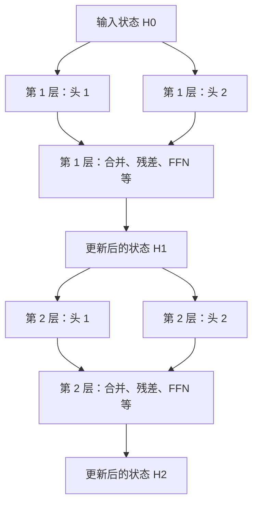

<a id="sec5-3"></a>
### 5.3 层与层之间，到底交付什么？

概念上，第 $\ell$ 层接收 $H^{(\ell-1)}$，产生 $H^{(\ell)}$：

$$
H^{(\ell)}=\operatorname{Block}_{\ell}(H^{(\ell-1)})
$$

不是每层都把“原始 Prompt”和“上一层输入”当两份独立材料重新拼接。上一层的处理结果已经成为下一层的当前输入。

不过，Transformer 中还有 **Residual Connection，残差连接**。以一种常见的 Pre-LN 结构简化表示：

$$
R=H+\operatorname{MHA}(\operatorname{LN}(H))
$$

$$
H'=R+\operatorname{FFN}(\operatorname{LN}(R))
$$

这里是“保留当前状态，再加上本次计算的更新”。注意力读回的内容会与原来已有的表示结合，FFN 再做进一步变换。

先把注意力、归一化等细节收起来，残差连接的核心就是：

$$
y=x+F(x)
$$

$x$ 是子网络的输入，$F(x)$ 是子网络根据当前输入算出的更新。例如 $x=[1,2]$、$F(x)=[0.1,-0.2]$，则 $y=[1.1,1.8]$。

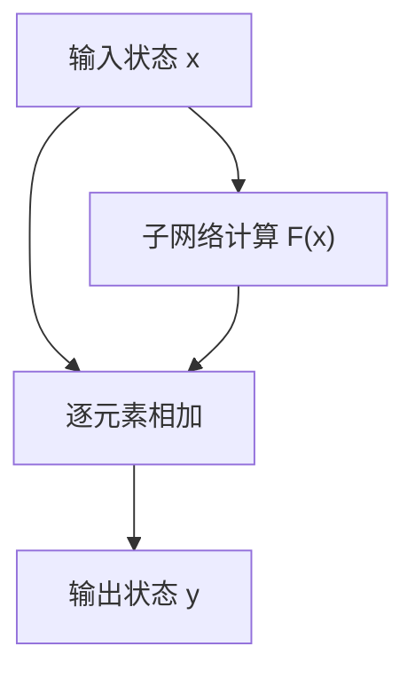

“残差”表达一种建模方式：如果想得到目标映射 $G(x)$，可以让子网络学习 $G(x)-x$，再加回 $x$。训练时不需要为每层手工指定这个差，仍由整体任务的损失共同优化。

这样有一条状态可以直接通过的路径，也有助于深层网络中梯度传播与优化。它不保证旧信息完全不变，不要求更新一定很小，也不能保证任意深的网络都能训练好。[S24](#s24)[S25](#s25)

这里的残差也不同于“模型预测错了多少”的损失值。做相加时形状必须兼容；形状不一致的架构可以为跳连增加投影，普通 Transformer 块通常保持外部隐藏维度一致。

**残差中的“原来”是当前子层接收到的状态。** 到第二层时，这个状态已经包含第一层的处理结果，并不是每次都重新附加一份最初的嵌入。

不同模型的归一化位置可能不同；这里用于解释数据怎样交接，不代表所有 Transformer 的逐项实现完全一致。

一个经典 FFN 可以写成：

$$
\operatorname{FFN}(r)=\phi(rW_1+b_1)W_2+b_2
$$

$\phi$ 是激活函数。Attention 负责跨位置读取与混合；FFN 通常对每个位置分别做非线性变换，并在各位置共享同一组 FFN 参数。现代模型可能使用门控 FFN 或 MoE 等变体。

<a id="sec5-4"></a>
### 5.4 多轮处理为什么可能更有用？

因为后一层能够使用前一层形成的组合特征。

例如文本包含：

> 小明的主管是小王。小王的主管是小李。问题：小明的上上级是谁？

可以用“先组织局部人物关系，再组合关系”理解多轮变换的用途。后面的层读取的 K、V，已经由前一层加工过，可能带有更丰富的上下文信息。

这不表示真实模型一定“第一层只找人物、第二层只找主管、第三层就做推理”，也不表示每增加一层，理解能力就必然提高一档。

需要同时区分两种说法：

- **训练时**：所有层通过端到端优化共同学出参数，知识通常分布在整个网络中。
- **推理时**：输入表示逐层被处理，后一层利用前一层的结果；参数通常不变。

所以，“多层能够支持更复杂的组合计算”比“每层装一点知识，堆够层数就装下全部知识”更准确。

<a id="sec5-5"></a>
### 5.5 层数越多越好吗？

不一定。增加深度可能增加表达能力，也会带来训练、推理和部署成本。

| 考虑因素 | 增加层数可能带来的影响 |
| --- | --- |
| 表达能力 | 能进行更多轮组合与变换，但收益可能递减 |
| 训练稳定性 | 优化更困难，需要合适的归一化、初始化和残差设计 |
| 推理延迟 | 层间存在依赖，单个 Token 需要经过更多处理步骤 |
| 存储与缓存 | 通常会增加权重和逐层 KV Cache 的需求 |
| 固定预算 | 更多层可能意味着需要减少宽度、数据量或其他资源 |

在正常的预训练方案里，层数是在开始训练前选好的。是否增加层数，要结合模型宽度、训练数据、算力预算和目标任务评估。

<a id="sec5-6"></a>
### 5.6 前馈网络 FFN：逐位置加工特征

**FFN，Feed-Forward Network，前馈网络**，是一种沿输入到输出方向进行计算的网络。在 Transformer 中，通常指每层注意力之后的逐位置前馈子网络。

经典写法为：

$$
\operatorname{FFN}(r)=\phi(rW_1+b_1)W_2+b_2
$$

它先通过一次线性变换形成中间特征，再经过激活函数，最后用另一次线性变换组合回输出维度。$W_1,W_2,b_1,b_2$ 是参数，$r$ 和中间输出是当前输入的状态。[S3](#s3)

以一个 8 维输入、32 维中间层、8 维输出的玩具 FFN 为例：

| 阶段 | 单个位置的形状 | 一批状态 `[2,4,8]` 对应的形状 |
| --- | --- | --- |
| 输入 | `[8]` | `[2,4,8]` |
| 第一次线性变换 | `[32]` | `[2,4,32]` |
| 激活函数逐元素变换 | `[32]` | `[2,4,32]` |
| 第二次线性变换 | `[8]` | `[2,4,8]` |

第一步形成的 32 个中间输出，可以用“32 个隐藏神经元”理解。每个都能对输入的 8 个分量做不同的加权组合，而非仅查看一个固定分量。扩大中间维度，是为形成更多特征组合；非线性激活则使组合能力超出连续堆叠线性变换。

两个线性层都有偏置时，参数量为：

$$
8\times32+32+32\times8+8=552
$$

处理不同位置时使用同一组 552 个参数；批次大小或 Token 数增加，会增加本次计算和激活值数量，不会因此给每个位置再建一套 FFN 参数。

Attention 和 FFN 的分工可以这样记：

| 子网络 | 主要处理什么 |
| --- | --- |
| Attention，注意力 | 在不同位置之间匹配、读取和混合信息 |
| FFN，前馈网络 | 对每个位置已有的特征分别进行非线性变换和组合 |

“逐位置”不意味着 FFN 的输入不含上下文：前面的注意力已经把相关信息混入这个位置的表示。它只是说普通 FFN 自身通常不再直接去读取另一位置。

“前馈”描述网络连接与前向计算方向，**不意味着训练时不能反向传播**。训练仍然计算这些参数的梯度；普通推理主要执行前向计算。

现代模型可能使用门控 FFN、不同中间宽度，或将此部分扩展为 MoE 专家。8→32→8 只是本节示例，不是所有 Transformer 必须遵守的比例。

<a id="sec5-7"></a>
### 5.7 前馈、前向计算、反向传播和参数更新是四个层面的词

这几个术语需要按职责理解：

| 术语 | 描述什么 | 具体做什么 | 是否因此修改可学习参数 |
| --- | --- | --- | --- |
| Feed-Forward Network，前馈网络 | 网络结构 | 计算连接沿输入到输出组织，不依赖内部循环反馈 | 结构名称本身不表示一次参数更新 |
| Forward Pass，前向计算或前向传播 | 一次计算过程 | 使用当前参数，从输入算到输出及需要的损失 | 普通前向计算不更新可学习参数 |
| Backpropagation，反向传播 | 梯度计算方法 | 从损失出发，沿计算图按链式法则求参数梯度 | 负责计算梯度，不等于优化器更新 |
| Optimizer Step，优化器更新 | 参数调整过程 | 根据梯度和优化规则修改参数 | 是，本步改变参数数值 |

**前馈网络在训练时完全可以使用反向传播。** 前馈描述结构，前向与反向描述计算任务，优化器决定怎样使用梯度。[S43](#s43)[S44](#s44)

可以借用做练习题的过程：先按当前方法做出答案，检查与目标的差距，再分析哪些计算环节的改变能减小差距，最后修改方法。反向传播做的是对“改变会有什么影响”的计算，不是把最后答案倒着还原成原始输入。

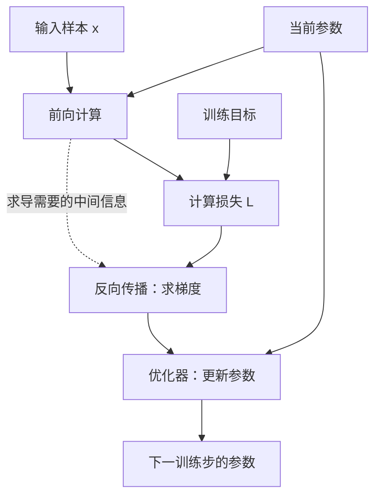

训练中的前向计算通常会记录求导所需的中间信息，也可用重计算等策略减少存储。它与生成阶段复用前缀 K/V 的目的不同，不能把训练计算图简单当成 KV Cache。

在普通推理中，模型主要执行前向计算并复用必要状态；生成新 Token 不等于做一次梯度训练。Prefill 与 Decode 也属于推理计算安排，不是反向传播阶段。

<a id="sec5-8"></a>
### 5.8 手算一次训练：预测、误差、梯度与真正的参数更新

为了看清方向，另用一个只保留两次乘法的教学网络，暂时省略偏置和非线性。这个例子不具备真实 FFN 的全部表达能力，只用于手算链式法则：

$$
a=w_1x,\qquad \hat y=w_2a
$$

输入与目标为 $x=2,y=8$，初始参数为 $w_1=1,w_2=2$。

**第一步：前向计算，得到当前预测。**

$$
a=1\times2=2,\qquad \hat y=2\times2=4
$$

选用便于手算的半平方误差损失：

$$
L=\frac12(\hat y-y)^2=\frac12(4-8)^2=8
$$

到这里参数仍然是 1 和 2，只是产生了当前预测和损失。

**第二步：反向传播，计算改变各个参数会怎样影响损失。**

先做一个直觉实验，两次都从原始参数出发，只改变一个数：

| 微小调整 | 新预测 | 对预测的影响 |
| --- | --- | --- |
| 仅将 $w_1$ 从 1 改为 1.01 | $2\times(1.01\times2)=4.04$ | 增加 0.04 |
| 仅将 $w_2$ 从 2 改为 2.01 | $2.01\times(1\times2)=4.02$ | 增加 0.02 |

同样增加 0.01，第一处参数对当前预测的影响更大。Gradient，梯度，就是用导数表达损失对这些变化的局部敏感度。

从损失回传到预测值：

$$
\frac{\partial L}{\partial\hat y}=\hat y-y=-4
$$

第二次乘法中，$\hat y=w_2a$，所以：

$$
\frac{\partial L}{\partial w_2}
=\frac{\partial L}{\partial\hat y}\frac{\partial\hat y}{\partial w_2}
=(-4)\times a=-8
$$

继续向前一层传递影响：

$$
\frac{\partial L}{\partial a}=(-4)\times w_2=-8
$$

又因为 $a=w_1x$：

$$
\frac{\partial L}{\partial w_1}
=\frac{\partial L}{\partial a}\frac{\partial a}{\partial w_1}
=(-8)\times x=-16
$$

合在一起就是 Chain Rule，链式法则：

$$
\frac{\partial L}{\partial w_1}
=\frac{\partial L}{\partial\hat y}
\frac{\partial\hat y}{\partial a}
\frac{\partial a}{\partial w_1}
=(\hat y-y)w_2x
$$

反向时乘上 $w_2$，是在计算上游变化如何影响最终损失，**不是用输出除以 $w_2$ 来还原输入**。它回传的是敏感度，而不是将文本倒着读或逆向执行原运算。

负梯度表示，在当前点附近适当增大这个参数能降低损失；幅度反映局部变化率，不是固定的“错误责任百分比”。步子太大时，仍可能越过合适范围并使损失上升。

**第三步：优化器使用梯度，真正修改参数。**

采用简单梯度下降，学习率 $\eta=0.025$：

$$
w_1'=1-0.025\times(-16)=1.4
$$

$$
w_2'=2-0.025\times(-8)=2.2
$$

两个梯度都基于更新前的参数计算，再统一更新。实际优化器可以使用动量和自适应缩放等规则，不必都按本例直接取一步负梯度。[S44](#s44)

**第四步：用新参数再次前向计算，检查结果。**

$$
a'=1.4\times2=2.8,\qquad \hat y'=2.2\times2.8=6.16
$$

$$
L'=\frac12(6.16-8)^2=1.6928
$$

预测从 4 变成 6.16，损失从 8 降为 1.6928。前向计算负责算当前结果，反向传播负责求梯度，优化器负责改数值。

以下是同一算例的纯 Python 数值复现；这里只计算一条样本的一步，不表示已经训练出可泛化的预测模型：

```python
x, target = 2.0, 8.0
w1, w2 = 1.0, 2.0
learning_rate = 0.025

hidden = w1 * x
prediction = w2 * hidden
error = prediction - target
loss = 0.5 * error ** 2

grad_w2 = error * hidden
grad_w1 = error * w2 * x
w1 = w1 - learning_rate * grad_w1
w2 = w2 - learning_rate * grad_w2

new_prediction = w2 * (w1 * x)
new_loss = 0.5 * (new_prediction - target) ** 2
print(round(loss, 4), round(new_prediction, 4), round(new_loss, 4))
# 8.0 6.16 1.6928
```

真实自回归语言模型通常对词表中的正确下一 Token 计算交叉熵等损失，再把梯度传回相应的输出头、Transformer 和嵌入参数。例子中的平方误差换成其他损失，并不改变“先计算结果，再求梯度，再更新参数”的职责分工。[S43](#s43)[S44](#s44)

<a id="sec5-9"></a>
### 5.9 偏置怎样学习？激活函数怎样参与反向传播？

前面的乘法例子为了手算省略了偏置和激活。把它们放回一个经典单元：

$$
z=\sum_iw_ix_i+b,\qquad a=\phi(z)
$$

损失对这个单元的影响也通过链式法则传递：

$$
\frac{\partial L}{\partial b}
=\frac{\partial L}{\partial a}\phi'(z),\qquad
\frac{\partial L}{\partial w_i}
=\frac{\partial L}{\partial a}\phi'(z)x_i
$$

偏置有梯度，优化器可以像更新权重一样更新它。激活函数的导数决定这一分支的局部影响怎样继续传递；这不要求函数规则本身一定带可学习参数。[S43](#s43)[S44](#s44)

例如，ReLU 在 $z<0$ 时局部导数为 0，在 $z>0$ 时为 1；零点不可微，需要实现约定。某次这一分支梯度为零，不表示整个模型全部参数都停止更新，也不表示神经元被永久删除。

普通推理不会因为激活值变化就自动更新偏置；训练中要经过求梯度与优化器更新，参数数值才发生调整。

<a id="ch6"></a>
## 6. 从最终状态到下一个 Token

<a id="sec6-1"></a>
### 6.1 最终隐藏状态 h 是什么？

当“是”这个已知位置经过全部 Transformer 层，得到最终隐藏状态。若模型还有末尾归一化，也要包含这一步。

下文把这个准备送入输出头的向量简写为 $h_t$，其中 $t=4$。

它可以理解为：**模型基于截至当前位置的内容，为预测下一个 Token 形成的内部表示。** 它仍然是一串数值，并不是已经选中的下一词向量。

<a id="sec6-2"></a>
### 6.2 输出头怎样给词表里的每个 Token 打分？

设词表有 $N$ 个 Token，最终状态为 $d$ 维。一个常见的 LM Head（Language Modeling Head，语言模型输出头）具有权重：

$$
U\in\mathbb R^{N\times d}
$$

第 $j$ 行 $u_j$ 对应候选 Token $j$ 的打分权重：

$$
z_j=h_tu_j^\top+b_j
$$

向量形式：

$$
z=h_tU^\top+b
$$

有的模型没有输出偏置。这里的 $z_j$ 叫 **Logit，未归一化预测分数**。

可以把点积理解为“当前状态对这个候选 Token 的支持分数”。但它不必是归一化的余弦相似度，也不等于在输入嵌入表里寻找最近邻。

**Attention 检索的是上下文位置；LM Head 打分的是词表候选项。** 两个步骤用途不同。

<a id="sec6-3"></a>
### 6.3 从分数到 Token ID

对全部候选分数做 Softmax：

$$
p_j=\frac{\exp(z_j)}{\sum_{r=1}^{N}\exp(z_r)}
$$

得到条件分布：

$$
p_\theta(x_{t+1}=j\mid x_1,\ldots,x_t)
$$

之后由 Decoding Strategy（解码策略）决定选谁，例如：

- **Greedy Decoding，贪心解码**：选分数最高的 ID，$j^*=\arg\max_jz_j$。
- **Sampling，采样**：按经过温度、Top-k、Top-p 等规则处理后的分布抽取一个 ID。

因此，并不是每次生成都必然选概率最高的 Token。贪心时，实际也可以直接对 Logits 取最大值，不必显式算出所有概率。

<a id="sec6-4"></a>
### 6.4 对最初理解的关键修正

下面这句话前半段接近正确，最后一步需要改：

> “得到最终 h，和输出表里 N 个向量计算分数，选出向量 M，再把 M 转回词。”

更准确的过程是：

1. 最终状态 $h_t$ 通过输出头，得到 N 个候选 Token 的分数。
2. 解码策略选出一个 **Token ID $j^*$**。
3. Tokenizer 根据 ID 和相应规则，恢复可显示的文本片段。
4. 要继续生成时，使用这个 ID 查输入嵌入表，再处理这个新位置。

**选中的结果首先是 ID，不需要把一个任意向量“反向翻译”成词。** 输出权重行只是给这个 ID 打分时使用的参数。

<a id="sec6-5"></a>
### 6.5 e 下标 j* 到底是什么？

选出的 Token ID 假设是“巴黎”对应的编号 $j^*$。下一轮需要给这个新 Token 准备输入，于是查输入嵌入表：

$$
e_{j^*}=E[j^*,:]
$$

这就是 $e_{j^*}$：**编号为 $j^*$ 的 Token 的输入嵌入向量**。

| 写法 | 用一句话解释 |
| --- | --- |
| $j^*$ | 这轮选中了词表中的哪个编号 |
| $u_{j^*}$ | 输出头为这个候选编号打分时使用的权重行 |
| $e_{j^*}$ | 下一轮把这个编号当输入时，查出的初始嵌入 |
| $h_t$ | 上一个已知位置的最终状态，用于预测这个编号 |
| $h_{t+1}$ | 新 Token 被真正送入模型后，在新位置算出的最终状态 |

有的模型把输入嵌入表 $E$ 和输出权重 $U$ 共享，这叫 **Weight Tying，权重绑定**；有的模型不共享。即使共享，输入查表和输出打分仍是两个不同用途，$h_t$ 也不会因此等于某一行嵌入。

<a id="sec6-6"></a>
### 6.6 为什么末尾位置适合预测下一个 Token？

自回归语言模型训练时，通常学习：用前缀预测其后的 Token。

$$
\mathcal L=-\sum_t\log p_\theta(x_{t+1}\mid x_1,\ldots,x_t)
$$

第 $t$ 个位置的输出与第 $t+1$ 个 Token 的目标对应。于是，对已知 Prompt 的末尾位置做预测，正好得到第一个未知位置的分布。

训练时，一条完整样本的许多位置都可以同时计算预测损失；生成时，只需要使用当前末尾位置的预测来决定接下来追加什么。

<a id="ch7"></a>
## 7. Prefill 的完整过程

<a id="sec7-1"></a>
### 7.1 从用户输入到模型输入

在聊天场景中，送入模型的内容通常比用户刚输入的文字更多：

- 系统或应用层指令；
- 先前对话内容；
- 本轮用户内容；
- 模型所需的角色分隔标记、特殊 Token 或助手生成前缀。

它们通常按 Chat Template（聊天模板）整理为序列，再分词为 Token ID。[S13](#s13)

不同模型的格式不同。全文的“法国 / 的 / 首都 / 是”省略了这些模板细节；真实聊天中，触发第一个回答 Token 预测的末尾位置，也可能是某个助手前缀或特殊标记，而非用户句子的最后一个字。

<a id="sec7-2"></a>
### 7.2 Prefill 不是训练 QKV 表

**Prefill，预填充阶段**，是让已有 Prompt 完整地经过模型，计算它的上下文表示，同时建立后续生成可复用的逐层 KV Cache。

开始时，模型权重已经加载好。Prefill 不负责把 $W_Q,W_K,W_V$ 训练出来。

更准确的说法是：

> 用训练好的参数，计算当前 Prompt 在每一层的状态、QKV 和注意力；保存其中之后还要用的 K、V，并从末尾状态预测第一个新 Token。

<a id="sec7-3"></a>
### 7.3 四个位置怎样经过每一层？

以四个 Token、隐藏维度 $d$、总共 $L$ 层为例：

| 步骤 | 计算内容 | 主要输出 |
| --- | --- | --- |
| 1 | 四个 Token ID 分别查嵌入表，配合位置机制准备输入 | $H^{(0)}$，形状 $4\times d$ |
| 2 | 第一层用全部四个输入位置计算自己的 QKV、注意力、FFN 等 | $H^{(1)}$；缓存第 1 层 K、V |
| 3 | 第二层接收全部四行 $H^{(1)}$，用第二层自己的参数继续计算 | $H^{(2)}$；缓存第 2 层 K、V |
| … | 每层重复同类结构，但参数和输入状态各不相同 | 每层都有自己的状态和缓存 |
| L | 最后一层完成四个位置的处理 | $H^{(L)}$，仍是 $4\times d$ |
| 输出 | 取最后一行，经过必要的末尾归一化和 LM Head | 第一个新 Token 的分布 |

**四个位置一直一起向后传递；不是每层只保留末尾一个位置。**

<a id="sec7-4"></a>
### 7.4 并行计算和“不能看未来”为什么不矛盾？

Prompt 已经全部给定，所以同一层可以批量计算四个位置的 QKV，再通过 Mask 限制各位置的读取范围。

| 发起读取的位置 | 可读“法国” | 可读“的” | 可读“首都” | 可读“是” |
| --- | --- | --- | --- | --- |
| 法国，位置 1 | 是 | 否 | 否 | 否 |
| 的，位置 2 | 是 | 是 | 否 | 否 |
| 首都，位置 3 | 是 | 是 | 是 | 否 |
| 是，位置 4 | 是 | 是 | 是 | 是 |

**因果约束限制的是信息能从哪里流入，不要求把这一层的四个位置按顺序一个个执行。**

关键在于：同一层各位置的 K、V 来自这一层的输入状态，而不是“等这个位置在本层先算完，再供下一个位置读取”。本层的输入已经齐备，因此可以用矩阵运算一起处理。

但是，第 2 层需要第 1 层输出，第 3 层需要第 2 层输出，层间依赖仍然存在。

| 计算范围 | 能否并行 | 原因 |
| --- | --- | --- |
| 同一层中的已知 Prompt 位置 | 通常可以批量并行 | 本层输入都已给定，Mask 保证因果性 |
| 同一层的多个头 | 通常可以并行 | 分别投影与读取，再合并 |
| 同一个位置连续经过不同层 | 存在顺序依赖 | 后层需要前层处理结果 |
| 尚未选出的多个回答 Token | 普通自回归生成中不能直接全部并行确定 | 后续输入依赖前面选出的 ID |

实际服务可能使用分块 Prefill、流水线或缓存前缀复用等技术；这些会改变执行安排，但不改变上述数据依赖。

<a id="sec7-5"></a>
### 7.5 最后一个位置需要再走一次网络吗？

不需要。

最后一层已经算出了四行状态；最后一行就是“是”这个位置的最终结果。直接取这一行做输出打分即可。

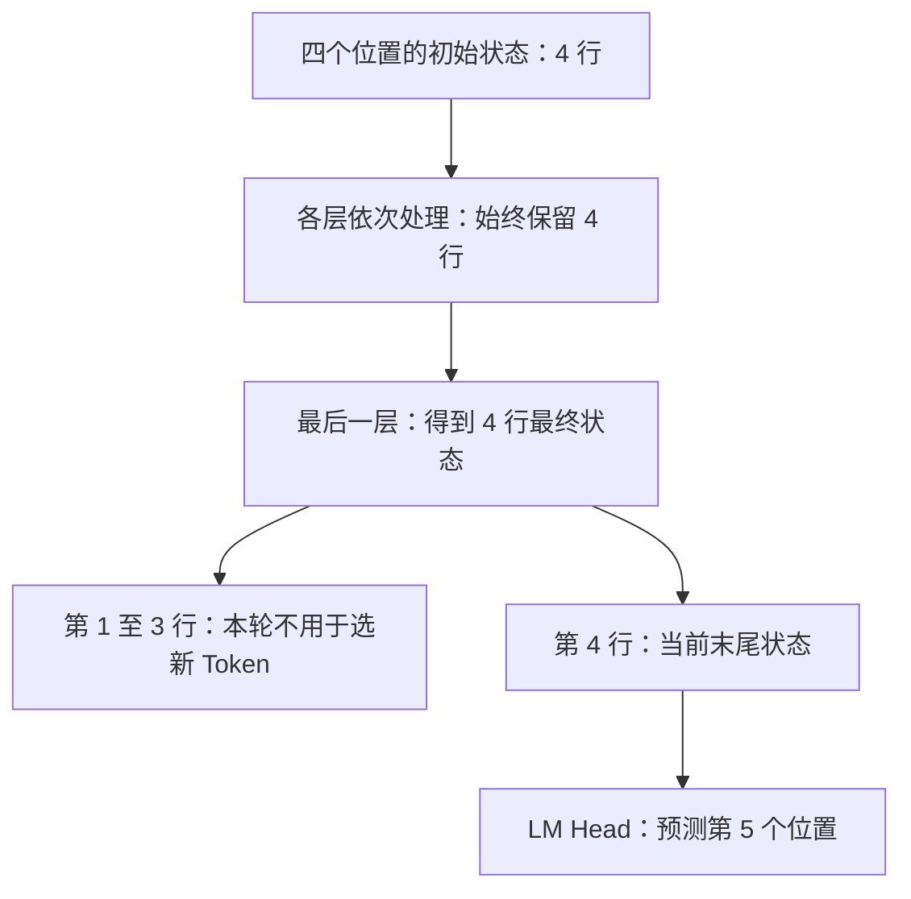

前面三个位置并非没有作用：它们的中间状态会影响后续层的 K、V，供末尾等位置读取。只是到最后决定“接下来追加什么”时，只需要末尾位置的词表分数。

若去计算前面各位置的输出分数，它们预测的是对应位置后面的 Token。例如“法国”的输出预测“的”，这些 Token 已经在 Prompt 里，生成回答时不需要再选一遍。

<a id="sec7-6"></a>
### 7.6 第一个回答 Token，从哪里来？

仍用教学例子：

1. Prefill 处理“法国 / 的 / 首都 / 是”。
2. 第 4 个位置经过所有层，得到最终状态 $h_4$。
3. 输出头计算 $p(x_5\mid x_1,x_2,x_3,x_4)$。
4. 解码策略选出第 5 个 Token，假设为“巴黎”。

**不需要先给模型一个未知位置的初始 Q，也不需要预先猜出“巴黎”再把它送入网络，才能预测它。**

<a id="ch8"></a>
## 8. Decode 与 KV Cache

<a id="sec8-1"></a>
### 8.1 Prefill 后，怎样继续预测？

**Decode，逐步解码阶段**，在普通自回归生成中，每步处理一个新追加的位置，利用缓存预测再下一个位置。

假设“巴黎”和“。”都各自是一个 Token：

| 这一步 | 本次送入网络的新内容 | 本次可复用的缓存 | 本次选出的下一 Token |
| --- | --- | --- | --- |
| Prefill | 法国 / 的 / 首都 / 是 | 初始没有此前缀的缓存 | 巴黎 |
| Decode 第 1 步 | 巴黎 | 四个 Prompt 位置的逐层 K、V | 。 |
| Decode 第 2 步 | 。 | Prompt 加“巴黎”的逐层 K、V | 结束标记，假设如此 |

表中的一个细节很重要：**刚选出的“巴黎”，要到下一步真正送入网络后，才会计算并缓存它的各层 K、V。**

<a id="sec8-2"></a>
### 8.2 一次 Decode 内部做什么？

以输入新 Token“巴黎”为例：

1. 根据它的 ID 查输入嵌入，并设置新位置所需的位置相关信息。
2. 到第一层，计算这个新位置的 $q,k,v$。
3. 用新 $q$ 读取“第一层已缓存的前缀 K、V，加上当前新位置的 K、V”。
4. 完成本层其他计算，把新位置的隐藏状态交给第二层；同时把第一层新 K、V 加入缓存。
5. 第二层使用第二层自己的前缀缓存继续处理；依次走完所有层。
6. 用新位置的最终状态预测下一 Token。

每层有独立的缓存。不能拿第一层缓存的 K、V，直接当成第二层的 K、V。

对某一层而言，可以简写为：

$$
K_{\text{all}}=\operatorname{Concat}(K_{\text{past}},k_t)
$$

$$
V_{\text{all}}=\operatorname{Concat}(V_{\text{past}},v_t)
$$

$$
a_t=\operatorname{Attention}(q_t,K_{\text{all}},V_{\text{all}})
$$

这就是“只算新位置，再读取旧缓存”的核心。[S12](#s12)

<a id="sec8-3"></a>
### 8.3 为什么旧 K、V 可以复用？

对于固定参数、相同位置设置的标准因果自注意力，旧位置只能读取自己及此前的位置。未来追加的 Token 不会反过来改变旧位置的计算结果。

因此，旧位置之前已经计算出的逐层 K、V，可以在追加新 Token 时继续使用。

不过，它们并不是“某个词天生固定的 K、V”。它们依赖**这次输入的前缀、该位置、该层以及模型参数**。换一段上下文，就不能仅按词相同直接复用。

KV Cache 是本次上下文的计算缓存，不等于模型的长期知识，也不意味着模型在与用户聊天时更新了权重。

<a id="sec8-4"></a>
### 8.4 为什么通常缓存 KV，不缓存过去的 Q？

因为下一步需要用的是**新位置的 Q**。旧位置的 Q 已经完成了它当时的读取任务，后续读取主要需要旧位置提供的 K 和 V。

| 对象 | 后续生成是否通常还要用 | 原因 |
| --- | --- | --- |
| 旧 Q | 通常不需要 | 不再重新计算旧位置的读取 |
| 旧 K | 需要 | 新 Q 要与它匹配 |
| 旧 V | 需要 | 新位置要从中读回信息 |

这描述的是标准生成所需的主要缓存；具体框架可能还有其他辅助状态。


**继续用“是 → 巴黎”的时间线检查：**

| 本次要计算哪个位置的状态 | 当前查询 | 供它匹配和读取的 K/V | 会用到历史位置的 Q 吗？ |
| --- | --- | --- | --- |
| Prefill 里的“是” | “是”的 Q | 法国、的、首都、是的 K/V | 不用其他位置的 Q 来计算“是”的读取 |
| 下一步输入“巴黎” | “巴黎”的 Q | 法国、的、首都、是、巴黎的 K/V | 不需要“是”或更早位置的旧 Q |

这些计算分别在每层、每个相应的头里进行。

**旧 Q 也不会因为后面追加了文本就自动改变。** 不缓存它，不是因为它“已经不准确”，而是标准生成不再需要重算旧位置的读取。旧 Q 的作用已参与当时的状态更新；后来位置通过各层的 K/V 读取其所需信息。[S12](#s12)


<a id="sec8-5"></a>
### 8.5 把整个流程连起来

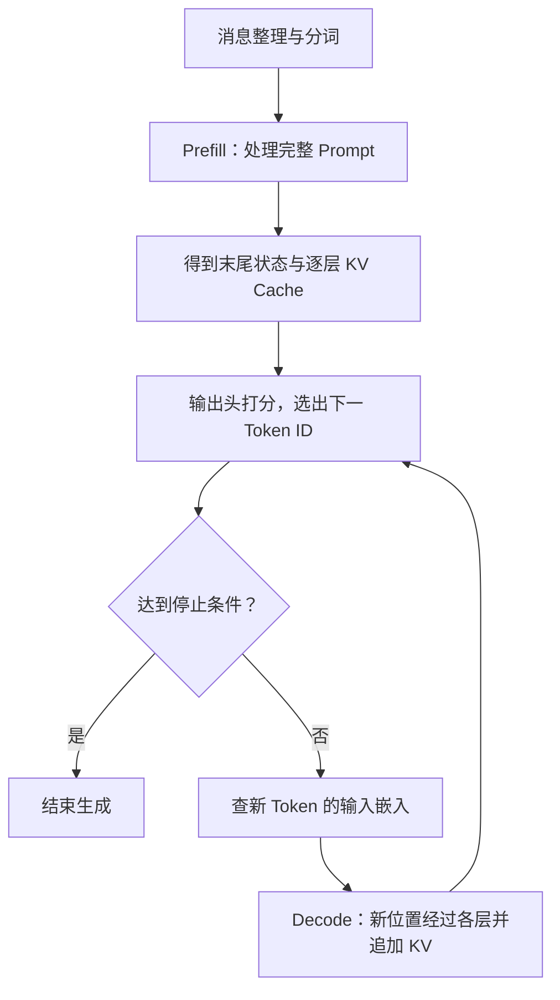

Token ID 在生成过程中可以增量解码为文字，供界面流式显示；特殊标记和不完整字节片段的显示方式由分词器及服务处理。到结束标记、长度上限或其他停止条件时，生成终止。

普通自回归生成具有：

$$
p(x_{1:T})=\prod_{t=1}^{T}p(x_t\mid x_{<t})
$$

“每次预测下一个 Token”与“能形成复杂回答”并不矛盾：复杂的上下文计算发生在每一步的网络内部，而整段回答由这些条件预测逐步构成。

本文解释的是标准 GPT 类 Decoder-only 自回归 Transformer 的机制，不据此断言某个闭源 ChatGPT 版本的全部内部结构与服务实现。


<a id="architecture-code"></a>
## 9. 模型结构代码：怎样用程序表达一个神经网络？

<a id="sec-code-1"></a>
### 9.1 数学结构、实现代码与参数文件的关系

| 层面 | 负责规定什么 | 训练前后主要怎样变化 |
| --- | --- | --- |
| 数学结构 | 用哪些变换，怎样连接，允许读取哪些位置 | 普通训练中大体固定 |
| 实现代码 | 用张量操作、模块调用、循环和条件执行结构 | 核心前向逻辑往往相同 |
| 参数形状与数量 | 每块权重有多少行列，哪些权重共享 | 普通训练中固定 |
| 参数数值 | 矩阵和向量里每个数具体是多少 | 被训练持续调整 |
| 推理服务代码 | 批处理、缓存、调度、流式输出等 | 可以独立优化或替换实现 |

**网络代码确实主要是在实现数学运算和数据流，但不只是把论文公式原样抄成字符串。** 它还要组织轴、位置、掩码、缓存、数值类型和设备。模型经过训练后能回答问题，主要来自结构与训练好参数的共同作用，不需要程序里写一张“法国 → 巴黎”的条件判断表。

<a id="sec-code-2"></a>
### 9.2 构造函数分配参数，forward 规定怎样计算

PyTorch 中，模块通常通过构造函数建立部件，通过 `forward()` 描述一次前向计算。

下面一行可以创建一个包含 1677 万参数的无偏置线性层：

```python
import torch.nn as nn

projection = nn.Linear(4096, 4096, bias=False)
print(sum(p.numel() for p in projection.parameters()))
# 16,777,216
```

参数很多，不代表有同样多行代码。创建权重数组之后，张量库负责批量计算。多层也可以由循环构造；通常是每次创建一个新的层对象，从而拥有不同参数，而不是让所有层意外引用同一块权重。[S15](#s15)

`from_pretrained()` 概念上是“识别配置与实现 → 建立相应网络 → 装入已训练参数”；框架实际可以借助空权重、分片等机制降低加载开销。它不会在每次加载时重新预训练。

<a id="sec-code-3"></a>
### 9.3 一层 Transformer 的核心，可以写得很短

下面是**教学伪代码**，只突出主要计算和状态形状；省略头的拆分、具体位置编码和归一化实现等细节，不是独立可运行脚本：

```python
def block(hidden, position_info, mask, cache):
    current = normalize_for_attention(hidden)
    query, key, value = project_qkv(current)

    message = multihead_attention(
        query, key, value,
        position_info=position_info,
        causal_mask=mask,
        layer_cache=cache,
    )
    updated = hidden + output_projection(message)
    return updated + feed_forward(normalize_for_ffn(updated))
```

所有层的组织也可以简化为：

```python
def network(token_ids):
    hidden = embedding_lookup(token_ids)
    for layer in layers:
        hidden = layer(hidden)
    hidden = final_normalize(hidden)
    return vocabulary_projection(hidden)
```

`layers` 是已经构建好的层对象列表，各层通常有不同参数；上面省略了位置和缓存参数的传递。生成时可以只需要末尾位置的词表分数，实际实现也可能省去无须使用的输出投影。

Transformer 的核心代码并非按参数量线性展开；同一种运算可作用在巨大的数组上。真实 Qwen3 实现见 [S32](#s32)。

<a id="sec-code-4"></a>
### 9.4 数学公式与磁盘中的矩阵方向，为什么有时相反？

本文多数公式把向量当行向量，写成：

$
Q=HW_Q
$

PyTorch 的 `Linear` 通常按 `[输出维度, 输入维度]` 保存权重，实际计算相当于：

$
Q=HA_Q^\top
$

因此 $A_Q=W_Q^\top$，两种写法表达同一变换，不是模型多做了一次不明操作。

以 Qwen3-0.6B-Base 为例：

| 第 0 层权重名称 | 保存形状，输出 × 输入 | 作用 |
| --- | --- | --- |
| `self_attn.q_proj.weight` | `[2048, 1024]` | 把状态投影到 16 个 Q 头，每头 128 维 |
| `self_attn.k_proj.weight` | `[1024, 1024]` | 投影到 8 组 K，每组 128 维 |
| `self_attn.v_proj.weight` | `[1024, 1024]` | 投影到 8 组 V，每组 128 维 |
| `self_attn.o_proj.weight` | `[1024, 2048]` | 将多头合并结果映射回状态宽度 |
| `mlp.gate_proj.weight` | `[3072, 1024]` | 门控前馈中的一个投影 |
| `mlp.up_proj.weight` | `[3072, 1024]` | 前馈扩展投影 |
| `mlp.down_proj.weight` | `[1024, 3072]` | 映射回 1024 维 |

完整名称还带有 `model.layers.0.` 等前缀。形状由配置和代码推导；`q_proj.weight` 是权重，当前文本的 Q 是加载参数后现场算出的结果。[S30](#s30)[S32](#s32)

这类门控 FFN 可以概念化为：

$
\operatorname{FFN}(r)=
\left(\operatorname{SiLU}(rW_g)\odot(rW_u)\right)W_d
$

$\odot$ 是逐元素相乘；三个矩阵都需要计入参数规模。这与经典“两块矩阵加一个激活函数”的 FFN 不完全相同。

<a id="sec-code-5"></a>
### 9.5 模型代码到底复杂在哪里？

| 工作 | 核心原理的复杂度 | 工程复杂性主要来自哪里 |
| --- | --- | --- |
| 一个线性层 | 输入乘矩阵，加可选偏置 | 高效矩阵乘法、设备与类型支持 |
| 一个 Transformer 块 | 注意力、前馈、残差等组合 | 位置、掩码、缓存、各种算子后端 |
| 模型结构定义 | 按配置建立许多层 | 不同模型变体与兼容性 |
| 大规模训练 | 前向、损失、反向、参数更新 | 多卡通信、内存、稳定性、故障恢复 |
| 推理服务 | 用模型持续生成 | 并发、批处理、缓存管理、吞吐与延迟 |

反向传播通常由自动求导框架根据前向图计算，不要求人手工给每一块巨大矩阵写完整导数。优化器再利用梯度更新参数。**读懂核心代码，与实现一套高效生产训练系统，是不同深度的工作。**


<a id="architecture-design"></a>
## 10. 架构设计：怎样选择层数、头数和维度？

<a id="sec-design-1"></a>
### 10.1 先认识哪些量可以设计

| 设计项 | 常用记号 | 控制什么 |
| --- | --- | --- |
| 层数 Depth | $L$ | 要接续进行多少轮状态加工 |
| 状态宽度 Hidden Size | $d$ | 层间每个位置用多少个数表示 |
| 查询头数 | $A_Q$ | 有多少组查询与注意力读取 |
| K/V 头数 | $A_{KV}$ | K/V 的分组与共享程度 |
| 每头维度 | $d_h$ | 一个头里的 Q/K 等向量有多宽 |
| 前馈中间维度 | $m$ | 每层非线性变换的中间宽度 |
| 专家数及每次选择数 | $E,k$ | 专家容量与每 Token 路径规模 |
| 词表大小 | $V_{\mathrm{model}}$ | 嵌入和输出矩阵需要多少行 |

这些设置相互牵制，不能把每一项都独立最大化，再期待整体最优。

<a id="sec-design-2"></a>
### 10.2 为什么没有“必须 28 层”的通用公式？

通常先考虑用途、数据、训练预算，以及部署的内存、吞吐和延迟目标，再提出候选结构，做小规模或较短周期实验，并结合缩放规律决定正式配置。[S16](#s16)

| 调整 | 可能得到的好处 | 需要支付的代价 |
| --- | --- | --- |
| 加深网络 | 更多接续的组合计算 | 层间依赖更长、训练与缓存开销增加 |
| 加宽状态 | 更宽的表示及更大的变换能力 | 很多矩阵大小近似按宽度平方增长 |
| 加宽 FFN | 增加逐位置非线性加工空间 | 参数和计算增加 |
| 增加专家池 | 扩大总参数容量 | 权重存储、通信与路由成本 |
| 增大每次专家选择数 | 每 Token 使用更多专家计算 | 实际计算更大，需评估并适配训练 |

在其他维度不变时，层数翻倍，主体层参数通常近似翻倍；把许多输入输出宽度都翻倍，相关矩阵参数可能接近四倍。实际结果还受词表、头内宽度、共享关系等影响。

**公开配置告诉我们作者选了什么，不一定公开了足以重现整个架构搜索的实验过程。** 本文不声称 Qwen 的 28 层是某个数学定理给出的唯一最优。

<a id="sec-design-3"></a>
### 10.3 头数增加，参数一定增加吗？

不一定。在固定总注意力宽度的标准多头注意力中：

- 1024 维可以拆成 8 个头，每头 128 维；
- 也可以拆成 16 个头，每头 64 维。

两种设计的总体投影大小可以相同。更多头不等于把一整套全宽注意力简单复制更多遍。

另一方面，$d=A_Qd_h$ 是常见设计约定，不是所有模型的硬性约束。本文 Qwen 小模型中 $d=1024$，而 $A_Qd_h=16\times128=2048$；查询先投影到 2048 维，最后由输出投影回到 1024 维。[S30](#s30)[S32](#s32)

GQA（Grouped-Query Attention，分组查询注意力）允许多组 Q 共享较少的 K/V 头，用于在能力与推理成本之间取舍。Q 头数与 K/V 头数必须分开看，KV Cache 的头数通常对应后者。[S39](#s39)

<a id="sec-design-4"></a>
### 10.4 先选参数量，还是先选层数？

这是迭代设计，而不是单向的固定顺序：

1. 根据目标和预算，先估一个可承受的参数与计算范围。
2. 用层数、宽度、FFN、专家等组合，构造候选模型。
3. 由矩阵形状精确统计候选参数量、预计权重和缓存需求。
4. 实测效果与效率，调整方案。

最终结构确定后，标准训练主要学习参数数值；它不会因为训练样本变多就自动增加网络层。

例如，如果任务是低延迟检索编码，可能更重视小模型的吞吐；如果是复杂通用生成，则需要综合任务效果、训练数据与推理预算。这里是设计思路，不是某家模型选型的未经公开证实的具体动机。


<a id="precision-quantization"></a>
## 11. 参数文件、浮点精度、混合精度与量化

<a id="sec-precision-1"></a>
### 11.1 训练前能算出权重文件大概多大吗？

通常可以。网络结构与权重共享关系确定后，即可统计参数数量；选择保存格式后，就能估算原始权重数据量。训练主要改变各个数的值。

对同一种位宽保存的权重：

$
\text{原始权重字节数}\approx
P_{\mathrm{saved}}\times\frac b8
$

$P_{\mathrm{saved}}$ 是实际保存的标量数量，$b$ 是每个数占用的位数。混合格式则对各组张量分别相加；量化缩放、元数据和重复保存条目等还会增加文件内容。

按 Qwen3-0.6B-Base 的配置与公开实现，可计算出：

| 组成 | 独立参数数量 |
| --- | ---: |
| 输入嵌入，与输出打分权重绑定 | 155,582,464 |
| 28 层的注意力、门控 FFN 与层内归一化 | 440,466,432 |
| 最后归一化 | 1,024 |
| 合计 | **596,049,920** |

例如每层的注意力投影合计为 $2\times1024\times(16+8)\times128$；三个 FFN 矩阵合计为 $3\times1024\times3072$。归一化等参数也要计数。输入与输出绑定的表只算一次。[S30](#s30)[S32](#s32)

| 如果这套权重都采用相应格式 | 原始数据量，十进制 GB |
| --- | ---: |
| FP32，每个数 4 字节 | 约 2.38 GB |
| FP16 或 BF16，每个数 2 字节 | 约 1.19 GB |
| FP8，每个数 1 字节 | 约 0.60 GB，尚未加缩放等额外数据 |

Base 仓库标出的权重文件约 1.19 GB，与 BF16 原始数据估算吻合。**这个结果是依据结构计算并与文件大小对照，不是声称在本环境完成了权重下载和模型推理。**

权重文件大小不等于运行显存。推理还需要 KV Cache、中间状态、算子工作区等；训练还可能需要梯度、优化器状态、主权重副本等。检查点保存什么也会影响磁盘大小。[S41](#s41)

<a id="sec-precision-2"></a>
### 11.2 FP32、FP16、BF16、FP8 到底是什么意思？

FP 是 **Floating Point，浮点数**。数字表示保存一个数使用的二进制位数。BF16 是 **Brain Floating Point 16，16 位脑浮点格式**。

可把正规浮点数先理解为：

$
\text{数值}\approx(-1)^{\text{符号}}\times
\text{有效数字}\times2^{\text{指数}}
$

指数部分影响可覆盖的数值范围，小数字段影响相近数值能区分得多细。

| 格式 | 总位数 | 符号位 | 指数位 | 小数字段位数 |
| --- | ---: | ---: | ---: | ---: |
| FP32 | 32 | 1 | 8 | 23 |
| FP16 | 16 | 1 | 5 | 10 |
| BF16 | 16 | 1 | 8 | 7 |
| FP8 E4M3 | 8 | 1 | 4 | 3 |
| FP8 E5M2 | 8 | 1 | 5 | 2 |

表中小数字段不包含正规数隐含的前导有效位；特殊值、非正规数等另有编码规则。FP8 不是唯一的一种格式，E4M3 和 E5M2 的范围、精细程度不同。[S35](#s35)[S36](#s36)

**这些格式既可用于参数，也可用于激活、梯度、中间运算或缓存。** “某模型发布为 BF16”不意味着所有计算过程都只使用 BF16。

<a id="sec-precision-3"></a>
### 11.3 FP32 为什么比 FP16 精确？是保留更多小数位吗？

FP32 在相近数值间有更多可表示的格点，因此通常舍入误差更小。例如输入实数的十进制写法 `1.0001`，转换结果为：

| 格式 | 实际表示的近似值 |
| --- | --- |
| FP32 | `1.000100016593933` |
| FP16 | `1.0` |

这个数值示例可用 Python 标准库复现：

```python
import struct

original = 1.0001
for code, label in [("<f", "FP32"), ("<e", "FP16")]:
    rounded = struct.unpack(code, struct.pack(code, original))[0]
    print(label, repr(rounded))
```

浮点格式不是“永远保留小数点后固定几位”；数值越大或越小，可表示数之间的绝对间隔也随数量级变化。FP32 也不是无限精确，只是这里比 FP16 更接近原值。

BF16 和 FP16 都是 16 位，但分配不同：BF16 的指数范围接近 FP32，而小数字段更短。它能覆盖更宽的范围，细节精度却低于 FP16。数值精细程度与范围不能混为一谈。[S35](#s35)

<a id="sec-precision-4"></a>
### 11.4 数值精度越高，模型效果一定越好吗？

**不一定。更精确地表示数值，不等于模型多学到了知识或推理规则。**

降低精度可能产生舍入、溢出、下溢以及误差累积。当两个词元分数接近时，误差可能改变排序；对稳定的计算路径，小扰动也可能几乎不改变任务效果。应在目标任务、数据分布和部署方案中测量，而不是只看位数。

同一个参数从 FP32 舍入成 FP16 后，再改用 FP32 保存，丢失的信息不会自动恢复。上例 `1.0001 → 1.0` 后，再用更宽的容器保存，仍然只是 `1.0`。

原生低精度训练、适配过的量化方案与简单粗暴地缩窄数值，不应一概而论。任务效果也由结构、数据与训练方法共同决定。

<a id="sec-precision-5"></a>
### 11.5 精度在训练前决定吗？为什么会混合精度？

训练方案通常提前规划主要数值格式，但**保存格式、乘法输入格式、累加格式、优化器状态格式可以不同**。训练结束还可以选择新的导出格式。

| 对象或步骤 | 某种混合精度方案可能怎样处理 |
| --- | --- |
| 主要矩阵乘法 | 用 BF16、FP16 或支持的 FP8 格式执行 |
| 乘积的累加 | 使用比输入更高的精度 |
| 归一化、损失等敏感步骤 | 保留较高精度，具体按实现 |
| 主权重或部分优化器状态 | 保留高精度以积累微小更新 |
| 发布用参数文件 | 导出为 BF16、FP16 或量化格式 |

这种方法叫 **Mixed Precision，混合精度**。不是每套实现都使用完全相同的组合。DeepSeek-V3 的技术报告就说明主要矩阵运算使用 FP8，而一些敏感模块与状态保留较高精度。[S35](#s35)[S14](#s14)

因此，`config.json` 中的 `torch_dtype` 或相应类型字段，不足以反推出完整训练过程里每一步的格式。

<a id="sec-precision-6"></a>
### 11.6 训练好以后降到 FP16、FP8：加载时做，还是提前做？

两种方式都存在：

| 方式 | 步骤 | 得到什么 |
| --- | --- | --- |
| 加载时转换 | 读取原权重，按指定类型或量化方案处理 | 内存中的低精度模型，原始文件仍可保留 |
| 提前处理后保存 | 转换、必要时校准，再导出新权重及配置 | 可重复直接加载的低精度模型包 |

FP32 到 FP16 常通过类型转换完成，例如使用已支持 `dtype` 参数的 Transformers：

```python
import torch
from transformers import AutoModelForCausalLM

half_model = AutoModelForCausalLM.from_pretrained(
    "./qwen-base",
    dtype=torch.float16,
    local_files_only=True,
)
half_model.save_pretrained("./qwen-fp16")
```

如果新目录要独立使用，还应把相应分词器保存过去。这里演示导出过程；正确执行推理仍需模型数值范围与运算后端适配。

工程里常把这种操作称为精度或类型转换；FP8、整数低比特方案往往还涉及更具体的量化策略。广义上都在减少数值表示的信息，但操作复杂程度不能简单等同。

<a id="sec-precision-7"></a>
### 11.7 FP8 为什么常常需要缩放？量化具体处理什么？

**Quantization（量化）**把原有数值映射到更有限的可表示集合。对于使用缩放的 FP8 方案，一组数可按如下概念流程处理：

1. 观察这组数的范围，确定缩放系数。
2. 先缩放，再舍入为 FP8 能表示的数。
3. 保存低精度数据及相应缩放信息。
4. 由配套算子使用这些信息完成计算。

可概念化为：

$
q=\operatorname{round}_{\mathrm{FP8}}(w/s),\qquad
\widehat w=sq
$

$s$ 是缩放系数，$q$ 是低精度表示，$\widehat w$ 是重建近似值；不同实现也可能保存倒数形式或采用不同分块。**FP8 的舍入对象是浮点可表示集合，并非普通整数取整。**

缩放可以按张量、通道或更小的块进行。有的方案用代表性数据校准，有的采用动态缩放，不是每一种量化都必须重新完整训练。[S36](#s36)

只把数组强行改成某个 8 位类型，不足以保证得到可运行、高效而准确的 FP8 推理管线。加载配置、缩放数据和计算算子需要配合。

下面示例对应 Transformers 5.7.0 文档中的细粒度 FP8 接口。该实现要求 H100 等计算能力不低于 9 的兼容显卡及相应软件；不是普通 CPU 示例。[S37](#s37)

```python
from transformers import (
    AutoModelForCausalLM,
    AutoTokenizer,
    FineGrainedFP8Config,
)

source_folder = "./qwen-base"
quantized = AutoModelForCausalLM.from_pretrained(
    source_folder,
    dtype="auto",
    device_map="auto",
    quantization_config=FineGrainedFP8Config(),
)

output_folder = "./qwen-fp8"
quantized.save_pretrained(output_folder)
AutoTokenizer.from_pretrained(source_folder).save_pretrained(output_folder)

# 后续可直接加载已经处理的模型包
restored = AutoModelForCausalLM.from_pretrained(
    output_folder,
    device_map="auto",
)
```

这个接口同时体现了“加载时量化”和“另存后直接复用”两条路径。具体方案可能只处理部分层，激活也可能运行时动态量化，所以不应把“有 FP8 权重”理解成所有操作都只用 8 位。

<a id="sec-precision-8"></a>
### 11.8 量化会把参数数量变少吗？

通常不会。若结构不变、没有额外剪枝等处理，原来需要保存的参数位置仍然存在，只是每个位置用更少的位表示，并可能附带缩放数据。

- 减少位数：改变表示精度与存储方式。
- 剪枝或删除部件：可能改变有效结构或参数数量，属于另一类处理。
- MoE 只调用部分专家：改变每 Token 的执行路径，不等于删除未调用专家。
- 降低精度也不直接缩短上下文长度；是否能支持更长上下文，还受缓存等资源影响。


<a id="sec-precision-9"></a>
### 11.9 保存、加载、运行：量化到底在哪一处省硬盘或内存？

“保存成低比特能省磁盘，低比特常驻能省运行内存”这个判断是对的，但**保存格式、加载时处理和运行时常驻表示要分别看**。

假设发布的 7B 参数权重是 FP16，且为建立数量感，先忽略未量化部件、缩放信息和文件开销。FP16 原始权重约 14 GB，紧凑的 4 位权重编码约 3.5 GB，均使用十进制单位：

| 方案 | 磁盘上的权重 | 运行时常驻权重表示 | 主要节省什么 |
| --- | --- | --- | --- |
| 保存 FP16，按 FP16 加载 | 约 14 GB | 约 14 GB | 本例没有低比特节省 |
| 提前量化为 4 位并保存，运行时保留低比特表示 | 理想约 3.5 GB，另有元数据等 | 理想约 3.5 GB，另有元数据等 | 磁盘与常驻权重内存均可能减少 |
| 磁盘保留 FP16，仅在加载时量化为 4 位 | 原 FP16 文件仍约 14 GB | 低比特常驻部分可减少 | 不会自动使原文件变小 |
| 磁盘是 4 位权重，加载后全部展开为 FP16 常驻 | 低比特文件较小 | 展开后约 14 GB，另有其他状态 | 文件小不代表常驻权重也小 |

这些是简化容量例子，不是任何具体模型的实际文件大小或峰值显存承诺。

加载过程也可能短暂持有原表示、转换缓冲区或不同设备副本，所以**加载峰值**不一定等于**加载完成后的常驻占用**；分片、流式转换和设备分配会影响结果。

量化也会影响实际运行，而不仅是把文件压小：有的实现使用低精度算子，有的把低比特权重按块还原为较高精度参与计算，再复用临时缓冲区；并不都要求整份 FP16 权重长期展开保存。存储格式与计算精度可以不同，例如 bitsandbytes 提供低比特线性层与独立的计算类型设置。[S45](#s45)

因此，推理占用至少需要分别考虑：

- 常驻权重及量化元数据；
- KV Cache 等随上下文增长的状态；
- 激活值、算子工作区和转换时的临时空间；
- 设备分配与加载峰值。

“原生训练出来是 FP16”在这里更准确的讨论前提是“取得的发布权重为 FP16”；真实训练内部可能使用混合精度，不能从发布格式倒推出所有训练计算的格式。

完整区分为：量化方案决定如何近似表示，转换时机决定何时处理，保存格式决定落盘内容，运行后端决定实际常驻与运算方式。具体效果和速度仍需在目标任务与硬件上测量。

<a id="hf-package"></a>
## 12. Hugging Face 模型包：从文件到可运行模型

<a id="sec-package-1"></a>
### 12.1 选哪个例子？“完全开源”要说明口径

HF 是 **Hugging Face**，这里指模型托管与机器学习社区。为了直接对照预训练结果，本章采用官方仓库 **Qwen/Qwen3-0.6B-Base**。[S30](#s30)

本次会话还用过 Qwen3-0.6B 对话版和 Qwen3-30B-A3B MoE。它们有不同训练阶段或结构，不应混用各自的文件大小、配置和参数统计。

| 对象 | 学习用途 |
| --- | --- |
| Qwen3-0.6B-Base | 检查一个纯预训练、稠密模型的发布包与原始续写 |
| Qwen3-0.6B | 观察后训练对话模型、聊天模板和生成设置 |
| Qwen3-30B-A3B | 理解专家、路由、总参数与激活参数 |

Base 仓库提供权重、配置与分词器，采用 Apache-2.0 许可证，推理结构实现也可以公开查看。但**本文不把它标成“全部预训练数据与端到端训练流水线全部开放”**。

开放代码、开放权重、训练数据信息及许可范围需要分别核对。OSI（Open Source Initiative，开源促进会）的开源 AI 定义也分别讨论代码、参数及训练数据信息等条件；不是只见到一个权重下载按钮就能推出所有材料已经开放。[S42](#s42)

<a id="sec-package-2"></a>
### 12.2 真实目录的十个文件

| 文件 | 内容 | 谁在什么环节使用 |
| --- | --- | --- |
| `README.md` | 模型介绍、训练阶段、使用示例 | 人阅读；HF 模型主页展示 |
| `LICENSE` | 使用、修改和分发条件 | 使用与再分发时核对 |
| `.gitattributes` | 大文件在 Git 中的处理规则 | Git 与文件分发工具 |
| `config.json` | 结构、标记与相关运行配置 | 模型加载器识别实现并建立网络 |
| `model.safetensors` | 参数张量，Base 版本约 1.19 GB | 加载到内存或显存参与计算 |
| `tokenizer.json` | 序列化的分词器流程及数据 | 分词器编码和解码 |
| `tokenizer_config.json` | 分词器设置、特殊标记及相关模板 | 加载分词器、整理模型输入 |
| `vocab.json` | 文本片段与词元编号的字典 | 分词器使用 |
| `merges.txt` | BPE 合并规则与顺序 | 分词器使用 |
| `generation_config.json` | 默认生成与停止等设置 | `generate()` 等接口使用 |

目录与大小来自真实文件列表，不是推测的通用模板。大型模型还可能拆成多个 `model-00001-of-….safetensors`，再由 `model.safetensors.index.json` 标明参数在哪个分片；这个 Base 例子采用单个权重文件。[S30](#s30)[S29](#s29)

<a id="sec-package-3"></a>
### 12.3 config 与权重分别交代什么？

`config.json` 的部分真实字段：

| 字段 | 值 | 含义 |
| --- | --- | --- |
| `model_type` | `qwen3` | 让加载工具识别模型类型 |
| `architectures` | `Qwen3ForCausalLM` | 声明相应架构实现 |
| `num_hidden_layers` | 28 | 网络层数 |
| `hidden_size` | 1024 | 层间状态宽度 |
| `num_attention_heads` / `num_key_value_heads` | 16 / 8 | Q 头与 K/V 组数 |
| `head_dim` | 128 | 每头维度 |
| `intermediate_size` | 3072 | 前馈中间宽度 |
| `vocab_size` | 151936 | 模型嵌入与输出矩阵预留的行数 |
| `tie_word_embeddings` | `true` | 输入嵌入与输出打分共享参数 |
| `torch_dtype` | `bfloat16` | 发布参数相关数值类型 |

完整每块矩阵的数字由权重文件提供。把层数或宽度字段改大，不会自动让旧权重匹配新网络，也不会凭修改配置就得到训练好的更强模型。[S30](#s30)

Qwen3 报告中的分词词表规模为 151,669，而网络配置预留 151,936 行。这两处统计的是不同对象；实现可以预留或补齐嵌入空间，不意味着每个预留行号都已经对应一个普通文本词元。[S31](#s31)

<a id="sec-package-4"></a>
### 12.4 分词文件不等于输入嵌入表

`vocab.json` 给出“文本片段 → 编号”；模型权重中的嵌入矩阵给出“编号 → 初始向量”。`merges.txt` 是 BPE 规则的一部分；`tokenizer.json` 将分词处理流程和相关数据组织在一起。这些文件存在信息重叠，不必由用户手工逐个执行。

`tokenizer_config.json` 还可保存聊天模板。以对话版为例，`apply_chat_template()` 将角色消息整理成带边界标记的序列。模板能影响输入格式，但不会当场训练网络参数。[S13](#s13)

一个 Tokenizer 中出现某些工具或图像相关标记，也不能单凭标记名称断言相应文本模型已具备完整图像输入或工具执行能力。

<a id="sec-package-5"></a>
### 12.5 生成设置与权重设置的区别

`generation_config.json` 可能保存是否采样、温度、Top-k、Top-p、结束编号等默认值，具体以该仓库版本为准。不要把对话版的默认值原封不动写成 Base 版的实际内容。

| 设置 | 主要影响 |
| --- | --- |
| 温度 Temperature | 候选分布的集中程度 |
| Top-k | 保留分数较高的若干候选 |
| Top-p | 根据累计概率保留候选集合 |
| 结束编号 | 什么时候停止生成 |
| 调用时 `max_new_tokens` | 本次最多追加多少词元 |

调用时常可覆盖默认生成设置。改变采样策略会改变选择词元的方式，不会因此修改已训练权重。

<a id="sec-package-6"></a>
### 12.6 包里没有 Python 网络文件，代码从哪里来？

Qwen3 已由 Transformers 原生支持。网络实现通常位于已安装库里的 `models/qwen3/modeling_qwen3.py` 等文件，而不一定重复放进每个 HF 权重仓库。[S32](#s32)

自动加载类根据模型配置识别相应实现，再装入权重。**数据包与执行程序可以分别发布、分别安装**；拿到参数文件，不等于已经具备运行它的所有依赖。

`model.safetensors` 以二进制形式保存有名称、形状与数值类型的张量，不能当作普通文本查看矩阵数值；可以通过 Safetensors 或加载后的模型对象检查。[S40](#s40)

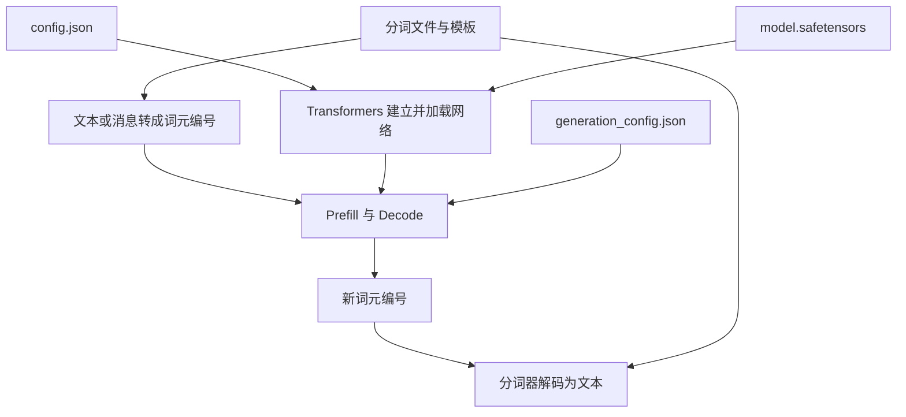

<a id="sec-package-7"></a>
### 12.7 下载与运行：一个完整的 Base 文本续写示例

以下采用已核对文档接口的 **Transformers 5.7.0** 作为教学版本，不表示它是当前最新或唯一可用版本。代码使用 `dtype`；一些较早版本使用 `torch_dtype`。

```bash
python -m pip install "transformers==5.7.0" torch accelerate safetensors huggingface_hub
hf download Qwen/Qwen3-0.6B-Base --local-dir ./qwen-base
```

HF 下载工具处理实际大文件及下载元数据。有些 Git 原始链接返回的只是大文件指针，文件名相同不代表已经取得完整权重。[S38](#s38)

```python
import torch
from transformers import AutoTokenizer, AutoModelForCausalLM

folder = "./qwen-base"
tokenizer = AutoTokenizer.from_pretrained(
    folder,
    local_files_only=True,
)
model = AutoModelForCausalLM.from_pretrained(
    folder,
    dtype=torch.float32,
    local_files_only=True,
).eval()

encoded = tokenizer("法国的首都是", return_tensors="pt")
with torch.inference_mode():
    generated = model.generate(
        **encoded,
        max_new_tokens=16,
        do_sample=False,
    )

# Base 模型用于文本续写；这里仅展示新生成部分
new_ids = generated[0, encoded["input_ids"].shape[1]:]
print(tokenizer.decode(new_ids, skip_special_tokens=True))
```

本例用 CPU 默认设备和 FP32 加载，方便阅读流程；这不改变原始包采用 BF16 发布的事实。要使用对话消息，应选择相应对话模型及正确模板，而不是假定 Base 已按同一种聊天行为训练。

<a id="sec-package-8"></a>
### 12.8 怎样亲眼查看参数、形状和权重绑定？

加载上面的模型之后：

```python
print(model)
print("独立参数数：", sum(p.numel() for p in model.parameters()))

q_weight = model.model.layers[0].self_attn.q_proj.weight
print("第 0 层 Q 投影：", q_weight.shape, q_weight.dtype)
print("部分真实权重数值：", q_weight[:2, :4].detach())

same_weights = (
    model.get_input_embeddings().weight
    is model.get_output_embeddings().weight
)
print("输入与输出是否共享：", same_weights)
```

`parameters()` 的去重计数与某些文件清单中逐名称统计的数值数量可能不同；一个共享参数可以有多个使用位置。统计时应先说明独立参数、保存条目还是实际访问元素。

**本次会话的验证范围：** 核对了模型目录、配置、公开实现和官方接口；对参数数量、字节数和浮点舍入做了独立算术检查。未在当前环境实际下载完整权重、执行模型生成或在兼容 GPU 上运行 FP8 量化。示例中的输出不应被当作已经实测的模型答案。

<a id="sec-package-9"></a>
### 12.9 模型包没有提供的东西，与运行时才生成的东西

这个发布目录不包含完整预训练数据、优化器训练状态和完整服务部署环境。继续训练所需的检查点，可能比仅用于推理的权重包多保存很多信息。[S41](#s41)

当前 Prompt 的 Q/K/V、隐藏状态、词表分数及 KV Cache，也不会预先存在于这个参数包里；它们是用模型与这次输入计算产生的结果。


<a id="ch9"></a>
## 13. BERT、FinBERT 与 BioBERT

<a id="sec9-1"></a>
### 13.1 BERT 是开源的吗？

**原始 BERT 是公开了代码和预训练权重的模型。** Google 官方仓库提供实现、训练与微调相关代码、模型配置、词表及预训练检查点，并说明所发布模型使用与代码相同的 Apache 2.0 许可。[S1](#s1)

但“BERT 开源”不意味着任何训练数据都以同样许可证完整公开，也不能推断所有后续 BERT 衍生模型都采用相同许可证。

BERT 的全称是 **Bidirectional Encoder Representations from Transformers，基于 Transformer 的双向编码表示**。

<a id="sec9-2"></a>
### 13.2 BERT 与生成式 GPT 类模型的核心区别

| 比较项 | 原始 BERT | 标准自回归 GPT 类模型 |
| --- | --- | --- |
| 主要结构 | Transformer Encoder，编码器 | Decoder-only，纯解码器结构 |
| 同一文本中的可见范围 | 通常可双向读取左右上下文 | 通过因果掩码读取自身及左侧上下文 |
| 典型预训练目标 | MLM；原始 BERT 还使用 NSP | Next Token Prediction，下一 Token 预测 |
| 常见使用方式 | 表示、分类、标注、匹配、排序 | 持续追加 Token 生成文本 |
| 前文 Prefill 教学例子的下三角 Mask | 不直接套用于标准 BERT 编码 | 用于标准因果生成模型 |

两者都使用 Transformer 的核心计算，但“用了 Transformer”不等于“都是 BERT”。原始 Transformer 还包含编码器—解码器结构，后续模型根据任务选择或修改部件。[S2](#s2)[S3](#s3)

MLM 是 **Masked Language Modeling，掩码语言建模**。简化例子：

> 原文：The company reported higher profits.  
> 输入：The company reported higher [MASK].  
> 训练目标：预测被遮住的 profits。

目标来自原始文本本身，所以这是一种 Self-supervised Learning（自监督学习）。原始 BERT 的遮掩策略还有随机替换、保留原词等细节，此处只展示核心。

NSP 是 **Next Sentence Prediction，下一句预测**，用于原始 BERT 的训练；不能泛化为所有后续 BERT 类模型都使用 NSP。

<a id="sec9-3"></a>
### 13.3 为什么能在 BERT 基础上得到领域模型？

因为可以加载 BERT 已有权重，继续训练，而不必从一组随机数重新开始。

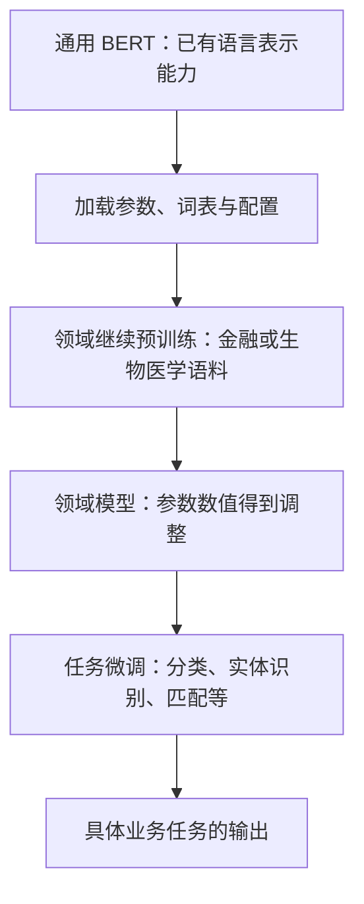

其中两种训练要分清：

| 训练阶段 | 常见名称 | 使用什么数据 | 主要目的 |
| --- | --- | --- | --- |
| 领域继续预训练 | DAPT，Domain-Adaptive Pretraining | 大量领域原始文本，未必需要人工任务标签 | 适应专业用词、表达与领域分布 |
| 下游任务微调 | Fine-tuning | 与任务对应的标注样本 | 学会输出业务需要的标签或分数 |

领域模型仍可能有与原始 BERT 相同的层数和参数形状；“继续学习专业领域”并不要求一定增加参数。

具体项目不一定严格经历图中每一步，也可以直接做任务微调，或选择从零训练。应以该版本论文与模型卡为准。

<a id="sec9-4"></a>
### 13.4 FinBERT 是怎样训练的？

“FinBERT”并不是一个在所有项目中都指向同一模型的唯一名称。

以 **ProsusAI/finBERT** 为明确例子：它在 BERT 基础上利用金融文本继续训练，并针对金融情感分类进行微调，输出正面、负面或中性等类别。[S4](#s4)[S5](#s5)

例如：

| 金融句子，教学示例 | 情感分类示意 |
| --- | --- |
| 公司利润高于此前预期 | 正面 |
| 公司下调全年利润指引 | 负面 |
| 公司将于周五召开股东大会 | 中性 |

这不是让模型只凭普通语言中的“高”“低”判断，而是通过训练适应具体领域和任务。

**许可证要按具体项目分别看。** 截至本笔记核对日期，ProsusAI 仓库明确区分了代码、权重与数据的授权；仓库 Apache 2.0 不自动覆盖权重和 Financial PhraseBank。其权重模型卡当时标注 CC BY-NC-SA 4.0。实际使用前需查对应版本页面。[S4](#s4)[S5](#s5)

<a id="sec9-5"></a>
### 13.5 BioBERT 是怎样训练的？

原始 BioBERT 的代表性版本，加载 BERT 权重后，在 PubMed 摘要、PMC 全文等生物医学语料上继续预训练，再用于命名实体识别、关系抽取、问答等任务。[S6](#s6)[S7](#s7)

| 任务 | 全称 | 简化例子 |
| --- | --- | --- |
| NER | Named Entity Recognition，命名实体识别 | 标出一段摘要中的疾病、药物、基因名称 |
| RE | Relation Extraction，关系抽取 | 判断文本是否表达某药物与某疾病的关系 |
| QA | Question Answering，问答 | 基于文献回答一个问题 |

原始常见 BioBERT 版本沿用 BERT 的 WordPiece 词表。不要把“BioBERT”理解为所有医学语言模型的统称，也不要把它与其他从零预训练的生物医学模型混为一谈。

<a id="sec9-6"></a>
### 13.6 如果基础模型不开源，还能继续训练吗？

需要看具体开放了什么能力：

- 有可用权重和训练实现，可以在许可允许范围内自行继续训练。
- 只有公开架构，可以按架构从零训练自己的权重，但不能凭空获得原模型已学到的参数。
- 只有 API，可能由提供方支持托管微调；没有公开权重时，不能据此在本地继续训练它的原始权重。

Prompt 中临时加入专业资料，是让推理利用上下文；继续预训练、任务微调则会调整可学习参数。RAG（Retrieval-Augmented Generation，检索增强生成）通常是先检索外部资料，再作为上下文交给生成模型，和“把资料训练进权重”也应区分。

<a id="ch10"></a>
## 14. BERT 在搜索中的使用

<a id="sec10-1"></a>
### 14.1 先认识搜索链路

**Query** 是用户查询，**Item** 是候选条目，可以是网页、商品、文章或文档。

一个常见的多阶段搜索流程如下。实际系统会根据业务合并或拆分步骤。

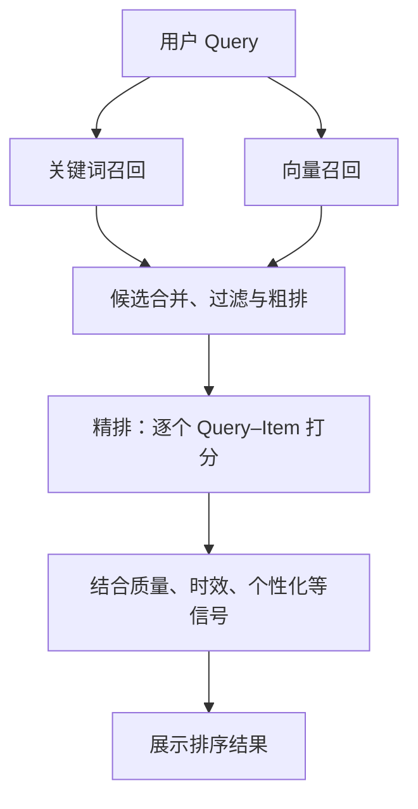

模型并不一定直接给全库每个 Item 做昂贵打分。通常先用较便宜的方法拿到候选，再用更强的模型精排。[S8](#s8)

<a id="sec10-2"></a>
### 14.2 双塔：把 Query 和 Item 分别变成向量

**Bi-Encoder，双编码器，也常称双塔模型**，分别编码 Query 和 Item：

$$
v_q=E_q(q),\qquad v_i=E_i(i)
$$

然后计算分数，例如点积：

$$
s(q,i)=v_qv_i^\top
$$

或余弦相似度：

$$
s(q,i)=\frac{v_qv_i^\top}{\lVert v_q\rVert\lVert v_i\rVert}
$$

这里的 $E_q,E_i$ 表示编码网络，不是前文输入嵌入表 $E$。两塔可以共享参数，也可以采用不同参数。

Item 的向量通常可以离线预先计算，放进向量索引；在线只编码 Query，再利用 ANN（Approximate Nearest Neighbor，近似最近邻）检索相近 Item。

这适合大规模召回。Sentence-BERT 是让 BERT 类模型产生可比较句向量的代表性工作。[S10](#s10)

**不能直接假设，未经适配的原始 BERT 的 [CLS] 向量就天然适合向量检索。** 通常需要合适的池化、对比学习或检索训练。

<a id="sec10-3"></a>
### 14.3 交叉编码器：把 Query 与一个 Item 一起读

**Cross-Encoder，交叉编码器**，把 Query 和 Item 拼在一起输入：

```text
[CLS] 用户 Query [SEP] Item 的标题、摘要或正文片段 [SEP]
```

在 BERT 的双向注意力里，Query 和 Item 的 Token 可以直接相互读取，形成更细致的匹配表示。

一种简单打分方式是取最终的 [CLS] 表示：

$$
h_{\text{CLS}}=\operatorname{BERT}(q,i)_{\text{CLS}}
$$

$$
s(q,i)=h_{\text{CLS}}w+b
$$

排序模型也可能使用更复杂的输出头。这些参数通过相关性任务训练得到，而不是预先给每个 Item 固定一个永远不变的分数。[S9](#s9)

同一 Item 面对不同 Query，分数通常不同。

<a id="sec10-4"></a>
### 14.4 模型如何学会这个分数？

假设训练样本包含：Query、Item 和相关性标签。标签可以是相关／不相关，也可以是多个相关性等级。

在简单二分类方案中，可以先把分数转为：

$$
p=\sigma(s)=\frac1{1+e^{-s}}
$$

再使用二元交叉熵：

$$
\mathcal L=-\big[y\log p+(1-y)\log(1-p)\big]
$$

训练会调整 BERT 和打分头的参数，让更相关的 Query–Item 组合获得更符合目标的分数。也有 Pairwise（成对）和 Listwise（列表）训练方法，直接学习偏好顺序或整个结果列表。

点击记录可以作为训练信号，但点击还受曝光、展示位置等因素影响，不能无条件视为纯粹的相关性真值。

<a id="sec10-5"></a>
### 14.5 推理时怎样对 Item 排序？

例如 Query 是“提前还房贷划算吗”，对三个候选分别打分：

| 候选 Item | 示例原始分数 | 排序理由示意 |
| --- | --- | --- |
| 分析贷款利率、剩余期限与资金机会成本 | 4.2 | 直接回答“是否划算” |
| 提前还贷的操作流程 | 1.7 | 相关，但侧重“怎么做” |
| 某银行贷款申请材料清单 | -0.6 | 与当前意图距离较远 |

这些数只是教学示例，不是实际模型输出。排序时，按同一 Query 下各候选的分数排序即可。

**不必在推理时把所有 Item 两两比较一遍。** 可以分别计算各个 Query–Item 的分数，并将多对输入组成批次计算。

一个原始排序分数也不自动等于校准后的点击概率或业务收益。最终系统还可能融合质量、时效、多样性、用户偏好等信号。

<a id="sec10-6"></a>
### 14.6 双塔与交叉编码器怎样配合？

| 比较项 | 双塔 Bi-Encoder | 交叉编码器 Cross-Encoder |
| --- | --- | --- |
| 输入方式 | Query 与 Item 分开编码 | Query 与 Item 一起编码 |
| Query–Item 的 Token 级直接交互 | 通常没有 | 有 |
| Item 表示能否预计算复用 | 通常可以 | 联合表示依赖当前 Query |
| 在线主要成本 | 编码 Query 与向量检索 | 为每个候选做联合编码 |
| 常见位置 | 大规模向量召回 | 较少候选的精排 |

常见搭配是：**先用双塔较快找出可能相关的候选，再用交叉编码器更细地评分。**

<a id="ch11"></a>
## 15. M6 与 BERT 的关系

<a id="sec11-1"></a>
### 15.1 “基于 BERT”至少有三种含义

| 可能的含义 | 判断标准 |
| --- | --- |
| 使用相近基础部件 | 是否使用 Transformer 自注意力、FFN 等 |
| 使用相同或相近整体架构 | 是否仍是标准双向 BERT 编码器结构 |
| 在 BERT 已有权重上继续训练 | 是否明确加载了 BERT 预训练检查点作为初始化 |

这三种含义不能互相替代。尤其不能因为一个模型使用自注意力，就推断它是加载 Google BERT 权重训练出来的。

<a id="sec11-2"></a>
### 15.2 原始 M6 是什么？

这里讨论的是 2021 年论文 **M6: A Chinese Multimodal Pretrainer** 中的模型。[S11](#s11)

M6 展开为 **Multi-Modality to Multi-Modality Multitask Mega-transformer**。它面向中文多模态、多任务预训练，把文本和图像等信息纳入统一建模。

原论文使用与 BERT、GPT 相同类型的 Transformer 基础部件，并利用注意力可见范围等设计支持编码和生成，涉及文本去噪、语言建模、图像描述等训练任务。

<a id="sec11-3"></a>
### 15.3 应该怎样回答“阿里 M6 基于 BERT 吗”？

准确的表述是：

> 原始 M6 属于 Transformer 路线，与 BERT、GPT 共享一些基础计算部件和训练思想；其多模态、多任务设计超出了标准 BERT 编码器。仅据这些关系，不能推断它就是加载 Google BERT 权重、再做一次领域继续训练。

因此，M6 与 BERT 的关系，不能直接套用“BERT → BioBERT”的权重继承关系。若讨论 M6 的某个后续版本或内部系统，需要单独查那个版本的论文或官方说明。

<a id="ch12"></a>
## 16. 学习过程中的问答归档

本章按提问脉络保留疑问；答案使用全文统一后的术语，避免把早期不够精确的理解固化下来。

### Q1. BERT 是开源的吗？如果不是，怎么有 FinBERT、BioBERT？

原始 BERT 公开了实现与预训练权重，所以可以加载已有参数，在金融、生物医学文本上继续训练。随后还可以针对情感分类、实体识别等任务微调。代码、权重和数据的授权需要分别看；FinBERT 还需要明确具体项目。详见[第 13 章](#ch9)。

### Q2. BERT 如何在搜索中给 Item 打分排序？

常见两条路径：双塔分别编码 Query、Item，再计算向量分数；交叉编码器把 Query 和一个 Item 联合输入，用训练好的打分头输出分数。先召回候选，再逐个打分排序，是常见做法。详见[第 14 章](#ch10)。

### Q3. 阿里 M6 是基于 BERT 吗？

要区分“共享 Transformer 部件”“采用标准 BERT 架构”“加载 BERT 权重继续训练”。原始 M6 是多模态、多任务 Transformer，不能直接等同于 BERT 的领域微调版本。详见[第 15 章](#ch11)。

### Q4. 最先进的闭源、开源模型参数规模多大？

需要说明日期、版本和“最先进”的评测标准。闭源模型未公开参数时，准确答案就是“未公开”；不能用传闻填空。公开权重模型则应同时看总参数、激活参数与许可证。本文给出可核验的历史版本规模作为例子，不把它们当作当前排名。详见[1.6 节](#sec1-6)。

### Q5. 参数到底是什么？一个参数是不是一个知识点？

一个参数是模型里可通过训练调整的一个标量数值。很多参数组成矩阵参与计算。知识与能力分布在参数组合中，不存在一般性的“一参数对应一条事实”。详见[第 1 章](#ch1)。

### Q6. 总参数 X B、激活参数 Y B，是什么意思？和激活函数有关吗？

总参数统计整个模型；MoE 的激活参数通常统计每 Token 路径涉及的参数。激活函数则对中间数值进行非线性变换。两者名字相近，所说的对象不同。详见[第 2 章](#ch2)。

### Q7. 预测未知 Token X，是拿 X 的 Q 去匹配前缀 K 吗？

不是。X 尚未选出时，没有它的本轮输入 Q。模型使用**末尾已知位置**的 Q，读取本层已知上下文位置的 K、V。等 X 被选出并作为下一轮输入，才为 X 所在的新位置计算 QKV。详见[4.2 节](#sec4-2)。

### Q8. 或者是拿前缀的 Q 去词表里匹配 K？

也不是。Attention 中的 K、V 对应上下文位置。最后用状态 $h$ 给词表候选打分，是 LM Head 的另一步计算。详见[第 4 章](#ch4)与[第 6 章](#ch6)。

### Q9. “是”的 Q 读取前文后，融合出的向量是什么？

它是一个注意力头为“是”这个位置读回的信息表示，即 V 的加权和。它是中间消息，不是新 Token、不是“巴黎”的固定嵌入，也通常不是直接可读的知识列表。它会参与本层后续计算，再传给后续层。详见[4.4 节](#sec4-4)。

### Q10. 得到最终 h 后，选出最相似的向量 M，再把 M 转成词，对吗？

应改成：输出头给词表中的每个 ID 打分，解码策略选出 ID，Tokenizer 把 ID 序列解码成文字。常见打分是点积，不必是余弦相似度；生成也不必总选最高分。详见[6.2—6.4 节](#sec6-2)。

### Q11. e 下标 j* 是什么，为什么又冒出一个向量？

$j^*$ 是刚选出的 Token ID，$e_{j^*}$ 是下一轮把这个 ID 当输入时，从输入嵌入表查出的一行。它与上一位置的最终状态 $h_t$ 不同。详见[6.5 节](#sec6-5)。

### Q12. 用户输入 Prompt 后，怎么得到第一个回答 Token？

消息先按模板整理并分词；Prefill 让全部已知位置经过模型；取末尾位置的最终状态，经过输出头与解码策略，选出第一个回答 Token。然后把新 Token 作为下一轮输入继续。详见[第 7 章](#ch7)与[第 8 章](#ch8)。

### Q13. Prefill 是为了初始化每层的 QKV 表吗？

它使用已训练好的投影参数，计算这次 Prompt 对应的 QKV 和隐藏状态，同时建立逐层 KV Cache，并产生首个新 Token 的分布。通常不需要为以后缓存旧 Q，也不更新投影权重。详见[7.2 节](#sec7-2)。

### Q14. Prefill 中四个 Token 在层与层之间传的是什么？

传的是四个位置各自的隐藏状态，概念上是一张 $4\times d$ 的矩阵。下一层用自己的参数从这张矩阵继续计算 QKV。QKV 与逐层 KV Cache 不能取代这条隐藏状态传递主线。详见[3.3 节](#sec3-3)。

### Q15. Q 到底是什么？K 到底是什么？

它们都是当前层输入经过不同可学习投影后得到的向量。Q 用于发起匹配，K 用于被匹配；二者点积得到读取分数。名字表达角色，不意味着向量里存着自然语言问句或一条固定标签。详见[4.1 节](#sec4-1)。

### Q16. 多头的结果会融合到本层输出，再交下一层吗？

会。各头分别产生读取结果，通常先拼接并经过输出投影，再结合残差、归一化、FFN 等形成该层输出。下一层收到的是更新后的隐藏状态。详见[第 5 章](#ch5)。

### Q17. 四个位置都并行传到下一层，末尾还需要重走一遍网络吗？

不需要。最后一层已经有四个位置的最终状态，直接取末尾那一行做输出打分。详见[7.5 节](#sec7-5)。

### Q18. 为什么前面三个位置也有最终状态，但预测时不用它们各自的词表分数？

因为当前要选的是 Prompt 后面紧接着的 Token，对应末尾位置的预测。末尾状态在各层中可以读取此前信息；前面各位置的词表分数则对应已经存在于 Prompt 中的后续 Token。要说“读取、融合了信息”，不要误解成推理时又训练了参数。详见[6.6 节](#sec6-6)与[7.5 节](#sec7-5)。

### Q19. 多头可以理解成多个角度；多层又是什么？

多头是在同一轮用多组投影并行读取，多层是在上一轮结果上继续变换。后一层读到的表示已经包含前一层的加工，所以可以继续组合已有信息。详见[5.1—5.4 节](#sec5-1)。

### Q20. 是不是一层学到的知识有限，堆多层就能学到足够知识？

可以用“更多层支持更多轮复杂计算”理解，但不要把每层当成独立知识仓库。整个模型端到端训练，能力分布在多层参数及其组合中，堆层不保证效果一直提高。详见[5.4—5.5 节](#sec5-4)。

### Q21. 每层输入除了原始数据，还会收到上一层输入吗？

通常下一层直接接收上一层的**输出状态**，不是每层重新拼接原始输入和上一层输入。残差连接是在当前子层内把已有状态加上更新，所以早期信息可以沿计算路径继续保留、变换。详见[5.3 节](#sec5-3)。

### Q22. 预训练前，先设计层数吗？参数是提前设计还是学到的？

通常先选层数、宽度等架构，决定参数形状和数量；然后初始化并通过训练学习数值。架构超参数与可学习参数不要混为一谈。详见[1.4 节](#sec1-4)。

### Q23. 怎么决定要多少参数？

根据任务、硬件与延迟目标、训练预算、数据规模和质量做选择，并利用小规模实验与缩放规律估计。不会只凭“知识多就多堆层”决定。详见[1.5 节](#sec1-5)。

### Q24. 整个过程都能并行吗？

已知 Prompt 在同一层通常可以批量并行处理；头之间也可以并行。层与层存在依赖；普通自回归生成的未知 Token 则依赖先前选出的 ID。详见[7.4 节](#sec7-4)。

### Q25. 为什么需要 KV Cache？缓存里的 K、V 是提前训练好的吗？

缓存避免为每个新 Token 重算已知前缀。里面的 K、V 是这次前缀现场计算的中间状态，每层各有一份，不是模型发布时就有的固定词向量表。详见[第 8 章](#ch8)。

### Q26. 怎么理解张量 Tensor？向量维度和张量阶数为什么不同？

在深度学习框架中，张量是按形状组织的数值数据。四个位置、每个位置八个数，可以写成 `[4,8]`；两条这样的输入组成 `[2,4,8]`。一个“4096 维向量”仍可是一阶张量，因为它有一个轴、该轴长 4096。详见[3.5 节](#sec3-5)。

### Q27. 模型的超参数是什么？与参数有什么区别？

层数、隐藏宽度是架构超参数，学习率、批次大小是训练超参数；权重和偏置才是普通训练直接调整的可学习参数。超参数可以手工选择或自动搜索，并非“数值特别大”的参数。详见[1.7 节](#sec1-7)。

### Q28. 偏置 Bias 的作用是什么？

偏置是加权和后可学习的基准偏移，使关系不必经过原点，也能改变激活函数开始产生某种响应的位置。它属于参数；残差连接加回的则是当前输入状态。详见[1.9 节](#sec1-9)。

### Q29. 量化是不是删掉一部分参数？低精度一定更差吗？

量化通常改变权重或激活值的数值表示，保留原有网络的主要参数位置与数量。它能减少存储和传输，但引入近似误差，效果需评估；数值精度与回答质量不能直接画等号。训练后量化可以提前保存或在加载时执行，量化感知训练则在训练中适应量化影响。详见[1.10 节](#sec1-10)。

### Q30. 残差连接为何要把输入再加回来？残差就是预测误差吗？

核心是 $y=x+F(x)$：保留一条状态通过路径，让子网络学习基于当前状态的更新，有助于优化深层网络。它不是本次预测的损失值，也不代表每层重新拼接原始 Prompt。详见[5.3 节](#sec5-3)。

### Q31. 前馈网络 FFN 做什么？前馈是否意味着不反向传播？

Transformer 的普通 FFN 对每个位置分别做线性变换、非线性激活和再次线性变换，通常在不同位置共享参数。前馈描述连接方向，训练仍使用反向传播。详见[5.6 节](#sec5-6)。

### Q32. 神经元是一个参数、一个向量，还是一个 Token？

经典神经元是一个计算单元：接收多个输入，利用多个权重和一个可选偏置，经激活后产生一个标量输出。多个单元的输出组成向量，同一套单元可被不同 Token 位置复用。详见[1.8 节](#sec1-8)。

普通层与 Transformer 块的统计口径、7 个单元与 29 个参数的区别，继续见 [1.13—1.14 节](#sec1-13)。

### Q33. 为什么只缓存 K/V，不缓存 Q？是不是旧 Q 会改变？

旧位置的 Q 在固定参数、相同前缀位置设置下也保持有效，但标准生成不再重算那个旧位置的读取。新增位置使用自己的 Q，匹配旧 K 并读取旧 V；旧 Q 没有需要复用的角色。详见[8.4 节](#sec8-4)。

### Q34. 参数与权重是同一个意思吗？开放权重就是公开参数吗？

参数包括可学习矩阵、偏置、归一化参数等；“权重文件”通常用广义说法指整套已训练参数。开放权重通常表示可取得这些参数值，但不自动表示完整训练数据、训练实现与许可范围全部开放。详见[1.11 节](#sec1-11)和[12.1 节](#sec-package-1)。

### Q35. 预训练完的大模型，除了数字还需要什么？

核心训练成果是参数数值；使用它还需要匹配的结构实现、配置、分词规则等。完整训练检查点还可能保存优化器状态、训练进度。Prompt 对应的 QKV 和 KV Cache 则是运行时才产生的。详见[1.12 节](#sec1-12)和[第 12 章](#hf-package)。

### Q36. 能不能用一个 HF 实例看每个文件到底是什么？

可以。Qwen3-0.6B-Base 的十个实际文件及用途见[12.2 节](#sec-package-2)。权重、结构配置、分词文件、生成配置要分开理解；示例按 Base 版本核对，不混用对话版的体积和设置。

### Q37. vocab.json 已经有词向量了吗？tokenizer.json 与嵌入表是什么关系？

`vocab.json` 负责文本片段与整数编号；分词器按规则编码、解码。嵌入向量保存在神经网络权重中，按编号查出。两者不是同一张表。详见[12.4 节](#sec-package-4)。

### Q38. 模型包里没有 .py，模型代码在哪里？

该 Qwen 模型由 Transformers 原生支持，网络代码在安装的库中；加载工具根据配置选择实现并装入权重。其他模型也可能附带自定义代码，不能假定所有模型包都一样。详见[12.6 节](#sec-package-6)。

### Q39. 模型结构代码是不是公式和加工逻辑？会很复杂吗？

核心是在组织张量运算与数据流：构建部件、计算 QKV、注意力、残差、前馈等。少量核心代码可以描述很大的模型，但高效训练与服务还需要复杂的算子、通信和缓存工程。详见[第 9 章](#architecture-code)。

### Q40. 只有几行代码，为什么能有上亿参数？

一行创建大矩阵的代码就可以分配上千万个参数；循环可以构造许多层。代码行数、矩阵元素数量与学到的数值是不同对象。详见[9.2 节](#sec-code-2)。

### Q41. 层数、注意力头和矩阵维度到底怎么选？

先确定用途、数据、训练预算和部署约束，再组合深度、宽度、FFN、头与专家等候选方案，做实验和规模预测。没有“知识有多少就能唯一算出多少层”的通用公式。详见[第 10 章](#architecture-design)。

### Q42. 隐藏维度一定等于头数乘每头维度吗？

不一定。标准设计常这样安排，但 Qwen 小模型的 1024 维状态先投影到 16×128=2048 维查询空间，再经输出投影回 1024 维。头数、头内维度与层间状态宽度要分别看。详见[10.3 节](#sec-design-3)。

### Q43. 训练完参数文件多大，是不是训练前就能算？

结构与保存方式确定后，通常能估算。矩阵形状决定有多少个数，位宽决定每个数占多少空间；文件元数据、量化系数、共享与重复保存还要另算。详见[11.1 节](#sec-precision-1)。

### Q44. FP32、FP16 是参数精度，还是计算精度？

它们是数值格式，可用于权重、激活、梯度、中间运算、缓存等。文件保存、矩阵输入、累加及优化器状态不必使用同一种格式。详见[11.2 节](#sec-precision-2)和[11.5 节](#sec-precision-5)。

### Q45. FP32 为什么比 FP16 精确？为什么 1.0001 会变成 1.0？

FP32 在这个数值附近有更细的可表示格点；FP16 会将 `1.0001` 舍入到 `1.0`。这不是固定保留几位十进制小数的规则。详见含复现代码的[11.3 节](#sec-precision-3)。

### Q46. 数值精度越高，模型答案一定越好吗？

不一定。它减少数值近似误差，不会凭空增加学到的知识；低精度误差有时影响预测，有时影响很小。任务效果要结合模型、数据、转换方案和实现评估。详见[11.4 节](#sec-precision-4)。

### Q47. BF16、FP16 都是 16 位，为什么不同？

位的分配不同。BF16 保留更宽指数范围，小数字段更短；FP16 的细节精度更高但范围较窄。训练稳定性不能只看总位数。详见[11.2—11.3 节](#sec-precision-2)。

### Q48. 参数位数是一开始就定死的吗？发布成 BF16 是否代表一直用它训练？

训练方案会规划精度，但可混用不同格式，发布时也能另选导出格式。BF16 权重包不能证明全部前向、反向和优化器更新都用了 BF16。详见[11.5 节](#sec-precision-5)。

### Q49. FP32 训练的结果，后来能降成 FP16、FP8 吗？

可以尝试相应转换或量化并做适配评估。FP16 常通过类型转换；FP8 往往还要配置缩放和配套算子。降低位数通常保留同一组参数位置。详见[11.6—11.8 节](#sec-precision-6)。

### Q50. 低精度处理是在加载时做，还是提前生成另一个模型包？

两种都可以。先加载再转换或边加载边转换，可以保持原文件；处理后调用保存接口，则可导出新包，后续直接读取。分词器、量化配置和缩放信息也要正确配套。详见[11.6—11.7 节](#sec-precision-6)。

是否省磁盘、常驻权重内存或加载峰值，需要继续区分保存与运行表示，见 [11.9 节](#sec-precision-9)。

### Q51. FP8 只是把每个数改成 8 位，加载就能跑吗？

不够。要选对 FP8 格式、缩放粒度、量化与加载方式，并有兼容算子和硬件。所给细粒度 FP8 示例有明确设备条件，未宣称在本环境实跑。详见[11.7 节](#sec-precision-7)。

### Q52. 把低精度模型再加载成 FP32，可以找回原来的精度吗？

不能自动找回已经舍去的信息。FP16 中的 `1.0` 改用 FP32 保存仍然是 `1.0`。如果想恢复未量化权重，需要保留或重新取得原始版本。详见[11.4 节](#sec-precision-4)。

### Q53. MoE 是 GPT 的外挂，还是模型内部的东西？

本文的 MoE 是结构内的路由器和专家前馈模块，与自回归生成兼容；不是外接一个独立聊天模型。模型通常在训练时就按该结构学习。详见[2.5 节](#sec2-5)。

### Q54. 为什么需要 MoE？为什么不全部激活，效果是不是更好？

它让模型保存较大参数容量，同时每词元只执行部分专家计算。全部执行会增加成本；直接改变既有模型的路由数量也改变其计算行为，不能当成无损升级。详见[2.6 节](#sec2-6)。

### Q55. Qwen 总参数 305 亿、激活 33 亿，128/8×33 为什么得到 528 亿？

因为 33 亿包括非专家部分，不能整体按专家数放大。应先扣共享规模，再放大所选专家部分，最后加回共享规模。标称 30.5B、3.3B 也不是精确到单参数的数字。详见带实际拆分的[2.7 节](#sec2-7)。

### Q56. “每次选 8 个专家”是全模型只有 8 个工作吗？

通常是各 MoE 层分别选 8 个；各层专家参数不同。激活规模合计一个词元经过整个网络的路径；一批词元可以分别调用更多专家。详见[2.7—2.8 节](#sec2-7)。

### Q57. 专家、注意力头与层的区别是什么？

头负责不同的上下文读取，专家通常负责选择性前馈加工，层负责组织一轮整体状态更新。一个 MoE 层也可以包含多头注意力。详见[2.8 节](#sec2-8)。


### Q58. 神经元和层是什么关系？为什么 7 个单元会有 29 个参数？

在普通全连接网络中，一层组织多个输出单元。教学网络 3→4→2→1 的隐藏及输出单元合计 7 个；每个单元有多个输入权重及一个偏置，因此参数合计为 $4(3+1)+2(4+1)+(2+1)=29$。输入节点、计算单元与参数不能混计。详见[1.13 节](#sec1-13)。

### Q59. Transformer 每层有多少神经元？整个模型怎样统计？

一个 Transformer 层通常是含注意力、FFN、残差与归一化的块，不等于一排与隐藏维度相同数量的单元。可以读取配置与实现，按明确口径统计，例如只统计各层 FFN 中间单元；不能直接从 7B 参数推导唯一的神经元数。详见[1.14 节](#sec1-14)。

### Q60. 神经元是设计出来的还是训练出来的？Token 越多是否单元越多？

普通方案中，先设计层数、宽度和连接，训练学习这些位置上的参数及协同响应。更多 Token 会复用同一套网络，增加本次执行和激活值数量，而不会给每个位置新增一套独立参数。详见[1.13—1.14 节](#sec1-13)。

### Q61. 前馈和反向传播是不是互相矛盾？

前馈描述连接结构，前向计算描述使用当前参数算结果，反向传播描述沿计算图求梯度，优化器更新才修改参数。前馈网络在训练时可以使用反向传播。详见[5.7 节](#sec5-7)。

### Q62. 反向传播是把计算倒着还原吗？它什么时候改变参数？

它回传的是损失对中间量与参数的局部敏感度，不是逆向还原输入。手算例子中先得到梯度 -16、-8，再由优化器将参数改为 1.4、2.2；新预测为 6.16，损失从 8 降为 1.6928。详见[5.8 节](#sec5-8)。

### Q63. 激活函数为什么能让多层网络更有用？

连续仿射变换仍可合并成一次仿射变换；插入非线性后，多个单元和层的组合才能表达更复杂的响应。激活值变为零，不代表权重消失，也不等同于 MoE 没有路由到一个专家。详见[2.9 节](#sec2-9)。

### Q64. 激活函数与偏置分别干什么？输入零时输出一定等于偏置吗？

偏置调整加权输入的基准，激活函数改变响应形状。输入为零时，激活前是 $b$，激活后是 $\phi(b)$；例如 ReLU 可以把负偏置对应的输出变成零。详见[1.9 节](#sec1-9)与[2.9 节](#sec2-9)。

### Q65. FP16 权重量化是不是只在保存和加载时起作用？

量化还影响运行时的权重表示与算子。提前量化保存并保留低比特常驻，可能同时省磁盘和权重内存；只在加载时量化，不会自动缩小原 FP16 文件；低比特文件全部展开为 FP16 常驻时，也不能按文件大小估算内存。加载峰值、KV Cache 与临时状态需另算。详见[11.9 节](#sec-precision-9)。

### Q66. 激活函数只是 0/1 开关吗？ReLU 规则固定，响应位置为什么还能学习？

ReLU 可以输出 2、10 等任意非负值；SiLU 还可输出负数。标准 ReLU 规则没有可学习参数，但前面的权重和偏置会学习，例如偏置由 −8 变成 −6，同一规则的转折位置就从 8 变成 6。函数规则、激活值与 MoE 激活参数需要分开。详见[2.9 节](#sec2-9)。

### Q67. 偏置有梯度吗？激活函数会参与反向传播吗？

有。对 $a=\phi(\sum_iw_ix_i+b)$，$\partial L/\partial b=(\partial L/\partial a)\phi'(z)$。激活函数影响局部导数，反向传播计算偏置与权重的梯度，优化器再更新它们；普通推理不会因此自动学习。详见[5.9 节](#sec5-9)。

<a id="ch13"></a>
## 17. 公式与术语速查

<a id="sec13-1"></a>
### 17.1 关键边界速查

| 容易记混的说法 | 统一后的理解 |
| --- | --- |
| 参数和中间向量都只是数字，所以是同一种东西 | 参数是训练调整并保存的数值；中间向量是当前输入经过网络计算得到的结果 |
| QKV 是预先训练好的三张词表 | 投影参数预先训练好；QKV 随本层输入现场计算 |
| Attention 已经在选下一个词 | Attention 在读上下文；最终选词由输出头和解码策略完成 |
| 输入嵌入、最终 h、输出权重向量都代表同一个词 | 它们分别承担输入查表、上下文表示、候选打分的角色 |
| Prefill 并行意味着可以看到未来 | 并行是执行方式；Mask 约束信息可见范围 |
| 开放权重意味着全部训练数据和流水线开放 | 参数、代码、训练数据信息与许可范围需要分别核对 |
| 代码只有几十行，不可能有上亿参数 | 一行创建大矩阵的代码就能分配上千万个可学习数值 |
| 激活参数可以整体按专家比例放大 | 先分出非专家部分与专家池，只对专家部分按比例计算 |
| 模型发布为 BF16，所以所有计算都是 BF16 | 保存、乘法、累加、优化器与缓存可采用不同格式 |
| FP32 的任务效果必然优于 FP16 | 数值更细致不等于学到更多知识，需评估误差是否影响任务 |
| 把量化模型加载为 FP32，就恢复原有信息 | 扩大表示容器不能自动补回已经舍去的信息 |
| 参数文件大小就是推理显存 | 运行还需要缓存、中间结果和算子工作空间 |
| 一个神经元就是一个参数 | 一个经典单元通常包含多个输入权重和一个可选偏置 |
| 隐藏维度就是整个 Transformer 块的神经元总数 | 一个块包含多个子网络，单元统计必须先定义口径 |
| 前馈意味着不能反向传播 | 结构、前向求值、反向求梯度、优化器更新分别描述不同职责 |
| 反向传播就是逆向执行原计算并直接改权重 | 它按链式法则求敏感度，参数由优化器使用梯度后更新 |
| 磁盘是低比特，运行一定占同样内存 | 保存格式、常驻表示、算子工作区与加载峰值要分别核对 |
| 激活函数只能输出 0 或 1 | ReLU 可输出任意非负实数，SiLU 还可输出负数 |
| 激活规则固定就不可能改变响应位置 | 前面的权重和偏置会学习，改变进入激活函数的数值与分界 |

<a id="sec13-2"></a>
### 17.2 公式速查

| 用途 | 公式 |
| --- | --- |
| 输入查表 | $e_j=E[j,:]$ |
| QKV 投影，省略部分实现细节 | $Q=HW_Q,\ K=HW_K,\ V=HW_V$ |
| 一个注意力头 | $\operatorname{softmax}(QK^\top/\sqrt{d_k}+M)V$ |
| 多头合并 | $\operatorname{Concat}(\operatorname{head}_1,\ldots,\operatorname{head}_A)W_O$ |
| 一种 Pre-LN 子层残差 | $H'=H+\operatorname{Sublayer}(\operatorname{LN}(H))$ |
| 输出词表打分 | $z=h_tU^\top+b$ |
| 词表概率 | $p_j=\exp(z_j)/\sum_r\exp(z_r)$ |
| 贪心选 Token | $j^*=\arg\max_jz_j$ |
| 自回归训练损失 | $\mathcal L=-\sum_t\log p_\theta(x_{t+1}\mid x_{1:t})$ |
| MoE 玩具计数 | $N_{\text{total}}\approx S+EP,\ N_{\text{active}}\approx S+kP$ |
| 双塔点积分数 | $s(q,i)=v_qv_i^\top$ |
| 简单交叉编码排序头 | $s(q,i)=h_{\text{CLS}}w+b$ |
| 经典神经元 | $a=\phi(\sum_iw_ix_i+b)$ |
| 经典两层 FFN | $\operatorname{FFN}(r)=\phi(rW_1+b_1)W_2+b_2$ |
| 残差连接核心 | $y=x+F(x)$ |
| 带偏置全连接层参数量 | $nm+m$，输入维度为 $n$、输出维度为 $m$ |
| 仿射整数反量化 | $\hat w=s(q-z_0)$ |
| 张量元素总数 | $\operatorname{numel}(H)=\prod_i\operatorname{Shape}(H)_i$ |
| 实现中线性层的权重方向 | $Q=HA_Q^\top$，$A_Q$ 按输出维度 × 输入维度保存 |
| 门控前馈网络，省略细节 | $(\operatorname{SiLU}(rW_g)\odot(rW_u))W_d$ |
| 参数原始存储估算 | $\text{bytes}\approx P_{\mathrm{saved}}b/8$ |
| MoE 专家池与共享部分 | $N_{\mathrm{total}}=S+P_{\mathrm{experts}},\ N_{\mathrm{active}}\approx S+(k/E)P_{\mathrm{experts}}$ |
| 按专家比例反推的简化口径 | $N_{\mathrm{total}}\approx S+(E/k)(N_{\mathrm{active}}-S)$ |
| FP8 缩放示意 | $q=\operatorname{round}_{\mathrm{FP8}}(w/s),\ \widehat w=sq$ |
| 两层标量网络的链式法则 | $\partial L/\partial w_1=(\hat y-y)w_2x$，其中 $a=w_1x,\ \hat y=w_2a$ |
| 半平方误差 | $L=\tfrac12(\hat y-y)^2$，用于本节手算，不代表所有任务损失 |
| 简单梯度下降 | $\theta'=\theta-\eta\nabla_\theta L$ |
| 激活函数与偏置组合 | $a=\phi(wx+b)$，输入零时 $a=\phi(b)$ |
| ReLU 的转折位置，单输入且 $w>0$ | $a=\max(0,wx+b)$，转折位置 $x=-b/w$ |
| 经典单元的偏置梯度 | $\partial L/\partial b=(\partial L/\partial a)\phi'(z)$ |

<a id="sec13-3"></a>
### 17.3 符号约定

| 符号 | 含义 |
| --- | --- |
| $n$ | 当前输入序列长度 |
| $N$ | 词表大小 |
| $d$ | 模型隐藏维度 |
| $L$ | Transformer 层数 |
| $A$ | 注意力头数 |
| $d_k$ | 一个头中 Q、K 的维度 |
| $x_i$ | 第 $i$ 个位置的 Token ID |
| $H^{(\ell)}$ | 第 $\ell$ 层输出的全部位置状态 |
| $h_t$ | 当前末尾位置准备送入输出头的最终状态 |
| $E$、$U$ | 输入嵌入表、输出打分权重；具体章节的玩具公式另行定义 |
| $W_Q,W_K,W_V,W_O$ | 注意力模块中的可学习投影矩阵 |
| $M$ | 注意力 Mask 矩阵 |
| $j^*$ | 本轮选出的 Token ID |
| $\theta$ | 全部可学习参数的统称 |
| $B,T,D$ | 张量例子中的批次大小、序列长度、隐藏维度；$T$ 在此不是参数数量单位 |
| $\phi$ | 神经元或 FFN 中使用的激活函数 |
| $F(x)$ | 残差分支根据当前输入计算的更新 |
| $s,z_0,q,\hat w$ | 量化中的缩放因子、零点、低精度编码、近似还原值 |
| $\hat y,y$ | 手算训练例子中的预测值与目标值 |
| $\eta,\nabla_\theta L$ | 学习率与损失对参数的梯度；手算局部的 $L$ 表示损失而非层数 |

<a id="sec13-4"></a>
### 17.4 专业术语表

| 英文或缩写 | 中文 | 本文中的用途 |
| --- | --- | --- |
| Transformer | Transformer 架构 | 以注意力等部件处理序列的模型架构 |
| Token / Tokenizer | 词元／分词器 | 文字与模型输入 ID 之间的转换 |
| Embedding | 嵌入 | 把离散 ID 映射为向量 |
| Hidden State | 隐藏状态 | 某位置在网络中的动态表示 |
| Parameter / Weight | 参数／权重 | 训练调整的数值；权重是参数的一类 |
| Hyperparameter | 超参数 | 训练或架构设计设置，例如层数、学习率 |
| Forward Pass | 前向计算 | 用输入与当前参数计算输出 |
| Backpropagation | 反向传播 | 利用链式法则计算参数梯度 |
| Loss | 损失函数 | 衡量预测与训练目标之间的差距 |
| Attention / Self-Attention | 注意力／自注意力 | 基于匹配权重读取同一序列等信息 |
| Q / K / V | 查询／键／值 | 匹配、被匹配、被读回的向量 |
| Causal Mask | 因果掩码 | 防止生成模型读取未来位置 |
| Softmax | 归一化指数函数 | 将一组分数变为和为 1 的权重 |
| Multi-Head Attention | 多头注意力 | 同一层中多组投影与读取 |
| FFN / MLP | 前馈网络／多层感知机 | 对各位置表示做进一步非线性变换 |
| Residual Connection | 残差连接 | 把已有状态与计算更新相加 |
| LN / LayerNorm | 层归一化 | 调整中间数值尺度；部分模型使用其他归一化 |
| LM Head | 语言模型输出头 | 将最终状态映射为词表分数 |
| Logits | 未归一化预测分数 | Softmax 前的候选分数 |
| Autoregressive | 自回归 | 根据已知前缀逐步预测后续 Token |
| Prefill | 预填充 | 批量处理已知 Prompt，并建立缓存 |
| Decode | 解码／逐步生成 | 利用新 Token 和缓存继续预测 |
| KV Cache | 键值缓存 | 保存前缀各层 K、V，供新位置读取 |
| Dense Model | 稠密模型 | Token 经过同一套主要网络 |
| MoE / Router | 混合专家／路由器 | 按输入选择部分专家网络 |
| Activation Function | 激活函数 | 提供非线性变换 |
| Activations | 激活值 | 当前前向计算的中间数值 |
| Pretraining | 预训练 | 大规模学习通用或领域表示 |
| DAPT | 领域自适应继续预训练 | 在领域文本上继续调整已有模型 |
| Fine-tuning | 微调 | 为特定任务或用途调整模型 |
| MLM / NSP | 掩码语言建模／下一句预测 | 原始 BERT 的训练任务 |
| [CLS] / [SEP] | 分类标记／分隔标记 | BERT 中的特殊 Token |
| Bi-Encoder / Cross-Encoder | 双编码器／交叉编码器 | 分开编码匹配／联合编码评分 |
| ANN | 近似最近邻 | 大规模向量检索 |
| Reranking | 重排序／精排 | 对召回的候选进一步评分排序 |
| RAG | 检索增强生成 | 检索资料后作为生成上下文使用 |
| Weight Tying | 权重绑定 | 多个用途共享同一组参数 |
| Tensor / Shape | 张量／形状 | 数值数据的组织形式／每个轴的长度 |
| Batch Size / Sequence Length | 批次大小／序列长度 | 一批输入条数／每条输入的位置数 |
| Neuron | 人工神经元 | 接收多个输入、计算一个标量输出的经典单元 |
| Bias | 偏置 | 加权和后的可学习基准偏移 |
| Quantization | 量化 | 用较低精度表示近似保存或处理权重、激活值 |
| PTQ / QAT | 训练后量化／量化感知训练 | 训练完成后转换／训练中适应量化误差 |
| FP32 / FP16 / FP8 | 32 位／16 位／8 位浮点 | Floating Point 数值表示格式 |
| BF16 / INT8 | 脑浮点格式／8 位整数 | Brain Floating Point／8-bit Integer |
| Scale / Zero Point | 缩放因子／零点 | 仿射整数编码与实际数值之间的映射参数 |
| Dtype / Device | 数值类型／设备 | 每个元素如何表示、张量存放在哪里 |
| Scalar / Vector / Matrix | 标量／向量／矩阵 | 0、1、2 个轴的常见数值对象 |
| Mixed Precision | 混合精度 | 不同步骤按数值性质采用不同格式 |
| Checkpoint / State Dict | 检查点／状态字典 | 训练或模型状态的保存组织方式 |
| Safetensors | 参数张量序列化格式 | 保存名称、形状、类型与二进制数值 |
| GQA | Grouped-Query Attention，分组查询注意力 | 多组 Q 共享较少 K/V 组 |
| BPE | Byte Pair Encoding，字节对编码 | 分词合并规则的一类算法 |
| Open Weights | 开放权重 | 可取得训练后的参数，不自动代表训练全流程开放 |
| Gradient / Chain Rule | 梯度／链式法则 | 损失对参数的局部敏感度／复合函数导数的计算规则 |
| Optimizer / Optimizer Step | 优化器／优化器更新 | 根据梯度和优化规则调整参数的算法／一次调整动作 |
| ReLU / SiLU | 整流线性单元／Sigmoid 线性单元 | 分段截断／平滑门控形式的激活函数 |
| Resident Memory / Peak Memory | 常驻内存／峰值内存 | 持续占用的空间／某阶段实际最高占用 |

<a id="ch14"></a>
## 18. 来源与后续学习

<a id="sec14-1"></a>
### 18.1 来源说明

本文按本次会话的问题重新组织与讲解，不逐字复刻对话。所有手算向量、注意力权重、搜索分数和简化 MoE 规模均为教学示例，不冒充真实模型内部数据。

以下优先列原论文、项目官方仓库、发布方模型卡和框架官方文档。S1—S20 在首次整理时核对，S21—S28 对应 2026-11-02 的术语补充，S29—S42 在 2026-11-01 至 2026-11-02 的会话与汇总中核对；S43—S46 在 2026-11-02 本轮补充中核对。具体版本、许可与接口以后可能变化；模型实现的 main 分支也会更新，复现实验应记录实际提交与依赖版本。

| 编号 | 原始资料 | 查阅用途 |
| --- | --- | --- |
| <a id="s1"></a>S1 | [Google Research：BERT 官方仓库](https://github.com/google-research/bert) | 代码、模型发布、配置、参数量和许可 |
| <a id="s2"></a>S2 | [BERT: Pre-training of Deep Bidirectional Transformers for Language Understanding](https://arxiv.org/abs/1810.04805) | BERT 架构、MLM、NSP 和任务适配 |
| <a id="s3"></a>S3 | [Attention Is All You Need](https://arxiv.org/abs/1706.03762) | QKV、缩放点积注意力、多头和 Transformer 基础 |
| <a id="s4"></a>S4 | [ProsusAI：FinBERT 官方仓库](https://github.com/ProsusAI/finBERT) | FinBERT 项目与代码、权重、数据许可范围 |
| <a id="s5"></a>S5 | [ProsusAI/finbert 模型卡](https://huggingface.co/ProsusAI/finbert)；[FinBERT 论文](https://arxiv.org/abs/1908.10063) | 金融领域训练、情感分类与权重使用条款 |
| <a id="s6"></a>S6 | [BioBERT 论文](https://arxiv.org/abs/1901.08746) | 生物医学继续预训练与下游任务 |
| <a id="s7"></a>S7 | [BioBERT 官方微调仓库](https://github.com/dmis-lab/biobert)；[官方预训练权重仓库](https://github.com/naver/biobert-pretrained) | 版本、权重、语料与实现 |
| <a id="s8"></a>S8 | [Sentence Transformers：Retrieve & Re-Rank](https://sbert.net/examples/sentence_transformer/applications/retrieve_rerank/README.html) | 多阶段召回与精排 |
| <a id="s9"></a>S9 | [Passage Re-ranking with BERT](https://arxiv.org/abs/1901.04085) | BERT 联合编码 Query 与段落进行排序 |
| <a id="s10"></a>S10 | [Sentence-BERT: Sentence Embeddings using Siamese BERT-Networks](https://arxiv.org/abs/1908.10084) | 句向量、双编码与相似度 |
| <a id="s11"></a>S11 | [M6: A Chinese Multimodal Pretrainer](https://arxiv.org/abs/2103.00823) | 原始 M6 的多模态、多任务架构 |
| <a id="s12"></a>S12 | [Hugging Face Transformers：How caching works](https://huggingface.co/docs/transformers/cache_explanation) | 因果注意力、逐层 KV Cache 与生成复用 |
| <a id="s13"></a>S13 | [Hugging Face Transformers：Chat templates](https://huggingface.co/docs/transformers/chat_templating) | 消息、角色与模型输入序列的关系 |
| <a id="s14"></a>S14 | [DeepSeek-V3 官方仓库](https://github.com/deepseek-ai/DeepSeek-V3)；[技术报告](https://arxiv.org/abs/2412.19437) | 671B 总参数、37B 每 Token 激活参数 |
| <a id="s15"></a>S15 | [PyTorch：Build the Neural Network](https://docs.pytorch.org/tutorials/beginner/basics/buildmodel_tutorial.html) | 网络层、参数、线性变换与激活函数 |
| <a id="s16"></a>S16 | [Training Compute-Optimal Large Language Models](https://arxiv.org/abs/2203.15556) | 参数量、训练数据与预算之间的取舍 |
| <a id="s17"></a>S17 | [Meta：Llama 3.1 405B 模型卡](https://huggingface.co/meta-llama/Llama-3.1-405B) | 明确版本的公开权重模型规模与许可 |
| <a id="s18"></a>S18 | [GPT-4 Technical Report](https://arxiv.org/abs/2303.08774) | 闭源技术报告未披露精确模型规模这一边界 |
| <a id="s19"></a>S19 | [Hugging Face Transformers：GPT-2](https://huggingface.co/docs/transformers/model_doc/gpt2) | 隐藏状态、语言模型输出、输入输出权重绑定的公开实现例子 |
| <a id="s20"></a>S20 | [Hugging Face：Mixture of Experts Explained](https://huggingface.co/blog/moe) | MoE、路由和部署成本的补充说明 |
| <a id="s21"></a>S21 | [Google Machine Learning Crash Course：Hyperparameters](https://developers.google.com/machine-learning/crash-course/linear-regression/hyperparameters) | 参数与超参数、学习率、批次大小 |
| <a id="s22"></a>S22 | [Google：Nodes and hidden layers](https://developers.google.com/machine-learning/crash-course/neural-networks/nodes-hidden-layers)；[Activation functions](https://developers.google.com/machine-learning/crash-course/neural-networks/activation-functions) | 神经元、隐藏层、激活与非线性 |
| <a id="s23"></a>S23 | [PyTorch：Linear](https://docs.pytorch.org/docs/stable/generated/torch.nn.Linear.html) | 线性层、权重形状与可选偏置 |
| <a id="s24"></a>S24 | [Deep Residual Learning for Image Recognition](https://arxiv.org/abs/1512.03385) | 残差映射与深层网络优化 |
| <a id="s25"></a>S25 | [Identity Mappings in Deep Residual Networks](https://arxiv.org/abs/1603.05027) | 跳连中的状态与梯度传播 |
| <a id="s26"></a>S26 | [Hugging Face：Quantization concepts](https://huggingface.co/docs/transformers/quantization/concept_guide) | 低精度表示、量化粒度、PTQ 与 QAT |
| <a id="s27"></a>S27 | [ONNX：QuantizeLinear](https://onnx.ai/onnx/operators/onnx__QuantizeLinear.html) | 量化编码、缩放因子、零点与范围裁剪 |
| <a id="s28"></a>S28 | [PyTorch：Tensors](https://docs.pytorch.org/tutorials/beginner/basics/tensorqs_tutorial.html) | 张量、形状、数据类型与计算 |
| <a id="s29"></a>S29 | [Qwen3-30B-A3B 模型卡](https://huggingface.co/Qwen/Qwen3-30B-A3B)；[实际配置](https://huggingface.co/Qwen/Qwen3-30B-A3B/raw/main/config.json)；[权重索引](https://huggingface.co/Qwen/Qwen3-30B-A3B/raw/main/model.safetensors.index.json) | 30.5B/3.3B 标称、48 层、128/8 专家与权重统计 |
| <a id="s30"></a>S30 | [Qwen3-0.6B-Base 文件目录](https://huggingface.co/Qwen/Qwen3-0.6B-Base/tree/main)；[配置](https://huggingface.co/Qwen/Qwen3-0.6B-Base/raw/main/config.json)；[许可证](https://huggingface.co/Qwen/Qwen3-0.6B-Base/blob/main/LICENSE) | 真实模型包、参数形状、权重格式与开放范围 |
| <a id="s31"></a>S31 | [Qwen3 Technical Report](https://arxiv.org/abs/2505.09388) | 稠密与 MoE 结构、词表、头数和训练背景 |
| <a id="s32"></a>S32 | [Transformers：Qwen3 结构实现](https://github.com/huggingface/transformers/blob/main/src/transformers/models/qwen3/modeling_qwen3.py) | 投影、门控 FFN、归一化、层结构、输入输出权重绑定 |
| <a id="s33"></a>S33 | [Transformers：Qwen3 MoE 实现](https://github.com/huggingface/transformers/blob/main/src/transformers/models/qwen3_moe/modeling_qwen3_moe.py) | 专家矩阵形状、路由分数、Top-k 与加权合并 |
| <a id="s34"></a>S34 | [Outrageously Large Neural Networks: The Sparsely-Gated Mixture-of-Experts Layer](https://arxiv.org/abs/1701.06538) | 条件计算、容量与每样本计算量的关系 |
| <a id="s35"></a>S35 | [NVIDIA Transformer Engine：低精度与混合精度入门](https://docs.nvidia.com/deeplearning/transformer-engine-releases/release-2.15/user-guide/features/low_precision_training/introduction/introduction.html) | FP32、FP16、BF16 的位分配与混合精度 |
| <a id="s36"></a>S36 | [NVIDIA Transformer Engine：FP8 Current Scaling](https://docs.nvidia.com/deeplearning/transformer-engine/features/low_precision_training/fp8_current_scaling/fp8_current_scaling.html) | E4M3/E5M2、缩放、舍入与运行时表示 |
| <a id="s37"></a>S37 | [Transformers 5.7.0：Fine-grained FP8](https://huggingface.co/docs/transformers/v5.7.0/quantization/finegrained_fp8) | 加载时量化、保存再加载及该实现的设备条件 |
| <a id="s38"></a>S38 | [Hugging Face Hub：下载文件](https://huggingface.co/docs/huggingface_hub/guides/download) | hf download、缓存与 local_dir |
| <a id="s39"></a>S39 | [GQA: Training Generalized Multi-Query Transformer Models from Multi-Head Checkpoints](https://arxiv.org/abs/2305.13245) | 查询头与 K/V 分组共享的取舍 |
| <a id="s40"></a>S40 | [Safetensors 官方文档](https://huggingface.co/docs/safetensors/index) | 带名称、形状、类型的张量序列化 |
| <a id="s41"></a>S41 | [PyTorch：Saving and Loading Models](https://docs.pytorch.org/tutorials/beginner/saving_loading_models.html) | 参数状态字典、训练检查点与优化器状态 |
| <a id="s42"></a>S42 | [OSI：Open Source AI Definition 1.0](https://opensource.org/ai/open-source-ai-definition) | 区分权重、代码、训练数据信息和许可条件 |
| <a id="s43"></a>S43 | [PyTorch：Automatic Differentiation with torch.autograd](https://docs.pytorch.org/tutorials/beginner/basics/autogradqs_tutorial.html) | 计算图、链式法则、反向求梯度与推理时关闭求导 |
| <a id="s44"></a>S44 | [PyTorch：Optimizing Model Parameters](https://docs.pytorch.org/tutorials/beginner/basics/optimization_tutorial.html) | 前向求损失、反向传播、优化器更新的职责分工 |
| <a id="s45"></a>S45 | [Hugging Face：Bitsandbytes](https://huggingface.co/docs/transformers/quantization/bitsandbytes) | 加载时量化、低比特线性层、独立计算类型与反量化内存 |
| <a id="s46"></a>S46 | [PyTorch：SiLU](https://docs.pytorch.org/docs/stable/generated/torch.nn.SiLU.html) | Sigmoid 线性单元的公式与用途 |


<a id="sec14-2"></a>
### 18.2 自测：按五组检查理解

**参数与表示**

1. 参数数量与参数数值，分别在什么时候确定？
2. 张量 `[4, 8]` 有几个轴、多少个数、几条位置向量？
3. 权重、偏置、超参数与激活值，分别是什么？
4. 为什么 `nn.Linear(4096, 4096)` 一行代码可以创建上千万参数？

**注意力与生成**

5. 为什么训练好的 $W_Q$ 固定，同一个 Token 的 $q$ 却可能不同？
6. 注意力 Softmax 与输出 Softmax，分别对什么对象归一化？
7. 末尾最终状态 $h$ 与新 Token 输入嵌入 $e$ 为什么不同？
8. 四个 Prompt Token 并行时，怎样保证不看未来？
9. 新 Token 刚选出时，是否已经有它的逐层 K/V？
10. 为什么旧 Q 不必缓存，旧 K/V 却能继续使用？

**架构与 MoE**

11. 多头、专家与网络层的关系是什么？
12. 为什么层数增加不保证固定预算下效果更好？
13. 为什么 1024 维状态可以有 16 个 128 维 Q 头？
14. 为什么激活参数不能整体按专家数放大？
15. 一批 Token 用到全部专家，与单 Token 稀疏有什么矛盾吗？

**数值与文件**

16. 怎样在训练前估算参数数量与权重原始字节数？
17. FP16 与 BF16 同为 16 位，为什么数值范围与精细程度不同？
18. 为什么量化后再转 FP32，不能找回原先舍掉的信息？
19. 加载时转换与提前另存模型包，各发生了什么？
20. 为什么权重格式不等于每一步计算精度，也不等于运行显存？

**模型应用与实践**

21. `vocab.json` 与权重中的嵌入表有什么区别？
22. HF 仓库没有网络 Python 文件，加载时如何找到实现？
23. Base 文本续写与对话版聊天模板有什么区别？
24. BERT 领域继续预训练与任务微调分别在学什么？
25. 为什么召回常用双塔，精排常用交叉编码器？

**保留前一版的基础术语自测**

26. 一个神经元为什么通常有多个参数？偏置与残差连接的相加有什么不同？
27. `[2,4,8]` 包含多少个数字？为什么不能直接把这个数当成模型参数量？
28. FFN 以 8→32→8 处理每个位置时，为什么中间状态会变宽，层的外部形状仍能保持一致？
29. 一个 7B 模型量化后，为什么还叫 7B？存储精度与计算精度能否不同？

**训练、神经元与部署追问**

30. 为什么 3→4→2→1 的网络可以有 7 个计算单元、29 个参数？
31. 为什么 Transformer 块的隐藏宽度不能直接当成该块的全部神经元数量？
32. 同一套 FFN 处理更多 Token 时，新增的是参数还是激活值？
33. 为什么前馈网络可以使用反向传播？哪一步才真正修改参数？
34. 在两层标量网络里，为什么反向回传乘上局部导数，而不是用输出做除法还原输入？
35. 在 $a=\phi(wx+b)$ 中，偏置与激活函数分别改变什么？
36. 为什么量化文件大小、运行常驻内存和加载峰值可能不同？
37. $\operatorname{ReLU}(x-8)$ 中，偏置与激活函数各自改变什么？把偏置改为 −6 会怎样？
38. 为什么 ReLU 的规则没有可学习参数，神经元的响应位置仍然能学习？
39. 偏置的梯度怎样经过激活函数传递？一个分支梯度为零，是否等于整个模型都不更新？

建议复习方式：先只看问题，用自己的话回答，再检查第 16 章及相应原理章节。涉及实际模型时，补上版本、数值统计口径与来源；涉及代码时，分清教学伪代码、可复现数值示例和未实跑的工程接口。

<a id="sec14-3"></a>
### 18.3 已覆盖内容与下一步学习

本版已经覆盖数值格式、量化流程、模型文件、结构代码与 MoE 的基础解释，不再把它们整体列为“尚未讲过”。

后续可以继续深入：

- **训练机制进阶**：批量梯度、自动微分、梯度累积、动量与自适应优化器；一次小网络的手算已见 [5.8 节](#sec5-8)。
- **数值实践**：在实际设备上比较 BF16、FP16、FP8 的准确率、延迟与内存；分析校准数据、分块与异常值。
- **推理系统**：分块 Prefill、连续批处理、前缀缓存、分页缓存与推测解码。
- **注意力细节**：RoPE 的几何与计算过程、GQA 缓存统计、长上下文与滑动窗口。
- **分词实现**：实际跑一次 BPE 合并、编码和字节解码。
- **检索实践**：对比学习、难负样本、排序损失与离线／在线评估。
- **继续训练与外部知识**：DAPT、指令微调、偏好优化与 RAG 怎样取舍。

<a id="revision-log"></a>
### 18.4 本版整理记录与容易固化的误解

| 日期，上海时间 | 更新 |
| --- | --- |
| 2026-11-01 | 建立参数、注意力、完整推理、BERT 与搜索等 14 章，归档 25 个问答 |
| 2026-11-02 | 先补充基础术语至 32 个问答、8 张图，并将唯一正文迁入 wiki，旧地址保留阅读入口 |
| 2026-11-02 | 在保留原章节锚点的基础上扩展为 18 章、57 个问答；加入张量与术语、结构代码、设计取舍、精度量化、真实 HF 文件包，展开 MoE 统计与 Q 缓存原因 |
| 2026-11-02 | 保留模型工程与 HF 章节，补入神经元／层统计、激活与偏置、反向传播手算、量化内存边界；扩展为 65 个问答、11 张流程图和 46 条来源 |
| 2026-11-02 | 基于上述最新版本，补齐基础费用与超过 8 小时的例子、激活规则和响应位置的区别、偏置梯度；问答增至 67 个，保留 11 张流程图与既有章节链接 |

本版统一了以下口径：

1. 推理中位置状态的改变称为“计算、读取、融合”，不写成当场训练权重。
2. 输出选择首先得到 Token ID，不把“选候选向量”与“生成新位置状态”混为一谈。
3. Qwen 的 30.5B、3.3B 采用模型卡标称口径；拆分示例说明具体统计约定。
4. FP32 数值更细致，不推出模型任务效果必然更好；类型转换也不能自动补回丢失信息。
5. 模型文件大小、独立参数计数、运行内存和单 Token 计算规模分别说明。
6. Base、对话版本与 MoE 版本分别标明；公开权重不自动推出训练全流程完整公开。

