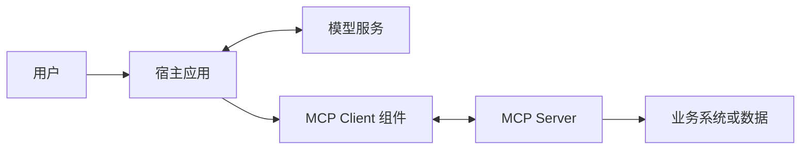
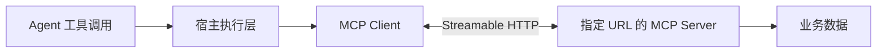
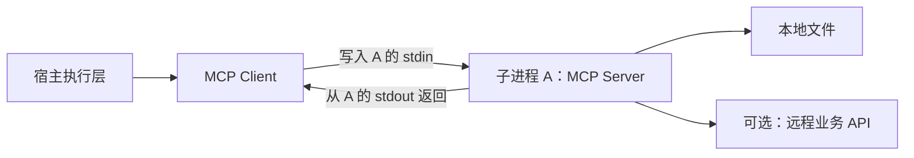
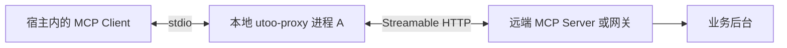

# Agent 与 MCP 接入原理

- 首次整理：2026-11-02
- 最近更新：2026-11-02
- 类型：原创学习笔记
- 来源：学习讨论整理、MCP 官方规范、OpenAI 官方文档与 Google Gmail API 文档；不是逐字对话记录。
- 标签：Agent、连接器、MCP、Host、Client、Server、stdio、Streamable HTTP、OAuth、工具调用

**先记住结论：连接器负责把业务能力接通，MCP 负责统一能力发现和调用；宿主是运行智能体的应用系统，MCP Client 是其中的协议组件。配置 URL 与配置 command 的区别，是连接现有 HTTP 服务，还是启动一个通过标准输入输出通信的服务子进程。**

本文面向有后端开发经验、初次系统学习智能体接入的读者。例子贯穿 Gmail、生财有术和一个脱敏的本地代理配置，先解释角色，再展开调用链与工程实现。产品行为核验时点为 **2026-11-02**；不据此推断任何平台未公开的内部代码。

## 导航

1. [从一个搜索任务理解 Agent](#agent)
2. [连接器和 MCP 各解决什么](#connector)
3. [Host、Client、Server 与进程](#roles)
4. [例子一 Gmail 业务适配与协议包装](#gmail)
5. [例子二 生财有术 URL 与 OAuth 接入](#shengcai)
6. [例子三 直接 URL 配置](#url)
7. [例子四 command 与本地 stdio 服务](#stdio)
8. [例子五 utoo-proxy 双角色桥接](#proxy)
9. [一次完整工具调用与宿主实现](#runtime)
10. [ChatGPT 自定义 MCP 与事件驱动](#chatgpt)
11. [安全、故障与常见误区](#boundaries)
12. [复习问答、术语与来源](#review)

<a id="agent"></a>
## 1. 从一个搜索任务理解 Agent

用户提出：“找到昨天收到的账单邮件，列出商家、金额和币种。”

单独的语言模型可以理解这句话，但不能凭语言能力知道邮箱里的真实内容。一个 Agent（智能体）系统需要把模型与工具、状态和执行控制结合起来：

1. 把用户目标和可用工具交给模型。
2. 模型提出搜索邮件的调用与参数。
3. 程序检查权限并执行搜索。
4. 模型阅读搜索结果，必要时要求读取邮件正文。
5. 程序继续执行，最后由模型形成答案。

这是“决策—执行—观察—再决策”的工作循环。模型是决策组件之一，整个智能体还包含实际运行的程序和约束；不能把模型输出的“我已搜索”当作搜索真的发生。

连接器给它提供访问外部系统的能力，但“随时服务”还需要任务状态、事件或调度、失败恢复和通知机制。**有连接器，不等于已经有一个全天候可靠运行的个人助手。**

本节是教学用系统拆解，不主张所有名为 Agent 的产品都采用完全相同的架构。

<a id="connector"></a>
## 2. 连接器和 MCP 各解决什么

MCP（Model Context Protocol，模型上下文协议）规定应用与工具服务交换能力及上下文的方式。[S1][S2]

| 维度 | 连接器 Connector | MCP |
| --- | --- | --- |
| 主要问题 | 怎样访问 Gmail、文档或订单系统 | 怎样让宿主以统一方式发现并调用这些能力 |
| 典型代码 | 账号映射、业务 API、分页、数据解析、限流和重试 | 工具描述、参数结构、协议消息、传输与结果格式 |
| 与业务关系 | 通常理解特定业务 | 协议本身不理解某家公司的业务 |
| 必须互相依赖吗 | 可以直接函数调用，也可使用自定义接口或 MCP | 既可包装连接器，也可暴露本地计算等能力 |

API（Application Programming Interface，应用程序接口）是宽泛概念；MCP 本身也是一种接口规范。不能简单理解为“API 被 MCP 替代”。更常见的是：外层使用 MCP，内部继续调用原有业务 API。

例如同一段搜索函数可以有两种暴露方式：

- 自定义方式：宿主知道某个 HTTP 接口的地址和请求格式，调用它。
- MCP 方式：服务注册搜索工具，宿主通过 `tools/list` 获取工具定义，通过 `tools/call` 调用。

采用 MCP 后，业务函数不会消失。标准化主要减少不同宿主与工具服务之间重复约定接入协议的工作；权限、数据质量和业务语义仍需开发者处理。

<a id="roles"></a>
## 3. Host、Client、Server 与进程

### 3.1 三个角色

| 角色 | 含义 | 本文例子 |
| --- | --- | --- |
| Host，宿主 | 承载模型交互、会话、工具选择与执行控制的应用系统 | ChatGPT 或自行开发的智能体应用 |
| MCP Client，协议客户端 | 宿主中与某个 MCP 服务通信的组件 | 执行工具发现和调用的 SDK 客户端 |
| MCP Server，协议服务端 | 向客户端提供工具、资源等能力的服务程序 | 生财有术 MCP 服务、本地文件工具 |

SDK（Software Development Kit，软件开发工具包）可以提供客户端和服务端的协议实现，避免手写每条协议消息。

**Host 不是“某台主机”的同义词。**在这里它指应用角色，不特指 Mac、浏览器或某台云服务器。Server 也指服务程序，不意味着必有一台独占机器。[S1]

### 3.2 逻辑角色不等于操作系统进程



文本解释：宿主与模型交互，并通过客户端组件连接工具服务；服务端再访问业务系统。图中的每个方框表示职责，不表示“每个方框必须是一个进程”。

- MCP Client 可以是宿主进程中的一个对象或模块。
- 多个服务可以分别由逻辑客户端管理，但不意味着每个客户端都要启动一个独立进程。
- 模型推理可以发生在远端；桌面应用的存在不代表模型就在本机运行。
- 平台是否使用共享网关、连接池或独立执行进程，需代码或明确文档验证，不能从一个配置文件推断。

类比：业务应用包含数据库客户端，客户端访问数据库。应用、客户端库和数据库是不同角色。这里仅作角色类比，MCP 不是数据库查询协议。

<a id="gmail"></a>
## 4. 例子一 Gmail 业务适配与协议包装

### 4.1 用户看到的一个动作，可能对应多个请求

教学目标：“搜索昨天的账单邮件，并读取匹配邮件的内容。”

Gmail 提供 `users.messages.list`，支持 `q` 搜索条件和分页；该接口的邮件条目只包含 `id` 与 `threadId`，获取详情需要再调用 `users.messages.get`。[S3][S4]

因此一个上层 `search_bill_emails` 工具可能依次完成：

1. 从已验证的用户身份找到对应的 Google 账号授权。
2. 把日期和条件转换成 Gmail 搜索表达式。
3. 调用列表接口，处理分页和数量上限。
4. 按需要读取部分邮件详情。
5. 返回商家、金额、币种、时间及证据，不返回访问令牌。

这部分是 **Gmail 业务适配代码**。它还要处理权限不足、账号断开和第三方限流。

### 4.2 MCP 层多做什么

MCP 层给这个函数增加名称、用途、输入结构和调用入口。下面只是原创教学工具设计，不代表任何已安装插件的真实工具名：

```json
{
  "name": "search_bill_emails",
  "description": "查找指定日期范围内的账单邮件，返回金额、币种与证据标识；不发送邮件。",
  "inputSchema": {
    "type": "object",
    "properties": {
      "start_date": {"type": "string"},
      "end_date": {"type": "string"},
      "limit": {"type": "integer", "minimum": 1, "maximum": 50}
    },
    "required": ["start_date", "end_date"],
    "additionalProperties": false
  },
  "annotations": {"readOnlyHint": true}
}
```

实际实现还应规定日期格式、时区和区间是否包含边界。`readOnlyHint` 是行为提示，不是安全控制；服务端仍需真正禁止写入。

**证据边界：**看见一个 Gmail 工具以 MCP 风格暴露，只能说明可见接入层；不能据此证明其后台一定直接调用 Gmail API、没有缓存或索引，也不能证明该 MCP 服务由 Google 官方运营。

<a id="shengcai"></a>
## 5. 例子二 生财有术 URL 与 OAuth 接入

场景：在 ChatGPT 添加一个名为“生财有术”的 MCP 服务，填写服务 URL 并配置 OAuth（Open Authorization，开放授权）认证。

可以从协议与产品功能理解为：

- ChatGPT 持有连接配置和授权关联。
- 宿主获取该服务提供的工具说明。
- 用户问“搜索跨境电商经验”时，模型提出某个搜索工具调用。
- 宿主通过客户端能力向已配置服务发送请求，再把结果交回模型。

**这里的 MCP Server，是配置 URL 对应的 MCP 服务程序。**它可能连接社区后台，也可能经过网关；与网站后台是否在同一台机器上，无法仅凭 URL 判断。

### 5.1 两个容易混淆的问题

**“添加服务，会在 Mac 上启动一个 MCP Client 进程吗？”**

不能这样推断。通过 ChatGPT 网页添加远程插件，与本机 `config.toml` 的本地工具配置是不同接入场景。远程接入需要客户端职责，但不等于在用户电脑创建独立客户端进程。[S5][S6]

**“Agent 调用 MCP Client 吗？”**

作为逻辑理解可以。更精确的表达是：模型提出工具调用，宿主的执行层校验并路由，客户端组件负责协议通信。模型一般不自己创建网络连接。

本例说明接入机制，**没有检查生财有术后端源码、部署拓扑或实际令牌管理实现**。

<a id="url"></a>
## 6. 例子三 直接 URL 配置

下面是本地宿主配置的教学示例；域名是占位符，不能直接用来测试：

```toml
[mcp_servers.community]
url = "https://mcp.example.com/mcp"
```

含义：连接一个已运行的 HTTP MCP 服务。配置不是服务部署命令，也不是下载服务器代码。



文本调用链：Agent 提议调用；宿主检查后，让 MCP Client 使用 Streamable HTTP（可流式传输的 HTTP）与指定服务通信。

- 不需要因为这一项配置，再启动一个本地 MCP 服务或转接代理。
- 不存在必须额外通过 stdin/stdout 中转的要求。
- URL 可以指向远端，也可以是 `http://localhost:3000/mcp`。因此准确区别是 **HTTP 端点与 stdio 子进程**，不是简单的远程与本地。
- 客户端对象数量、连接复用和进程划分属于宿主实现细节。
- 具体配置字段与认证支持须按宿主文档核对；本例对应官方 `config.toml` 配置模式，不是全体 MCP 宿主的通用配置格式。[S6]

<a id="stdio"></a>
## 7. 例子四 command 与本地 stdio 服务

下面假设开发者已经准备了一个本地 MCP 服务脚本；它是配置示例，不是已提供或已运行的程序：

```toml
[mcp_servers.local_notes]
command = "python3"
args = ["/absolute/path/to/notes_mcp_server.py"]
```

在本地执行场景下，宿主按该命令启动子进程 A，然后使用 stdio（standard input/output，标准输入输出）传输 MCP 消息。[S6]

- 宿主的 MCP Client 把请求写入 **A 的 stdin**。
- A 从自己的 stdin 读取请求、执行工具。
- A 把响应写到自己的 **stdout**，宿主读取。
- 普通日志应写入 stderr（standard error，标准错误输出），避免污染协议通道。[S7]



文本解释：子进程 A 是当前连接中的 **Server**，不是宿主的 Client。A 可以读取本地笔记，也可以通过 HTTP（Hypertext Transfer Protocol，超文本传输协议）访问远程数据。

**Server 并不等于“必须在远端”，本地子进程完全可以是服务端。**

此处限定本地运行。支持远程执行环境的宿主也可能把 command 放到远端执行，不能只看“command”一词就断言程序一定在当前 Mac 上。[S6]

<a id="proxy"></a>
## 8. 例子五 utoo-proxy 双角色桥接

### 8.1 脱敏配置

本例保留讨论中的程序名和参数形状，真实企业网关地址已替换，**不能直接运行该占位地址**：

```toml
[mcp_servers.skylark]
command = "utoo-proxy"
args = ["https://mcp.example.com/mcp", "-t", "STREAMABLE_HTTP"]
```

**配置可确定的事实：**连接名称是 `skylark`；启动命令是 `utoo-proxy`；向它传入 URL、`-t` 和 `STREAMABLE_HTTP` 三个参数。连接名称不是可执行文件名。

**合理且较强的推断：**根据 command 型配置及参数命名，它用于将本地 stdio MCP 连接转接到远端 Streamable HTTP MCP 服务。

**尚未核实：**未取得该代理的公开实现文档，未运行或检查本机可执行文件。不能保证参数内部语义、消息是否透传、请求 ID 是否重写、认证来源、会话管理和重连行为与某个通用代理相同。

### 8.2 一个进程可以在不同连接中扮演不同角色



文本解释：对左侧宿主而言，A 接受 MCP 调用，是 **Server**；对右侧远端服务而言，A 发起 MCP 调用，是 **Client**。因此它是双角色代理，不是必须在两种名称中选一个。

假设 Agent 要执行一个远端搜索工具，预期的桥接调用链是：

1. Agent 提出工具名和参数。
2. 宿主执行层检查权限，交给自身 MCP Client。
3. Client 将 MCP 工具请求写入 A 的 stdin。
4. A 用远端传输方式转发或重新发起请求。
5. 远端执行并返回结果。
6. A 将相应结果写回 stdout，宿主交给模型继续处理。

这主要是 **传输桥接**。远端仍应提供兼容的 MCP 接口；普通 REST（Representational State Transfer，表述性状态转移）业务接口不会仅因套上一个 URL 就自动成为 MCP。

### 8.3 修正最初的说法

原理解：“启动 MCP 客户端进程 A，Agent 通过 stdin/stdout 调用 A。”

更准确：“宿主启动本地 MCP 服务/代理进程 A，宿主的 MCP Client 通过 stdio 与 A 通信；如果 A 再连接远端 MCP，则 A 在远端连接中同时充当 Client。”

口诀只适用于这里的工具调用链：**发起工具请求的一侧是 Client，暴露并执行工具的一侧是 Server。**不要扩大成“MCP 永远只有客户端能发消息”；完整协议还包含通知及其他双向交互能力。[S1][S2]

<a id="runtime"></a>
## 9. 一次完整工具调用与宿主实现

### 9.1 工具发现和模型调用是两层接口

`tools/list` 返回工具名、用途和参数结构；`tools/call` 执行具体工具。模型厂商的 tool calling（工具调用）接口，则让模型输出工具名称、参数和调用关联标识。[S2]

下面是省略协议版本相关元数据的教学片段，**不是完整的可直接发送请求**：

```json
{"jsonrpc":"2.0","id":7,"method":"tools/call","params":{"name":"search_docs","arguments":{"query":"跨境电商"}}}
```

JSON-RPC（JSON Remote Procedure Call，基于 JSON 的远程过程调用）中的 `id: 7` 用于协议请求响应关联。模型接口产生的 tool-call ID 则用于模型对话中的工具结果关联。**这两个 ID 属于不同层，不能假设相同。**

### 9.2 最小宿主的五个模块

| 模块 | 需要实现的工作 |
| --- | --- |
| 会话状态 | 保存用户消息、模型回复、工具调用及结果 |
| 模型适配 | 将 MCP 工具结构转为模型接受的格式，再解析模型调用 |
| 连接管理 | 管理 HTTP 或 stdio 连接、超时、取消及释放 |
| 注册与路由 | 将对外工具别名映射到服务和原始工具名，解决重名 |
| 执行控制 | 校验参数与权限，必要时确认，执行并记录结果 |

例如两个服务都有 `search`，宿主可以向模型暴露 `gmail_search` 与 `docs_search`，再映射回各服务原名。这是宿主设计方案，不是所有平台的固定命名规则。

官方客户端教程展示了 SDK 连接、工具发现和模型结果回传的基本接法；具体类名和生命周期随 SDK 版本变化，开发时必须固定版本，不混用旧教程。[S8]

### 9.3 执行循环伪代码

以下是原创架构伪代码，不依赖某个特定 SDK，不能直接运行：

```text
发现服务工具，并按当前用户权限过滤
将工具定义适配成模型接受的格式

循环直到完成、用户取消或达到预算：
    调用模型（对话历史、可用工具）
    若模型给出最终答案：返回
    保存模型的工具调用消息
    对每个工具调用：
        按工具别名找到目标服务与工具
        校验参数、用户权限及确认要求
        通过目标服务的 MCP Client 执行调用
        区分业务错误、协议错误和网络错误
        将 MCP 结果适配成模型的工具结果消息
        用模型的调用 ID 关联结果，追加到历史
```

结果可能是文本、结构化数据或多模态内容，不能统一粗暴地转成字符串。工程上还需限制轮数、耗时、并发、返回大小和费用，避免失控循环。

<a id="chatgpt"></a>
## 10. ChatGPT 自定义 MCP 与事件驱动

本章描述 2026-11-02 核验到的公开产品功能，不代表用户每个账号、工作区和运行模式均已开放，也不揭示平台内部进程架构。

### 10.1 添加自定义服务

当前官方网页流程为：Plugins → 添加自定义 MCP server → 提供 Server URL 或 Tunnel → 认证 → 创建插件并安装；插件详情中可以管理工具与刷新服务定义。[S5]

这是添加连接配置，不是自动替开发者托管业务服务器。只做工具与数据结果时不必开发自定义界面；需要交互展示时再加入可选界面能力。[S9]

开发者仍负责业务适配、权限校验、稳定部署与可观测性。ChatGPT 承担宿主职责，并不能替代后端自己的数据授权。

### 10.2 OAuth 的两层边界

以 Gmail 适配器为例：

1. **ChatGPT → 自定义 MCP 服务：**证明谁可以使用这个工具服务、允许做什么。
2. **MCP 服务 → Google：**证明服务代表哪个 Google 用户、获准访问哪些 Gmail 能力。

两层可以共用身份体系，但不能把它们当作同一权限。用户不一定看到两次登录；设计上仍应明确各令牌的签发方、受众、有效期和范围。

公开认证方案采用 OAuth 2.1；服务端必须自行验签、核对 issuer/audience/expiry/scopes，并据身份做业务授权。[S10]

本地 `config.toml` 支持什么凭证方式，与 ChatGPT 网页自定义插件支持什么方式也不能互相套用。配置中没有显式认证字段，不证明无认证，也不证明用了 OAuth。

### 10.3 内网 MCP 与隧道

Secure MCP Tunnel（安全 MCP 隧道）可让内网客户端主动向 OpenAI 建立出站连接，领取请求、转发到内网 MCP 并返回结果，而不必开放公网入站端口。需要运行隧道客户端，并满足组织、工作区和使用权限要求。[S11]

隧道解决“如何到达服务”，不代替用户身份、资源访问权限和业务安全。普通 URL 的 `localhost` 也不会自动指向用户的 Mac；它指向实际发起连接的运行环境。

### 10.4 从能调用到事件触发

仅添加工具不会自动开始持续监控。当前官方 MCP Events（MCP 事件扩展）提供另一条受支持路径：[S12]

- `events/list` 描述可订阅事件和过滤条件。
- `events/subscribe` 建立订阅，保存范围和回调信息。
- 服务端在事件发生后发送带签名的 webhook（事件回调）。
- ChatGPT 异步处理，按用户指定的响应方式继续执行。
- `events/unsubscribe` 停止订阅。

官方列出的测试场景包括网页 Work、桌面 Work + Cloud 和 dot。需另外实现事件能力及用户订阅，不能把普通工具的存在等同于后台任务已建立。

教学例子：“这个文档收到新评论时，概括评论并提醒我。”工具提供读取文档的能力；事件负责何时触发；用户授权规定监控范围和如何响应。定时轮询是另一种调度方案，二者不应混为一谈。

<a id="boundaries"></a>
## 11. 安全、故障与常见误区

### 11.1 工程检查清单

以下是由协议边界推导的工程建议，不是声称每一项都是 MCP 强制规定：

- 通过验证后的身份确定用户，不能相信模型传入的任意 `user_id` 就授予访问。
- 不向模型或普通日志返回访问令牌、数据库密码等秘密。
- 读取到的邮件、网页和工具内容属于外部数据，不能提升为系统指令。
- 工具标记是提示；真正的授权、参数验证和业务限制必须落在服务端。
- 查询失败可以按策略重试；发送、修改等写操作超时后要先确认是否已执行，避免重复。
- 多用户连接、缓存和工具结果必须隔离，不能因复用连接而串号。
- 子进程需要关闭与清理；网络连接需要超时、取消、限流和恢复策略。
- 对事件处理做去重、过期管理和授权撤销检查，避免事件触发写入后又形成反馈循环。

### 11.2 常见误区速查

| 容易误解的说法 | 更准确的理解 |
| --- | --- |
| 连接器就是 MCP | 连接器是集成能力，MCP 是一种标准接入协议 |
| 宿主就是我的 Mac | 宿主是应用系统，部署位置需另看 |
| MCP Server 必须在远端 | 本地 stdio 子进程也可以是 Server |
| url 就一定是远程 | URL 也可以指向本机 HTTP 服务 |
| command 启动 MCP 客户端 | 标准 stdio 配置启动的是服务端程序，也可能是双角色代理 |
| 每个 MCP 必须一个客户端进程 | 逻辑组件不等于独立进程 |
| Agent 直接用 stdin 调工具 | 宿主执行层的客户端负责协议通信 |
| MCP 替我实现 Gmail 搜索业务 | MCP 包装调用接口，业务适配仍需代码 |
| 支持 MCP 就能自由访问所有数据 | 受账号、工具、资源授权和运行环境限制 |
| 配置完就会全天监控 | 还需调度或事件订阅及对应授权 |

<a id="review"></a>
## 12. 复习问答、术语与来源

### Q1. 连接器与 MCP 是竞争关系吗？
不是。连接器可以被 MCP 包装，也可以采用自定义接口；两者经常处于不同层。

### Q2. Host、Client、Server 在生财例子里分别是谁？
Host 是承载调用的 ChatGPT 应用系统；Client 是宿主的 MCP 通信组件；Server 是配置地址对应的生财 MCP 服务。不能由此确定机器或进程数量。

### Q3. url 配置会启动一个代理进程吗？
不需要由这项配置启动代理。宿主通过 HTTP 连接目标服务；实际平台可有自己的执行架构，但不能仅凭配置断言。

### Q4. command 配置启动的 A 是什么？
标准 stdio 场景下，A 是宿主连接的 MCP Server。即使 A 自己还会联网取数据，这个角色也不改变。

### Q5. utoo-proxy 为什么可以既是 Server 又是 Client？
因为角色相对于一条连接定义：它在宿主这一侧提供服务，在远端这一侧发起调用。这个配置的具体代理行为仍需实现验证。

### Q6. 为什么不能把日志随便写到 stdout？
stdio 模式用 stdout 传协议消息，普通日志可能破坏解析；日志应使用 stderr 或其他日志通道。

### Q7. 模型 tool-call ID 与 MCP 请求 ID 相同吗？
不是同一概念。宿主需要维护关联，将协议结果正确放回模型的工具调用上下文。

### Q8. Gmail 搜索工具一定只调用一次 Google API 吗？
不一定。先列邮件、再读详情、翻页都可能需要多次调用；一个上层工具可封装整个小工作流。

### Q9. 模型说要发送邮件，就算获得授权吗？
不算。模型提出动作，宿主与服务端仍需执行授权、确认及业务安全检查。

### Q10. URL 配置里看不到 OAuth，能判断没有认证吗？
不能。凭证可能由其他配置、登录状态或代理管理。需要检查具体产品与实现，不能猜测。

### Q11. 加入 MCP 能自动获得主动提醒吗？
不能自动获得。需要调度或事件能力、订阅与通知执行链，且受用户授权和产品支持范围约束。

### Q12. 自己开发 Host 最小要做什么？
接一个模型、一个只读 MCP 服务，实现工具发现、格式适配、权限校验、多轮执行和结果关联；再逐步加入界面与后台任务。

### 术语速查

| 术语 | 全称或含义 | 记忆点 |
| --- | --- | --- |
| Agent | 智能体 | 围绕目标组织决策、工具执行和反馈 |
| MCP | Model Context Protocol，模型上下文协议 | 标准能力交换接口 |
| Host | 宿主应用 | 承载整个交互与执行过程 |
| Client / Server | 客户端 / 服务端 | 相对于具体协议连接定义的角色 |
| stdio | standard input/output，标准输入输出 | 本地服务进程的协议传输方式 |
| Streamable HTTP | 可流式传输的 HTTP | MCP 的 HTTP 传输方式 |
| OAuth | Open Authorization，开放授权 | 委托访问与权限范围 |
| SDK | Software Development Kit，软件开发工具包 | 封装协议和常用实现 |
| tool calling | 工具调用 | 模型生成结构化工具使用请求 |
| webhook | 事件回调 | 事件发生后向约定端点送达通知 |

### 原始资料与适用范围

以下均为官方资料链接，核验日期为 2026-11-02。文档内容会演进；本文不复制外部全文，例子为原创教学示意。

- **[S1]** [MCP Architecture overview](https://modelcontextprotocol.io/docs/learn/architecture)：Host、Client、Server、协议与传输角色。
- **[S2]** [MCP Tools specification](https://modelcontextprotocol.io/specification/latest/server/tools)：工具定义、发现、调用与结果。
- **[S3]** [Gmail users.messages.list](https://developers.google.com/workspace/gmail/api/reference/rest/v1/users.messages/list)：搜索、分页和 ID 返回范围。
- **[S4]** [Gmail users.messages.get](https://developers.google.com/workspace/gmail/api/reference/rest/v1/users.messages/get)：邮件详情接口。
- **[S5]** [OpenAI Add custom MCP server](https://developers.openai.com/api/docs/guides/custom-mcp-server)：ChatGPT 自定义服务入口和管理。
- **[S6]** [ChatGPT Learn MCP configuration](https://learn.chatgpt.com/docs/extend/mcp)：本地配置、command、url 和运行环境边界。
- **[S7]** [MCP stdio transport](https://modelcontextprotocol.io/specification/2026-07-28/basic/transports/stdio)：stdio 与 HTTP 传输规范。
- **[S8]** [Build an MCP client](https://modelcontextprotocol.io/docs/develop/build-client)：客户端连接及模型工具循环的官方教程。
- **[S9]** [OpenAI Build an MCP server](https://developers.openai.com/plugins/build/mcp-server)：工具注册、结构化结果、可选界面和服务端责任。
- **[S10]** [OpenAI Authentication](https://developers.openai.com/plugins/build/auth)：授权发现和令牌校验边界。
- **[S11]** [OpenAI Secure MCP Tunnel](https://developers.openai.com/api/docs/guides/secure-mcp-tunnels)：私网服务接入方式。
- **[S12]** [OpenAI MCP Events](https://developers.openai.com/plugins/build/mcp-events)：事件发现、订阅、签名回调与生命周期。

相关阅读：[大模型基础学习笔记](2026-11-01-大模型基础学习笔记.md)关注模型内部计算；本文关注模型之外的应用、工具与执行系统。两层结合，才形成可以访问外部世界的完整应用。
