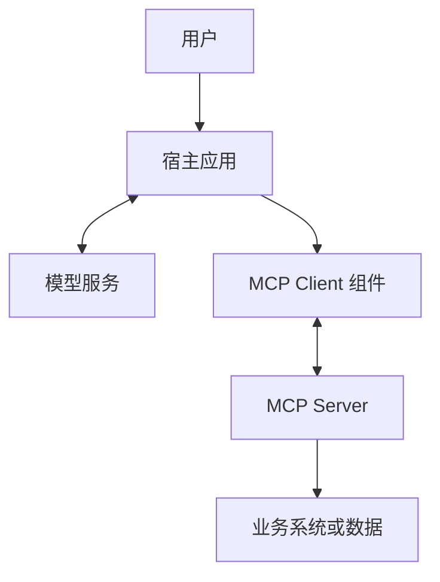
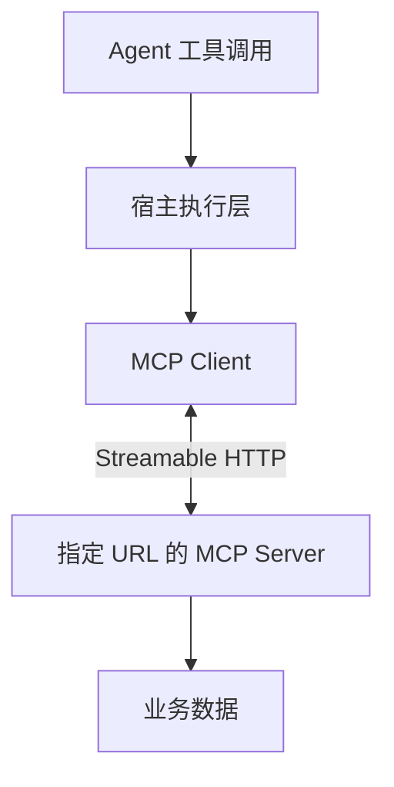
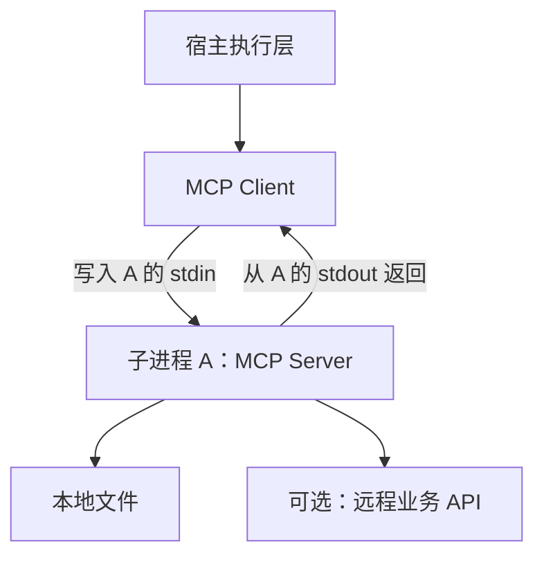
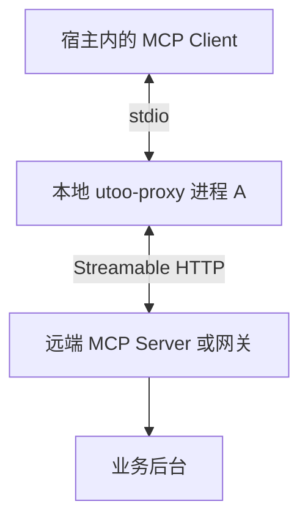
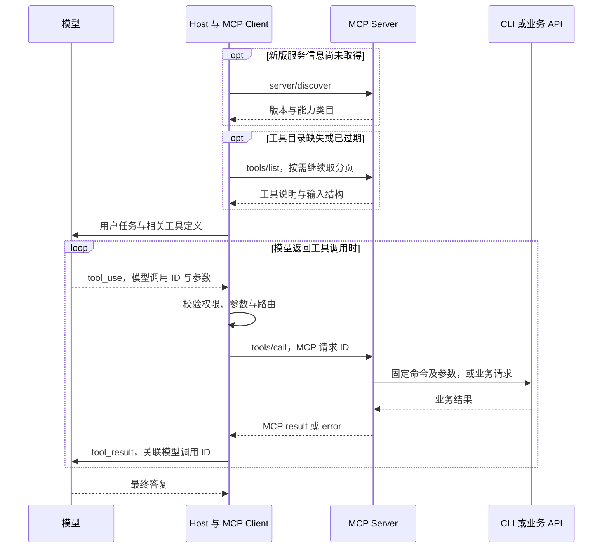
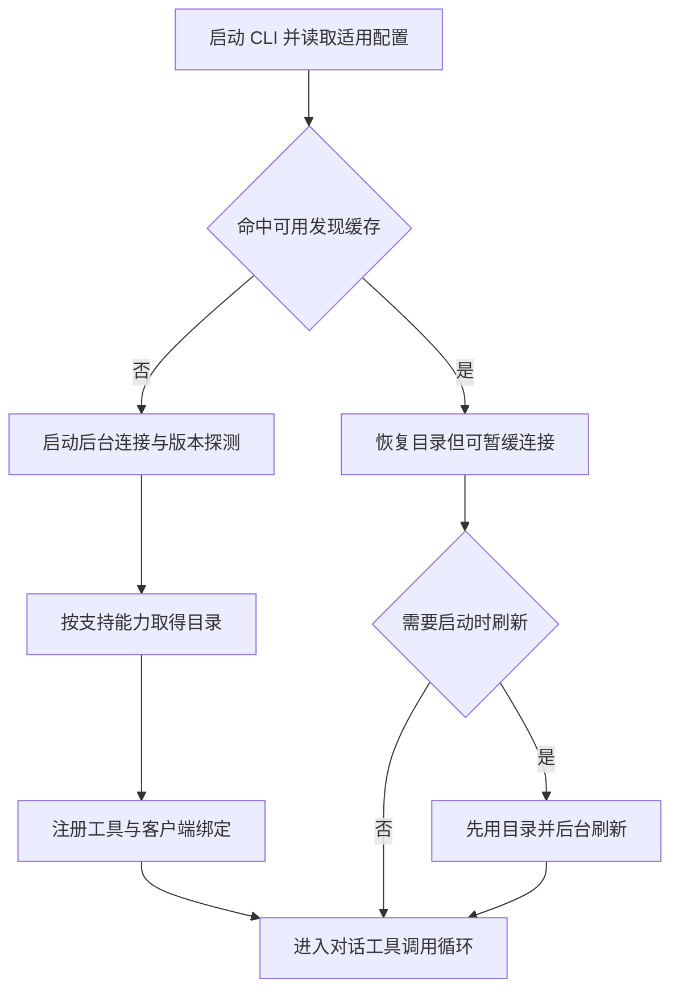
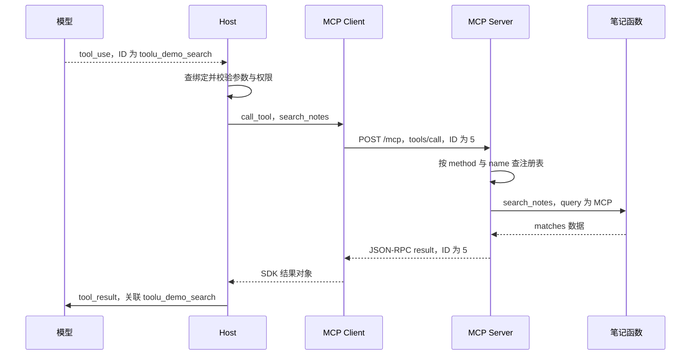
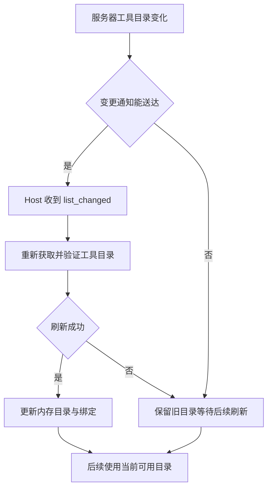

# Agent 与 MCP 接入原理

- 首次整理：2026-11-02
- 最近更新：2026-11-08
- 类型：原创学习笔记
- 来源：学习讨论整理、MCP 官方规范、OpenAI 与 Anthropic 官方文档、Google Gmail API 文档，以及注明版本的本地实验；不是逐字对话记录。
- 标签：Agent、连接器、MCP、Host、Client、Server、stdio、Streamable HTTP、JSON-RPC、OAuth、工具调用、CLI、IPC、工具搜索、上下文管理、Claude Code、发现缓存

**先记住结论：连接器负责把业务能力接通，MCP 负责统一能力发现和调用；宿主是运行智能体的应用系统，MCP Client 是其中的协议组件。配置 URL 与配置 command 的区别，是连接现有 HTTP 服务，还是启动一个通过标准输入输出通信的服务子进程。**

本文面向有后端开发经验、初次系统学习智能体接入的读者。例子贯穿 Gmail、生财有术和一个脱敏的本地代理配置，先解释角色，再展开调用链与工程实现。首次产品快照为 **2026-11-02**；本轮在 **2026-11-08** 补核 MCP 2026-07-28 与 Anthropic 文档，第 10 章保留原快照日期；不据此推断任何平台未公开的内部代码。

本次增量融入第 6、9、12 章，最后的[第 13 章](#claude-code-case)以 Claude Code CLI（命令行客户端）为完整例子。通用协议、产品行为、特定版本代码观察与实际实验分别标注；《MCP 官方协议中文版指南》作为只读参考，不在本次修改范围内。此前已收录的激活函数、分词器和 stdio 基础不重复建文。

## 导航

1. [从一个搜索任务理解 Agent](#agent)
2. [连接器和 MCP 各解决什么](#connector)
3. [Host、Client、Server 与进程](#roles)
4. [例子一 Gmail 业务适配与协议包装](#gmail)
5. [例子二 生财有术 URL 与 OAuth 接入](#shengcai)
6. [例子三 直接 URL 配置](#url)
7. [例子四 command 与本地 stdio 服务](#stdio)
8. [例子五 utoo-proxy 双角色桥接](#proxy)
9. [一次完整工具调用与宿主实现](#runtime)
10. [ChatGPT 自定义 MCP 与事件驱动](#chatgpt)
11. [安全、故障与常见误区](#boundaries)
12. [复习问答、术语与来源](#review)
13. [完整例子：Claude Code 通过 HTTP 使用 MCP](#claude-code-case)

本轮重点入口：[HTTP method 与 JSON-RPC method](#http-rpc-method) · [多 URL 与服务端分发](#endpoint-dispatch) · [方法全集与实现条件](#method-contract) · [状态保存范围](#catalog-state) · [探测时机](#discovery-timing) · [能力变更](#catalog-refresh) · [模型与 skill 加载](#catalog-model) · [CLI 全流程案例](#claude-code-case)。

<a id="agent"></a>
## 1. 从一个搜索任务理解 Agent

用户提出：“找到昨天收到的账单邮件，列出商家、金额和币种。”

单独的语言模型可以理解这句话，但不能凭语言能力知道邮箱里的真实内容。一个 Agent（智能体）系统需要把模型与工具、状态和执行控制结合起来：

1. 把用户目标和可用工具交给模型。
2. 模型提出搜索邮件的调用与参数。
3. 程序检查权限并执行搜索。
4. 模型阅读搜索结果，必要时要求读取邮件正文。
5. 程序继续执行，最后由模型形成答案。

这是“决策—执行—观察—再决策”的工作循环。模型是决策组件之一，整个智能体还包含实际运行的程序和约束；不能把模型输出的“我已搜索”当作搜索真的发生。

连接器给它提供访问外部系统的能力，但“随时服务”还需要任务状态、事件或调度、失败恢复和通知机制。**有连接器，不等于已经有一个全天候可靠运行的个人助手。**

本节是教学用系统拆解，不主张所有名为 Agent 的产品都采用完全相同的架构。

<a id="connector"></a>
## 2. 连接器和 MCP 各解决什么

MCP（Model Context Protocol，模型上下文协议）规定应用与工具服务交换能力及上下文的方式。[S1][S2]

| 维度 | 连接器 Connector | MCP |
| --- | --- | --- |
| 主要问题 | 怎样访问 Gmail、文档或订单系统 | 怎样让宿主以统一方式发现并调用这些能力 |
| 典型代码 | 账号映射、业务 API、分页、数据解析、限流和重试 | 工具描述、参数结构、协议消息、传输与结果格式 |
| 与业务关系 | 通常理解特定业务 | 协议本身不理解某家公司的业务 |
| 必须互相依赖吗 | 可以直接函数调用，也可使用自定义接口或 MCP | 既可包装连接器，也可暴露本地计算等能力 |

API（Application Programming Interface，应用程序接口）是宽泛概念；MCP 本身也是一种接口规范。不能简单理解为“API 被 MCP 替代”。更常见的是：外层使用 MCP，内部继续调用原有业务 API。

例如同一段搜索函数可以有两种暴露方式：

- 自定义方式：宿主知道某个 HTTP 接口的地址和请求格式，调用它。
- MCP 方式：服务注册搜索工具，宿主通过 `tools/list` 获取工具定义，通过 `tools/call` 调用。

采用 MCP 后，业务函数不会消失。标准化主要减少不同宿主与工具服务之间重复约定接入协议的工作；权限、数据质量和业务语义仍需开发者处理。

<a id="roles"></a>
## 3. Host、Client、Server 与进程

### 3.1 三个角色

| 角色 | 含义 | 本文例子 |
| --- | --- | --- |
| Host，宿主 | 承载模型交互、会话、工具选择与执行控制的应用系统 | ChatGPT 或自行开发的智能体应用 |
| MCP Client，协议客户端 | 宿主中与某个 MCP 服务通信的组件 | 执行工具发现和调用的 SDK 客户端 |
| MCP Server，协议服务端 | 向客户端提供工具、资源等能力的服务程序 | 生财有术 MCP 服务、本地文件工具 |

SDK（Software Development Kit，软件开发工具包）可以提供客户端和服务端的协议实现，避免手写每条协议消息。

**Host 不是“某台主机”的同义词。**在这里它指应用角色，不特指 Mac、浏览器或某台云服务器。Server 也指服务程序，不意味着必有一台独占机器。[S1]

### 3.2 逻辑角色不等于操作系统进程



文本解释：宿主与模型交互，并通过客户端组件连接工具服务；服务端再访问业务系统。图中的每个方框表示职责，不表示“每个方框必须是一个进程”。

- MCP Client 可以是宿主进程中的一个对象或模块。
- 多个服务可以分别由逻辑客户端管理，但不意味着每个客户端都要启动一个独立进程。
- 模型推理可以发生在远端；桌面应用的存在不代表模型就在本机运行。
- 平台是否使用共享网关、连接池或独立执行进程，需代码或明确文档验证，不能从一个配置文件推断。

类比：业务应用包含数据库客户端，客户端访问数据库。应用、客户端库和数据库是不同角色。这里仅作角色类比，MCP 不是数据库查询协议。

### 3.3 三层拆开：协议说什么，传输怎么送，操作系统怎样连

本轮追问集中在“把 CLI 包成 MCP 后，实际发生了什么”。先固定三个维度，后文再各自展开：

| 层次 | 需要回答的问题 | 本例中的对象 |
| --- | --- | --- |
| 协议语义 Protocol Semantics | 请求叫什么、参数是什么、怎样关联结果与错误？ | MCP 的 `tools/list`、`tools/call`，以及 JSON-RPC 消息 |
| 传输绑定 Transport Binding | 怎样分隔、送达与结束这些消息？ | stdio 的逐行消息；Streamable HTTP 的 POST 与 JSON/SSE 响应 |
| 操作系统与网络通道 | 进程之间如何实际传字节？ | 匿名管道、socket pair、网络连接等，由运行时实现决定 |

CLI（Command-Line Interface，命令行界面）是服务内部可调用的一种业务入口。CLI 不因输出了 JSON 就自动具备 MCP 的能力发现、版本处理和工具调用语义。反过来，MCP 也不限定业务必须通过命令行实现。[S13][S14]

在这一层次关系中，**MCP Client 通常是 Host 内的协议组件；stdio 不是另一个客户端；stdin 也不是一个工具名。**“本地/远端”表示部署位置，“stdio/HTTP”表示传输方式，不能互相替代。

<a id="gmail"></a>
## 4. 例子一 Gmail 业务适配与协议包装

### 4.1 用户看到的一个动作，可能对应多个请求

教学目标：“搜索昨天的账单邮件，并读取匹配邮件的内容。”

Gmail 提供 `users.messages.list`，支持 `q` 搜索条件和分页；该接口的邮件条目只包含 `id` 与 `threadId`，获取详情需要再调用 `users.messages.get`。[S3][S4]

因此一个上层 `search_bill_emails` 工具可能依次完成：

1. 从已验证的用户身份找到对应的 Google 账号授权。
2. 把日期和条件转换成 Gmail 搜索表达式。
3. 调用列表接口，处理分页和数量上限。
4. 按需要读取部分邮件详情。
5. 返回商家、金额、币种、时间及证据，不返回访问令牌。

这部分是 **Gmail 业务适配代码**。它还要处理权限不足、账号断开和第三方限流。

### 4.2 MCP 层多做什么

MCP 层给这个函数增加名称、用途、输入结构和调用入口。下面只是原创教学工具设计，不代表任何已安装插件的真实工具名：

```json
{
  "name": "search_bill_emails",
  "description": "查找指定日期范围内的账单邮件，返回金额、币种与证据标识；不发送邮件。",
  "inputSchema": {
    "type": "object",
    "properties": {
      "start_date": {"type": "string"},
      "end_date": {"type": "string"},
      "limit": {"type": "integer", "minimum": 1, "maximum": 50}
    },
    "required": ["start_date", "end_date"],
    "additionalProperties": false
  },
  "annotations": {"readOnlyHint": true}
}
```

实际实现还应规定日期格式、时区和区间是否包含边界。`readOnlyHint` 是行为提示，不是安全控制；服务端仍需真正禁止写入。

**证据边界：**看见一个 Gmail 工具以 MCP 风格暴露，只能说明可见接入层；不能据此证明其后台一定直接调用 Gmail API、没有缓存或索引，也不能证明该 MCP 服务由 Google 官方运营。

<a id="shengcai"></a>
## 5. 例子二 生财有术 URL 与 OAuth 接入

场景：在 ChatGPT 添加一个名为“生财有术”的 MCP 服务，填写服务 URL 并配置 OAuth（Open Authorization，开放授权）认证。

可以从协议与产品功能理解为：

- ChatGPT 持有连接配置和授权关联。
- 宿主获取该服务提供的工具说明。
- 用户问“搜索跨境电商经验”时，模型提出某个搜索工具调用。
- 宿主通过客户端能力向已配置服务发送请求，再把结果交回模型。

**这里的 MCP Server，是配置 URL 对应的 MCP 服务程序。**它可能连接社区后台，也可能经过网关；与网站后台是否在同一台机器上，无法仅凭 URL 判断。

### 5.1 两个容易混淆的问题

**“添加服务，会在 Mac 上启动一个 MCP Client 进程吗？”**

不能这样推断。通过 ChatGPT 网页添加远程插件，与本机 `config.toml` 的本地工具配置是不同接入场景。远程接入需要客户端职责，但不等于在用户电脑创建独立客户端进程。[S5][S6]

**“Agent 调用 MCP Client 吗？”**

作为逻辑理解可以。更精确的表达是：模型提出工具调用，宿主的执行层校验并路由，客户端组件负责协议通信。模型一般不自己创建网络连接。

本例说明接入机制，**没有检查生财有术后端源码、部署拓扑或实际令牌管理实现**。

<a id="url"></a>
## 6. 例子三 直接 URL 配置

下面是本地宿主配置的教学示例；域名是占位符，不能直接用来测试：

```toml
[mcp_servers.community]
url = "https://mcp.example.com/mcp"
```

含义：连接一个已运行的 HTTP MCP 服务。配置不是服务部署命令，也不是下载服务器代码。



文本调用链：Agent 提议调用；宿主检查后，让 MCP Client 使用 Streamable HTTP（可流式传输的 HTTP）与指定服务通信。

- 不需要因为这一项配置，再启动一个本地 MCP 服务或转接代理。
- 不存在必须额外通过 stdin/stdout 中转的要求。
- URL 可以指向远端，也可以是 `http://localhost:3000/mcp`。因此准确区别是 **HTTP 端点与 stdio 子进程**，不是简单的远程与本地。
- 客户端对象数量、连接复用和进程划分属于宿主实现细节。
- 具体配置字段与认证支持须按宿主文档核对；本例对应官方 `config.toml` 配置模式，不是全体 MCP 宿主的通用配置格式。[S6]

<a id="transport-comparison"></a>
### 6.1 Streamable HTTP 是什么，与 stdio、普通 HTTP 怎样比较？

HTTP（Hypertext Transfer Protocol，超文本传输协议）已经规定请求、响应、状态码、头与消息体。**Streamable HTTP（可流式 HTTP 传输）是 MCP 在 HTTP 上定义的传输绑定**，统一 MCP 消息如何发往一个端点，以及结果用 JSON（JavaScript Object Notation，JavaScript 对象表示法）或 SSE（Server-Sent Events，服务端发送事件）返回。[S14]

| 比较项 | stdio MCP | Streamable HTTP MCP | 常见业务 HTTP JSON 接口 |
| --- | --- | --- | --- |
| 如何接入 | 启动命令、参数、环境 | 已知 MCP URL | 已知业务 URL |
| 消息承载 | 子进程 stdin/stdout | HTTP 请求与响应体 | HTTP 请求与响应体 |
| 消息边界 | 一行一个 JSON-RPC 消息 | 单个 JSON 或 SSE 事件 | 由接口约定 |
| 如何发现功能 | MCP 的能力与工具目录方法 | 同样的 MCP 方法 | 自定目录，或依赖业务文档 |
| 调用含义 | `tools/call` 及工具参数 | `tools/call` 及工具参数 | 例如 `/notes/search` 自定请求 |
| 服务生命周期 | 客户端通常启动并管理子进程 | 服务独立运行，可集中提供能力 | 服务通常独立运行 |
| 常见场景 | 本机 CLI、文件与开发工具 | 跨进程或跨机器的集中接入 | 专门业务集成 |

“普通 HTTP”并非严谨的另一种协议名，这里指常见的一次请求返回一个 JSON 的业务接口。**HTTP 本来就能流式传输**；SSE 也使用 HTTP。因此不能用“一个能流式、另一个不能”解释根本区别。MCP 多约定的是消息方法、发现机制、参数、结果、错误和版本元数据等。[S13][S14]

例子：`POST /notes/search` 收到 `{"q":"MCP"}` 后直接返回业务数据，可以是普通 API；`POST /mcp` 收到方法为 `tools/call`、工具名为 `search_notes` 的 MCP 消息，则按协议返回关联结果。后者内部仍可调用前者。

<a id="mcp-versioning"></a>
### 6.2 先看协议版本，再画初始化和消息方向

**本轮核验：2026-11-08。**主线采用官方 **2026-07-28** 版，并与 **2025-11-25** 握手时代对照；旧版代码仍可能运行在真实系统中，不能把新版机制和旧版握手拼成一条必经流程。[S15][S16]

| 机制 | 2025-11-25 等旧版 | 2026-07-28 主线 |
| --- | --- | --- |
| 开始交换能力 | `initialize` 请求/响应，再发 `notifications/initialized` | 逐请求携带版本、客户端身份与能力；可先查 `server/discover` |
| 发现是否必经 | 先完成初始化握手 | `server/discover` 不是所有调用的必经前置；stdio 探测尤其有用 |
| HTTP 协议会话 | 可由服务分配 `Mcp-Session-Id` | 已移除协议会话；应用业务状态另行管理 |
| 服务需要客户端补充输入 | 可发独立 JSON-RPC 请求 | 在业务响应里返回 `input_required`，走多次往返 |
| 长期变化通知 | 可使用独立 GET SSE 流 | 使用 POST `subscriptions/listen` 的响应流 |
| 取消 HTTP 请求 | 按旧版通知与生命周期规则 | 关闭对应响应流，表示客户端放弃该请求 |

新版没有初始化握手，并不表示没有身份验证、能力声明或业务状态。**Host 的聊天会话、HTTP 连接复用、MCP 协议会话、业务任务状态是不同对象。**需要跨调用延续的任务，可以用服务显式返回的句柄继续引用；不能依靠模型记住未返回的服务内状态。

兼容程序应先判断对端支持的协议时代，再按相应规则工作。支持新版但版本不匹配时，应读取支持版本并选择交集；不能把所有错误都当作“旧版服务”。准确回退行为须核对所用 SDK（Software Development Kit，软件开发工具包）。[S15]

<a id="http-wire"></a>
### 6.3 一次 HTTP 调用实际长什么样？

2026-07-28 版的每个消息单独 POST 到 MCP 端点。下例对应 [9.7 节](#wire-example) 的完整请求体，头字段只展示该工具需要的标准项，不含认证信息：

```http
POST /mcp HTTP/1.1
Content-Type: application/json
Accept: application/json, text/event-stream
MCP-Protocol-Version: 2026-07-28
Mcp-Method: tools/call
Mcp-Name: search_notes
```

其中 `Mcp-Method`、`Mcp-Name` 镜像方法和适用的工具名，便于中间层路由；消息体仍是事实来源，头与体不一致需要拒绝。具体工具还可能声明额外参数映射；不能据此示例省略该工具要求的字段。[S14]

服务可直接返回 `application/json` 的最终响应，也可用 `text/event-stream` 逐条发送进度与最终结果。下面是**显示消息格式的原创简化片段**：

```text
event: message
data: {"jsonrpc":"2.0","method":"notifications/progress","params":{"progressToken":"p42","progress":1,"total":2}}

event: message
data: {"jsonrpc":"2.0","id":42,"result":{"resultType":"complete","content":[{"type":"text","text":"找到一篇笔记"}],"isError":false}}

```

每个 SSE 事件由空行结束。网络读取与事件不是一一对应关系：一次读取可能只有半条事件，也可能带来多条。客户端需要增量解析，不能把每个网络数据块直接当完整 JSON。[S32]

这里“流式”的对象是 **MCP 协议消息**；`notifications/progress` 也不等于模型正在逐词输出最终回答。反过来，stdio 也能在共享输出流中先送进度、后送结果，并非只能一次性返回。[S7][S22]

<a id="http-rpc-method"></a>
### 6.4 HTTP 只有 GET/POST，为什么请求里又有 tools/call？

这几个名称位于不同层。先看一条调用，再分别读它的字段：

```http
POST /mcp HTTP/1.1
Content-Type: application/json
Accept: application/json, text/event-stream
MCP-Protocol-Version: 2026-07-28
Mcp-Method: tools/call
Mcp-Name: search_notes

{"jsonrpc":"2.0","id":42,"method":"tools/call","params":{"name":"search_notes","arguments":{"query":"MCP"},"_meta":{"io.modelcontextprotocol/protocolVersion":"2026-07-28","io.modelcontextprotocol/clientCapabilities":{}}}}
```

| 层次 | 本例字段 | 由谁规定 | 解决什么 |
| --- | --- | --- | --- |
| HTTP 方法 | 请求行的 `POST` | HTTP | 这次 HTTP 请求的语义 |
| HTTP 请求目标 | `/mcp` | 服务部署与传输绑定 | 请求送到哪个端点；路径名不强制是 `/mcp` |
| JSON-RPC 方法 | body 的 `method: tools/call` | 信封字段由 JSON-RPC 定义，具体方法名由 MCP 定义 | 调用哪一种协议操作 |
| MCP 工具名 | `params.name: search_notes` | 该服务发布的工具目录 | 执行哪一个业务工具 |
| 业务参数 | `arguments.query: MCP` | 该工具的 `inputSchema` | 把什么输入交给工具 |
| 请求关联 | `id: 42` | JSON-RPC | 把最终响应对应到原请求 |

HTTP 方法也不只五个：除 GET、POST、PUT、DELETE 等，还有 HEAD、OPTIONS、CONNECT、TRACE，PATCH 由扩展规范定义；方法集合可以扩展。`Mcp-Method` 是请求头，不是新增的 HTTP 方法。[S37]

**JSON-RPC 2.0 是消息协议，不是某个框架。**框架或 SDK 可以实现它。它规定请求、通知、响应、ID、参数和错误的格式，可以通过 HTTP、stdio 等通道承载，并非只能存在于 HTTP 的业务代码中。[S31]

从 HTTP 的视角看，body 确实是上层载荷；从互通的视角看，这份载荷遵守标准消息协议。可以把 `method` 直觉理解为“操作类型”，但**不能在 MCP 报文中随意把字段改名为 `type`**：那将成为自己的消息格式，标准客户端不再按 JSON-RPC 识别。同理，`type: tool_use` 是模型接口内容块的字段，不是 JSON-RPC 的 `method`。[S27][S31]

<a id="endpoint-dispatch"></a>
### 6.5 为什么用一个 MCP 端点？服务器还需要再路由吗？

`POST /search_notes`、`POST /save_notes` 这类接口完全可以提供业务服务。按资源组织也可以采用 `GET /notes?query=MCP`、`POST /notes`。前者偏向按动作命名，后者更接近常见资源接口；**多 URL 本身不是错误，也不存在“多 URL 天生不能被模型调用”的限制。**宿主可以根据接口文档或 OpenAPI 描述编写适配器。[S37]

MCP 选择统一端点和消息方法，是为了让通用客户端使用相同的发现、调用、错误与版本规则，而不必为每家服务另约一套 URL。两种模式可以共存：外部 `POST /mcp`，内部调用原有 `/notes/search`。这是接口契约与适配成本的选择，不是未经测试的性能优劣结论。[S14][S18]

**服务器仍要分发，只是通常由 SDK 完成：**

| 所在位置 | 用什么选择目标 | 本例 |
| --- | --- | --- |
| Host 的工具绑定 | 模型可见别名 → 客户端与原始工具名 | `mcp__notes__search_notes` → `notes` / `search_notes` |
| HTTP 层 | 请求目标 | `/mcp` → MCP 协议处理器 |
| JSON-RPC 层 | `method` | `tools/call` → 工具调用处理器 |
| 工具层 | `params.name` | `search_notes` → 已注册函数 |

前两侧路由承担不同职责，不会因为 Host 已经选中服务器，就使服务端不再需要识别方法与工具。下面是**省略认证、schema 校验与错误封装的教学伪代码**：

```python
def dispatch(message, tool_registry):
    method = message["method"]
    if method == "tools/list":
        return describe_tools(tool_registry)
    if method == "tools/call":
        params = message["params"]
        handler = tool_registry[params["name"]]
        return handler(**params.get("arguments", {}))
    raise UnknownMethod(method)
```

这里没有第二次用 LLM（Large Language Model，大语言模型）猜意图：工具名已经确定，服务端查表执行。SDK 的工具注册器就是在帮开发者维护这类映射。[S18]

服务端也不需要先证明“调用方背后有 Agent”才能执行。一个普通程序只要发送合规 MCP 请求、满足认证与业务授权，就能调用相同工具。新版 `clientInfo` 可以描述调用程序，但它不是可信的账号身份证明，不能替代令牌验证和数据授权。[S17][S24]

<a id="method-contract"></a>
### 6.6 方法全集在哪里，是每个服务都要全部实现吗？

**先按协议修订判断，再按所声明能力判断。**以 2026-07-28 为例，服务端必须支持 `server/discover`，但客户端可以不把发现作为每次业务调用的前置。只有提供 Tools 能力时，才需要实现相应的工具目录与调用契约；不提供资源或提示模板的服务，不需要为了凑接口数量虚构空功能。[S17][S18]

| 想核对什么 | 权威入口 | 不能混淆的对象 |
| --- | --- | --- |
| 必填字段、请求与结果类型 | [2026-07-28 Schema Reference](https://modelcontextprotocol.io/specification/2026-07-28/schema)；规范首页同时链接权威 `schema.ts` | 类型全集不等于每个服务的能力清单 |
| 某方法何时可用、必须怎样处理 | [对应修订的 Specification](https://modelcontextprotocol.io/specification/2026-07-28) 及该功能页 | 不能只看 TypeScript 类型就推断全部行为规则 |
| 方法、通知和类型的中文导航 | [官方协议中文版指南第 9 章](2026-11-08-MCP官方协议中文版指南.md#ch9) | 本库已有参考，不在这里重复全文 |
| 自己连接的服务器实际提供什么 | 发现结果中的能力声明、对应列表及认证结果 | 协议允许的集合与当前账号可见的集合不同 |

例如一个仅提供搜索工具的服务，可以不提供 Prompts 和 Resources；`tools/list` 分页还可能产生多次请求。**“握手阶段固定调用三个列表接口”不是通用规则。**旧版的必经初始化与新版发现的区别继续见 [6.2 节](#mcp-versioning)。

<a id="stdio"></a>
## 7. 例子四 command 与本地 stdio 服务

下面假设开发者已经准备了一个本地 MCP 服务脚本；它是配置示例，不是已提供或已运行的程序：

```toml
[mcp_servers.local_notes]
command = "python3"
args = ["/absolute/path/to/notes_mcp_server.py"]
```

在本地执行场景下，宿主按该命令启动子进程 A，然后使用 stdio（standard input/output，标准输入输出）传输 MCP 消息。[S6]

- 宿主的 MCP Client 把请求写入 **A 的 stdin**。
- A 从自己的 stdin 读取请求、执行工具。
- A 把响应写到自己的 **stdout**，宿主读取。
- 普通日志应写入 stderr（standard error，标准错误输出），避免污染协议通道。[S7]



文本解释：子进程 A 是当前连接中的 **Server**，不是宿主的 Client。A 可以读取本地笔记，也可以通过 HTTP（Hypertext Transfer Protocol，超文本传输协议）访问远程数据。

**Server 并不等于“必须在远端”，本地子进程完全可以是服务端。**

此处限定本地运行。支持远程执行环境的宿主也可能把 command 放到远端执行，不能只看“command”一词就断言程序一定在当前 Mac 上。[S6]

<a id="stdio-ipc"></a>
### 7.1 stdin/stdout 是 Linux 标准流吗，底层是管道还是 socket？

stdin（standard input，标准输入）、stdout（standard output，标准输出）、stderr（standard error，标准错误输出）是进程常见的标准流，并非 Linux 独有。POSIX（Portable Operating System Interface，可移植操作系统接口）系统中，它们通常对应文件描述符 0、1、2；stdin 是输入方向，stdout 是输出方向，不能把二者当成同一个双向对象。[S30]

IPC（Inter-Process Communication，进程间通信）是大类。**标准流是程序读写接口；管道或套接字是可能承载这些字节的底层机制。**[S7][S29]

| 名称 | 这一层表示什么 | 能否仅凭 stdio 配置确定？ |
| --- | --- | --- |
| 标准流 | 子进程从哪里读取、向哪里输出 | 可以确定协议使用 stdin/stdout |
| Anonymous Pipe（匿名管道） | 常见的父子进程字节通道 | 某些运行时这样实现，不能一概而论 |
| Socket Pair（套接字对） | 两个相连的套接字端点，也可接到标准流 | 也是可能实现，需查运行时代码或描述符 |
| Unix Domain Socket（Unix 域套接字） | 本机进程通信的一类套接字机制 | 不能因为“本地”就断言一定使用它 |
| TCP（Transmission Control Protocol，传输控制协议）连接 | 网络字节通道，可发生在本机或跨机器 | 不由 stdio 这个配置词推出 |

以常见的管道实现为例：父进程持有一个写端，连接子进程的 stdin；父进程另持有一个读端，连接子进程的 stdout。父端调用 `write`，服务端调用 `read`；响应方向相反。由两个方向组成请求/响应通道。**MCP 规定读写与消息格式，不强制所有运行时使用同一种 OS（Operating System，操作系统）对象。**

如果改成让程序直接监听 Unix socket 或 TCP，再复用相同逐行 JSON-RPC 格式，是自定义通道设计；不能仅因消息格式相同，就说它具有 stdio 子进程的启动与退出规则。[S13]

<a id="stdio-framing"></a>
### 7.2 字节流如何分出一条条 MCP 消息？

在 stdio 绑定中，一行放一个 UTF-8（Unicode Transformation Format, 8-bit，8 位 Unicode 转换格式）编码的 JSON-RPC 消息，以换行界定边界。消息字符串内部的换行必须由 JSON 转义，不能把格式化、多行缩进的 JSON 原样写入协议流。[S7]

```python
# 教学片段：message 是准备好的协议消息对象。
sys.stdout.write(json.dumps(message, ensure_ascii=False, separators=(",", ":")) + "\n")
sys.stdout.flush()
print("search completed", file=sys.stderr)
```

最后一行是日志，只写 stderr。日志级别、提示语或 CLI 原始输出混入 stdout，都可能被客户端当成协议消息解析。`flush()` 用于把缓冲区内容及时交给通道，避免对端一直等待；它不保证一次 `write` 恰好对应一次 `read`。

多个并发请求共用同一 stdout，靠 JSON-RPC 的 `id` 关联最终响应，不能仅靠返回顺序。通知没有 `id`，不会获得一个对应响应；进度使用 `progressToken` 关联，不能误认作新的工具结果。[S22][S31]

<a id="cli-wrapper"></a>
### 7.3 把 CLI 包成 MCP，究竟包装了什么？

假设现有命令能搜索笔记：`notes-cli search --query MCP --json`。下面是原创设计，不代表本机安装了这个命令。

| 环节 | 接收什么 | 负责什么 | 返回什么 |
| --- | --- | --- | --- |
| Host 内 MCP Client | 模型提出的工具调用，经宿主校验后 | 发 `tools/call`，管理超时与关联 | MCP 结果供宿主转换 |
| MCP Server 包装层 | 协议工具名与结构化参数 | 校验、映射固定命令、启动 CLI、解析业务输出 | 合法的 MCP 结果或错误 |
| CLI 子进程 | argv（argument vector，参数向量）等 | 执行原有搜索逻辑 | CLI 自己的 stdout、stderr、退出码 |

**这可能涉及两层子进程：Host 启动 MCP Server A，A 再为调用启动 CLI B。**如果 A 直接调用一个库函数，则没有 B；如果用常驻 CLI，也可能是其他生命周期，需按实现判断。

```python
# 教学封装函数：固定工具路径；下方 CLI 参数是自拟接口，未接真实 CLI 实跑。
import json
import subprocess

def run_notes_search(query: str) -> dict:
    if not isinstance(query, str) or not query.strip() or len(query) > 200:
        raise ValueError("query must contain 1 to 200 characters")
    completed = subprocess.run(
        ["/absolute/path/notes-cli", "search", "--query", query, "--json"],
        capture_output=True,
        text=True,
        timeout=10,
        check=True,
        shell=False,
    )
    return json.loads(completed.stdout)
```

这只是**业务执行函数**，还需要 MCP SDK 注册工具、实现输入/输出 schema（结构约束）并封装结果；不是粘贴后就具备全部协议能力的服务。固定可执行文件与参数列表，避免把模型文字拼成任意 shell 命令；参数值的业务限制仍需检查。[S29]

`capture_output=True` 把 B 的普通 stdout 交给 A 读取，A 再产生自己的 MCP 响应；它们不能不加区分地接到同一个协议 stdout。包装层还应分别处理超时、非零退出码、非法 JSON 与业务空结果。写操作超时后，执行状态可能未知，不能盲目重复。[S29]

<a id="proxy"></a>
## 8. 例子五 utoo-proxy 双角色桥接

### 8.1 脱敏配置

本例保留讨论中的程序名和参数形状，真实企业网关地址已替换，**不能直接运行该占位地址**：

```toml
[mcp_servers.skylark]
command = "utoo-proxy"
args = ["https://mcp.example.com/mcp", "-t", "STREAMABLE_HTTP"]
```

**配置可确定的事实：**连接名称是 `skylark`；启动命令是 `utoo-proxy`；向它传入 URL、`-t` 和 `STREAMABLE_HTTP` 三个参数。连接名称不是可执行文件名。

**合理且较强的推断：**根据 command 型配置及参数命名，它用于将本地 stdio MCP 连接转接到远端 Streamable HTTP MCP 服务。

**尚未核实：**未取得该代理的公开实现文档，未运行或检查本机可执行文件。不能保证参数内部语义、消息是否透传、请求 ID 是否重写、认证来源、会话管理和重连行为与某个通用代理相同。

### 8.2 一个进程可以在不同连接中扮演不同角色



文本解释：对左侧宿主而言，A 接受 MCP 调用，是 **Server**；对右侧远端服务而言，A 发起 MCP 调用，是 **Client**。因此它是双角色代理，不是必须在两种名称中选一个。

假设 Agent 要执行一个远端搜索工具，预期的桥接调用链是：

1. Agent 提出工具名和参数。
2. 宿主执行层检查权限，交给自身 MCP Client。
3. Client 将 MCP 工具请求写入 A 的 stdin。
4. A 用远端传输方式转发或重新发起请求。
5. 远端执行并返回结果。
6. A 将相应结果写回 stdout，宿主交给模型继续处理。

这主要是 **传输桥接**。远端仍应提供兼容的 MCP 接口；普通 REST（Representational State Transfer，表述性状态转移）业务接口不会仅因套上一个 URL 就自动成为 MCP。

### 8.3 修正最初的说法

原理解：“启动 MCP 客户端进程 A，Agent 通过 stdin/stdout 调用 A。”

更准确：“宿主启动本地 MCP 服务/代理进程 A，宿主的 MCP Client 通过 stdio 与 A 通信；如果 A 再连接远端 MCP，则 A 在远端连接中同时充当 Client。”

口诀只适用于这里的工具调用链：**发起工具请求的一侧是 Client，暴露并执行工具的一侧是 Server。**不要扩大成“MCP 永远只有客户端能发消息”；协议还包含通知及客户端参与的补充输入。需要按版本区分：2026-07-28 版服务不再发独立 JSON-RPC 请求，补充输入通过响应中的 MRTR 处理；旧版可有服务端请求。[S15][S16][S21]

<a id="runtime"></a>
## 9. 一次完整工具调用与宿主实现

### 9.1 工具发现和模型调用是两层接口

`tools/list` 返回工具名、用途和参数结构；`tools/call` 执行具体工具。模型厂商的 tool calling（工具调用）接口，则让模型输出工具名称、参数和调用关联标识。[S2]

下面是省略协议版本相关元数据的教学片段，**不是完整的可直接发送请求**：

```json
{"jsonrpc":"2.0","id":7,"method":"tools/call","params":{"name":"search_docs","arguments":{"query":"跨境电商"}}}
```

JSON-RPC（JSON Remote Procedure Call，基于 JSON 的远程过程调用）中的 `id: 7` 用于协议请求响应关联。模型接口产生的 tool-call ID 则用于模型对话中的工具结果关联。**这两个 ID 属于不同层，不能假设相同。**

### 9.2 最小宿主的五个模块

| 模块 | 需要实现的工作 |
| --- | --- |
| 会话状态 | 保存用户消息、模型回复、工具调用及结果 |
| 模型适配 | 将 MCP 工具结构转为模型接受的格式，再解析模型调用 |
| 连接管理 | 管理 HTTP 或 stdio 连接、超时、取消及释放 |
| 注册与路由 | 将对外工具别名映射到服务和原始工具名，解决重名 |
| 执行控制 | 校验参数与权限，必要时确认，执行并记录结果 |

例如两个服务都有 `search`，宿主可以向模型暴露 `gmail_search` 与 `docs_search`，再映射回各服务原名。这是宿主设计方案，不是所有平台的固定命名规则。

官方客户端教程展示了 SDK 连接、工具发现和模型结果回传的基本接法；具体类名和生命周期随 SDK 版本变化，开发时必须固定版本，不混用旧教程。[S8]

### 9.3 执行循环伪代码

以下是原创架构伪代码，不依赖某个特定 SDK，不能直接运行：

```text
发现服务工具，并按当前用户权限过滤
将工具定义适配成模型接受的格式

循环直到完成、用户取消或达到预算：
    调用模型（对话历史、可用工具）
    若模型给出最终答案：返回
    保存模型的工具调用消息
    对每个工具调用：
        按工具别名找到目标服务与工具
        校验参数、用户权限及确认要求
        通过目标服务的 MCP Client 执行调用
        区分业务错误、协议错误和网络错误
        将 MCP 结果适配成模型的工具结果消息
        用模型的调用 ID 关联结果，追加到历史
```

结果可能是文本、结构化数据或多模态内容，不能统一粗暴地转成字符串。工程上还需限制轮数、耗时、并发、返回大小和费用，避免失控循环。

<a id="protocol-primitives"></a>
### 9.4 MCP 协议具体包含什么？

JSON-RPC 2.0 解决“以怎样的信封表达调用”：请求有 `id`、`method`、`params`；响应以相同 `id` 携带 `result` 或 `error`；通知没有请求关联 `id`。MCP 再约定具体方法与参数、结果的含义。**JSON-RPC 合法，不等于已经实现全部 MCP 要求。**[S31]

| 协议对象 | 主要方法或消息 | 能力边界 |
| --- | --- | --- |
| 服务信息与能力类目 | `server/discover`，2026 版 | 查询已知服务支持什么；不是全网找服务 |
| Tools（工具） | `tools/list`、`tools/call` | 发现并执行函数，有输入及可选输出结构 |
| Resources（资源） | `resources/list`、`resources/read`、资源模板方法 | 按 URI 取得上下文材料，怎样供模型使用由 Host 决定 |
| Prompts（提示模板） | `prompts/list`、`prompts/get` | 获取带参数的可复用消息模板 |
| 进度 | `notifications/progress` | 报告请求进展；不是最终响应 |
| 变化订阅 | `subscriptions/listen`，2026 版 | 订阅目录或资源变化的通知流 |
| 补充输入 | MRTR（Multi Round-Trip Requests，多次往返请求） | 返回输入需求，由客户端处理后重试原业务调用 |
| 授权与扩展 | 授权规范、已声明的扩展能力 | 能力支持、账号权限、模型可见性分别检查 |

URI（Uniform Resource Identifier，统一资源标识符）用于标识资源，并不要求每个资源都能作为公开网页打开。工具通常供模型选择，资源通常由应用组织，提示模板通常由用户选择；这是交互分工，不代表某个界面的固定布局。[S17][S18][S19][S21][S22][S23][S24]

旧资料中的 Sampling（模型采样委托）、Roots（客户端根目录信息）与 Logging（协议日志能力）在 2026-07-28 版标为 Deprecated（弃用），保留兼容期，不能把“弃用”理解为当天全部删除。这里的 Logging 能力与进程向 stderr 写诊断日志不是一回事；新实现应按新版推荐路径选择功能。[S36]

<a id="discovery-stages"></a>
### 9.5 Agent 如何发现 MCP、再探查具体能力？

“发现 MCP”实际上包含四个问题：

| 顺序 | 要知道什么 | 如何得到 | 主要负责者 |
| --- | --- | --- | --- |
| 1 | 去哪里连接？ | 用户配置、插件安装、可信目录给出 command 或 URL | 用户与 Host |
| 2 | 服务支持什么类目与版本？ | 新版可用 `server/discover`；旧版初始化交换能力 | MCP Client |
| 3 | 具体有哪些工具与参数？ | `tools/list`，继续读取需要的分页 | MCP Client 与目录缓存 |
| 4 | 本次应把哪些工具给模型？ | 权限过滤、搜索和延迟加载 | Host 的工具管理与模型 |

`server/discover` 接收者已经是一个已知服务，因此不能凭它在互联网找到所有 MCP。Registry（服务注册目录）提供发布与接入元数据；官方 Registry 并不是每次业务请求必经的调用代理。它与工具能力列表处于不同层。[S17][S25]

**Capabilities（能力声明）**例如 `tools: {}` 表示支持工具这一类协议能力；某个工具的 `inputSchema` 才说明 `query` 是否必填、类型是什么、长度或枚举有何限制。`outputSchema` 可定义结构化结果约束。空的能力对象不表示“没有工具”，也不表示“所有工具都已授权”。[S17][S18]

例如 `tools/list` 返回 `search_notes` 的用途与参数，不返回它的源代码。Host 可以把该工具向模型命名为 `mcp__notes__search_notes`，再维护到服务 `notes` / 原始工具名 `search_notes` 的映射。这个命名前缀是 Claude 产品约定，不是 MCP 要求全球工具都这样命名。[S26]

目录可以缓存，工具调用前不必每次重新 `tools/list`；但要考虑版本、有效期、变化通知与身份隔离。新版发现/列表结果的 TTL（Time To Live，生存时间）与 Cache Scope（缓存范围）用于约束复用。同一个 URL 的不同用户可能看到不同工具与资源，不能直接跨用户共享带权限的目录。[S17][S18]

<a id="tool-decision"></a>
### 9.6 模型怎么决定调用，宿主怎样把决定落地？

以“在我的笔记里找到 MCP stdio 的说明”为例，模型通常看见当前目标、对话状态，以及工具的名称、描述和参数结构。它根据这些信息提出 `search_notes(query="MCP stdio")`。它不需要先阅读包装层源码，也不是自己向 stdin 写字节。**MCP 没有替模型规定一套“选哪个工具”的推理算法。**[S27]

Host 接着检查目标服务、当前用户的权限与参数，生成 MCP 调用。模型提出的 `tool_use` 是模型接口消息；`tools/call` 是 Host 发给服务的协议消息；最终 `tool_result` 又回到模型接口。三者不能混为一层。[S18][S27]

下图采用 2026-07-28 主线。旧版先完成初始化握手，再发现工具；目录有效时可跳过重新查询。



图中的主线假定调用已获授权；拒绝或校验失败时，Host 应返回相应错误而不执行。实际应用还可以并发独立工具调用，但有依赖的“搜索后读取某条结果”必须保持先后关系。

<a id="wire-example"></a>
### 9.7 从模型调用到 MCP 报文：完整的一次笔记搜索

以下为 2026-07-28 版原创教学报文。工具名、结果和 ID 均为自拟，不代表已安装插件。模型先提出：

```json
{"type":"tool_use","id":"toolu_notes_1","name":"mcp__notes__search_notes","input":{"query":"MCP stdio"}}
```

Host 完成路由后发送：

```json
{
  "jsonrpc": "2.0",
  "id": 42,
  "method": "tools/call",
  "params": {
    "_meta": {
      "io.modelcontextprotocol/protocolVersion": "2026-07-28",
      "io.modelcontextprotocol/clientInfo": {"name": "notes-host", "version": "1.0"},
      "io.modelcontextprotocol/clientCapabilities": {}
    },
    "name": "search_notes",
    "arguments": {"query": "MCP stdio"}
  }
}
```

HTTP 使用 [6.3 节](#http-wire) 的请求头与 JSON 消息体；stdio 则把该 JSON **序列化成一行**，再追加分隔换行。认证、业务参数结构和错误处理还需真实实现，不能把报文示例当完整客户端。[S14][S15]

服务返回的成功结果示例：

```json
{
  "jsonrpc": "2.0",
  "id": 42,
  "result": {
    "resultType": "complete",
    "isError": false,
    "content": [{"type": "text", "text": "找到一篇 stdio 笔记"}],
    "structuredContent": {
      "matches": [{"id": "note-7", "title": "stdio 与进程通信"}]
    }
  }
}
```

`content` 可以包含文本或受支持的多模态内容；`structuredContent` 供程序读取结构化字段。Host 根据模型接口及任务需要转换，而非将所有字节原封不动塞给模型。若声明了输出 schema，还要按约定验证。[S18]

发回 Claude 模型的示意消息块为：

```json
{"type":"tool_result","tool_use_id":"toolu_notes_1","content":"找到 note-7：stdio 与进程通信。"}
```

`42` 关联 MCP 请求/响应，`toolu_notes_1` 关联模型的工具使用/结果；Host 维护二者映射。实际 Messages API（消息接口）还要按其完整消息封装与角色规则发送，这里只展示内容块。读到结果后，模型可以进一步请求读取 `note-7`，也可以直接回答。[S27]

<a id="result-errors"></a>
### 9.8 返回结果、错误、进度和额外输入怎么区分？

| 收到什么 | 含义 | Host 应如何继续 |
| --- | --- | --- |
| 正常结果，匹配同一个 MCP `id` | 协议调用完成 | 适配为对应模型调用的结果 |
| 正常结果但匹配列表为空 | 搜索成功、没有命中 | 告诉模型没有结果，不伪造成网络失败 |
| 工具结果 `isError: true` | 工具运行发生可供模型理解的业务失败 | 交回错误内容，由策略决定修正或停止 |
| JSON-RPC `error` | 未知方法、协议或请求等层面的错误 | 按错误类别诊断，不当作成功正文 |
| `notifications/progress` | 长操作的中途进展 | 更新进度，继续等待最终响应 |
| `resultType: input_required` | 需要客户端处理额外输入 | 进入 MRTR 流程，再决定继续或拒绝 |
| 超时或连接中断 | 没有确认收到最终结果 | 区分“未拿到结果”与“业务一定未执行” |

MRTR 的例子：导出工具发现缺少目标格式，服务先返回输入需求；Host 按能力与权限获取信息，再用**新的 JSON-RPC 请求 ID**重发原业务请求，携带对应输入响应与服务要求原样传回的状态。它不是把半截网络包接着发送，也不是服务绕过 Host 直接命令用户。[S21]

对应术语是 `inputRequests`（所需输入）、`inputResponses`（匹配的输入回答）与 `requestState`（续接业务请求所需状态）；客户端按协议携回状态，不应自行改写其内容。是否可以处理某类输入，仍以客户端声明的能力和用户授权为边界。[S21]

取消同样要区分版本与传输：2026 版 stdio 使用 `notifications/cancelled`，HTTP 通过关闭对应响应流放弃请求。进度通知用 `progressToken` 关联，可与最终响应 ID 属于不同标识用途。取消或断线不证明业务副作用已经回滚，重试写操作必须考虑幂等性与结果确认。[S22][S23]

<a id="mcp-unload"></a>
### 9.9 多轮之后怎么卸载无用 MCP？先认清六种生命期

一次调用结束，不等于把工具、历史、连接与进程全部销毁。**“卸载”不是 MCP 中统一的一个远程方法，而是 Host 管理多层对象的统称。**

| 想解决的问题 | 应处理的对象 | 可采取的动作 | 不应推导出的效果 |
| --- | --- | --- | --- |
| 太多工具定义占上下文 | 模型本轮可见的工具 schema | Tool Search（工具搜索）、延迟加载、任务筛选 | 不等于服务已断开 |
| 历史工具结果太长 | 模型输入历史 | Compaction（上下文压缩）、摘要或清理旧结果 | 不等于撤销工具权限 |
| 某服务暂时不用 | 运行时工具可用性 | 禁用服务、从动态服务集合移除 | 不等于旧结果从历史消失 |
| 空闲连接或本地资源占用 | 客户端连接、子进程及其资源 | 断开连接；对自有子进程关闭输入并等待退出 | 不等于应杀掉共享远端服务 |
| 不再配置此服务 | 持久服务配置 | 移除安装或配置项 | 不等于第三方凭证必然失效 |
| 不再允许访问账号 | 授权与令牌 | 按认证系统撤销授权 | 不等于删除已有笔记或历史数据 |

**工具定义可以按需加载，服务目录可以继续留在 Host 的内存里。**工具结果也可以只保留摘要和可回查的证据标识。主任务仍需的文件、待处理调用、用户约束与恢复线索要保留；把“所有旧消息一刀切删除”当成压缩会破坏后续推理。[S28][S33][S34]

Anthropic 的两个层次也要分清：

- Agent SDK 的工具搜索负责让模型按需取得相关定义；定义可能在之后轮次继续可用，直到相关发现记录被上下文压缩。是否启用及参数取决于模型、平台与配置，不能把某个阈值当作 MCP 协议规定。[S28]
- 直接使用 Claude Messages API 时，`defer_loading: true` 表示延迟向模型展开定义；应用仍向 API 提供完整工具集合，搜索结果以 `tool_reference` 等机制引用工具。它不是关闭 MCP 进程的开关。[S33]

SDK 另有运行时控制，以下是接口示意，`session` 必须是仍在运行的 Query 对象：

```typescript
await session.toggleMcpServer("notes", false);
const status = await session.mcpServerStatus();
// 重新需要时再启用。
await session.toggleMcpServer("notes", true);
```

`toggleMcpServer` 是 Anthropic SDK 的宿主管理接口，不是发给远端的 MCP 方法。`setMcpServers({...})` 则替换**该方法管理的动态服务及进程内 SDK 服务集合**，需要传入仍应保留的条目；不能把 `{}` 理解成“一定断开全部来源的 MCP”。配置文件、插件或启动选项中的其他服务不属于同一管理集合，云会话还需核对其限制。[S35]

2026-11-08 核对的 TypeScript 文档特别说明：中途通过 `setMcpServers` 加入的 stdio/HTTP/SSE 服务，禁用时移除工具需要 Claude Code v2.1.285 或更高；进程内 SDK 服务的断开与工具移除需要 v2.1.286 或更高。接口存在，不保证旧运行时具备同样行为。[S35]

**一种原创工程策略：**目录保持可搜索，任务开始时加载相关工具；结束时先压缩大结果；空闲超时后再回收自有连接或子进程；下一次需要时重建连接并重新核验授权、版本与目录。不能在仍有依赖结果或写调用执行时直接销毁资源。这个策略由 Host 实现，不是 MCP 规定统一的空闲分钟数。

<a id="mcp-question-map"></a>
### 9.10 本轮提问与正文对应表

以下保留所有已检索到的新疑问，按问题主题归并，不冒充逐字原文。原有 Gmail、生财有术、URL 与代理例子继续作为前置知识。

| 追问 | 深入讲解入口 |
| --- | --- |
| 把 CLI 包装成 MCP 时，谁启动谁、谁读写谁？ | [角色分层](#roles)、[CLI 包装](#cli-wrapper) |
| stdin/stdout 是否 Linux 标准流，底层是哪种 IPC？ | [标准流、管道与套接字](#stdio-ipc) |
| Streamable HTTP 是什么？ | [传输比较](#transport-comparison)、[线上消息形状](#http-wire) |
| stdio 与 Streamable HTTP 有什么区别？ | [同语义、不同传输](#transport-comparison)、[逐行消息](#stdio-framing) |
| Streamable HTTP 与普通 HTTP 有什么区别？ | [HTTP 能力与 MCP 约定](#transport-comparison) |
| MCP 协议具体包含什么，Anthropic 文档如何对应？ | [协议能力](#protocol-primitives)、[版本](#mcp-versioning)、[官方来源](#mcp-sources) |
| Agent 如何发现服务、如何探查能力？ | [四步发现](#discovery-stages) |
| Agent 如何决定调用哪个工具？ | [模型选择与宿主执行](#tool-decision) |
| 如何调用 MCP、拿到结果并继续多轮？ | [完整时序](#tool-decision)、[两层 ID 与报文](#wire-example) |
| 执行中需要补信息、报进度或取消时怎么办？ | [结果与中间状态](#result-errors) |
| 多轮后如何卸载不再使用的 MCP？ | [六种生命期与 SDK 控制](#mcp-unload) |
| 添加配置时就握手吗，每次新对话都重新探测吗？ | [触发时机](#discovery-timing)、[Claude Code 启动分支](#cc-startup) |
| 所有方法都必须实现吗，完整定义在哪里？ | [能力条件与规范入口](#method-contract) |
| HTTP 的 POST、body 的 method、工具名分别是什么？method 能改叫 type 吗？ | [三层方法](#http-rpc-method) |
| 为什么不用多个 URL？服务端还要识别路由吗？ | [端点与确定性分发](#endpoint-dispatch) |
| 探测后保存哪些信息，缓存还是持久化？ | [对象分层](#catalog-state)、[保存策略](#catalog-storage)、[Claude Code 路径](#cc-cache) |
| 服务器能力更新后怎样获取？ | [通知与失效](#catalog-refresh)、[案例更新分支](#cc-refresh) |
| 工具目录是否全局共享？客户端是否跨会话共享？ | [作用域](#client-sharing)、[CLI 多轮及恢复](#cc-context) |
| 新会话是否把所有工具交给模型，与 skill 加载时机相同吗？ | [模型可见性](#catalog-model)、[案例加载与调用](#cc-model) |
| 普通程序也能调用吗，服务端必须知道背后是 LLM 吗？ | [调用方身份与业务授权](#endpoint-dispatch) |
| 能否用真实 SDK、请求和结果完整复现？ | [第 13 章](#claude-code-case)、[验证边界](#cc-validation) |

<a id="catalog-state"></a>
### 9.11 先分清：探测到了什么，模型又看到了什么？

一个服务“已经添加”“已经发现”“已经可调用”“已进入模型上下文”分别描述不同状态。用两个工具 `search_notes`、`get_note` 作为例子：

| 对象 | 典型内容 | 为什么需要 | 常见保存位置，非协议强制 |
| --- | --- | --- | --- |
| 连接配置 | 服务名、URL/command、传输与认证关联 | 知道去哪里连接 | 用户/项目配置文件 |
| 服务发现信息 | 支持版本、能力类目、服务信息、instructions | 选择兼容协议和可用功能 | 运行时内存，可写发现缓存 |
| 能力目录 Catalog | 工具名、说明、input/output schema；提示与资源目录 | 校验、搜索和调用 | 内存目录，可持久化快照 |
| 工具绑定 Binding | 模型别名 → 服务器、客户端对象、原始工具名 | 解决重名并找到执行目标 | Host 运行时对象 |
| 客户端与传输状态 | SDK 对象、待处理请求、连接池、订阅流 | 实际通信与请求关联 | 进程内活对象 |
| 聊天历史 | 用户消息、tool_use、tool_result、答复 | 继续多轮任务 | 会话内存及可恢复的历史记录 |
| 当前模型输入 | 本轮历史、可见工具、按需加载的定义 | 决策下一步 | 单次模型请求及上下文管理状态 |

`capabilities.tools` 只回答是否提供工具类能力；工具目录进一步回答每个工具怎么用。二者都不会把函数源码或已经登录的整个账号交给模型。客户端对象中的连接句柄也不是工具定义的一部分。[S17][S18]

因此可以同时成立：Host 内存中有 100 个工具；本轮模型只加载了 3 个完整定义；某个远端客户端还没有建立连接，正在等首次工具调用。最后一种状态需要宿主提供可复用目录和延迟连接机制，不能假设每个产品都有。

<a id="discovery-timing"></a>
### 9.12 到底什么时候探测？由事件和目录状态决定

MCP 规定发现请求如何表达，不替所有宿主决定“点击添加”“打开聊天”“首次工具调用”哪一个按钮必须发网络请求。[S1][S17]

| 事件 | 宿主可能做什么 | 应检查的证据 |
| --- | --- | --- |
| 保存配置 | 只落盘；也可能附带验证连接 | 添加命令文档与请求日志 |
| 运行实例启动 | 读取配置，连接并拉列表，或恢复可用缓存 | 实际启动日志；是否启用发现缓存 |
| 第一条用户问题到达 | 等待必要服务，或先处理问题、让服务继续后台连接 | 首轮等待策略、配置来源与模式 |
| 第一次需要某个工具 | 使用已有客户端，或补建延迟连接 | 客户端连接状态与目录新鲜度 |
| 收到目录变化通知 | 使相关目录失效并重新获取 | 服务能力、订阅及通知流状态 |
| 恢复历史对话 | 恢复文本历史，并按当前运行实例重建所需资源 | 恢复发生于同进程还是新进程 |

这里有三种容易都叫作 discover 的动作：找到服务器入口、向已知服务查询能力、在 Host 已有目录中为模型搜索工具。只有第二种对应 `server/discover`；第三种 Tool Search 通常不需要再做一遍网络发现。

**不能拿健康检查代替启动实测。**例如命令 `mcp get` 为展示连接状态执行过发现，不证明交互式聊天在启动时也采用相同的阻塞方式。Claude Code 的已核验差异放在[第 13 章](#claude-code-case)。

<a id="catalog-storage"></a>
### 9.13 缓存还是持久化？这是两个不同维度

Cache（缓存）描述用途：用旧结果减少重复获取；Persistence（持久化）描述介质与寿命：数据是否写到退出进程后仍存在的存储。**内存缓存与磁盘缓存都成立，不能用“是缓存”推断“没有落盘”。**

一个可持久化的目录快照，至少应能回答来源、身份分区、版本、新鲜度和具体工具。以下为**自定义 Host 的逻辑示意，不是 Claude Code 的真实文件格式**：

```json
{
  "server": "notes",
  "endpoint": "http://127.0.0.1:8765/mcp",
  "authorizationPartition": "principal-A-fingerprint",
  "protocolVersion": "2026-07-28",
  "receivedAt": "2026-11-08T14:00:00+08:00",
  "ttlMs": 60000,
  "cacheScope": "private",
  "capabilities": {"tools": {}},
  "tools": [{"name": "search_notes", "inputSchema": {"type": "object"}}]
}
```

真实工具 schema 应包含完整字段约束；这里仅展示目录快照的分层。可以持久化工具数据，但不能把一个 JSON 对象当成“保存了原 TCP 连接”。下次启动需要构造客户端，并根据缓存与协议状态决定是否重新发现。

新版 `ttlMs` 是结果新鲜度提示，不是服务器保证在期限内绝不改变；`cacheScope: private` 限定同一授权上下文复用。应用自定的磁盘保留期、启动刷新期与该协议字段并非同一字段，不应机械画等号。[S46]

工程上，缓存键通常还需要服务配置、认证分区与协议修订；配置或授权改变后要重新核验。只按 URL 缓存所有用户可见目录，可能把用户 A 的工具或资源泄露给 B。缓存正文也不应保存原始访问令牌。

<a id="catalog-refresh"></a>
### 9.14 能力更新后，如何从旧目录切换到新目录？

**通知告诉客户端“目录变了”，列表请求取得新的具体内容。**工具增删或参数变化后，服务可发送 `notifications/tools/list_changed`；Host 再读取 `tools/list`，校验新定义并更新目录及别名绑定。[S18]

两代协议中，通知通道不同：旧版可在已建立的通道接收通知；2026-07-28 版要通过 `subscriptions/listen` 选择接收的变更类型，其响应流承载通知。是否支持、是否成功订阅、通知流是否仍在线，都影响更新能否到达；“有 HTTP 连接”不等于“必然订阅了工具变更”。[S14]

没有通知时，客户端只能在重新获取目录时确认变化，例如下一次需要过期数据、启动刷新、重新连接或手动刷新。TTL 是新鲜度判断，不等于强制周期轮询。[S46]

以下是由这些机制推导的工程处理原则：

1. 先验证新列表，再替换目录与工具绑定，避免中间状态只更新了一半。
2. 刷新失败时明确是否继续使用旧快照，不把“获取失败”误写成“服务已没有工具”。
3. 用户身份或配置变化时重新核验；普通网络失败与权限变化不能采用同一兜底策略。
4. 已发出的工具调用与新目录分别处理；删掉模型可见定义不自动取消正在执行的请求。
5. 两个进程各有目录副本时，一个副本更新不等于另一个立即更新；后者仍需自己的通知或刷新。

<a id="catalog-model"></a>
### 9.15 完整目录如何进入 LLM？与 skill 加载是同一回事吗？

**获取目录、筛选目录、向模型展开完整定义，是三个步骤。**可采用全部加载，也可采用检索后逐步披露。是否支持渐进加载由 Host、模型接口和产品配置共同决定，不由 `tools/list` 这个方法直接决定。

| 阶段 | MCP 工具 | Skill（技能说明） |
| --- | --- | --- |
| Host 获取候选 | 从网络发现或目录快照取得名称、描述与 schema | 读取文件/插件提供的名称、描述和位置 |
| 模型初步获知 | 名称、服务器说明或摘要，取决于宿主设计 | 通常先提供名称与描述 |
| 需要具体能力 | 工具搜索选出完整参数定义 | 读取对应说明正文及必要参考 |
| 实际执行 | Host 经 MCP 客户端发送调用 | Host 根据说明使用其已授权工具；说明文字不会自行执行 |
| 上下文整理 | 压缩发现记录或旧结果，必要时再次搜索 | 压缩已加载说明，必要时重新读取 |

Claude Code/Agent SDK 的 Tool Search（工具搜索）会按需展开工具定义；相关发现记录被压缩后，可能需要再次搜索。Skill 正文也按使用需要加载。它们具有相似的分层披露思路，却没有“必须同一时刻把所有正文加载完”的约定。[S28][S41]

例如问题是“查 MCP 笔记”：Host 已有 100 个工具，模型先找到笔记搜索工具、再看到其 `query` 结构，决定调用。读取结果后需要正文，再加载 `get_note`。这个过程中不需要每次都重新访问 `tools/list`。**模型的工具搜索请求与 MCP 的目录获取请求必须分别观察。**

<a id="client-sharing"></a>
### 9.16 能力目录和客户端，到底按什么范围共享？

先说明“共享”的对象与边界，而不是只说“会话级”或“全局”：

| 范围 | 可共享什么 | 不代表什么 |
| --- | --- | --- |
| 同一用户/配置目录 | 连接配置、符合条件的磁盘目录快照 | 不代表运行时对象实时同步 |
| 同一 Host 运行实例 | 它管理的目录、客户端、连接池与订阅 | 不代表任意身份都可访问相同工具 |
| 同一实例中的多个对话 | 实现允许时可复用客户端；各自组织模型上下文 | 不代表 A 的历史工具结果自动进入 B 的当前输入 |
| 不同 OS 进程 | 可通过文件或独立服务复用数据 | 普通内存里的 SDK 对象不能直接被另一进程复用 |
| 同一个远端 MCP Server | 多个客户端都可连接它 | 共享 Server 不等于共享 Client |

应用可以实现跨进程网关或专用连接管理服务；那是新增的共享组件，需要明确身份与调用关联。MCP 没有强制每个聊天新建客户端，也没有强制所有聊天共用一个客户端。[S1]

**恢复对话文本不等于恢复进程。**同一进程里切换对话，可能继续使用客户端；退出后新建进程再恢复同一会话 ID，只是从存储恢复历史，还要重新创建活对象。2026-07-28 移除了 MCP 协议会话，也不等于取消 Host 聊天会话、HTTP 连接池或长期通知流。[S15]

<a id="chatgpt"></a>
## 10. ChatGPT 自定义 MCP 与事件驱动

本章描述 2026-11-02 核验到的公开产品功能，不代表用户每个账号、工作区和运行模式均已开放，也不揭示平台内部进程架构。

### 10.1 添加自定义服务

当前官方网页流程为：Plugins → 添加自定义 MCP server → 提供 Server URL 或 Tunnel → 认证 → 创建插件并安装；插件详情中可以管理工具与刷新服务定义。[S5]

这是添加连接配置，不是自动替开发者托管业务服务器。只做工具与数据结果时不必开发自定义界面；需要交互展示时再加入可选界面能力。[S9]

开发者仍负责业务适配、权限校验、稳定部署与可观测性。ChatGPT 承担宿主职责，并不能替代后端自己的数据授权。

### 10.2 OAuth 的两层边界

以 Gmail 适配器为例：

1. **ChatGPT → 自定义 MCP 服务：**证明谁可以使用这个工具服务、允许做什么。
2. **MCP 服务 → Google：**证明服务代表哪个 Google 用户、获准访问哪些 Gmail 能力。

两层可以共用身份体系，但不能把它们当作同一权限。用户不一定看到两次登录；设计上仍应明确各令牌的签发方、受众、有效期和范围。

公开认证方案采用 OAuth 2.1；服务端必须自行验签、核对 issuer/audience/expiry/scopes，并据身份做业务授权。[S10]

本地 `config.toml` 支持什么凭证方式，与 ChatGPT 网页自定义插件支持什么方式也不能互相套用。配置中没有显式认证字段，不证明无认证，也不证明用了 OAuth。

### 10.3 内网 MCP 与隧道

Secure MCP Tunnel（安全 MCP 隧道）可让内网客户端主动向 OpenAI 建立出站连接，领取请求、转发到内网 MCP 并返回结果，而不必开放公网入站端口。需要运行隧道客户端，并满足组织、工作区和使用权限要求。[S11]

隧道解决“如何到达服务”，不代替用户身份、资源访问权限和业务安全。普通 URL 的 `localhost` 也不会自动指向用户的 Mac；它指向实际发起连接的运行环境。

### 10.4 从能调用到事件触发

仅添加工具不会自动开始持续监控。当前官方 MCP Events（MCP 事件扩展）提供另一条受支持路径：[S12]

- `events/list` 描述可订阅事件和过滤条件。
- `events/subscribe` 建立订阅，保存范围和回调信息。
- 服务端在事件发生后发送带签名的 webhook（事件回调）。
- ChatGPT 异步处理，按用户指定的响应方式继续执行。
- `events/unsubscribe` 停止订阅。

官方列出的测试场景包括网页 Work、桌面 Work + Cloud 和 dot。需另外实现事件能力及用户订阅，不能把普通工具的存在等同于后台任务已建立。

教学例子：“这个文档收到新评论时，概括评论并提醒我。”工具提供读取文档的能力；事件负责何时触发；用户授权规定监控范围和如何响应。定时轮询是另一种调度方案，二者不应混为一谈。

<a id="boundaries"></a>
## 11. 安全、故障与常见误区

### 11.1 工程检查清单

以下是由协议边界推导的工程建议，不是声称每一项都是 MCP 强制规定：

- 通过验证后的身份确定用户，不能相信模型传入的任意 `user_id` 就授予访问。
- 不向模型或普通日志返回访问令牌、数据库密码等秘密。
- 读取到的邮件、网页和工具内容属于外部数据，不能提升为系统指令。
- 工具标记是提示；真正的授权、参数验证和业务限制必须落在服务端。
- 查询失败可以按策略重试；发送、修改等写操作超时后要先确认是否已执行，避免重复。
- 多用户连接、缓存和工具结果必须隔离，不能因复用连接而串号。
- 子进程需要关闭与清理；网络连接需要超时、取消、限流和恢复策略。
- 对事件处理做去重、过期管理和授权撤销检查，避免事件触发写入后又形成反馈循环。

### 11.2 常见误区速查

| 容易误解的说法 | 更准确的理解 |
| --- | --- |
| 连接器就是 MCP | 连接器是集成能力，MCP 是一种标准接入协议 |
| 宿主就是我的 Mac | 宿主是应用系统，部署位置需另看 |
| MCP Server 必须在远端 | 本地 stdio 子进程也可以是 Server |
| url 就一定是远程 | URL 也可以指向本机 HTTP 服务 |
| command 启动 MCP 客户端 | 标准 stdio 配置启动的是服务端程序，也可能是双角色代理 |
| 每个 MCP 必须一个客户端进程 | 逻辑组件不等于独立进程 |
| Agent 直接用 stdin 调工具 | 宿主执行层的客户端负责协议通信 |
| MCP 替我实现 Gmail 搜索业务 | MCP 包装调用接口，业务适配仍需代码 |
| 支持 MCP 就能自由访问所有数据 | 受账号、工具、资源授权和运行环境限制 |
| 配置完就会全天监控 | 还需调度或事件订阅及对应授权 |

<a id="review"></a>
## 12. 复习问答、术语与来源

### Q1. 连接器与 MCP 是竞争关系吗？
不是。连接器可以被 MCP 包装，也可以采用自定义接口；两者经常处于不同层。

### Q2. Host、Client、Server 在生财例子里分别是谁？
Host 是承载调用的 ChatGPT 应用系统；Client 是宿主的 MCP 通信组件；Server 是配置地址对应的生财 MCP 服务。不能由此确定机器或进程数量。

### Q3. url 配置会启动一个代理进程吗？
不需要由这项配置启动代理。宿主通过 HTTP 连接目标服务；实际平台可有自己的执行架构，但不能仅凭配置断言。

### Q4. command 配置启动的 A 是什么？
标准 stdio 场景下，A 是宿主连接的 MCP Server。即使 A 自己还会联网取数据，这个角色也不改变。

### Q5. utoo-proxy 为什么可以既是 Server 又是 Client？
因为角色相对于一条连接定义：它在宿主这一侧提供服务，在远端这一侧发起调用。这个配置的具体代理行为仍需实现验证。

### Q6. 为什么不能把日志随便写到 stdout？
stdio 模式用 stdout 传协议消息，普通日志可能破坏解析；日志应使用 stderr 或其他日志通道。

### Q7. 模型 tool-call ID 与 MCP 请求 ID 相同吗？
不是同一概念。宿主需要维护关联，将协议结果正确放回模型的工具调用上下文。

### Q8. Gmail 搜索工具一定只调用一次 Google API 吗？
不一定。先列邮件、再读详情、翻页都可能需要多次调用；一个上层工具可封装整个小工作流。

### Q9. 模型说要发送邮件，就算获得授权吗？
不算。模型提出动作，宿主与服务端仍需执行授权、确认及业务安全检查。

### Q10. URL 配置里看不到 OAuth，能判断没有认证吗？
不能。凭证可能由其他配置、登录状态或代理管理。需要检查具体产品与实现，不能猜测。

### Q11. 加入 MCP 能自动获得主动提醒吗？
不能自动获得。需要调度或事件能力、订阅与通知执行链，且受用户授权和产品支持范围约束。

### Q12. 自己开发 Host 最小要做什么？
接一个模型、一个只读 MCP 服务，实现工具发现、格式适配、权限校验、多轮执行和结果关联；再逐步加入界面与后台任务。


本轮 Q13—Q30 归纳新增疑问与关键复习点；问题覆盖关系见 [9.10 节](#mcp-question-map)。

### Q13. stdio 的 stdin/stdout 是 Linux 特有机制吗？

不是。它们是标准流接口；POSIX 上通常对应描述符 0/1，stderr 为 2。标准流名称不指定底层 IPC 对象。见 [7.1 节](#stdio-ipc)。

### Q14. 本地 MCP 的 IPC 到底是匿名管道还是 local socket？

需要查运行时实现；两者都可能承载标准流。仅凭 stdio 配置不能断言 Unix 域套接字。直接监听 socket 的自定义通道还要另定义生命周期。见 [7.1 节](#stdio-ipc)。

### Q15. CLI 输出 JSON，直接接到 MCP stdout 就行吗？

不行。包装层还需实现协议方法、参数校验、错误与结果封装；CLI 的业务 stdout 应先被包装层捕获。见 [7.3 节](#cli-wrapper)。

### Q16. stdio 如何知道一条消息结束，为什么不能随便 print？

每行一个 JSON-RPC 消息；普通日志写 stderr。多行美化 JSON 或业务日志混入 stdout 会破坏协议 framing。见 [7.2 节](#stdio-framing)。

### Q17. Streamable HTTP 是另一个 HTTP 协议吗，每次必须流式吗？

它是 MCP 的 HTTP 传输绑定；可直接返回 JSON，也可使用 SSE 响应流，不要求每次保持长流。见 [6.1—6.3 节](#transport-comparison)。

### Q18. Streamable HTTP 与 stdio 区别是什么？

MCP 调用语义相同，承载、消息边界和服务生命周期不同；HTTP 可在本机使用，stdio 服务也可能运行在远程执行环境。见 [6.1 节](#transport-comparison)。

### Q19. Streamable HTTP 与普通 HTTP 的区别是能否流式吗？

HTTP 本身支持流式。差别在于是否遵循 MCP 对方法、发现、结构、头与结果等的统一约定。见 [6.1 节](#transport-comparison)。

### Q20. 所有 MCP 调用前，都必须 initialize 吗？

取决于版本。2025-11-25 等旧版先握手；2026-07-28 改为每个请求带元数据，可先 discover。不能混用两版流程。见 [6.2 节](#mcp-versioning)。

### Q21. server/discover 会自动找到网上的所有服务吗？

不会。它查询一个已经知道地址或启动命令的服务；服务接入元数据来自配置、安装或目录。见 [9.5 节](#discovery-stages)。

### Q22. capabilities.tools、tools/list 与 inputSchema 是同一件事吗？

分别是支持工具类能力、具体工具目录、某个工具的输入结构；工具可见和可用还受授权约束。见 [9.4—9.5 节](#protocol-primitives)。

### Q23. Agent 凭什么决定调用某个 MCP？协议里有选择算法吗？

常见模型根据目标、历史和可见工具说明提出调用，Host 校验后执行；MCP 规范不规定模型决策算法。见 [9.6 节](#tool-decision)。

### Q24. 模型 tool_use、MCP tools/call、tool_result 如何连接？

Host 把模型调用映射为协议请求，再把结果适配回对应模型调用；两层 ID 分别关联。见 [9.7 节](#wire-example)。

### Q25. 拿到进度、空搜索、isError 和网络超时，都算失败吗？

含义不同。进度尚未结束；空搜索可以成功；业务错误、协议错误与未确认结果要分别处理。见 [9.8 节](#result-errors)。

### Q26. 服务执行中需要用户补充信息怎么办？

2026 版通过 MRTR 返回输入需求，由 Host 处理后用新请求 ID 带回答案和状态重发；旧版服务端请求另看旧规范。见 [9.8 节](#result-errors)。

### Q27. 多轮之后“卸载 MCP”，到底卸载什么？

工具 schema、历史结果、工具可用性、连接/进程、持久配置、授权是六类对象，需要分别管理。见 [9.9 节](#mcp-unload)。

### Q28. 工具搜索或上下文压缩，会顺便关掉服务进程吗？

通常不会，它们处理模型输入；连接和进程回收由 Host 的资源管理另做。见 [9.9 节](#mcp-unload)。

### Q29. toggleMcpServer 与 setMcpServers 是 MCP 协议方法吗？

不是，它们是 Anthropic SDK 的运行时管理接口，且版本、服务来源与云会话限制都要核对。setMcpServers({}) 不表示必然断开所有服务。见 [9.9 节](#mcp-unload)。

### Q30. 关闭连接、取消调用、移除配置，会自动撤销凭证吗？

不能这样推导。它们的生命期不同；取消或超时也不保证已发生的业务副作用回滚。见 [9.8—9.9 节](#result-errors)。

本轮 Q31—Q56 归纳 HTTP/JSON-RPC 分层及生命周期追问；Claude Code 的实现证据和完整案例见[第 13 章](#claude-code-case)。

### Q31. HTTP 的 method 为什么可以写 tools/call？
HTTP 请求行仍是 POST；`tools/call` 是 JSON-RPC 消息体的操作名。另有 `params.name` 指定业务工具，三个层次分别看。[6.4 节](#http-rpc-method)

### Q32. JSON-RPC 是框架，还是协议？
是消息协议，可以由不同框架/SDK 实现，也可以承载在 HTTP 或 stdio 上；不绑定某个开发语言。[6.4 节](#http-rpc-method)

### Q33. method 只是操作类型，能不能改叫 type？
自定义协议可以自行命名；要与 JSON-RPC/MCP 客户端互通，就必须保留其约定字段。概念上的近似不等于报文可替换。[6.4 节](#http-rpc-method)

### Q34. 为什么不直接提供 search_notes、save_notes 两个 URL？
可以提供。MCP 统一的是发现和调用契约，已有业务接口可以继续作为内部实现；多 URL 并非错误，也不天然更慢。[6.5 节](#endpoint-dispatch)

### Q35. Host 已经选好工具，服务端为什么还要路由？
Host 选服务和别名；服务端仍按 HTTP 端点、JSON-RPC 方法与工具名分发，通常由 SDK 查表完成，不再让模型猜一遍意图。[6.5 节](#endpoint-dispatch)

### Q36. 协议列出的方法都必须实现吗？完整定义在哪里？
按修订与能力条件判断；新版服务必须提供发现，工具/资源/提示等按声明功能实现。字段看 Schema Reference，行为看对应规范页。[6.6 节](#method-contract)

### Q37. 把 MCP 配置进 Agent，就一定立即探测吗？
不一定。配置保存、连接验证、运行实例启动与首次使用是不同触发事件。Claude Code 的 `mcp add` 本地实验只写配置。[9.12 节](#discovery-timing)、[13.3 节](#cc-config)

### Q38. 每次新开聊天都会重新 discover 和 tools/list 吗？
不是协议统一要求。需看是否新建运行进程、目录是否命中有效缓存、客户端是否保留；冷启动和缓存命中不同。[13.4 节](#cc-startup)

### Q39. 探测结果是缓存，还是持久化？
可以是持久化缓存。运行时有内存目录，产品还可将快照写盘供下次启动使用；“缓存”不限定存储介质。[9.13 节](#catalog-storage)

### Q40. 目录里保存了源码、客户端连接或模型权重吗？
没有。通常保存服务能力、工具说明与结构约束、资源/提示目录及新鲜度信息。连接对象与目录数据分别管理。[9.11 节](#catalog-state)

### Q41. MCP 能力目录是全局的，还是会话级的？
配置、磁盘快照、进程内目录、模型上下文各有作用域。说“全局”前必须指明是用户配置目录、进程，还是远端共享服务。[9.16 节](#client-sharing)

### Q42. Host 拿到 100 个工具，就会把 100 份完整 schema 全给模型吗？
未必。可以先提供名称与说明，模型需要时再通过工具搜索加载具体定义；也可以配置为提前加载。[9.15 节](#catalog-model)

### Q43. 加载 MCP 工具和 skill 是同一时机吗？
没有统一同步时刻。Skill 主要读取说明文件，MCP 还涉及目录缓存和异步连接；两者都可以按需展开详情。[9.15 节](#catalog-model)

### Q44. LLM 的 result 怎样交到 MCP 客户端？
模型返回 tool_use，Host 解析工具别名、检查权限与参数，再调用绑定客户端；最终结果按模型调用 ID 回填 tool_result。[13.8—13.10 节](#cc-model)

### Q45. MCP 服务必须知道调用者是 Agent 吗？
不需要。普通程序也可发送合规请求；服务端根据协议和真实身份授权执行，不能把自报的 clientInfo 当安全凭据。[6.5 节](#endpoint-dispatch)

### Q46. 工具新增或参数变化，客户端怎么知道？
支持并成功建立通知通道时，服务发送 list_changed，客户端重新取对应列表；通知本身不携带完整新版目录。[9.14 节](#catalog-refresh)

### Q47. 没有通知或通知流断开，会自动立刻同步吗？
不会凭空知道。需要后续刷新、重连或过期数据的重新获取；更新机制和断流恢复策略属于具体实现。[13.11 节](#cc-refresh)

### Q48. 发现缓存 TTL 为 15 分钟，是每 15 分钟轮询吗？
不是。Claude Code 文档中的该值用于启动时判断缓存新鲜度；协议 TTL 本身也不是强制轮询周期。[13.6 节](#cc-cache)

### Q49. 同一个 MCP URL 能跨账号共用目录缓存吗？
不能直接这样做。private 结果必须按授权上下文隔离；同 URL 可能返回不同目录和资源。[9.13 节](#catalog-storage)

### Q50. 两个终端的 Claude Code 是否共用同一个 MCP 客户端对象？
独立进程不直接共享普通内存对象；可以复用符合条件的磁盘快照，各自仍创建客户端。它们可以连接同一远端服务。[13.12 节](#cc-context)

### Q51. 同一个 CLI 进程执行 clear，会把所有客户端重建吗？
2.1.319 的清理逻辑保留普通外部 MCP 状态，IDE 有专门处理；这是版本代码观察，不能推广成所有 Host 的协议规则。[13.12 节](#cc-context)

### Q52. 退出后 resume 同一个会话 ID，会恢复原网络连接吗？
不会恢复已退出进程的对象。恢复的是历史，新进程重新准备目录和客户端；缓存命中可减少发现请求。[13.12 节](#cc-context)

### Q53. 模型执行 Tool Search，就等于又调用了 tools/list 吗？
不等于。前者在工具候选中查找适合当前任务的定义；后者从服务器取得目录。有效目录可以支持多次搜索。[13.8 节](#cc-model)

### Q54. 多轮后工具从模型上下文退出，MCP 就被卸载了吗？
没有这个必然关系。定义、历史、可用性、连接、进程、配置和授权要分别处理。[9.9 节](#mcp-unload)、[13.12 节](#cc-context)

### Q55. mcp get 成功，能证明交互式会话启动时发生相同请求吗？
不能。健康检查与交互启动是不同执行路径；本地实验与官方启动策略应分别标注。[13.3 节](#cc-config)、[验证记录](#cc-validation)

### Q56. 本文已经实测真实 LLM 自动选择工具了吗？
没有。本地验证执行了真实 HTTP MCP/CLI/SDK；模型 tool_use 是显式回放样本。完整示意不能写成真实模型端到端实测。[13.13 节](#cc-host-code)

### 术语速查

| 术语 | 全称或含义 | 记忆点 |
| --- | --- | --- |
| Agent | 智能体 | 围绕目标组织决策、工具执行和反馈 |
| MCP | Model Context Protocol，模型上下文协议 | 标准能力交换接口 |
| Host | 宿主应用 | 承载整个交互与执行过程 |
| Client / Server | 客户端 / 服务端 | 相对于具体协议连接定义的角色 |
| stdio | standard input/output，标准输入输出 | 本地服务进程的协议传输方式 |
| Streamable HTTP | 可流式传输的 HTTP | MCP 的 HTTP 传输方式 |
| OAuth | Open Authorization，开放授权 | 委托访问与权限范围 |
| SDK | Software Development Kit，软件开发工具包 | 封装协议和常用实现 |
| tool calling | 工具调用 | 模型生成结构化工具使用请求 |
| CLI / argv | Command-Line Interface，命令行界面／argument vector，参数向量 | 包装已有业务入口，不能替代协议层 |
| IPC / FD | Inter-Process Communication，进程间通信／File Descriptor，文件描述符 | 区分底层通道与标准流接口 |
| stdin / stdout / stderr | 标准输入／标准输出／标准错误输出 | 请求、响应与日志分流 |
| JSON-RPC | JSON Remote Procedure Call，基于 JSON 的远程过程调用 | 关联请求、响应和通知的消息信封 |
| SSE | Server-Sent Events，服务端发送事件 | HTTP 响应体中的文本事件格式 |
| Framing | 消息定界 | 从字节流中识别完整消息 |
| Schema / Capabilities | 结构约束／能力声明 | 某工具字段规则与服务功能类目 |
| MRTR | Multi Round-Trip Requests，多次往返请求 | 补充输入后重新发起业务请求 |
| Tool Search / Deferred Loading | 工具搜索／延迟加载 | 按任务向模型提供工具定义 |
| Compaction | 上下文压缩 | 历史整理，与断开服务分别管理 |
| Registry | 服务注册目录 | 接入元数据，不是必经调用代理 |
| TTL / Cache Scope | Time To Live，生存时间／缓存范围 | 目录可复用多久、允许在哪个身份范围复用 |
| Catalog / Binding | 能力目录／工具绑定 | 描述有哪些工具／把模型别名映射到执行目标 |
| Persistence / Discovery Cache | 持久化／发现缓存 | 数据退出后是否保留／复用已发现能力的快照 |
| Cold Start / Cache Hit | 冷启动／缓存命中 | 无可用快照时准备资源／复用已有目录数据 |
| SWR | Stale-While-Revalidate，先用旧值并后台刷新 | 一种缓存策略，不等于定时轮询或协议强制 |
| Protocol Era | 协议代际 | 区分旧版初始化与新版逐请求自包含行为 |
| Sampling / Roots / Logging | 模型采样委托／客户端根目录信息／协议日志能力 | 2026-07-28 版标记弃用，旧资料须分版本阅读 |
| webhook | 事件回调 | 事件发生后向约定端点送达通知 |

<a id="mcp-sources"></a>
### 原始资料与适用范围

S1—S12 保留首次整理时的官方资料入口与 2026-11-02 核验快照；S7 的版本化 stdio 页面在本轮再次核对。S13—S36 于 2026-11-08 核对，优先使用 MCP 版本化规范与 Anthropic 官方文档；S30 为 Linux man-pages 项目提供的标准库手册。文档内容会演进；本文不复制外部全文，例子为原创教学示意。

- **[S1]** [MCP Architecture overview](https://modelcontextprotocol.io/docs/learn/architecture)：Host、Client、Server、协议与传输角色。
- **[S2]** [MCP Tools specification](https://modelcontextprotocol.io/specification/latest/server/tools)：工具定义、发现、调用与结果。
- **[S3]** [Gmail users.messages.list](https://developers.google.com/workspace/gmail/api/reference/rest/v1/users.messages/list)：搜索、分页和 ID 返回范围。
- **[S4]** [Gmail users.messages.get](https://developers.google.com/workspace/gmail/api/reference/rest/v1/users.messages/get)：邮件详情接口。
- **[S5]** [OpenAI Add custom MCP server](https://developers.openai.com/api/docs/guides/custom-mcp-server)：ChatGPT 自定义服务入口和管理。
- **[S6]** [ChatGPT Learn MCP configuration](https://learn.chatgpt.com/docs/extend/mcp)：本地配置、command、url 和运行环境边界。
- **[S7]** [MCP stdio transport](https://modelcontextprotocol.io/specification/2026-07-28/basic/transports/stdio)：stdio 传输、逐行消息与子进程生命周期。
- **[S8]** [Build an MCP client](https://modelcontextprotocol.io/docs/develop/build-client)：客户端连接及模型工具循环的官方教程。
- **[S9]** [OpenAI Build an MCP server](https://developers.openai.com/plugins/build/mcp-server)：工具注册、结构化结果、可选界面和服务端责任。
- **[S10]** [OpenAI Authentication](https://developers.openai.com/plugins/build/auth)：授权发现和令牌校验边界。
- **[S11]** [OpenAI Secure MCP Tunnel](https://developers.openai.com/api/docs/guides/secure-mcp-tunnels)：私网服务接入方式。
- **[S12]** [OpenAI MCP Events](https://developers.openai.com/plugins/build/mcp-events)：事件发现、订阅、签名回调与生命周期。


- **[S13]** [MCP 2026-07-28：Transport overview](https://modelcontextprotocol.io/specification/2026-07-28/basic/transports)：协议语义与传输绑定、消息方向和自定义通道。
- **[S14]** [MCP 2026-07-28：Streamable HTTP](https://modelcontextprotocol.io/specification/2026-07-28/basic/transports/streamable-http)：POST、JSON/SSE、请求头、会话移除与取消。
- **[S15]** [MCP 2026-07-28：Versioning and Compatibility](https://modelcontextprotocol.io/specification/2026-07-28/basic/versioning)：逐请求元数据、版本错误与跨时代兼容。
- **[S16]** [MCP 2025-11-25：Lifecycle](https://modelcontextprotocol.io/specification/2025-11-25/basic/lifecycle)：initialize 与 initialized 的旧版握手。
- **[S17]** [MCP 2026-07-28：server/discover](https://modelcontextprotocol.io/specification/2026-07-28/server/discover)：已知服务的身份、版本与能力探查。
- **[S18]** [MCP 2026-07-28：Tools](https://modelcontextprotocol.io/specification/2026-07-28/server/tools)：目录、输入输出结构、结果与工具错误。
- **[S19]** [MCP 2026-07-28：Resources](https://modelcontextprotocol.io/specification/2026-07-28/server/resources)：资源读取、URI 与应用职责。
- **[S20]** [MCP 2026-07-28：Prompts 官方源码](https://github.com/modelcontextprotocol/modelcontextprotocol/blob/main/docs/specification/2026-07-28/server/prompts.mdx)：提示模板获取与参数；按版本确认支持。
- **[S21]** [MCP 2026-07-28：Multi Round-Trip Requests](https://modelcontextprotocol.io/specification/2026-07-28/basic/patterns/mrtr)：input_required、补充输入与重发。
- **[S22]** [MCP 2026-07-28：Progress](https://modelcontextprotocol.io/specification/2026-07-28/basic/patterns/progress)：进度通知与关联标识。
- **[S23]** [MCP 2026-07-28：Cancellation](https://modelcontextprotocol.io/specification/2026-07-28/basic/patterns/cancellation)：不同绑定的放弃请求机制及结果边界。
- **[S24]** [MCP 2026-07-28：Authorization](https://modelcontextprotocol.io/specification/2026-07-28/basic/authorization)：协议能力与身份授权不能混为一层。
- **[S25]** [MCP Registry：About](https://modelcontextprotocol.io/registry/about)：目录元数据及其与执行代理的区别。
- **[S26]** [Anthropic Agent SDK：Connect to external tools with MCP](https://code.claude.com/docs/en/agent-sdk/mcp)：接入配置、命名、权限及工具发现。
- **[S27]** [Anthropic：Tool use overview](https://platform.claude.com/docs/en/agents-and-tools/tool-use/overview)：tool_use/tool_result 与客户端执行职责。
- **[S28]** [Anthropic Agent SDK：Tool search](https://code.claude.com/docs/en/agent-sdk/tool-search)：按需提供工具定义及多轮上下文行为。
- **[S29]** [Python：subprocess](https://docs.python.org/3/library/subprocess.html)：标准流捕获、参数列表、超时及退出码。
- **[S30]** [Linux man-pages：stdio(3)](https://man7.org/linux/man-pages/man3/stdio.3.html)：标准流与标准文件描述符。
- **[S31]** [JSON-RPC 2.0 specification](https://www.jsonrpc.org/specification)：请求、响应、通知和 ID 关联。
- **[S32]** [WHATWG HTML：Server-sent events](https://html.spec.whatwg.org/dev/server-sent-events.html)：SSE 事件格式及流解析。
- **[S33]** [Anthropic API：Tool search tool](https://platform.claude.com/docs/en/agents-and-tools/tool-use/tool-search-tool)：defer_loading 与 tool_reference。
- **[S34]** [Anthropic API：Context editing](https://platform.claude.com/docs/en/build-with-claude/context-editing)：旧工具结果与历史上下文管理。
- **[S35]** [Anthropic Agent SDK：TypeScript reference](https://code.claude.com/docs/en/agent-sdk/typescript)：toggleMcpServer、setMcpServers、管理范围与运行时版本。
- **[S36]** [MCP 2026-07-28 发布说明](https://blog.modelcontextprotocol.io/posts/2026-07-28/)：无握手主线、MRTR 与 Sampling/Roots/Logging 等弃用边界。

- **[S37]** [RFC 9110：HTTP Semantics](https://www.rfc-editor.org/rfc/rfc9110.html#section-9)：HTTP 方法、请求目标与扩展方法；不把 JSON-RPC 方法当 HTTP 动词。
- **[S38]** [Claude Code：MCP](https://code.claude.com/docs/en/mcp)：配置作用域、缓存状态、动态目录刷新和工具搜索。
- **[S39]** [Claude Code：Environment variables](https://code.claude.com/docs/en/env-vars)：启动等待、发现缓存开关、TTL/最大陈旧期限及协议代际选项。
- **[S40]** [Claude Code：Manage sessions](https://code.claude.com/docs/en/sessions)：CLI 对话切换、clear、resume 与历史存储。
- **[S41]** [Claude Code：Skills](https://code.claude.com/docs/en/skills)：名称/描述与正文分层加载。
- **[S42]** [MCP Python SDK：Client](https://py.sdk.modelcontextprotocol.io/client/)：2.x 客户端连接、发现和工具调用；勿混用 1.x 类名。
- **[S43]** [MCP Python SDK：Running your server](https://py.sdk.modelcontextprotocol.io/run/)：stdio、HTTP ASGI（Asynchronous Server Gateway Interface，异步服务器网关接口）应用与运行方式。
- **[S44]** [MCP Python SDK 2.3.0 发布包](https://pypi.org/project/mcp/2.3.0/)：本例固定版本；包内代码与本地实验共同核验实际 API。
- **[S45]** [MCP TypeScript SDK 2.x：Client](https://ts.sdk.modelcontextprotocol.io/v2/api/@modelcontextprotocol/client/client/client.html)：默认内存响应缓存、目录聚合与可替换缓存存储；SDK 策略不等于全部 Host 策略。
- **[S46]** [MCP 2026-07-28：Caching](https://modelcontextprotocol.io/specification/2026-07-28/server/utilities/caching)：新鲜度、private/public 分区与 TTL 不等于轮询。
- **[S47]** [MCP 2026-07-28：Schema Reference](https://modelcontextprotocol.io/specification/2026-07-28/schema)：完整核心类型、方法及结果结构；与规范正文配合阅读。

S37—S47 于 2026-11-08 补核。前文 CLI 绝对路径与自拟工具仍属教学设计；新增[第 13 章](#claude-code-case)有真实 CLI 健康检查和官方 SDK 的本地 HTTP 实验，但没有执行真实模型 API，也未实测交互式启动、磁盘缓存命中和通知刷新。明确的产品文档与版本代码观察不能冒充这些未执行的实验。

相关阅读：[大模型基础学习笔记](2026-11-01-大模型基础学习笔记.md)关注模型内部计算；本文关注模型之外的应用、工具与执行系统。两层结合，才形成可以访问外部世界的完整应用。

<a id="claude-code-case"></a>
## 13. 完整例子：Claude Code 通过 HTTP 使用 MCP

本章把前面的角色与状态串成一条可检查的链路：**配置 → 连接与发现 → 保存目录 → 向模型提供定义 → 决策 → Host 执行 → 服务分发 → 结果回送 → 多轮整理 → 退出或恢复。**限定 Claude Code CLI，不研究桌面聊天的内部实现。

导航：[范围与证据](#cc-evidence) · [服务器](#cc-server) · [配置](#cc-config) · [何时探测](#cc-startup) · [发现报文](#cc-discovery) · [目录保存](#cc-cache) · [工具目录](#cc-catalog) · [模型加载](#cc-model) · [HTTP 调用](#cc-call) · [结果回送](#cc-result) · [能力更新](#cc-refresh) · [多轮与退出](#cc-context) · [可运行 Host 示范](#cc-host-code) · [验证记录](#cc-validation)。

<a id="cc-evidence"></a>
### 13.1 场景、固定版本与证据等级

用户任务：“先搜索 MCP 笔记，再读取第一条的全文。”实验服务 `notes` 只有两篇自拟只读笔记，提供 `search_notes`、`get_note`，另有一个资源和一个提示模板。HTTP 地址为 `http://127.0.0.1:8765/mcp`。这里 localhost 指实际运行 CLI 和 SDK 的实验环境。

| 标记 | 本章如何取得证据 | 能说明什么 | 不能说明什么 |
| --- | --- | --- | --- |
| 文档 D | 2026-11-08 读取官方 Claude Code、MCP 和 SDK 文档 | 当前公开产品与协议规则 | 不证明某账号的灰度开关状态 |
| 实验 E | Python 3.12.14、MCP Python SDK 2.3.0、Claude Code 2.1.319；真实 localhost HTTP 请求 | CLI 添加/健康检查、SDK 发现/调用/结果/兼容行为 | 不替代真实交互聊天启动或模型决策实测 |
| 代码观察 C | 检查该 Claude Code 发布安装包中可读的实现 | 缓存目录、逻辑字段和 clear 清理逻辑 | 不是稳定公共接口，不证明所有分支都实际执行 |
| 教学 T | 自拟模型 tool_use、状态表和简化宿主代码 | 解释各环节的数据转换 | 不是 Claude Code 源码或真实模型输出 |

本章不宣称使用真实模型自动完成了任务：工具调用决策采用显式回放，MCP 网络与业务执行是真实的。已执行和未执行的项目最后统一列在[验证记录](#cc-validation)。

<a id="cc-server"></a>
### 13.2 第一步：让服务器真正提供工具

以下 `notes_server.py` 使用固定的 **MCP Python SDK 2.3.0**。不要把它与 1.x 的 `FastMCP` / `ClientSession` 示例混拼。[S42][S43][S44]

```python
# notes_server.py；原创只读演示数据，适配 mcp==2.3.0。
from mcp.server import MCPServer
from mcp.server.mcpserver.exceptions import ToolError
from pydantic import BaseModel

NOTES = {
    "n1": {"id": "n1", "title": "MCP HTTP", "text": "MCP 的 HTTP 接入使用 JSON-RPC；业务工具由 tools/call 的 name 指定。"},
    "n2": {"id": "n2", "title": "Transformer", "text": "激活函数让前馈网络表达非线性变换。"},
}
mcp = MCPServer(
    "NotesLab", version="1.0.0",
    instructions="先搜索笔记，再按 id 读取。演示数据只读。",
    subscriptions=False,
)

class NoteHit(BaseModel):
    id: str
    title: str

class SearchResult(BaseModel):
    matches: list[NoteHit]

class Note(NoteHit):
    text: str

@mcp.tool(structured_output=True)
def search_notes(query: str) -> SearchResult:
    """按关键词搜索演示笔记，返回 id 和标题；需要正文时再调用 get_note。"""
    if not query.strip():
        raise ToolError("query 不能为空")
    return SearchResult(matches=[
        NoteHit(id=n["id"], title=n["title"])
        for n in NOTES.values()
        if query.casefold() in (n["title"] + n["text"]).casefold()
    ])

@mcp.tool(structured_output=True)
def get_note(note_id: str) -> Note:
    """按搜索结果中的 note_id 读取完整演示笔记。"""
    if note_id not in NOTES:
        raise ToolError("未找到笔记: " + note_id)
    return Note(**NOTES[note_id])

@mcp.resource("notes://overview")
def overview() -> str:
    """演示笔记库的概况。"""
    return "NotesLab 有两篇只读笔记：MCP HTTP、Transformer。"

@mcp.prompt()
def explain_note(note_id: str) -> str:
    """生成解释一篇笔记的提示模板。"""
    return f"请读取笔记 {note_id}，用一个例子解释它。"

app = mcp.streamable_http_app(json_response=True)
```

复现时将上面代码保存为 `notes_server.py`，在独立实验目录准备环境并启动：

```bash
python3 -m venv .venv
.venv/bin/python -m pip install "mcp==2.3.0" "uvicorn==0.54.0" "jsonschema==4.26.0"
.venv/bin/python -m uvicorn notes_server:app --host 127.0.0.1 --port 8765
```

服务器生命周期独立于 Claude Code：CLI 退出后，只要这个进程仍运行，HTTP 服务就仍存在。SDK 注册器产生工具目录和调用分发，业务函数只负责查数据。`json_response=True` 让普通结果直接返回 JSON；这仍是 Streamable HTTP，并不要求每个响应使用 SSE。

为了让第一次实验容易观察，本服务关闭变更订阅，后面[能力更新分支](#cc-refresh)单独解释支持订阅时的行为。不能因为这个只读样例没有发送通知，就认为协议没有通知机制。

<a id="cc-config"></a>
### 13.3 第二步：配置服务，并区分“保存成功”与“连接成功”

在另一个终端执行：

```bash
claude --version
claude mcp add --transport http notes --scope local http://127.0.0.1:8765/mcp
claude mcp get notes
```

`notes` 是配置中的服务名，不是远端协议方法；URL 是服务入口。`local` 表示个人在当前项目的配置作用域，**不表示 stdio 或网络上只能访问本机**。本例碰巧使用本机 HTTP。[S38]

配置的逻辑内容如下；这不是声称 local 配置文件一定只包含这几项：

```json
{
  "mcpServers": {
    "notes": {"type": "http", "url": "http://127.0.0.1:8765/mcp"}
  }
}
```

**文档 D：**项目共享配置使用 `.mcp.json`；个人项目作用域与用户作用域保存在 Claude Code 的用户配置中，并按对应作用域读取。应先看配置来源，不要把所有服务都当成 `.mcp.json` 定义。[S38]

**实验 E：**在独立 `CLAUDE_CONFIG_DIR` 下，设置 `MCP_SDK_GENERATION=v2`、`MCP_PROTOCOL_NEGOTIATION=auto`、`MCP_DISCOVERY_CACHE=0`，记录服务收到的请求：

| 操作 | 真实请求摘要 | 实验结论 |
| --- | --- | --- |
| `claude mcp add ...` | 0 条 HTTP 请求 | 本次操作只写配置 |
| 第一次 `claude mcp get notes` | `POST /mcp`：`server/discover` → `tools/list` | 健康检查主动探测服务和工具 |
| 第二次独立执行 `mcp get notes` | 再次 `server/discover` → `tools/list` | 两次检查没有复用同一个运行中客户端 |

两次 CLI 检查都只请求工具列表，虽然服务器还声明资源和提示模板。这直接说明：**不能把某次检查理解为“必须立即把所有能力的列表都获取一遍”。**交互式会话的目录使用还应看下一节。

本例不需要账号授权。真实远程服务如果返回认证挑战，还要先完成其认证流程，再继续请求；授权不是让 LLM 自己填写一个身份字段，完整协议另见[官方指南授权章节](2026-11-08-MCP官方协议中文版指南.md#ch4)。

<a id="cc-startup"></a>
### 13.4 第三步：新启动 CLI 时，何时发现、何时拿工具？

**以下为文档 D 的交互式 CLI 策略，不是上一节健康检查推出来的结论。**启动默认不阻塞首条用户问题：没有可用发现缓存时，服务在后台连接；工具在准备好后变为可用。设置 `MCP_CONNECTION_NONBLOCKING=0` 可以要求首轮等待；`alwaysLoad: true` 和特定非交互模式另有等待行为。[S39]



| 场景 | 目录从哪里来 | 当时是否一定连接 | 什么时候可能发发现/列表请求 |
| --- | --- | --- | --- |
| 冷启动，缓存关闭或不可用 | 服务器 | 要连接；默认可在后台进行 | 这次运行实例启动时开始 |
| 新进程命中足够新鲜的有效缓存 | 磁盘快照 | 可以尚未连接 | 首次工具使用时补建连接；不要求固定重拉全部目录 |
| 命中可用但需要刷新的缓存 | 先用快照 | 后台刷新会访问服务器 | 启动时触发刷新 |
| 当前客户端已连接，继续下一轮 | 现有内存目录 | 复用现有状态 | 通常没有本轮独立发现，除非需要刷新 |
| 同一进程开始新对话 | 可继续有运行时目录 | 不由“新对话”三个字决定 | 结合 clear/切换、配置与连接状态判断 |

缓存连接延迟到首次工具调用时，Host 仍可以先让模型选择缓存中的工具；真正执行之前再连接。**“模型能看见名称”与“该服务器已经联网”不是同一个状态。**[S26][S38]

`-p` 非交互模式以及 Agent SDK 的 `options.mcpServers` 有自己的首轮等待规则；SDK 显式传入外部服务时，可等待到该服务连接超时。不能把交互式 CLI 的默认后台连接，直接推广为所有调用方式。[S26]

本例为了可重复观察，启动交互式 CLI 的命令可以明确关闭发现缓存：

```bash
MCP_SDK_GENERATION=v2 MCP_PROTOCOL_NEGOTIATION=auto MCP_DISCOVERY_CACHE=0 claude
```

这里给出交互式启动方法和文档行为；本轮没有调用真实模型服务执行该交互流程。下节展示的 CLI 请求来自已执行的健康检查，模型到工具的全过程随后用可运行示范 Host 展开。

<a id="cc-discovery"></a>
### 13.5 第四步：版本探测返回什么，之后再探查哪些能力？

**实验 E，发现请求摘录：**省去 User-Agent 和 clientInfo 的可选展示字段，JSON-RPC 请求 ID 保留实际值。

```http
POST /mcp HTTP/1.1
Content-Type: application/json
Accept: application/json, text/event-stream
MCP-Protocol-Version: 2026-07-28
Mcp-Method: server/discover

{"jsonrpc":"2.0","id":"server-discover-probe-1","method":"server/discover","params":{"_meta":{"io.modelcontextprotocol/protocolVersion":"2026-07-28","io.modelcontextprotocol/clientInfo":{"name":"claude-code","version":"2.1.319"},"io.modelcontextprotocol/clientCapabilities":{"roots":{"listChanged":true},"elicitation":{"form":{},"url":{}}}}}}
```

服务器返回 200、`Content-Type: application/json`，body 为：

```json
{
  "jsonrpc": "2.0",
  "id": "server-discover-probe-1",
  "result": {
    "resultType": "complete",
    "supportedVersions": ["2026-07-28"],
    "capabilities": {
      "prompts": {"listChanged": false},
      "resources": {"listChanged": false, "subscribe": false},
      "tools": {"listChanged": false}
    },
    "instructions": "先搜索笔记，再按 id 读取。演示数据只读。",
    "ttlMs": 0,
    "cacheScope": "private",
    "_meta": {
      "io.modelcontextprotocol/serverInfo": {"name": "NotesLab", "version": "1.0.0"}
    }
  }
}
```

注意四个细节：

1. `server/discover` 已经发到已知 URL，不会替 Host 搜索互联网服务器。
2. 新版服务信息位于结果 `_meta` 的命名空间字段中；不能照搬旧版 initialize 结果的字段位置。[S17]
3. `tools` 表示提供工具；`listChanged: false` 表示这个实验服务不提供对应变更通知，不是“没有工具”。
4. 请求中仍可出现兼容能力名 `roots`；它不改变新版已经移除旧握手的事实，也不表示弃用功能被重新推荐。

取得服务信息后，具体列表由能力、产品界面和当前用途决定：

| 需求 | 相应请求 | 结果的用途 |
| --- | --- | --- |
| 提供业务工具 | `tools/list`，按游标继续分页 | 工具说明、参数和输出结构 |
| 提供提示模板 | `prompts/list` | 列出可选模板；取内容再用 `prompts/get` |
| 提供资源 | `resources/list`、必要时 `resources/templates/list` | 目录；真正内容再用 `resources/read` |
| 跟踪能力变化 | 支持时建立 `subscriptions/listen` | 获得变更通知，之后再拉新目录 |

本轮 CLI 健康检查实际只做了 `tools/list`；第 13.13 节示范 Host 会按能力取工具、提示与资源列表，用来展示条件探查。**后者是教学 Host 的行为，不能写成 Claude Code 所有模式固定发出的请求序列。**

旧服务则是另一条兼容分支：在旧版初始化交换版本、能力和身份，发送 `notifications/initialized`，再读取需要的列表。本轮 SDK 以 `mode="legacy"` 成功执行了这条分支；它与上面的新版发现不是必须连续发生的两个阶段。

<a id="cc-cache"></a>
### 13.6 第五步：目录究竟保存在什么地方？

**文档 D：**Claude Code 的远端发现缓存可以跨次启动保留目录；截至核验日期，默认关闭，除非账号灰度启用。用 `MCP_DISCOVERY_CACHE=1` 明确开启，`0` 明确关闭。是否命中还取决于配置资格、身份、版本与条目有效性，不是设置为 1 后所有服务都立即变成 cached。[S38][S39]

**代码观察 C，2.1.319：**

| 对象 | 该版本可观察到的位置或结构 | 说明 |
| --- | --- | --- |
| 入口配置 | 默认 `~/.claude.json` 中的个人/项目配置；共享项目可用 `.mcp.json` | 保存服务地址和配置，不是工具目录本身 |
| 运行时状态 | `mcp.clients`、`mcp.tools`、`mcp.commands`、`mcp.resources`、`mcp.resourceTemplates` | 客户端对象与目录保存在运行进程内 |
| 发现缓存目录 | 默认 `~/.claude/mcp-discovery-cache/`；指定时跟随 `CLAUDE_CONFIG_DIR` | 数据快照可以由后续启动读取 |
| 缓存文件名 | 根据分区信息生成的 32 位十六进制摘要加 `.json` | 不是直接用服务名当文件名 |
| 缓存逻辑字段 | `serverName`、`cacheKey`、`savedAt`、可选 `toolsSavedAt`、失败计数、服务信息、协议代际、能力、工具/提示/资源/模板 | 解释保存什么，不是建议用户自行写入此内部格式 |

该版本缓存读写有封装与加密处理；`.json` 后缀不代表它是可直接手改的普通配置文件。**本节路径和字段来自代码观察，没有以真实账号执行磁盘缓存写入/命中实验。**

键的构造还考虑服务器配置、身份/授权分区、协议代际、CLI 版本及相关能力开关。其意义是：同 URL 不一定可共用旧目录；更新 CLI 或切换身份后，也不能默认命中之前的条目。这里描述当前实现，不定义所有版本的稳定存储合同。

缓存新鲜度的公开配置为：

| 条件 | 默认值对应的启动行为 |
| --- | --- |
| 年龄不超过 `MCP_DISCOVERY_CACHE_TTL_S` | 默认 900 秒，使用目录可不触发后台刷新 |
| 超过该 TTL，但未超过 `MCP_DISCOVERY_CACHE_MAX_STALE_S` | 默认最大 14,400 秒，先用旧目录并后台刷新 |
| 超过最大陈旧期限 | 这次启动不再使用旧条目，转为连接发现 |
| 连续后台刷新失败 | 默认达到 1 次失败，下一次启动丢弃该条目；可配置失败容忍次数 |

这些是**启动时**的条件，不是每 15 分钟运行一次的轮询任务。协议响应中的 `ttlMs` 与产品上述环境变量也不是同一个配置：前者是服务器给单次结果的新鲜度提示，后者控制产品的启动缓存策略。[S39][S46]

将快照读进内存后，两个 CLI 进程仍分别维护自己的客户端和目录副本。磁盘缓存复用的是数据，不是活连接；一个进程收到更新，不意味着另一个进程的内存立即同步。

<a id="cc-catalog"></a>
### 13.7 第六步：获取工具定义，并绑定到具体客户端

健康检查中，发现之后实际发出的请求 ID 为 `0`，方法是 `tools/list`。客户端继续附带本次协议所需元数据；不能只保留下面这一行操作名而省略完整信封：

```json
{
  "jsonrpc": "2.0",
  "id": 0,
  "method": "tools/list",
  "params": {
    "_meta": {
      "io.modelcontextprotocol/protocolVersion": "2026-07-28",
      "io.modelcontextprotocol/clientInfo": {"name": "claude-code", "version": "2.1.319"},
      "io.modelcontextprotocol/clientCapabilities": {
        "roots": {"listChanged": true}, "elicitation": {"form": {}, "url": {}}
      }
    }
  }
}
```

**实验 E 的工具结果摘录：**下例保留两个工具的名称、用途与输入结构，删去自动生成的 `title`、可选输出 schema 和服务显示元数据；真实 SDK 结果包含完整输出结构。

```json
{
  "jsonrpc": "2.0", "id": 0,
  "result": {
    "resultType": "complete", "ttlMs": 0, "cacheScope": "private",
    "tools": [
      {
        "name": "search_notes",
        "description": "按关键词搜索演示笔记，返回 id 和标题；需要正文时再调用 get_note。",
        "inputSchema": {
          "type": "object", "properties": {"query": {"type": "string"}}, "required": ["query"]
        }
      },
      {
        "name": "get_note",
        "description": "按搜索结果中的 note_id 读取完整演示笔记。",
        "inputSchema": {
          "type": "object", "properties": {"note_id": {"type": "string"}}, "required": ["note_id"]
        }
      }
    ]
  }
}
```

工具列表属于 `notes` 这个服务的原始名字空间。Host 接着建立绑定；以下为教学 T 的内存表示，而非 Claude Code 对象的序列化输出：

```python
bindings = {
    "mcp__notes__search_notes": (notes_client, "search_notes", search_schema),
    "mcp__notes__get_note": (notes_client, "get_note", read_schema),
}
```

这里保存了三件事：发给哪个客户端、在服务器端叫什么、参数要符合什么结构。模型不需要知道 URL、连接池或服务器函数源码；有了别名也不代表能够跳过权限校验。

<a id="cc-model"></a>
### 13.8 第七步：在会话中发现工具，交给模型决策

假设此时两个工具都已在 Host 目录中。开启 Tool Search 时，模型可以先知道工具名称及服务器说明，再按问题取得相关完整定义；未开启或不支持时，完整定义可以提前加载。**不是“新会话必然给模型全量 schema”，也不是“完全不给模型任何候选信息”。**[S28][S38]

为看清格式转换，教学 T 先只加载搜索工具。MCP 的 `inputSchema` 转为 Claude 模型工具定义里的 `input_schema`：

```json
{
  "name": "mcp__notes__search_notes",
  "description": "按关键词搜索演示笔记，返回 id 和标题；需要正文时再调用 get_note。",
  "input_schema": {
    "type": "object", "properties": {"query": {"type": "string"}}, "required": ["query"]
  }
}
```

模型接口请求中放入所选工具和当前消息，例如：

```json
{
  "messages": [{"role": "user", "content": "先搜索 MCP，再读取第一篇的全文。"}],
  "tools": [{"name":"mcp__notes__search_notes","description":"搜索笔记，返回 id 和标题","input_schema":{"type":"object","properties":{"query":{"type":"string"}},"required":["query"]}}]
}
```

这只是 Messages 请求中与本问题相关的部分，不是完整模型 API 调用；真实请求还需要模型、输出预算等字段，Claude Code 的搜索/延迟加载实现也可以使用工具引用机制，不一定把定义简单复制成上例。[S27][S33]

教学回放的模型输出是：

```json
{"type":"tool_use","id":"toolu_demo_search","name":"mcp__notes__search_notes","input":{"query":"MCP"}}
```

此时**模型只提出了执行意图，网络调用尚未因此自动发生**。Host 根据绑定找到客户端，校验参数和权限；若是 `cached` 状态，此时需要补建连接。通过检查后才能执行下一节。

与 skill 的关系也就清楚了：本次任务可能先读入技能名称与描述，却还在等待某个 MCP 的后台连接；或者 MCP 目录已命中缓存，而技能正文仍未读取。技能正文按使用需要加载，没有一个“新对话时所有 skill 正文和所有 MCP 定义必须同步加载”的阶段。[S41]

<a id="cc-call"></a>
### 13.9 第八步：Host 解析意图，客户端包装 HTTP，服务端执行

Host 收到模型的 `tool_use` 后，实际程序的动作如下：

1. 从别名找到绑定 `(notes_client, search_notes, schema)`。
2. 检查该工具当前仍可用、调用已获授权，参数满足 schema 和业务限制。
3. 调用 SDK 的 `call_tool("search_notes", {"query": "MCP"})`。
4. SDK 构造 JSON-RPC 请求 ID、方法、参数和元数据，补齐 HTTP 头并解析响应。
5. 服务器按端点、方法与工具名分发，再由已注册函数执行查询。

**下面按真实 SDK 报文整理：**发送者是第 13.13 节的示范 `ExampleHost`，不是声称抓到了真实 Claude Code 交互式模型决策。请求 ID `5` 来自该次实验。

```http
POST /mcp HTTP/1.1
Content-Type: application/json
Accept: application/json, text/event-stream
MCP-Protocol-Version: 2026-07-28
Mcp-Method: tools/call
Mcp-Name: search_notes

{"jsonrpc":"2.0","id":5,"method":"tools/call","params":{"name":"search_notes","arguments":{"query":"MCP"},"_meta":{"io.modelcontextprotocol/protocolVersion":"2026-07-28","io.modelcontextprotocol/clientInfo":{"name":"ExampleHost","version":"1.0.0"},"io.modelcontextprotocol/clientCapabilities":{}}}}
```

本例客户端不声明参数头映射，因而没有额外的 `Mcp-Param-*`。若工具 schema 声明了该机制，客户端还要按要求镜像；服务端要检查头体一致，不能只信请求头。[S14]



服务器处理请求时，不用再问一个模型“你是不是想搜索”；它直接调用注册的 `search_notes`。即使上游是普通 Python 程序，仍走相同分发链。协议和授权判断依然执行，不能把 Client 自报名称当权限依据。

<a id="cc-result"></a>
### 13.10 第九步：结果回到 Host，再回到模型，继续读取正文

**实验 E 的成功结果，正文格式压缩：**

```json
{
  "jsonrpc": "2.0", "id": 5,
  "result": {
    "resultType": "complete", "isError": false,
    "content": [{"type": "text", "text": "{\"matches\":[{\"id\":\"n1\",\"title\":\"MCP HTTP\"}]}"}],
    "structuredContent": {"matches": [{"id": "n1", "title": "MCP HTTP"}]},
    "_meta": {"io.modelcontextprotocol/serverInfo": {"name": "NotesLab", "version": "1.0.0"}}
  }
}
```

SDK 将它解析成结果对象。Host 可以读取 `structured_content` 做程序处理；向 Claude 模型回送时，使用模型接口的 `tool_result`，而非把 JSON-RPC `id` 当模型调用 ID。教学 T 的对话追加形状如下：

```json
[
  {
    "role": "assistant",
    "content": [{"type":"tool_use","id":"toolu_demo_search","name":"mcp__notes__search_notes","input":{"query":"MCP"}}]
  },
  {
    "role": "user",
    "content": [{"type":"tool_result","tool_use_id":"toolu_demo_search","content":[{"type":"text","text":"{\"matches\":[{\"id\":\"n1\",\"title\":\"MCP HTTP\"}]}"}],"is_error":false}]
  }
]
```

这是两个新增消息，不是清空之前的用户目标和历史。`tool_result` 位于模型协议要求的用户消息中；它表示程序回传的观察，不表示用户本人输入了这些数据。[S27]

下一轮为了读全文，Host 按需加载 `get_note` 定义，模型再提出：

```json
{"type":"tool_use","id":"toolu_demo_read","name":"mcp__notes__get_note","input":{"note_id":"n1"}}
```

继续用同一个客户端发送 `tools/call`，但工具名变为 `get_note`、使用新的 MCP 请求 ID。结果为 `id/title/text` 三字段，Host 回填新的 `tool_use_id`。若直接回答已足够，就不需要读取第二篇笔记或无关工具。

本轮回放程序从**真实搜索结果**取得 `n1`，再执行真实读取，没有写死第二次业务查询的命中数据。最终自然语言答复可以概括原文并说明来源；这一步本文只说明应如何生成，没有调用模型生成实测答复。

若执行 `get_note({"note_id": "missing"})`，本例 SDK 返回 `isError: true` 的工具结果；它与“网络没有连上”“JSON-RPC 方法不存在”“搜索成功但没有命中”分别处理。错误详情回给模型后，模型可以修正输入，但不能把失败写成成功。

<a id="cc-refresh"></a>
### 13.11 第十步：会话中工具更新，怎样刷新能力目录？

**文档 D：**Claude Code 交互式终端收到对应列表变更通知后，会重新获取该服务的相应目录；`-p` 和 Agent SDK 在通知下只刷新工具列表。刷新失败会保留先前成功发现的目录，等待后续成功更新。[S38]

当前只读实验服务器关闭了订阅，因此以下是**教学 T 的另一个分支，不是本轮已捕获通知**。假定服务已声明工具列表可变，客户端在新版协议选择订阅：

```json
{"jsonrpc":"2.0","id":99,"method":"subscriptions/listen","params":{"notifications":{"toolsListChanged":true},"_meta":{"io.modelcontextprotocol/protocolVersion":"2026-07-28","io.modelcontextprotocol/clientCapabilities":{}}}}
```

它通过 POST 的 SSE 响应流接收确认，随后接收工具目录变更；下面是事件中的 JSON 消息体：

```json
{"jsonrpc":"2.0","method":"notifications/subscriptions/acknowledged","params":{"_meta":{"io.modelcontextprotocol/subscriptionId":99},"notifications":{"toolsListChanged":true}}}
```

```json
{"jsonrpc":"2.0","method":"notifications/tools/list_changed","params":{"_meta":{"io.modelcontextprotocol/subscriptionId":99}}}
```

`99` 标识订阅，通知本身没有新的 JSON-RPC 请求 ID。收到变更后，客户端另外发 `tools/list`，使用新的请求 ID；不是把“工具已经变更”的通知直接当新目录。[S47]



通知流断开时，客户端无法即时接收新变化；Claude Code 有重开通知流的策略，但有限制，不能假定永远实时。可以在 `/mcp` 中重连。对尚未建立连接的 cached 服务，同样不能假设它正在监听所有变更；还要依赖启动刷新与首次连接时的处理。

手动 Reconnect 的缓存行为也需看状态：对 connected/failed 服务会丢弃条目；对 cached 服务则立即连接并保留条目。因此不能笼统说“点击重连永远先删除全部缓存”。[S38]

更新目录也不等于替换旧的历史工具结果。此前已经得到的笔记正文仍是当时观察；模型若要使用新工具参数，应看到更新后的定义，而不是依赖压缩前的过期说明。

<a id="cc-context"></a>
### 13.12 第十一步：多轮后退出上下文、clear、退出进程与恢复

假设笔记任务结束，用户转而询问矩阵乘法。Host 可以不再向模型提供笔记工具的完整定义，但继续保留目录、客户端和配置。后续又需要搜索时，可以重新加载定义；不是必须重新安装 MCP。

Claude Code/Agent SDK 的工具定义可在相关发现消息被压缩后退出可用上下文，再次需要时重新搜索。`/compact` 整理历史，`/clear` 开始新上下文，移除服务配置和撤销授权则是其他动作。[S28][S40]

| 操作 | 模型上下文 | 目录与客户端 | 连接配置 |
| --- | --- | --- | --- |
| 同一对话继续下一轮 | 接着使用当前历史 | 当前客户端可继续用 | 保留 |
| 压缩历史或退出已加载定义 | 历史/定义可能被摘要或移除 | 不因此自动销毁客户端 | 保留 |
| 同进程 `/clear` | 旧会话保存，开始新上下文 | 2.1.319 代码观察：普通外部 MCP 状态保留，IDE 另有处理 | 保留 |
| 另开终端启动 `claude` | 新对话独立组织输入 | 新进程创建自己的客户端，可读符合条件的磁盘缓存 | 按作用域重新读取 |
| 退出后 `claude --resume ...` | 恢复持久历史 | 无法恢复已退出进程的活对象，重新准备客户端 | 按当前配置读取 |
| 禁用服务器 | 不再作为当前可用能力 | 按产品断开/移除工具策略处理 | 可仍保留以便再次启用 |
| 移除配置 | 历史不因此自动删除 | 后续不再按该配置创建客户端 | 删除相应配置 |

**代码观察 C 的范围：**检查 2.1.319 的 clear 处理器可见，它清理聊天及相关任务状态，保留普通 `mcp` 运行状态，并单独处理名为 `ide` 的连接。此处没有运行真实交互会话观察网络是否完全不重连；配置、身份变化或连接失败仍可能触发其他刷新路径。

两个终端 A/B 即便使用相同 URL、同一个会话 ID 或相同磁盘缓存，也不直接共享一个普通 JavaScript 客户端对象。A 收到通知并刷新，不会自动改写 B 的内存目录。它们共享的是服务或可复用数据，不是同一块进程内对象。

**最终判断要按对象回答：**工具定义可能是对话上下文级，运行时目录/客户端是进程内状态，发现缓存是用户配置目录下的持久化数据，服务端进程则独立运行。任何一个对象被清理，都不能自动推导其他对象已经清理。

<a id="cc-host-code"></a>
### 13.13 把转换过程写成可以运行的 Host 示范

Claude Code 已封装 Host 与客户端，用户通常不必重写。为了观察其中的数据转换，下面另写 `host_demo.py`：使用**真实官方 SDK 和 HTTP 服务**，显式回放两个模型决定。它不是 Claude Code 源码，也不会访问模型 API。

先运行第 13.2 节的服务器，再运行这段程序。它会打印协议、目录、提供给模型的定义、真实 MCP 结果和准备回送模型的消息。

```python
# host_demo.py；适配 mcp==2.3.0，两个 tool_use 明确为教学回放。
import asyncio
import json
from jsonschema import validate
from mcp import Client
from mcp.types import Implementation

def wire(model):
    return model.model_dump(mode="json", by_alias=True, exclude_none=True)

async def main():
    url = "http://127.0.0.1:8765/mcp"
    messages = [{"role": "user", "content": "先搜索 MCP，再读取第一篇的全文。"}]
    visible_tools = []
    async with Client(
        url, cache=None,
        client_info=Implementation(name="ExampleHost", version="1.0.0"),
    ) as client:
        print("协议：", client.protocol_version)
        discovered = client.session.discover_result
        tools = await client.list_tools()
        catalog = {"tools": [wire(t) for t in tools.tools]}
        if client.server_capabilities.prompts is not None:
            catalog["prompts"] = wire(await client.list_prompts())
        if client.server_capabilities.resources is not None:
            catalog["resources"] = wire(await client.list_resources())
        print("Host 目录：", json.dumps(catalog, ensure_ascii=False))

        bindings = {"mcp__notes__" + t.name: (client, t) for t in tools.tools}
        # 本例显式授权两个只读演示工具；不是对任意服务器放开所有能力。
        allowed = {"mcp__notes__search_notes", "mcp__notes__get_note"}

        def load_definition(alias):
            _, tool = bindings[alias]
            visible_tools.append({
                "name": alias, "description": tool.description,
                "input_schema": tool.input_schema,
            })
            print("本轮提供给模型的工具：", json.dumps(visible_tools, ensure_ascii=False))

        async def execute(block):
            if block["name"] not in allowed:
                raise PermissionError("未授权的工具")
            selected_client, tool = bindings[block["name"]]
            validate(block["input"], tool.input_schema)
            result = await selected_client.call_tool(tool.name, block["input"])
            feedback = {
                "type": "tool_result", "tool_use_id": block["id"],
                "content": [wire(c) for c in result.content if c.type == "text"],
                "is_error": bool(result.is_error),
            }
            messages.extend([
                {"role": "assistant", "content": [block]},
                {"role": "user", "content": [feedback]},
            ])
            print("真实 MCP 结果：", json.dumps(wire(result), ensure_ascii=False))
            print("准备回送模型：", json.dumps(feedback, ensure_ascii=False))
            return result

        load_definition("mcp__notes__search_notes")
        first = {"type": "tool_use", "id": "toolu_demo_search",
                 "name": "mcp__notes__search_notes", "input": {"query": "MCP"}}
        result = await execute(first)
        assert not result.is_error
        note_id = result.structured_content["matches"][0]["id"]

        load_definition("mcp__notes__get_note")
        second = {"type": "tool_use", "id": "toolu_demo_read",
                  "name": "mcp__notes__get_note", "input": {"note_id": note_id}}
        result = await execute(second)
        assert result.structured_content["id"] == "n1"
        failed = await client.call_tool("get_note", {"note_id": "missing"})
        assert failed.is_error

        before = len(messages)
        visible_tools.clear()
        assert len(messages) == before
        print("定义移除后，历史消息数仍为：", len(messages))
    print("退出 client 上下文：释放此客户端资源")

    async with Client(url, cache=None) as again:
        print("新客户端：", again.protocol_version)
    async with Client(url, mode="2026-07-28", prior_discover=discovered, cache=None) as warm:
        await warm.list_tools()
        print("显式复用发现结果：", warm.protocol_version)
    async with Client(url, mode="legacy", cache=None) as legacy:
        await legacy.list_tools()
        print("独立旧版兼容分支：", legacy.protocol_version)

if __name__ == "__main__":
    asyncio.run(main())
```

运行命令：

```bash
.venv/bin/python host_demo.py
```

这个示范刻意让状态变化可见：

- 先发现并取目录；随后仅加载搜索定义，再加载读取定义，没有因此重新 `tools/list`。
- 第二个调用的 `note_id` 来自第一个真实结果，展示多轮工具依赖。
- 移除 `visible_tools` 不会清空 `messages`，也没有在当时关闭客户端。
- `async with` 结束释放此客户端；不会杀掉独立运行的 HTTP 服务器。
- 新默认客户端会重新发现；显式传入 `prior_discover` 可以复用已得结果。这是本 SDK 的选择，不是“所有新聊天必须先发现”的协议要求。
- 复用 `prior_discover` 是复用内存中的 SDK 发现对象，**不是测试 Claude Code 的磁盘发现缓存**。

真实模型版本应把 `first`、`second` 两个回放块替换为模型响应解析，并把 `messages` 和当前工具集合送入下一次模型请求；还要支持并发、取消、预算、多模态结果和授权变化。这里对文本结果的处理仅适用于本例只读服务，不能拿来丢弃其他工具的图片或资源内容。

<a id="cc-validation"></a>
### 13.14 本轮验证记录与问题覆盖

本轮复核使用独立实验配置目录和自拟笔记，没有保存用户令牌或私人服务器地址。实际结果如下：

| 项目 | 状态与观察 | 证据边界 |
| --- | --- | --- |
| CLI 版本 | 2.1.319 | 安装包版本与 `claude --version` 一致 |
| 官方 SDK | mcp 2.3.0，Python 3.12.14 | 本地已安装依赖；示范固定此版本 |
| 添加配置 | 成功，服务收到 0 条 HTTP 请求 | 仅证明本次 `mcp add` 行为 |
| 两次独立健康检查 | 均成功；各发发现和工具列表请求 | 不证明交互式聊天启动时序 |
| 新版发现、工具/提示/资源目录 | 成功 | 来自示范 Host 的真实 HTTP 调用 |
| 搜索 → 从结果读取正文 | 成功 | 回放模型选择，真实服务执行 |
| 缺失笔记 | 正确返回工具错误 | 不当作 HTTP 断连或空命中 |
| 新客户端、显式复用发现、legacy 分支 | 成功 | SDK 行为；不外推为 Claude Code 缓存策略 |
| Claude Code 缓存位置及逻辑字段 | 已检查 2.1.319 发布包代码 | 未实际执行磁盘缓存命中 |
| 同进程 clear 的 MCP 状态保留 | 已检查该版本处理器 | 未运行真实交互式 clear 抓包 |
| 真正模型自动选择工具并生成最终答复 | 未执行 | 文中 tool_use 为教学回放 |
| 交互式启动等待、账号灰度与缓存命中 | 未实测 | 按公开文档解释，并标注条件 |
| 工具变更通知与通知流恢复 | 未实测 | 协议及产品文档分支；样例服务器关闭订阅 |
| 远程 OAuth、真实 CLI 业务包装与性能 | 未执行 | 不把 localhost 只读示例称为生产验证 |

最后按原始追问核对学习目标：

| 原始问题 | 本文给出的可检查答案 |
| --- | --- |
| 握手是添加时一次，还是每次新会话一次？ | 区分新旧修订、配置保存、健康检查、实例启动、缓存与首次使用，不给无条件的一次/每次答案 |
| 方法都要实现吗，原文在哪里？ | 能力条件、Schema Reference 与版本化规范入口见 [6.6 节](#method-contract) |
| 探测多少项，保存什么、放在哪里？ | 条件目录请求与内存/磁盘/历史三层；产品路径明确标为版本代码观察 |
| 是缓存还是持久化，是否全局共享？ | 持久化缓存可跨启动复用数据，活客户端和目录副本分别属于运行进程 |
| 能力更新如何获取？ | 通知 → 重拉列表；无通知时依赖刷新/重新连接；TTL 不是轮询 |
| 会把所有工具加载进 LLM 吗，支持渐进式吗？ | 完整 Host 目录与本轮展开定义分开；工具搜索按需加载，配置可以改变行为 |
| 与 skill 是否同一时机？ | 都能分层披露，但来源、网络依赖、正文/定义与执行方式不同 |
| 模型 result 如何交给客户端？ | tool_use → 绑定/校验 → call_tool → MCP 请求 → tool_result；两层 ID 分开 |
| 普通程序能调用吗？服务端还路由吗？ | 合规程序都能调用；SDK 根据方法和工具名分发，无需模型再识别意图 |
| 多轮后工具怎样退出、客户端跨会话共享吗？ | 分别处理定义、历史、目录、客户端、配置和授权；同进程与新进程分开比较 |

学习时可以沿正文依赖阅读；开发时从本章的运行命令和验证边界回查；核对协议细节时进入[官方协议中文版指南](2026-11-08-MCP官方协议中文版指南.md#ch9)。该指南在本轮保持原样，产品实现与实验只沉淀在本文。
