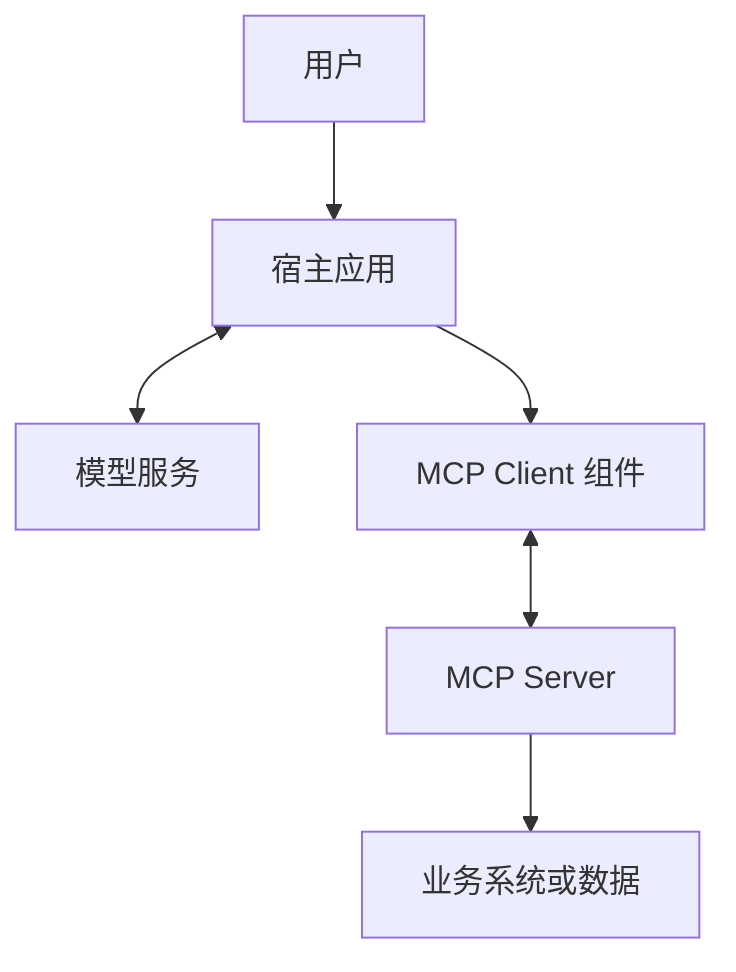
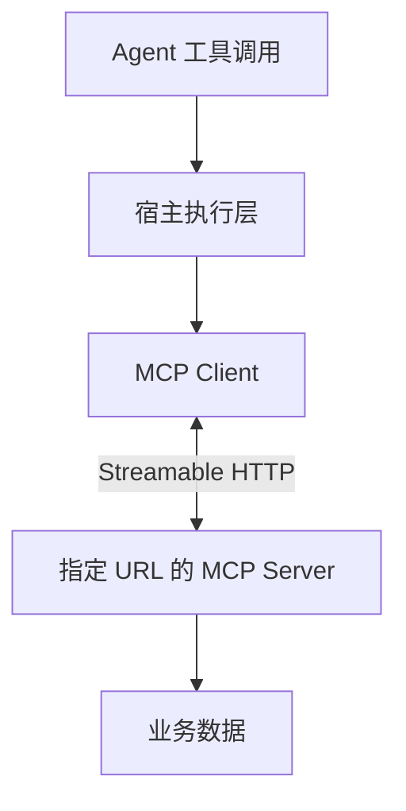
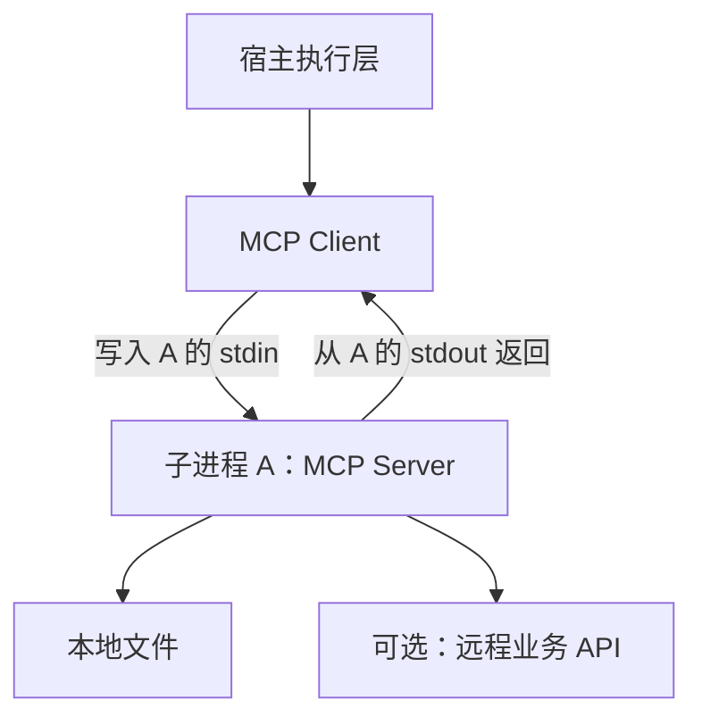
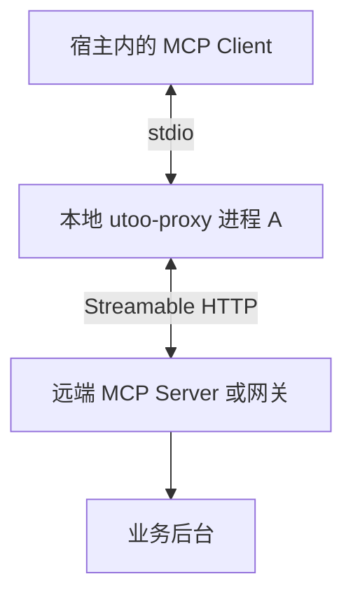
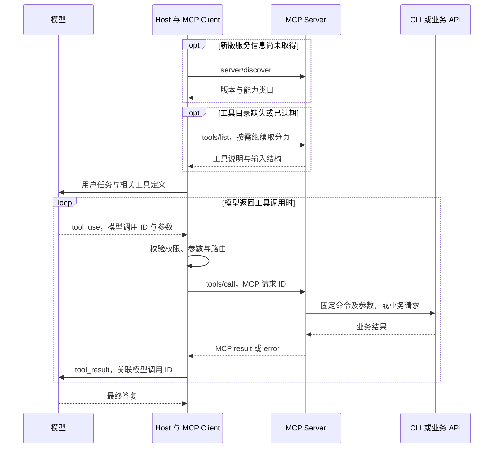

# Agent 与 MCP 接入原理

- 首次整理：2026-11-02
- 最近更新：2026-11-08
- 类型：原创学习笔记
- 来源：学习讨论整理、MCP 官方规范、OpenAI 官方文档与 Google Gmail API 文档；不是逐字对话记录。
- 标签：Agent、连接器、MCP、Host、Client、Server、stdio、Streamable HTTP、OAuth、工具调用、CLI、IPC、工具搜索、上下文管理

**先记住结论：连接器负责把业务能力接通，MCP 负责统一能力发现和调用；宿主是运行智能体的应用系统，MCP Client 是其中的协议组件。配置 URL 与配置 command 的区别，是连接现有 HTTP 服务，还是启动一个通过标准输入输出通信的服务子进程。**

本文面向有后端开发经验、初次系统学习智能体接入的读者。例子贯穿 Gmail、生财有术和一个脱敏的本地代理配置，先解释角色，再展开调用链与工程实现。首次产品快照为 **2026-11-02**；本轮在 **2026-11-08** 补核 MCP 2026-07-28 与 Anthropic 文档，第 10 章保留原快照日期；不据此推断任何平台未公开的内部代码。

## 导航

1. [从一个搜索任务理解 Agent](#agent)
2. [连接器和 MCP 各解决什么](#connector)
3. [Host、Client、Server 与进程](#roles)
4. [例子一 Gmail 业务适配与协议包装](#gmail)
5. [例子二 生财有术 URL 与 OAuth 接入](#shengcai)
6. [例子三 直接 URL 配置](#url)
7. [例子四 command 与本地 stdio 服务](#stdio)
8. [例子五 utoo-proxy 双角色桥接](#proxy)
9. [一次完整工具调用与宿主实现](#runtime)
10. [ChatGPT 自定义 MCP 与事件驱动](#chatgpt)
11. [安全、故障与常见误区](#boundaries)
12. [复习问答、术语与来源](#review)

<a id="agent"></a>
## 1. 从一个搜索任务理解 Agent

用户提出：“找到昨天收到的账单邮件，列出商家、金额和币种。”

单独的语言模型可以理解这句话，但不能凭语言能力知道邮箱里的真实内容。一个 Agent（智能体）系统需要把模型与工具、状态和执行控制结合起来：

1. 把用户目标和可用工具交给模型。
2. 模型提出搜索邮件的调用与参数。
3. 程序检查权限并执行搜索。
4. 模型阅读搜索结果，必要时要求读取邮件正文。
5. 程序继续执行，最后由模型形成答案。

这是“决策—执行—观察—再决策”的工作循环。模型是决策组件之一，整个智能体还包含实际运行的程序和约束；不能把模型输出的“我已搜索”当作搜索真的发生。

连接器给它提供访问外部系统的能力，但“随时服务”还需要任务状态、事件或调度、失败恢复和通知机制。**有连接器，不等于已经有一个全天候可靠运行的个人助手。**

本节是教学用系统拆解，不主张所有名为 Agent 的产品都采用完全相同的架构。

<a id="connector"></a>
## 2. 连接器和 MCP 各解决什么

MCP（Model Context Protocol，模型上下文协议）规定应用与工具服务交换能力及上下文的方式。[S1][S2]

| 维度 | 连接器 Connector | MCP |
| --- | --- | --- |
| 主要问题 | 怎样访问 Gmail、文档或订单系统 | 怎样让宿主以统一方式发现并调用这些能力 |
| 典型代码 | 账号映射、业务 API、分页、数据解析、限流和重试 | 工具描述、参数结构、协议消息、传输与结果格式 |
| 与业务关系 | 通常理解特定业务 | 协议本身不理解某家公司的业务 |
| 必须互相依赖吗 | 可以直接函数调用，也可使用自定义接口或 MCP | 既可包装连接器，也可暴露本地计算等能力 |

API（Application Programming Interface，应用程序接口）是宽泛概念；MCP 本身也是一种接口规范。不能简单理解为“API 被 MCP 替代”。更常见的是：外层使用 MCP，内部继续调用原有业务 API。

例如同一段搜索函数可以有两种暴露方式：

- 自定义方式：宿主知道某个 HTTP 接口的地址和请求格式，调用它。
- MCP 方式：服务注册搜索工具，宿主通过 `tools/list` 获取工具定义，通过 `tools/call` 调用。

采用 MCP 后，业务函数不会消失。标准化主要减少不同宿主与工具服务之间重复约定接入协议的工作；权限、数据质量和业务语义仍需开发者处理。

<a id="roles"></a>
## 3. Host、Client、Server 与进程

### 3.1 三个角色

| 角色 | 含义 | 本文例子 |
| --- | --- | --- |
| Host，宿主 | 承载模型交互、会话、工具选择与执行控制的应用系统 | ChatGPT 或自行开发的智能体应用 |
| MCP Client，协议客户端 | 宿主中与某个 MCP 服务通信的组件 | 执行工具发现和调用的 SDK 客户端 |
| MCP Server，协议服务端 | 向客户端提供工具、资源等能力的服务程序 | 生财有术 MCP 服务、本地文件工具 |

SDK（Software Development Kit，软件开发工具包）可以提供客户端和服务端的协议实现，避免手写每条协议消息。

**Host 不是“某台主机”的同义词。**在这里它指应用角色，不特指 Mac、浏览器或某台云服务器。Server 也指服务程序，不意味着必有一台独占机器。[S1]

### 3.2 逻辑角色不等于操作系统进程



文本解释：宿主与模型交互，并通过客户端组件连接工具服务；服务端再访问业务系统。图中的每个方框表示职责，不表示“每个方框必须是一个进程”。

- MCP Client 可以是宿主进程中的一个对象或模块。
- 多个服务可以分别由逻辑客户端管理，但不意味着每个客户端都要启动一个独立进程。
- 模型推理可以发生在远端；桌面应用的存在不代表模型就在本机运行。
- 平台是否使用共享网关、连接池或独立执行进程，需代码或明确文档验证，不能从一个配置文件推断。

类比：业务应用包含数据库客户端，客户端访问数据库。应用、客户端库和数据库是不同角色。这里仅作角色类比，MCP 不是数据库查询协议。

### 3.3 三层拆开：协议说什么，传输怎么送，操作系统怎样连

本轮追问集中在“把 CLI 包成 MCP 后，实际发生了什么”。先固定三个维度，后文再各自展开：

| 层次 | 需要回答的问题 | 本例中的对象 |
| --- | --- | --- |
| 协议语义 Protocol Semantics | 请求叫什么、参数是什么、怎样关联结果与错误？ | MCP 的 `tools/list`、`tools/call`，以及 JSON-RPC 消息 |
| 传输绑定 Transport Binding | 怎样分隔、送达与结束这些消息？ | stdio 的逐行消息；Streamable HTTP 的 POST 与 JSON/SSE 响应 |
| 操作系统与网络通道 | 进程之间如何实际传字节？ | 匿名管道、socket pair、网络连接等，由运行时实现决定 |

CLI（Command-Line Interface，命令行界面）是服务内部可调用的一种业务入口。CLI 不因输出了 JSON 就自动具备 MCP 的能力发现、版本处理和工具调用语义。反过来，MCP 也不限定业务必须通过命令行实现。[S13][S14]

在这一层次关系中，**MCP Client 通常是 Host 内的协议组件；stdio 不是另一个客户端；stdin 也不是一个工具名。**“本地/远端”表示部署位置，“stdio/HTTP”表示传输方式，不能互相替代。

<a id="gmail"></a>
## 4. 例子一 Gmail 业务适配与协议包装

### 4.1 用户看到的一个动作，可能对应多个请求

教学目标：“搜索昨天的账单邮件，并读取匹配邮件的内容。”

Gmail 提供 `users.messages.list`，支持 `q` 搜索条件和分页；该接口的邮件条目只包含 `id` 与 `threadId`，获取详情需要再调用 `users.messages.get`。[S3][S4]

因此一个上层 `search_bill_emails` 工具可能依次完成：

1. 从已验证的用户身份找到对应的 Google 账号授权。
2. 把日期和条件转换成 Gmail 搜索表达式。
3. 调用列表接口，处理分页和数量上限。
4. 按需要读取部分邮件详情。
5. 返回商家、金额、币种、时间及证据，不返回访问令牌。

这部分是 **Gmail 业务适配代码**。它还要处理权限不足、账号断开和第三方限流。

### 4.2 MCP 层多做什么

MCP 层给这个函数增加名称、用途、输入结构和调用入口。下面只是原创教学工具设计，不代表任何已安装插件的真实工具名：

```json
{
  "name": "search_bill_emails",
  "description": "查找指定日期范围内的账单邮件，返回金额、币种与证据标识；不发送邮件。",
  "inputSchema": {
    "type": "object",
    "properties": {
      "start_date": {"type": "string"},
      "end_date": {"type": "string"},
      "limit": {"type": "integer", "minimum": 1, "maximum": 50}
    },
    "required": ["start_date", "end_date"],
    "additionalProperties": false
  },
  "annotations": {"readOnlyHint": true}
}
```

实际实现还应规定日期格式、时区和区间是否包含边界。`readOnlyHint` 是行为提示，不是安全控制；服务端仍需真正禁止写入。

**证据边界：**看见一个 Gmail 工具以 MCP 风格暴露，只能说明可见接入层；不能据此证明其后台一定直接调用 Gmail API、没有缓存或索引，也不能证明该 MCP 服务由 Google 官方运营。

<a id="shengcai"></a>
## 5. 例子二 生财有术 URL 与 OAuth 接入

场景：在 ChatGPT 添加一个名为“生财有术”的 MCP 服务，填写服务 URL 并配置 OAuth（Open Authorization，开放授权）认证。

可以从协议与产品功能理解为：

- ChatGPT 持有连接配置和授权关联。
- 宿主获取该服务提供的工具说明。
- 用户问“搜索跨境电商经验”时，模型提出某个搜索工具调用。
- 宿主通过客户端能力向已配置服务发送请求，再把结果交回模型。

**这里的 MCP Server，是配置 URL 对应的 MCP 服务程序。**它可能连接社区后台，也可能经过网关；与网站后台是否在同一台机器上，无法仅凭 URL 判断。

### 5.1 两个容易混淆的问题

**“添加服务，会在 Mac 上启动一个 MCP Client 进程吗？”**

不能这样推断。通过 ChatGPT 网页添加远程插件，与本机 `config.toml` 的本地工具配置是不同接入场景。远程接入需要客户端职责，但不等于在用户电脑创建独立客户端进程。[S5][S6]

**“Agent 调用 MCP Client 吗？”**

作为逻辑理解可以。更精确的表达是：模型提出工具调用，宿主的执行层校验并路由，客户端组件负责协议通信。模型一般不自己创建网络连接。

本例说明接入机制，**没有检查生财有术后端源码、部署拓扑或实际令牌管理实现**。

<a id="url"></a>
## 6. 例子三 直接 URL 配置

下面是本地宿主配置的教学示例；域名是占位符，不能直接用来测试：

```toml
[mcp_servers.community]
url = "https://mcp.example.com/mcp"
```

含义：连接一个已运行的 HTTP MCP 服务。配置不是服务部署命令，也不是下载服务器代码。



文本调用链：Agent 提议调用；宿主检查后，让 MCP Client 使用 Streamable HTTP（可流式传输的 HTTP）与指定服务通信。

- 不需要因为这一项配置，再启动一个本地 MCP 服务或转接代理。
- 不存在必须额外通过 stdin/stdout 中转的要求。
- URL 可以指向远端，也可以是 `http://localhost:3000/mcp`。因此准确区别是 **HTTP 端点与 stdio 子进程**，不是简单的远程与本地。
- 客户端对象数量、连接复用和进程划分属于宿主实现细节。
- 具体配置字段与认证支持须按宿主文档核对；本例对应官方 `config.toml` 配置模式，不是全体 MCP 宿主的通用配置格式。[S6]

<a id="transport-comparison"></a>
### 6.1 Streamable HTTP 是什么，与 stdio、普通 HTTP 怎样比较？

HTTP（Hypertext Transfer Protocol，超文本传输协议）已经规定请求、响应、状态码、头与消息体。**Streamable HTTP（可流式 HTTP 传输）是 MCP 在 HTTP 上定义的传输绑定**，统一 MCP 消息如何发往一个端点，以及结果用 JSON（JavaScript Object Notation，JavaScript 对象表示法）或 SSE（Server-Sent Events，服务端发送事件）返回。[S14]

| 比较项 | stdio MCP | Streamable HTTP MCP | 常见业务 HTTP JSON 接口 |
| --- | --- | --- | --- |
| 如何接入 | 启动命令、参数、环境 | 已知 MCP URL | 已知业务 URL |
| 消息承载 | 子进程 stdin/stdout | HTTP 请求与响应体 | HTTP 请求与响应体 |
| 消息边界 | 一行一个 JSON-RPC 消息 | 单个 JSON 或 SSE 事件 | 由接口约定 |
| 如何发现功能 | MCP 的能力与工具目录方法 | 同样的 MCP 方法 | 自定目录，或依赖业务文档 |
| 调用含义 | `tools/call` 及工具参数 | `tools/call` 及工具参数 | 例如 `/notes/search` 自定请求 |
| 服务生命周期 | 客户端通常启动并管理子进程 | 服务独立运行，可集中提供能力 | 服务通常独立运行 |
| 常见场景 | 本机 CLI、文件与开发工具 | 跨进程或跨机器的集中接入 | 专门业务集成 |

“普通 HTTP”并非严谨的另一种协议名，这里指常见的一次请求返回一个 JSON 的业务接口。**HTTP 本来就能流式传输**；SSE 也使用 HTTP。因此不能用“一个能流式、另一个不能”解释根本区别。MCP 多约定的是消息方法、发现机制、参数、结果、错误和版本元数据等。[S13][S14]

例子：`POST /notes/search` 收到 `{"q":"MCP"}` 后直接返回业务数据，可以是普通 API；`POST /mcp` 收到方法为 `tools/call`、工具名为 `search_notes` 的 MCP 消息，则按协议返回关联结果。后者内部仍可调用前者。

<a id="mcp-versioning"></a>
### 6.2 先看协议版本，再画初始化和消息方向

**本轮核验：2026-11-08。**主线采用官方 **2026-07-28** 版，并与 **2025-11-25** 握手时代对照；旧版代码仍可能运行在真实系统中，不能把新版机制和旧版握手拼成一条必经流程。[S15][S16]

| 机制 | 2025-11-25 等旧版 | 2026-07-28 主线 |
| --- | --- | --- |
| 开始交换能力 | `initialize` 请求/响应，再发 `notifications/initialized` | 逐请求携带版本、客户端身份与能力；可先查 `server/discover` |
| 发现是否必经 | 先完成初始化握手 | `server/discover` 不是所有调用的必经前置；stdio 探测尤其有用 |
| HTTP 协议会话 | 可由服务分配 `Mcp-Session-Id` | 已移除协议会话；应用业务状态另行管理 |
| 服务需要客户端补充输入 | 可发独立 JSON-RPC 请求 | 在业务响应里返回 `input_required`，走多次往返 |
| 长期变化通知 | 可使用独立 GET SSE 流 | 使用 POST `subscriptions/listen` 的响应流 |
| 取消 HTTP 请求 | 按旧版通知与生命周期规则 | 关闭对应响应流，表示客户端放弃该请求 |

新版没有初始化握手，并不表示没有身份验证、能力声明或业务状态。**Host 的聊天会话、HTTP 连接复用、MCP 协议会话、业务任务状态是不同对象。**需要跨调用延续的任务，可以用服务显式返回的句柄继续引用；不能依靠模型记住未返回的服务内状态。

兼容程序应先判断对端支持的协议时代，再按相应规则工作。支持新版但版本不匹配时，应读取支持版本并选择交集；不能把所有错误都当作“旧版服务”。准确回退行为须核对所用 SDK（Software Development Kit，软件开发工具包）。[S15]

<a id="http-wire"></a>
### 6.3 一次 HTTP 调用实际长什么样？

2026-07-28 版的每个消息单独 POST 到 MCP 端点。下例对应 [9.7 节](#wire-example) 的完整请求体，头字段只展示该工具需要的标准项，不含认证信息：

```http
POST /mcp HTTP/1.1
Content-Type: application/json
Accept: application/json, text/event-stream
MCP-Protocol-Version: 2026-07-28
Mcp-Method: tools/call
Mcp-Name: search_notes
```

其中 `Mcp-Method`、`Mcp-Name` 镜像方法和适用的工具名，便于中间层路由；消息体仍是事实来源，头与体不一致需要拒绝。具体工具还可能声明额外参数映射；不能据此示例省略该工具要求的字段。[S14]

服务可直接返回 `application/json` 的最终响应，也可用 `text/event-stream` 逐条发送进度与最终结果。下面是**显示消息格式的原创简化片段**：

```text
event: message
data: {"jsonrpc":"2.0","method":"notifications/progress","params":{"progressToken":"p42","progress":1,"total":2}}

event: message
data: {"jsonrpc":"2.0","id":42,"result":{"resultType":"complete","content":[{"type":"text","text":"找到一篇笔记"}],"isError":false}}

```

每个 SSE 事件由空行结束。网络读取与事件不是一一对应关系：一次读取可能只有半条事件，也可能带来多条。客户端需要增量解析，不能把每个网络数据块直接当完整 JSON。[S32]

这里“流式”的对象是 **MCP 协议消息**；`notifications/progress` 也不等于模型正在逐词输出最终回答。反过来，stdio 也能在共享输出流中先送进度、后送结果，并非只能一次性返回。[S7][S22]

<a id="stdio"></a>
## 7. 例子四 command 与本地 stdio 服务

下面假设开发者已经准备了一个本地 MCP 服务脚本；它是配置示例，不是已提供或已运行的程序：

```toml
[mcp_servers.local_notes]
command = "python3"
args = ["/absolute/path/to/notes_mcp_server.py"]
```

在本地执行场景下，宿主按该命令启动子进程 A，然后使用 stdio（standard input/output，标准输入输出）传输 MCP 消息。[S6]

- 宿主的 MCP Client 把请求写入 **A 的 stdin**。
- A 从自己的 stdin 读取请求、执行工具。
- A 把响应写到自己的 **stdout**，宿主读取。
- 普通日志应写入 stderr（standard error，标准错误输出），避免污染协议通道。[S7]



文本解释：子进程 A 是当前连接中的 **Server**，不是宿主的 Client。A 可以读取本地笔记，也可以通过 HTTP（Hypertext Transfer Protocol，超文本传输协议）访问远程数据。

**Server 并不等于“必须在远端”，本地子进程完全可以是服务端。**

此处限定本地运行。支持远程执行环境的宿主也可能把 command 放到远端执行，不能只看“command”一词就断言程序一定在当前 Mac 上。[S6]

<a id="stdio-ipc"></a>
### 7.1 stdin/stdout 是 Linux 标准流吗，底层是管道还是 socket？

stdin（standard input，标准输入）、stdout（standard output，标准输出）、stderr（standard error，标准错误输出）是进程常见的标准流，并非 Linux 独有。POSIX（Portable Operating System Interface，可移植操作系统接口）系统中，它们通常对应文件描述符 0、1、2；stdin 是输入方向，stdout 是输出方向，不能把二者当成同一个双向对象。[S30]

IPC（Inter-Process Communication，进程间通信）是大类。**标准流是程序读写接口；管道或套接字是可能承载这些字节的底层机制。**[S7][S29]

| 名称 | 这一层表示什么 | 能否仅凭 stdio 配置确定？ |
| --- | --- | --- |
| 标准流 | 子进程从哪里读取、向哪里输出 | 可以确定协议使用 stdin/stdout |
| Anonymous Pipe（匿名管道） | 常见的父子进程字节通道 | 某些运行时这样实现，不能一概而论 |
| Socket Pair（套接字对） | 两个相连的套接字端点，也可接到标准流 | 也是可能实现，需查运行时代码或描述符 |
| Unix Domain Socket（Unix 域套接字） | 本机进程通信的一类套接字机制 | 不能因为“本地”就断言一定使用它 |
| TCP（Transmission Control Protocol，传输控制协议）连接 | 网络字节通道，可发生在本机或跨机器 | 不由 stdio 这个配置词推出 |

以常见的管道实现为例：父进程持有一个写端，连接子进程的 stdin；父进程另持有一个读端，连接子进程的 stdout。父端调用 `write`，服务端调用 `read`；响应方向相反。由两个方向组成请求/响应通道。**MCP 规定读写与消息格式，不强制所有运行时使用同一种 OS（Operating System，操作系统）对象。**

如果改成让程序直接监听 Unix socket 或 TCP，再复用相同逐行 JSON-RPC 格式，是自定义通道设计；不能仅因消息格式相同，就说它具有 stdio 子进程的启动与退出规则。[S13]

<a id="stdio-framing"></a>
### 7.2 字节流如何分出一条条 MCP 消息？

在 stdio 绑定中，一行放一个 UTF-8（Unicode Transformation Format, 8-bit，8 位 Unicode 转换格式）编码的 JSON-RPC 消息，以换行界定边界。消息字符串内部的换行必须由 JSON 转义，不能把格式化、多行缩进的 JSON 原样写入协议流。[S7]

```python
# 教学片段：message 是准备好的协议消息对象。
sys.stdout.write(json.dumps(message, ensure_ascii=False, separators=(",", ":")) + "\n")
sys.stdout.flush()
print("search completed", file=sys.stderr)
```

最后一行是日志，只写 stderr。日志级别、提示语或 CLI 原始输出混入 stdout，都可能被客户端当成协议消息解析。`flush()` 用于把缓冲区内容及时交给通道，避免对端一直等待；它不保证一次 `write` 恰好对应一次 `read`。

多个并发请求共用同一 stdout，靠 JSON-RPC 的 `id` 关联最终响应，不能仅靠返回顺序。通知没有 `id`，不会获得一个对应响应；进度使用 `progressToken` 关联，不能误认作新的工具结果。[S22][S31]

<a id="cli-wrapper"></a>
### 7.3 把 CLI 包成 MCP，究竟包装了什么？

假设现有命令能搜索笔记：`notes-cli search --query MCP --json`。下面是原创设计，不代表本机安装了这个命令。

| 环节 | 接收什么 | 负责什么 | 返回什么 |
| --- | --- | --- | --- |
| Host 内 MCP Client | 模型提出的工具调用，经宿主校验后 | 发 `tools/call`，管理超时与关联 | MCP 结果供宿主转换 |
| MCP Server 包装层 | 协议工具名与结构化参数 | 校验、映射固定命令、启动 CLI、解析业务输出 | 合法的 MCP 结果或错误 |
| CLI 子进程 | argv（argument vector，参数向量）等 | 执行原有搜索逻辑 | CLI 自己的 stdout、stderr、退出码 |

**这可能涉及两层子进程：Host 启动 MCP Server A，A 再为调用启动 CLI B。**如果 A 直接调用一个库函数，则没有 B；如果用常驻 CLI，也可能是其他生命周期，需按实现判断。

```python
# 教学封装函数：固定工具路径；下方 CLI 参数是自拟接口，未接真实 CLI 实跑。
import json
import subprocess

def run_notes_search(query: str) -> dict:
    if not isinstance(query, str) or not query.strip() or len(query) > 200:
        raise ValueError("query must contain 1 to 200 characters")
    completed = subprocess.run(
        ["/absolute/path/notes-cli", "search", "--query", query, "--json"],
        capture_output=True,
        text=True,
        timeout=10,
        check=True,
        shell=False,
    )
    return json.loads(completed.stdout)
```

这只是**业务执行函数**，还需要 MCP SDK 注册工具、实现输入/输出 schema（结构约束）并封装结果；不是粘贴后就具备全部协议能力的服务。固定可执行文件与参数列表，避免把模型文字拼成任意 shell 命令；参数值的业务限制仍需检查。[S29]

`capture_output=True` 把 B 的普通 stdout 交给 A 读取，A 再产生自己的 MCP 响应；它们不能不加区分地接到同一个协议 stdout。包装层还应分别处理超时、非零退出码、非法 JSON 与业务空结果。写操作超时后，执行状态可能未知，不能盲目重复。[S29]

<a id="proxy"></a>
## 8. 例子五 utoo-proxy 双角色桥接

### 8.1 脱敏配置

本例保留讨论中的程序名和参数形状，真实企业网关地址已替换，**不能直接运行该占位地址**：

```toml
[mcp_servers.skylark]
command = "utoo-proxy"
args = ["https://mcp.example.com/mcp", "-t", "STREAMABLE_HTTP"]
```

**配置可确定的事实：**连接名称是 `skylark`；启动命令是 `utoo-proxy`；向它传入 URL、`-t` 和 `STREAMABLE_HTTP` 三个参数。连接名称不是可执行文件名。

**合理且较强的推断：**根据 command 型配置及参数命名，它用于将本地 stdio MCP 连接转接到远端 Streamable HTTP MCP 服务。

**尚未核实：**未取得该代理的公开实现文档，未运行或检查本机可执行文件。不能保证参数内部语义、消息是否透传、请求 ID 是否重写、认证来源、会话管理和重连行为与某个通用代理相同。

### 8.2 一个进程可以在不同连接中扮演不同角色



文本解释：对左侧宿主而言，A 接受 MCP 调用，是 **Server**；对右侧远端服务而言，A 发起 MCP 调用，是 **Client**。因此它是双角色代理，不是必须在两种名称中选一个。

假设 Agent 要执行一个远端搜索工具，预期的桥接调用链是：

1. Agent 提出工具名和参数。
2. 宿主执行层检查权限，交给自身 MCP Client。
3. Client 将 MCP 工具请求写入 A 的 stdin。
4. A 用远端传输方式转发或重新发起请求。
5. 远端执行并返回结果。
6. A 将相应结果写回 stdout，宿主交给模型继续处理。

这主要是 **传输桥接**。远端仍应提供兼容的 MCP 接口；普通 REST（Representational State Transfer，表述性状态转移）业务接口不会仅因套上一个 URL 就自动成为 MCP。

### 8.3 修正最初的说法

原理解：“启动 MCP 客户端进程 A，Agent 通过 stdin/stdout 调用 A。”

更准确：“宿主启动本地 MCP 服务/代理进程 A，宿主的 MCP Client 通过 stdio 与 A 通信；如果 A 再连接远端 MCP，则 A 在远端连接中同时充当 Client。”

口诀只适用于这里的工具调用链：**发起工具请求的一侧是 Client，暴露并执行工具的一侧是 Server。**不要扩大成“MCP 永远只有客户端能发消息”；协议还包含通知及客户端参与的补充输入。需要按版本区分：2026-07-28 版服务不再发独立 JSON-RPC 请求，补充输入通过响应中的 MRTR 处理；旧版可有服务端请求。[S15][S16][S21]

<a id="runtime"></a>
## 9. 一次完整工具调用与宿主实现

### 9.1 工具发现和模型调用是两层接口

`tools/list` 返回工具名、用途和参数结构；`tools/call` 执行具体工具。模型厂商的 tool calling（工具调用）接口，则让模型输出工具名称、参数和调用关联标识。[S2]

下面是省略协议版本相关元数据的教学片段，**不是完整的可直接发送请求**：

```json
{"jsonrpc":"2.0","id":7,"method":"tools/call","params":{"name":"search_docs","arguments":{"query":"跨境电商"}}}
```

JSON-RPC（JSON Remote Procedure Call，基于 JSON 的远程过程调用）中的 `id: 7` 用于协议请求响应关联。模型接口产生的 tool-call ID 则用于模型对话中的工具结果关联。**这两个 ID 属于不同层，不能假设相同。**

### 9.2 最小宿主的五个模块

| 模块 | 需要实现的工作 |
| --- | --- |
| 会话状态 | 保存用户消息、模型回复、工具调用及结果 |
| 模型适配 | 将 MCP 工具结构转为模型接受的格式，再解析模型调用 |
| 连接管理 | 管理 HTTP 或 stdio 连接、超时、取消及释放 |
| 注册与路由 | 将对外工具别名映射到服务和原始工具名，解决重名 |
| 执行控制 | 校验参数与权限，必要时确认，执行并记录结果 |

例如两个服务都有 `search`，宿主可以向模型暴露 `gmail_search` 与 `docs_search`，再映射回各服务原名。这是宿主设计方案，不是所有平台的固定命名规则。

官方客户端教程展示了 SDK 连接、工具发现和模型结果回传的基本接法；具体类名和生命周期随 SDK 版本变化，开发时必须固定版本，不混用旧教程。[S8]

### 9.3 执行循环伪代码

以下是原创架构伪代码，不依赖某个特定 SDK，不能直接运行：

```text
发现服务工具，并按当前用户权限过滤
将工具定义适配成模型接受的格式

循环直到完成、用户取消或达到预算：
    调用模型（对话历史、可用工具）
    若模型给出最终答案：返回
    保存模型的工具调用消息
    对每个工具调用：
        按工具别名找到目标服务与工具
        校验参数、用户权限及确认要求
        通过目标服务的 MCP Client 执行调用
        区分业务错误、协议错误和网络错误
        将 MCP 结果适配成模型的工具结果消息
        用模型的调用 ID 关联结果，追加到历史
```

结果可能是文本、结构化数据或多模态内容，不能统一粗暴地转成字符串。工程上还需限制轮数、耗时、并发、返回大小和费用，避免失控循环。

<a id="protocol-primitives"></a>
### 9.4 MCP 协议具体包含什么？

JSON-RPC 2.0 解决“以怎样的信封表达调用”：请求有 `id`、`method`、`params`；响应以相同 `id` 携带 `result` 或 `error`；通知没有请求关联 `id`。MCP 再约定具体方法与参数、结果的含义。**JSON-RPC 合法，不等于已经实现全部 MCP 要求。**[S31]

| 协议对象 | 主要方法或消息 | 能力边界 |
| --- | --- | --- |
| 服务信息与能力类目 | `server/discover`，2026 版 | 查询已知服务支持什么；不是全网找服务 |
| Tools（工具） | `tools/list`、`tools/call` | 发现并执行函数，有输入及可选输出结构 |
| Resources（资源） | `resources/list`、`resources/read`、资源模板方法 | 按 URI 取得上下文材料，怎样供模型使用由 Host 决定 |
| Prompts（提示模板） | `prompts/list`、`prompts/get` | 获取带参数的可复用消息模板 |
| 进度 | `notifications/progress` | 报告请求进展；不是最终响应 |
| 变化订阅 | `subscriptions/listen`，2026 版 | 订阅目录或资源变化的通知流 |
| 补充输入 | MRTR（Multi Round-Trip Requests，多次往返请求） | 返回输入需求，由客户端处理后重试原业务调用 |
| 授权与扩展 | 授权规范、已声明的扩展能力 | 能力支持、账号权限、模型可见性分别检查 |

URI（Uniform Resource Identifier，统一资源标识符）用于标识资源，并不要求每个资源都能作为公开网页打开。工具通常供模型选择，资源通常由应用组织，提示模板通常由用户选择；这是交互分工，不代表某个界面的固定布局。[S17][S18][S19][S21][S22][S23][S24]

旧资料中的 Sampling（模型采样委托）、Roots（客户端根目录信息）与 Logging（协议日志能力）在 2026-07-28 版标为 Deprecated（弃用），保留兼容期，不能把“弃用”理解为当天全部删除。这里的 Logging 能力与进程向 stderr 写诊断日志不是一回事；新实现应按新版推荐路径选择功能。[S36]

<a id="discovery-stages"></a>
### 9.5 Agent 如何发现 MCP、再探查具体能力？

“发现 MCP”实际上包含四个问题：

| 顺序 | 要知道什么 | 如何得到 | 主要负责者 |
| --- | --- | --- | --- |
| 1 | 去哪里连接？ | 用户配置、插件安装、可信目录给出 command 或 URL | 用户与 Host |
| 2 | 服务支持什么类目与版本？ | 新版可用 `server/discover`；旧版初始化交换能力 | MCP Client |
| 3 | 具体有哪些工具与参数？ | `tools/list`，继续读取需要的分页 | MCP Client 与目录缓存 |
| 4 | 本次应把哪些工具给模型？ | 权限过滤、搜索和延迟加载 | Host 的工具管理与模型 |

`server/discover` 接收者已经是一个已知服务，因此不能凭它在互联网找到所有 MCP。Registry（服务注册目录）提供发布与接入元数据；官方 Registry 并不是每次业务请求必经的调用代理。它与工具能力列表处于不同层。[S17][S25]

**Capabilities（能力声明）**例如 `tools: {}` 表示支持工具这一类协议能力；某个工具的 `inputSchema` 才说明 `query` 是否必填、类型是什么、长度或枚举有何限制。`outputSchema` 可定义结构化结果约束。空的能力对象不表示“没有工具”，也不表示“所有工具都已授权”。[S17][S18]

例如 `tools/list` 返回 `search_notes` 的用途与参数，不返回它的源代码。Host 可以把该工具向模型命名为 `mcp__notes__search_notes`，再维护到服务 `notes` / 原始工具名 `search_notes` 的映射。这个命名前缀是 Claude 产品约定，不是 MCP 要求全球工具都这样命名。[S26]

目录可以缓存，工具调用前不必每次重新 `tools/list`；但要考虑版本、有效期、变化通知与身份隔离。新版发现/列表结果的 TTL（Time To Live，生存时间）与 Cache Scope（缓存范围）用于约束复用。同一个 URL 的不同用户可能看到不同工具与资源，不能直接跨用户共享带权限的目录。[S17][S18]

<a id="tool-decision"></a>
### 9.6 模型怎么决定调用，宿主怎样把决定落地？

以“在我的笔记里找到 MCP stdio 的说明”为例，模型通常看见当前目标、对话状态，以及工具的名称、描述和参数结构。它根据这些信息提出 `search_notes(query="MCP stdio")`。它不需要先阅读包装层源码，也不是自己向 stdin 写字节。**MCP 没有替模型规定一套“选哪个工具”的推理算法。**[S27]

Host 接着检查目标服务、当前用户的权限与参数，生成 MCP 调用。模型提出的 `tool_use` 是模型接口消息；`tools/call` 是 Host 发给服务的协议消息；最终 `tool_result` 又回到模型接口。三者不能混为一层。[S18][S27]

下图采用 2026-07-28 主线。旧版先完成初始化握手，再发现工具；目录有效时可跳过重新查询。



图中的主线假定调用已获授权；拒绝或校验失败时，Host 应返回相应错误而不执行。实际应用还可以并发独立工具调用，但有依赖的“搜索后读取某条结果”必须保持先后关系。

<a id="wire-example"></a>
### 9.7 从模型调用到 MCP 报文：完整的一次笔记搜索

以下为 2026-07-28 版原创教学报文。工具名、结果和 ID 均为自拟，不代表已安装插件。模型先提出：

```json
{"type":"tool_use","id":"toolu_notes_1","name":"mcp__notes__search_notes","input":{"query":"MCP stdio"}}
```

Host 完成路由后发送：

```json
{
  "jsonrpc": "2.0",
  "id": 42,
  "method": "tools/call",
  "params": {
    "_meta": {
      "io.modelcontextprotocol/protocolVersion": "2026-07-28",
      "io.modelcontextprotocol/clientInfo": {"name": "notes-host", "version": "1.0"},
      "io.modelcontextprotocol/clientCapabilities": {}
    },
    "name": "search_notes",
    "arguments": {"query": "MCP stdio"}
  }
}
```

HTTP 使用 [6.3 节](#http-wire) 的请求头与 JSON 消息体；stdio 则把该 JSON **序列化成一行**，再追加分隔换行。认证、业务参数结构和错误处理还需真实实现，不能把报文示例当完整客户端。[S14][S15]

服务返回的成功结果示例：

```json
{
  "jsonrpc": "2.0",
  "id": 42,
  "result": {
    "resultType": "complete",
    "isError": false,
    "content": [{"type": "text", "text": "找到一篇 stdio 笔记"}],
    "structuredContent": {
      "matches": [{"id": "note-7", "title": "stdio 与进程通信"}]
    }
  }
}
```

`content` 可以包含文本或受支持的多模态内容；`structuredContent` 供程序读取结构化字段。Host 根据模型接口及任务需要转换，而非将所有字节原封不动塞给模型。若声明了输出 schema，还要按约定验证。[S18]

发回 Claude 模型的示意消息块为：

```json
{"type":"tool_result","tool_use_id":"toolu_notes_1","content":"找到 note-7：stdio 与进程通信。"}
```

`42` 关联 MCP 请求/响应，`toolu_notes_1` 关联模型的工具使用/结果；Host 维护二者映射。实际 Messages API（消息接口）还要按其完整消息封装与角色规则发送，这里只展示内容块。读到结果后，模型可以进一步请求读取 `note-7`，也可以直接回答。[S27]

<a id="result-errors"></a>
### 9.8 返回结果、错误、进度和额外输入怎么区分？

| 收到什么 | 含义 | Host 应如何继续 |
| --- | --- | --- |
| 正常结果，匹配同一个 MCP `id` | 协议调用完成 | 适配为对应模型调用的结果 |
| 正常结果但匹配列表为空 | 搜索成功、没有命中 | 告诉模型没有结果，不伪造成网络失败 |
| 工具结果 `isError: true` | 工具运行发生可供模型理解的业务失败 | 交回错误内容，由策略决定修正或停止 |
| JSON-RPC `error` | 未知方法、协议或请求等层面的错误 | 按错误类别诊断，不当作成功正文 |
| `notifications/progress` | 长操作的中途进展 | 更新进度，继续等待最终响应 |
| `resultType: input_required` | 需要客户端处理额外输入 | 进入 MRTR 流程，再决定继续或拒绝 |
| 超时或连接中断 | 没有确认收到最终结果 | 区分“未拿到结果”与“业务一定未执行” |

MRTR 的例子：导出工具发现缺少目标格式，服务先返回输入需求；Host 按能力与权限获取信息，再用**新的 JSON-RPC 请求 ID**重发原业务请求，携带对应输入响应与服务要求原样传回的状态。它不是把半截网络包接着发送，也不是服务绕过 Host 直接命令用户。[S21]

对应术语是 `inputRequests`（所需输入）、`inputResponses`（匹配的输入回答）与 `requestState`（续接业务请求所需状态）；客户端按协议携回状态，不应自行改写其内容。是否可以处理某类输入，仍以客户端声明的能力和用户授权为边界。[S21]

取消同样要区分版本与传输：2026 版 stdio 使用 `notifications/cancelled`，HTTP 通过关闭对应响应流放弃请求。进度通知用 `progressToken` 关联，可与最终响应 ID 属于不同标识用途。取消或断线不证明业务副作用已经回滚，重试写操作必须考虑幂等性与结果确认。[S22][S23]

<a id="mcp-unload"></a>
### 9.9 多轮之后怎么卸载无用 MCP？先认清六种生命期

一次调用结束，不等于把工具、历史、连接与进程全部销毁。**“卸载”不是 MCP 中统一的一个远程方法，而是 Host 管理多层对象的统称。**

| 想解决的问题 | 应处理的对象 | 可采取的动作 | 不应推导出的效果 |
| --- | --- | --- | --- |
| 太多工具定义占上下文 | 模型本轮可见的工具 schema | Tool Search（工具搜索）、延迟加载、任务筛选 | 不等于服务已断开 |
| 历史工具结果太长 | 模型输入历史 | Compaction（上下文压缩）、摘要或清理旧结果 | 不等于撤销工具权限 |
| 某服务暂时不用 | 运行时工具可用性 | 禁用服务、从动态服务集合移除 | 不等于旧结果从历史消失 |
| 空闲连接或本地资源占用 | 客户端连接、子进程及其资源 | 断开连接；对自有子进程关闭输入并等待退出 | 不等于应杀掉共享远端服务 |
| 不再配置此服务 | 持久服务配置 | 移除安装或配置项 | 不等于第三方凭证必然失效 |
| 不再允许访问账号 | 授权与令牌 | 按认证系统撤销授权 | 不等于删除已有笔记或历史数据 |

**工具定义可以按需加载，服务目录可以继续留在 Host 的内存里。**工具结果也可以只保留摘要和可回查的证据标识。主任务仍需的文件、待处理调用、用户约束与恢复线索要保留；把“所有旧消息一刀切删除”当成压缩会破坏后续推理。[S28][S33][S34]

Anthropic 的两个层次也要分清：

- Agent SDK 的工具搜索负责让模型按需取得相关定义；定义可能在之后轮次继续可用，直到相关发现记录被上下文压缩。是否启用及参数取决于模型、平台与配置，不能把某个阈值当作 MCP 协议规定。[S28]
- 直接使用 Claude Messages API 时，`defer_loading: true` 表示延迟向模型展开定义；应用仍向 API 提供完整工具集合，搜索结果以 `tool_reference` 等机制引用工具。它不是关闭 MCP 进程的开关。[S33]

SDK 另有运行时控制，以下是接口示意，`session` 必须是仍在运行的 Query 对象：

```typescript
await session.toggleMcpServer("notes", false);
const status = await session.mcpServerStatus();
// 重新需要时再启用。
await session.toggleMcpServer("notes", true);
```

`toggleMcpServer` 是 Anthropic SDK 的宿主管理接口，不是发给远端的 MCP 方法。`setMcpServers({...})` 则替换**该方法管理的动态服务及进程内 SDK 服务集合**，需要传入仍应保留的条目；不能把 `{}` 理解成“一定断开全部来源的 MCP”。配置文件、插件或启动选项中的其他服务不属于同一管理集合，云会话还需核对其限制。[S35]

2026-11-08 核对的 TypeScript 文档特别说明：中途通过 `setMcpServers` 加入的 stdio/HTTP/SSE 服务，禁用时移除工具需要 Claude Code v2.1.285 或更高；进程内 SDK 服务的断开与工具移除需要 v2.1.286 或更高。接口存在，不保证旧运行时具备同样行为。[S35]

**一种原创工程策略：**目录保持可搜索，任务开始时加载相关工具；结束时先压缩大结果；空闲超时后再回收自有连接或子进程；下一次需要时重建连接并重新核验授权、版本与目录。不能在仍有依赖结果或写调用执行时直接销毁资源。这个策略由 Host 实现，不是 MCP 规定统一的空闲分钟数。

<a id="mcp-question-map"></a>
### 9.10 本轮提问与正文对应表

以下保留所有已检索到的新疑问，按问题主题归并，不冒充逐字原文。原有 Gmail、生财有术、URL 与代理例子继续作为前置知识。

| 追问 | 深入讲解入口 |
| --- | --- |
| 把 CLI 包装成 MCP 时，谁启动谁、谁读写谁？ | [角色分层](#roles)、[CLI 包装](#cli-wrapper) |
| stdin/stdout 是否 Linux 标准流，底层是哪种 IPC？ | [标准流、管道与套接字](#stdio-ipc) |
| Streamable HTTP 是什么？ | [传输比较](#transport-comparison)、[线上消息形状](#http-wire) |
| stdio 与 Streamable HTTP 有什么区别？ | [同语义、不同传输](#transport-comparison)、[逐行消息](#stdio-framing) |
| Streamable HTTP 与普通 HTTP 有什么区别？ | [HTTP 能力与 MCP 约定](#transport-comparison) |
| MCP 协议具体包含什么，Anthropic 文档如何对应？ | [协议能力](#protocol-primitives)、[版本](#mcp-versioning)、[官方来源](#mcp-sources) |
| Agent 如何发现服务、如何探查能力？ | [四步发现](#discovery-stages) |
| Agent 如何决定调用哪个工具？ | [模型选择与宿主执行](#tool-decision) |
| 如何调用 MCP、拿到结果并继续多轮？ | [完整时序](#tool-decision)、[两层 ID 与报文](#wire-example) |
| 执行中需要补信息、报进度或取消时怎么办？ | [结果与中间状态](#result-errors) |
| 多轮后如何卸载不再使用的 MCP？ | [六种生命期与 SDK 控制](#mcp-unload) |

<a id="chatgpt"></a>
## 10. ChatGPT 自定义 MCP 与事件驱动

本章描述 2026-11-02 核验到的公开产品功能，不代表用户每个账号、工作区和运行模式均已开放，也不揭示平台内部进程架构。

### 10.1 添加自定义服务

当前官方网页流程为：Plugins → 添加自定义 MCP server → 提供 Server URL 或 Tunnel → 认证 → 创建插件并安装；插件详情中可以管理工具与刷新服务定义。[S5]

这是添加连接配置，不是自动替开发者托管业务服务器。只做工具与数据结果时不必开发自定义界面；需要交互展示时再加入可选界面能力。[S9]

开发者仍负责业务适配、权限校验、稳定部署与可观测性。ChatGPT 承担宿主职责，并不能替代后端自己的数据授权。

### 10.2 OAuth 的两层边界

以 Gmail 适配器为例：

1. **ChatGPT → 自定义 MCP 服务：**证明谁可以使用这个工具服务、允许做什么。
2. **MCP 服务 → Google：**证明服务代表哪个 Google 用户、获准访问哪些 Gmail 能力。

两层可以共用身份体系，但不能把它们当作同一权限。用户不一定看到两次登录；设计上仍应明确各令牌的签发方、受众、有效期和范围。

公开认证方案采用 OAuth 2.1；服务端必须自行验签、核对 issuer/audience/expiry/scopes，并据身份做业务授权。[S10]

本地 `config.toml` 支持什么凭证方式，与 ChatGPT 网页自定义插件支持什么方式也不能互相套用。配置中没有显式认证字段，不证明无认证，也不证明用了 OAuth。

### 10.3 内网 MCP 与隧道

Secure MCP Tunnel（安全 MCP 隧道）可让内网客户端主动向 OpenAI 建立出站连接，领取请求、转发到内网 MCP 并返回结果，而不必开放公网入站端口。需要运行隧道客户端，并满足组织、工作区和使用权限要求。[S11]

隧道解决“如何到达服务”，不代替用户身份、资源访问权限和业务安全。普通 URL 的 `localhost` 也不会自动指向用户的 Mac；它指向实际发起连接的运行环境。

### 10.4 从能调用到事件触发

仅添加工具不会自动开始持续监控。当前官方 MCP Events（MCP 事件扩展）提供另一条受支持路径：[S12]

- `events/list` 描述可订阅事件和过滤条件。
- `events/subscribe` 建立订阅，保存范围和回调信息。
- 服务端在事件发生后发送带签名的 webhook（事件回调）。
- ChatGPT 异步处理，按用户指定的响应方式继续执行。
- `events/unsubscribe` 停止订阅。

官方列出的测试场景包括网页 Work、桌面 Work + Cloud 和 dot。需另外实现事件能力及用户订阅，不能把普通工具的存在等同于后台任务已建立。

教学例子：“这个文档收到新评论时，概括评论并提醒我。”工具提供读取文档的能力；事件负责何时触发；用户授权规定监控范围和如何响应。定时轮询是另一种调度方案，二者不应混为一谈。

<a id="boundaries"></a>
## 11. 安全、故障与常见误区

### 11.1 工程检查清单

以下是由协议边界推导的工程建议，不是声称每一项都是 MCP 强制规定：

- 通过验证后的身份确定用户，不能相信模型传入的任意 `user_id` 就授予访问。
- 不向模型或普通日志返回访问令牌、数据库密码等秘密。
- 读取到的邮件、网页和工具内容属于外部数据，不能提升为系统指令。
- 工具标记是提示；真正的授权、参数验证和业务限制必须落在服务端。
- 查询失败可以按策略重试；发送、修改等写操作超时后要先确认是否已执行，避免重复。
- 多用户连接、缓存和工具结果必须隔离，不能因复用连接而串号。
- 子进程需要关闭与清理；网络连接需要超时、取消、限流和恢复策略。
- 对事件处理做去重、过期管理和授权撤销检查，避免事件触发写入后又形成反馈循环。

### 11.2 常见误区速查

| 容易误解的说法 | 更准确的理解 |
| --- | --- |
| 连接器就是 MCP | 连接器是集成能力，MCP 是一种标准接入协议 |
| 宿主就是我的 Mac | 宿主是应用系统，部署位置需另看 |
| MCP Server 必须在远端 | 本地 stdio 子进程也可以是 Server |
| url 就一定是远程 | URL 也可以指向本机 HTTP 服务 |
| command 启动 MCP 客户端 | 标准 stdio 配置启动的是服务端程序，也可能是双角色代理 |
| 每个 MCP 必须一个客户端进程 | 逻辑组件不等于独立进程 |
| Agent 直接用 stdin 调工具 | 宿主执行层的客户端负责协议通信 |
| MCP 替我实现 Gmail 搜索业务 | MCP 包装调用接口，业务适配仍需代码 |
| 支持 MCP 就能自由访问所有数据 | 受账号、工具、资源授权和运行环境限制 |
| 配置完就会全天监控 | 还需调度或事件订阅及对应授权 |

<a id="review"></a>
## 12. 复习问答、术语与来源

### Q1. 连接器与 MCP 是竞争关系吗？
不是。连接器可以被 MCP 包装，也可以采用自定义接口；两者经常处于不同层。

### Q2. Host、Client、Server 在生财例子里分别是谁？
Host 是承载调用的 ChatGPT 应用系统；Client 是宿主的 MCP 通信组件；Server 是配置地址对应的生财 MCP 服务。不能由此确定机器或进程数量。

### Q3. url 配置会启动一个代理进程吗？
不需要由这项配置启动代理。宿主通过 HTTP 连接目标服务；实际平台可有自己的执行架构，但不能仅凭配置断言。

### Q4. command 配置启动的 A 是什么？
标准 stdio 场景下，A 是宿主连接的 MCP Server。即使 A 自己还会联网取数据，这个角色也不改变。

### Q5. utoo-proxy 为什么可以既是 Server 又是 Client？
因为角色相对于一条连接定义：它在宿主这一侧提供服务，在远端这一侧发起调用。这个配置的具体代理行为仍需实现验证。

### Q6. 为什么不能把日志随便写到 stdout？
stdio 模式用 stdout 传协议消息，普通日志可能破坏解析；日志应使用 stderr 或其他日志通道。

### Q7. 模型 tool-call ID 与 MCP 请求 ID 相同吗？
不是同一概念。宿主需要维护关联，将协议结果正确放回模型的工具调用上下文。

### Q8. Gmail 搜索工具一定只调用一次 Google API 吗？
不一定。先列邮件、再读详情、翻页都可能需要多次调用；一个上层工具可封装整个小工作流。

### Q9. 模型说要发送邮件，就算获得授权吗？
不算。模型提出动作，宿主与服务端仍需执行授权、确认及业务安全检查。

### Q10. URL 配置里看不到 OAuth，能判断没有认证吗？
不能。凭证可能由其他配置、登录状态或代理管理。需要检查具体产品与实现，不能猜测。

### Q11. 加入 MCP 能自动获得主动提醒吗？
不能自动获得。需要调度或事件能力、订阅与通知执行链，且受用户授权和产品支持范围约束。

### Q12. 自己开发 Host 最小要做什么？
接一个模型、一个只读 MCP 服务，实现工具发现、格式适配、权限校验、多轮执行和结果关联；再逐步加入界面与后台任务。


本轮 Q13—Q30 归纳新增疑问与关键复习点；问题覆盖关系见 [9.10 节](#mcp-question-map)。

### Q13. stdio 的 stdin/stdout 是 Linux 特有机制吗？

不是。它们是标准流接口；POSIX 上通常对应描述符 0/1，stderr 为 2。标准流名称不指定底层 IPC 对象。见 [7.1 节](#stdio-ipc)。

### Q14. 本地 MCP 的 IPC 到底是匿名管道还是 local socket？

需要查运行时实现；两者都可能承载标准流。仅凭 stdio 配置不能断言 Unix 域套接字。直接监听 socket 的自定义通道还要另定义生命周期。见 [7.1 节](#stdio-ipc)。

### Q15. CLI 输出 JSON，直接接到 MCP stdout 就行吗？

不行。包装层还需实现协议方法、参数校验、错误与结果封装；CLI 的业务 stdout 应先被包装层捕获。见 [7.3 节](#cli-wrapper)。

### Q16. stdio 如何知道一条消息结束，为什么不能随便 print？

每行一个 JSON-RPC 消息；普通日志写 stderr。多行美化 JSON 或业务日志混入 stdout 会破坏协议 framing。见 [7.2 节](#stdio-framing)。

### Q17. Streamable HTTP 是另一个 HTTP 协议吗，每次必须流式吗？

它是 MCP 的 HTTP 传输绑定；可直接返回 JSON，也可使用 SSE 响应流，不要求每次保持长流。见 [6.1—6.3 节](#transport-comparison)。

### Q18. Streamable HTTP 与 stdio 区别是什么？

MCP 调用语义相同，承载、消息边界和服务生命周期不同；HTTP 可在本机使用，stdio 服务也可能运行在远程执行环境。见 [6.1 节](#transport-comparison)。

### Q19. Streamable HTTP 与普通 HTTP 的区别是能否流式吗？

HTTP 本身支持流式。差别在于是否遵循 MCP 对方法、发现、结构、头与结果等的统一约定。见 [6.1 节](#transport-comparison)。

### Q20. 所有 MCP 调用前，都必须 initialize 吗？

取决于版本。2025-11-25 等旧版先握手；2026-07-28 改为每个请求带元数据，可先 discover。不能混用两版流程。见 [6.2 节](#mcp-versioning)。

### Q21. server/discover 会自动找到网上的所有服务吗？

不会。它查询一个已经知道地址或启动命令的服务；服务接入元数据来自配置、安装或目录。见 [9.5 节](#discovery-stages)。

### Q22. capabilities.tools、tools/list 与 inputSchema 是同一件事吗？

分别是支持工具类能力、具体工具目录、某个工具的输入结构；工具可见和可用还受授权约束。见 [9.4—9.5 节](#protocol-primitives)。

### Q23. Agent 凭什么决定调用某个 MCP？协议里有选择算法吗？

常见模型根据目标、历史和可见工具说明提出调用，Host 校验后执行；MCP 规范不规定模型决策算法。见 [9.6 节](#tool-decision)。

### Q24. 模型 tool_use、MCP tools/call、tool_result 如何连接？

Host 把模型调用映射为协议请求，再把结果适配回对应模型调用；两层 ID 分别关联。见 [9.7 节](#wire-example)。

### Q25. 拿到进度、空搜索、isError 和网络超时，都算失败吗？

含义不同。进度尚未结束；空搜索可以成功；业务错误、协议错误与未确认结果要分别处理。见 [9.8 节](#result-errors)。

### Q26. 服务执行中需要用户补充信息怎么办？

2026 版通过 MRTR 返回输入需求，由 Host 处理后用新请求 ID 带回答案和状态重发；旧版服务端请求另看旧规范。见 [9.8 节](#result-errors)。

### Q27. 多轮之后“卸载 MCP”，到底卸载什么？

工具 schema、历史结果、工具可用性、连接/进程、持久配置、授权是六类对象，需要分别管理。见 [9.9 节](#mcp-unload)。

### Q28. 工具搜索或上下文压缩，会顺便关掉服务进程吗？

通常不会，它们处理模型输入；连接和进程回收由 Host 的资源管理另做。见 [9.9 节](#mcp-unload)。

### Q29. toggleMcpServer 与 setMcpServers 是 MCP 协议方法吗？

不是，它们是 Anthropic SDK 的运行时管理接口，且版本、服务来源与云会话限制都要核对。setMcpServers({}) 不表示必然断开所有服务。见 [9.9 节](#mcp-unload)。

### Q30. 关闭连接、取消调用、移除配置，会自动撤销凭证吗？

不能这样推导。它们的生命期不同；取消或超时也不保证已发生的业务副作用回滚。见 [9.8—9.9 节](#result-errors)。

### 术语速查

| 术语 | 全称或含义 | 记忆点 |
| --- | --- | --- |
| Agent | 智能体 | 围绕目标组织决策、工具执行和反馈 |
| MCP | Model Context Protocol，模型上下文协议 | 标准能力交换接口 |
| Host | 宿主应用 | 承载整个交互与执行过程 |
| Client / Server | 客户端 / 服务端 | 相对于具体协议连接定义的角色 |
| stdio | standard input/output，标准输入输出 | 本地服务进程的协议传输方式 |
| Streamable HTTP | 可流式传输的 HTTP | MCP 的 HTTP 传输方式 |
| OAuth | Open Authorization，开放授权 | 委托访问与权限范围 |
| SDK | Software Development Kit，软件开发工具包 | 封装协议和常用实现 |
| tool calling | 工具调用 | 模型生成结构化工具使用请求 |
| CLI / argv | Command-Line Interface，命令行界面／argument vector，参数向量 | 包装已有业务入口，不能替代协议层 |
| IPC / FD | Inter-Process Communication，进程间通信／File Descriptor，文件描述符 | 区分底层通道与标准流接口 |
| stdin / stdout / stderr | 标准输入／标准输出／标准错误输出 | 请求、响应与日志分流 |
| JSON-RPC | JSON Remote Procedure Call，基于 JSON 的远程过程调用 | 关联请求、响应和通知的消息信封 |
| SSE | Server-Sent Events，服务端发送事件 | HTTP 响应体中的文本事件格式 |
| Framing | 消息定界 | 从字节流中识别完整消息 |
| Schema / Capabilities | 结构约束／能力声明 | 某工具字段规则与服务功能类目 |
| MRTR | Multi Round-Trip Requests，多次往返请求 | 补充输入后重新发起业务请求 |
| Tool Search / Deferred Loading | 工具搜索／延迟加载 | 按任务向模型提供工具定义 |
| Compaction | 上下文压缩 | 历史整理，与断开服务分别管理 |
| Registry | 服务注册目录 | 接入元数据，不是必经调用代理 |
| TTL / Cache Scope | Time To Live，生存时间／缓存范围 | 目录可复用多久、允许在哪个身份范围复用 |
| Sampling / Roots / Logging | 模型采样委托／客户端根目录信息／协议日志能力 | 2026-07-28 版标记弃用，旧资料须分版本阅读 |
| webhook | 事件回调 | 事件发生后向约定端点送达通知 |

<a id="mcp-sources"></a>
### 原始资料与适用范围

S1—S12 保留首次整理时的官方资料入口与 2026-11-02 核验快照；S7 的版本化 stdio 页面在本轮再次核对。S13—S36 于 2026-11-08 核对，优先使用 MCP 版本化规范与 Anthropic 官方文档；S30 为 Linux man-pages 项目提供的标准库手册。文档内容会演进；本文不复制外部全文，例子为原创教学示意。

- **[S1]** [MCP Architecture overview](https://modelcontextprotocol.io/docs/learn/architecture)：Host、Client、Server、协议与传输角色。
- **[S2]** [MCP Tools specification](https://modelcontextprotocol.io/specification/latest/server/tools)：工具定义、发现、调用与结果。
- **[S3]** [Gmail users.messages.list](https://developers.google.com/workspace/gmail/api/reference/rest/v1/users.messages/list)：搜索、分页和 ID 返回范围。
- **[S4]** [Gmail users.messages.get](https://developers.google.com/workspace/gmail/api/reference/rest/v1/users.messages/get)：邮件详情接口。
- **[S5]** [OpenAI Add custom MCP server](https://developers.openai.com/api/docs/guides/custom-mcp-server)：ChatGPT 自定义服务入口和管理。
- **[S6]** [ChatGPT Learn MCP configuration](https://learn.chatgpt.com/docs/extend/mcp)：本地配置、command、url 和运行环境边界。
- **[S7]** [MCP stdio transport](https://modelcontextprotocol.io/specification/2026-07-28/basic/transports/stdio)：stdio 传输、逐行消息与子进程生命周期。
- **[S8]** [Build an MCP client](https://modelcontextprotocol.io/docs/develop/build-client)：客户端连接及模型工具循环的官方教程。
- **[S9]** [OpenAI Build an MCP server](https://developers.openai.com/plugins/build/mcp-server)：工具注册、结构化结果、可选界面和服务端责任。
- **[S10]** [OpenAI Authentication](https://developers.openai.com/plugins/build/auth)：授权发现和令牌校验边界。
- **[S11]** [OpenAI Secure MCP Tunnel](https://developers.openai.com/api/docs/guides/secure-mcp-tunnels)：私网服务接入方式。
- **[S12]** [OpenAI MCP Events](https://developers.openai.com/plugins/build/mcp-events)：事件发现、订阅、签名回调与生命周期。


- **[S13]** [MCP 2026-07-28：Transport overview](https://modelcontextprotocol.io/specification/2026-07-28/basic/transports)：协议语义与传输绑定、消息方向和自定义通道。
- **[S14]** [MCP 2026-07-28：Streamable HTTP](https://modelcontextprotocol.io/specification/2026-07-28/basic/transports/streamable-http)：POST、JSON/SSE、请求头、会话移除与取消。
- **[S15]** [MCP 2026-07-28：Versioning and Compatibility](https://modelcontextprotocol.io/specification/2026-07-28/basic/versioning)：逐请求元数据、版本错误与跨时代兼容。
- **[S16]** [MCP 2025-11-25：Lifecycle](https://modelcontextprotocol.io/specification/2025-11-25/basic/lifecycle)：initialize 与 initialized 的旧版握手。
- **[S17]** [MCP 2026-07-28：server/discover](https://modelcontextprotocol.io/specification/2026-07-28/server/discover)：已知服务的身份、版本与能力探查。
- **[S18]** [MCP 2026-07-28：Tools](https://modelcontextprotocol.io/specification/2026-07-28/server/tools)：目录、输入输出结构、结果与工具错误。
- **[S19]** [MCP 2026-07-28：Resources](https://modelcontextprotocol.io/specification/2026-07-28/server/resources)：资源读取、URI 与应用职责。
- **[S20]** [MCP 2026-07-28：Prompts 官方源码](https://github.com/modelcontextprotocol/modelcontextprotocol/blob/main/docs/specification/2026-07-28/server/prompts.mdx)：提示模板获取与参数；按版本确认支持。
- **[S21]** [MCP 2026-07-28：Multi Round-Trip Requests](https://modelcontextprotocol.io/specification/2026-07-28/basic/patterns/mrtr)：input_required、补充输入与重发。
- **[S22]** [MCP 2026-07-28：Progress](https://modelcontextprotocol.io/specification/2026-07-28/basic/patterns/progress)：进度通知与关联标识。
- **[S23]** [MCP 2026-07-28：Cancellation](https://modelcontextprotocol.io/specification/2026-07-28/basic/patterns/cancellation)：不同绑定的放弃请求机制及结果边界。
- **[S24]** [MCP 2026-07-28：Authorization](https://modelcontextprotocol.io/specification/2026-07-28/basic/authorization)：协议能力与身份授权不能混为一层。
- **[S25]** [MCP Registry：About](https://modelcontextprotocol.io/registry/about)：目录元数据及其与执行代理的区别。
- **[S26]** [Anthropic Agent SDK：Connect to external tools with MCP](https://code.claude.com/docs/en/agent-sdk/mcp)：接入配置、命名、权限及工具发现。
- **[S27]** [Anthropic：Tool use overview](https://platform.claude.com/docs/en/agents-and-tools/tool-use/overview)：tool_use/tool_result 与客户端执行职责。
- **[S28]** [Anthropic Agent SDK：Tool search](https://code.claude.com/docs/en/agent-sdk/tool-search)：按需提供工具定义及多轮上下文行为。
- **[S29]** [Python：subprocess](https://docs.python.org/3/library/subprocess.html)：标准流捕获、参数列表、超时及退出码。
- **[S30]** [Linux man-pages：stdio(3)](https://man7.org/linux/man-pages/man3/stdio.3.html)：标准流与标准文件描述符。
- **[S31]** [JSON-RPC 2.0 specification](https://www.jsonrpc.org/specification)：请求、响应、通知和 ID 关联。
- **[S32]** [WHATWG HTML：Server-sent events](https://html.spec.whatwg.org/dev/server-sent-events.html)：SSE 事件格式及流解析。
- **[S33]** [Anthropic API：Tool search tool](https://platform.claude.com/docs/en/agents-and-tools/tool-use/tool-search-tool)：defer_loading 与 tool_reference。
- **[S34]** [Anthropic API：Context editing](https://platform.claude.com/docs/en/build-with-claude/context-editing)：旧工具结果与历史上下文管理。
- **[S35]** [Anthropic Agent SDK：TypeScript reference](https://code.claude.com/docs/en/agent-sdk/typescript)：toggleMcpServer、setMcpServers、管理范围与运行时版本。
- **[S36]** [MCP 2026-07-28 发布说明](https://blog.modelcontextprotocol.io/posts/2026-07-28/)：无握手主线、MRTR 与 Sampling/Roots/Logging 等弃用边界。

**本轮验证边界：**已核验官方文档、报文结构、示例代码语法和流程图；CLI 绝对路径与工具名称是教学占位，未连接真实 CLI、官方 SDK 或真实模型做端到端集成测试。目录缓存、空闲回收与历史压缩策略为本文工程分析，不冒充产品未公开实现。

相关阅读：[大模型基础学习笔记](2026-11-01-大模型基础学习笔记.md)关注模型内部计算；本文关注模型之外的应用、工具与执行系统。两层结合，才形成可以访问外部世界的完整应用。
