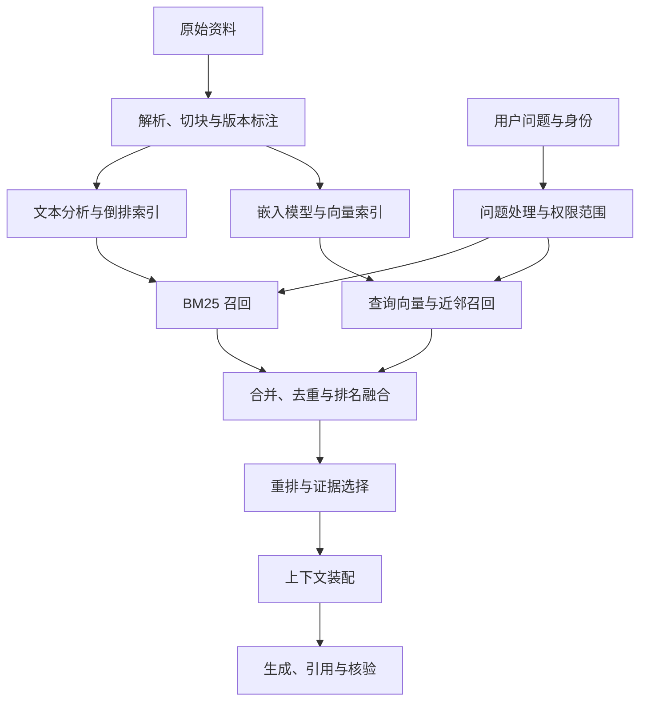
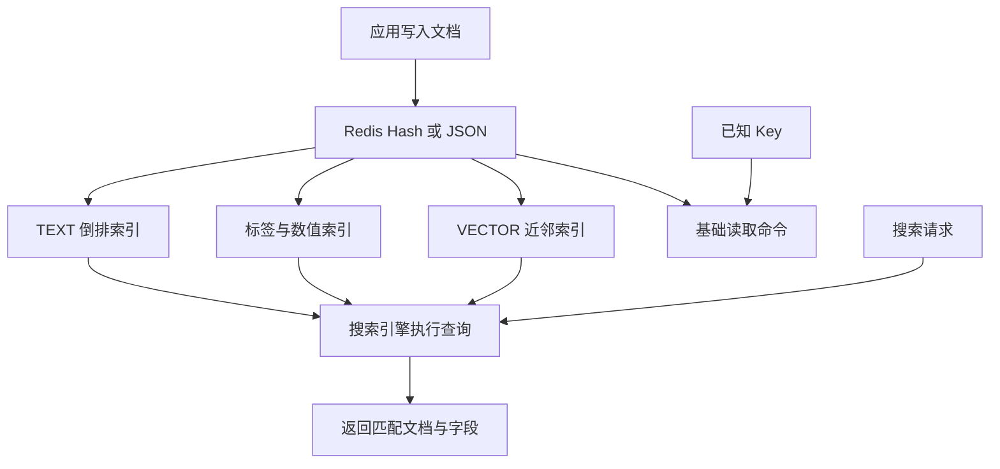

# RAG 检索原理与工程实践

首次整理：2026-11-04

最近更新：2026-11-05

类型：原创学习笔记

来源：2026-11-03 至 2026-11-05 的学习对话，以及文末列出的论文、官方文档和维护者源码。本文按知识依赖重新编排，保留追问与更正后的解释。

标签：RAG、倒排索引、BM25、分词、Embedding、语义检索、向量检索、K-means、IVF、PQ、HNSW、混合检索、重排、Elasticsearch、Redis、RediSearch

基础内容于 2026-11-04 核验；向量检索分类、K-means 与 Redis 查询补充于 2026-11-05 核验，时区为 Asia/Shanghai。公式手算、切分演示和业务场景均为原创教学示例。涉及产品行为时标明版本或配置条件。数值算例以标准库代码复核，ES、Redis 命令示例未连接真实实例执行。

## 阅读导航

| 学习问题 | 阅读入口 |
| --- | --- |
| 为什么用 RAG，倒排索引能否用于 RAG？ | [1. 架构与动机](#rag) |
| 一条查询怎样走到有出处的答案？ | [2. 完整链路](#pipeline) |
| 两种分词器有什么区别，分词器是否需要训练？ | [3. 分词](#tokenization) |
| 倒排索引怎样定位文档？ | [4. 倒排索引](#inverted-index) |
| BM25 为什么这样评分，怎样手算？ | [5. BM25](#bm25) |
| 文字如何变成适合检索的向量，用什么模型？ | [6. 嵌入模型](#embedding) |
| 相似度怎样算，KNN 与 HNSW 什么关系？ | [7. 向量检索](#vector-search) |
| KNN、范围查询、ANN、K-means 能否互相对标？ | [概念分层](#vector-taxonomy) · [索引方案对比](#ann-methods) |
| K-means 怎么迭代，如何用于 IVF 和 PQ？ | [六点手算](#kmeans) · [IVF 与 PQ](#ivf-pq) |
| 指定 K 个中心，是否类似指定多个注意力头再训练？ | [K-means 与多头注意力](#kmeans-attention) |
| 语义检索除了单向量还有哪些方案？ | [8. 检索表示](#semantic-retrieval) |
| 条件过滤、混合召回、融合与重排怎样配合？ | [9. 混合与重排](#hybrid) |
| ES 的全文检索是否就是倒排加 BM25？ | [10. Elasticsearch](#elasticsearch) |
| Redis 与 RediSearch 什么关系，谁生成向量？ | [11. Redis Search](#redis-search) |
| `$vector AS distance` 是什么意思，还支持哪些查询？ | [KNN 语法](#redis-knn-syntax) · [范围与召回](#redis-vector-range) · [查询能力](#redis-query-capabilities) |
| Redis Search 是否在竞争 ES 的市场？ | [12. 场景与选型](#selection) |
| RAG 答错怎么定位，如何评测？ | [13. 故障与评测](#evaluation) |
| 按问题复习、查术语与原始来源 | [14. 复习与来源](#review) |

相关基础可回读[大模型笔记中的双塔与交叉编码器](2026-11-01-大模型基础学习笔记.md#ch10)及[模型词表与分词文件](2026-11-01-大模型基础学习笔记.md#sec-package-4)。Agent 如何调用检索工具可结合[工具调用循环](2026-11-02-Agent与MCP接入原理.md#runtime)学习。

<a id="rag"></a>

## 1. RAG 的架构与动机

RAG（Retrieval-Augmented Generation，检索增强生成）先从外部资料取得相关证据，再把问题与证据交给生成模型组织答案。模型参数提供语言与推理能力，外部资料提供本次任务需要核对的事实。原始 RAG 论文讨论了参数知识与外部检索记忆的结合，本文进一步整理应用开发中的检索、过滤、引用与更新链路。[S1](#s1)

假设用户问“产品 A 的赎回款什么时候到账”。通用模型可能知道赎回的含义，却无法凭参数确认产品 A 今天生效的条款。检索层找到对应版本，生成层再解释确认日、交易日、划付与银行入账的区别，并提供出处。文档更新后，系统通过更新数据和索引使用新资料，无需为了每次条款变化都重新训练生成模型。

| 需求 | RAG 中对应的工作 |
| --- | --- |
| 使用内部知识 | 检索已授权的制度、产品资料和业务数据 |
| 使用最新资料 | 维护版本、生效时间和增量索引 |
| 答案可核对 | 保存文档、章节和片段标识，关联引用 |
| 降低凭记忆回答的比例 | 提供证据，检查证据不足和冲突情况 |

倒排索引是其中一种检索基础设施。倒排加 BM25、稠密向量、学习型稀疏检索、结构化数据库查询，以及多路混合，都能为 RAG 提供材料。因此“为什么用 RAG，不用倒排索引”应该拆成两个决定，先决定是否需要检索后生成，再决定检索层采用什么方法。[S2](#s2)

RAG 的结果仍依赖证据和模型使用证据的质量。错误条款、缺失条件或引用映射错误，都可能产生有出处却不正确的回答。它的工程目标需要同时覆盖取证和生成。

<a id="pipeline"></a>

## 2. 从数据入库到回答的完整链路

离线或增量入库包括解析、清洗、切块、元数据标注、权限关联、向量化和建索引。在线包括问题处理、过滤、多路召回、融合、重排、证据装配和生成。两条链路通过同一组稳定的片段标识关联。



这是教学架构，具体系统可以只选择一路召回。多轮问题“那它节假日呢”通常需要结合当前产品、前一轮问题和时间点改写，既要保留查询意图，也要避免把旧猜测当作已确认条件。[S2](#s2)

一份可回读的片段记录可以包含以下字段。这是元数据设计示例。

| 字段 | 用途 |
| --- | --- |
| `doc_id`、`chunk_id` | 文档与片段的稳定标识 |
| `text`、`title`、`section` | 原文、标题与章节上下文 |
| `product_id`、`tenant_id` | 业务范围与租户隔离 |
| `version`、`effective_at` | 版本与生效时点 |
| `source_url`、页码或段落位置 | 引用和原文回读 |
| 权限关联、删除状态 | 限定可检索资料及处理撤回 |
| `embedding_model`、向量 | 追踪向量来源与索引版本 |

切块应尽量保留定义、条件、表头和例外。切得太小，可能只留下“T+2”却丢失“从份额确认日开始”；切得太大，可能稀释检索主题或超过模型输入限制。块大小、相邻重叠和父章节回读应通过同一评测集选择，本文不预设通用最优数字。

<a id="tokenization"></a>

## 3. 搜索分词、模型分词与训练的关系

### 3.1 两种分词服务于不同目标

| 对比 | 搜索引擎的文本分析 | 模型 Tokenizer，词元编码器 |
| --- | --- | --- |
| 目标 | 产生适合匹配与索引的词项 | 产生模型配套的词元编号 |
| 输出 | 词项、位置、字符偏移等 | Token ID 序列及配套输入信息 |
| 后续 | 倒排索引、词频统计、BM25 | 嵌入矩阵、模型前向计算 |
| 切分单位 | 词、字符、字符片段等，按检索目标配置 | 模型词表规定的词、子词、字符或字节片段 |
| 兼容要求 | 建索引和查询的分析结果应相互兼容 | 词表、ID 映射和输入格式应与模型配套 |

在 ES 中，Analyzer（分析器）可以包含字符过滤器、一个分词器和词项过滤器。清理 HTML、统一大小写、停用词和同义词处理分别发生在处理链中。索引与查询可以使用不同的分析器，但必须保证它们能形成预期匹配。[S3](#s3)

模型 Tokenizer 输出编号后，模型才查嵌入矩阵并进一步计算。用于语义检索的段落向量还需要编码网络与汇聚等步骤。模型分词器、输入嵌入表与最后的段落向量分别属于不同环节。[S8](#s8)

### 3.2 分词器是程序，还是训练结果

运行时执行的是程序，程序可以使用规则、词典或事先统计得到的参数。三种具体实现能够说明这种差别。

| 实现 | 依据 | 事先准备的资源 |
| --- | --- | --- |
| ES `standard` | Unicode 文本边界规则 | 算法规则和配置 |
| ES SmartCN | HMM，Hidden Markov Model，隐马尔可夫模型 | 根据训练语料得到的词频概率与统计词典 |
| RediSearch 中文 Friso | 词典匹配与 MMSEG 消歧算法等 | 预置词库、配置及可选自定义词库 |

ES `standard` 使用 Unicode UAX #29 文本分段规则。Lucene 官方明确说明 SmartCN 采用 HMM，并通过大规模语料计算中文词频概率。Redis 中文分词使用 Friso，其维护者提供了词典和匹配、消歧模式的说明。[S4](#s4) [S5](#s5) [S6](#s6) [S7](#s7)

例如“研究生命起源”可以产生“研究／生命／起源”与“研究生／命／起源”两种候选。词典和规则可以消除部分歧义，统计模型则利用已有概率选择切分。这是解释机制的示意，实际输出应以对应版本、词典和配置的检查结果为准。

模型 Tokenizer 也常包含算法与事先学到的资源。例如 BPE（Byte Pair Encoding，字节对编码）从语料学习合并规则，使用阶段按规则切分并映射 ID。这里学习的是编码词表和规则；段落语义表示由后面的嵌入模型计算。[S8](#s8)

<a id="inverted-index"></a>

## 4. 倒排索引怎样找到文档

正向访问通常是“文档编号 → 文档内容”，倒排访问是“词项 → 包含它的文档”。假设有三篇教学文档。

| 文档 | 分析后的词项示意 |
| --- | --- |
| A | 产品A、赎回、确认、交易日、划付 |
| B | 产品A、赎回、到账、进度 |
| C | 产品B、申购、确认 |

对应的倒排表可以记录“赎回 → A、B”“到账 → B”“确认 → A、C”。真实倒排项还可能包含词频和位置。查询多个词时，系统利用这些列表执行交集、并集和相关性搜索，并可通过跳过不可能进入前列的候选来减少计算。

分词决定了能匹配什么。BM25 决定匹配项的相关性贡献。查询中的 AND／OR、短语、字段和过滤条件则决定匹配规则。基础 BM25 对词项贡献求和，短语查询还需要利用词项的位置和距离。[S3](#s3) [S9](#s9)

对产品编号等硬条件，可以采用专门的精确字段和过滤，把文本相关性留给正文。搜索专业术语、错误码、已知标题或明确实体时，倒排加 BM25 是重要的基线。用户与文档说法差异较大时，可以补充同义词、查询改写或语义检索。[S20](#s20) [S21](#s21)

<a id="bm25"></a>

## 5. BM25 的原理、公式与手算

### 5.1 三个因素怎样配合

BM25（Best Matching 25，相关性排序算法）发展自概率信息检索，综合查询词在当前文档中的出现次数、在语料中的稀有程度，以及文档相对长度。匹配词越有区分度，贡献通常越大；同一个词重复出现有收益，但收益逐渐饱和；在匹配词频相同的情况下，长文档获得长度调整。[S10](#s10)

本文采用常见教学公式，查询词按词项集合处理，不额外引入查询词频权重。

$$
S(q,d)=\sum_{t\in q}\operatorname{IDF}(t)\cdot
\frac{f(t,d)(k_1+1)}{f(t,d)+k_1\left(1-b+b\frac{L_d}{\overline L}\right)}
$$

| 符号 | 含义 |
| --- | --- |
| `q`、`d`、`t` | 查询、当前文档、一个查询词项 |
| `f(t,d)`，TF | Term Frequency，词频，该词在当前文档出现的次数 |
| `df(t)` | Document Frequency，文档频率，包含该词的文档数 |
| `N` | 统计范围内的文档数 |
| `L_d`、平均长度 | 分析后的当前字段长度与该字段平均长度 |
| `k1` | 控制词频饱和 |
| `b` | 控制长度归一化强度 |

Lucene 使用下面的 IDF（Inverse Document Frequency，逆文档频率）形式。`N` 和 `df` 使用相应字段的文档统计。

$$
\operatorname{IDF}(t)=\ln\left(1+\frac{N-df(t)+0.5}{df(t)+0.5}\right)
$$

包含某词的文档越少，匹配它越能缩小候选范围。IDF 衡量语料区分度，稀有拼写错误也可能取得高 IDF，因此还要依赖数据清洗和查询设计。[S10](#s10)

### 5.2 为什么重复十次不会获得十倍分数

当字段长度等于平均长度时，词频部分简化为下面的式子。

$$
W(f)=\frac{f(k_1+1)}{f+k_1}
$$

取 `k1=1.2`，可以得到以下教学数值。

| 出现次数 | 1 | 2 | 5 | 10 | 100 |
| --- | --- | --- | --- | --- | --- |
| 词频权重 | 1.000 | 1.375 | 1.774 | 1.964 | 2.174 |

固定长度后，新增一次出现带来的收益逐渐降低，这个公式版本的词频权重上限为 `k1+1=2.2`。`k1` 越大，饱和越慢；`k1=0` 时，出现过的词按是否出现贡献分数。

长度因子是 `1-b+b×当前长度/平均长度`。匹配词频相同，长文档的分母更大。`b=0` 关闭长度调整，`b=1` 完整采用相对长度因子。ES 的默认参数为 `k1=1.2`、`b=0.75`。如何调整应由业务标注和评测决定。[S9](#s9)

### 5.3 完整排名算例

设语料包含 1,000 篇文档，平均长度 300。“赎回”出现在 100 篇中，IDF 约为 `2.298597`；“到账”出现在 10 篇中，IDF 约为 `4.557380`。查询为“赎回 到账”，允许部分词匹配。

| 文档 | 长度 | 赎回次数 | 到账次数 | 赎回贡献 | 到账贡献 | 总分 |
| --- | --- | --- | --- | --- | --- | --- |
| A | 100 | 1 | 1 | 3.161 | 6.266 | 9.427 |
| B | 1000 | 10 | 1 | 3.802 | 2.332 | 6.134 |
| C | 300 | 3 | 0 | 3.612 | 0.000 | 3.612 |

A 的长度项为 `1.2×(0.25+0.75×100/300)=0.6`。两个词都出现一次，各自的词频权重为 `2.2/(1+0.6)=1.375`，总分为两个 IDF 之和乘以 `1.375`。B 重复“赎回”较多，但收益饱和且篇幅更长。C 没有取得“到账”的贡献。

以下代码只依赖 Python 标准库，用来复现上表。

```python
import math

def idf(document_count, document_frequency):
    return math.log(1 + (document_count - document_frequency + 0.5)
                    / (document_frequency + 0.5))

def term_score(term_frequency, length, average_length, term_idf,
               k1=1.2, b=0.75):
    if term_frequency == 0:
        return 0.0
    length_factor = k1 * (1 - b + b * length / average_length)
    return term_idf * term_frequency * (k1 + 1) / (term_frequency + length_factor)

weights = [idf(1000, 100), idf(1000, 10)]
documents = [("A", 100, [1, 1]), ("B", 1000, [10, 1]), ("C", 300, [3, 0])]
for name, length, frequencies in documents:
    score = sum(term_score(frequency, length, 300, weight)
                for frequency, weight in zip(frequencies, weights))
    print(name, f"{score:.3f}")

# A 9.427
# B 6.134
# C 3.612
```

### 5.4 教学分数与 ES 原始分数的区别

Lucene 8 起移除了分子中的常数 `k1+1`。在相同参数的单一评分设置下，这种统一缩放保留排序；涉及不同字段和不同相似度的组合时，需要按具体查询分析。上面的数字用于解释公式，不能直接当作 ES 的 `_score`。字段权重、长度编码、分片统计与查询组合也会影响实际值。[S11](#s11)

在 ES 中可用 `_explain` 查看某篇文档的评分贡献。调参前先检查分词、候选范围、字段权重和语料统计，避免用 `k1`、`b` 掩盖没有召回正确词项的问题。[S29](#s29)

<a id="embedding"></a>

## 6. 文字怎样向量化，检索模型怎样训练

### 6.1 一次编码经过什么

Embedding Model（嵌入模型）把文字转换成可以用于比较的数值表示。典型单向量编码包括词元编码、嵌入查表、Transformer 编码，以及 Pooling（汇聚）和可选投影、归一化。汇聚可能取特殊位置、最后一个有效位置或对有效位置求平均，应遵守具体模型的约定。

单个 Token 的输入嵌入来自词表查表，段落向量则经过上下文计算。后者旨在服务整段内容的检索。不同模型的原始隐藏状态需要经过相应检索训练和表示设计，才能适合用距离衡量相关性。[S12](#s12) [S18](#s18)

### 6.2 为什么向量距离能反映相关性

双编码器分别编码查询与文档，文档表示可以离线计算。训练样本包含查询、正例和负例，优化目标把查询靠近正例，远离负例。一个常见的对比损失写法如下。

$$
\mathcal L=-\log\frac{\exp(s(q,d^+)/\tau)}{\sum_{d\in\mathcal C}\exp(s(q,d)/\tau)}
$$

`d+` 为正例，候选集合 `C` 包含正负例，温度 `τ` 调整分数分布。具体模型可以使用其他损失、蒸馏或训练方案。DPR（Dense Passage Retrieval，稠密段落检索）是双编码器检索的代表工作。[S12](#s12)

例如，“赎回的钱多久到账”的正例给出确认后划付时间，困难负例只说“可以查询到账进度”。后者词面很接近，但没有回答时间。检索训练希望把这种区别纳入表示。语义来自模型学到的关系，余弦函数和 HNSW 索引负责比较和查找。

### 6.3 选用哪些模型

| 代表模型 | 角色 | 使用时核对 |
| --- | --- | --- |
| DPR | 说明查询与文档独立编码的检索设计 | 训练领域、查询和文档编码器是否配套 |
| Qwen3-Embedding | 文本嵌入与检索 | 具体规格、维度、长度限制和查询指令 |
| BGE-M3 | 稠密、稀疏及多向量表示 | 实际启用哪种输出、索引是否支持对应评分 |
| Qwen3-Reranker、BGE-Reranker | 查询与候选相关性重排 | 候选数量、输入长度、延迟和评分约定 |

这些是已核验的模型家族示例，本文不依据榜单宣称某个模型适合所有中文业务。问题找相似问题属于对称任务，短问题找长答案属于非对称任务，训练目标和输入方式应与实际任务相符。[S13](#s13) [S18](#s18) [S19](#s19) [S31](#s31)

文档与查询需使用兼容的模型、版本、指令和归一化方式。同为 1,024 维的两个模型也可能属于不同坐标空间。更换嵌入模型通常需要重算文档向量，建立新索引并验证后切换。[S15](#s15)

<a id="vector-search"></a>

## 7. 相似度、KNN 与向量索引

### 7.1 三种常见度量

令查询向量为 `q`，文档向量为 `d`。

$$
\text{点积}=q^\top d
$$

$$
\text{余弦相似度}=\frac{q^\top d}{\lVert q\rVert\lVert d\rVert}
$$

$$
\text{欧氏距离}=\sqrt{\sum_i(q_i-d_i)^2}
$$

点积同时受方向与长度影响，余弦比较方向，欧氏距离比较坐标距离。以下二维数字用于演示度量差异。

| 向量 | 与查询 `(1,0)` 的点积 | 余弦相似度 |
| --- | --- | --- |
| 文档 A `(3,4)` | 3 | 0.6 |
| 文档 B `(1,0)` | 1 | 1.0 |

两种度量给出了不同顺序。单位向量的点积等于余弦，且平方欧氏距离等于 `2-2×余弦`。度量应与模型训练和归一化方式配套。相似度 `0.8` 没有天然的“80% 正确概率”含义，数据库也可能进一步转换原始距离为返回分数。[S14](#s14)

<a id="vector-taxonomy"></a>

### 7.2 查询目标、结果保证、索引与训练分四层

“找最近的 10 个”和“找距离不超过 0.2 的所有点”是两种要求；用穷举、分桶还是图来执行，是下一层决定。不能把 KNN、ANN、HNSW、K-means 放在同一列当作互斥选项。

| 层次 | 代表概念 | 回答的问题 |
| --- | --- | --- |
| 查询目标 | KNN（k-Nearest Neighbors，K 近邻）、Range／Radius search（范围／半径查询） | 要最近 K 项，还是距离阈值以内的项？ |
| 结果保证 | Exact（精确）、Approximate（近似）；ANN（Approximate Nearest Neighbor，近似最近邻） | 是否保证得到精确近邻，可能损失哪些结果？ |
| 索引与执行 | 原向量全扫描、IVF 分桶、HNSW 图导航；还可组合 PQ 编码 | 怎样减少计算、访存或存储开销？ |
| 索引训练 | K-means（K 均值聚类） | 如何学习分区中心或子空间码本？ |

KNN 指定结果数量，通常不限制最远距离，数据里没有相关内容时也可能返回很远的点。范围查询指定距离阈值，结果数量不固定，可以为零。其精确目标可写为：

$$
R(q,r)=\{x\in D\mid d(q,x)\le r\}
$$

这里 `D` 是满足过滤条件的候选集，`r` 是指定度量下的阈值。本次讨论中的 RNN 指 Radius Nearest Neighbor（半径近邻），但文献中 RNN 也常指 Reverse Nearest Neighbor（反向近邻），两者不是同一个问题。本文统一写“范围查询”；Redis Search 的命令关键字是 `VECTOR_RANGE`。查询目标、近似召回和客户端分页应分开判断。[S38](#s38) [S39](#s39) [S49](#s49)

| 查询与执行组合 | 可以怎样理解 |
| --- | --- |
| KNN + Redis `FLAT` | 按存储向量与选定度量求精确 KNN |
| KNN + HNSW | 通过近似图搜索求 K 近邻，是 ANN 的常见用法 |
| 范围查询 + 精确全扫描 | 找出所有满足距离阈值的候选，再按接口规则返回 |
| 范围查询 + 支持该操作的近似索引 | 找出符合阈值的已发现候选，可能漏掉其他范围内的点 |

ANN 的误差可以来自没有搜索到真正近邻，也可以来自压缩表示造成的距离近似。因此“ANN 一定不扫描全部记录”不成立：Faiss 的 `IndexPQ` 可以扫描全部压缩码，结果仍可能不同于原向量精确排序。这里用作精确基线的 FLAT 特指 Redis `FLAT` 或 Faiss `IndexFlatL2/IP`；不能把其他产品中所有含有 Flat 的名字都理解为精确全库检索。[S34](#s34)

精确向量检索也不等于业务答案正确：它只保证在指定向量、度量和候选范围下找到正确近邻。

| 需要区分的指标 | 回答的问题 |
| --- | --- |
| ANN recall，相对精确近邻的召回 | 近似算法找回多少精确搜索的前 K 项 |
| 业务 Recall@K，相关证据召回率 | 人工标注的相关证据有多少进入前 K 项 |

精确向量搜索也可能找不到正确证据，原因可能是解析、切块、编码模型或过滤范围，而非近似索引。通过精确搜索与 ANN 对照，可以把表示质量和搜索损失分开定位。

<a id="ann-methods"></a>

### 7.3 检索方案怎样对比，为什么不能严格三分

常见思路包括空间划分、哈希／编码、邻居图。它们是理解机制的分类，可以在一个索引中组合。

| 方法 | 主要机制 | 主要代价或误差来源 |
| --- | --- | --- |
| 原向量 FLAT 全扫描 | 遍历候选并计算指定距离 | 候选多时计算与访存开销大，适合做精确基线 |
| KD-tree（k-dimensional tree，K 维树） | 按坐标划分空间，用距离边界剪枝 | 高维数据可能难以有效剪枝；既可实现精确查询，也有近似查询模式 |
| IVF（Inverted File，倒排文件索引） | 把向量分配到聚类中心对应的桶，查询只访问部分桶 | 真近邻所在的桶可能未被访问 |
| LSH（Locality-Sensitive Hashing，局部敏感哈希） | 让近邻较可能落入相同或相关哈希桶 | 哈希碰撞与桶探查之间的召回、空间和计算取舍 |
| PQ（Product Quantization，乘积量化） | 子向量用码本编号近似表示 | 编码有损，距离估计和排序可能改变 |
| HNSW（Hierarchical Navigable Small World，分层可导航小世界图） | 高层粗定位，低层沿稀疏近邻图探索 | 图遍历可能漏点，图本身占内存 |

IVF 可以和 PQ 组合成 IVFPQ；图索引也可以组合压缩存储。Faiss 的 `IVFFlat` 中 Flat 表示桶内保留原向量，默认只搜部分桶时仍是近似搜索。SPTAG（Space Partition Tree And Graph，空间划分树与图）明确组合树与邻居图，也不宜归为纯图方法。[S34](#s34) [S37](#s37) [S44](#s44) [S45](#s45) [S47](#s47)

HNSW 构建稀疏分层图，不要求先存储全库的两两距离矩阵。在 Redis Search 中，`M` 控制图连接规模，`EF_CONSTRUCTION` 影响建图时的候选探索，`EF_RUNTIME` 影响查询时的探索。更大的搜索范围通常提高召回，也增加耗时；不能据此承诺对任意数据都有固定的对数复杂度。[S38](#s38)

选型时固定相同向量、过滤和精确基线，比较召回率、尾部延迟、建索引时间、内存与更新成本。数据量大并不必然要求 ANN；过滤后候选很少或硬件适合并行扫描时，精确搜索仍值得比较。

<a id="kmeans"></a>

### 7.4 K-means：先分组，再把中心移到组内均值

K-means 的输入是一组向量和预先选定的聚类数，输出是各点所属的组与每组中心。它是无监督聚类，不需要先给每个点标业务类别，也不负责直接返回某个查询的最近 K 个文档。[S35](#s35)

下面是原创二维教学数据：A=(1,1)、B=(1,2)、C=(2,1)、D=(8,8)、E=(8,9)、F=(9,8)。设分成两组，故意把初始中心都放在左边 `(1,1)`、`(2,1)`，观察分组怎样修正。

1. 分配：对每个点，计算到各中心的平方欧氏距离，分给最近中心。
2. 更新：对每个组，按坐标求算术平均，作为新中心。
3. 重复：使用新中心重新分配、更新，直到稳定或达到停止条件。

| 轮次：先分配、再更新中心 | 第 1 组与新中心 | 第 2 组与新中心 | 更新后的组内平方误差总和 |
| --- | --- | --- | --- |
| 第 1 轮 | A、B；`(1,1.5)` | C、D、E、F；`(6.75,6.5)` | 72.25 |
| 第 2 轮 | A、B、C；`(4/3,4/3)` | D、E、F；`(25/3,25/3)` | `8/3 ≈ 2.6667` |
| 第 3 轮 | 分组与中心不变 | 分组与中心不变 | `8/3` |

例如 C 在第一轮后，到两个新中心的平方距离分别为 `1.25` 与 `52.8125`，所以第二轮改到第 1 组。中心是均值，不要求等于任意一个真实样本。

普通 K-means 最小化组内平方欧氏误差；用 `k_c` 表示聚类数，避免与 KNN 的结果数混淆：

$$
J=\sum_{j=1}^{k_c}\sum_{x\in C_j}\|x-\mu_j\|_2^2,
\qquad
\mu_j=\frac{1}{|C_j|}\sum_{x\in C_j}x
$$

固定分组时，均值最小化该组的平方误差；固定中心时，分给最近中心不会增大误差。交替执行可以使目标下降，但初始化影响结果，不能保证达到全局最优。K-means++ 初始化和多次重启有助于改善结果。[S35](#s35) [S36](#s36)

特征尺度、离群点和簇形状会影响效果。普通 K-means 的“取均值”与平方欧氏目标配套；即使输入都归一化，均值中心也不自动保持单位长度。针对余弦目标，可采用重新归一化中心的球面 K-means，不能随意替换距离而沿用所有结论。[S35](#s35)

<a id="kmeans-attention"></a>

#### 7.4.1 指定 K 个中心，是否类似指定多个注意力头

这个类比在“先指定结构规模，再从数据学习参数”这一层成立：设计者设定聚类数 K 或注意力头数 H，通常不手工规定每个中心或每个头的业务含义。但中心是代表一组数据的向量，一个头则是一套计算关系并聚合信息的机制，二者不采用相同的训练方法。

| 对比 | 普通 Lloyd K-means | 标准多头自注意力 |
| --- | --- | --- |
| 人为设定 | 聚类数量 K | 注意力头数 H，以及每头维度等结构配置 |
| 学习对象 | K 个中心的坐标 | 各头的 Q、K、V 投影矩阵等参数，输出投影也共同训练 |
| 优化目标 | 减小组内平方欧氏误差 | 减小整体任务损失，例如下一个词元预测损失 |
| 更新方式 | 交替执行最近中心分配、组内均值更新 | 通过反向传播求梯度，由优化器更新参数 |
| 一个输入怎样参与 | 每个数据点通常只归入一个簇 | 同一个 Token（词元）同时进入多个头 |
| 训练后普通推理 | 中心保持固定，计算新点归属 | 参数保持固定，注意力权重随当前输入重新计算 |

K、H 属于超参数；中心坐标与投影矩阵中的数属于可学习参数。普通训练调整这些数，通常不自动决定把 K 或 H 改成多少。“从数据学习”不等于必须使用神经网络或反向传播。[S35](#s35) [S50](#s50)

K-means 可以回看上面的六点例子：C 改变分组，各组再取均值，中心随之移动。多头注意力则在前向计算后，用预测与目标的差异形成损失，再把梯度传回各头参数。它学习“怎样提取和组合信息以帮助任务”，没有把某个头更新成一组 Token 均值的步骤。

对第 h 个头，Q（Query，查询）、K（Key，键）、V（Value，值）由当前输入和该头的投影矩阵生成。省略掩码等细节，可写为：

$$
Q_h=XW_Q^{(h)},\qquad K_h=XW_K^{(h)},\qquad V_h=XW_V^{(h)}
$$

$$
A_h=\operatorname{softmax}\!\left(\frac{Q_hK_h^\top}{\sqrt{d_k}}\right),\qquad O_h=A_hV_h
$$

其中 X 是本层输入，d_k 是查询／键向量宽度；式中的 K_h 是键矩阵，与聚类数 K 无关。Softmax（归一化指数函数）对每个查询位置，在该头可见的键位置之间归一化；自回归掩码等约束在归一化前应用。它不在 H 个头之间为 Token 选择一个头。因此“8 个头”不等于“把 Token 分为 8 类”，每个头也不是一个固定语义中心。[S50](#s50)

多个头提供学习不同信息交互方式的空间，不保证形成 H 种独立、可解释的职责。有些头可能冗余；已有研究在部分模型中观察到，删除相当一部分头仍不明显损害效果。常见等宽配置还满足 `d_k = d_model / H`：固定总宽度时，增加头数会缩小每头宽度，不能简单推出头越多效果越好。[S50](#s50) [S51](#s51)

相关基础可回读[超参数与可学习参数](2026-11-01-大模型基础学习笔记.md#sec1-7)、[QKV 与注意力](2026-11-01-大模型基础学习笔记.md#ch4)及[前向、反向与优化器](2026-11-01-大模型基础学习笔记.md#sec5-7)。

<a id="ivf-pq"></a>

### 7.5 K-means 怎样用于 IVF 和 PQ

IVF 的典型训练步骤是用 K-means 学到一批中心，把文档向量分配给最近中心，建立“中心编号→向量列表”。查询时先定位要访问的中心，再搜索对应的列表。这些桶按向量几何结构形成，不自动等于“金融”“法律”等业务分类；也不能把向量中心编号与全文倒排索引里的词项混为一谈。[S35](#s35) [S43](#s43)

| 参数 | 阶段与作用 | 原创教学取值 |
| --- | --- | --- |
| `nlist` | 建索引时的分桶数量，通常对应粗聚类中心数 | 1,000 个桶 |
| `nprobe` | 查询时访问的桶数 | 访问 10 个桶 |
| `top_k` | 本次近邻查询要输出的结果数 | 返回最近 20 项 |

若有 100 万个向量且各桶近似均衡，每桶约 1,000 个，只访问 10 桶约需比较 10,000 个原向量，另加查找中心等开销。`N × nprobe / nlist` 只是这个均衡假设下的估算，不保证桶大小一致。提高 `nprobe` 通常扩大覆盖；提高 `top_k` 不能替代扩大探查范围。[S43](#s43)

没有其他扫描上限、过滤差异或量化误差时，IVFFlat 搜完所有桶可恢复全量精确检索；IVFPQ 即使搜完所有桶，仍可能有压缩距离误差。这里的 IVF 参数采用 Faiss 术语，不是 Redis Search 的通用配置项。[S34](#s34) [S37](#s37)

PQ 则把一个向量拆为多个子向量，在各子空间学习码本，常用 K-means 训练每本码本，再用中心编号代替子向量。原创容量示例：768 维 FLOAT32 原向量占 `768 × 4 = 3,072` 字节；拆成 96 份，每份 8 维，每个码本有 256 个中心，中心编号用 8 bit，整条编码只需 `96 × 1 = 96` 字节。单条编码是原字节数的 `1/32`，此处未计共享码本、文档 ID、索引结构及原文。[S37](#s37)

PQ 的核心是有损编码，近似解码后仍可得到 768 维向量；不能说它必然把 768 维变成 96 维的连续语义向量。PCA（Principal Component Analysis，主成分分析）才是把向量投影到较低维空间的一类方法，两者可以组合。[S46](#s46)

因此，比较完整检索方案时，应比较原向量 FLAT、IVFFlat、IVFPQ、HNSW 等具体配置；解释方案内部时，再说明其中是否用 K-means 训练中心、是否有 PQ 压缩，以及误差来自哪里。

<a id="semantic-retrieval"></a>

## 8. 语义检索的常用方案

语义检索根据查询意图和内容相关性寻找资料。它既包括“相似问题找相似问题”，也包括“问题找能够支持答案的段落”。后者强调能否回应问题。向量检索是一条实现路径，学习型稀疏表示也可以借助倒排索引实现语义匹配。[S16](#s16) [S31](#s31)

| 方案 | 表示与匹配方式 | 常见位置 |
| --- | --- | --- |
| 稠密单向量 | 查询与片段独立编码成单向量，按距离比较 | 大规模候选召回 |
| 学习型稀疏 | 模型生成高维、少量非零的词项权重 | 倒排候选召回 |
| 多向量与晚交互 | 保留多个上下文 Token 向量，细粒度匹配再聚合 | 召回或重排 |
| 交叉编码器 | 查询与文档联合编码，直接输出相关分数 | 少量候选重排 |
| 混合检索 | 组合不同检索通道并融合排名 | 完整检索架构 |

SPLADE（Sparse Lexical and Expansion Model，稀疏词项与扩展模型）可以学习词项权重和扩展，使词面不同的表达通过扩展词项产生匹配。它使用神经网络生成稀疏表示，检索时仍可利用倒排索引。[S16](#s16)

ColBERT 采用 Late Interaction（晚交互），分别预编码查询与文档的 Token 级向量，再计算细粒度匹配。常见 MaxSim 形式如下，对每个查询向量取最佳文档匹配，再求和。

$$
S(q,d)=\sum_i\max_j q_i^\top d_j
$$

它保留更多局部信息，也增加向量数量和匹配开销。将文档切为多个块并给每块一个向量，与一个片段保留多个 Token 向量，是两种不同粒度。数据库支持多个向量字段，也不自动代表支持这种 MaxSim 评分。[S17](#s17)

BGE-M3 同时提供三类表示，但不能把三类输出都当成普通单向量 KNN 使用。其稀疏模式按词项权重匹配，多向量模式按晚交互评分，需要相应的检索或重排实现。[S18](#s18)

<a id="hybrid"></a>

## 9. 条件过滤、混合检索、融合与重排

### 9.1 条件过滤与两路融合的区别

| 操作 | 如何影响结果 |
| --- | --- |
| `product_id=PRD-2048` | 限定候选范围 |
| 标题或正文匹配“赎回规则”并计算 BM25 | 提供关键词相关性和排名 |
| 文本匹配作为 KNN 的硬过滤 | 限定满足文字条件的向量候选 |
| BM25 与向量分别召回，再融合 | 两路都能贡献候选及排名信息 |
| 重排候选 | 更细致判断当前查询与候选是否相关 |

“文本过滤 + KNN”可以只是先筛候选再按距离查近邻。需要融合两路相关性时，应明确分别召回、去重和组合排名的步骤。[S20](#s20) [S28](#s28)

### 9.2 为什么不能随手把两个分数相加

BM25 分数、余弦相似度与距离的范围和方向可能不同。可以用经过校准的加权融合，也可以用 RRF（Reciprocal Rank Fusion，倒数排名融合）根据名次组合。一个常见写法如下，`c` 为平滑常数，未进入某路候选的文档在该路不贡献分数。

$$
S_{\mathrm{RRF}}(d)=\sum_j\frac{1}{c+\operatorname{rank}_j(d)}
$$

RRF 避开了直接比较两路原始分数的问题，候选窗口、常数、权重和去重仍需验证。Top-K 越大通常带来更多候选，也可能增加重复、噪声和成本。[S20](#s20)

Cross-Encoder（交叉编码器）把查询与每个候选一起送入模型，在内部建立直接交互，再输出相关性分数。联合计算不能完全预先完成，因此常用在较小候选集。重排只能调整已经进入候选的内容，召回阶段完全漏掉的证据仍需从上游修复。[S19](#s19)

### 9.3 一个可验证的起步设计

作为教学设计，可以并行取 BM25 前 50 条与向量前 50 条，去重、融合、重排，选择 5 至 10 段证据，再按上下文预算组织。这里的数量用于说明各阶段关系，实际值依据数据与延迟预算确定。

先保留 BM25、单路稠密和混合三个基线，再分别验证切块、查询改写、嵌入模型、融合窗口与重排收益。每次改变少量变量，才能判断提升来自哪里。

<a id="elasticsearch"></a>

## 10. Elasticsearch 中的全文与向量检索

ES（Elasticsearch，分布式搜索与分析引擎）对普通 `text` 字段的常见全文路径，是文本分析、倒排匹配和 BM25 评分。实际结果还由查询逻辑、字段权重与最终排序控制。BM25 是默认 similarity，可以按字段配置其他评分方式。[S9](#s9)

| 请求内容 | 应观察的机制 |
| --- | --- |
| 在正文中搜索“赎回规则” | 分词结果、词项匹配、相关性评分 |
| 限定产品和日期 | 精确字段、数值或日期范围过滤 |
| 强调完整短语 | 词项位置、顺序与间隔 |
| 按时间排序 | 显式排序字段对结果顺序的影响 |
| 在向量字段上查近邻 | 查询向量、距离度量、候选搜索与过滤 |

`filter` 上下文负责判定是否满足条件，这些过滤子句不贡献文本相关性分数。`match` 等全文查询则根据分析后的词项执行匹配。分词错误、字段类型错误或查询条件过严，都可能在打分前排除正确文档。[S21](#s21)

检查分词可用 `_analyze`，检查单篇文档为何匹配和得分可用 `_explain`。两者分别帮助定位词项生成和评分问题。向量路径需要另行核对模型、维度、距离及近邻搜索配置。[S3](#s3) [S29](#s29) [S15](#s15)

<a id="redis-search"></a>

## 11. Redis、RediSearch 与文本向量化

### 11.1 数据存储与索引查询的关系

Redis 提供数据结构与访问命令，RediSearch 在 Redis 文档上提供字段索引和查询。早期通过模块或 Redis Stack 提供的 Search 等能力，已从 Redis 8.0 开始整合到 Redis Open Source 发行包。阅读旧资料时应核对实际部署版本。[S22](#s22)

同一份 Hash 或 JSON 文档既可以按 Key 读取，也可以通过 Search 的索引查找。



| 字段类型 | 主要用途 |
| --- | --- |
| `TEXT` | 全文分词、匹配与相关性评分 |
| `TAG` | 标签值、类别等匹配 |
| `NUMERIC` | 数值范围查询 |
| `GEO` | 地理范围查询 |
| `GEOSHAPE` | 点或多边形等空间关系查询 |
| `VECTOR` | 向量距离与近邻搜索 |

`FT.CREATE` 的 Schema（索引结构）指定字段及其类型，`PREFIX` 等选项指定索引范围。原文和向量可以保存在同一文档中，索引负责找到符合条件的文档。[S24](#s24)

### 11.2 全文评分与 KNN 分别怎样用

当前官方文档将全文默认评分器标为 `BM25STD`，并注明 Redis 8.4 将旧 `BM25` 名称改为 `BM25STD`，旧名已弃用。KNN 使用 `VECTOR` 字段及配置的距离度量，文本、标签和数值条件可以限定搜索范围。两种机制可以组合，但过滤与排名融合要分别设计。[S23](#s23) [S28](#s28)

下面是已启用 Search 实例上的命令示意。索引、商品编号与内容均为教学数据，本文未连接实例运行。

```text
FT.CREATE idx:products ON HASH PREFIX 1 product: SCHEMA name TEXT category TAG price NUMERIC
HSET product:1001 name "Wireless headphones" category electronics price 399
HGETALL product:1001
FT.SEARCH idx:products '@name:headphones @category:{electronics} @price:[0 500]'
```

第一条建立字段索引，第二条保存内容，第三条按 Key 读取，第四条按文本、标签和价格查询。中文正文应核对中文语言选项和词典，本文示例采用英文名称以保持示例聚焦于查询结构。[S6](#s6) [S24](#s24)

### 11.3 谁负责生成向量

直接使用 RediSearch 的 `VECTOR` 和 `FT.SEARCH` 接口时，向量由应用选择的 Embedding 模型生成。常规 Search 接口没有统一默认的文本向量化模型。官方 Python 示例在客户端用 Sentence Transformers 编码，再把结果写入 Redis，查询时也先生成问题向量。[S25](#s25)

| 阶段 | 模型或应用负责 | Redis Search 负责 |
| --- | --- | --- |
| 入库 | 解析、切块、生成片段向量、关联元数据 | 保存内容和向量，建立字段索引 |
| 查询 | 生成查询向量、提供过滤条件 | 查找近邻，返回原文和元数据 |
| 更新 | 对变化内容重新编码 | 更新索引与文档状态 |

RedisVL（Redis Vector Library，Redis 向量开发库）提供本地模型和模型服务的 Vectorizer（向量化封装），可以简化调用。某个封装类拥有默认模型时，该默认属于客户端封装，不能推成 RediSearch 服务端自带统一模型。[S26](#s26)

### 11.4 索引更新与版本边界

Search 自动维护索引，但首次为已有资料建索引可能需要后台扫描。Redis 8.8 及以后，非零 `search-workers` 配置使用后台索引，写入后紧接着搜索可能暂时看不到全部新文档。官方为严格搜索写后可读场景提供 `search-workers=0` 的前台索引选择，同时说明会放弃后台多线程索引的吞吐收益。应用应依据实际配置验证可见性。[S27](#s27)

Redis Open Source 8.4 起引入原生 `FT.HYBRID`，以 `SEARCH`、`VSIM` 与 `COMBINE` 组织全文、向量及排名融合，支持 RRF 与线性组合。具体参数和部署兼容性仍应核对对应版本；普通过滤 KNN 的命令形态可能只做硬过滤。[S28](#s28) [S42](#s42)

<a id="redis-knn-syntax"></a>

### 11.5 逐项理解 `$vector AS distance`

本节讨论 Redis Search 的 `VECTOR` 字段与 `FT.SEARCH` 查询。下面先读查询表达式，再读完整请求：

```text
*=>[KNN 10 @text_embedding $vector AS distance]
```

| 片段 | 含义 |
| --- | --- |
| `*` | 不附加文档过滤条件，候选来自该索引范围 |
| `=>` | 把左侧候选条件与右侧向量近邻操作连接起来 |
| `KNN 10` | 查找最近的 10 个结果；结果不足时不会凭空补足 |
| `@text_embedding` | Schema 中的向量字段 |
| `$vector` | 输入参数占位符，实际查询向量通过 `PARAMS` 绑定 |
| `AS distance` | 给每个结果计算出的距离起别名 `distance` |

`$vector AS distance` 不能连读为“把查询向量改名成 distance”。输入是一条查询向量，输出则是每个命中文档各自的距离；别名只是让返回和排序更方便，不改变度量、向量内容或索引算法。[S38](#s38)

以下是命令结构示意，假设索引已经定义 `text`、`text_embedding` 等字段。`<binary_vector>` 是必须由客户端替换的真实字节参数，不是可直接输入的文本：

```text
FT.SEARCH idx:docs
  "*=>[KNN 10 @text_embedding $vector AS distance]"
  PARAMS 2 vector <binary_vector>
  SORTBY distance ASC
  RETURN 2 text distance
  LIMIT 0 10
  DIALECT 2
```

| 请求选项 | 需要核对的细节 |
| --- | --- |
| `PARAMS 2 vector <binary_vector>` | 后面是两个参数项，即一组“名称、值”；不是两条向量 |
| `SORTBY distance ASC` | 显式按距离从小到大排序；距离度量来自字段配置 |
| `RETURN 2 text distance` | 返回正文与距离两个字段 |
| `LIMIT 0 10` | 从第 0 项起返回 10 条，独立于近邻搜索的 K |
| `DIALECT 2` | 选择查询语法版本，向量查询需要方言版本至少为 2 |

例如字段为 `DIM 768 TYPE FLOAT32`，查询向量的原始字节长度应为 `768 × 4 = 3,072`。还要核对模型空间、归一化与客户端序列化，不能只检查长度。JSON 数字数组的文本字符串不能直接代替本请求要求的原始字节。[S24](#s24) [S38](#s38) [S39](#s39)

未指定 `AS` 时，KNN 默认距离字段名按 `__<vector_field>_score` 生成，本例为 `__text_embedding_score`。显式起名有助于避免误读其含义。写了 `KNN 100` 却只收到 10 条，先查 `LIMIT`；随后检查候选是否不足、字段是否有效及执行限制。[S38](#s38) [S39](#s39)

同一条 KNN 表达式可以在 Redis `FLAT` 字段上执行精确搜索，也可以在 HNSW 字段上执行近似搜索；表达式本身没有切换字段的索引类型。

<a id="redis-vector-range"></a>

### 11.6 范围查询、近似召回与结果分页

KNN 指定数量，`VECTOR_RANGE` 指定距离阈值。以下仍为需要客户端绑定真实向量的结构示意，假设 `text_embedding` 已配置为 HNSW，距离度量与业务阈值已经验证：

```text
FT.SEARCH idx:docs
  "@text_embedding:[VECTOR_RANGE 0.2 $vector]=>{$EPSILON:0.1; $YIELD_DISTANCE_AS:distance}"
  PARAMS 2 vector <binary_vector>
  SORTBY distance ASC
  RETURN 2 text distance
  LIMIT 0 100
  DIALECT 2
```

查询目标是距离不超过 `0.2` 的结果，并让本次请求最多返回 100 条。HNSW 上 `$EPSILON:0.1` 将潜在候选探索边界扩到 `0.2 × 1.1 = 0.22`，以增加探索机会；它没有把最终命中阈值从 `0.2` 改成 `0.22`。[S38](#s38)

需分别检查三个问题：查询条件是否正确，近似搜索是否找全，以及本页是否返回全部已找到结果。HNSW 范围查询不能因语义写了“所有点”就承诺完整召回；调大探索参数也不构成这种保证。对已找到的候选重算精确距离，只能改善它们的距离或排序，无法补回未探索到的点。严格完整性要求应采用经过验证的精确执行，并处理分页和结果上限。[S38](#s38) [S39](#s39)

范围查询没有 KNN 那样默认的距离字段名，需要返回或按距离排序时，可使用 `$YIELD_DISTANCE_AS`。这里的 `EPSILON` 特指 Redis Search 的向量范围查询参数，不延伸解释其他 Redis 接口中碰巧同名的选项。[S38](#s38)

<a id="redis-query-capabilities"></a>

### 11.7 除了 KNN 和范围查询，还能查什么

以下按能力整理，其中既有查询条件，也有融合与结果处理操作。它们不是全部互斥的查询类别；需要预先建立对应字段，并使用部署版本支持的语法。

| 能力 | 字段或命令 | 查询表达式／操作示例 | 解决的问题 |
| --- | --- | --- | --- |
| 全文词项 | `TEXT` | `@title:(redis search)` | 标题同时匹配两个词项 |
| 短语 | `TEXT` | `@title:"vector search"` | 按词项顺序和位置匹配短语 |
| 前缀、后缀、包含 | `TEXT` | `redi*`、`*search`、`*search*` | 按词项的部分字符匹配 |
| 拼写模糊 | `TEXT` | `%redis%` | 按编辑距离容忍拼写差异 |
| 标签值匹配 | `TAG` | `@status:{published}` | 按状态、类别等筛选 |
| 数值范围 | `NUMERIC` | `@price:[100 500]` | 查价格、时间戳等数值区间 |
| 地理半径 | `GEO` | `@location:[116.4 39.9 5 km]` | 查经纬度位置附近的对象 |
| 地理形状 | `GEOSHAPE` | `@area:[WITHIN $shape]` | 查位于给定形状内的对象 |
| 向量近邻与范围 | `VECTOR` | `KNN`、`VECTOR_RANGE` | 按向量距离取前 K 或限定阈值 |
| 布尔组合 | 查询表达式 | 空格（AND）、`\|`（OR）、`-`（NOT）与括号 | 组合文本和结构化条件 |
| 全文与向量融合 | `FT.HYBRID` | `SEARCH`、`VSIM`、`COMBINE` | 两路候选与相关性排名融合 |
| 聚合统计 | `FT.AGGREGATE` | `GROUPBY`、`COUNT`、`SUM`、`AVG` | 对匹配结果分组和统计 |

词项查询经过分词与词项处理；短语匹配也不等于整段原字符串的逐字节相等。拼写模糊采用 Levenshtein distance（编辑距离），前后缀也作用于词项，均不等于 Embedding 语义检索。标签匹配则按 TAG 的分隔符、大小写等配置形成的标签值执行。[S40](#s40) [S48](#s48)

数值范围 `[100 500]` 默认包含端点；地理半径通常按米、千米等单位理解，与向量空间中的距离阈值不同。`GEOSHAPE` 支持 `WITHIN`、`CONTAINS` 等空间关系。本文该类示例采用查询语法参考页给出的 `DIALECT 3`；查询方言与具体字段能力仍需按部署版本核对，不将其推成所有版本都排斥方言 2。[S40](#s40)

<a id="redis-filter-fusion"></a>

### 11.8 硬过滤、两路融合与聚合不是同一件事

例如下面的查询表达式，要求在指定租户、已发布、价格在区间内的文档中找最近 10 项：

```text
(@tenant:{acme} @status:{published} @price:[100 500])
=>[KNN 10 @text_embedding $vector AS distance]
```

左侧决定哪些文档有资格参与近邻搜索。把 `@title:redis` 加进去，也可以只是再增加一个文字条件；若最终按距离排序，并没有因此融合 BM25 排名。引擎物理执行时可以交替探查向量和过滤条件，不应把逻辑候选约束误写成固定的“先把全部过滤结果物化再搜索”。[S38](#s38)

| 操作 | 候选与排序的含义 |
| --- | --- |
| 标签／数值／文字条件 + KNN | 满足条件的候选按向量近邻目标检索 |
| 全文分支 + 向量分支 + RRF／线性融合 | 两路各自贡献候选、排名或经过处理的分数 |
| `FT.AGGREGATE` 分组统计 | 在匹配结果上进行分组、计算及排序 |

当前 `FT.HYBRID` 可在服务端完成全文与向量融合，无需把“两路融合”一概理解为只能在客户端实现。RRF 使用各路名次；线性融合涉及分数处理和权重，两者都要验证候选窗口与参数。租户等共同约束需要覆盖所有相关分支，不能只限制一路。[S28](#s28) [S42](#s42)

例如按商品分类统计数量，可表达为 `FT.AGGREGATE idx:products "*" LOAD 1 @category GROUPBY 1 @category REDUCE COUNT 0 AS count`，这里显式加载 `category`。也可按实际用途将字段配置为 `SORTABLE`，让聚合流水线直接取得属性。这是结果处理能力，不能把它与 KNN 当成同一层的索引算法。[S41](#s41)

<a id="selection"></a>

## 12. Elasticsearch 与 Redis Search 的重叠和选型

两者均覆盖全文、向量与结构化条件查询。从功能重叠看，Redis Search 进入了部分过去会采用 ES 的应用检索场景。这是产品能力与架构方面的分析，本文没有据此推算市场份额变化。[S22](#s22) [S28](#s28) [S30](#s30)

| 业务条件 | 应重点验证 |
| --- | --- |
| 文档已保存在 Redis Hash 或 JSON | 直接建立索引能否满足需求，以及省去独立同步链路的收益 |
| 已有 ES 搜索系统 | 分词、排序、混合检索和现有运维能力能否复用 |
| 日志、可观测性与长期历史分析 | 数据接入、分析、可视化、冷热分层和保留策略 |
| RAG 文档检索 | 过滤正确性、召回质量、更新可见性与成本 |
| 高并发、频繁更新 | 写入与查询同时运行时的尾部延迟、资源占用与恢复表现 |

Elastic 的产品范围还包含 Kibana、接入工具、可观测性、安全分析与数据生命周期能力。Redis 搜索和基础数据访问共享同一实例的数据与资源，可以减少部分架构组件，也需要计算额外索引和查询的开销。[S30](#s30) [S32](#s32)

选型实验应固定相同的数据、过滤条件、召回目标和负载，再比较端到端质量、延迟、内存、存储、更新与恢复成本。不同发行版、持久化和存储配置会改变结果，不能只从产品名推断性能结论。

<a id="evaluation"></a>

## 13. RAG 常见问题、定位方法与评测

### 13.1 按故障层定位

| 表现 | 先检查 | 可能采取的措施 |
| --- | --- | --- |
| 原文存在，检索库没有 | 解析、入库、索引状态、错误记录 | 修复采集与字段处理，再增量索引 |
| 精确术语、编号搜不到 | 分词、字段类型、词典和过滤 | 精确字段、术语词典、查询改写 |
| 换一种说法就搜不到 | 单路关键词召回覆盖 | 稠密或学习型稀疏召回、混合检索 |
| 向量精确搜索也排不到 | 切块、模型、截断和输入约定 | 修复表示与编码，再评测模型 |
| 精确搜索有，ANN 没有 | 索引与搜索参数 | 调搜索范围并对比精确近邻 |
| 候选中有，最终上下文没有 | 融合、去重、重排、预算 | 对照逐阶段片段 ID 和分数 |
| 有证据，回答仍错 | 条件完整性、版本、最终请求和后处理 | 标准证据对照实验、生成约束和引用核验 |
| 命中旧版本或已删除内容 | 生效时间、删除与缓存更新 | 版本过滤、索引撤回和缓存失效 |
| 检索出无权访问资料 | 各路索引、过滤与授权边界 | 在候选与回读路径强制校验权限 |

先用标准证据直接给同一生成模型回答，形成 Oracle Context（标准证据上下文）对照。如果恢复正确，重点查检索和证据装配。如果仍然错误，重点查生成、问题理解与输出处理。与此同时，比较真实请求中的证据，确认它没有被截断或压缩丢失。[S2](#s2) [S33](#s33)

### 13.2 各指标回答什么问题

评测前约定相关项的粒度，可以是整篇文档、片段或某条证据事实。一个需要多段条件的问题，只命中其中一段不能代表证据完整。

| 指标 | 口径与用途 |
| --- | --- |
| Recall@K，相关项召回率 | 前 K 项找到的标注相关项数，除以全部标注相关项数 |
| Hit@K，查询命中率 | 每个查询前 K 项是否至少命中一项，再对查询集合汇总 |
| Precision@K，前列精确率 | 前 K 个返回项中相关项所占比例，需规定不足 K 项的处理方式 |
| MRR，Mean Reciprocal Rank，平均倒数排名 | 对各查询第一个相关项的排名取倒数，再求平均，无命中按 0 计 |
| nDCG@K，Normalized Discounted Cumulative Gain，归一化折损累计增益 | 按相关程度与位置评价排序，使用理想排序归一化 |
| Groundedness，证据支持度 | 答案论断能否被实际提供的证据支持 |
| 答案正确性、完整性 | 是否符合核实事实，是否覆盖必要条件和结论 |
| 引用准确性与覆盖 | 引用能否支撑对应论断，关键论断是否有出处 |
| 延迟、成本与可用性 | 达到质量目标所需资源及失败情况 |

检索过程质量与最终答案质量应分别测量。证据支持度高的答案仍可能随过期资料一起出错，所以还要核查事实与时间。模型裁判可以辅助规模化检查，仍需人工抽样验证。[S33](#s33)

### 13.3 生产验证的最小记录

一次可追踪请求记录查询改写、身份与过滤范围、索引和模型版本、各路候选、融合排名、重排结果、最终上下文、答案与引用，并分阶段记录用量和延迟。日志中的原文和身份信息按实际权限保存。

回归集覆盖准确术语、同义改写、表格、否定和例外、时效冲突、多证据、无答案与权限受限问题。保留独立测试样本，用同样的数据快照比较改动。回答依据不足时，应返回证据缺口或继续取证，不能凭相似度高就补出业务条件。

<a id="review"></a>

## 14. 复习问答、术语与原始来源

### Q1. RAG 和倒排索引是什么关系？

RAG 组织取证与生成，倒排索引可以实现其中的检索。关键词、向量、结构化查询和混合方式都能作为取证路径。详见[第 1 章](#rag)。

### Q2. 为什么不直接让模型凭参数回答？

业务资料可能私有、刚更新或要求精确出处。RAG 把当前授权证据带入本次请求，同时需要检查资料质量、时间和引用。详见[第 1 章](#rag)。

### Q3. BM25 与向量检索能互相替代吗？

两者有重叠，也有互补。词面线索明确时 BM25 很有价值，改写表达可由语义召回补充，最终用相同评测集选择单路或混合。详见[第 9 章](#hybrid)。

### Q4. 倒排索引为什么能加快查找？

它把词项关联到文档列表，多词查询利用列表交并与搜索剪枝查找候选，避免每次逐篇解析所有原文。详见[第 4 章](#inverted-index)。

### Q5. TF 和 DF 有什么区别？

TF 是词在当前文档的次数，DF 是包含该词的文档数量。一篇文档重复一百次，对 DF 仍只贡献一篇。详见[第 5 章](#bm25)。

### Q6. 为什么 BM25 不把词频直接线性相加？

重复出现有信息，但新增信息递减。饱和函数控制重复收益，长度归一化缓解长文天然出现更多词的倾向。详见[5.2 节](#bm25)。

### Q7. BM25 的 k1 和 b 分别控制什么？

k1 控制词频饱和，b 控制长度调整。默认值只是起点，调参需考虑语料和相关性标注。详见[第 5 章](#bm25)。

### Q8. 为什么手算 BM25 与 ES 的分数不同？

教学公式可能保留 k1+1，Lucene 8 已移除该常数。此外还存在字段权重、长度编码、分片统计和查询组合的影响。详见[5.4 节](#bm25)。

### Q9. 两种分词器分别是什么？

搜索分析产生倒排词项，模型 Tokenizer 产生模型词元编号。词元嵌入和段落语义向量还在后续环节生成。详见[第 3 章](#tokenization)。

### Q10. 搜索分词器全是手写规则吗？

具体实现可以结合规则、词典和统计模型。standard 使用边界规则，SmartCN 采用 HMM 与训练语料统计，Friso 采用词典和消歧算法。详见[3.2 节](#tokenization)。

### Q11. 向量的语义从哪里来？

来自模型表示设计与训练。相关查询和文档在训练中被拉近，困难负例帮助区分词面相近却不能回答问题的内容。详见[第 6 章](#embedding)。

### Q12. 查询和文档同维度就可以比较吗？

还要使用兼容的模型、版本、输入指令和归一化方式。同维度只满足数组形状，不能保证坐标语义兼容。详见[第 6 章](#embedding)。

### Q13. 余弦、点积和欧氏距离如何选择？

按模型约定和验证结果选择。归一化单位向量上存在等价关系，未归一化时排序可能不同。详见[第 7 章](#vector-search)。

### Q14. KNN、ANN、HNSW 是同一层概念吗？

KNN 表达近邻查询目标，ANN 表示近似搜索，HNSW 是实现近似搜索的一种图索引。详见[7.2 节](#vector-search)。

### Q15. 语义检索为什么还能用倒排索引？

SPLADE 等学习型稀疏模型会产生词项权重和扩展，可以用倒排执行匹配。语义检索目标与具体索引结构需要分开理解。详见[第 8 章](#semantic-retrieval)。

### Q16. 晚交互与交叉编码重排有什么区别？

晚交互分别预编码多个 Token 向量，在线匹配并聚合。交叉编码把查询与候选联合送入模型，在线执行直接交互。详见[第 8 章](#semantic-retrieval)及[第 9 章](#hybrid)。

### Q17. 重排器能解决所有召回问题吗？

它只处理候选集合。正确证据完全没有进入候选时，应修复入库、过滤或召回。详见[第 9 章](#hybrid)。

### Q18. 文本条件加 KNN 就是 BM25 和向量融合吗？

该文本条件可能只是硬过滤。两路相关性融合需要分别取得候选与排名，再执行去重和组合。详见[9.1 节](#hybrid)。

### Q19. Redis 与 RediSearch 如何分工？

文档可存为 Hash 或 JSON，基础命令按 Key 访问，Search 根据字段索引查询。Redis 8.0 起发行方式已整合此前模块能力。详见[第 11 章](#redis-search)。

### Q20. RediSearch 是否默认把文本转换为向量？

常规 VECTOR 接口接收应用生成的向量。RedisVL 可以封装模型调用，模型选择和向量兼容性仍由应用配置。详见[11.3 节](#redis-search)。

### Q21. Redis Search 是否正在取代 ES？

两者部分功能与应用场景重叠。现有数据、完整查询需求、历史分析、更新与运维成本决定适用性，产品能力交集不能直接证明全面替代。详见[第 12 章](#selection)。

### Q22. 原文在库里，为什么仍然答错？

依次追踪解析、过滤、召回、融合、重排、上下文和生成。用精确近邻对照 ANN，用标准证据对照真实检索上下文。详见[第 13 章](#evaluation)。

### Q23. Hit@K、Recall@K 与 ANN recall 有何区别？

Hit 统计至少命中一项的查询比例，业务 Recall 统计相关证据覆盖率，ANN recall 对照精确近邻。只有一个相关项等特定口径下，Hit 与业务 Recall 才可能相同。详见[第 13 章](#evaluation)。

### Q24. 写入成功后是否立刻能搜到，如何证明？

检查部署版本、首次扫描和后台索引配置。建立包含新增、修改、删除和重启恢复的可见性验证，并记录索引是否就绪。详见[11.4 节](#redis-search)。

### Q25. KNN、范围查询、ANN 能否互相对标？

KNN 规定结果数量，范围查询规定距离阈值，两者是查询目标。ANN 描述近似求解，不能作为与它们互斥的第三种查询。HNSW 可以求近似 KNN；支持的范围查询也可能漏召回。详见[概念分层](#vector-taxonomy)。

### Q26. K-means 应该和 HNSW、FLAT 放在一起选吗？

K-means 是聚类训练算法，常用于 IVF 粗聚类和 PQ 子空间码本；HNSW 是图索引，原向量 FLAT 是全扫描方案。比较完整检索方案时可选 IVF、HNSW 或 FLAT，再说明内部训练和编码方式。详见[索引对比](#ann-methods)与[六点手算](#kmeans)。

### Q27. nlist、nprobe、top-k 分别控制什么？

在 Faiss IVF 中，nlist 是桶数量，nprobe 是本次访问的桶数，top-k 是输出邻居数。扩大 top-k 不等于覆盖更多桶；IVFFlat 搜全桶与 IVFPQ 搜全桶也有是否存在量化误差的区别。它们不是 Redis 的统一配置项。详见[IVF 参数](#ivf-pq)。

### Q28. PQ 压缩为什么不等于 PCA 降维？

PQ 用多个子空间的码本编号近似表示原向量，减少编码字节，仍可近似重建原维度向量。PCA 把向量投影到较低维空间。两者可组合。详见[容量示例](#ivf-pq)。

### Q29. 全量扫描是否必然精确，候选重算距离能否补回漏召回？

原向量精确扫描可作基线；全量扫描有损 PQ 码仍可能得到近似距离。对已召回候选重算距离，可以改善排序，无法找回未进入候选的点。应分别检查候选覆盖与距离精度。详见[7.2 节](#vector-taxonomy)与[范围召回](#redis-vector-range)。

### Q30. `$vector AS distance` 是否给输入向量改名？

不是。$vector 是待绑定的输入参数，AS distance 命名的是每个结果到查询向量的计算距离。距离算法由字段配置决定，排序需显式指定 SORTBY distance ASC。详见[语法拆解](#redis-knn-syntax)。

### Q31. PARAMS 2 与 DIALECT 2 中的 2 含义相同吗？

前者计后续参数项，一组名称和值共两项；后者选择查询语法版本。实际向量字节还需匹配字段类型、维度与模型约定。768 维 FLOAT32 原始向量占 3,072 字节。详见[完整请求](#redis-knn-syntax)。

### Q32. 为什么 KNN 100 只返回 10 条，范围查询也可能返回不全？

近邻目标、召回完整性、结果分页是三件事。先查 LIMIT，KNN 100 可配 LIMIT 0 100，再查有效候选与执行限制。范围查询即使提高分页上限，近似索引仍可能漏召回。详见[分页](#redis-knn-syntax)与[范围查询](#redis-vector-range)。

### Q33. RediSearch 除了向量查询，还支持哪些能力？

全文词项、短语、部分字符、拼写模糊、标签、数值范围、地理半径和形状条件，还能布尔组合、融合及聚合。编辑距离模糊匹配针对拼写，不自动等于语义检索。详见[能力对照表](#redis-query-capabilities)。

### Q34. 文本条件加 KNN、FT.HYBRID、FT.AGGREGATE 怎样区分？

文本条件可以只限制向量候选；FT.HYBRID 能组织独立全文与向量分支并融合排名；FT.AGGREGATE 对匹配结果进行分组、计数等处理。三者分别关注候选约束、多路相关性和结果统计。详见[三种操作对照](#redis-filter-fusion)。

### Q35. 指定 K 个聚类中心，是否类似指定 H 个注意力头让模型学习？

共同点是预设结构规模、从数据学习参数。不同点是 K-means 学中心与分组，普通 Lloyd 算法用最近中心分配和均值更新；注意力头学投影与信息聚合规则，由整体任务损失反向传播训练。详见[类比边界](#kmeans-attention)。

### Q36. 多头注意力是否把 Token 分到不同头，头越多是否越好？

标准多头自注意力让同一 Token 同时进入各头；每个头内部对可见键位置归一化，不是在头之间选一个。各头不保证形成独立语义类别，也可能冗余；固定总宽度时，增加头数通常缩小每头宽度。详见[归一化方向与头的分工](#kmeans-attention)。

### 新增参数与公式速查

| 名称 | 速查 |
| --- | --- |
| 范围查询目标 | 在过滤后的候选集内，取 `d(q,x) ≤ r` 的点；近似执行与分页另查 |
| K-means 的 `k_c` | 聚类数，不是输出邻居数；目标是组内平方误差之和最小 |
| 聚类数 K 与注意力头数 H | 都是结构超参数；中心坐标和投影矩阵数值才是对应的学习对象 |
| 每头注意力 | `A_h = softmax(Q_h K_h^T / sqrt(d_k))`，省略掩码；每行在可见键位置之间归一化 |
| `nlist / nprobe / top_k` | 桶数／访问桶数／输出数量，属 Faiss IVF 的不同控制项 |
| 均衡桶下的候选数估算 | `N × nprobe / nlist`，还需计中心搜索等开销 |
| PQ 编码容量 | `ceil(子空间数量 × 每个编号位数 / 8)` 字节，向上取整，另计码本和其他数据 |
| Redis Search 范围 `EPSILON` | 影响候选探索边界 `r × (1 + epsilon)`，不把结果阈值改成该边界 |

### 术语速查

| 术语 | 全称或说明 |
| --- | --- |
| RAG | Retrieval-Augmented Generation，检索增强生成 |
| BM25 | Best Matching 25，基于词项统计的相关性排序算法 |
| TF／IDF | Term Frequency，词频／Inverse Document Frequency，逆文档频率 |
| Tokenizer | 词元编码器，模型配套文本编码组件 |
| Analyzer | 分析器，搜索引擎的文本处理链 |
| Embedding | 嵌入表示，本文主要指用于检索的数值向量 |
| Bi-Encoder | 双编码器，查询与文档独立编码 |
| Cross-Encoder | 交叉编码器，查询与候选联合编码 |
| Pooling | 汇聚，将位置级表示转成段落级表示等 |
| KNN／ANN | k-Nearest Neighbors，近邻查询／Approximate Nearest Neighbor，近似最近邻 |
| Range／Radius search | 范围／半径查询，Redis Search 对应 VECTOR_RANGE |
| RNN | 本会话指 Radius Nearest Neighbor（半径近邻），文献也常指 Reverse Nearest Neighbor（反向近邻），需辨上下文 |
| FLAT | 本文精确基线指原向量全扫描；其他实现需另查编码方式 |
| K-means | K 均值聚类，交替分配最近中心、更新组内均值 |
| Hyperparameter／Learnable parameter | 超参数／可学习参数，例如头数 H／头内投影矩阵数值 |
| Multi-Head Attention | 多头注意力，并行计算多组输入相关的信息聚合 |
| IVF | Inverted File，倒排文件索引，此处按中心编号组织向量桶 |
| PQ | Product Quantization，乘积量化，子空间码本与有损编码 |
| PCA | Principal Component Analysis，主成分分析，可用于投影降维 |
| KD-tree／LSH | k-dimensional tree，K 维树／Locality-Sensitive Hashing，局部敏感哈希 |
| SPTAG | Space Partition Tree And Graph，空间划分树与图 |
| HNSW | Hierarchical Navigable Small World，分层可导航小世界图 |
| RRF | Reciprocal Rank Fusion，倒数排名融合 |
| Late Interaction | 晚交互，先独立编码，再进行细粒度匹配 |
| HMM | Hidden Markov Model，隐马尔可夫模型 |
| RedisVL | Redis Vector Library，Redis 向量开发库 |

### 原始资料与适用范围

S1—S33 初次于 2026-11-04 核验；于 2026-11-05 复核 S28，并陆续增加 S34—S51。论文用来解释原理，动态官方文档用来核对产品能力。检索模型和命令示例未在真实服务上完成效果或性能测试。

<a id="s1"></a>

- S1 [RAG 原始论文](https://arxiv.org/abs/2005.11401)。解释参数知识与外部检索记忆的结合。

<a id="s2"></a>

- S2 [Microsoft RAG 信息检索架构](https://learn.microsoft.com/en-us/azure/architecture/ai-ml/guide/rag/rag-information-retrieval)。检索、融合和重排的工程参考。

<a id="s3"></a>

- S3 [Elasticsearch 分析器组成](https://www.elastic.co/docs/manage-data/data-store/text-analysis/anatomy-of-an-analyzer)。字符处理、分词和词项过滤。

<a id="s4"></a>

- S4 [Elasticsearch standard tokenizer](https://www.elastic.co/docs/reference/text-analysis/analysis-standard-tokenizer)。Unicode 文本边界规则。

<a id="s5"></a>

- S5 [Lucene 10.3.1 SmartChineseAnalyzer](https://lucene.apache.org/core/10_3_1/analysis/smartcn/org/apache/lucene/analysis/cn/smart/SmartChineseAnalyzer.html)。HMM、语料词频概率与统计词典。

<a id="s6"></a>

- S6 [Redis 中文支持](https://redis.io/docs/latest/develop/ai/search-and-query/advanced-concepts/chinese/)。Friso、语言选项与自定义词典。

<a id="s7"></a>

- S7 [Friso 维护者仓库](https://github.com/lionsoul2014/friso)。词典、MMSEG 及切分模式，具体 Redis 接入配置另看官方文档。

<a id="s8"></a>

- S8 [Hugging Face 分词算法](https://huggingface.co/docs/transformers/tokenizer_summary)。BPE、WordPiece 与 Unigram。

<a id="s9"></a>

- S9 [Elasticsearch similarity 配置](https://www.elastic.co/docs/reference/elasticsearch/index-settings/similarity)。默认 BM25 及 k1、b。

<a id="s10"></a>

- S10 [Lucene 9.12.3 BM25Similarity](https://lucene.apache.org/core/9_12_3/core/org/apache/lucene/search/similarities/BM25Similarity.html)。IDF、字段平均长度和参数含义。

<a id="s11"></a>

- S11 [Lucene 8 迁移指南](https://lucene.apache.org/core/8_5_2/MIGRATE.html)。移除 BM25 分子 k1+1 的说明。

<a id="s12"></a>

- S12 [DPR 原始论文](https://arxiv.org/abs/2004.04906)。双编码器与检索训练。

<a id="s13"></a>

- S13 [Qwen3 Embedding 与 Reranker 官方介绍](https://qwenlm.github.io/blog/qwen3-embedding/)。具体模型家族与输入能力。

<a id="s14"></a>

- S14 [Faiss 度量与距离](https://github.com/facebookresearch/faiss/wiki/MetricType-and-distances)。点积、余弦与 L2 的关系。

<a id="s15"></a>

- S15 [Azure 向量检索与排名](https://learn.microsoft.com/en-us/azure/search/vector-search-ranking)。精确搜索、ANN 与 HNSW。

<a id="s16"></a>

- S16 [SPLADE 原始论文](https://arxiv.org/abs/2107.05720)。学习型稀疏词项表示与扩展。

<a id="s17"></a>

- S17 [ColBERT 原始论文](https://arxiv.org/abs/2004.12832)。上下文多向量和晚交互。

<a id="s18"></a>

- S18 [BGE-M3 官方说明](https://bge-model.com/bge/bge_m3.html)。稠密、词项权重与多向量评分。

<a id="s19"></a>

- S19 [Sentence Transformers 召回与重排](https://sbert.net/examples/sentence_transformer/applications/retrieve_rerank/README.html)。双编码器与交叉编码器分工。

<a id="s20"></a>

- S20 [Azure 混合检索](https://learn.microsoft.com/en-us/azure/search/hybrid-search-overview)。全文与向量并行及 RRF。

<a id="s21"></a>

- S21 [Elasticsearch 查询与过滤上下文](https://www.elastic.co/docs/reference/query-languages/query-dsl/query-filter-context)。匹配条件与评分贡献的区别。

<a id="s22"></a>

- S22 [Redis 8.0 官方变化](https://redis.io/docs/latest/develop/whats-new/8-0/)。搜索等能力整合进发行包。

<a id="s23"></a>

- S23 [Redis 全文评分器](https://redis.io/docs/latest/develop/ai/search-and-query/advanced-concepts/scoring/)。当前默认 BM25STD 及命名版本说明。

<a id="s24"></a>

- S24 [Redis FT.CREATE](https://redis.io/docs/latest/commands/ft.create/)。Hash／JSON、索引范围和字段类型。

<a id="s25"></a>

- S25 [Redis Python 向量入库与查询](https://redis.io/docs/latest/develop/clients/redis-py/vecsearch/)。客户端调用嵌入模型后保存和查询。

<a id="s26"></a>

- S26 [RedisVL 向量化封装](https://redis.io/docs/latest/develop/ai/redisvl/user_guide/how_to_guides/vectorizers/)。本地与模型服务接入。

<a id="s27"></a>

- S27 [RedisVL 索引与写后可见性](https://redis.io/docs/latest/develop/ai/redisvl/concepts/search-and-indexing/)。Redis 8.8 及以后 search-workers 的条件行为。

<a id="s28"></a>

- S28 [Redis FT.HYBRID](https://redis.io/docs/latest/commands/ft.hybrid/)。文本与向量子查询及融合，使用前核对部署版本。

<a id="s29"></a>

- S29 [Elasticsearch Explain API](https://www.elastic.co/docs/api/doc/elasticsearch/operation/operation-explain)。单篇文档匹配和分数解释。

<a id="s30"></a>

- S30 [Elastic 产品与平台概览](https://www.elastic.co/docs/get-started)。搜索、分析、可观测性和安全能力。

<a id="s31"></a>

- S31 [Sentence Transformers 语义检索](https://sbert.net/examples/sentence_transformer/applications/semantic-search/README.html)。对称与非对称任务、查询和文档编码。

<a id="s32"></a>

- S32 [Elasticsearch 数据生命周期](https://www.elastic.co/docs/manage-data/lifecycle)。索引、数据流、分层与保留策略。

<a id="s33"></a>

- S33 [Microsoft RAG 评测指标](https://learn.microsoft.com/en-us/azure/foundry/concepts/evaluation-evaluators/rag-evaluators)。检索质量、证据支持度与回答完整性。

<a id="s34"></a>

- S34 [Faiss 索引类型](https://github.com/facebookresearch/faiss/wiki/Faiss-indexes)。原向量 FLAT、IVF、HNSW、PQ 和组合索引；全量扫描不一定使用无损距离。

<a id="s35"></a>

- S35 [Faiss K-means 聚类](https://github.com/facebookresearch/faiss/wiki/K%E2%80%90means-clustering)。均值平方误差、交替优化、局部最优与球面聚类。

<a id="s36"></a>

- S36 [scikit-learn KMeans](https://scikit-learn.org/stable/modules/generated/sklearn.cluster.KMeans.html)。初始化、重复训练、停止条件与局部最优；本文不依赖其默认参数。

<a id="s37"></a>

- S37 [Faiss 降低存储占用](https://github.com/facebookresearch/faiss/wiki/Lower-memory-footprint)。PQ 子向量压缩、有损距离与 IVFPQ。

<a id="s38"></a>

- S38 [Redis 向量搜索概念](https://redis.io/docs/latest/develop/ai/search-and-query/vectors/)。KNN、VECTOR_RANGE、字段算法、距离别名、字节绑定、探索参数和分页。

<a id="s39"></a>

- S39 [Redis FT.SEARCH](https://redis.io/docs/latest/commands/ft.search/)。PARAMS、RETURN、SORTBY、LIMIT 与 DIALECT 的命令语义。

<a id="s40"></a>

- S40 [Redis 查询语法](https://redis.io/docs/latest/develop/ai/search-and-query/advanced-concepts/query_syntax/)。文本、标签、数值、地理、布尔组合与方言边界。

<a id="s41"></a>

- S41 [Redis FT.AGGREGATE](https://redis.io/docs/latest/commands/ft.aggregate/)。匹配结果上的分组、聚合函数和流水线处理。

<a id="s42"></a>

- S42 [Redis 8.4 新功能](https://redis.io/docs/latest/develop/whats-new/8-4/)。FT.HYBRID 引入全文与向量的 RRF、线性组合能力。

<a id="s43"></a>

- S43 [Faiss 更快搜索](https://github.com/facebookresearch/faiss/wiki/Faster-search)。IVF 分区、中心、nlist、nprobe 和查询流程。

<a id="s44"></a>

- S44 [Microsoft SPTAG 仓库](https://github.com/microsoft/SPTAG)。KD-tree／平衡 K-means 树与邻居图的组合。

<a id="s45"></a>

- S45 [SciPy KDTree.query](https://docs.scipy.org/doc/scipy/reference/generated/scipy.spatial.KDTree.query.html)。KD-tree 最近邻查询与 eps 近似控制，不把该结构限定为 ANN。

<a id="s46"></a>

- S46 [Faiss 聚类、PCA 与量化组件](https://github.com/facebookresearch/faiss/wiki/Faiss-building-blocks:-clustering,-PCA,-quantization)。区分投影降维与子向量有损编码。

<a id="s47"></a>

- S47 [Indyk 与 Motwani 的近似近邻论文](https://stanford.edu/class/cs114/readings/JL-Indyk.pdf)。局部敏感哈希与高维近邻问题的原始论文，不据此推演完整历史时间线。

<a id="s48"></a>

- S48 [Redis 全文查询](https://redis.io/docs/latest/develop/ai/search-and-query/query/full-text/)。词项、前后缀与基于编辑距离的拼写模糊匹配。

<a id="s49"></a>

- S49 [Influence Sets Based on Reverse Nearest Neighbor Queries](https://research.google/pubs/influence-sets-based-on-reverse-nearest-neighbor-queries/)。作者机构的反向近邻论文页面，用于说明 RNN 缩写的另一种常见含义。

<a id="s50"></a>

- S50 [Attention Is All You Need](https://arxiv.org/abs/1706.03762)。多头注意力的独立投影、并行聚合、头内维度、Softmax 与整体任务训练。

<a id="s51"></a>

- S51 [Are Sixteen Heads Really Better than One?](https://arxiv.org/abs/1905.10650)。部分模型中的注意力头冗余与剪枝实验，不把实验结果推广为所有头都可删除。
