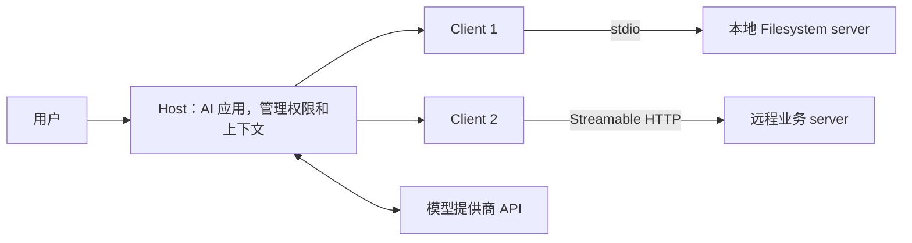
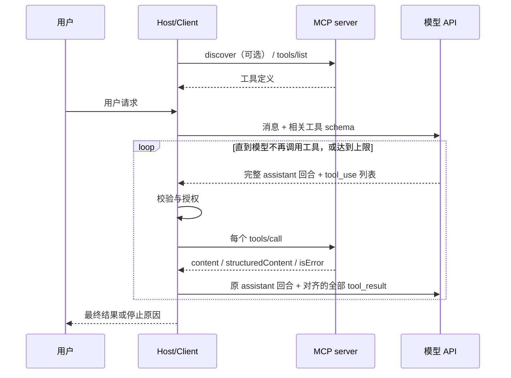
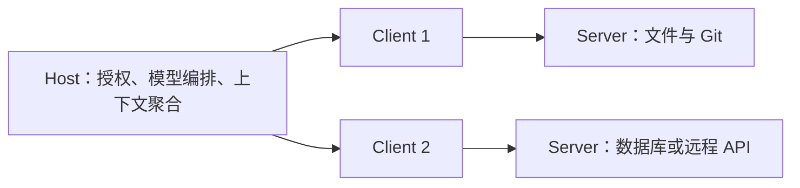

# MCP 官方协议中文版指南：2026-07-28 正式版

- 首次整理：2026-11-08
- 最近更新：2026-11-08
- 类型：原创学习笔记（依据官方资料的中文译述、总结与工程说明；非官方翻译）
- 来源：[MCP 官方入门](https://modelcontextprotocol.io/docs/2026-07-28/getting-started/intro)、[最新正式规范](https://modelcontextprotocol.io/specification/latest)、[官方版本目录](https://modelcontextprotocol.io/llms.txt)、正文逐节原始链接与文末覆盖清单。
- 标签：MCP、2026-07-28、JSON-RPC、MRTR、stdio、Streamable HTTP、OAuth、Elicitation、MCP Apps、Tasks、Skills、Registry

**版本核验**：用户给出的 `modelcontextprotocol.io` 是 MCP 官方网站。2026-11-08 查阅时，官方 `/specification/latest` 指向 **2026-07-28**；本文以该 Current 正式版为基线，不把 Draft 当成已发布协议。日期版本仍可能收到向后兼容更新，因此本文同时保留查阅日和关键示例仓库 commit。

**阅读定位**：沿官网的 **Documentation → Specification → Extensions → Registry** 展开：先理解、接入与开发，再解释规范性字段、消息模式、传输、授权和功能，最后讨论扩展与分发。为避免重复，教学页的安全内容并入授权章，客户端／服务端概念与对应规范合讲；Schema 单列作字段核对和例子索引。不是逐字重印所有网页，也不是只写概述。

本文保留规范的强度：**MUST / MUST NOT＝必须／不得，SHOULD / SHOULD NOT＝应／不应，MAY＝可以**。示例、SDK 行为、产品界面、工程建议与协议要求分开标明；当官方旧例子、注释、导览与正式类型不一致时，明确列出差异，不悄悄拼成一个不存在的“官方版本”。完整线上请求、内嵌 MRTR 参数、结果体、SDK 片段也分别说明。

**范围与验证**：覆盖版本目录内 26 个 Documentation 页面、31 个 Specification 入口（Schema 以完整 TypeScript 真源及其 128 个引用 JSON 示例核对）、9 个 Extensions 页面、11 个 Registry 页面及 Examples 入口，共 78 个主要官网入口；另追读功能生命周期、相关扩展规范、官方仓库和关联示例。代码例子做静态核读；本文未运行真实 MCP client/server、模型 API、OAuth 登录或外部天气服务，不声称互操作认证。具体覆盖与未展开外链见[来源和范围](#sources)。

已有笔记[《Agent 与 MCP 接入原理》](2026-11-02-Agent与MCP接入原理.md)偏角色、进程与接入直觉；本篇新建为按官方结构的完整协议阅读指南，二者互补，保留原笔记。

## 阅读导航

1. [入门、架构与开发：Documentation](#ch1)
2. [开发工具：Inspector、mcpdo 与调试](#ch2)
3. [规范总览、基础协议、消息模式与传输](#ch3)
4. [授权与安全：HTTP OAuth、威胁模型、本地隔离](#ch4)
5. [客户端功能：Roots、Sampling、Elicitation](#ch5)
6. [服务端功能：Discovery、Prompts、Resources、Tools 与工具集](#ch6)
7. [可选扩展：Apps、机器／企业授权、Tasks、Skills、Server Cards](#ch7)
8. [Registry：发布、发现与分发元数据](#ch8)
9. [Schema 精读、128 个示例与官方材料差异](#ch9)
10. [实现验收、术语、复习与来源覆盖](#ch10)

**只读一条主线**：第 1 章掌握角色和开发闭环 → 第 3 章建立“逐请求自包含、MRTR、订阅”的新版模型 → 第 6 章理解业务能力 → 第 4、5 章守住授权与用户交互边界 → 按需进入扩展。不要先复制旧 `initialize` 教程再猜新版语义。

<a id="ch1"></a>

## 1. 入门、架构与开发：Documentation

[Getting started：MCP 是什么](#ch1-s1) · [Learn：架构与版本](#ch1-s2) · [Develop：连接现有服务器](#ch1-s3) · [Develop：用 Agent Skills 辅助设计](#ch1-s4) · [Develop：构建服务器](#ch1-s5) · [Develop：构建客户端](#ch1-s6) · [Develop：大规模客户端最佳实践](#ch1-s7) · [SDKs：选择与迁移](#ch1-s8) · [Examples：官方参考服务器到底教什么](#ch1-s9)

<a id="ch1-s1"></a>

### 1.1 Getting started：MCP 是什么

官方入口：[What is MCP](https://modelcontextprotocol.io/docs/2026-07-28/getting-started/intro)。

MCP（Model Context Protocol，模型上下文协议）是连接 AI 应用与外部系统的开放标准。它让 AI 应用通过统一接口取得文件、数据库和 API 数据，调用搜索、计算或业务操作，并使用可复用提示模板。官网用“AI 应用的 USB-C”作类比：接入方式标准化，减少每个模型应用对每个外部系统分别开发适配器的重复成本。

这个类比的边界也要明确：MCP 不规定模型如何推理、不决定工具选择算法、不自动赋予第三方系统访问权，也不替应用完成权限审查、业务审批或数据治理。接上服务器只表示应用有了一条调用通道，不表示任何调用都应自动执行。

官网列举的用例包括日历与 Notion 的个人助手、从 Figma 设计生成网页、企业跨数据库问答，以及 Blender/3D 打印工作流。服务端提供能力，宿主决定如何呈现和使用。协议既不绑定 Claude，也不绑定 ChatGPT；官网列出的支持方还包括 VS Code、Cursor 等。某客户端支持 MCP，不等于实现全部扩展或每项可选能力。

读者有三条建设路径：

- **已有 AI 应用，接入外部能力**：先看本地/远程服务器连接，再理解能力与权限。
- **已有数据/API，提供给 AI 应用**：开发 MCP server，设计 tools/resources/prompts。
- **自己开发 AI 应用**：开发 MCP client，并承担模型适配、工具调用循环、授权与上下文管理。

MCP Apps 是在工具和资源之上添加交互 UI 的扩展，不应与基础 MCP 协议混为一谈。

<a id="ch1-s2"></a>

### 1.2 Learn：架构与版本

#### 1.2.1 范围与参与方

官方入口：[Architecture overview](https://modelcontextprotocol.io/docs/2026-07-28/learn/architecture)。MCP 生态包含 Specification、各语言 SDK、Inspector 等开发工具，以及 reference servers。协议只约束上下文交换，不限定上层 LLM 编排实现。



- **Host**：完整 AI 应用，管理一个或多个 MCP client、模型交互、用户授权和上下文。
- **Client**：宿主内部与一个 MCP server 通信的协议组件，不是模型本身。
- **Server**：提供工具、资源、提示等能力的程序。“server”描述角色，不要求它部署在远端。

典型情况是一个 host 为每个 server 建一个 client。本地 stdio 进程通常服务一个 client；远程 HTTP 服务可服务很多 client。“一条专用连接”是组件关系的描述，不能据此推导 2026-07-28 存在协议级有状态会话。

#### 1.2.2 两层分工

| 层 | 解决什么问题 | 主要内容 |
|---|---|---|
| 数据层 | 双方交换什么、字段如何解释 | JSON-RPC 2.0、版本与能力发现、工具/资源/提示、通知 |
| 传输层 | 消息怎么送达、如何分帧和认证 | stdio、Streamable HTTP、HTTP 头与传输安全 |

**stdio**：client 启动子进程，通过 stdin/stdout 交换协议消息，无须开放端口。stdout 必须专供协议，日志写 stderr。终端直接运行 server 后“没有输出、一直等待”可能完全正常。

**Streamable HTTP**：client 通过 HTTP POST 发送消息，服务器可用 SSE 流式返回。不要把“HTTP 上可用 SSE 流式响应”和旧版独立 HTTP+SSE transport 混为一谈。生产部署还需要 TLS、Origin 校验、认证、租户隔离和反向代理配置；OAuth 细则应以授权规范为准，不能仅凭架构页列举“API key/custom header”就断言任意认证方式满足规范。

#### 1.2.3 数据层原语与控制权

| 原语 | 主要用途 | 典型方法 | 使用主体 |
|---|---|---|---|
| Tools | 执行操作或计算 | `tools/list`、`tools/call` | 模型建议调用，host 执行并落实权限 |
| Resources | 取得上下文数据 | `resources/list`、`resources/templates/list`、`resources/read` | 应用决定读取、展示或注入上下文 |
| Prompts | 复用交互模板 | `prompts/list`、`prompts/get` | 用户选择工作流/提示 |
| Elicitation | 请求用户补充输入 | MRTR 中的 `elicitation/create` 输入请求 | server 请求，client/host 与用户交互 |

数据库集成可以同时提供“执行查询”的 tool、“数据库 schema”的 resource 和“生成分析”的 prompt，不必把所有能力塞进工具。资源不是只有本地文件，也不是一读取就自动进入模型上下文。

2026-07-28 架构页已将 Sampling 和协议 Logging 标为 deprecated。新实现应直接集成模型 API，使用 stderr（stdio）或 OpenTelemetry 等观测方式。Deprecated 不等于已从规范删除；不要把旧例程仍能运行当成新项目应继续依赖它的理由。长任务在新结构中使用 Tasks 扩展，不能继续照搬旧核心实验性 tasks 接口。

#### 1.2.4 2026-07-28 的关键起点：逐请求自包含

旧教程常从 `initialize → initialized` 开始。当前基线改为逐请求携带版本、相关 client capabilities 与建议携带的 client identity，server 不应依赖之前请求来推断这些信息。

```json
{
  "jsonrpc": "2.0",
  "id": 1,
  "method": "server/discover",
  "params": {
    "_meta": {
      "io.modelcontextprotocol/protocolVersion": "2026-07-28",
      "io.modelcontextprotocol/clientInfo": {"name": "guide-client", "version": "1.0.0"},
      "io.modelcontextprotocol/clientCapabilities": {"elicitation": {}}
    }
  }
}
```

这是按官网架构例子缩写的协议示意，不是某 SDK 的构造函数。server 必须实现 `server/discover`，但 client **不必先调用**它；client 可以直接发其他请求，再处理版本不支持错误。发现返回 supportedVersions、server capabilities、server identity，以及可用于缓存的提示。

典型调用链是：

1. 可选 `server/discover`，了解版本与能力。
2. `tools/list`，获得 name、description、inputSchema、可选 outputSchema 等。
3. host 将所需工具定义适配到模型 API。
4. 模型提出调用，host 校验名称、参数与授权。
5. client 发 `tools/call`，server 执行业务逻辑。
6. host 处理结果中的 content/structuredContent/isError，再决定给模型和用户什么内容。

JSON-RPC request 的 id 用于匹配响应；notification 没有 id，也没有响应。工具名称必须来自已发现的 server 命名空间；多 server 的同名工具需要 host 自己路由，不能丢失来源。

#### 1.2.5 变更通知不是无条件推送

现代客户端需要显式发 `subscriptions/listen`，例如请求 `toolsListChanged: true`。server 首先发送 `notifications/subscriptions/acknowledged`，确认实际接受的过滤条件；随后匹配的通知带上 `io.modelcontextprotocol/subscriptionId`，其值对应 listen 请求 id。

收到 `notifications/tools/list_changed` 后应重新取得工具列表、更新搜索目录，并使缓存失效。通知是 best effort，连接重建可能丢失，因此不能把“没有收到通知”当成数据永远新鲜。TTL 与按需刷新仍然必要。

#### 1.2.6 Versioning：日期是协议版本，不是包版本

官方入口：[Versioning](https://modelcontextprotocol.io/docs/2026-07-28/learn/versioning)。

协议版本采用 `YYYY-MM-DD`，表示最近一次不向后兼容变更的日期。同一版本仍可得到兼容更新，因此“2026-07-28 页面”不是不可变快照，阅读日期仍应记录。

- **Draft**：进行中的草案，不应当作已发布基线。
- **Current**：当前可用版本，可能继续收兼容更新。
- **Final**：已定稿的过去版本，不再修改。
- **Deprecated**：单项功能进入废弃周期。常规至少十二个月，政策的 expedited-removal 例外至少九十天，之后才具备移除资格，不是到期自动删除。

当前版本为 **2026-07-28**。请求在 `_meta` 的 `io.modelcontextprotocol/protocolVersion` 声明版本；Streamable HTTP 同时发送一致的 `MCP-Protocol-Version`。服务端逐请求接受或拒绝，不支持时返回带支持版本列表的 `UnsupportedProtocolVersionError`。客户端可换共同支持版本重试；没有交集就应明确报错。

注意四个互不等同的数字：MCP 协议日期、SDK semver、应用自身 version、模型提供商 API 日期。不能因为 SDK 包号较新，就断言连接采用 modern；兼容模式可能仍默认 legacy。

<a id="ch1-s3"></a>

### 1.3 Develop：连接现有服务器

#### 1.3.1 连接本地服务器

官方入口：[Connect local servers](https://modelcontextprotocol.io/docs/2026-07-28/develop/connect-local-servers)。官网以 Claude Desktop 与 Filesystem 演示，不是通用客户端配置标准。

**步骤**：安装客户端与 Node.js → 打开 Developer/Edit Config → 在已有配置中合并 server 条目 → 使用绝对路径 → 完全退出并重启客户端 → 查看工具 → 在专用测试目录验证。

Claude Desktop 配置位置按官网记录为：

- macOS：`~/Library/Application Support/Claude/claude_desktop_config.json`
- Windows：`%APPDATA%\Claude\claude_desktop_config.json`
- Linux：`~/.config/Claude/claude_desktop_config.json`

以下是依据 reference server 补充了最小权限选项的配置示意，**不是官网原例逐字复制**：

```json
{
  "mcpServers": {
    "filesystem-readonly": {
      "command": "npx",
      "args": ["-y", "@modelcontextprotocol/server-filesystem", "--read-only", "/absolute/path/to/test-data"]
    }
  }
}
```

固定版本的 reference repo 要求 Node.js 24+；不要只看官网“安装 Node LTS”而忽略包自己的 engines。Windows 的当前 reference README 建议 `command: "cmd"`、args 前加 `"/c", "npx"`。客户端配置格式各不相同，例如 VS Code 使用的顶层键不必等于 `mcpServers`。

权限有三层：用户授予 host 的操作权限、server 的 allowed directories、操作系统进程权限。`--read-only` 是服务器不注册写工具的实际限制；`readOnlyHint` 只是提示。目录白名单也不是操作系统沙箱，符号链接、硬链接和并发修改仍需特别考虑。

官网说的“每次文件操作请求批准”是该产品教程的行为说明，不是 MCP 要求所有 host 每次读文件都弹相同窗口。应由 host 的明确授权策略决定，同时遵守规范和组织政策。

**排错顺序**：JSON 语法 → executable 是否在 GUI 程序的 PATH → 文件/工作目录绝对路径 → 构建是否完成 → 手工启动同一命令 → 完全重启 → 看日志。

macOS 日志在 `~/Library/Logs/Claude`，Windows 在 `%APPDATA%\Claude\logs`，Linux 在 `~/.config/Claude/logs`。`mcp.log` 记录总体连接，`mcp-server-<name>.log` 记录对应 server 的 stderr；stderr 不只是错误，也含普通日志。

#### 1.3.2 连接远程服务器

官方入口：[Connect remote servers](https://modelcontextprotocol.io/docs/2026-07-28/develop/connect-remote-servers)。

官网流程是 Claude Settings → Connectors → Add custom connector → 输入完整 HTTPS endpoint → 按需认证 → 查看资源/提示 → 设置工具权限。示例 endpoint 是 `https://example-server.modelcontextprotocol.io/mcp`，本次仅核读链接，没有实际连接或授权。

远程部署不用每台设备装运行时，适合 SaaS API 和团队共享服务。需额外确认谁运营 server、认证将授予哪些 scopes、数据会发给谁、是否支持租户隔离。定期删除不用的 connector。**连接成功、认证成功、工具被列出、操作被允许是四件不同的事**。

服务端 URL 配置入口、套餐条件和 UI 可能随产品变化；本指南解释官网流程，不保证各产品所有版本都有同名按钮。

<a id="ch1-s4"></a>

### 1.4 Develop：用 Agent Skills 辅助设计

官方入口：[Build with Agent Skills](https://modelcontextprotocol.io/docs/2026-07-28/develop/build-with-agent-skills)。

Agent Skill 是可移植任务说明，不是 MCP wire protocol。官网链接的 `mcp-server-dev` 包有三个组合技能：`build-mcp-server` 做设计发现与路由，`build-mcp-app` 添加内嵌 UI，`build-mcpb` 打包本地 stdio server。

设计前先明确五件事：连接云 API 还是本机；只给自己/团队还是公开用户；操作数量；是否需中途补充输入或丰富 UI；上游用 API key、OAuth 还是无需认证。

| 情况 | 官网建议方向 | 关键限制 |
|---|---|---|
| 云 API | 远程 Streamable HTTP | 部署、认证、令牌存储与租户隔离 |
| 简单确认/短表单 | Elicitation | client 必须声明对应能力，处理拒绝/取消 |
| 搜索式选择器、图表、交互看板 | MCP Apps | 扩展支持、iframe/CSP、非 UI 降级 |
| 本地文件、桌面程序、localhost 服务 | MCPB | 打包不自动提供沙箱，验证路径与进程权限 |
| 个人实验 | stdio | 分发依赖运行时，后续可迁移 MCPB |

技能提出“小接口一操作一工具、大接口 search+execute、常用操作直出加长尾搜索”的设计选项。这里的“约15个操作”“50+端点”是经验尺度，不是协议阈值。

**重要外链核读结论**：官网链接不意味着其中所有代码已更新到本协议版本。固定 `claude-plugins-official` commit 的技能 version 为 0.1.0，`references/versions.md` 的多项最后核验仍是 2026-03；其 TS scaffold 使用 `@modelcontextprotocol/sdk` 和 initialize、其 MCPB 材料仍推荐 roots。应吸收发现问题、工具设计与分发思路，但使用当前 SDK/规范重做版本相关代码，不能将技能复制当作 2026-07-28 合规证明。

同理，技能中的 FastMCP 3.x 指第三方 `fastmcp` 包，并不等于当前官方 Python SDK 的 `MCPServer`。UI 示例中的直接 `innerHTML` 插入外部姓名/邮箱也不能照搬到生产：需安全 DOM 文本赋值或可靠转义。

<a id="ch1-s5"></a>

### 1.5 Develop：构建服务器

#### 1.5.1 官网天气例子的教学目标

官方入口：[Build an MCP server](https://modelcontextprotocol.io/docs/2026-07-28/develop/build-server)。

教学业务固定为美国 NWS：

- `get_alerts(state)`：两字母州代码，查询天气警报。
- `get_forecast(latitude, longitude)`：先查 `/points/{lat},{lon}`，再按其 forecast URL 读取预报。

示例展示输入 schema、工具描述、HTTP 请求、返回格式、stdio 启动和宿主连接；它不是全球天气服务，也没有生产级配额、认证、监控和高可用。没有 active alerts 是正常空结果，不是故障。非美国坐标、NWS 故障/限流、缺少字段与网络超时都需要与“无数据”分开。

#### 1.5.2 各语言页签要点与版本边界

本表覆盖官网全部八个 server 页签，并与已核读外链作区分。

| 语言 | 官网做法 | 前提与注意 |
|---|---|---|
| Python | `MCPServer("weather")`、`@mcp.tool()`、类型注解与 docstring 生成定义；`httpx2.AsyncClient`；`mcp.run(transport="stdio")` | 官网写 Python3.10+/SDK2.0+。固定样例要求 mcp≥2.3.0；当前 SDK README 写 Python3.11+，复现宜选3.11+并锁依赖 |
| TypeScript | 分拆的 `@modelcontextprotocol/server`，Zod，`registerTool`；`serveStdio(createServer)` | factory 每次必须返回新 server；官网 Node20+，固定仓库 Node24+。旧手动 `connect(new StdioServerTransport())` 只走 legacy |
| Java | Spring Boot starter，官网 `@Tool` + `MethodToolCallbackProvider` | 页面明确协议2025-11-25，不能连接仅现代版本的 client；外链 README 已用 `@McpTool` 自动发现，不可混抄 |
| Kotlin | `Server`、`addTool`、Ktor HTTP、stdio transport/session | 页面明确2025-11-25；示例 SDK0.16.0/Ktor3.2.3/Kotlin2.3.20。官网JDK11+，外链weather README JDK17+ |
| C# | `AddMcpServer().WithStdioServerTransport().WithToolsFromAssembly()`，工具 attribute 与依赖注入 | 官网用 EmptyApplicationBuilder 避免 stdout；外链 Program 使用默认 builder 但把 Console 日志全部送 stderr，二者不能忽略日志配置随意拼接 |
| Ruby | `MCP::Tool` 子类、input_schema、`MCP::Server` 与 stdio | 官网最低运行时与仓库不同，仓库推荐 Ruby3.4+；严格现代协议兼容性另见下文 |
| Rust | rmcp3.4、宏生成 router/schema、tokio、serde | Rust1.88+；明确展示 output schema、text+structured 双通道、数组根结果与工具失败 |
| Go | `mcp.NewServer`、泛型 `mcp.AddTool`、typed input、context | Go1.25+；官网片段偏文本结果，固定仓库已演示 object/array structuredContent |

所有 stdio server 的普通输出必须改写 stderr：Python logging、TS console.error、Java/C# 日志配置、Ruby Logger($stderr)、Rust eprintln/tracing、Go log。不能只检查业务代码，还要检查框架启动 banner、构建命令和依赖包是否向 stdout 打印。

#### 1.5.3 主线复现：固定官方 TypeScript 样例，而非混拼网页代码

本段唯一源码基线是 [quickstart-resources commit d7787ff](https://github.com/modelcontextprotocol/quickstart-resources/tree/d7787ff2474ed74d88bfb9d9b90d42549f0013bc)。使用 **Node.js 24+**。以下是读者可执行路径，本次未执行。

```bash
git clone https://github.com/modelcontextprotocol/quickstart-resources.git
cd quickstart-resources
git checkout d7787ff2474ed74d88bfb9d9b90d42549f0013bc

cd weather-server-typescript
npm ci
npm run build
```

已核验该固定 checkout 的 server/client 均有 lockfileVersion 3 的 `package-lock.json`，两端 MCP SDK 实际锁定 **2.4.0**，因此这里用 `npm ci`，不重新解析 semver。server 的 package.json 仍写 `@modelcontextprotocol/server: ^2.0.0`、`zod: ^4.6.5`、`typescript: ^7.0.2`；package.json 的范围与锁文件的具体结果不是一回事。运行时与外部 NWS 服务仍是另外的复现条件。

关键源码：[weather-server-typescript/src/index.ts](https://github.com/modelcontextprotocol/quickstart-resources/blob/d7787ff2474ed74d88bfb9d9b90d42549f0013bc/weather-server-typescript/src/index.ts)。

该固定代码使用 **`get-alerts` 与 `get-forecast`**，不是官网分步教程的下划线命名。直接运行：

```bash
node build/index.js
```

这只是在 stdin 等待协议消息。更好的验证是 Inspector：

```bash
npx @modelcontextprotocol/inspector --cli node build/index.js \
  --protocol-era modern --method tools/list
npx @modelcontextprotocol/inspector --cli node build/index.js \
  --protocol-era modern --method tools/call \
  --tool-name get-alerts --tool-arg state=CA
```

Inspector 本身也应固定所选版本以便 CI 复现；上面的无版本命令是操作示意，不是完整锁定测试环境。预期能列出两工具；调用警报应得到数组 structuredContent，或明确错误结果。NWS 访问成功与否影响业务数据，不能把 skip 说成成功。

源码结构可这样阅读：

1. `makeNWSRequest<T>` 设置 User-Agent/Accept 并检查 HTTP 状态。
2. `alertsOutputSchema` 用 `z.array(z.object(...))` 宣告顶层数组。
3. `forecastOutputSchema` 宣告坐标和 periods 的对象结构。
4. 每个工具的 inputSchema 验证州代码长度或经纬度范围。
5. handlers 同时返回人读 text 与机器用 structuredContent；查询失败抛错交给 SDK 转工具错误。
6. 使用 `??` 而非 `||` 处理 temperature，避免把 0 度当作缺失。
7. `serveStdio(buildServer, ...)` 一套 factory 服务两个 era，错误与启动消息写 stderr。

只截取其工厂启动部分，非独立完整程序：

```typescript
serveStdio(buildServer, {
  onerror: (error) => {
    console.error("Weather MCP Server error:", error);
  },
});
console.error("Weather MCP Server running on stdio");
```

**兼容性需测到结果形状**：TS SDK 能把数组根 schema 为2025-11-25 client投影成旧 `{"result": [...]}`。因此要分别测试 modern 和 legacy。Python/Rust/Go 固定样例 README 明确数组根输出不能自动投影给旧客户端。不能只测“进程启动了”就宣布跨版本互通。

#### 1.5.4 Python 结构化输出的细节

固定 Python weather.py 不再只是官网的字符串返回：

- `Alert`、`Forecast`、`Period` 用 Pydantic 声明字段。
- `Alerts(RootModel[list[Alert]])` 表达真正顶层数组；直接 `-> list[Alert]` 会被该 SDK 包成 `{"result": ...}`，并不等价。
- 无警报返回空数组；网络失败抛 `ToolError`，避免在宣告 array schema 后成功返回一段报错字符串。
- 类型、schema、结构化结果必须一致，不应靠模型自行猜测。

这是新协议“输出 schema 根不再限于 object”的实际落点。对声明 outputSchema 的成功结果做校验，才能抓住 list-only 检查发现不了的问题。

#### 1.5.5 Ruby 已知互操作缺口

固定仓库 [Ruby weather README](https://github.com/modelcontextprotocol/quickstart-resources/blob/d7787ff2474ed74d88bfb9d9b90d42549f0013bc/weather-server-ruby/README.md) 明确记载：当时 mcp gem 未输出2026-07-28必需的 `resultType`，严格校验的现代客户端连 tools/list 都会拒绝；Ruby 自家 client 不校验该字段，所以同语言成功可能掩盖问题。该仓库只声明此例验证过 Ruby client，本文没有重复运行验证。

因此，“SDK Tier1”“支持现代版本”“自家样例可连接”均不能替代真实跨 SDK 互操作矩阵。问题是读取日及固定源码证据，不应外推为将来所有 Ruby 版本永久不支持。

<a id="ch1-s6"></a>

### 1.6 Develop：构建客户端

官方入口：[Build an MCP client](https://modelcontextprotocol.io/docs/2026-07-28/develop/build-client)。

#### 1.6.1 客户端要完成的闭环

客户端教程的核心不是“把 server 接上模型”一句话，而是两种协议间的适配：MCP 向外部能力发请求，模型提供商 API 描述对话与工具使用。后者不是 MCP 的一部分。



必须保持的实现约束：

1. 一个 assistant 回合可能请求多个工具，不能只取第一个。
2. 每个 tool_use 都有对应 tool_result，关联 id 不得丢失。
3. 原 assistant 内容块应按模型 API 要求完整回传，不能把提供商带签名的内容块误删。这里是应用处理 API 消息的要求，不是要求向终端展示模型内部推理。
4. 持续给后续模型请求带工具定义，否则只能调用一轮。
5. 工具业务失败通常是成功 JSON-RPC 响应中 `isError: true`，不是传输异常。协议错误、网络错误与业务错误要分别处理。
6. content 是多类型数组，不能无条件访问每个块 `.text`。
7. 限制工具轮数、总耗时、预算与输出大小；触顶时告知未执行的后续调用。
8. 清理子进程/transport；EOF、Ctrl-C、异常、无密钥情况下都应退出清楚。
9. 即使模型建议了工具，也仍须 host 的授权策略；示例的自动循环不是生产批准机制。

#### 1.6.2 各语言 client 页签

| 语言 | 官网体现的重点 | 限制 |
|---|---|---|
| Python | `Client` 的 async context 管生命周期、stdio subprocess、`asyncio.to_thread(input)` 避免阻塞连接 | 官网短例每个 query 新建 messages；持久多轮记忆见仓库，不应混称已实现 |
| TypeScript | `Client(...,{versionNegotiation:{mode:"auto"}})`，stdio transport，工具循环与 EOF/SIGINT 清理 | SDK 默认 legacy，必须显式考虑 auto；源码与官网工具名、Node版本不同 |
| Java | Spring AI starter 自动 MCP clients、tool callbacks、Brave Search chatbot | 明确2025-11-25；例子依赖归档的旧 Brave server，不能当现代推荐产品 |
| Kotlin | 按 `.js/.py/.jar` 启动子进程、转换 schema、循环处理多个工具 | 明确2025-11-25，需关闭 MCP、进程和 Anthropic client |
| C# | `McpClient.CreateAsync`、ListTools、Microsoft.Extensions.AI `UseFunctionInvocation` | 自动调用策略不等于用户授权；外链源码另限制子进程环境变量继承 |
| Ruby | stdio、按块转换、正确保留模型 API 内容、ensure 清理 | 返回封装结构与其他SDK不同；需读该版本 API，勿机械套 `.content` |
| Rust | `serve_with_lifecycle(Auto)`、list_all_tools、编译 outputSchema 校验器、HTTP调用模型API | `serve` 默认仅legacy；rmcp本身不替此例验证输出，应用显式做 |

官网 client 页没有 Go 页签，但固定 quickstart repo 有 Go client。它接收完整 server 命令，使用 jsonschema-go 校验工具输出；无模型 API key 时仍可连接、列工具并退出。

#### 1.6.3 与主线服务器配套的 TypeScript client

继续同一固定 checkout：

```bash
cd ../mcp-client-typescript
npm ci
npm run build
# 不提供真实模型密钥，只检查 MCP 连接；空值避免本地 .env 触发付费聊天
ANTHROPIC_API_KEY= node build/index.js ../weather-server-typescript/build/index.js
```

此处 shell 赋值为 POSIX 写法，PowerShell 应使用自己的环境变量设置语法。预期列出 `get-alerts`、`get-forecast` 并提示设置密钥后退出。本次没有运行，不能声称确认该输出。

若要实际聊天，按 README 在自己的本地环境安全配置模型密钥，并把 `.env` 排除出版本控制；不要写进日志、截图或仓库。当前固定 package.json 为 client `^2.4.0`、Anthropic SDK `^1.3.0`，Node>=24。模型 ID 属于提供商示例配置，官网与仓库不同，需按实际账户可用模型设置，不属于协议规范。

固定仓库相对官网精简教程增加了：

- `clear` 清空会话历史；保留成功对话用于追问。
- 无密钥也能测试 MCP wiring，模型 client 延迟初始化。
- 图片转成提供商接受的 base64 image blocks；文本资源取 text；不支持内容用占位提示而非悄悄丢弃。
- 空 text block 过滤；只有 structuredContent 时序列化为 JSON 给模型。
- 协议拒绝转 failed tool_result，保持 id 对齐。
- 分别提示 refusal、max_tokens 截断、轮数上限等结束原因。

仓库 README 与测试说明也是文档，不等于当前代码所有边界都已被本文证明。特别是中断回合历史清理，仍应针对选定版本做测试，不能从 README 的“不会保留不完整查询”直接推定源码全分支都满足。

#### 1.6.4 Rust 示例说明为什么不能混淆 API 版本

官网 Rust 代码直接调 Messages API，使用 API 日期 `2023-06-01` 与 `x-api-key`；固定仓库源码已改为 API 日期 `2026-10-21` 与 Bearer。这些是**模型提供商 HTTP API 的版本与认证**，不是 MCP2026-07-28 的 auth，更不是本指南自行推测的新 MCP 规则。

直接复现时必须整套使用同一个 checkout 的 Cargo.toml、源码与 README；不可拿官网旧认证头加仓库新 API 日期拼出一个“官方示例”。

#### 1.6.5 应验证什么，而不只是“能列工具”

已核读 [quickstart tests README](https://github.com/modelcontextprotocol/quickstart-resources/blob/d7787ff2474ed74d88bfb9d9b90d42549f0013bc/tests/README.md)。它区分：

- server 启动、版本协商、工具列表、真正调用以及 outputSchema 验证；
- client 无密钥连接 mock server；
- fake 模型 API 驱动完整 tool loop：多工具、恰好十轮、无限工具、JSON-RPC拒绝、只有structuredContent、图片/资源/音频、refusal、失败查询、空回复、max_tokens、clear与quit。

测试 README 还说明 NWS 故障可标 skip，因此“测试无失败”不必等于真实天气调用成功。本文仅审阅测试说明与相关源码，没有运行其 `./tests/smoke-test.sh`，没有核验 CI 完整通过。

<a id="ch1-s7"></a>

### 1.7 Develop：大规模客户端最佳实践

官方入口：[Client best practices](https://modelcontextprotocol.io/docs/2026-07-28/develop/clients/client-best-practices)。

#### 1.7.1 Progressive discovery：控制何时进入模型上下文

host 从 server 取得工具列表，不意味着必须立即把全部 schema 塞入模型。少量工具可以直装；当定义占据上下文显著比例时，官网建议按上下文百分比设阈值，例如1%–5%。这是建议，不是协议硬限制。

常见三层：

1. **Catalog**：轻量 `search_tools(query)` 返回名称+短描述。
2. **Inspect**：`get_tool_details(name)` 按需取完整输入/输出schema。
3. **Execute**：模型理解后调用实际工具。

`search_tools/get_tool_details` 是 host 自建 meta-tools 的示例命名，**不是 MCP 新增的标准 RPC**。搜索可用关键词/BM25、向量、轻量子模型或混合策略，也可用模型提供商原生工具搜索。

host 应把已获取的 schema 缓存在自己一侧，按 server 分组，处理同名工具路由；`notifications/tools/list_changed` 到来就刷新索引。`ttlMs/cacheScope` 规定缓存边界，不能跨身份盲目复用 private 目录或资源。

动态连接 server 也可懒加载，但不要忽略模型 prompt cache：中途重排/删除 tools 数组可能使缓存前缀失效，成本反而更高。官网建议在缓存断点之后追加，或保持稳定的 `call_tool({name,args})` 包装，并把断连尽量放在会话边界。

#### 1.7.2 Programmatic tool calling / Code mode：控制中间结果如何流动

code mode 把模型生成的一小段程序放进沙箱执行，由 host broker 将函数调用转发为 MCP tools/call。大量日志、筛选去重和多步变换可以在沙箱中完成，模型只读最后摘要。

```text
模型 → 生成脚本 → 隔离沙箱 → host broker → MCP client → servers
                    ↑ 中间数据在此处理                 ↓
模型 ← 有界摘要/错误 ←─────────────────────────────────┘
```

这不是让沙箱直接拿所有 credentials 连外网。推荐结构是：沙箱无直接网络；host 注入函数 stub；broker 持有凭据、做鉴权和路由；仅筛选后的输出回到模型。

`outputSchema` 可用于生成精确返回类型。缺 schema 时优先承认 generic/string，而非伪造类型。使用另一个模型把自由文本抽取成类型也可能漏字段或幻觉，必须验证，并经 host broker 路径而非让沙箱自行联网。

官网列举的运行时包括 Deno/isolated-vm、实验性的 Monty、早期 pctx、Wasmtime；它们是选项例子，不是官方安全认证或可直接互换的完整方案。

#### 1.7.3 Code mode 的安全与错误边界

- 每一次运行时工具调用都要校验权限；批准脚本不自动授权脚本以后调用的一切。可定义本次运行的工具/范围授权，但 broker 仍须逐调用比对。
- 一个 server 的结果是传给另一个 server 的不可信输入，数据外传风险不会因“少给模型看输出”消失。
- 凭据留在 host，不进入模型生成代码。
- 限制执行时间、内存、并发和最终输出，防止死循环与数据泄漏。
- wrapper 将 MCP `isError: true` 转为异常，使脚本可以 try/catch；未捕获错误作为结果反馈。
- 脚本失败前可能已提交部分写入，不能因最终抛错就报告“什么都没发生”。

progressive discovery 省的是定义 token；code mode 省的是中间结果 token。二者可组合，但既不是业务权限替代品，也不是协议强制行为。

<a id="ch1-s8"></a>

### 1.8 SDKs：选择与迁移

官方入口：[SDKs](https://modelcontextprotocol.io/docs/2026-07-28/sdk)。读取日官方表：

| Tier | SDK |
|---|---|
| Tier1 | TypeScript、Python、C#、Go、Rust、Ruby |
| Tier2 | Java |
| Tier3 | Swift、PHP、Kotlin |

Tier 基于功能完整度、协议支持与维护承诺；SDK 各自采用新规范的时间不同。应检查具体包版本、支持的协议 revision、transport/扩展范围、默认协商模式与已知问题。

当前 TypeScript SDK 的 main 是 v2 稳定线，拆分 server/client 包，支持 Standard Schema（如 Zod4、Valibot、ArkType），另提供 Node/Express/Fastify/Hono 薄适配包。旧 `@modelcontextprotocol/sdk` 留在 v1.x 分支，官方 README 说 v2 发布后至少六个月继续安全与缺陷维护；不能把仍维护的 v1.x 误当新线。

Python SDK 当前用 `MCPServer` 与统一 `Client`，官方 README 包含 tool+resource 示例、HTTP server 与 client，`cli` extra 添加 mcp dev/run/install。外部 FastMCP 与官方 SDK 名称相似但生命周期/版本不同，安装依赖前必须确认包来源。

**选型表应按具体工程填写**：语言运行时、锁定SDK版本、modern/legacy协商、输出schema验证责任、HTTP/OAuth支持、MRTR/订阅/扩展支持、跨SDK测试。不要仅填一个“支持MCP：是”。

<a id="ch1-s9"></a>

### 1.9 Examples：官方参考服务器到底教什么

官方入口：[Example servers](https://modelcontextprotocol.io/examples)，外链 [servers 固定源码](https://github.com/modelcontextprotocol/servers/tree/36380287ed3b15d115b55f546617d723072b1296)。参考实现不是生产托管服务，也不是安全审计结论。该固定仓库全部 server 支持 stdio，只有 Everything 另外提供 Streamable HTTP。

#### 1.9.1 Everything：协议与客户端测试台

[README](https://github.com/modelcontextprotocol/servers/blob/36380287ed3b15d115b55f546617d723072b1296/src/everything/README.md) 与 [features](https://github.com/modelcontextprotocol/servers/blob/36380287ed3b15d115b55f546617d723072b1296/src/everything/docs/features.md) 明确它不是实用业务服务，而是测试/演示。

- tools：echo、sum、图片、资源链接/内嵌资源、结构化结果。
- prompts：静态模板、带参数、上下文相关补全、内嵌资源。
- resources：动态text/blob、静态文档、多contents集合、现代 minted URI 和旧session资源。
- 现代协议：server/discover、MRTR/input_required、requestState、subscriptions/listen、缓存提示、Tasks扩展、JSON Schema2020-12与x-mcp-header。
- legacy shim：同一业务 handler 可由 SDK 映射到旧 server-to-client requests；旧 HTTP+SSE 只面向旧时代。

实际核读的 [trigger-multi-step-elicitation.ts](https://github.com/modelcontextprotocol/servers/blob/36380287ed3b15d115b55f546617d723072b1296/src/everything/tools/trigger-multi-step-elicitation.ts) 先问名字，再问颜色；后续 HTTP 请求可能用新server实例，因此阶段与第一轮答案放进签名、有过期时间的 requestState，而非进程临时字段。拒绝或取消会停止，非法答案重问。这说明无状态协议如何承载多轮业务，并不表示完全不需要保存业务状态。

[get-header-params.ts](https://github.com/modelcontextprotocol/servers/blob/36380287ed3b15d115b55f546617d723072b1296/src/everything/tools/get-header-params.ts) 展示 region schema 上的 `x-mcp-header: "Region"`，现代 HTTP client 镜像到 `Mcp-Param-Region` 便于网关路由；stdio/legacy 不镜像，body/header不一致拒绝。它还演示不依赖Zod创建原始JSON Schema2020-12。

边界：get-env 默认遮蔽 credential-like 名称，但不是保证所有秘密都能靠名称识别；不要启用输出所有秘密的调试开关。gzip URL 获取有尺寸/超时/地址限制，但 README 明说检查与连接间的 DNS rebinding 仍不完全防护。Tasks 示例时钟驱动状态，不是真后台作业基础设施。

#### 1.9.2 Fetch：外部内容读取与安全限制

[Fetch README](https://github.com/modelcontextprotocol/servers/blob/36380287ed3b15d115b55f546617d723072b1296/src/fetch/README.md)。`fetch(url,max_length,start_index,raw,timeout_ms)` 将HTML转Markdown，支持分段返回；同名 prompt 体现用户发起的取内容流程。现代/legacy stdio均支持，工具失败与未知tool协议错误分开。

当前默认拒绝非公网IP，并检查重定向；可额外设 allowed-hosts。hostname校验和实际连接之间仍有DNS rebinding窗口，只有代理能解析的hostname也有检查限制。不能称“已经完全解决SSRF”。robots规则、每次读超时、整体下载时长与HTML提取超时是不同边界。

有 Node 时 Readability.js 可能首次运行自动npm安装依赖，这些版本范围不由单独锁定fetch Python包完整锁住。生产离线/限制出网环境应预装并锁定，或按README关闭JS提取。返回网页内容始终是不可信数据，不应当成host操作指令。

#### 1.9.3 Filesystem：访问边界与文件资源

[Filesystem README](https://github.com/modelcontextprotocol/servers/blob/36380287ed3b15d115b55f546617d723072b1296/src/filesystem/README.md)。可读写、append/edit、目录浏览、搜索路径、移动/复制和metadata，也有`file://{+path}`资源模板。`resources/list`不枚举整块磁盘，先用工具找文件再按URI读取。

现代连接应使用启动参数的allowed directories。旧roots机制已deprecated，只有legacy便利路径；`--confine-roots`使legacy客户端只能缩小而不能扩大启动白名单。现代不能照旧使用顶层反向 RPC 调用 roots/list；核心中保留的弃用 Roots 能力也只能按 MRTR 处理。

注意三种非显然边界：

1. `search_files`查文件路径glob，不查内容；官网连接教程的宽泛能力描述不能当该工具的精确定义。
2. 覆写/编辑保留inode，不是crash-atomic；如果存在硬链接，其他路径看到同一内容变化。
3. 路径解析/目录读取有15秒限制，遍历最多100000条；超时不表示底层OS调用已被强制取消。

#### 1.9.4 Git：读写仓库与明确约束

[Git README](https://github.com/modelcontextprotocol/servers/blob/36380287ed3b15d115b55f546617d723072b1296/src/git/README.md)。tools包括status/diff/log/show/branch/remote，以及add/commit/reset/create_branch/checkout/merge；prompts可生成提交信息和总结变更。

**不设 `--repository` 时可访问进程能触达的任意仓库**。该参数允许的是包含指定路径的整个仓库，不是那个子目录。server不依赖roots，两个era都一样。写操作要配用户授权与测试仓库，不能因为它叫reference就直接连重要工作区。commit identity沿用环境/Git配置，无配置时可能回退OS用户主机名；生产需显式设置。

#### 1.9.5 Memory：显式知识图谱，不是模型参数记忆

[Memory README](https://github.com/modelcontextprotocol/servers/blob/36380287ed3b15d115b55f546617d723072b1296/src/memory/README.md)。entities有name/type/observations，relations有from/to/type。九个工具做增删、搜索、读取；`memory://knowledge-graph`资源可订阅，变更后通知。

存储为JSONL，建议 `MEMORY_FILE_PATH` 指向自己控制的绝对路径；默认node_modules内文件可能随npm升级/清缓存丢失。保存使用同目录临时文件+rename，跨进程使用锁文件；网络文件系统若不提供正确独占创建语义，不能保证同等安全。

它演示业务持久化与协议读写，不提供完整隐私治理、语义检索、身份隔离或事实真伪判断。README中的系统提示只是用法示例，不是协议要求。

#### 1.9.6 Sequential Thinking：结构化过程记录工具

[README](https://github.com/modelcontextprotocol/servers/blob/36380287ed3b15d115b55f546617d723072b1296/src/sequentialthinking/README.md)。工具参数有thoughtNumber/totalThoughts、修订/分支等，展示如何把过程数据作为工具输入并持续保存。每连接保留历史，默认最多1000条；日志可关闭。

这是该示例当前的状态保存行为，不是现代协议推荐的会话模型；多任务复用应隔离状态并用显式标识，不能据此恢复协议级 session。

它不证明模型推理正确，也不意味着host应暴露或存储模型的私密内部推理。适合记录面向用户的计划、假设、步骤摘要与修订；不要将工具标签误当“保证深度思考”的算法。

#### 1.9.7 Time：时区类型与边界案例

[Time README](https://github.com/modelcontextprotocol/servers/blob/36380287ed3b15d115b55f546617d723072b1296/src/time/README.md)。工具是get_current_time、convert_time、get_time_ago，IANA名称严格区分大小写，省略timezone用server默认。

DST跳过的本地时刻报错；重复的时刻会报告第一次及later_occurrence，不悄悄选一个。get_time_ago按实际经过时间计算，“一天前”是24小时，不保证墙上钟表时刻相同。Docker不能自动知道host时区，应显式传LOCAL_TIMEZONE或启动参数。这是输入验证、结构化输出与错误表达的良好例子。

#### 1.9.8 归档样例与 Registry

官网将 servers-archived 标为仅供历史参考、不再积极维护。旧Brave、GitHub、Slack、Postgres等样例不要不加说明地作为新生产推荐。Registry列出公司与社区发布的服务器，提供发现能力，但“列入Registry”不等于协议完整、安全审计通过或用户已授权。

<a id="ch2"></a>

## 2. 开发工具：Inspector、mcpdo 与调试

[一个包，三种界面，另加持久连接工具](#ch2-s1) · [调试新版时必须显式选择协议时代](#ch2-s2) · [Web / TUI 要看哪一层](#ch2-s3) · [配置是只读检查，还是修改自己的目录](#ch2-s4) · [CLI 如何成为可靠的检查步骤](#ch2-s5) · [官方外链示例：不仅看截图，也看测试服务器实现](#ch2-s6) · [mcpdo：连接保持不等于协议恢复保证](#ch2-s7) · [Inspector 的安全边界](#ch2-s8) · [按故障层定位，而不是盲目重装](#ch2-s9)


<a id="ch2-s1"></a>

### 2.1 一个包，三种界面，另加持久连接工具

MCP Inspector 是官方参考调试工具，不是协议本身。查阅时源仓库 `package.json` 为 **2.14.0**，固定源码提交为 [`4d3464cb`](https://github.com/modelcontextprotocol/inspector/tree/4d3464cb3a6dde609d7b5ac24c440b947eb40f23)；官网要求 **Node.js ≥22.19.0**。三个界面共享连接、配置、OAuth 与协议版本处理：

| 界面 | 用法 | 适合的工作 |
| --- | --- | --- |
| Web | `npx @modelcontextprotocol/inspector` | 图形化参数表单、内容预览、协议与网络监控、MCP Apps |
| CLI，Command-Line Interface，命令行界面 | 后接 `--cli` | 一次连接、一个方法、输出、退出，适合 CI（Continuous Integration，持续集成） |
| TUI，Terminal User Interface，终端交互界面 | 后接 `--tui` | SSH 终端中交互查看服务器、资源、提示和工具，需要真实 TTY |
| `mcpdo` | `npx -p @modelcontextprotocol/inspector mcpdo` | 实验性工具，通过本地守护进程保持命名连接，支持多步操作 |

模式标志必须放在启动器能解析的最前面；其他参数属于各个客户端，不是所有参数都能跨界面使用。例如 `--method` 仅属于 CLI；`--server` 仅在 CLI 中选择命名条目，Web 接受但忽略，TUI 不定义它。[官方 Inspector 总览](https://modelcontextprotocol.io/docs/2026-07-28/tools/inspector)、[配置和参数](https://modelcontextprotocol.io/docs/2026-07-28/tools/inspector/configuration)

<a id="ch2-s2"></a>

### 2.2 调试新版时必须显式选择协议时代

Inspector 默认使用 **legacy**，并不因为安装了新版本就自动采用 `2026-07-28`。

- `legacy`：直接使用旧式 `initialize`，不探测新版。
- `auto`：先尝试 `server/discover`，遇到非现代结果后回退到旧流程。
- `modern`：固定 `2026-07-28`，不回退，以便让兼容性错误显现。

官方给出的原因是：调试器不应默默探测，尤其某些旧 stdio 服务会对未知方法保持沉默，使探测挂住；额外探测也会污染正在分析的记录。因此**传输方式与协议时代是两个独立维度**，同一个 HTTP 地址可以有不同兼容路径。[Protocol eras](https://modelcontextprotocol.io/docs/2026-07-28/tools/inspector/protocol-eras)

以下命令依据官方 CLI 示例补上 `--protocol-era modern`，使用的是占位文件或地址，**不是本次已运行成功的记录**：

```bash
# 检查现代 stdio 服务的工具列表
npx @modelcontextprotocol/inspector --cli node build/index.js \
  --protocol-era modern --method tools/list --format json

# 检查现代 HTTP 服务，不在 CI 内启动交互登录
npx @modelcontextprotocol/inspector --cli \
  --server-url https://api.example.com/mcp --transport http \
  --protocol-era modern --stored-auth-only --method tools/list --format json

# 按完整 JSON 传参，避免命令行 key=value 的数字推断
npx @modelcontextprotocol/inspector --cli \
  --server-url https://api.example.com/mcp --transport http \
  --protocol-era modern --method tools/call --tool-name get_weather \
  --tool-args-json '{"city":"Boston"}' --format json
```

`--tool-arg key=value` 会尝试 JSON 解析，再依 schema 转换字符串；邮编等字段不能仅凭引号想当然。`--tool-args-json` 跳过 key/value 解析，但 schema 类型转换仍存在。CLI 的 `--format json` 通常输出带 `result` 的信封；`mcpdo --format json` 则直接输出 payload，没有相同信封。[CLI client](https://modelcontextprotocol.io/docs/2026-07-28/tools/inspector/cli)、[mcpdo](https://modelcontextprotocol.io/docs/2026-07-28/tools/inspector/mcpdo)

<a id="ch2-s3"></a>

### 2.3 Web / TUI 要看哪一层

Web 中 Tools、Prompts、Resources、Skills、Tasks 等页随服务器能力出现。最重要的三个观测层是：

1. **Protocol**：JSON-RPC 请求、响应和通知，观察 MRTR 是否正确成组，以及请求 ID 是否变化。
2. **Network**：HTTP 状态、header 和 body，检查 `Mcp-*` 镜像 header；仅对 HTTP/SSE 连接出现。
3. **Console**：本地 stdio 子进程的 `stderr`，与 Network 不会同时出现。

Tasks、Logs、Protocol、Network、Console 可以固定到侧栏，一边操作一边观察。TUI 用 `c` 连接、`d` 断开、`Tab` 移动焦点、`/` 筛选、`?` 查看帮助；它不适合没有真实终端的 CI。MCP Apps 在不同来源的沙箱 frame 中渲染，不能把普通工具结果和真正执行了 UI 的状态混为一谈。[Web client](https://modelcontextprotocol.io/docs/2026-07-28/tools/inspector/web)、[TUI client](https://modelcontextprotocol.io/docs/2026-07-28/tools/inspector/tui)

<a id="ch2-s4"></a>

### 2.4 配置是只读检查，还是修改自己的目录

- `--config path`：只读使用已有文件，缺失就报错，不迁移、不写入。检查他人的客户端配置时优先用它。
- `--catalog path`：Inspector 自己可写的服务器目录；默认 `~/.mcp-inspector/mcp.json`，不存在时创建。
- 二者互斥，不能再混用临时目标。
- Web 首次创建目录会填入 filesystem、everything、官方托管示例三个条目；CLI/TUI 创建空目录。
- `--` 的方向要特别注意：Web/TUI 将它后面的内容交给目标服务；CLI 则以它分开前面的目标命令与后面的 Inspector 选项。复制命令前核对当前界面。

目录里的 `protocolEra`、超时和 OAuth 等属于 **Inspector 配置格式**，不是核心协议规定所有宿主必须接受的配置文件。[Configuration and flags](https://modelcontextprotocol.io/docs/2026-07-28/tools/inspector/configuration)

<a id="ch2-s5"></a>

### 2.5 CLI 如何成为可靠的检查步骤

CLI 不应只检查命令有没有打印文字，还应检查退出码与结果：

| 退出码 | 含义 |
| --- | --- |
| 0 | 成功 |
| 1 | 参数、存储或其他未细分错误 |
| 2 | `--app-info` 没有找到 App |
| 3 | 需要认证 |
| 4 | 无法连接、DNS/超时等 |
| 5 | 工具不存在，或工具结果 `isError: true` |
| 6 | `tools/list --strict` 检出 error 级 schema 可移植性问题 |
| 7 / 8 / 9 | Skill 校验失败 / 读取预算不足以全部校验 / 要求摘要但没有摘要 |
| 10 | 负载测试越过设定错误率或 p99 阈值 |
| 11 | HTTP 429 限流 |

即使工具返回的结果被正常打印，`isError: true` 仍返回 5。非零状态还在 stderr 输出单行 JSON 错误信封。CI 使用 `--stored-auth-only`，避免无人能完成的浏览器登录；`--strict` 检查 schema；Skills 用 `--verify --require-digests`。负载测试会真实、重复、并发调用工具，只应对允许重复执行的测试目标使用，不能拿会发邮件或付款的工具做压测。[CLI 方法、退出码与 CI recipes](https://modelcontextprotocol.io/docs/2026-07-28/tools/inspector/cli)

<a id="ch2-s6"></a>

### 2.6 官方外链示例：不仅看截图，也看测试服务器实现

已阅读 Inspector 文档引用的可组合测试服务器配置及关键实现，固定在上述提交。它们是为观察协议而写的测试夹具，不是生产后端：

| 配置或入口 | 官方例子演示什么 | 从实现得到的边界 |
| --- | --- | --- |
| `mrtr-showcase-http.json` | `mrtr_confirm` 一轮确认；`mrtr_two_step` 两轮；`mrtr_edge` 分别覆盖只有 inputRequests、只有 requestState；`mrtr_loop` 永不结束 | 客户端需要轮数上限；每轮只回复当轮输入，不能累积旧输入；新版每请求重建服务对象，状态需由 token 或外部存储承接 |
| `modern-network-http.json` | 缺失/不匹配 header、缺能力、不支持版本、未知方法 | 注入四种 HTTP + JSON-RPC 错误，分别观察 400/-32020、400/-32021、400/-32022、404/-32601 |
| `xmcpheader-modern-http.json` | `city` 映射到 `Mcp-Param-City`；非法 `Bad Header` 注解 | 合规客户端必须排除定义非法的工具，Inspector 显示排除原因；“工具在原始列表里”不等于它可调用 |
| `subscriptions-modern-http.json` | `subscriptions/listen` 与 acknowledged、重连状态 | 示例不提供旧版的更新资源工具，因为每请求临时实例的修改不能自然跨请求保存 |
| `tasks-modern-http.json`、`modern-tasks.ts` | 返回 task、轮询、等待用户输入、`tasks/update`、最终内联结果 | 用进程内共享 Map 保存任务，并用轮询次数模拟推进；不是持久化任务队列，重启恢复未由这个例子保证 |
| `cancellation-modern-http.json` | 慢工具取消 | HTTP 关闭当前流与旧版发送取消通知不同；stdio 仍需通知 |

来源：[配置目录](https://github.com/modelcontextprotocol/inspector/tree/4d3464cb3a6dde609d7b5ac24c440b947eb40f23/test-servers/configs)、[MRTR 与 header 夹具实现](https://github.com/modelcontextprotocol/inspector/blob/4d3464cb3a6dde609d7b5ac24c440b947eb40f23/test-servers/src/test-server-fixtures.ts)、[现代 Tasks 示例](https://github.com/modelcontextprotocol/inspector/blob/4d3464cb3a6dde609d7b5ac24c440b947eb40f23/test-servers/src/modern-tasks.ts)。本次为源码阅读，**未构建并运行这些测试服务器**。

<a id="ch2-s7"></a>

### 2.7 mcpdo：连接保持不等于协议恢复保证

典型交互是先 `connect`，再对显式命名的连接发多个命令，最后 `disconnect`：

```bash
npx -p @modelcontextprotocol/inspector mcpdo connect @demo \
  https://api.example.com/mcp --era modern
npx -p @modelcontextprotocol/inspector mcpdo @demo tools/list --format json
npx -p @modelcontextprotocol/inspector mcpdo disconnect demo
```

本地 `mcpdod` 守护进程按需启动；一个连接串行执行调用，其他连接不被它阻塞。非交互脚本必须指定连接，不能默认使用用户上一次选择的目标。Elicitation 可以停放在 daemon 上，由后续命令答复；官方默认 10 分钟后取消。保持连接、保存 OAuth 和重拨传输是工具行为，**不代表任意业务操作断线后可安全重试，也不代表任务持久化**。Daemon 崩溃会丢失持有的连接，需重新建立。[mcpdo](https://modelcontextprotocol.io/docs/2026-07-28/tools/inspector/mcpdo)、[daemon 安全边界](https://modelcontextprotocol.io/docs/2026-07-28/tools/inspector/security)

<a id="ch2-s8"></a>

### 2.8 Inspector 的安全边界

Inspector 可以启动本地进程，并持有真实凭据。开发工具不能当成无害网页：

- 默认只监听 `127.0.0.1`。Web 每次启动产生 API token，但 `GET /` 会把 token 放进页面；**能访问页面的人可能拿到 token**，因此 token 不能替代网络隔离。
- 不应关闭认证再暴露到非回环地址。Docker 应发布成 `-p 127.0.0.1:6274:6274`，而不是所有接口可达的 `-p 6274:6274`。
- OAuth token、client secret 和 stdio `env` 值进入 secret store；`headers` **原样保存**，如果其中放了凭据，目录文件仍敏感。
- 优先 OS keychain；无 keychain 的无头环境可能自动回落到明文 `secrets.json`。`0600` 不能防同用户进程、root 或备份泄漏。加密文件需要另外提供高熵密钥；密钥与密文放在同一份备份中无助于隔离。
- stdio 服务以当前用户权限运行。环境变量白名单是卫生措施，不是沙箱；不可信服务仍可能读取同用户可读文件。
- Web、CLI、TUI 的回调地址不完全相同。默认 Web 6274、CLI/TUI 6276；`localhost` 与 `127.0.0.1` 不是可随意交换的 OAuth redirect URI。
- 协议记录和 stderr 不保证自动脱敏。提交 issue 之前检查 token、个人信息、URL 参数与工具结果。

来源：[Inspector Security](https://modelcontextprotocol.io/docs/2026-07-28/tools/inspector/security)、[授权流程](https://modelcontextprotocol.io/docs/2026-07-28/tools/inspector/authorization)、[部署 recipes](https://modelcontextprotocol.io/docs/2026-07-28/tools/inspector/recipes)、[官方 secret-storage 说明](https://github.com/modelcontextprotocol/inspector/blob/4d3464cb3a6dde609d7b5ac24c440b947eb40f23/docs/secret-storage.md)。

<a id="ch2-s9"></a>

### 2.9 按故障层定位，而不是盲目重装

1. **进程层**：command 是否存在，路径是否绝对，工作目录是否预期，依赖是否安装，GUI 启动环境是否缺少 PATH。
2. **流层**：stdio 的 stdout 是否混入日志，是否按行输出完整 JSON；HTTP 是否有代理缓冲、错误 content type 或 SSE 流提前关闭。
3. **协议层**：版本、必须的 `_meta`、能力声明和 mirrored header 是否匹配；查看 `-32602`、`-32021`、`-32022` 的具体 error data。
4. **业务层**：schema 合法不等于参数满足业务约束；确认 `isError`、上游 API、权限和实际副作用。
5. **宿主层**：Inspector 成功后还要在目标客户端中测试。配置或服务代码变更时，有些客户端需要完全退出并重新启动。

stdio 使用 stderr 日志；远程 HTTP 的 stderr 不会自动送给客户端，应使用服务端日志汇聚或 OpenTelemetry。新实现不应把已经弃用的协议 Logging 当成长期可观测性基础。[Debugging](https://modelcontextprotocol.io/docs/2026-07-28/tools/debugging)

<a id="ch3"></a>

## 3. 规范总览、基础协议、消息模式与传输

[Specification：这份规范究竟定义什么](#ch3-s1) · [Key Changes：从 2025-11-25 迁移时必须改变的模型](#ch3-s2) · [Deprecated Features：弃用不等于已删除](#ch3-s3) · [Architecture：Host、Client、Server 的职责与隔离](#ch3-s4) · [Base Protocol / Overview：消息、类型与公共字段](#ch3-s5) · [Versioning and Compatibility：每请求协商与双时代互通](#ch3-s6) · [Message Patterns：请求响应、MRTR、订阅](#ch3-s7) · [Transports：协议含义不随字节通道改变](#ch3-s8)

<a id="ch3-s1"></a>

### 3.1 Specification：这份规范究竟定义什么

MCP 将 LLM 应用与外部上下文、工具连接起来，定义的是应用间可互操作的消息、能力与交互规则，而不是模型推理算法。Host 是 AI 应用，Client 是 Host 内连接一个 Server 的协议参与者，Server 提供 Resources、Prompts、Tools。客户端仍可提供 Elicitation；Roots、Sampling 虽仍在本版中，但已弃用。规范的类型真源是 [`schema.ts`](https://github.com/modelcontextprotocol/specification/blob/94f4ebc8ecb3764584bc30d5139d57c03692b734/schema/2026-07-28/schema.ts)，JSON Schema 为自动生成产物。

本版的阅读入口应是“无状态请求 + 每次请求声明能力”，不能继续套用旧教程中的 initialize → initialized → 会话生命周期。底层仍是 JSON-RPC 2.0，但服务端不能再主动发起独立 JSON-RPC 请求；需要用户输入时通过响应里的 MRTR 结构表达。[首页](https://modelcontextprotocol.io/specification/2026-07-28/index.md) · [消息模式](https://modelcontextprotocol.io/specification/2026-07-28/basic/patterns/index.md)

#### 3.1.1 安全边界先于功能接口

官方首页强调用户对数据访问与操作的知情同意、数据隐私、工具执行风险。工具描述与 annotations 本身不是可信安全声明；Host 应负责授权界面和访问控制，不能因为一个工具自称“只读”就放弃审查。协议不能在传输层替实现者强制执行这些原则。服务端只应得到完成当前操作所需的上下文，而不是默认获得完整聊天或其他服务器的数据。[安全与信任](https://modelcontextprotocol.io/specification/2026-07-28/index.md#security-and-trust--safety)

扩展是显式选择的模块，不应混写成所有 MCP 实现必备能力：Tasks 已移出 core，MCP Apps、Skills over MCP 也属于扩展相关领域。首页扩展介绍还保留“during initialization”的措辞；实际本版如何声明扩展，以后文 Versioning 的每请求 capabilities 规则为准，不应因此重新添加握手。

<a id="ch3-s2"></a>

### 3.2 Key Changes：从 2025-11-25 迁移时必须改变的模型

[官方完整变更](https://modelcontextprotocol.io/specification/2026-07-28/changelog.md)

| 主题 | 旧模型 | 2026-07-28 模型 | 实现影响 |
|---|---|---|---|
| 初始化 | initialize / notifications/initialized | 不再需要；每个请求自带版本与能力 | 不可把连接内缓存能力当作协议事实 |
| 服务发现 | 初始化结果附带能力 | server/discover，服务端 MUST 实现，客户端 MAY 先调用 | 发现可选，不等于协议请求前置握手 |
| 会话 | HTTP Mcp-Session-Id、DELETE | core 不再有会话 ID | 跨调用业务状态用显式 handle 参数 |
| 服务端请求 | 服务端发 sampling、roots、elicitation RPC | InputRequiredResult + 客户端重试原请求 | 不再实现任意反向 RPC dispatcher |
| 完成类型 | 方法各自结果结构 | 所有顶层 Result 带 resultType | 区分 complete 与 input_required |
| 订阅 | HTTP GET、resources/subscribe/unsubscribe | subscriptions/listen POST 响应流 | 一个长请求承载所选通知 |
| 流恢复 | SSE id、Last-Event-ID | 无重放、无恢复 | 断流后新的请求 ID 重新请求 |
| ping | 协议方法 | 删除 | 保活不能伪装成 core ping RPC |
| 日志级别 | logging/setLevel | 每请求 _meta logLevel | 无 logLevel 不得发日志通知 |
| Roots 更新 | notifications/roots/list_changed | 删除 | 不再靠该通知刷新会话根目录 |
| Tasks | core 实验能力 | io.modelcontextprotocol/tasks 扩展 | 使用扩展版本，不照搬旧 tasks/result |

还有几项容易漏掉的兼容性变化：HTTP POST 的 `Mcp-Method` 和部分方法的 `Mcp-Name` 成为必需；工具参数可通过 `x-mcp-header` 镜像到 HTTP 头；列表/资源缓存结果增加 `ttlMs` 与 `cacheScope`；工具 Schema 放宽到 JSON Schema 2020-12 表达能力，结构化结果可为任意 JSON 值；资源不存在由 `-32002` 改为 `-32602`；URL elicitation 删除完成通知及 elicitationId；新增 trace context 约定。鉴权还加强了 issuer 校验、凭证按 issuer 隔离和 DCR application_type 要求。各自具体约束应读对应专题，不能只依据变更摘要编程。

<a id="ch3-s3"></a>

### 3.3 Deprecated Features：弃用不等于已删除

[弃用注册表](https://modelcontextprotocol.io/specification/2026-07-28/deprecated.md) · [生命周期政策](https://modelcontextprotocol.io/community/feature-lifecycle.md)

| 功能 | 现状与替代路径 | 最早可移除 |
|---|---|---|
| Roots | 本版 Deprecated；改用工具参数、资源 URI、服务配置 | 2027-07-28 当日或之后发布的首个修订版 |
| Sampling | 本版 Deprecated；直接集成模型提供方 API | 同上 |
| Logging | 本版 Deprecated；stdio stderr 或 OpenTelemetry | 同上 |
| Dynamic Client Registration | 本版 Deprecated；优先 Client ID Metadata Documents | 同上 |
| includeContext=thisServer/allServers | 已弃用；省略或使用 none | 随 Sampling，不晚于 Sampling 本身移除 |
| 旧 HTTP+SSE | 2025-03-26 起弃用；迁移 Streamable HTTP | SEP-2596 Final 后三个月；注册表未给固定日历日期 |

新实现 SHOULD NOT 采用弃用功能；已有实现 SHOULD 在最早移除时点前迁移。“最早”仅表示具备移除资格，是否移除由维护者决定。通常弃用窗口至少 12 个月；已披露且不能原地修复的活跃安全风险可按特定流程缩短，但至少 90 天。SDK 支持版本的时间表与规范移除时间也不是同一个概念。注册表的 Removed 栏当前写“尚无按此政策移除的功能”，这不否认本版破坏性重构已经取消握手等机制，应区分“生命周期政策记录”与“版本差异”。

<a id="ch3-s4"></a>

### 3.4 Architecture：Host、Client、Server 的职责与隔离

[架构规范](https://modelcontextprotocol.io/specification/2026-07-28/architecture/index.md)



- **Host** 创建并管理多个 Client，控制连接权限与生命周期，执行安全政策及用户同意，聚合上下文并协调模型。
- **Client** 与一个特定 Server 一对一通信；每请求附版本和能力；路由消息、维护订阅，并隔离不同 Server。
- **Server** 聚焦少数资源、工具和提示词，可在本地或远程运行；通过 `InputRequiredResult` 请求额外输入。

一对一是逻辑 Client 与 Server 的关系，不表示一个 TCP 连接就是一段聊天。多个线程、任务、会话可以复用同一 stdio 进程；服务器不能据此猜测用户意图或承接历史状态。确需跨请求保存操作状态时，调用者每次显式带标识符。[无状态性](https://modelcontextprotocol.io/specification/2026-07-28/basic/index.md#statelessness)

能力是“声明支持什么”，不是“被授权做什么”。客户端的 capabilities 与服务端 `server/discover` 声明互相约束；用户同意、OAuth 访问控制、业务权限仍需独立实施。收到客户端未声明支持的输入请求，应视为协议违规，不能擅自启用相应能力。

官方[架构教学示例](https://modelcontextprotocol.io/docs/2026-07-28/learn/architecture.md#example)按发现、列出工具、调用天气工具、订阅列表变化演示完整链路：Host 将模型提出的工具调用交给正确 Client，结果再进入模型上下文；订阅通知到来后重新 `tools/list` 更新注册表。示例 Python 是伪代码，不是可复制运行的 SDK API 承诺。通知是 best-effort，断线期间可漏消息，应结合缓存期限或轮询保证新鲜度。

<a id="ch3-s5"></a>

### 3.5 Base Protocol / Overview：消息、类型与公共字段

[基础协议](https://modelcontextprotocol.io/specification/2026-07-28/basic/index.md)

#### 3.5.1 三类 JSON-RPC 消息

1. **Request**：客户端发出；`jsonrpc: "2.0"`、`id`、`method`；方法参数放 `params`。ID 必须字符串或整数，不能 null；不能与尚未收到响应的请求 ID 重复。
2. **Response**：对应请求的相同 ID；包含 `result` 或 `error`。错误有整数 `code`、字符串 `message`，可有任意类型 `data`。无法从畸形请求读出 ID 的错误例外不要求关联 ID。
3. **Notification**：无 ID，接收方 MUST NOT 回复。客户端和服务端都可发通知，但具体方向由方法和 transport 决定。

结果对象必须包含 `resultType`：`complete` 表示最终结果；`input_required` 表示本次 RPC 已返回，但业务操作还要补输入再请求。扩展可以定义新的类型，只有通过支持的扩展能力声明得到的类型才合法；未知 `resultType` 必须视为无效。兼容旧协议服务端时，缺失该字段必须按 `complete` 处理，不能将此兼容规则用来允许新服务端漏字段。

```json
{
  "jsonrpc": "2.0",
  "id": 11,
  "method": "tools/call",
  "params": {
    "name": "get_weather",
    "arguments": {"location": "Seattle, WA"},
    "_meta": {
      "io.modelcontextprotocol/protocolVersion": "2026-07-28",
      "io.modelcontextprotocol/clientCapabilities": {},
      "io.modelcontextprotocol/clientInfo": {"name": "ExampleClient", "version": "1.0.0"}
    }
  }
}
```

这是依官方示例补齐必需元数据的请求。即使没有额外能力也必须显式传 `{}`；不需要额外业务参数的方法也应有容纳 `_meta` 的 `params`。

#### 3.5.2 无状态规则落到实现上

服务端 MUST NOT 从之前请求推断版本、客户端身份和能力；不得将连接、进程当作会话代理。服务器 SHOULD 能处理不同任务、聊天的交错请求，SHOULD NOT 要求相关操作复用连接/进程；客户端 SHOULD NOT 以单个聊天/任务为 stdio 进程寿命界限。跨请求状态必须由显式标识引用。“无状态协议”不等于“禁止数据库”，也不禁止长订阅持有请求范围内状态。

#### 3.5.3 `_meta` 字段与命名空间

| 字段 | 位置和要求 | 用途 |
|---|---|---|
| io.modelcontextprotocol/protocolVersion | 每请求 params._meta，MUST | 当前请求使用的修订版 |
| io.modelcontextprotocol/clientCapabilities | 每请求 params._meta，MUST | 本次可使用的客户端能力 |
| io.modelcontextprotocol/clientInfo | 每请求，SHOULD，除非专门配置不发 | 客户端自报 name、version |
| io.modelcontextprotocol/serverInfo | 每结果 result._meta，SHOULD，除非专门配置不发 | 服务端自报实现信息 |
| progressToken | 请求 _meta，可选 | 请求进度通知 |
| io.modelcontextprotocol/logLevel | 请求 _meta，可选 | 本次请求日志最低级别 |
| io.modelcontextprotocol/subscriptionId | 订阅通知 params._meta，MUST | 原 subscriptions/listen 的 JSON-RPC ID |
| traceparent / tracestate / baggage | _meta，可选 | W3C Trace Context / Baggage |

版本或能力字段缺失 → `-32602`，HTTP 必须 400。服务端需要客户端未声明的能力 → `-32021`，`data.requiredCapabilities` 是 **ClientCapabilities 对象，不是字符串数组**。例如官方[错误示例](https://github.com/modelcontextprotocol/specification/blob/94f4ebc8ecb3764584bc30d5139d57c03692b734/schema/2026-07-28/examples/MissingRequiredClientCapabilityError/missing-elicitation-capability.json)：

```json
{"jsonrpc":"2.0","id":11,"error":{"code":-32021,"message":"Server requires the elicitation capability for this request","data":{"requiredCapabilities":{"elicitation":{}}}}}
```

ClientInfo/ServerInfo 都是自报信息，SHOULD NOT 用于安全判断或改变行为。追踪上下文遵循 W3C 格式；不能把 traceparent 当作用户身份或授权凭据。

自定义 `_meta` 键允许可选 prefix 和 name。prefix 是点分标签加 `/`，标签字母开头、字母或数字结尾，内部可有连字符；推荐 reverse DNS。如 `com.example/requestTag`。第二段为 `mcp` 或 `modelcontextprotocol` 的 prefix 为 MCP 保留；`com.example.mcp/` 不因末尾含 mcp 而保留。name 非空时以字母数字开头结尾，内部可含 `-_.`。扩展标识必须有 prefix。

#### 3.5.4 错误分配不能再自行占用 -320xx

| 错误码 | 含义 / 要求 |
|---|---|
| -32700、-32600…-32603 | 标准 JSON-RPC 解析、请求、方法、参数、内部错误 |
| -32000…-32019 | legacy 区，禁止分配新码；新实现不建议使用 |
| -32020 | HeaderMismatch，HTTP 头缺失、畸形或与正文不符 |
| -32021 | MissingRequiredClientCapability |
| -32022 | UnsupportedProtocolVersion |
| -32020…-32099 中其他码 | 仅规范有权定义，不能随意输出 |
| -32002 | 本版不得输出；旧版资源不存在兼容接收 |
| -32042 | 旧版 URL elicitation required，本版不得输出 |

新应用错误 SHOULD 选 JSON-RPC 保留区 `[-32768,-32000]` 之外。SDK 本地超时不应伪装成对端返回的协议错误。

#### 3.5.5 JSON Schema：验证能力和安全界限

省略 `$schema` 默认 2020-12；实现 MUST 支持它，并按声明/默认 dialect 校验。可以声明 draft-07 等其他 dialect，但不支持时应清晰报错，不可静默按另一方言解释。组合关键词、`$defs`、条件分支都可能制造昂贵验证，SHOULD 限制深度、子 schema 数量或验证时长。[JSON Schema Usage](https://modelcontextprotocol.io/specification/2026-07-28/basic/index.md#json-schema-usage)

外部 `$ref` MUST NOT 自动联网解引用。可提供显式 opt-in，但默认必须关闭；建议域名 allowlist、拒绝环回/链路本地/私网地址、超时、大小上限和访问记录。外部引用无法解析应拒绝 schema，而不是降级为“接受所有输入”。这是避免 SSRF 和验证绕过的关键。

#### 3.5.6 icons 不是无害文本

`icons` 是 Icon 数组，`src` 必需，`mimeType`、`sizes`（如 48x48/any）、`theme`（light/dark）可选，可附着 Implementation、Tool、Prompt、Resource。支持渲染的客户端 MUST 支持 PNG、JPEG，SHOULD 支持 SVG、WebP。虽然字段简介提到 HTTP/HTTPS，安全段要求 HTTPS 或 data URI，应按严格安全要求实现：不带 cookie/Authorization/客户端凭证，不跨 origin 重定向，不允许危险 scheme，验证来源与服务端同源、MIME 与实际 magic bytes 一致，限制体积/像素/帧数；SVG 应清理或禁用可执行内容。[icons](https://modelcontextprotocol.io/specification/2026-07-28/basic/index.md#icons)

<a id="ch3-s6"></a>

### 3.6 Versioning and Compatibility：每请求协商与双时代互通

[版本规范](https://modelcontextprotocol.io/specification/2026-07-28/basic/versioning.md)

Modern 指本版起的每请求元数据；Legacy 指 2025-11-25 及以前的 initialize 会话；Dual-era 表示两者兼容。没有必须先执行的协商握手。客户端直接调用任何 RPC 是允许的；服务端逐次接受或拒绝版本。

```json
{"jsonrpc":"2.0","id":11,"error":{"code":-32022,"message":"Unsupported protocol version","data":{"supported":["2026-07-28","2025-11-25"],"requested":"1900-01-01"}}}
```

遇到此错，应从 `supported` 选双方支持的版本重试；无交集再报可操作错误。不要把“认识本版错误但不支持所选版本”误判为 legacy。`server/discover` 可提前拿 `supportedVersions`、`capabilities`、身份和 instructions；它是普通请求而非状态建立步骤。注意错误的字段叫 `supported`，发现结果叫 `supportedVersions`。[官方发现结果示例](https://github.com/modelcontextprotocol/specification/blob/94f4ebc8ecb3764584bc30d5139d57c03692b734/schema/2026-07-28/examples/DiscoverResult/server-capabilities-discovery.json)

扩展通过 capabilities.extensions 声明，值为扩展定义的设置对象，`{}` 表示无附加配置的支持。例如 `{"extensions":{"io.modelcontextprotocol/ui":{"mimeTypes":["text/html;profile=mcp-app"]}}}`。仅一方支持时必须退回 core 或适当报错，不能假定扩展会被另一方理解。

| 客户端 / 服务端 | 结果 |
|---|---|
| Modern / Modern | 无握手工作，必要时纠正版本 |
| Modern / Legacy | 不具备 fallback 就失败；stdio 推荐先 discover 避免旧端误执行含糊方法 |
| Dual-era / Modern | 探测后保持 modern；修正 modern 错误 |
| Dual-era / Legacy | 探测失败后 initialize，必要时进一步兼容旧 HTTP+SSE |
| Legacy / Modern | 失败；旧客户端无自动“向前”切换机制 |
| Legacy / Dual-era | 按旧握手和旧修订语义工作 |
| Legacy / Legacy | 按对应旧规范工作 |

时代识别是服务端级别属性，应缓存至 stdio 进程或 HTTP origin 生命周期，可跨重启缓存并在假设失败时重探。Dual-era 服务端可以同进程/端点服务两种时代，但必须由请求携带的现代元数据或旧 initialize 明确选择，不能将两种状态规则混用。

<a id="ch3-s7"></a>

### 3.7 Message Patterns：请求响应、MRTR、订阅

#### 3.7.1 三种模式共同的方向约束

客户端发 requests / notifications；服务端发 responses / notifications。服务端 MUST NOT 发独立 JSON-RPC request，客户端不发送 JSON-RPC response。传输绑定不能改写这一语义；“双向通信”不等于“双方都可自由发 RPC”。[模式总览](https://modelcontextprotocol.io/specification/2026-07-28/basic/patterns/index.md)

#### 3.7.2 MRTR：不是在一条挂起请求里反向调用客户端

[MRTR 规范](https://modelcontextprotocol.io/specification/2026-07-28/basic/patterns/mrtr.md)

只允许 `tools/call`、`resources/read`、`prompts/get` 返回 InputRequiredResult；其他方法 MUST NOT。服务器需要补信息时，当前 RPC 返回 `input_required`，已经结束；客户端收集信息后以**新 ID**重发原方法及原始参数，附 `inputResponses` 和原样 `requestState`。这样下一轮可被另一服务器实例处理，不要求 sticky session。

- `inputRequests`：map，key 是服务端分配且当前请求内唯一的字符串；value 是 elicitation/create、sampling/createMessage 或 roots/list 请求对象，不是独立顶层 JSON-RPC 消息。
- `inputResponses`：map，以相同 key 返回对应结果。
- `requestState`：服务器理解的 opaque string；客户端禁止读取、解析、修改或推断内部内容，只负责原样回传。
- 每个 InputRequiredResult 至少包含 `inputRequests` 或 `requestState` 之一。无 inputRequests 时可以立即重试；有 inputRequests 时先构造输入。前一轮没有 requestState，重试也不得擅自带它。

下面由官方 GitHub username 示例改编；添加工具名 `build_profile`，补齐每请求元数据，避免采用已弃用的 Sampling 展示主路径。令牌 `opaque-authenticated-state` 仅为示意，生产必须满足下述完整性要求。

```json
{"jsonrpc":"2.0","id":21,"method":"tools/call","params":{"name":"build_profile","arguments":{},"_meta":{"io.modelcontextprotocol/protocolVersion":"2026-07-28","io.modelcontextprotocol/clientCapabilities":{"elicitation":{"form":{}}}}}}
```

```json
{
  "jsonrpc":"2.0","id":21,
  "result":{
    "resultType":"input_required",
    "inputRequests":{
      "github_login":{
        "method":"elicitation/create",
        "params":{
          "mode":"form",
          "message":"Please provide your GitHub username",
          "requestedSchema":{"type":"object","properties":{"name":{"type":"string"}},"required":["name"]}
        }
      }
    },
    "requestState":"opaque-authenticated-state"
  }
}
```

```json
{
  "jsonrpc":"2.0","id":22,"method":"tools/call",
  "params":{
    "name":"build_profile","arguments":{},
    "inputResponses":{"github_login":{"action":"accept","content":{"name":"octocat"}}},
    "requestState":"opaque-authenticated-state",
    "_meta":{"io.modelcontextprotocol/protocolVersion":"2026-07-28","io.modelcontextprotocol/clientCapabilities":{"elicitation":{"form":{}}}}
  }
}
```

```json
{"jsonrpc":"2.0","id":22,"result":{"resultType":"complete","content":[{"type":"text","text":"Profile prepared for octocat."}]}}
```

官方 [InputRequests 示例](https://github.com/modelcontextprotocol/specification/blob/94f4ebc8ecb3764584bc30d5139d57c03692b734/schema/2026-07-28/examples/InputRequests/elicitation-and-sampling-input-requests.json)还展示同时请求 GitHub 名称和法国首都 Sampling：两个 key 对应[两个结果](https://github.com/modelcontextprotocol/specification/blob/94f4ebc8ecb3764584bc30d5139d57c03692b734/schema/2026-07-28/examples/InputResponses/elicitation-and-sampling-input-responses.json)。这是批量收集输入，不是 JSON-RPC batch。Sampling 在该示例中有效但已弃用，不宜作为新系统默认依赖。

只有 requestState 的[官方示例](https://github.com/modelcontextprotocol/specification/blob/94f4ebc8ecb3764584bc30d5139d57c03692b734/schema/2026-07-28/examples/InputRequiredResult/input-required-result-with-request-state-only.json)表达没有需客户端执行的 inputRequests 也可以结束这一轮，让客户端下一轮继续。schema 注释将其用于 load shedding 示意；不要据此推断规范承诺重试间隔、持久任务或无限轮询。

**MRTR 安全与错误处理：**

1. 服务端必须把回传 state 当作攻击者可控输入。影响授权、资源访问或业务逻辑时 MUST 使用 HMAC/AEAD 等完整性保护，验证失败必须拒绝；只有篡改最坏仅导致请求失败时才可省略。
2. SHOULD 在受保护内容内绑定认证主体、短 TTL、原方法和关键参数摘要，并验证，防跨用户/跨请求复用。这只限制重放窗口，不保证单次；必须仅用一次的状态需要服务器端消耗记录。
3. 服务器不得请求客户端未声明的能力，也不得假定用户一定答复或客户端一定重试；可多轮返回 input_required。
4. 缺失上一轮必要输入时 SHOULD 再请求缺失部分，而非直接报错；额外未知输入 SHOULD 忽略；格式或协议错误用 JSON-RPC 错误。
5. state 和 inputResponses 只能用于原请求重试，不能“顺便复用”到并行请求。

工程建议：重试完整业务操作前，设计幂等键和副作用边界；无状态、改用新 JSON-RPC ID 不会自动保证支付/写入只执行一次。

#### 3.7.3 Subscriptions：通知由一个长请求承载

[订阅规范](https://modelcontextprotocol.io/specification/2026-07-28/basic/patterns/subscriptions.md)

`subscriptions/listen` 取代 resources/subscribe、resources/unsubscribe 和 HTTP GET 接收流。`notifications` filter 的所有字段可选，未指定就是未订阅：toolsListChanged、promptsListChanged、resourcesListChanged 为布尔值；resourceSubscriptions 为资源 URI 数组。服务端 MUST NOT 发未明确请求的类型。

```json
{"jsonrpc":"2.0","id":31,"method":"subscriptions/listen","params":{"_meta":{"io.modelcontextprotocol/protocolVersion":"2026-07-28","io.modelcontextprotocol/clientCapabilities":{}},"notifications":{"toolsListChanged":true,"resourceSubscriptions":["file:///project/config.json"]}}}
```

首先必须收到本订阅的 acknowledgment，内容是服务端实际支持的 filter 子集：

```json
{"jsonrpc":"2.0","method":"notifications/subscriptions/acknowledged","params":{"_meta":{"io.modelcontextprotocol/subscriptionId":31},"notifications":{"toolsListChanged":true,"resourceSubscriptions":["file:///project/config.json"]}}}
```

然后才可发送该订阅的事件：

```json
{"jsonrpc":"2.0","method":"notifications/resources/updated","params":{"_meta":{"io.modelcontextprotocol/subscriptionId":31},"uri":"file:///project/config.json"}}
```

`subscriptionId` 就是原 request ID，不是另发一个服务端随机 handle。每条订阅通知必须携带；stdio 共用 stdout 时必须据此解复用。多个订阅可并发，ack-first 顺序是每个 subscription 的局部顺序，允许其他订阅消息插入。客户端应核对已确认 filter，优雅处理不支持项。

订阅终止：HTTP 客户端关闭 SSE；stdio 发取消通知；服务端停机或传输断开。订阅页建议服务端主动结束时先返回下面的 completion 再关流；意外断流没有该结果，客户端可重新订阅。stdio 重连后必须重新发送 listen，服务器无跨连接订阅恢复保证。

```json
{"jsonrpc":"2.0","id":31,"result":{"resultType":"complete","_meta":{"io.modelcontextprotocol/subscriptionId":31}}}
```

**源文一致性提示：** Cancellation 页同时规定服务端拆除订阅（schema 注释进一步限定为 stdio）MUST 发 `notifications/cancelled`，且禁止服务端为其他目的发它；Subscriptions 页强调上述 completion 的 SHOULD 优雅关闭路径。两页未完整说明两种信号在主动拆除时的组合顺序，不能把其中一条静默删掉或写成唯一信号。互操作实现应至少能处理两种终止信号，发端行为需结合官方后续澄清及测试确认。

#### 3.7.4 Cancellation：取消是尽力终止，不是事务回滚

[取消规范](https://modelcontextprotocol.io/specification/2026-07-28/basic/patterns/cancellation.md)

```json
{"jsonrpc":"2.0","method":"notifications/cancelled","params":{"requestId":"123","reason":"User requested cancellation"}}
```

stdio 必须用上述通知，`requestId` 是先前已发且仍认为在执行的请求 ID；`reason` 可选。HTTP 则关闭当前请求 SSE，服务端 MUST 视为取消，不要求/不期待另发取消 POST。取消通知不带自身 `id`，也不应获得“取消确认”RPC 响应。

接收方 SHOULD 停止执行、释放资源、不再回复；未知、已完成、不可取消的请求可能忽略。传输页进一步要求被取消请求不再发送消息。客户端 SHOULD 忽略后到响应，双方 MUST 处理完成与取消交错的竞态。无效取消通知通常忽略。取消不保证已经发生的数据库写入撤销。

所有请求 SHOULD 有超时，SDK SHOULD 提供逐请求配置。收到进度 MAY 重置等待计时，但 SHOULD 仍设置总时长上限。长订阅要选择适合长流的超时策略，不能把普通短 RPC 的默认值直接照搬。

#### 3.7.5 Progress：token 与 JSON-RPC ID 不同

[进度规范](https://modelcontextprotocol.io/specification/2026-07-28/basic/patterns/progress.md)

在正常请求的 `params._meta` 中加入 `"progressToken":"abc123"` 选择接收进度，仍须保留版本和能力字段。token 必须字符串或整数，并在所有活动请求中唯一。服务端可以完全不发进度，频率自主；有 token 不等于承诺会发。

```json
{"jsonrpc":"2.0","method":"notifications/progress","params":{"progressToken":"abc123","progress":50,"total":100,"message":"Reticulating splines..."}}
```

progress 每次 MUST 增加；progress 与 total 可为浮点数；total 未知可省略；message SHOULD 人可读。只能引用仍在执行请求提供的 token，完成后必须停止；双方建议限速。HTTP 进度只在该请求的响应流，不进入 subscriptions/listen。token 不是百分数强制约定，也不是 subscriptionId。

<a id="ch3-s8"></a>

### 3.8 Transports：协议含义不随字节通道改变

[传输总览](https://modelcontextprotocol.io/specification/2026-07-28/basic/transports/index.md)

所有 JSON-RPC 消息必须 UTF-8。绑定定义 framing、元数据镜像、取消及关闭，不定义消息业务含义。自定义 transport 必须保留 JSON-RPC、消息模式和每请求 metadata；建议文档化连接与取消机制。可靠双向字节流（Unix socket/TCP）SHOULD 复用 stdio newline framing，仅为进程生命周期寻找对应机制。

#### 3.8.1 stdio：一行一消息，一个通道多路复用

[stdio 规范](https://modelcontextprotocol.io/specification/2026-07-28/basic/transports/stdio.md)

Client 启动 Server 子进程，向 stdin 写请求/通知，从 stdout 读响应/通知。每个消息一行，不得含原始嵌入换行；字符串中的转义 `\n` 不破坏 framing。stdout 禁止启动横幅、普通 print 日志等非 MCP 内容；stdin 也只允许合法消息。stderr 可写 UTF-8 调试/信息/错误日志，客户端可收集或忽略，不能见 stderr 就认定执行失败。

所有响应用 ID 关联，订阅通知用 subscriptionId，进度用 progressToken；没有“每请求流”可以关闭，不能通过关闭 stdout 取消某个请求，否则会毁掉整个进程通道。必须发送 notifications/cancelled。

优雅关闭顺序：关闭子进程 stdin → 等待退出 → 合理时限后平台化强杀。服务器 SHOULD 在 EOF 后尽快退出。POSIX 通常 SIGTERM 再 SIGKILL；Windows 可用 TerminateProcess/Job Objects。意外退出建议重启，未完成请求视为丢失，订阅须重新建立。

兼容探测：Dual-era 客户端 SHOULD 先发带现代 `_meta` 的 server/discover。DiscoverResult → modern；认可的现代错误如 -32022 → modern，纠正版号；其他错误或合理超时 → legacy，走 initialize。禁止只按单一 -32601 判断，因为旧端可回 -32602、其他码或沉默。Modern-only 客户端也推荐探测，防旧端将 tools/call 按旧语义直接执行。

#### 3.8.2 Streamable HTTP：POST + JSON 或请求级 SSE

[HTTP 规范](https://modelcontextprotocol.io/specification/2026-07-28/basic/transports/streamable-http.md)

服务端暴露一个支持 POST 的 MCP endpoint。每条客户端消息一个 POST，body 是单个 request/notification，不是 JSON-RPC response，也不是消息数组。客户端必须同时支持 application/json 和 text/event-stream，并在 Accept 同时列出两者。

```http
POST /mcp HTTP/1.1
Host: example.com
Content-Type: application/json
Accept: application/json, text/event-stream
MCP-Protocol-Version: 2026-07-28
Mcp-Method: tools/call
Mcp-Name: get_weather

{"jsonrpc":"2.0","id":11,"method":"tools/call","params":{"name":"get_weather","arguments":{"location":"Seattle, WA"},"_meta":{"io.modelcontextprotocol/protocolVersion":"2026-07-28","io.modelcontextprotocol/clientCapabilities":{}}}}
```

上例补上官方部分 HTTP 片段省略的必需 Accept。客户端必须处理两种合法响应：直接 JSON 结果，或 SSE 中多个当前请求相关通知加最终 JSON-RPC 响应。最终响应 SHOULD 结束 SSE。下面是依据规范构造的传输示意；发送 progress 前原请求还需携带相同 progressToken。

```text
HTTP/1.1 200 OK
Content-Type: text/event-stream
X-Accel-Buffering: no

event: message
data: {"jsonrpc":"2.0","method":"notifications/progress","params":{"progressToken":"abc123","progress":1,"total":2}}

event: message
data: {"jsonrpc":"2.0","id":11,"result":{"resultType":"complete","content":[{"type":"text","text":"18°C"}]}}

```

服务端 SHOULD 发 `X-Accel-Buffering: no` 减少 nginx 缓冲；长流可周期性发 `:` 开头的 SSE comment 保活，客户端必须忽略 comment。保活不等于业务进度。禁止独立反向 RPC，MRTR 必须在结果里表达。订阅流仅承载所选变更通知，progress/logging 仍在对应调用流。

接受通知 POST 时返回 202 无 body；拒绝时 HTTP 错误，可带无 ID 的 JSON-RPC 错误。但本版 core **没有 HTTP 客户端→服务器通知方法**，取消走断流；通知 POST 的头要求也未由本版定义。不要因机械规则存在，就发明 HTTP notifications/cancelled。

#### 3.8.3 HTTP 安全端点与错误

服务器 MUST 验证 Origin，存在且无效时 403；本地 SHOULD 仅绑定 127.0.0.1 而非 0.0.0.0，并应正确认证，抵御 DNS rebinding。没有 Origin 不表示无需认证。

| 情况 | HTTP / JSON-RPC |
|---|---|
| 无效 Origin | 403，可有无 ID 错误正文 |
| 所选版本不支持 | 400 + -32022 + supported/requested |
| 缺必需请求 `_meta` | 400 + -32602 |
| 必需客户端能力缺失 | 400 + -32021 |
| 方法不存在 | 404 + -32601 |
| 必需头缺失、畸形、头正文不符 | 400 + -32020 |
| 接受客户端通知 | 202，无 body |

现代未知方法 404 的 JSON-RPC 正文用于区别“旧端根本没有现代 endpoint”的 404。中间代理验证失败必须给适当 HTTP 错误，但不强制生成 JSON-RPC 正文，客户端不能无条件 JSON.parse 每个错误页。

#### 3.8.4 标准头是正文镜像，不是另一份事实源

- 所有请求必须 `MCP-Protocol-Version`，与 params._meta 对应版本一致。
- 所有请求必须 `Mcp-Method`，与 method 一致。
- tools/call、prompts/get 必须 `Mcp-Name`=params.name；resources/read 必须 `Mcp-Name`=params.uri。
- HTTP 头名大小写不敏感，值（如方法名）大小写敏感。

负责解析 body 的服务器 MUST 校验镜像一致，不能让代理按“租户 A”路由而后端按“租户 B”执行。依据镜像头执行策略的中间层 SHOULD 确认协议版本支持头正文校验，旧版或缺版本时应拒绝依赖该镜像的请求。

#### 3.8.5 x-mcp-header：工具参数镜像的完整规则

工具可选择在 inputSchema 参数上声明 `"x-mcp-header":"Region"`；使用 HTTP 的 conforming 客户端必须支持并镜像为 `Mcp-Param-Region`，而非自行决定忽略。[官方定义与示例](https://modelcontextprotocol.io/specification/2026-07-28/basic/transports/streamable-http.md#custom-headers-from-tool-parameters)

```json
{"name":"execute_sql","inputSchema":{"type":"object","properties":{"region":{"type":"string","x-mcp-header":"Region"},"query":{"type":"string"}},"required":["region","query"]}}
```

arguments 中 region=us-west1 会生成 `Mcp-Param-Region: us-west1`。必须从精确 property path 读取值，而不是在对象里任意搜索同名字段。

约束清单：

1. 注解非空、符合 HTTP field-name token，不含 CR/LF/control；同一 inputSchema 内大小写不敏感唯一。
2. 只支持 string、boolean、integer；不允许 number；integer 限 JS safe integer 范围 `[-2^53+1,2^53-1]`。
3. 只能沿根节点的 properties 链静态到达；允许嵌套对象，但禁止穿过数组 items、组合 oneOf/anyOf/allOf/not、条件分支、$ref。
4. 非法注解使工具定义无效。HTTP 客户端 MUST 将该工具从 tools/list 可用结果排除，SHOULD 记录工具名和原因；不应因一个坏工具抛弃全部列表。stdio MAY 完全忽略该注解。
5. 参数缺失或 null 不发头，服务器也不应期待；有值却漏头必须拒绝。

类型转字符串：string 原样、integer 十进制、boolean 小写 true/false。安全 ASCII 可直接传；非 ASCII、控制字符、前后空白等必须先 UTF-8 再 Base64，用大小写固定的哨兵包裹：`=?base64?{payload}?=`。`Mcp-Name` 同规则。即使原文恰好形如该哨兵，也必须再编码，防歧义。

| 原值 | 头字段值 |
|---|---|
| us-west1 | us-west1 |
| Hello, 世界 | =?base64?SGVsbG8sIOS4lueVjA==?= |
| 前后各一空格的 padded | =?base64?IHBhZGRlZCA=?= |
| line1 后换行再 line2 | =?base64?bGluZTEKbGluZTI=?= |

服务器必须先解码再比较；整数 SHOULD 数值比较（42.0 与 42 视为相等）。未知自定义头，中间代理 MUST 转发并忽略；认识的头含非法字符必须拒绝。若因工具 schema 更新造成 missing/mismatch，客户端 SHOULD tools/list 刷新后重试，不能删掉所有头“绕过校验”。Base64 不是加密，切勿认为镜像后的敏感参数不会出现在网关日志。

#### 3.8.6 断流、取消与旧版兼容

关闭 SSE 是该请求取消信号，服务器 MUST 接受并不得继续发送；没有 Last-Event-ID 恢复、event ID 重投递，也没有 core 会话。断流丢失 in-flight 请求，重新发起要用新的 request ID；这不代表先前副作用一定没发生，业务幂等与状态查询仍有必要。

Modern-only 服务器遇旧 GET/DELETE SHOULD 405；Mcp-Session-Id 应忽略且不新建/回显；Last-Event-ID 应忽略。不能将新 Streamable HTTP 误写为旧 HTTP+SSE 的改名：旧方式是独立 SSE 与 POST endpoints，新方式是 POST 自身可以返回 SSE。

Dual-era HTTP 客户端可先尝试现代请求。400 时先检查正文：认可的现代 -32022/-32021/-32020 表示应修正版本/能力/头，不是退回 initialize。空正文或不认识的现代错误才按兼容规则尝试旧握手。进一步旧 HTTP+SSE fallback：POST 得 400/404/405 且正文不是认可的现代协议错误时，GET 尝试 SSE，首个 endpoint 事件确认旧传输。别把认证失败或任何 4xx 都一律降级。

<a id="ch4"></a>

## 4. 授权与安全：HTTP OAuth、威胁模型与本地隔离

[HTTP OAuth 的角色与完整链路](#ch4-s1) · [官方授权代码真正值得学什么](#ch4-s2) · [威胁模型：攻击入口与控制点](#ch4-s3) · [本地服务器：协议不是沙箱](#ch4-s4)

> 核对日期：2026-11-08。核心协议固定为 **2026-07-28**；扩展另标状态与源文件版本。下文“必须／不得”对应来源的 MUST／MUST NOT，“建议”对应 SHOULD 或教程建议。代码为说明流程的节选或改写，不代表已经部署和测试的完整应用。

MCP 授权解决的是“哪个客户端能代表谁访问这个 MCP 服务”，不是“模型读到的文字都可信”，也不是“本地服务器自动获得了沙箱”。需要同时建立三个边界：

1. **HTTP 访问边界**：OAuth access token、audience、scope，以及服务端的具体业务权限检查。
2. **主机执行边界**：本地进程、环境变量、文件、网络、子进程的操作系统权限。
3. **内容与交互边界**：工具描述、资源、Skills、App HTML 和 elicitation 都可能来自不可信服务器，不能自动获得用户或系统指令的权限。

授权对 MCP 实现是可选的；支持授权的 HTTP 实现 SHOULD 遵循本规范。stdio SHOULD NOT 套用此 HTTP OAuth 流程，而从环境取得凭证。它并不因此更安全，stdio 子进程通常与客户端处于同一信任域。来源：[授权规范](https://modelcontextprotocol.io/specification/2026-07-28/basic/authorization/index.md)、[本地服务器安全](https://modelcontextprotocol.io/docs/2026-07-28/tutorials/security/local-server-security.md)。

<a id="ch4-s1"></a>

### 4.1 HTTP OAuth 的角色与完整链路

- **MCP Client**：OAuth 客户端，通常代表资源所有者。
- **MCP Server**：OAuth Resource Server，验证 access token，不必自己签发令牌。
- **Authorization Server（AS）**：登录、同意与签发令牌，可以独立于 MCP Server 部署。

推荐把链路理解为“发现资源 → 发现授权服务器 → 确定客户端身份 → 用户授权 → 验证授权响应 → 换 token → 每次请求验证 token”，而不是“拿到任意 JWT 就连接”。AS 必须实现 OAuth 2.1 及适当安全措施；规范引用的是特定 IETF 草案，并非宣称所有 OAuth 草案已成为最终 RFC。完整边界见[授权规范](https://modelcontextprotocol.io/specification/2026-07-28/basic/authorization/index.md)。

#### 4.1.1 从 401 发现受保护资源

服务端必须实现 RFC 9728 Protected Resource Metadata（PRM），其中 `authorization_servers` 至少有一个 AS。服务端必须至少提供一种发现方式：401 的 `WWW-Authenticate` 指针，或者规范 well-known URI；客户端必须支持两种。

```http
HTTP/1.1 401 Unauthorized
WWW-Authenticate: Bearer resource_metadata="https://mcp.example.com/.well-known/oauth-protected-resource/mcp", scope="files:read"
```

```json
{
  "resource": "https://mcp.example.com/mcp",
  "authorization_servers": ["https://auth.example.com/tenant1"],
  "scopes_supported": ["files:read"]
}
```

有 `resource_metadata` 时优先采用它。没有时，若 MCP 地址为 `https://example.com/public/mcp`，客户端先查 `https://example.com/.well-known/oauth-protected-resource/public/mcp`，再查根级 `https://example.com/.well-known/oauth-protected-resource`。PRM 的资源身份必须与目标资源匹配，不能把任意返回 JSON 当成可信配置。多 AS 是多个独立 OAuth 域，不是凭证通用的集群。来源：[发现规范](https://modelcontextprotocol.io/specification/2026-07-28/basic/authorization/authorization-server-discovery.md)、[授权教程](https://modelcontextprotocol.io/docs/2026-07-28/tutorials/security/authorization.md)。

#### 4.1.2 发现 AS，并验证 issuer

对 `https://auth.example.com/tenant1`，客户端必须按下列优先顺序尝试：

1. `https://auth.example.com/.well-known/oauth-authorization-server/tenant1`
2. `https://auth.example.com/.well-known/openid-configuration/tenant1`
3. `https://auth.example.com/tenant1/.well-known/openid-configuration`

无路径 issuer 则尝试根级 OAuth Metadata，再根级 OIDC Discovery。MCP 没有另造应用专用 well-known 后缀。返回文档的 `issuer` 必须与构造发现 URL 时使用的 issuer **完全一致**，不匹配不得使用。PKCE 支持也必须检查：OAuth Metadata 或 OIDC 文档缺少 `code_challenge_methods_supported`，客户端必须拒绝继续；有能力时必须使用 `S256`。不能以“服务商其实支持 PKCE”为由略过元数据要求。来源：[发现规范](https://modelcontextprotocol.io/specification/2026-07-28/basic/authorization/authorization-server-discovery.md)、[安全要求](https://modelcontextprotocol.io/specification/2026-07-28/basic/authorization/security-considerations.md)。

#### 4.1.3 注册选择：预注册、CIMD、兼容 DCR

支持全部方案的客户端 SHOULD 按以下顺序选择：已有预注册凭证 → AS 宣告支持的 Client ID Metadata Documents（CIMD）→ 支持时使用 DCR → 请用户提供客户端信息。

**CIMD** 用 HTTPS URL 作为 `client_id`。URL 必须有路径，文档至少包含 `client_id`、`client_name`、`redirect_uris`，且 `client_id` 必须与文档 URL 精确匹配。AS 通过 `client_id_metadata_document_supported: true` 宣告支持；必须检查合法 JSON、必填字段、client_id 一致性和 redirect URI，建议遵守 HTTP 缓存头缓存。

```json
{
  "client_id": "https://app.example.com/oauth/client-metadata.json",
  "client_name": "Example MCP Client",
  "redirect_uris": ["http://127.0.0.1:8090/callback"],
  "grant_types": ["authorization_code", "refresh_token"],
  "response_types": ["code"],
  "token_endpoint_auth_method": "none"
}
```

**DCR 在 2026-07-28 文档中已弃用**，保留用于不支持 CIMD 的旧 AS，不能再把它写成新系统唯一推荐路径。DCR 客户端必须指定合适的 `application_type`：原生、CLI、本机 Web 应用建议 `native`，远程 Web 应用建议 `web`，并处理 OIDC redirect URI 约束导致的失败。

预注册和 DCR 凭证必须按 AS `issuer` 绑定，AS 改变时不得把旧 secret 发给新 AS；预注册不匹配应报错而非静默尝试。CIMD URL 可跨支持它的 AS 使用，不需要重新注册。**身份可移植不代表信任可移植**：AS 仍可限制可信客户端域名，CIMD 也不能证明哪个本机进程占据 localhost 回调端口。来源：[客户端注册](https://modelcontextprotocol.io/specification/2026-07-28/basic/authorization/client-registration.md)、[CIMD 安全](https://modelcontextprotocol.io/specification/2026-07-28/basic/authorization/security-considerations.md#client-id-metadata-document-security)。

#### 4.1.4 授权码、PKCE、resource 与 issuer 绑定

客户端在跳转前，把已验证 AS 元数据的 issuer 与本次 PKCE verifier、state（若使用）存入同一请求记录。授权请求和 token 请求都必须包含 `resource`，即目标 MCP Server 的规范资源 URI；即使 AS 不支持 resource，客户端仍必须发送。

```text
response_type=code
client_id=https://app.example.com/oauth/client-metadata.json
redirect_uri=http://127.0.0.1:8090/callback
scope=files:read
resource=https://mcp.example.com/mcp
code_challenge=<BASE64URL(SHA256(verifier))>
code_challenge_method=S256
state=<本次请求的随机值>
```

以上为解码后的参数示意，实际请求须 URL 编码。回调中的 `iss` 验证发生在**向任何 token endpoint 发送授权码之前**：

| AS 是否宣告 `authorization_response_iss_parameter_supported: true` | 回调有 `iss` | 处理 |
|---|---|---|
| 是 | 有 | 与记录的 issuer 做简单字符串比较，不等则拒绝 |
| 是 | 无 | 拒绝 |
| 否或未声明 | 有 | 仍须比较，不等则拒绝 |
| 否或未声明 | 无 | 本版允许继续 |

先按表单编码规则解码 `iss`，但不能再做主机大小写折叠、去默认端口、补删尾斜杠或百分号规范化。错误回调同样适用：issuer 不匹配时不得执行或展示其 `error`、`error_description`、`error_uri`。这是 mix-up 防护，PKCE 不能替代它，因为被骗的客户端可能把 verifier 一起交给攻击者 token endpoint。当前 AS 发 `iss` 是 SHOULD，而非已经升级为 MUST。来源：[授权响应验证](https://modelcontextprotocol.io/specification/2026-07-28/basic/authorization/index.md#authorization-response-validation)。

#### 4.1.5 每个请求验证 token，不只登录时验证

客户端每个 HTTP 请求均须携带 `Authorization: Bearer …`，不得放在查询参数。服务端必须先验证 token 再处理请求，至少确认 token 有效且是发给本服务的；只验证签名、不验证 issuer 和 audience，是不够的。无效或过期 token 返回 401，scope 不足返回相应 403，格式错误的授权请求使用 400。

服务端调用上游 API 时，应该以自身 OAuth 客户端身份取得**另一枚针对上游的 token**。不得接受面向其他服务的 token 再原样转发；token passthrough 明确禁止。access token、ID token、ID-JAG 不是可互换的凭证。来源：[token 使用](https://modelcontextprotocol.io/specification/2026-07-28/basic/authorization/index.md#access-token-usage)、[安全要求](https://modelcontextprotocol.io/specification/2026-07-28/basic/authorization/security-considerations.md)。

#### 4.1.6 最小权限与 step-up，不要无限弹登录

初次 scope 选择建议遵循：401 challenge 中的 scope 优先；没有则使用 PRM `scopes_supported` 全集；仍没有则省略 scope。因而服务端应把 `scopes_supported` 设计成基础功能所需最小集合，而非管理员权限大全。challenge 的 scope 是**当前操作的权威要求**，客户端不得假设它一定是 `scopes_supported` 的子集。

```http
HTTP/1.1 403 Forbidden
WWW-Authenticate: Bearer error="insufficient_scope", scope="files:write", resource_metadata="https://mcp.example.com/.well-known/oauth-protected-resource/mcp"
```

客户端重授权时合并“此前请求的 scopes ∪ 本次 challenge scopes”，取得新 token 后有限次数重试原请求。服务端一次给出当前操作全部必要 scopes；scope 累积由客户端负责，服务端不必记忆客户端历史 scope 集。服务端判断权限时必须考虑 scope 层级关系。代表用户的客户端 SHOULD 尝试 step-up；`client_credentials` 客户端 MAY 尝试或直接终止。

Refresh token 并不保证签发。客户端必须保密存储，可在 AS 支持时申请 `offline_access`，元数据建议声明 refresh grant；资源服务端 SHOULD NOT 把 `offline_access` 放进 PRM scopes 或 challenge，因为它不是访问资源的必要权限。来源：[scope 策略、step-up、refresh tokens](https://modelcontextprotocol.io/specification/2026-07-28/basic/authorization/index.md)。

<a id="ch4-s2"></a>

### 4.2 官方授权代码真正值得学什么

[官方教程](https://modelcontextprotocol.io/docs/2026-07-28/tutorials/security/authorization.md#implementation-example)分别给出 TypeScript、Python、C# 的 `add` 工具服务。三者都不是自写 OAuth AS，而是接入现成 AS、发布 PRM、验证 RS256 JWT、检查 `mcp:tools` scope。

- **TypeScript**：教程指定 `@modelcontextprotocol/server@^2.3.0`、`@modelcontextprotocol/express@^2.0.2`，通过 `mcpAuthMetadataRouter` 发布元数据，`requireBearerAuth` 每次鉴权，`jose.jwtVerify` 检查 algorithm、issuer、audience、`exp`。`expectedResource` 只是检查 verifier 报告的资源，**不会替你检查 JWT 的 aud**；旧 express 版本还可能忽略此选项。
- **Python**：教程指定 `mcp>=2.2`、HTTPX2、PyJWT。同步 JWKS 获取放进 `asyncio.to_thread`，避免阻塞事件循环；`validate_token_resource` 仍不替代 `jwt.decode(..., audience=...)`。`AuthSettings.model_validate` 保留 issuer 原串，避免 URL 类型自动添加斜杠。教程提醒 SDK challenge 未带 scope，可能影响 403 后的 step-up，不能只凭“用官方 SDK”就断言链路完整。
- **C#**：教程基于 .NET 10、`ModelContextProtocol.AspNetCore` 2.4.0。除 JWT bearer authentication 外，单独建立 `mcp:tools` authorization policy；裸 `RequireAuthorization()` 只保证有合法 token，不保证所需 scope。手写 `OnChallenge`／`OnForbidden` 和 Origin 中间件补足挑战与来源检查；`[Authorize]` 工具失败若只返回 JSON-RPC 错误，并不会自动触发 HTTP 403 step-up。

共同的生产要点：

1. JWKS／introspection 不可达属于服务故障，应返回 5xx，不要误报 401 让用户反复登录。
2. opaque token 使用 introspection；检查 `active`，仍要验证 audience、scope、expiry，缺失必需绑定信息就拒绝。
3. TLS 终止代理后的 PRM `resource`、token audience 和外部 URL 必须一致，注意路径和尾斜杠。
4. Origin allowlist 不等于 CORS。浏览器客户端需在鉴权前处理 preflight，并暴露 `WWW-Authenticate` 响应头。
5. 2026-07-28 没有协议会话，不应用 `Mcp-Session-Id` 认证用户；兼容旧客户端也不能把 session ID 当身份。
6. 日志删除 Authorization、token、code、secret；只接受 access token，不能把登录 ID token 当资源凭证。

测试至少覆盖无 token 401、错误 aud 401、有效 token 缺 scope 403、正常调用、AS 故障 5xx、恶意 Origin 拒绝。教程的 Inspector 使用 `--protocol-era modern` 明确选择本版；CIMD 文档需要包含 Inspector 的实际回调 URI，而不是照抄另一个客户端端口。

<a id="ch4-s3"></a>

### 4.3 威胁模型：攻击入口与控制点

来源：[安全最佳实践全文](https://modelcontextprotocol.io/docs/2026-07-28/tutorials/security/security_best_practices.md)。以下不仅是“加 HTTPS”的清单。

| 威胁 | 为什么发生 | 必要控制与建议 |
|---|---|---|
| Confused deputy | MCP 代理用同一个静态上游 client ID，第三方同意 cookie 掩盖不同 MCP 客户端 | 代理必须在转向上游前检查每用户、每 client_id 同意；展示客户端、scopes、redirect URI，防 CSRF／clickjacking |
| 同意流程绕过 | 在用户批准前已经建立 OAuth state，回调可绕过同意页 | 必须在批准后、转向 IdP 前写入 state；随机、短期、单次使用；回调严格匹配 |
| Token passthrough | 代理接收不是给自己的 token 并转发 | 独立 audience 与独立上游 token，逐请求校验 |
| SSRF | 资源 metadata、AS URL、token endpoint 或 CIMD 指向内网 | 服务端部署的客户端必须评估并缓解；建议 HTTPS、私网／保留地址限制、逐跳重定向检查、出口代理、DNS 检查与使用绑定 |
| 状态句柄劫持 | cartId／workflowId 被猜到就能操作他人状态 | 每请求鉴权，不得将持有句柄当认证；建议随机句柄、到期、服务端绑定经验证主体 |
| 授权 URL 注入 | `javascript:` URL 被打开，或 URL 拼入 shell 命令 | 必须拒绝危险 scheme；生产 HTTPS；不得通过 shell 打开 URL；严格解析、校验 |
| 浏览器漏洞升级为本机执行 | Web UI XSS 取得本地 stdio 代理凭证，代理允许任意启动命令 | 修复 URL/XSS，限制代理权限、命令和子进程，独立安全上下文及沙箱 |
| localhost 回调冒充 | CIMD 证明域名所有权，不能证明回调端口对应正确进程 | 明示回调主机；建议警告 localhost-only 配置，按需要增加证明／信任策略 |

若用 cookie 保存同意，官方要求 `__Host-` 前缀、`Secure`、`HttpOnly`、`SameSite=Lax`、签名或服务端 session，并绑定特定 client_id。不能只记录“这个用户曾同意过”。OAuth 核心规范中 state 为 SHOULD 的表述，也不能拿来削弱代理特定防护段的 MUST。

SSRF 需要覆盖 IPv6、IPv4-mapped IPv6、编码变体、重定向和 DNS rebinding，手写一条正则挡 `127.0.0.1` 不够。CIMD 让 AS 自己也成为 URL fetcher，其出口控制同样重要。

<a id="ch4-s4"></a>

### 4.4 本地服务器：协议不是沙箱

[本地服务器安全指南](https://modelcontextprotocol.io/docs/2026-07-28/tutorials/security/local-server-security.md)讨论的是工作站／笔记本上通常通过 stdio 启动的服务器，不是远程 SaaS 部署。它是普通进程，可继承环境、读取用户可读文件、建立网络连接。包名像官方、进入目录、签名或有 SBOM，都只提供来源线索，不能证明代码无害。

建议的防线按实施顺序排列：

1. **先删不需要的服务器**。纯远程 API 包装器有官方远程服务时，优先避免在本机执行其代码。
2. **验证发布者和准确包名，锁版本，同时安排更新**。`npx package@version` 或 `uvx` 仅锁顶层包，传递依赖仍可能变化；镜像 digest 固定整个镜像，但也需要及时修补。
3. **真正隔离**。第三方服务放容器、系统沙箱或 VM，默认不挂载 home／SSH／云凭证目录；只挂工作目录，能只读就只读。
4. **逐服务器凭证**。不要从全局 shell 环境泄漏所有密钥；使用独立、最小 scope、可轮换凭证，优先系统 secret store。
5. **限制出口**。无需网络的文件服务关闭网络；需联网的服务有明确域名目的地，考虑出口 allowlist／代理。
6. **把工具描述当不可信输入**。不调用工具也可能读到恶意描述；关注 tool poisoning、shadowing 与批准后的定义改变，优先选能记录定义并提示变更的客户端。
7. **本地端口不是认证边界**。只绑定 127.0.0.1 仍需认证和 Origin 校验，及时更新桥接器和开发工具。

服务器配置中的根目录 allowlist 是诚实服务配合的约束，不是恶意进程无法绕开的 OS 限制。一键本地安装客户端必须展示完整命令及参数、明确本机执行风险、要求用户明确同意并允许取消。企业部署还要持续盘点版本／来源、批准清单、运行基线、审计及全员撤销凭证／修补流程。来源：[本地安全](https://modelcontextprotocol.io/docs/2026-07-28/tutorials/security/local-server-security.md)、[本地安装的必须项](https://modelcontextprotocol.io/docs/2026-07-28/tutorials/security/security_best_practices.md#local-mcp-server-compromise)。

<a id="ch5"></a>

## 5. 客户端功能：Roots、Sampling 与 Elicitation

[Client features：先明确新版 MRTR 模式](#ch5-s1) · [Roots：已弃用的上下文范围提示](#ch5-s2) · [Sampling：已弃用的客户端代做模型生成](#ch5-s3) · [Elicitation：向用户补充收集信息](#ch5-s4)

<a id="ch5-s1"></a>

### 5.1 Client features：先明确新版 MRTR 模式

Elicitation、兼容性 Roots 和 Sampling 都作为 `InputRequiredResult.inputRequests` 中的嵌套请求表达。2026-07-28 **MUST** 使用 MRTR，旧的服务器直接发起反向 JSON-RPC 请求方式不再支持。只有 `prompts/get`、`resources/read`、`tools/call` 可返回 `input_required`，其他请求 **MUST NOT** 这样做。[Multi Round-Trip Requests](https://modelcontextprotocol.io/specification/2026-07-28/basic/patterns/mrtr)

一次输入不足的响应已经结束当前请求，并不是让服务端握着原请求无限等待。客户端获得输入后，使用新的 JSON-RPC id 重发原操作，并带上 `inputResponses` 及服务端提供的 `requestState`。`inputRequests` 的 key 是这一轮服务器分配的关联键，不是 JSON-RPC id；结果以同样 key 写入 `inputResponses`。

`input_required` **MUST** 至少包含 `inputRequests` 或 `requestState` 之一。客户端若重试，**MUST** 原样回传存在的 requestState，**MUST NOT** 解析或修改，也不能用于其他并行请求；服务端未给则不能自行添加。服务器 **MUST NOT** 索要客户端未声明的能力，也 **MUST NOT** 假设客户端一定继续。

安全上，服务端 **MUST** 把回传 state 当作攻击者可控输入。影响授权、资源访问或业务逻辑时 **MUST** 保证完整性并拒绝验证失败者；**SHOULD** 绑定认证主体、短期有效期、原方法及重要参数摘要。签名防篡改并不等于单次消费，需要一次性语义的服务端 **MUST** 自己防重放。[MRTR 要求与安全](https://modelcontextprotocol.io/specification/2026-07-28/basic/patterns/mrtr#server-requirements-basic-workflow)

<a id="ch5-s2"></a>

### 5.2 Roots：已弃用的上下文范围提示

**Roots 在 2026-07-28 已弃用。** 新实现 **SHOULD NOT** 采用，现有实现 **SHOULD** 迁移为工具参数、资源 URI 或服务端配置传递目录／文件。Roots 是“希望你关注哪里”的协作提示，不是访问控制或沙箱。[Roots](https://modelcontextprotocol.io/specification/2026-07-28/client/roots)

兼容时客户端每请求声明 `roots: {}`。服务端在 MRTR 中请求的内容为 `{"method":"roots/list"}`，客户端回填的结果形如：

```json
{
  "roots": [{"uri": "file:///home/user/workspace", "name": "Workspace"}]
}
```

URI 在本版 **MUST** 为 `file://`。客户端 **MUST** 仅公开具备适当权限的 roots、验证 URI 防遍历、落实访问控制并检查可访问性；**SHOULD** 征求用户同意。服务器 **SHOULD** 尊重边界、验证路径、处理目录失效。恶意服务端不因收到 roots 就被技术上困在这些目录，真正约束仍要靠 OS 权限和沙箱。[Roots 安全](https://modelcontextprotocol.io/specification/2026-07-28/client/roots#security-considerations)；[客户端概念：Roots](https://modelcontextprotocol.io/docs/2026-07-28/learn/client-concepts#roots)

<a id="ch5-s3"></a>

### 5.3 Sampling：已弃用的客户端代做模型生成

**Sampling 在 2026-07-28 已弃用。** 新实现 **SHOULD NOT** 采用，现有实现 **SHOULD** 改为直接集成模型提供商 API。以下是迁移／兼容知识，不是推荐新系统依赖它。[Sampling](https://modelcontextprotocol.io/specification/2026-07-28/client/sampling)

#### 5.3.1 基本语义与参数控制权

兼容客户端声明 `sampling: {}`。服务端在 MRTR 中返回 `sampling/createMessage`，客户端在自己的控制和用户审批下调用模型，再通过原请求重试带回生成内容。模型及权限控制仍属于客户端，服务器不直接获得客户端模型凭据。

输入含 `messages` 与必需 `maxTokens`，可带 `modelPreferences`、`systemPrompt`、`temperature`、`stopSequences`、`metadata`。角色必须是 user／assistant。客户端 **MUST** 遵守最大 token 限制，但 **MAY** 更少生成；对 systemPrompt、temperature、stopSequences 和 metadata 可按支持情况修改或忽略。不同采样请求间消息历史 **SHOULD NOT** 隐式保留。

`costPriority`、`speedPriority`、`intelligencePriority` 均为 0–1 偏好，hints 是有序模型名提示，最终选择在客户端，不保证某个精确模型。结果含 `model`、`role`、`content` 和可选 `stopReason`；后者常见 endTurn、stopSequence、maxTokens、toolUse，但允许其他字符串。[Sampling 数据类型](https://modelcontextprotocol.io/specification/2026-07-28/client/sampling#data-types)

`includeContext` 的 thisServer／allServers 本身也已弃用。服务端 **SHOULD** 省略或使用 none，未声明 `sampling.context` 时 **SHOULD NOT** 使用旧值；客户端可忽略，不能把它当跨服务器共享资料的授权。

#### 5.3.2 Sampling 中的工具循环

只有客户端声明 `sampling.tools`，服务端才可发送带工具的采样请求；否则服务端 **MUST NOT** 发送。工具定义只属于本次采样，不必等于服务端 `tools/list` 中注册的工具。`toolChoice.mode` 为 auto（默认）、required（模型必须至少用一个工具）或 none（不得用工具）。

一个简化循环是：

1. 原工具调用返回 input_required，请客户端做一次带 tools 的采样。
2. 客户端征求必要审批后调用模型，模型返回 assistant 的一个或多个 `tool_use`。
3. 客户端重发原工具调用，把采样结果给服务器。
4. 服务器执行这些工具，构造下一轮采样消息。
5. assistant 的 tool_use 后，下一条消息 **MUST** 是只含 `tool_result` 的 user 消息，每个 `toolUseId` 与前一条的 id 一一配对；所有调用结果收齐前不能夹入其他消息。
6. 继续 MRTR，直至模型生成最终答案；双方 **SHOULD** 限制循环次数。

不能在同一 user 消息混合 tool_result 与普通 text／image／audio，也不能遗漏一个并行 tool_use 的结果。此约束帮助适配不同厂商的专用工具角色。[Sampling 消息约束](https://modelcontextprotocol.io/specification/2026-07-28/client/sampling#message-content-constraints)

用户拒绝或发生错误时，客户端不必重发一个错误占位，因为初始 RPC 已被 input_required 完整结束。安全建议包括审批、内容校验、限流和敏感资料处理，且双方 **MUST** 妥善处理敏感数据。

<a id="ch5-s4"></a>

### 5.4 Elicitation：向用户补充收集信息

#### 5.4.1 Form 与 URL 是两个安全边界

客户端每请求在 `clientCapabilities.elicitation` 声明 form、url 或两者。空对象为兼容等价于仅 form；支持者 **MUST** 至少支持一种模式，服务器 **MUST NOT** 请求未声明的模式。省略 mode 按 form 解释。[Elicitation](https://modelcontextprotocol.io/specification/2026-07-28/client/elicitation)

- **Form**：资料经 MCP client 回到服务器，适用于可让用户审阅、修改的普通结构化输入。
- **URL**：资料在用户与外部站点之间带外交互，除 URL 本身外不经 MCP client，适用于密码、API key、访问 token、支付凭据等。

服务端 **MUST NOT** 用 form 索要上述秘密／凭据，相关交互 **MUST** 走 URL。普通姓名、邮箱、用户名不是一律禁用 form，但仍受用户审阅和拒绝权约束。客户端 **MUST** 清楚标明请求服务器、提供拒绝与取消、允许发送前审改表单；URL 导航前则要展示目标并取得同意。

#### 5.4.2 Form 的 schema 是受限子集

尽管概念介绍有“可选 schema”字样，正式 `ElicitRequestFormParams` 的 `requestedSchema` 是必需字段。根为 object，仅支持平铺字段：string（可带 email／uri／date／date-time）、number／integer、boolean，以及字符串枚举。枚举支持单选与多选；多选字符串数组是明确支持的例外，并非任意数组都可用。不能使用嵌套对象或对象数组。[Form 参数](https://modelcontextprotocol.io/specification/2026-07-28/schema#elicitrequestformparams)；[Form schema](https://modelcontextprotocol.io/specification/2026-07-28/client/elicitation#requested-schema)

单选带标题可用 oneOf 的 const/title；多选带标题用 items.anyOf。旧 enumNames 属 legacy，新实现宜用标准结构。default 可预填，支持 defaults 的客户端 **SHOULD** 预填，但预填不是用户已提交。

#### 5.4.3 完整的表单 MRTR 示例

假设此前客户端以 id `e1` 调用了 `prepare_report`，业务参数为 `{"topic":"MCP"}`，并声明支持 form。服务端发现缺少输出语言，返回：

```json
{
  "jsonrpc": "2.0",
  "id": "e1",
  "result": {
    "resultType": "input_required",
    "inputRequests": {
      "report_language": {
        "method": "elicitation/create",
        "params": {
          "mode": "form",
          "message": "请选择报告语言。",
          "requestedSchema": {
            "type": "object",
            "properties": {"language": {"type": "string", "enum": ["zh-CN", "en"]}},
            "required": ["language"]
          }
        }
      }
    }
  }
}
```

用户提交后，用不同 RPC id 重试原操作：

```json
{
  "jsonrpc": "2.0",
  "id": "e2",
  "method": "tools/call",
  "params": {
    "_meta": {
      "io.modelcontextprotocol/protocolVersion": "2026-07-28",
      "io.modelcontextprotocol/clientInfo": {"name": "GuideClient", "version": "1.0.0"},
      "io.modelcontextprotocol/clientCapabilities": {"elicitation": {"form": {}}}
    },
    "name": "prepare_report",
    "arguments": {"topic": "MCP"},
    "inputResponses": {
      "report_language": {"action": "accept", "content": {"language": "zh-CN"}}
    }
  }
}
```

例子未使用 requestState，故重试也没有它；若服务器有给，客户端必须原样带回，不能自行解码加工。准备结束时返回 `resultType: complete` 的工具结果。用户可以 decline（明确拒绝）或 cancel（关闭／未作明确选择），服务端 **MUST** 能处理拒绝、取消和客户端处理失败，不应无限强迫用户重复提交。[Elicitation actions](https://modelcontextprotocol.io/specification/2026-07-28/client/elicitation#response-actions)

#### 5.4.4 URL 模式不是 MCP 本身的认证

嵌套 URL 请求例子：

```json
{
  "method": "elicitation/create",
  "params": {
    "mode": "url",
    "message": "请在服务的安全页面完成第三方账户连接。",
    "url": "https://mcp.example.com/connect"
  }
}
```

客户端结果只有 `{"action":"accept"}`，不带 content。**accept 仅表示同意交互，不代表外部操作成功或已经完成。** 重试原操作后，服务端依据回传 state 或其保存的状态判断完成情况，可能再次返回 input_required。客户端 **SHOULD** 给用户手动重试／取消入口。[URL elicitation](https://modelcontextprotocol.io/specification/2026-07-28/client/elicitation#url-mode-elicitation-requests)

MCP client → MCP server 的授权仍由 MCP authorization 处理。URL elicitation 可处理 MCP server → 第三方服务的授权：此时服务器对客户端是 OAuth resource server，对第三方是 OAuth client。第三方凭据 **MUST NOT** 经过 MCP client，服务器 **MUST NOT** 用 MCP 客户端的凭据透传到第三方，也 **MUST NOT** 把获得的第三方凭据再传回客户端。用户直接授权服务器，服务器负责安全存储与管理 token。[Elicitation OAuth 区别](https://modelcontextprotocol.io/specification/2026-07-28/client/elicitation#url-mode-elicitation-for-oauth-flows)

#### 5.4.5 URL 与用户绑定的强制防护

服务端：

- **MUST NOT** 在发给客户端的 URL 中塞入用户敏感信息、凭据或 PII。
- **MUST NOT** 给出可直接访问受保护资源的预认证 URL，防止恶意客户端拿它冒充用户。
- 非开发环境 **SHOULD** 使用 HTTPS；form 字段中 **SHOULD NOT** 放预期可点击链接。
- **MUST** 将 elicitation 绑定到客户端及用户身份；有存储状态时 **MUST** 保护，远程服务尽可能从认证凭据确定身份，不能未经验证相信用户填写的“我是谁”。

客户端：

- **MUST NOT** 自动预取 URL 或其 metadata，连链接预览也不能绕过该要求。
- **MUST** 同意前展示完整 URL，**MUST NOT** 未经明确同意直接打开。
- **MUST** 用客户端和 LLM 无法读取页面内容／用户输入的安全方式打开。
- **SHOULD** 突出域名、警示可疑或 Punycode URI；仅 URL 模式专用 `url` 字段适合在上述保护下可点击。

特别要防止“攻击者生成自己的授权链接，诱骗受害者完成第三方授权，结果把受害者 token 绑定到攻击者”的钓鱼。服务器 **MUST** 确认发起者与最终完成授权者为同一用户，且验证机制能抵抗 URL 修改。常见但非强制实现是先去 MCP 服务器自己的 connect 页面验证浏览器登录主体与请求认证主体一致，再跳第三方授权页。[Safe URL handling 与 Phishing](https://modelcontextprotocol.io/specification/2026-07-28/client/elicitation#safe-url-handling)

<a id="ch6"></a>

## 6. 服务端功能：Discovery、Prompts、Resources、Tools 与 Utilities

[Server features：先理解三种原语](#ch6-s1) · [Discovery：`server/discover`](#ch6-s2) · [Prompts：发现、取模板、注入消息](#ch6-s3) · [Resources：用 URI 标识上下文](#ch6-s4) · [Tools：从接口声明到执行结果](#ch6-s5) · [Server utilities：Caching、Completion、Logging、Pagination](#ch6-s6) · [一条串起功能的执行路径](#ch6-s7) · [以 Schema 校验阅读中的边界](#ch6-s8)

<a id="ch6-s1"></a>

### 6.1 Server features：先理解三种原语

服务器暴露的是标准接口，而不是一个必然拥有自主决策能力的 Agent。三种原语的区别在于谁主导使用：

| 原语 | 典型控制方 | 用途 | 不能据此推出的结论 |
|---|---|---|---|
| Prompts | 用户 | 选择并实例化工作流提示模板 | 模板内容由用户撰写、天然可信 |
| Resources | 应用／Host | 获取上下文，并决定如何筛选和送入模型 | 返回数据会自动进入模型上下文 |
| Tools | 模型 | 请求执行函数、查询外部系统或产生副作用 | 模型选择即等于用户授权 |

协议不强制斜杠菜单、资源选择器或确认弹窗的具体 UI。Host 管理用户体验和多个 client；每个 client 是面向某个服务器的协议组件。多服务器协作通常由 Host 编排，不意味着服务器之间可以自行共享用户资料。[服务端概览](https://modelcontextprotocol.io/specification/2026-07-28/server/index)；[服务端概念](https://modelcontextprotocol.io/docs/2026-07-28/learn/server-concepts)；[客户端概念](https://modelcontextprotocol.io/docs/2026-07-28/learn/client-concepts)

#### 6.1.1 所有后续例子的共同前提

请求 `params._meta` 中，`io.modelcontextprotocol/protocolVersion` 与 `io.modelcontextprotocol/clientCapabilities` 必需；`clientInfo` 在 schema 中是可选字段，客户端 **SHOULD** 附带，不能把它说成同样的 MUST。能力按每个请求声明，服务器 **MUST NOT** 从以前请求推断本次能力。服务端结果需有 `resultType`。本章示例均附带 `clientInfo` 以利调试，但身份名称和版本都是自报信息，不能代替认证。[RequestMetaObject](https://modelcontextprotocol.io/specification/2026-07-28/schema#requestmetaobject)；[Result](https://modelcontextprotocol.io/specification/2026-07-28/schema#result)

<a id="ch6-s2"></a>

### 6.2 Discovery：`server/discover`

服务端 **MUST** 实现发现接口，客户端却不必每次先调用它。客户端可以直接请求某个 RPC，再处理不支持版本的错误。发现接口的主要价值是一次取得版本、功能和展示信息；同时兼容现代与旧版 stdio 的客户端 **SHOULD** 先用它探测。[Discovery](https://modelcontextprotocol.io/specification/2026-07-28/server/discover)

完整请求与响应示例：

```json
{
  "jsonrpc": "2.0",
  "id": "d1",
  "method": "server/discover",
  "params": {
    "_meta": {
      "io.modelcontextprotocol/protocolVersion": "2026-07-28",
      "io.modelcontextprotocol/clientInfo": {"name": "GuideClient", "version": "1.0.0"},
      "io.modelcontextprotocol/clientCapabilities": {"elicitation": {"form": {}, "url": {}}}
    }
  }
}
```

```json
{
  "jsonrpc": "2.0",
  "id": "d1",
  "result": {
    "resultType": "complete",
    "supportedVersions": ["2026-07-28"],
    "capabilities": {
      "prompts": {"listChanged": true},
      "resources": {"listChanged": true, "subscribe": true},
      "tools": {"listChanged": true},
      "completions": {}
    },
    "_meta": {
      "io.modelcontextprotocol/serverInfo": {"name": "ProjectServer", "version": "1.0.0"}
    },
    "instructions": "Read project resources before requesting an analysis.",
    "ttlMs": 300000,
    "cacheScope": "public"
  }
}
```

`instructions` 是使用指导，`serverInfo` 是展示、日志和调试信息。服务端 **SHOULD** 提供 `serverInfo`，客户端 **SHOULD NOT** 根据它改变行为或作安全决策。能力声明也不是访问授权：某个工具在列表中，不代表任意用户都可执行它。客户端选择服务端列出的共同版本继续请求，而不是认为发现本身建立了永久会话。[Discovery 数据类型](https://modelcontextprotocol.io/specification/2026-07-28/server/discover#data-types)

<a id="ch6-s3"></a>

### 6.3 Prompts：发现、取模板、注入消息

#### 6.3.1 能力与列表

支持者 **MUST** 声明 `prompts`。`prompts.listChanged` 表示能发列表变化通知。声明能力后，服务端 **MUST** 对 `prompts/list` 返回当前调用者可用的集合；集合可为空、可随真实数据变化、可按本次凭据过滤，但 **MUST NOT** 依赖连接身份或作为同一连接上其他请求的副作用而变化。列表可分页、可缓存。[Prompts](https://modelcontextprotocol.io/specification/2026-07-28/server/prompts)

`Prompt` 的关键字段为 `name`、可选 `title`、`description`、`icons` 和 `arguments`。`PromptArgument` 包含名称、标题、说明和 `required`，不是工具使用的完整 JSON Schema。**线上 `prompts/get.arguments` 是字符串到字符串的映射**；教学页旅行示例中的数值、数组型输入是概念演示，不应直接复制成该 RPC 的参数。[PromptArgument](https://modelcontextprotocol.io/specification/2026-07-28/schema#promptargument)；[GetPromptRequestParams](https://modelcontextprotocol.io/specification/2026-07-28/schema#getpromptrequestparams)

#### 6.3.2 实例化模板

用户选择模板后，客户端发送完整请求：

```json
{
  "jsonrpc": "2.0",
  "id": "p2",
  "method": "prompts/get",
  "params": {
    "_meta": {
      "io.modelcontextprotocol/protocolVersion": "2026-07-28",
      "io.modelcontextprotocol/clientInfo": {"name": "GuideClient", "version": "1.0.0"},
      "io.modelcontextprotocol/clientCapabilities": {}
    },
    "name": "review_code",
    "arguments": {"language": "python", "code": "print('hello')"}
  }
}
```

```json
{
  "jsonrpc": "2.0",
  "id": "p2",
  "result": {
    "resultType": "complete",
    "description": "Review the supplied code",
    "messages": [{
      "role": "user",
      "content": {"type": "text", "text": "Review this Python code: print('hello')"}
    }]
  }
}
```

返回的是消息模板展开后的内容，不是模型生成结果；调用 `prompts/get` 不等于启动一次 LLM 推理。消息角色为 `user` 或 `assistant`，每条 `PromptMessage.content` 是一个内容块。可为文本、图像、音频、资源链接或嵌入资源；图像／音频用 Base64 和有效 MIME 类型，嵌入资源需要有效 URI、恰当 MIME 和文本或 Base64 blob。内容块可带 audience、priority、lastModified 注释。[Prompts 数据类型](https://modelcontextprotocol.io/specification/2026-07-28/server/prompts#data-types)

#### 6.3.3 更新、补充输入与错误

参数可经 `completion/complete` 提供建议。若模板实例化还缺少输入，服务器 **MAY** 返回 `input_required`，通过 MRTR 再次请求，而不是单独向客户端发一个反向 JSON-RPC 请求。

客户端若打开 `subscriptions/listen` 且订阅 `promptsListChanged: true`，声明支持 `listChanged` 的服务器在列表变化时 **SHOULD** 发 `notifications/prompts/list_changed`；客户端随后重新拉取列表。通知不是新列表内容本身。

无效模板名称或缺必填参数 **SHOULD** 用 `-32602`，内部错误 **SHOULD** 用 `-32603`。实现方 **MUST** 认真校验输入和输出，防止注入和越权。用户选择一个模板，并不把来自服务器的文本升级为更高权限的指令。[Prompts 消息与安全](https://modelcontextprotocol.io/specification/2026-07-28/server/prompts#protocol-messages)

<a id="ch6-s4"></a>

### 6.4 Resources：用 URI 标识上下文

#### 6.4.1 列表、模板、内容是三个不同层次

`resources/list` 返回可发现的具体资源描述；`resources/templates/list` 返回 RFC 6570 URI 模板；`resources/read` 读取具体 URI 的内容。模板不是枚举所有资源的另一种写法，发现模板之后需要填参数构造 URI，再读取。上述三个操作均支持缓存，前两者还支持分页。[Resources](https://modelcontextprotocol.io/specification/2026-07-28/server/resources)

描述对象主要字段是 `uri`、`name`，以及可选的 `title`、`description`、`icons`、`mimeType`、`size`、`annotations`。`size` 指原始内容的字节数，不是 Base64 长度或 token 数。模板以 `uriTemplate` 代替 `uri`。一个资源描述例子：

```json
{
  "uri": "project://guide/README",
  "name": "README",
  "title": "项目说明",
  "mimeType": "text/markdown",
  "annotations": {"audience": ["user", "assistant"], "priority": 0.8}
}
```

`resources/read` 的完整响应可以包含多个内容项，例如读取一个目录资源时返回多个文件：

```json
{
  "jsonrpc": "2.0",
  "id": "r3",
  "result": {
    "resultType": "complete",
    "contents": [{
      "uri": "project://guide/README",
      "mimeType": "text/markdown",
      "text": "# Project\nBuild with the documented command."
    }],
    "ttlMs": 60000,
    "cacheScope": "private"
  }
}
```

二进制内容用 `blob` 放 Base64；文本用 `text`。应用取得内容后可以过滤、截取、检索、做 embedding 或纳入上下文；协议不规定必须全部喂给模型。[Resource contents](https://modelcontextprotocol.io/specification/2026-07-28/server/resources#resource-contents)；[服务器概念中的 Resources](https://modelcontextprotocol.io/docs/2026-07-28/learn/server-concepts#resources)

#### 6.4.2 能力与更新通知

支持资源 **MUST** 声明 `resources`；`listChanged` 和 `subscribe` 两个子能力可分别支持，也可都不支持。集合仍需遵循“可按本次授权过滤，不按隐式连接状态变化”的约束。

- `resourcesListChanged: true` 订阅的是资源列表变化。
- `resourceSubscriptions: [URI, ...]` 订阅的是指定资源内容变化。
- 两者通过 `subscriptions/listen.params.notifications` 表达。
- 收到 `notifications/resources/updated` 后重新 `resources/read`；通知包含 URI，不等于内容增量。

完整订阅请求示例：

```json
{
  "jsonrpc": "2.0",
  "id": "watch4",
  "method": "subscriptions/listen",
  "params": {
    "_meta": {
      "io.modelcontextprotocol/protocolVersion": "2026-07-28",
      "io.modelcontextprotocol/clientInfo": {"name": "GuideClient", "version": "1.0.0"},
      "io.modelcontextprotocol/clientCapabilities": {}
    },
    "notifications": {
      "resourcesListChanged": true,
      "resourceSubscriptions": ["project://guide/README"]
    }
  }
}
```

更新通知示例：

```json
{
  "jsonrpc": "2.0",
  "method": "notifications/resources/updated",
  "params": {
    "_meta": {"io.modelcontextprotocol/subscriptionId": "watch4"},
    "uri": "project://guide/README"
  }
}
```

这是新版统一订阅方式，不应继续教授 `resources/subscribe` 为本版主接口。[Resources 订阅](https://modelcontextprotocol.io/specification/2026-07-28/server/resources#subscriptions)；[SubscriptionFilter](https://modelcontextprotocol.io/specification/2026-07-28/schema#subscriptionfilter)

#### 6.4.3 URI、注释与安全

`https://` **SHOULD** 仅在客户端可自行访问该 Web 资源时使用；若必须经服务器取数据，即使服务器底层使用 HTTP，也宜使用其他或自定义 scheme。`file://` 表示文件系统式资源，不要求对应实际物理磁盘；`git://` 用于版本控制语义；自定义 scheme **MUST** 符合 RFC 3986。

`annotations.audience` 为 user／assistant 数组，`priority` 为 0 到 1 的重要性提示，`lastModified` 为 ISO 8601 时间。它们是使用和展示建议，不是授权凭证。

不存在的资源 **MUST** 返回 `-32602`，**MUST NOT** 用空 `contents` 假装“未找到”；客户端为兼容旧版 **SHOULD** 接受 `-32002`。服务器 **MUST** 验证 URI，提供 `file://` 时 **MUST** 清理路径防止目录遍历；敏感资源 **SHOULD** 做访问控制，操作前 **SHOULD** 检查权限。读取也可能通过 MRTR 请求额外输入。[Resources URI、错误与安全](https://modelcontextprotocol.io/specification/2026-07-28/server/resources#common-uri-schemes)

<a id="ch6-s5"></a>

### 6.5 Tools：从接口声明到执行结果

#### 6.5.1 声明不是执行，模型选择不是授权

支持工具的服务器 **MUST** 声明 `tools`，必须回应 `tools/list`，并遵循与其他列表相同的无隐式连接状态约束。服务端 **SHOULD** 使用确定性排序，以利客户端缓存和模型 prompt cache。列表可分页和缓存，变化通知经 `subscriptions/listen` 的 `toolsListChanged` 选择开启。

工具由模型根据上下文选择，但 Host／client 决定是否实际调用。官方建议保持人类可拒绝调用的能力，显示可用工具、执行指示和必要确认。[Tools](https://modelcontextprotocol.io/specification/2026-07-28/server/tools)

#### 6.5.2 Schema 与命名

`name` 是调用标识，`title` 用于展示；可选的描述和图标帮助发现。`inputSchema` 必须是非 null 的 JSON Schema 对象，**根 `type` 必须为 `object`**，因为工具参数是对象。未写 `$schema` 时默认 JSON Schema 2020-12。无参数工具推荐 `{"type":"object","additionalProperties":false}`。`outputSchema` 可选，用于校验 `structuredContent`，不要求输出也为 object。[Tool schema](https://modelcontextprotocol.io/specification/2026-07-28/schema#tool)

工具定义片段：

```json
{
  "name": "calculate_sum",
  "title": "加法计算",
  "description": "Add two numbers without modifying external data.",
  "inputSchema": {
    "type": "object",
    "properties": {"a": {"type": "number"}, "b": {"type": "number"}},
    "required": ["a", "b"],
    "additionalProperties": false
  },
  "outputSchema": {"type": "number"},
  "annotations": {"readOnlyHint": true, "openWorldHint": false}
}
```

工具名 **SHOULD** 为 1–128 字符、区分大小写、仅含 ASCII 字母、数字、下划线、连字符和点；**SHOULD** 在单个服务器内唯一。聚合多个服务器时需消歧，不能相信自报的 `serverInfo.name` 全局唯一。[Tool names](https://modelcontextprotocol.io/specification/2026-07-28/server/tools#tool-names)

工具行为注释包括：`readOnlyHint` 默认 false；`destructiveHint` 默认 true；`idempotentHint` 默认 false；`openWorldHint` 默认 true。destructive／idempotent 只在非只读工具上有意义。它们全部是提示，不是安全保证；来自不可信服务器时客户端 **MUST** 视为不可信。`readOnlyHint: true` 不能取代权限检查，`idempotentHint: true` 也不能据此盲目重试有副作用的请求。[ToolAnnotations](https://modelcontextprotocol.io/specification/2026-07-28/schema#toolannotations)

#### 6.5.3 一次完整调用

```json
{
  "jsonrpc": "2.0",
  "id": "t5",
  "method": "tools/call",
  "params": {
    "_meta": {
      "io.modelcontextprotocol/protocolVersion": "2026-07-28",
      "io.modelcontextprotocol/clientInfo": {"name": "GuideClient", "version": "1.0.0"},
      "io.modelcontextprotocol/clientCapabilities": {}
    },
    "name": "calculate_sum",
    "arguments": {"a": 2, "b": 3}
  }
}
```

```json
{
  "jsonrpc": "2.0",
  "id": "t5",
  "result": {
    "resultType": "complete",
    "content": [{"type": "text", "text": "5"}],
    "structuredContent": 5,
    "isError": false
  }
}
```

`content` 是内容块数组，可混合文本、图片、音频、资源链接与嵌入资源。`structuredContent` 是**任意 JSON 值**，包括对象、数组、字符串、数字、布尔或 null，不能套用旧版仅对象的限制。若声明 `outputSchema`，服务端 **MUST** 让结构化结果符合它，客户端 **SHOULD** 校验。为兼容旧客户端，结构化结果还 **SHOULD** 序列化到文本块。这里的“结构化”指服务端结果，不是 LLM 的 constrained decoding／structured outputs。[Structured content](https://modelcontextprotocol.io/specification/2026-07-28/server/tools#structured-content)

工具返回的 `resource_link` **不保证** 出现在 `resources/list`。链接指向可继续读取或订阅的资源，不是已嵌入的内容。使用嵌入资源的服务器 **SHOULD** 实现 `resources` 能力。[Tool resource links](https://modelcontextprotocol.io/specification/2026-07-28/server/tools#resource-links)

#### 6.5.4 HTTP 参数镜像：`x-mcp-header`

该 schema 注解／HTTP 参数镜像机制把指定参数镜像到 `Mcp-Param-{name}` HTTP 头，供代理、WAF 或负载均衡器不解析 body 即可路由。它是 schema 属性上的注释，例如 `region` 的 schema 加 `"x-mcp-header":"Region"`，参数 `"region":"eu-west1"` 对应 `Mcp-Param-Region: eu-west1`。[x-mcp-header](https://modelcontextprotocol.io/specification/2026-07-28/server/tools#x-mcp-header)

强约束包括：名称非空、符合 HTTP field-name token 语法、无控制字符及 CR/LF、所有注释值大小写无关唯一；仅可用于 string、boolean 或安全整数，不能用于 `number`；整数限制在 `-(2^53)+1` 到 `(2^53)-1`；属性必须从 schema 根静态可达。HTTP 客户端 **MUST** 排除非法工具定义，而非让一个坏定义阻断整个列表；**SHOULD** 记录工具名和拒绝原因。stdio 等其他传输 **MAY** 忽略该注释。开发者 **SHOULD NOT** 镜像密码、API key、token、PII 等，因为中间层能看到头值。

#### 6.5.5 有状态业务与无协议会话并不冲突

“没有协议级会话”不等于服务器必须无任何业务状态。规范给出非规范性建议：创建购物篮、浏览器上下文、数据库事务时，工具返回一个显式 handle，后续每次调用把 handle 当普通参数传回。例如创建返回 `basket_id`，添加商品传 `basket_id` 和 `sku`。服务器每次按 handle 查询业务数据，而不依赖当前 TCP 连接。[Stateful tools](https://modelcontextprotocol.io/specification/2026-07-28/server/tools#stateful-tools)

对已认证服务，handle 只是对象名称，不等于授权；每次需验证当前调用者。未认证服务若不得不把 handle 当 bearer token，需高熵、有限寿命。文档宜说明到期规则，过期／未知 handle 宜返回可让模型恢复的执行错误。这些是设计指导，不是 MCP 新增了一个“session handle”字段。

#### 6.5.6 两层错误与安全底线

- **协议错误**：不知道这个工具、请求不符合 `CallToolRequest`、服务端异常，用 JSON-RPC `error`。未知工具典型代码为 `-32602`。
- **工具执行错误**：上游 API 失败、日期格式或数值范围错误、业务规则失败，用正常 `result` 搭配 `isError: true` 和可行动反馈。客户端 **SHOULD** 把这类错误提供给模型帮助修正。

不要把所有参数错误都粗暴归入同一层：外层 RPC 格式不合法与工具业务参数校验失败，是不同的恢复场景。

服务器 **MUST** 校验工具输入、实施访问控制、限流并清理输出。客户端 **SHOULD** 对敏感操作确认、在调用前展示输入以防外传、校验输出、正确处理 schema `$ref`、设置超时并审计使用。工具返回内容本身仍需防提示注入。[Tools 错误与安全](https://modelcontextprotocol.io/specification/2026-07-28/server/tools#error-handling)

<a id="ch6-s6"></a>

### 6.6 Server utilities：Caching、Completion、Logging、Pagination

#### 6.6.1 Caching：按新鲜度和授权上下文复用

`server/discover`、`tools/list`、`prompts/list`、`resources/list`、`resources/templates/list`、`resources/read` 的 `complete` 结果 **MUST** 带缓存提示 `ttlMs` 和 `cacheScope`。`input_required` 不可缓存；通过 MRTR 重发、包含 `inputResponses` 或 `requestState` 的请求所产结果也 **MUST NOT** 缓存，即使结果已经 complete。[Caching](https://modelcontextprotocol.io/specification/2026-07-28/server/utilities/caching)

缓存键包括方法及影响结果的参数，例如 URI、分页 cursor；方法或参数不同 **MUST NOT** 误用旧响应。私有结果还必须按授权上下文隔离。

- 服务端 `ttlMs` **MUST** 是非负值，语义为毫秒整数；从收到结果的本地时刻计时。
- `now < receivedAt + ttlMs` 时视为新鲜；0 为立即过期。
- 缺失（兼容旧服务）或负值时客户端 **SHOULD** 按 0 处理。
- TTL 不是数据不变承诺，也不是自动轮询间隔。客户端 **SHOULD NOT** 仅因 TTL 到期而后台拉取，宜下次需要时再读；若选择轮询则 **MUST** 加 jitter 和 backoff。
- 收到相关变化通知应立即失效，即使 TTL 尚未结束。刷新失败时客户端 **MAY** 使用陈旧响应，但应用需考虑数据风险。

`public` 允许跨用户、跨凭据共享，甚至响应来自认证端点也一样；`private` 仅允许在同一授权上下文复用，**MUST NOT** 跨上下文。把用户过滤后的列表误标 public 会泄露信息。服务端 **MUST** 对原语本身做访问控制，不能只靠缓存范围防越权。

分页每页独立计时，TTL 可不同，但同一列表各页 `cacheScope` **MUST** 一致。跨页不保证快照一致，可能重复或遗漏；需要一致列表时 **SHOULD** 从头重取；cursor 失效时 **SHOULD** 丢弃全部页缓存并重新开始。[Caching 与分页](https://modelcontextprotocol.io/specification/2026-07-28/server/utilities/caching#interaction-with-pagination)

#### 6.6.2 Completion：补参数，不是让模型续写

服务器 **MUST** 声明 `completions` 才表示支持补全。`completion/complete` 给 prompt 参数和 resource URI 模板参数提供候选值；不是 sampling，也不是工具参数的通用 schema 验证器。[Completion](https://modelcontextprotocol.io/specification/2026-07-28/server/utilities/completion)

以下是 `params` 中业务部分，实际发送还需附加必需 `_meta`：

```json
{
  "ref": {"type": "ref/prompt", "name": "review_code"},
  "argument": {"name": "framework", "value": "fla"},
  "context": {"arguments": {"language": "python"}}
}
```

对应结果体：

```json
{
  "resultType": "complete",
  "completion": {"values": ["flask"], "total": 1, "hasMore": false}
}
```

`ref/prompt` 用 `name`；`ref/resource` 用 URI 或 URI 模板 `uri`。已有参数放 `context.arguments`，让后续建议有条件地收敛。每次最多 100 个候选，`total`、`hasMore` 提供总量／剩余提示；不应将其误认成列表 cursor 分页。

服务器 **SHOULD** 按相关性排序、适当模糊匹配；客户端 **SHOULD** debounce、适当缓存并容忍部分结果。实现 **MUST** 校验输入、限流、控制敏感候选的访问，防止通过逐字补全枚举私有名称。未知方法 `-32601`、错误参数 `-32602`、内部错误 `-32603` 为建议错误映射。

#### 6.6.3 Logging：保留兼容，但已弃用

**2026-07-28 已弃用 Logging。** 新实现 **SHOULD NOT** 采用；现有实现 **SHOULD** 迁移到 stdio 的 stderr 或 OpenTelemetry。规范至少在本版发布后保留十二个月，之后才有资格移除，并非到某天自动消失。[Logging](https://modelcontextprotocol.io/specification/2026-07-28/server/utilities/logging)

仍兼容此功能时，服务器 **MUST** 声明 `logging`。客户端在每次请求 `_meta` 中写 `io.modelcontextprotocol/logLevel`，不是旧版的 `logging/setLevel`。级别按严重性为 debug、info、notice、warning、error、critical、alert、emergency。服务器只 **MAY** 在该请求响应流、最终响应前发达到阈值的 `notifications/message`；未带 logLevel 时 **MUST NOT** 发，也 **MUST NOT** 发到订阅流或其他请求流。

通知字段为 `level`、可选 `logger`、任意 JSON 数据 `data`。无效级别 **SHOULD** 以 `-32602` 拒绝请求。日志 **MUST NOT** 包含凭据、秘密、PII 或有助攻击的内部细节；实现宜限流、脱敏、控制读取和保留范围。

#### 6.6.4 Pagination：游标完全不透明

分页用于四种列表：`resources/list`、`resources/templates/list`、`prompts/list`、`tools/list`。首次不发 cursor；服务器返回 `nextCursor`，客户端下一次原样传入 `params.cursor`。页大小由服务端决定，客户端 **MUST NOT** 假设固定大小。[Pagination](https://modelcontextprotocol.io/specification/2026-07-28/server/utilities/pagination)

客户端 **MUST** 把游标当 opaque token，不能解析、修改或根据内容作判断。**空字符串也是有效游标**，不能用 `if (!nextCursor)` 判断结束；宜区分字段缺失／null 与实际字符串。缺少 `nextCursor` **SHOULD** 视为结束。无效游标 **SHOULD** 返回 `-32602`，并结合缓存规则从头恢复。

<a id="ch6-s7"></a>

### 6.7 一条串起功能的执行路径

以下是综合教学路径，不是协议规定的唯一顺序：

1. Host 为 ProjectServer 建立 client，必要时 `server/discover` 了解能力和版本。
2. `prompts/list` 得到 review_code，用户主动选择；`completion/complete` 帮助填写语言。
3. `prompts/get` 展开模板，Host 决定是否、如何放入对话。
4. `resources/templates/list` 发现文件模板，构造 URI 后 `resources/read`，并按权限／上下文预算挑选内容。
5. `tools/list` 发现分析工具，模型建议调用，Host 校验参数并执行用户确认策略。
6. `tools/call` 返回 input_required，让用户用 form 提供非敏感偏好，或在 URL 页面完成第三方授权。
7. 客户端取得输入后以新 id 重发同一个工具请求，原样回传 requestState（如存在）；服务端重新验证用户和参数。
8. 取得 complete 结果，校验 outputSchema，区分 isError 与成功，把合适的内容提供给模型／用户。
9. 若需持续上下文，开启 subscriptions/listen；变化通知先使缓存失效，再按需读取。

该路径的核心不是“所有方法都调用一遍”，而是始终区分：描述／执行、数据／指令、选择／授权、同意打开 URL／授权已完成、协议无会话／业务可持久化、缓存可复用／跨用户可共享。[服务端概念](https://modelcontextprotocol.io/docs/2026-07-28/learn/server-concepts)；[MRTR](https://modelcontextprotocol.io/specification/2026-07-28/basic/patterns/mrtr)；[Caching](https://modelcontextprotocol.io/specification/2026-07-28/server/utilities/caching)

<a id="ch6-s8"></a>

### 6.8 以 Schema 校验阅读中的边界

查阅专题说明后，用本版 schema 检查字段形状，尤其是以下容易被旧知识或概念示例带偏的位置：[Schema Reference](https://modelcontextprotocol.io/specification/2026-07-28/schema)

| 核对项 | 本版准确读法 |
|---|---|
| RequestMetaObject | protocolVersion 与 clientCapabilities 必需，clientInfo 为 SHOULD／可选 |
| GetPromptRequestParams.arguments | 字符串值映射，不是任意 JSON 参数对象 |
| PromptMessage.content | 单内容块，不是 SamplingMessage 的单块或块数组联合 |
| Tool.inputSchema | 根必须 `type: object`；outputSchema 不受此输出类型限制 |
| CallToolResult.structuredContent | 任意 JSON 值，不限 object |
| ElicitRequestFormParams.requestedSchema | 必需的受限平铺 schema；多选枚举数组可用 |
| InputRequiredResult | inputRequests 或 requestState 至少存在一个 |
| 服务器列表和资源读取 | 完整结果具备 ttlMs/cacheScope；不能照抄少字段的旧式示例 |
| ToolAnnotations | 行为提示，不是安全保证 |
| Roots / Sampling / Logging | 本版仍有兼容定义，但已弃用，不是新项目推荐功能 |

Schema 页面包含生成的类型、注释和教学样例；少数样例省略字段、甚至某些标为 JSON 的讲解例子含注释。实际开发应同时核对类型和规范性 MUST，不能只看“有一段 JSON 就直接可发”。本章改写的 JSON 代码块均经过 JSON 语法检查，但未宣称对某一 SDK 或真实 MCP 服务器做过运行时互通测试。

<a id="ch7"></a>

## 7. 可选扩展：与核心协议分别协商、分别核验

[2026-07-28 扩展协商位置](#ch7-s1) · [Apps：工具数据与 UI 资源分离](#ch7-s2) · [机器授权扩展：client credentials 不等于用户委托](#ch7-s3) · [企业托管授权：IdP 参与签发，但不等于检查每次工具调用](#ch7-s4) · [Tasks：耐久句柄与中途输入，不再占住连接](#ch7-s5) · [Skills：传工作流，不自动授予执行权](#ch7-s6) · [Server Cards：连接前发现，不能替代运行时能力与授权](#ch7-s7) · [如何读支持矩阵，如何避免把官网示例混成一个版本](#ch7-s8)

[扩展总览](https://modelcontextprotocol.io/extensions/overview.md)将扩展定位为核心之外的可组合功能。所有阶段都默认关闭，开发者必须显式 opt-in；SDK 不实现某扩展仍可符合核心规范。

| 扩展 | 标识 | 本次读取状态 |
|---|---|---|
| Apps | `io.modelcontextprotocol/ui` | Stable |
| OAuth Client Credentials | `io.modelcontextprotocol/oauth-client-credentials` | Stable |
| Enterprise-Managed Authorization | `io.modelcontextprotocol/enterprise-managed-authorization` | Stable |
| Tasks | `io.modelcontextprotocol/tasks` | Beta，目标进入 Core |
| Skills | `io.modelcontextprotocol/skills` | Beta，目标尚未声明 |
| Server Cards | 见其独立 SEP／仓库 | Beta；下文按 SEP、schema 与官方示例单列说明 |

Experimental 可以随时改变；Beta 允许少量有记录的破坏性修改，建议通过 settings 的 `revision` 检测；Stable 的已发布修订不可修改，新行为随新核心协议修订发布。稳定性状态不是“所有客户端已经支持”的承诺。

<a id="ch7-s1"></a>

### 7.1 2026-07-28 扩展协商位置

客户端将扩展声明放入**每个请求**的 `params._meta["io.modelcontextprotocol/clientCapabilities"].extensions`。服务端在 `server/discover` 的 `capabilities.extensions` 声明。下面是改写的完整请求例，不是旧版 initialize：

```json
{
  "jsonrpc": "2.0",
  "id": 1,
  "method": "tools/call",
  "params": {
    "name": "get-time",
    "arguments": {},
    "_meta": {
      "io.modelcontextprotocol/protocolVersion": "2026-07-28",
      "io.modelcontextprotocol/clientInfo": {"name": "ExampleClient", "version": "1.0.0"},
      "io.modelcontextprotocol/clientCapabilities": {
        "extensions": {
          "io.modelcontextprotocol/ui": {"mimeTypes": ["text/html;profile=mcp-app"]}
        }
      }
    }
  }
}
```

`2025-11-25` 及以前部分实现经 initialize 携带 extensions，但当时 published schema 没有此字段，不能倒推成旧版必须支持。对端不支持时应回退到核心语义，或在功能不可缺时给出恰当错误。Apps 适合保留文本结果回退；强制企业授权服务不能为了兼容而绕过认证策略。来源：[协商与降级](https://modelcontextprotocol.io/extensions/overview.md#negotiation)。

<a id="ch7-s2"></a>

### 7.2 Apps：工具数据与 UI 资源分离

Apps 是“带 UI 元数据的工具 + HTML resource + Host 控制的消息通道”。工具的 `_meta.ui.resourceUri` 指向 `ui://…`；Host 通过 `resources/read` 获取 `text/html;profile=mcp-app` HTML，可以预加载。工具结果随后推给 UI；按钮点击由 App 发请求，Host 再转给服务器。不是把 HTML 字符串混在文本中就自动运行。来源：[Apps 总览](https://modelcontextprotocol.io/extensions/apps/overview.md)、[构建教程](https://modelcontextprotocol.io/extensions/apps/build.md)。

**官方 Get Time 示例拆解**：

- 服务器 `registerAppTool("get-time", …)` 提供可读时间，`registerAppResource` 读取打包 HTML。
- 当前 vanilla 示例同时返回 `content` 与 `structuredContent: {time}`，且有 output schema；UI 不必从自然语言解析时间。
- UI `new App(...)`，先注册 `ontoolinput`／`ontoolresult`／`onteardown`／错误处理，再 `connect()`，避免错过初始消息。
- “刷新”调用 `app.callServerTool({name:"get-time", arguments:{}})`；主题与安全区域变化由 Host context 更新；`sendMessage`／`openLink` 都是发给 Host 的请求，Host 可以拒绝，不是自主获得宿主能力。

```typescript
// 根据官方 vanilla 示例删减：关注初始化顺序与结构化结果。
import { App } from "@modelcontextprotocol/ext-apps";
const app = new App({ name: "Get Time App", version: "1.0.0" });
const output = document.getElementById("server-time")!;
app.ontoolresult = (result) => {
  output.textContent = (result.structuredContent as { time?: string })?.time ?? "[ERROR]";
};
app.onerror = console.error;
await app.connect();
```

代码来源：[服务器](https://github.com/modelcontextprotocol/ext-apps/blob/19256f52cad5517ba8272581ed2e11d6a81273d5/examples/basic-server-vanillajs/server.ts)、[UI](https://github.com/modelcontextprotocol/ext-apps/blob/19256f52cad5517ba8272581ed2e11d6a81273d5/examples/basic-server-vanillajs/src/mcp-app.ts)。构建页仍包含 `@modelcontextprotocol/sdk/server/...` 示例，而当前仓库已使用 `@modelcontextprotocol/server`，不宜混抄依赖。Node 20+、Vite 和 single-file 打包是教程路线，不是线协议要求。

**安全实现不是“用了 iframe”一句话**：官方 App 规范要求沙箱、消息校验、Host 执行 CSP；禁止访问未声明域名。`connectDomains`、`resourceDomains`、`frameDomains`、`baseUriDomains` 分别限制联网、静态资源、嵌套 frame、base URI。`permissions` 是请求摄像头、麦克风等能力，不保证授予。UI 仍可能诱导用户或耗尽 CPU／内存，隔离不等于内容可信。

[官方 basic-host](https://github.com/modelcontextprotocol/ext-apps/blob/19256f52cad5517ba8272581ed2e11d6a81273d5/examples/basic-host/README.md)展示双 iframe：Host 8080 → 不同 origin 的 sandbox proxy 8081 → inner `srcdoc` UI。proxy 验证并转发消息，避免工具 HTML 与宿主共用 DOM／cookies／JS 权限。App↔Host 是基于 postMessage 的 MCP 方言，有 `ui/initialize` 等生命周期，不是直接把核心 HTTP 2026-07-28 请求逐字搬进 iframe。来源：[Apps 2026-01-26 已发布规范的 UI 与安全段](https://github.com/modelcontextprotocol/ext-apps/blob/19256f52cad5517ba8272581ed2e11d6a81273d5/specification/2026-01-26/apps.mdx)。该文件有自身日期，本文不把它伪装成核心协议同日版本。

`_meta.ui.visibility` 可区分 model／app 可见性；app-only 工具不应出现在模型工具列表，App 也不得调用没有 app visibility 的工具。Host 对同源服务器工具调用、打开链接、写模型上下文、用户消息等继续施加自身权限策略。

#### 7.2.1 已发布 Apps API 与生命周期

> 版本核对：2026-11-08 阅读官方仓库 README 的 Specification 表和官方 API Overview，二者仍将 **2026-01-26** 指为已发布 Stable，`draft` 为开发版。本节完整读取固定 commit `19256f52cad5517ba8272581ed2e11d6a81273d5` 的该规范后整理。核心 MCP 2026-07-28、Apps dialect 2026-01-26、ext-apps npm 版本是三个不同版本轴。
>
> 来源：[版本表](https://github.com/modelcontextprotocol/ext-apps/blob/19256f52cad5517ba8272581ed2e11d6a81273d5/README.md#specification)、[API Overview](https://apps.extensions.modelcontextprotocol.io/api/documents/Overview.html)、[Apps 稳定规范全文](https://github.com/modelcontextprotocol/ext-apps/blob/19256f52cad5517ba8272581ed2e11d6a81273d5/specification/2026-01-26/apps.mdx)。

#### 7.2.2 两层协商不要混淆

- **Host 的 MCP Client ↔ MCP Server**：协商 `io.modelcontextprotocol/ui`，包括支持的 `mimeTypes`。在核心 2026-07-28 中采用每请求 `_meta` 与 `server/discover`，不能照搬旧 Apps prose 的 `initialize` 示例。
- **View ↔ Host**：iframe 内的 App 发 `ui/initialize`，Host 返回 UI 能力和环境上下文，View 再发 `ui/notifications/initialized`。这不是再次初始化远程 MCP Server。

View 的初始化包含 `appInfo`、`protocolVersion`、**必需的 `appCapabilities`**。稳定规范列出的 App 能力为 `experimental`、`tools.listChanged`、`availableDisplayModes`；其中 `tools` 表示 View 自己能提供供 Host 调用的 MCP-style tools，不能误解为“已经获得调用所有服务器工具的权限”。

Host 返回 `protocolVersion`、`hostInfo`、`hostCapabilities`，并建议提供 `hostContext`。稳定规范的 Host 能力包括：

| 字段 | 语义 |
|---|---|
| `openLinks` | 支持请求打开外部 URL |
| `serverTools` | 可以代理到 MCP Server 的工具调用，含可选 listChanged |
| `serverResources` | 可以代理资源读取，含可选 listChanged |
| `logging` | 接收日志 |
| `sandbox.permissions` | Host 实际授予的 camera／microphone／geolocation／clipboardWrite |
| `sandbox.csp` | Host 批准的连接、资源、frame、base URI 域名 |
| `experimental` | 实验功能 |

**声明需要某权限 ≠ Host 已经批准 ≠ 操作已经执行**。View 应按能力、运行结果及宿主策略处理拒绝。来源：[App／Host capabilities](https://github.com/modelcontextprotocol/ext-apps/blob/19256f52cad5517ba8272581ed2e11d6a81273d5/specification/2026-01-26/apps.mdx#app-capabilities-in-uiinitialize)。

#### 7.2.3 消息清单与方向

下表覆盖稳定规范的 App↔Host 消息，而不是把所有核心方法都默认开放给网页：

| 方向 | 方法 | 核心语义 |
|---|---|---|
| View → Host | `ui/initialize` | 协商 Apps 协议、身份和能力 |
| View → Host | `ui/notifications/initialized` | View 已完成初始化 |
| View → Host | `tools/call` | 请求 Host 代理工具调用，受 visibility 与 Host 策略限制 |
| View → Host | `resources/read` | 请求读取资源，不是任意网络／文件访问权 |
| View → Host | `notifications/message` | 调试／遥测日志，不是用户聊天消息 |
| 双端连接检查 | `ping` | 健康检查，不授予业务能力 |
| View → Host | `ui/open-link` | 请求打开 URL；可被拒绝／失败 |
| View → Host | `ui/message` | 请求向聊天加入用户消息，可触发后续对话；Host 可要求同意 |
| View → Host | `ui/update-model-context` | 更新该 View 提供的未来轮次上下文；不是立即发起对话 |
| View → Host | `ui/request-display-mode` | 请求 inline／fullscreen／pip，响应给出实际模式 |
| Host → View | `ui/notifications/tool-input-partial` | 可选的流式部分参数 |
| Host → View | `ui/notifications/tool-input` | 完整参数，必须先于对应结果 |
| Host → View | `ui/notifications/tool-result` | 原始 CallToolResult，用于展示 |
| Host → View | `ui/notifications/tool-cancelled` | 工具执行被取消 |
| Host → View | `ui/resource-teardown` | 请求 View 清理后拆除，是带 id、可响应的请求 |
| View → Host | `ui/notifications/size-changed` | 内容尺寸改变；灵活尺寸 Host 用它调整容器 |
| Host → View | `ui/notifications/host-context-changed` | 部分上下文更新，View 合并而非清空未出现字段 |
| Sandbox → Host | `ui/notifications/sandbox-proxy-ready` | 外层沙箱已准备接收 HTML |
| Host → Sandbox | `ui/notifications/sandbox-resource-ready` | 交付 HTML、CSP、permissions 等供内层加载 |

规范把 `size-changed` 放在“Host→View notifications”标题下，但正文明确方向为 View→Host；`ui/resource-teardown` 也被称作 notification，却有 id 和响应。实现应按实际消息形状与生命周期处理，不能跟着标题误分类。来源：[Messages](https://github.com/modelcontextprotocol/ext-apps/blob/19256f52cad5517ba8272581ed2e11d6a81273d5/specification/2026-01-26/apps.mdx#mcp-apps-specific-messages)。

#### 7.2.4 初始工具调用、流式输入、结束和再次交互

```text
工具调用开始，可以与 UI 加载并行
→ Web Host 准备不同 origin 的 sandbox proxy，再交付 HTML
→ View 发 ui/initialize
→ Host 返回能力和 hostContext
→ View 发 ui/notifications/initialized
→ 可选 0..n 次 tool-input-partial
→ 一次完整 tool-input
→ tool-result 或 tool-cancelled
→ 交互阶段：按钮调用工具、读资源、发消息、更新上下文
→ Host 发 ui/resource-teardown，View 清理并响应
→ Host 拆除 iframe 与监听器
```

几个容易漏掉的约束：

- Host 在收到 View 的 initialized 前不得给 View 发普通请求／通知；不要让初始工具结果抢在握手前抵达。
- 完整 `tool-input` 在参数可用时发送，针对该输入交付最多一次，且必须先于 `tool-result`。部分输入只能在它之前发送，完整输入后必须停止 partial。
- partial 是对未完成 JSON 的尽力恢复，字段可缺失或变化；View **不得**依靠 partial 参数执行关键操作，可以只用来做预览或加载状态。
- UI 在工具执行期间显示时，完成后 Host 必须推 tool-result；取消则推 tool-cancelled。
- 用户交互发出的 `tools/call` 有正常 RPC 响应。不能把 UI 通知当成“所有后续调用都没有 request/response”的替代机制。
- teardown 可以在初始化后的任何阶段发生。Host SHOULD 等待清理响应以降低丢数据风险，但示例并未定义可无限阻塞 Host 的保证。

来源：[生命周期](https://github.com/modelcontextprotocol/ext-apps/blob/19256f52cad5517ba8272581ed2e11d6a81273d5/specification/2026-01-26/apps.mdx#lifecycle)、[工具输入通知](https://github.com/modelcontextprotocol/ext-apps/blob/19256f52cad5517ba8272581ed2e11d6a81273d5/specification/2026-01-26/apps.mdx#notifications-host--view)。

#### 7.2.5 日志、聊天消息、模型上下文是三条不同通路

`notifications/message` 是日志；`ui/message` 是请求把内容放入对话并可能触发 follow-up；`ui/update-model-context` 则保存最新 View 状态供未来轮次使用，例如“当前选中的区域为华东”。上下文更新可以包含 `content`、`structuredContent`，每次更新替换该 View 前次提供的上下文。Host 可等下次用户消息才交给模型、去重相同更新，多次更新时建议仅交付最后一次，不应默认为每次滑块移动都触发一次模型回复。

不能把 `ui/message` 的 `role:"user"` 解释为“网页内容天然等同真实用户授权”。它仍是 App→Host 请求，需要宿主的内容来源、同意和权限策略。来源：[ui/message 与 ui/update-model-context](https://github.com/modelcontextprotocol/ext-apps/blob/19256f52cad5517ba8272581ed2e11d6a81273d5/specification/2026-01-26/apps.mdx#requests-view--host)。

#### 7.2.6 尺寸、显示模式与主题不是装饰性细节

`hostContext` 可提供产生 View 的 `toolInfo`、light/dark theme、CSS variables／字体 CSS、displayMode、可用模式、containerDimensions、BCP 47 locale、IANA timeZone、userAgent、web/desktop/mobile 平台、touch/hover、safe-area insets。字段多为可选，View 要有默认值和缺失处理。

宽和高分别独立决定：固定 `width`／`height` 由 Host 控制；`maxWidth`／`maxHeight` 是 View 自适应上限；未给值表示该方向不设上限。灵活尺寸下 Host 必须监听 size-changed 并调整 iframe；SDK 默认 autoResize 用 ResizeObserver 并去抖，不代表所有手写客户端自动具备此行为。

View 必须声明支持的显示模式，请求前检查 Host 的 availableDisplayModes，并处理“请求 fullscreen，响应仍为 inline”。Host 不得切换到 View 已声明列表以外的模式，必须返回实际模式。模式变化经 host-context-changed 通知。

标准主题变量覆盖背景、文本、边框、ring、字体族／字重／字号／行高、圆角、边框宽度与阴影；不要求特定 React/Vue 组件库，也没有标准 spacing 系统。Host 可只给子集，View 应为所用变量提供 fallback。字体 CSS 同样受沙箱加载与 CSP 约束，主题一致性不能绕过来源限制。来源：[尺寸／模式／主题](https://github.com/modelcontextprotocol/ext-apps/blob/19256f52cad5517ba8272581ed2e11d6a81273d5/specification/2026-01-26/apps.mdx#container-dimensions)。

#### 7.2.7 稳定 prose 与当前 SDK 的差异应显式测试

本次还核对了同 commit 的 [src/spec.types.ts](https://github.com/modelcontextprotocol/ext-apps/blob/19256f52cad5517ba8272581ed2e11d6a81273d5/src/spec.types.ts)相关类型：`LATEST_PROTOCOL_VERSION` 仍是 `2026-01-26`，但已有一些比稳定 prose 更细／更新的内容。

- prose 的 `ui/message.content` 示例是单个 text 对象；当前类型及 vanilla 示例是 **ContentBlock[]**，返回类型还允许 `isError` 表示未送达或被拒绝。
- 当前 SDK Host capabilities 额外出现 `downloadFile`、`updateModelContext`、`message`、`sampling`；有 `ui/download-file`、`ui/notifications/request-teardown` 类型。它们不能不加说明就写成旧 stable prose 已详细规定的必选功能。
- prose 对 tool result 的 best practices 把 structuredContent 写成不进模型上下文。这不能推导为跨所有 MCP Host 的保密保证：UI 展示、模型可见性与服务端数据最小化要按实际 Host／SDK 契约核对，不应把敏感数据仅因放 structuredContent 就认为安全。
- README 明确 npm 1.x→2.x 的基础 SDK 迁移不改变 Apps wire protocol；不要看到 npm major 升级就擅自把 `ui/initialize.protocolVersion` 改成核心 MCP 日期。

因此，手写 JSON-RPC 时应固定 Apps 协议、SDK/schema、Host 版本并做互操作测试，尤其是 message shape、错误响应、能力缺失、初始化顺序和取消清理。稳定文档列作未来方向的外部 URL 内容类型、多 UI 资源、通用持久化／恢复、View-to-View 等，不能当作本版已保证的标准能力。

#### 7.2.8 官网直接关联的 22 个 Apps 示例

核对日期：2026-11-08。范围严格取自已读 Apps overview/build 直接列出的项目：15 个场景、6 个模板及 basic-host，共 **22 项**；每项 README 已完整取得并阅读，固定到 commit `19256f52cad5517ba8272581ed2e11d6a81273d5`。未安装依赖、未运行示例，未递归阅读它们再链接的所有第三方库或测试文件；下列“运行方式”是 README 说明，不是本次执行记录。

统一边界：这些都是示例，不代表自动具备生产认证、租户隔离或主机沙箱。README 中 npx/uv 或未锁版本的快捷运行命令只作启动说明，生产应固定依赖、审查来源与最小权限。以下有安全评述时，是结合示例特性给出的实施提醒，不宣称已验证所有防护代码。

##### 7.2.8.1 交互式 CesiumJS 地球与地理编码（map-server）

`geocode` 调 Nominatim，返回最多 5 个坐标／包围盒匹配；`show-map` 把地图定位到目标区域，View 自身还暴露 navigate-to、get-current-view、get-screenshot 供支持此能力的 Host 调用。示例动态加载 Cesium CDN 与 OSM 瓦片，需对应 CSP，并按 README 对 Nominatim 限为每秒一次；无 API key 不代表无需网络或无需遵守数据源政策。支持 HTTP／stdio，重点是服务器工具与 View 工具分工，不是任意地图网页嵌入。

已读来源：[固定 README](https://github.com/modelcontextprotocol/ext-apps/blob/19256f52cad5517ba8272581ed2e11d6a81273d5/examples/map-server/README.md)。

##### 7.2.8.2 生成并展示 Three.js 场景（threejs-server）

`show_threejs_scene` 接收 JavaScript 场景代码，`learn_threejs` 返回文档；React UI 显示 partial code 预览，在完整输入后执行代码绘制 canvas。示例包装 requestAnimationFrame 并根据可见性暂停动画，也预置 OrbitControls／bloom 等对象。可运行 HTTP／stdio，但这是执行生成代码的 UI 场景，应保持沙箱和资源限制，不能将它的代码执行能力推广为 Host 主机执行权限。

已读来源：[固定 README](https://github.com/modelcontextprotocol/ext-apps/blob/19256f52cad5517ba8272581ed2e11d6a81273d5/examples/threejs-server/README.md)。

##### 7.2.8.3 多通道 GLSL 实时渲染（shadertoy-server）

`render-shadertoy` 接收主 fragmentShader，可选 common 与 bufferA–D；View 由 ontoolinput 驱动 WebGL 2.0／ShaderToyLite，支持 iTime、iMouse、触控与多 pass，编译错误在 UI 叠层显示。README 的渐变、万花筒、Julia 集输入分别体现时间、空间变换和用户输入。HTTP／stdio 只是服务连接方式，实际图形能力仍依赖浏览器 WebGL，复杂 shader 的计算负载需要控制。

已读来源：[固定 README](https://github.com/modelcontextprotocol/ext-apps/blob/19256f52cad5517ba8272581ed2e11d6a81273d5/examples/shadertoy-server/README.md)。

##### 7.2.8.4 留存 cohort 热力图（cohort-heatmap-server）

`get-cohort-data` 按指标、周／月周期、cohort 数与观察期数生成数据，React UI 挂载或筛选变化时重新获取，hover 展示数值、click 高亮行列。数据明确来自指数衰减模型的合成样本，不是已连接真实客户系统。支持 HTTP／stdio，适合学习交互查询与颜色映射，接真实业务时要另加数据权限与口径核对。

已读来源：[固定 README](https://github.com/modelcontextprotocol/ext-apps/blob/19256f52cad5517ba8272581ed2e11d6a81273d5/examples/cohort-heatmap-server/README.md)。

##### 7.2.8.5 客户分群气泡图（customer-segmentation-server）

`get-customer-data` 返回 250 条生成客户数据、4 个分群及可选分群过滤，工具通过 `_meta.ui.resourceUri` 关联 UI。Chart.js 页面连接后先取数据，随后在浏览器切换 X/Y 指标、气泡大小、分群可见性与详情面板；生成器用 Gaussian clustering 并在内存缓存数据。HTTP／stdio 示例中的“客户”是合成记录，不能将其展示误写成真实客户分析或持久数据库实现。

已读来源：[固定 README](https://github.com/modelcontextprotocol/ext-apps/blob/19256f52cad5517ba8272581ed2e11d6a81273d5/examples/customer-segmentation-server/README.md)。

##### 7.2.8.6 维基百科链接图探索（wiki-explorer-server）

`get-first-degree-links` 抓取给定 Wikipedia 页面并提取内部链接，vanilla UI 用 force-graph 展示连接，可对节点执行 Expand 或 Open。蓝／绿／红表示普通、已扩展、错误状态，适合展示工具调用逐步扩展图，而不是一次塞入整个知识图谱。支持 HTTP／stdio；服务端抓 URL 与 Host 打开外链是不同动作，生产改造应保留 URL／出口限制及外链策略。

已读来源：[固定 README](https://github.com/modelcontextprotocol/ext-apps/blob/19256f52cad5517ba8272581ed2e11d6a81273d5/examples/wiki-explorer-server/README.md)。

##### 7.2.8.7 SaaS 参数情景模拟（scenario-modeler-server）

`get-scenario-data` 返回 5 个模板、默认滑块输入，也可接受 customInputs；React／Chart.js UI 调整 MRR、增长、流失、毛利与固定成本，并即时显示 12 个月预测与模板叠加。交互投影在客户端计算，以减少滑块每次变化的往返延迟。HTTP／stdio 可启动，但这是基于参数的教学情景模型，不是经验证的经营预测或投资结论。

已读来源：[固定 README](https://github.com/modelcontextprotocol/ext-apps/blob/19256f52cad5517ba8272581ed2e11d6a81273d5/examples/scenario-modeler-server/README.md)。

##### 7.2.8.8 预算分配滑块与基准对照（budget-allocator-server）

`get-budget-data` 返回五类预算定义、24 个月历史与公司阶段 benchmark；UI 用 Chart.js 环图、SVG sparkline 和客户端 percentile 计算同步反馈滑块变动。示例包含 Seed／Series A／Series B／Growth 切换与总额预设，展示一次工具结果如何支持多次本地交互。支持 HTTP／stdio；README 未证明这些 benchmark 为可审计行业统计，生产使用需确认来源，也没有展示实际付款或预算审批执行。

已读来源：[固定 README](https://github.com/modelcontextprotocol/ext-apps/blob/19256f52cad5517ba8272581ed2e11d6a81273d5/examples/budget-allocator-server/README.md)。

##### 7.2.8.9 分块 PDF 查看、标注与模型协作（pdf-server）

`display_pdf` 打开 PDF.js UI，app-only `read_pdf_bytes` 通过 offset／hasMore 分块获取，页面／文本由 updateModelContext 告知模型；`interact` 可导航、搜索、填表、标注及保存，View 用 viewUUID／localStorage 保存状态。它的内存命令队列默认适合长驻 stdio，HTTP 必须显式启用且请求落同进程，不能直接用于无状态多实例；HTTP 默认忽略 client roots，只有明确启用才读取，本地文件及保存路径也受授权目录与可写门槛限制。README 的具体保存／写入功能是样例实现能力，不是 roots 自动构成 OS 沙箱，也不是任何 PDF 表单提交或法律签署的授权。

已读来源：[固定 README](https://github.com/modelcontextprotocol/ext-apps/blob/19256f52cad5517ba8272581ed2e11d6a81273d5/examples/pdf-server/README.md)。

##### 7.2.8.10 二进制资源驱动的视频播放（video-resource-server）

`play_video` 返回 videoUri，View 经 `resources/read` 读取，服务器从 CDN 获取视频后以 base64 blob 返回，再由 UI 解码交给 video 元素。README 用不同大小 bunny 视频展示“工具只给资源定位，资源传实际二进制”的分层。开发运行用 npm dev，也有 stdio 配置；大文件的响应限额、base64 开销和内存占用仍需按实际 Host 测试，不能把此例理解为自动提供 HTTP 自适应流媒体。

已读来源：[固定 README](https://github.com/modelcontextprotocol/ext-apps/blob/19256f52cad5517ba8272581ed2e11d6a81273d5/examples/video-resource-server/README.md)。

##### 7.2.8.11 ABC 乐谱与音频播放（sheet-music-server）

`play-sheet-music` 接收 ABC notation，服务器先用 abcjs parser 校验并返回解析错误，UI 在 ontoolinput 后绘谱及提供播放、暂停和循环。README 的 C 大调音阶与小星星例子展示文本乐谱如何变成可操作媒体。支持 HTTP／stdio，实际渲染／音频在客户端完成，仍受浏览器音频与 Host 沙箱策略约束。

已读来源：[固定 README](https://github.com/modelcontextprotocol/ext-apps/blob/19256f52cad5517ba8272581ed2e11d6a81273d5/examples/sheet-music-server/README.md)。

##### 7.2.8.12 流式 TTS 与逐词高亮（say-server）

单文件 Python `say` 工具加载内嵌 React UI，app-only create_tts_queue／add_tts_text／poll_tts_audio 等把增量文本和音频分块连接起来，并向模型更新播放进度。示例用 Pocket TTS、Web Audio、localStorage 的多 View 播放锁及 esm.sh CSP，无前端 build 步骤但仍有运行时依赖与模型资源。可通过 uv 运行 HTTP／stdio；自定义声音可来自 HuggingFace 或本地文件，需核对权限与各声音集合许可证，README 明确部分集合仅限非商业用途。

已读来源：[固定 README](https://github.com/modelcontextprotocol/ext-apps/blob/19256f52cad5517ba8272581ed2e11d6a81273d5/examples/say-server/README.md)。

##### 7.2.8.13 可定制二维码（qr-server）

Python `generate_qr` 接收文本／URL、颜色、尺寸、边框与 L/M/Q/H 纠错级别，HTML View 完成 UI 握手后显示二维码并报告 size-changed。依赖通过 PEP 723 在 server.py 声明，由 uv 管理，支持 3108 端口 HTTP 或 stdio。二维码只是编码展示，不验证目的地安全；Wi-Fi 密码等输入即使变成图片仍是敏感内容，README 的安装命令也不等于自动获准执行。

已读来源：[固定 README](https://github.com/modelcontextprotocol/ext-apps/blob/19256f52cad5517ba8272581ed2e11d6a81273d5/examples/qr-server/README.md)。

##### 7.2.8.14 实时 CPU／内存监控（system-monitor-server）

模型可见 `get-system-info` 返回机器静态信息并链接 UI，app-only `poll-system-stats` 提供每核时间计数、内存与 uptime。View 每两秒轮询、用计数差计算 CPU 使用率，并保留 30 点的一分钟图。支持 HTTP／stdio；指标来自服务器运行的机器而非必然是用户电脑，主机名和硬件信息的对外暴露仍需权限与部署控制。

已读来源：[固定 README](https://github.com/modelcontextprotocol/ext-apps/blob/19256f52cad5517ba8272581ed2e11d6a81273d5/examples/system-monitor-server/README.md)。

##### 7.2.8.15 浏览器实时语音转文字（transcript-server）

`transcribe` 打开 Web Speech API 页面，用户 Start 后采集语音，临时识别结果走 update-model-context，Send 才走 ui/message 并清空临时上下文。示例区分“给模型状态”与“向对话发送”，连续模式会在识别停止后重启。要求 Node 20+ 及兼容浏览器、iframe microphone permission；不能因 README 展示功能就假设浏览器或用户已经授予麦克风，Whisper 离线识别在此 README 仍是未来项。

已读来源：[固定 README](https://github.com/modelcontextprotocol/ext-apps/blob/19256f52cad5517ba8272581ed2e11d6a81273d5/examples/transcript-server/README.md)。

##### 7.2.8.16 React 起步模板（basic-server-react）

`get-time` 关联 `ui://get-time/mcp-app.html`，React View 用 useApp hook 展示工具数据并演示 callServerTool、sendMessage、sendLog、openLink。Vite＋vite-plugin-singlefile 打包成单 HTML resource，npm dev 是开发入口，也提供 stdio 配置。框架只改变 UI 组织方式，外部资源仍需声明 resourceDomains，消息／打开链接仍由 Host 决定。

已读来源：[固定 README](https://github.com/modelcontextprotocol/ext-apps/blob/19256f52cad5517ba8272581ed2e11d6a81273d5/examples/basic-server-react/README.md)。

##### 7.2.8.17 Vue 3 Composition API 模板（basic-server-vue）

同样通过 get-time 工具与 HTML resource 建立数据／视图关联，Vue 3 Composition API 页面直接使用 App 类而非 React hook。示例展示工具调用、聊天消息、日志和外链，Vite 将前端打成单文件，提供 npm dev 与 stdio 入口。Vue 响应式不会扩展协议权限，拆出 CDN 资源时仍需配置 CSP。

已读来源：[固定 README](https://github.com/modelcontextprotocol/ext-apps/blob/19256f52cad5517ba8272581ed2e11d6a81273d5/examples/basic-server-vue/README.md)。

##### 7.2.8.18 Svelte 5 runes 模板（basic-server-svelte）

该模板把相同 get-time／UI resource 模式换成 Svelte 5 runes，App 类承担 Host 通信，保留调用工具、发消息、日志与打开链接按钮。前端通过 Vite single-file 构建，README 给 npm dev 与 stdio 使用方式。它是 UI 框架适配示例而非新增 MCP 方法，Host 能力与外部资源 CSP 约束不变。

已读来源：[固定 README](https://github.com/modelcontextprotocol/ext-apps/blob/19256f52cad5517ba8272581ed2e11d6a81273d5/examples/basic-server-svelte/README.md)。

##### 7.2.8.19 Preact 模板（basic-server-preact）

Preact 版本以 App 类连接 Host，get-time 的元数据指向 HTML resource，演示四类常用通信 API。README 使用 Vite single-file、npm dev，并给出 stdio 客户端配置。其轻量 UI 框架选择不改变工具 visibility、消息同意或资源域名限制。

已读来源：[固定 README](https://github.com/modelcontextprotocol/ext-apps/blob/19256f52cad5517ba8272581ed2e11d6a81273d5/examples/basic-server-preact/README.md)。

##### 7.2.8.20 Solid 模板（basic-server-solid）

Solid View 采用 App 类消费 get-time 的结果并发起工具、消息、日志和外链请求，服务器仍是工具与 resource 双注册。单文件 HTML 构建和 npm dev／stdio 入口与其余模板保持一致。适合观察框架响应式实现，而不是把 Solid 当作协议或安全机制。

已读来源：[固定 README](https://github.com/modelcontextprotocol/ext-apps/blob/19256f52cad5517ba8272581ed2e11d6a81273d5/examples/basic-server-solid/README.md)。

##### 7.2.8.21 无框架 Get Time 模板（basic-server-vanillajs）

vanilla 页面直接使用 App 类，额外明确展示 applyDocumentTheme、applyHostStyleVariables、applyHostFonts，与 get-time 链接的 HTML resource 配合。README 提供 Vite single-file、npm dev 和 stdio 配置；本指南另行深入核读该 server.ts 与 UI 源码，核对 structuredContent 及先注册 handler 再 connect。它是本文代码级深入例子，仍需 Host 的消息、外链与 CSP 控制。

已读来源：[固定 README](https://github.com/modelcontextprotocol/ext-apps/blob/19256f52cad5517ba8272581ed2e11d6a81273d5/examples/basic-server-vanillajs/README.md)。

##### 7.2.8.22 用于开发测试的 Host（basic-host）

React Host 提供工具选择、参数输入和 iframe 管理，AppBridge 连接服务并转发工具请求。README 的双 iframe 结构为 Host 8080 → 不同 origin 的 sandbox proxy 8081 → 内层 srcdoc，默认连接 localhost:3001/mcp，也可用 SERVERS 配置多端点。它是教学／测试 Host，不应仅凭这个 README 宣称完成了生产级安全审计或获得仓库维护方的生产支持承诺。

已读来源：[固定 README](https://github.com/modelcontextprotocol/ext-apps/blob/19256f52cad5517ba8272581ed2e11d6a81273d5/examples/basic-host/README.md)。

<a id="ch7-s3"></a>

### 7.3 机器授权扩展：client credentials 不等于用户委托

适合 daemon、CI/CD、后台服务。使用应用自身身份而非假装某个人在线同意。稳定规范要求预先配置凭证，本流程不使用 DCR，仍遵守核心 HTTP 授权与 resource/audience 规则。来源：[导览](https://modelcontextprotocol.io/extensions/auth/oauth-client-credentials.md)、[2026-07-28 稳定规范](https://github.com/modelcontextprotocol/ext-auth/blob/15ca394e00a66434520b9ade26294999295a43ae/specification/stable/oauth-client-credentials/2026-07-28/oauth-client-credentials.mdx)。

**请区分两种 JWT 用法**。本扩展的稳定规范示例是 `grant_type=client_credentials`，JWT 是客户端认证材料：

```http
POST /token HTTP/1.1
Host: auth.example.com
Content-Type: application/x-www-form-urlencoded

grant_type=client_credentials&client_assertion_type=urn%3Aietf%3Aparams%3Aoauth%3Aclient-assertion-type%3Ajwt-bearer&client_assertion=<signed-jwt>&resource=https%3A%2F%2Fmcp.example.com&scope=mcp%3Aread
```

这是 RFC 7523 §2.2 客户端认证，不是把 `grant_type` 换成 jwt-bearer 的授权 grant。网站导览的简化时序图写成另一种形式，实施时以上述稳定规范为准。规范的 secret 示例将 `client_id`／`client_secret` 放请求体，而元数据条款又列 `client_secret_basic`；这个文本差异需要对所选 AS／SDK 做互操作测试，不能把 Basic 与 POST 认证当成同一种编码。

导览提供 TypeScript `ClientCredentialsProvider`／`PrivateKeyJwtProvider` 和 Python 对应 provider。关键安全点是 TypeScript `expectedIssuer`、Python `issuer`：把凭证锁到发放它的 AS，不被恶意 MCP metadata 引导到另一 AS。推荐短期签名断言、secret manager、最小 scope 和轮换。到期后取得新 client-credentials token，不应假设 AS 会签发 refresh token。导览示例的内存 token storage 是教学简化，不是生产持久化方案。

<a id="ch7-s4"></a>

### 7.4 企业托管授权：IdP 参与签发，但不等于检查每次工具调用

Enterprise-Managed Authorization 适合组织统一管理“哪些员工、哪些客户端、哪些 MCP 服务、哪些 scopes”。其链路为：

```text
企业 SSO → ID token／SAML assertion
      → 企业 IdP token exchange → ID-JAG
      → MCP 资源 AS 的 JWT authorization grant → MCP access token
      → MCP Server
```

来源：[导览](https://modelcontextprotocol.io/extensions/auth/enterprise-managed-authorization.md)、[稳定规范](https://github.com/modelcontextprotocol/ext-auth/blob/15ca394e00a66434520b9ade26294999295a43ae/specification/stable/enterprise-managed-authorization/2026-07-28/enterprise-managed-authorization.mdx)。

规范中的两次交换不能合并：

1. 向企业 IdP 的 token endpoint 发送 RFC 8693 token exchange。`requested_token_type=urn:ietf:params:oauth:token-type:id-jag`；**audience 必须是资源 AS 的 issuer**。这一阶段 `resource` 是可选的，若带上必须为 MCP 资源标识。OIDC 使用 ID token 作 subject token；SAML 有先交换 refresh token 的路径。
2. 向 MCP 资源 AS 发 `grant_type=urn:ietf:params:oauth:grant-type:jwt-bearer` 与 `assertion=<ID-JAG>`，并按该 AS 的注册规则做客户端认证。资源 AS 验证 IdP 签名、issuer、audience、有效期及其处理规则，签发受 MCP 资源 audience 限制的 access token。

发现支持使用 AS metadata 的 `authorization_grant_profiles_supported` 包含 `urn:ietf:params:oauth:grant-profile:id-jag`。ID-JAG token exchange 响应虽然字段叫 `access_token`，`token_type` 是 `N_A`；不要把它直接当 Bearer 送 MCP Server。账户映射应以稳定 subject 为主，email 不是天然不可变身份。

**能力边界**：稳定规范明确 IdP 的可见性限于令牌签发，不覆盖实际 MCP 流量。导览称集中撤销立即生效，不能据此保证所有已签发 access token 当场失效；生产仍需设计短时效、introspection／撤销机制、服务端授权及审计。不同供应商跟踪不同 ID-JAG 草案与产品阶段，列入支持表不代表任意两个版本已经互通。

<a id="ch7-s5"></a>

### 7.5 Tasks：耐久句柄与中途输入，不再占住连接

Tasks 当前是 Beta 扩展，只有 `tools/call` 支持任务化。客户端本次请求声明扩展，服务端自行决定同步返回还是 `resultType:"task"`；没有“客户端加一个 task 参数就必须异步”的规则。未经当前请求声明不得回 task；无法同步服务时返回 `-32021` Missing Required Client Capability。来源：[Tasks 导览](https://modelcontextprotocol.io/extensions/tasks/overview.md)、[2026-07-28 完整规范](https://github.com/modelcontextprotocol/ext-tasks/blob/cc9aaac1047a9440b07486e38f37060bbebeef4c/specification/2026-07-28/tasks.md)。

```json
{
  "jsonrpc": "2.0", "id": 10,
  "result": {
    "resultType": "task",
    "taskId": "example-durable-task-id",
    "status": "working",
    "createdAt": "2026-11-08T10:00:00Z",
    "lastUpdatedAt": "2026-11-08T10:00:00Z",
    "ttlMs": 3600000,
    "pollIntervalMs": 5000
  }
}
```

上例为改写响应。`taskId` 直接在 result 中，不是 result.task。服务端发响应前必须耐久创建，确保随后的 `tasks/get` 能查到；客户端应持久化 task ID，断线恢复后继续查。TTL 从创建时起算，可变化，`null` 表示无限；到期服务端可清理，不保证永存。

- `tasks/get`：成功响应的外层为 `resultType:"complete"`（未知 taskId、未授权等仍可返回 RPC error），task 的 `status` 决定是否带 `inputRequests`、最终 `result` 或 JSON-RPC `error`。
- `tasks/update`：按 `inputRequests` 的 key 提交 `inputResponses`；成功 ACK 为 `{"resultType":"complete"}`，不承诺状态马上改变。
- `tasks/cancel`：协作取消，只保证接受意图，不保证已停止或一定到 cancelled；不得用 `notifications/cancelled` 取消任务。
- `notifications/tasks`：通过 `subscriptions/listen` 明确订阅，携带完整状态；task 不使用该流上的 `notifications/progress`／`notifications/message`。
- HTTP `tasks/get`、`tasks/update`、`tasks/cancel` 请求的 `Mcp-Name` **必须设为 taskId**（创建任务的 `tools/call` 仍使用工具名），`Mcp-Method` 为对应方法，帮助中间层路由。

状态转换允许 `working ↔ input_required`，且二者均能直接进入 `completed`、`failed` 或 `cancelled`；三个终态不可再变。业务工具返回 `isError:true` 仍是 `completed`；只有 JSON-RPC 执行错误才是 `failed`。这对监控统计非常重要，不能用 completed 直接推断业务成功。

**官方 hello_world 示例**先回任务，后在 `tasks/get` 中返回名字表单 elicitation，客户端由 `tasks/update` 回答，再轮询得到“Hello, Luca!”。它体现：任务中途输入走 update，不重发最初 tools/call；输入 key 在任务生命周期不可复用，客户端按 key 去重，避免每轮轮询重复弹窗。原示例表单字段为 `name`，回答片段却写 `input`，实施时应以 schema 为准保持同名。任务载荷不提高 elicitation／sampling 的信任等级。

安全上任务 ID 必须足够不可猜测，并且每个任务请求仍须认证和授权。规范虽允许将高熵 ID 作为状态 bearer handle，也同时要求 auth binding；结合核心安全要求，不能把“知道 taskId”当完整用户认证。新版没有 `tasks/list`，也没有独立 `tasks/result`，避免沿用旧版教学代码。

[官方 TypeScript 包 README](https://github.com/modelcontextprotocol/ext-tasks/blob/cc9aaac1047a9440b07486e38f37060bbebeef4c/packages/ext-tasks/README.md)提供 `createTaskSessionFromClient`、`session.callTool`、`execution.settle()`、`resultFromTaskOutcome`。注意 minimal sample 对现代 Tasks server 还需要 `rawDispatch` 与 `v2RequestFraming`；receiver 示例专为 2025-11-25，不能当现代服务端实现。

#### 7.5.1 任务状态转换与 ACK 的准确边界

Tasks 的正常执行状态不是必须经过 `input_required` 的线性流程。按[2026-07-28 Tasks 官方状态图与说明](https://github.com/modelcontextprotocol/ext-tasks/blob/cc9aaac1047a9440b07486e38f37060bbebeef4c/specification/2026-07-28/tasks.md#task-status)，准确表述为：

```text
working        → input_required
input_required → working
working        → completed | failed | cancelled
input_required → completed | failed | cancelled
```

也就是说，**working 和 input_required 都可以进入任一终态**；不需要为了结束任务先人为制造输入请求。轮询期间也可以连续看到同一个非终态，这只是状态尚未改变，不是新的迁移。

- 三个终态 `completed`、`failed`、`cancelled` 一旦达到就不再改变，不应重开为 working，也不应把 completed 改成 cancelled。
- `CreateTaskResult` 初态通常为 working，但规范明确“通常而非必然”；不能把示意图的初始箭头误读成唯一允许的初态。
- `tasks/update` 与 `tasks/cancel` ACK 是最终一致的确认，ACK 本身不强制立刻迁移。取消是合作性的，即使 ACK，任务也可能完成或失败。
- `failed` 只用于执行过程中的 JSON-RPC 错误；业务结果 `isError:true` 使用 completed 并把错误放 result 中。状态机终结与业务成功是两个维度。

<a id="ch7-s6"></a>

### 7.6 Skills：传工作流，不自动授予执行权

Skills over MCP 通过既有 Resources 传输 Agent Skills 的 `SKILL.md` 与支持文件，增加 `skills/list`、`skills/get` 以及可选 `resources/directory/read`。它不重新定义 Agent Skills 文件格式，也不是新的远程执行协议。来源：[Skills 总览](https://modelcontextprotocol.io/extensions/skills/overview.md)、[完整 Beta 规范](https://github.com/modelcontextprotocol/ext-skills/blob/649f7aee87d631ac4d1fdd3b12eef0c6264fdb3a/specification/beta/skills.mdx)。

服务端必须声明 `resources` 和 `io.modelcontextprotocol/skills`。`directoryRead` 默认 false，未声明 true 时客户端不得调用目录读取。一个 entry 包含：

```typescript
interface SkillEntrySketch {
  uri: string; // 例如 skill://code-review/SKILL.md
  frontmatter: { name: string; description: string; [key: string]: unknown };
  resources: Array<{ uri: string; digest: string; size: number }> | "dynamic";
}
```

这是说明性类型节选。`frontmatter` 保留完整原字段，不是只挑 name／description。manifest 必须列出 SKILL.md 和所有支持文件，每个文件一次，`sha256:<64位小写hex>` 与 size 都按实际原始字节计算。资源可使用其他 URI scheme，不能看到 `skill://` 就判定为 skill，也不能对该 scheme 的 authority 做 DNS 查询。

#### 7.6.1 发现、读取、激活是三件事

1. `skills/list` 可分页，但单个 entry 是完整原子单元，manifest 不得跨页拆；列出的 entry 不需再 get 才完整。
2. 列表可空或部分，不等于不存在其他 skill。Host 必须支持凭 URI 经 `skills/get` 直接加载，未知 URI 返回 `-32602`。
3. `resources/read` 只返回文件。读到 SKILL.md **不自动激活**，只有 Host 的 skill-loading path 经校验和所需批准后才算加载。
4. Host 不得在连接、列表或批准时提前抓全量文件；按需读取 SKILL.md 与支持文件。
5. list／get／目录读取有 `resultType:"complete"`、`ttlMs`、`cacheScope`；缓存新鲜度不等于内容完整性。

#### 7.6.2 完整性与批准绑定

Host 在 skill 生效期间保留加载时 entry，至少到 SKILL.md 离开模型上下文为止。每次读取必须属于保留 manifest，验证 byte size 与 SHA-256，SKILL.md 还要逐字段比 frontmatter。任何不匹配不得使用。刷新 entry 若发现文件更改、新增或删除，原有持久批准失效，需按要求重新批准。

**官方 PDF 示例**很能说明问题：原 manifest 只有 SKILL.md、invoice、purchase-order；之后 live directory 多出 credit-note。Host 不得因目录列表看到它就把它纳入已批准 skill。必须先 skills/get 刷新完整 entry，处理批准失效，才能加载新文件。目录列表是实时观察，manifest 是当前批准边界，没有共同快照 token 可以自动合并。来源：[规范示例与目录规则](https://github.com/modelcontextprotocol/ext-skills/blob/649f7aee87d631ac4d1fdd3b12eef0c6264fdb3a/specification/beta/skills.mdx#example-message-flow)。

SHA-256 由同一服务器提供，只证明“内容与它给的 manifest 一致”，不证明内容安全、作者可信或中间网关没有同时改两者。`resources:"dynamic"` 没有稳定摘要，Host 可拒绝，接受时仍比 frontmatter，不能把一次批准延伸到任意未来内容。

#### 7.6.3 Host 必须守住的信任边界

- **身份键是（Host 分配的服务器身份，skill URI）**，不是 name、单独 URI 或 server 自报名字；缓存路径也必须带两部分。
- 不得让同名远程 skill 偷换另一个来源或本地 skill；名称冲突需消歧。
- 内容必须保留 MCP 来源，不能缓存到本地后变成高可信 filesystem skill。
- skill 的代码执行、hooks、模型在其指示下发起的主机代码执行，必须经过明确逐 skill 用户批准。
- `allowed-tools` 不会自动扩权；未经该 skill 明确批准必须忽略。
- 资源读取绑定原服务器，跨服务器读取必须逐次批准并明确两边服务器。
- 嵌套 SKILL.md 作为普通支持文件读取，不激活其 frontmatter；真正激活嵌套 skill 要新的明确同意。
- 磁盘缓存要么仅 Host 可写且不可原地改，要么每次使用重新算摘要；必须排除在本地 skill 扫描路径外，重启／服务器断开后来源规则仍在。

服务端 SHOULD NOT 超过每 skill **512 个文件、16 MiB**；Host MUST 支持到该上限。目录读取只列直接子项，目录 MIME 为 `inode/directory`、URI 不带末尾斜杠，分页后逐层下钻。

截至读取日期，[官方仓库实现清单](https://github.com/modelcontextprotocol/ext-skills/blob/649f7aee87d631ac4d1fdd3b12eef0c6264fdb3a/docs/implementations.md)记录 TypeScript SDK 2.4.0 提供 `ext/skills` 的 `loadSkills`／`skills.attach` 与 `SkillsClient`；一些 SDK 仍为已合并未发布或进行中。Inspector 的校验覆盖、ChatGPT 插件提交时静态导入等也被标为 partial。**能读资源不等于完整实现 skill 加载、安全批准与缓存规则**。

<a id="ch7-s7"></a>

### 7.7 Server Cards：连接前发现，不能替代运行时能力与授权

> 核对日期：2026-11-08。Server Cards 是可选扩展，不是所有 MCP Server 必须提供的核心接口。[扩展总览](https://modelcontextprotocol.io/extensions/overview.md)列为 **Beta，目标尚未声明**；[SEP-2127](https://modelcontextprotocol.io/seps/2127-mcp-server-cards.md)为 **Final / Extensions Track**。Final 表示提案已定稿，不等于扩展已经 Stable，更不等于已并入核心。

**文档状态需要交代清楚**：当前官方 `ext-server-card` 仓库读取到的 commit 为 `526201bbc80231daa40ffcdecfc9da4e54e5dc93`，README 仍保留“Experimental、尚未接受”的旧说明，SEP 也保留旧仓库名和毕业计划。应以当前扩展总览判断生命周期地位，以明确读取的 schema 与 discovery 文件说明数据格式，不应把历史计划写成已经完成的迁移。这个版本差异是实施时需要固定来源与版本的理由。

#### 7.7.1 四种“发现”解决不同问题

| 机制 | 回答的问题 | 不能替代什么 |
|---|---|---|
| AI Catalog | 某个域名希望介绍哪些 AI 服务／文档？ | 不是 MCP 运行时能力，也不是授权服务器列表 |
| Server Card | 这个远程 MCP 服务是谁、端点在哪里、声称支持哪些 transport／协议版本？ | 不包含工具清单或标准 capabilities／extensions 声明 |
| 核心 `server/discover` | 已知端点当前实际提供什么身份、版本和能力？ | 不能在尚不知道端点时完成域名爬取 |
| OAuth Protected Resource Metadata | 访问这个受保护资源该使用哪个 AS？ | Server Card 不能替代 OAuth discovery 或授予访问权限 |

Server Card 面向公开、可缓存、可索引的**连接前元数据**。核心 `server/discover` 是知道端点后的实时协议 RPC，跨 transport 工作。两者重叠字段应保持一致；不一致时客户端 SHOULD 优先使用运行时值，并且 **MUST NOT** 把 Card 内容作为安全或访问控制决定的权威。来源：[SEP 的关系说明](https://modelcontextprotocol.io/seps/2127-mcp-server-cards.md#relationship-to-serverdiscover)、[discovery 一致性要求](https://github.com/modelcontextprotocol/ext-server-card/blob/526201bbc80231daa40ffcdecfc9da4e54e5dc93/docs/discovery.md#consistency-with-runtime-behavior)。

MCP Registry 的 `server.json` 是另一个独立格式，可描述 npm／PyPI／OCI 等本地包与启动配置；Server Card 只描述远程连接。不要把 Card 当成本地命令执行或软件安装的许可证，也不要把 Registry 的 schema URL 填到 Server Card 中。

#### 7.7.2 从域名到远程端点

AI Catalog 可以在任意 URL 发布；做自动域名发现时，建议尝试：

```text
https://example.com/.well-known/ai-catalog.json
```

其中 MCP 项目的 `type` 必须是 `application/mcp-server-card+json`；使用 `url` 指向 Card，或者用 `data` 内嵌完整 Card，两者恰选一个。下面是官方 discovery 文档的单服务示例：

```json
{
  "specVersion": "1.0",
  "entries": [
    {
      "identifier": "urn:air:example.com:mcp:weather",
      "type": "application/mcp-server-card+json",
      "url": "https://example.com/mcp/server-card"
    }
  ]
}
```

客户端筛选此 media type，获取或读取内嵌 Card，再选择兼容端点。域名 A 的 Catalog 可以指向由 SaaS 域名 B 运营的 Card，例如餐馆同时宣传第三方预订和招聘服务。Catalog 中出现一个链接只是发现线索，不能自动消除跨域连接的信任判断。

Card 本身可放在任意未保留 URI；推荐保留位置是 **`<streamable-http-url>/server-card`**。若 MCP 端点为 `https://host/team/mcp`，对应默认位置为 `https://host/team/mcp/server-card`，不是域名根目录固定的 `/mcp/server-card`。客户端已有 Catalog 的精确 URL 就应跟随它，不需猜路径。请求建议带：

```http
GET /team/mcp/server-card HTTP/1.1
Host: host
Accept: application/mcp-server-card+json
```

域名级 well-known 是给 AI Catalog 的；不要另造“所有服务器必须在 `/.well-known/mcp/server-card`”的规定。来源：[官方 discovery 文档全文](https://github.com/modelcontextprotocol/ext-server-card/blob/526201bbc80231daa40ffcdecfc9da4e54e5dc93/docs/discovery.md)。该文件有沿用旧 transport GET/SSE 的背景说明，不能据此修改 2026-07-28 核心 HTTP 方法语义。

#### 7.7.3 Card 格式：最小有效，不等于已经足够连接

[官方 schema.ts](https://github.com/modelcontextprotocol/ext-server-card/blob/526201bbc80231daa40ffcdecfc9da4e54e5dc93/schema.ts)为类型源，生成 JSON Schema。当前最小必填为 `$schema`、`name`、`version`、`description`，`remotes` 是可选，因此一个有效 Card 不一定含可用端点。

```json
{
  "$schema": "https://static.modelcontextprotocol.io/schemas/v1/server-card.schema.json",
  "name": "example-org/minimal",
  "version": "1.0.0",
  "description": "Smallest valid Server Card."
}
```

上例来自[官方 minimal.json](https://github.com/modelcontextprotocol/ext-server-card/blob/526201bbc80231daa40ffcdecfc9da4e54e5dc93/examples/ServerCard/valid/minimal.json)。注意三种版本不是一回事：

- `$schema` 的 `v1` 是 Card 数据格式族，不是 `2026-07-28` MCP 协议修订。
- 顶层 `version` 是具体服务器软件版本。
- `remotes[].supportedProtocolVersions` 是各个端点声称支持的 MCP 版本。

Card 可包含 title、websiteUrl、repository、icons、remotes、命名空间 `_meta`。`name` 使用命名空间／名称形式，schema 强制一个 `/` 及字符约束；不要把可读 `title` 当稳定身份。`remotes[].type` 当前 schema 接受 `streamable-http` 或历史 `sse`，这表示 Card 可描述旧服务，并不是现代核心要求实现旧 SSE。

**官方模板端点示例**展示两层变量：

```text
remotes[0].url = https://{tenant}.example.com/mcp
remotes[0].variables.tenant = { isRequired: true, default: "default", ... }
headers[0].name = Authorization
headers[0].value = Bearer {token}
headers[0].variables.token = { isRequired: true, isSecret: true, ... }
```

来源：[templated-remote.json](https://github.com/modelcontextprotocol/ext-server-card/blob/526201bbc80231daa40ffcdecfc9da4e54e5dc93/examples/ServerCard/valid/templated-remote.json)。Card 描述“需要用户提供一个 secret”，不包含实际 secret；`isSecret:true` 只是安全处理提示，不是加密，更不是从其他账户取 token 的授权。该示例列的支持版本是 2025-06-18、2025-11-25，应保留为旧服务样例，而非默认为 2026-07-28。

#### 7.7.4 为什么不放工具清单、capabilities 或 extensions？

工具、资源、prompt 往往随用户身份、部署、feature flag 和配置变化。静态公开文档容易过时，也可能公开本不应暴露的权限信息。因此当前格式故意不枚举 primitives，不承载标准 capabilities 或 extensions 支持；这些应通过运行时协议发现和 list 方法取得。命名空间 `_meta` 可以加厂商元数据，但不能把私有字段伪装成已经标准化的能力协商。来源：[SEP 原理说明](https://modelcontextprotocol.io/seps/2127-mcp-server-cards.md#why-exclude-primitives)。

#### 7.7.5 安全、缓存与示例验证

按已读取的 discovery 规范：

- 公开 Card／Catalog **不得**包含凭证、token、内部网络拓扑、私有端点或专有逻辑。
- 生产托管 Card **必须**使用 HTTPS，TLS 1.2+；本机开发可以 HTTP。SEP 高层摘要写 HTTPS SHOULD，详细 discovery 文件写 MUST，实施以详细条款为准。
- Card endpoint 必须提供合适 CORS，文档给出公开只读场景下 `Access-Control-Allow-Origin:*`、允许 GET、允许 `If-None-Match` 并暴露 `ETag`。不能把这个宽松 CORS 模板直接套到受保护的 MCP 业务接口。
- 建议 `Cache-Control: public,max-age=3600`、ETag、条件 GET 与 304；ETag 是不透明 HTTP validator，不要求特定哈希格式。服务端建议限流，客户端尊重缓存而非不断轮询。
- 图标也是不可信外部内容，SVG 尤其需要处理可执行内容风险。

[官方校验脚本](https://github.com/modelcontextprotocol/ext-server-card/blob/526201bbc80231daa40ffcdecfc9da4e54e5dc93/scripts/validate-examples.ts)使用 Ajv 2020 验证 `#/$defs/ServerCard`，遍历 valid／invalid 示例：有效组必须通过，无效组必须失败。五个[无效样例](https://github.com/modelcontextprotocol/ext-server-card/tree/526201bbc80231daa40ffcdecfc9da4e54e5dc93/examples/ServerCard/invalid)分别覆盖 name 无斜杠、按日期写错 schema URL、缺 name、缺 `$schema`、误用 `server.schema.json`。这些是格式负例测试，不是运行时端点可信性或 OAuth 安全测试。

SEP 直链的 [Python SDK PR #2951](https://github.com/modelcontextprotocol/python-sdk/pull/2951)与 [Go SDK PR #1024](https://github.com/modelcontextprotocol/go-sdk/pull/1024)在读取时均 open、未合并。前者说明 server-side 构造／发布、client fetch／validation、Catalog 过滤、缓存测试；后者说明 Go server-side helper。它们是实验实现参考，不能写成已发布 SDK 保证。Python PR 摘要还说明缺 `$schema` 时会补默认值，而官方 invalid 示例要求拒绝，说明实际实现需要核对与规范的差异。

<a id="ch7-s8"></a>

### 7.8 如何读支持矩阵，如何避免把官网示例混成一个版本

[客户端矩阵](https://modelcontextprotocol.io/extensions/client-matrix.md)由社区维护，读取时很多单元格为空；空白不能推导为肯定不支持。Apps 总览列出若干支持产品，矩阵未同步填满；Skills 仓库实现清单也比矩阵更细。选择方案应核对具体客户端版本、扩展 revision、SDK release、端到端授权及失败测试，而不是只写一个“支持 MCP”。

本章审阅还遇到这些需要保留的来源边界：

- OAuth／OIDC／JWT RFC 与草案这里只按 MCP 使用处作边界摘要，没有声称逐字审计整个 OAuth 体系。
- Apps overview、build、当前仓库代码与已发布 Apps 2026-01-26 文件存在版本差异；核心 HTTP 版本、App↔Host dialect 版本、npm SDK 版本必须分别固定。
- Tasks 标准正文个别说明仍用“embedded task”或示例旧日期，但类型与 JSON 实例是平铺 `result.taskId`，不应凭残留文字另造 envelope。
- 客户端支持与厂商授权功能会变化，本文是 2026-11-08 官方材料读取快照，不是永久兼容性认证。

<a id="ch8"></a>

## 8. Registry：发布与发现元数据，不是执行协议

[Registry、包仓库和 MCP 服务的分工](#ch8-s1) · [官方天气服务发布示例的六步](#ch8-s2) · [包类型、所有权与远程服务](#ch8-s3) · [发布身份、自动化、版本与查询](#ch8-s4) · [公开发布前的条款边界](#ch8-s5)


<a id="ch8-s1"></a>

### 8.1 Registry、包仓库和 MCP 服务的分工

官方 MCP Registry 在查阅日仍为 **preview**，可能有破坏性变化或数据重置。它保存公开可访问 MCP 服务的 `server.json` 元数据，描述名称、包/URL、启动参数与配置；实际代码包仍由 npm、PyPI、OCI 镜像仓库等托管，实际工具调用仍发往 MCP 服务。**Registry API、MCP JSON-RPC 协议、SDK 包版本是三套不同的版本体系。**

官方架构偏向让下游聚合器/市场定期同步，再向宿主提供筛选与安全评估。公开 Registry 不面向只在内网或私有包仓库可用的服务；可建立遵循其 API 的私有 registry，但官方实现本身并非受支持的自托管产品。[Registry overview](https://modelcontextprotocol.io/registry/about)、[FAQ](https://modelcontextprotocol.io/registry/faq)

命名空间验证证明“谁有权发布这个名字”，不证明代码无漏洞。官方明确将代码安全扫描主要交给包仓库与下游聚合器，内容审核能力有限；有安全漏洞的服务器并不一定被下架。因此不能把“已收录官方 Registry”翻译成“官方安全认证”。[审核策略](https://modelcontextprotocol.io/registry/moderation-policy)

<a id="ch8-s2"></a>

### 8.2 官方天气服务发布示例的六步

官方 quickstart 复用 `quickstart-resources/weather-server-typescript`，流程是：

1. 修改包名、仓库地址、版本。
2. 在 npm `package.json` 中增加 `mcpName`，例如 `io.github.my-username/weather`。
3. 测试、构建并先发布到 npm；Registry 不帮你上传可执行包。
4. 用官方 `mcp-publisher init` 生成 `server.json`，其 `name` 必须匹配 `mcpName`。
5. 用 `mcp-publisher login github` 验证 GitHub 命名空间。
6. `mcp-publisher publish` 发布元数据，再查询 API 确认。

以下是对官方天气例子的缩写改编，保留结构和示例值；**没有实际执行发布**：

```json
{
  "$schema": "https://static.modelcontextprotocol.io/schemas/2025-12-11/server.schema.json",
  "name": "io.github.my-username/weather",
  "description": "An MCP server for weather information.",
  "version": "1.0.1",
  "packages": [
    {
      "registryType": "npm",
      "identifier": "@my-username/mcp-weather-server",
      "version": "1.0.1",
      "transport": {"type": "stdio"}
    }
  ]
}
```

这里 schema 的 `2025-12-11` 是 Registry 文档示例引用的 **server.json schema 版本**，不是 MCP 协议退回 2025 年。[发布 quickstart](https://modelcontextprotocol.io/registry/quickstart)

<a id="ch8-s3"></a>

### 8.3 包类型、所有权与远程服务

| 类型 | 所有权/完整性关联 | 注意事项 |
| --- | --- | --- |
| npm | `package.json.mcpName` 与 server name 匹配 | 当前官方 npm 公共仓库 |
| PyPI / NuGet | 包 README 含匹配的 `mcp-name:` | 文档示例允许 HTML 注释 |
| Cargo | README 含可见的 `mcp-name:` 文本 | crates.io 渲染会去掉 HTML 注释；先 `cargo install`，再按二进制名运行，没有 npx 式每次 runner |
| OCI | `io.modelcontextprotocol.server.name` annotation | 包括 Docker Hub、GHCR 和文档列举的云镜像仓库 |
| MCPB | GitHub/GitLab Release URL 与 `fileSha256` | Registry 不替你校验该 hash，安装客户端应校验 |
| 远程 URL | `remotes` 数组及公开可达 URL | 新部署使用 Streamable HTTP；旧 SSE 仅用于兼容 |

`packages` 与 `remotes` 可以共存。多租户远程 URL 可以有 `{tenant_id}` 变量，也可声明 header 输入及 `isSecret`；这是安装配置的描述，不是把实际用户秘密写进公共元数据。[Package types](https://modelcontextprotocol.io/registry/package-types)、[Remote servers](https://modelcontextprotocol.io/registry/remote-servers)

<a id="ch8-s4"></a>

### 8.4 发布身份、自动化、版本与查询

- GitHub 认证对应 `io.github.username/*` 或组织命名空间；域名认证对应反向 DNS 名称。
- 域名认证可以通过 DNS TXT 或 `/.well-known/mcp-registry-auth` 证明公钥控制权，官方示例还展示 Google KMS、Azure Key Vault 签名方式。
- GitHub Actions 推荐通过 `github-oidc` 登录 Registry，工作流需要 `id-token: write`。这免去 Registry 专用长期凭据，但 npm 等底层包发布仍需自己的授权。
- 元数据发布版本必须唯一，发布后不可原地更改。推荐 SemVer；非 SemVer 字符串可能被标记为 latest，不能靠字符串排序推导最新版。
- 公开只读 API 包括 `/v0.1/servers`、按服务器列版本、按版本取详情；服务器名与版本作为路径参数时必须 URL 编码。
- 聚合器应保存自己的副本，低频同步并维护 `status`。没有 uptime 或数据持久性承诺；被标记 deleted 的条目也需要传播处理。

来源：[发布认证](https://modelcontextprotocol.io/registry/authentication)、[GitHub Actions](https://modelcontextprotocol.io/registry/github-actions)、[版本策略](https://modelcontextprotocol.io/registry/versioning)、[Aggregators](https://modelcontextprotocol.io/registry/registry-aggregators)。进一步读取的 [官方 OpenAPI](https://github.com/modelcontextprotocol/registry/blob/main/docs/reference/api/openapi.yaml) 还明确：列表默认可包含旧版本，需要 `version=latest` 才筛到每个服务的最新版本；返回顺序不等于版本新旧。

<a id="ch8-s5"></a>

### 8.5 公开发布前的条款边界

Registry 条款在所读页面标注生效日期为 `2025-09-02`。元数据是公开材料，提交的数据适用 **CC0 1.0** 公共领域奉献，且官方不保证服务器准确、安全、可用或数据持久。发布者应确认自己有权公开名称、描述、仓库/服务地址和其中的个人信息。这里仅概述与发布相关的技术边界，不替代完整条款，也没有代用户执行 Registry 发布或接受发布协议。[Registry Terms of Service](https://modelcontextprotocol.io/registry/terms-of-service)

<a id="ch9"></a>

## 9. Schema 精读、128 个关联示例与来源差异

[读 schema 时最重要的层次区别](#ch9-s1) · [方法全集与类型族地图](#ch9-s2) · [类型与行为约束的进阶细节](#ch9-s3) · [128 个示例合起来演示了什么](#ch9-s4) · [已发现的官方源不一致与示例注意事项](#ch9-s5) · [Schema 示例覆盖边界](#ch9-s6) · [所有已读示例链接](#ch9-s7) · [全部导出类型与常量索引](#ch9-s8)

本章以[官方 TypeScript schema.ts](https://github.com/modelcontextprotocol/specification/blob/94f4ebc8ecb3764584bc30d5139d57c03692b734/schema/2026-07-28/schema.ts)的全部 3208 行、165 个导出符号及 128 个 `@includeCode` JSON 示例为依据。可将方法地图作为前文的交叉检查；末尾完整来源清单可折叠展开。

<a id="ch9-s1"></a>

### 9.1 读 schema 时最重要的层次区别

- **JSON-RPC envelope**：`JSONRPCRequest`/`JSONRPCResultResponse` 是线上完整消息。
- **方法参数或结果对象**：`CallToolRequestParams`、`CallToolResult` 等只是一部分。对应例子不带 jsonrpc/id 是正常的，不应当成遗漏。
- **MRTR 内嵌输入**：`ElicitRequest`、`CreateMessageRequest`、`ListRootsRequest` 是 `inputRequests` 中的值，不继承 JSONRPCRequest；对应 ElicitResult、CreateMessageResult、ListRootsResult 也不继承顶层 Result，**不要求 resultType**。因此“所有结果都必须 resultType”应准确限定为顶层协议 Result；不要给内嵌用户回复强加该字段。
- **类型表达比行为约束宽**：ResultType 包含 string 以支持扩展，不意味着任意未协商值都有效；NotificationMetaObject 的 subscriptionId 可选是因为普通进度不使用它，不意味着订阅通知可省略；TS 的 number 也不取消请求 ID/错误码等必须整数的文字约束。

<a id="ch9-s2"></a>

### 9.2 方法全集与类型族地图

#### 9.2.1 客户端顶层请求：完整 10 项

| 方法 | 请求 / 成功结果 | MRTR | 缓存结果 |
|---|---|---|---|
| server/discover | DiscoverRequest / DiscoverResult | 否 | 是 |
| completion/complete | CompleteRequest / CompleteResult | 否 | 否 |
| prompts/get | GetPromptRequest / GetPromptResult | 是 | 否 |
| prompts/list | ListPromptsRequest / ListPromptsResult | 否 | 是 |
| resources/list | ListResourcesRequest / ListResourcesResult | 否 | 是 |
| resources/templates/list | ListResourceTemplatesRequest / ListResourceTemplatesResult | 否 | 是 |
| resources/read | ReadResourceRequest / ReadResourceResult | 是 | 是 |
| subscriptions/listen | SubscriptionsListenRequest / SubscriptionsListenResult | 否 | 否 |
| tools/call | CallToolRequest / CallToolResult | 是 | 否 |
| tools/list | ListToolsRequest / ListToolsResult | 否 | 是 |

这里“缓存结果”指继承 CacheableResult、必须具有 ttlMs/cacheScope；不是禁止应用在其他层设计缓存。四个 list 方法支持 PaginatedRequest/Result 的 cursor/nextCursor。MRTR 的三项结果响应联合含 InputRequiredResult。

#### 9.2.2 通知全集

客户端通知联合只有 `notifications/cancelled`，HTTP 不使用该通知作为取消机制。服务端通知联合完整 8 项：

1. notifications/cancelled：服务器仅为 stdio 订阅终止使用；不能取消任意客户端操作。
2. notifications/progress。
3. notifications/message：Logging 已弃用。
4. notifications/resources/updated。
5. notifications/resources/list_changed。
6. notifications/tools/list_changed。
7. notifications/prompts/list_changed。
8. notifications/subscriptions/acknowledged。

内嵌输入方法完整 3 项：elicitation/create（当前有效）、sampling/createMessage（弃用）、roots/list（弃用）。Core 不含 initialize、ping、logging/setLevel、tasks/*、resources/subscribe、resources/unsubscribe、notifications/roots/list_changed、notifications/elicitation/complete。

#### 9.2.3 类型族覆盖

- 公共 JSON：JSONValue、JSONObject、JSONArray；版本常量与 JSONRPCMessage 联合。
- 元数据：MetaObject、RequestMetaObject、NotificationMetaObject、ResultMetaObject、Implementation、BaseMetadata、Icon/Icons、Annotations。
- 包络与错误：Request/Notification/Result、各 Params、RequestId/ProgressToken/Cursor、5 个标准错误、3 个 MCP 错误、错误码常量。
- MRTR：InputRequest/InputResponse、InputRequests/InputResponses、InputRequiredResult、InputResponseRequestParams。
- Discovery：DiscoverRequest/Result/ResultResponse、ClientCapabilities、ServerCapabilities。
- 分页与缓存：PaginatedRequestParams/Request/Result、CacheableResult。
- Resources：list/templates/read 对应请求和结果响应；Resource/ResourceTemplate、ResourceContents、TextResourceContents、BlobResourceContents。
- 订阅及进度/取消：SubscriptionFilter、Listen 参数/结果/专门 result metadata、Acknowledged、ResourceUpdated、Progress、Cancelled 各类型。
- Prompts：List/Get 请求参数/结果/响应、Prompt/PromptArgument/PromptMessage、Role。
- Tools：List/Call 请求参数/结果/响应、Tool/ToolAnnotations。
- 内容：ContentBlock、TextContent、ImageContent、AudioContent、ResourceLink、EmbeddedResource。
- Logging：LoggingMessageNotificationParams/Notification、LoggingLevel，均弃用。
- Sampling：CreateMessage 参数/请求/结果、SamplingMessage/ContentBlock、ToolChoice、ToolUseContent/ToolResultContent、ModelPreferences/ModelHint，均与弃用 Sampling 功能相关。
- Completion：Complete 参数/请求/结果/响应、ResourceTemplateReference、PromptReference。
- Roots：ListRootsRequest/Result、Root，弃用。
- Elicitation：Form/URL 请求参数、ElicitRequestParams/Request/Result；PrimitiveSchemaDefinition、String/Number/Boolean Schema；四种单选/多选 schema、LegacyTitledEnumSchema 及相应 union。
- 方向聚合：ClientRequest/Notification/Result、ServerNotification/Result；不再有顶层 ServerRequest 对称族。

<a id="ch9-s3"></a>

### 9.3 类型与行为约束的进阶细节

#### 9.3.1 缓存、身份与显示

`cacheScope=private` 绑定**授权上下文**，示例说明不同 access token 需要不同缓存，不能仅以“同一个 server URL/同一个用户昵称”合并。`public` 明确表示非用户特定数据，可以跨授权上下文缓存。`ttlMs=0` SHOULD 立刻视为 stale；正数 SHOULD 在接收后的相应毫秒内视为 fresh。发现结果同样继承 CacheableResult。

Implementation 必需 name/version，可有 title、description、websiteUrl、icons。显示名通常 title → name；Tool 特殊为 title → annotations.title → name。programmatic name 与显示 title 不应混用。

#### 9.3.2 能力声明的旧名不等于旧方法仍在

ServerCapabilities.resources.subscribe 仍存在，表示支持订阅单资源更新；它**不恢复 resources/subscribe 方法**，实际必须走 subscriptions/listen。ClientCapabilities.实验字段 `experimental` 与有命名空间的正式 `extensions` 也不是同一个字段。Elicitation 的 `{}` 是隐式 form 支持，form+url 由对应键显式声明。

#### 9.3.3 资源内容与通知

Resource.size 是编码前原始字节数，不是 Base64 长度或 token 数；ResourceTemplate.mimeType 只应在所有匹配资源都相同时设置。resources/read 的 contents 是数组，可含多个资源/子资源；ResourceUpdatedNotification.uri 可能是已订阅资源的**子资源 URI**，客户端不能机械要求逐字等于订阅 URI。

TextResourceContents.text 只用于可表示为文本的数据；binary 用 BlobResourceContents.blob Base64。ImageContent/AudioContent 则字段为 data + mimeType，不能把资源 blob 与媒体 content data 混用。

#### 9.3.4 Prompts 与 Tools 的参数不同

prompts/get.arguments 是 string→string map；tools/call.arguments 是对象 map，其值可为任意 JSON 兼容值。PromptMessage.content 是**单个** ContentBlock；SamplingMessage.content 才可以是单块或数组。

Tool.inputSchema 根必须 `type:"object"`，2020-12 放宽允许组合/条件/$defs，不等于工具输入可以是数组/标量。官方组合例子将属性类型放根 properties，oneOf 分支只用 required，保证错误类型不被“不匹配的分支”掩盖。outputSchema 不要求根 object，数组输出例子给出用户对象数组。

Tool annotations 是 hints，默认值依次为 readOnlyHint=false、destructiveHint=true、idempotentHint=false、openWorldHint=true；destructiveHint/idempotentHint 仅当非只读时有意义。不能依据不可信服务器的 hint 作安全决定。

工具业务失败应放 `resultType:complete` + isError:true，使模型能看到问题并纠错；查不到工具、服务端不支持 tools/call、畸形调用等属于协议错误。两个官方例子分别用 “缺 expression” 展示 InvalidParams、用“出发日期必须未来”展示业务结果错误，帮助区分结构验证与领域验证。

#### 9.3.5 Sampling 兼容代码的细节

模型偏好始终 advisory，客户端可忽略、可修改/省略 systemPrompt、可少采样 maxTokens。若使用 hints，按次序选首个匹配，优先于数值优先级；name 是模型名子串提示，可映射类似定位的其他供应商模型，不是固定硬路由。

tools/toolChoice 出现但未声明 sampling.tools 时客户端必须报错。toolChoice.required 至少使用一个工具，none 禁止工具，默认 auto。ToolUseContent.id 与 ToolResultContent.toolUseId 必须对应；后续 sampling SHOULD 保留二者 `_meta` 以利缓存。ToolResultContent.content 使用普通 ContentBlock[]，可容纳资源链接等，而 SamplingMessageContentBlock 本身不直接包含 ResourceLink/EmbeddedResource。

#### 9.3.6 Completion 不等于生成文本

completion/complete 为 prompt 或 resource template 参数补全；ref 为 ref/prompt 或 ref/resource，argument 含 name/value，context.arguments 传已解析变量（如 language=python 帮助 framework 的 fla 补为 flask）。结果 values 最多 100 项，total 可大于已返条数，hasMore 可表明仍有候选而无精确 total；不要臆造此方法的分页 cursor。

#### 9.3.7 Elicitation 表单范围

根 object 的字段限指定基本/枚举类型，不能套用 Tool 的任意 JSON Schema 能力。普通嵌套 object/任意数组不支持，但**受限多选枚举数组明确支持**：items.enum 或 items.anyOf(const/title)，可用 minItems/maxItems/default:string[]。单选带显示标题用 oneOf(const/title)，旧 enumNames 非标准且建议迁移。

StringSchema.format 仅 email、uri、date、date-time；NumberSchema.minimum/maximum/default 可为数值而不仅整数。ElicitResult.action 分 accept/decline/cancel；仅 form+accept 返回 content，URL accept 示例只有 `{"action":"accept"}`，不能用它声称远端 OAuth/API key 操作一定成功；服务器仍应在重试中检查带外结果。

<a id="ch9-s4"></a>

### 9.4 128 个示例合起来演示了什么

- 错误族 10 例：参数缺失、未知工具/提示、无效 cursor、方法能力不支持，以及 3 个 modern 错误。部分例子只是 Error 对象，部分是完整 envelope，要按所挂类型解释。
- MRTR 4 例：两个输入请求与对应结果、带 state 的 input_required、仅 state 的 load shedding 示意。里面 Base64 字符串不是安全令牌生成指南，生产仍需完整性与防重放约束。
- 能力族展示最低能力与子能力：tools/listChanged、resources 的列表变化与单资源订阅独立；form-only 隐式声明；MCP Apps MIME 与 Tasks 扩展键。
- 资源/提示/工具列表展示 cursor、ttlMs/cacheScope、title/icons；资源 read 展示文本内容；资源链接与嵌入资源是不同内容表示。
- 工具 6 个定义示例覆盖默认方言、显式 draft-07、无参数、oneOf 互斥 ID/name、结构化 object 输出、array 输出；调用示例含 progressToken 和业务失败。
- Sampling 的 Paris/London 多工具链：一轮给模型两个天气工具调用，下一轮按 call_abc123/call_def456 返回两份天气，再得到自然语言总结。它是弃用功能的兼容示例，不是新实现推荐。
- Completion 演示 py→python/pytorch/pyside 与带 language 上下文的 fla→flask，Roots 演示一个/多个 file:// 目录。
- Elicitation 展示 GitHub 用户名、联系字段、URL 带外 API key 输入、字符串/数值/布尔/单选/多选 UI schema，以及 form accept 和 URL accept 的结果区别。

<a id="ch9-s5"></a>

### 9.5 已发现的官方源不一致与示例注意事项

1. [read-resource-result-response.json](https://github.com/modelcontextprotocol/specification/blob/94f4ebc8ecb3764584bc30d5139d57c03692b734/schema/2026-07-28/examples/ReadResourceResultResponse/read-resource-result-response.json) 缺 `ttlMs/cacheScope`，不满足本版 ReadResourceResult extends CacheableResult；同目录 [with-ttl 版本](https://github.com/modelcontextprotocol/specification/blob/94f4ebc8ecb3764584bc30d5139d57c03692b734/schema/2026-07-28/examples/ReadResourceResultResponse/read-resource-result-response-with-ttl.json) 是完整可参照写法。不要以旧例子为理由删掉必需字段。
2. [list-roots-request.json](https://github.com/modelcontextprotocol/specification/blob/94f4ebc8ecb3764584bc30d5139d57c03692b734/schema/2026-07-28/examples/ListRootsRequest/list-roots-request.json) 仍出现 id；当前 ListRootsRequest 类型仅 method/可选 params，并经 MRTR 发送。该例不能拿来恢复服务器独立 JSON-RPC request；类型与模式规范更明确。
3. PrimitiveSchemaDefinition 注释说“without nested objects or arrays”，但 union 中 MultiSelectEnumSchema 明确包含受限数组；应解释为不允许一般嵌套结构，允许明确定义的多选数组，不应一刀切禁止。
4. InputResponseRequestParams 注释说可用于 any client-initiated request，但具体只有三种 Params 继承它，MRTR prose 也只允许 tools/call、resources/read、prompts/get 返回 input_required；不能推广到所有方法。
5. Cancellation schema 明确服务端取消通知限 stdio 订阅，与取消 prose 的较宽措辞及订阅 completion 结束规则需联合阅读；第 3.7 节已保留两种终止信号的来源差异。
6. Icon 的 schema 注释“HTTP/HTTPS、同域或可信域 SHOULD”比基础安全 prose 更宽松；正文继续采用安全段严格规则，不因类型允许 string 就自动加载任意 URL。

<a id="ch9-s6"></a>

### 9.6 Schema 示例覆盖边界

本章覆盖 3208 行 schema.ts 与其中全部 128 个 `@includeCode` 链接例子的 JSON 文本。未将示例内 `https://example.com/*` 图标或带外 UI 地址当真实网站访问，也未对 Base64 图片/音频做媒体渲染，这些是类型数据示意而非更多规范文档。本文不声称逐份阅读所有 SEP PR 历史讨论或外部 RFC 全文；相关规范行为已由固定版本正文和 schema 校验。已读取 JSON 不等于通过完整生成 schema 验证，本文采用全文语义核对，并明确指出上述不一致。

<a id="ch9-s7"></a>

### 9.7 所有已读示例链接

以下 128 个不同 JSON 示例均出自本版 schema.ts 的 `@includeCode` 引用；按类型族理解其语义，不能将所有片段当成完整线上消息。

<details>
<summary>展开 128 个官方 JSON 示例的完整来源清单</summary>

1. [examples/ParseError/invalid-json.json](https://github.com/modelcontextprotocol/specification/blob/94f4ebc8ecb3764584bc30d5139d57c03692b734/schema/2026-07-28/examples/ParseError/invalid-json.json)
2. [examples/MethodNotFoundError/prompts-not-supported.json](https://github.com/modelcontextprotocol/specification/blob/94f4ebc8ecb3764584bc30d5139d57c03692b734/schema/2026-07-28/examples/MethodNotFoundError/prompts-not-supported.json)
3. [examples/InvalidParamsError/unknown-tool.json](https://github.com/modelcontextprotocol/specification/blob/94f4ebc8ecb3764584bc30d5139d57c03692b734/schema/2026-07-28/examples/InvalidParamsError/unknown-tool.json)
4. [examples/InvalidParamsError/invalid-tool-arguments.json](https://github.com/modelcontextprotocol/specification/blob/94f4ebc8ecb3764584bc30d5139d57c03692b734/schema/2026-07-28/examples/InvalidParamsError/invalid-tool-arguments.json)
5. [examples/InvalidParamsError/unknown-prompt.json](https://github.com/modelcontextprotocol/specification/blob/94f4ebc8ecb3764584bc30d5139d57c03692b734/schema/2026-07-28/examples/InvalidParamsError/unknown-prompt.json)
6. [examples/InvalidParamsError/invalid-cursor.json](https://github.com/modelcontextprotocol/specification/blob/94f4ebc8ecb3764584bc30d5139d57c03692b734/schema/2026-07-28/examples/InvalidParamsError/invalid-cursor.json)
7. [examples/InternalError/unexpected-error.json](https://github.com/modelcontextprotocol/specification/blob/94f4ebc8ecb3764584bc30d5139d57c03692b734/schema/2026-07-28/examples/InternalError/unexpected-error.json)
8. [examples/HeaderMismatchError/header-mismatch.json](https://github.com/modelcontextprotocol/specification/blob/94f4ebc8ecb3764584bc30d5139d57c03692b734/schema/2026-07-28/examples/HeaderMismatchError/header-mismatch.json)
9. [examples/UnsupportedProtocolVersionError/unsupported-version.json](https://github.com/modelcontextprotocol/specification/blob/94f4ebc8ecb3764584bc30d5139d57c03692b734/schema/2026-07-28/examples/UnsupportedProtocolVersionError/unsupported-version.json)
10. [examples/MissingRequiredClientCapabilityError/missing-elicitation-capability.json](https://github.com/modelcontextprotocol/specification/blob/94f4ebc8ecb3764584bc30d5139d57c03692b734/schema/2026-07-28/examples/MissingRequiredClientCapabilityError/missing-elicitation-capability.json)
11. [examples/InputRequests/elicitation-and-sampling-input-requests.json](https://github.com/modelcontextprotocol/specification/blob/94f4ebc8ecb3764584bc30d5139d57c03692b734/schema/2026-07-28/examples/InputRequests/elicitation-and-sampling-input-requests.json)
12. [examples/InputResponses/elicitation-and-sampling-input-responses.json](https://github.com/modelcontextprotocol/specification/blob/94f4ebc8ecb3764584bc30d5139d57c03692b734/schema/2026-07-28/examples/InputResponses/elicitation-and-sampling-input-responses.json)
13. [examples/InputRequiredResult/input-required-result-with-elicitation-and-sampling-and-request-state.json](https://github.com/modelcontextprotocol/specification/blob/94f4ebc8ecb3764584bc30d5139d57c03692b734/schema/2026-07-28/examples/InputRequiredResult/input-required-result-with-elicitation-and-sampling-and-request-state.json)
14. [examples/InputRequiredResult/input-required-result-with-request-state-only.json](https://github.com/modelcontextprotocol/specification/blob/94f4ebc8ecb3764584bc30d5139d57c03692b734/schema/2026-07-28/examples/InputRequiredResult/input-required-result-with-request-state-only.json)
15. [examples/CancelledNotificationParams/user-requested-cancellation.json](https://github.com/modelcontextprotocol/specification/blob/94f4ebc8ecb3764584bc30d5139d57c03692b734/schema/2026-07-28/examples/CancelledNotificationParams/user-requested-cancellation.json)
16. [examples/CancelledNotification/user-requested-cancellation.json](https://github.com/modelcontextprotocol/specification/blob/94f4ebc8ecb3764584bc30d5139d57c03692b734/schema/2026-07-28/examples/CancelledNotification/user-requested-cancellation.json)
17. [examples/DiscoverRequest/server-discover-request.json](https://github.com/modelcontextprotocol/specification/blob/94f4ebc8ecb3764584bc30d5139d57c03692b734/schema/2026-07-28/examples/DiscoverRequest/server-discover-request.json)
18. [examples/DiscoverResult/server-capabilities-discovery.json](https://github.com/modelcontextprotocol/specification/blob/94f4ebc8ecb3764584bc30d5139d57c03692b734/schema/2026-07-28/examples/DiscoverResult/server-capabilities-discovery.json)
19. [examples/DiscoverResultResponse/discover-result-response.json](https://github.com/modelcontextprotocol/specification/blob/94f4ebc8ecb3764584bc30d5139d57c03692b734/schema/2026-07-28/examples/DiscoverResultResponse/discover-result-response.json)
20. [examples/ClientCapabilities/roots-minimum-baseline-support.json](https://github.com/modelcontextprotocol/specification/blob/94f4ebc8ecb3764584bc30d5139d57c03692b734/schema/2026-07-28/examples/ClientCapabilities/roots-minimum-baseline-support.json)
21. [examples/ClientCapabilities/sampling-minimum-baseline-support.json](https://github.com/modelcontextprotocol/specification/blob/94f4ebc8ecb3764584bc30d5139d57c03692b734/schema/2026-07-28/examples/ClientCapabilities/sampling-minimum-baseline-support.json)
22. [examples/ClientCapabilities/sampling-tool-use-support.json](https://github.com/modelcontextprotocol/specification/blob/94f4ebc8ecb3764584bc30d5139d57c03692b734/schema/2026-07-28/examples/ClientCapabilities/sampling-tool-use-support.json)
23. [examples/ClientCapabilities/sampling-context-inclusion-support-deprecated.json](https://github.com/modelcontextprotocol/specification/blob/94f4ebc8ecb3764584bc30d5139d57c03692b734/schema/2026-07-28/examples/ClientCapabilities/sampling-context-inclusion-support-deprecated.json)
24. [examples/ClientCapabilities/elicitation-form-and-url-mode-support.json](https://github.com/modelcontextprotocol/specification/blob/94f4ebc8ecb3764584bc30d5139d57c03692b734/schema/2026-07-28/examples/ClientCapabilities/elicitation-form-and-url-mode-support.json)
25. [examples/ClientCapabilities/elicitation-form-only-implicit.json](https://github.com/modelcontextprotocol/specification/blob/94f4ebc8ecb3764584bc30d5139d57c03692b734/schema/2026-07-28/examples/ClientCapabilities/elicitation-form-only-implicit.json)
26. [examples/ClientCapabilities/extensions-ui-mime-types.json](https://github.com/modelcontextprotocol/specification/blob/94f4ebc8ecb3764584bc30d5139d57c03692b734/schema/2026-07-28/examples/ClientCapabilities/extensions-ui-mime-types.json)
27. [examples/ServerCapabilities/logging-minimum-baseline-support.json](https://github.com/modelcontextprotocol/specification/blob/94f4ebc8ecb3764584bc30d5139d57c03692b734/schema/2026-07-28/examples/ServerCapabilities/logging-minimum-baseline-support.json)
28. [examples/ServerCapabilities/completions-minimum-baseline-support.json](https://github.com/modelcontextprotocol/specification/blob/94f4ebc8ecb3764584bc30d5139d57c03692b734/schema/2026-07-28/examples/ServerCapabilities/completions-minimum-baseline-support.json)
29. [examples/ServerCapabilities/prompts-minimum-baseline-support.json](https://github.com/modelcontextprotocol/specification/blob/94f4ebc8ecb3764584bc30d5139d57c03692b734/schema/2026-07-28/examples/ServerCapabilities/prompts-minimum-baseline-support.json)
30. [examples/ServerCapabilities/prompts-list-changed-notifications.json](https://github.com/modelcontextprotocol/specification/blob/94f4ebc8ecb3764584bc30d5139d57c03692b734/schema/2026-07-28/examples/ServerCapabilities/prompts-list-changed-notifications.json)
31. [examples/ServerCapabilities/resources-minimum-baseline-support.json](https://github.com/modelcontextprotocol/specification/blob/94f4ebc8ecb3764584bc30d5139d57c03692b734/schema/2026-07-28/examples/ServerCapabilities/resources-minimum-baseline-support.json)
32. [examples/ServerCapabilities/resources-subscription-to-individual-resource-updates-only.json](https://github.com/modelcontextprotocol/specification/blob/94f4ebc8ecb3764584bc30d5139d57c03692b734/schema/2026-07-28/examples/ServerCapabilities/resources-subscription-to-individual-resource-updates-only.json)
33. [examples/ServerCapabilities/resources-list-changed-notifications-only.json](https://github.com/modelcontextprotocol/specification/blob/94f4ebc8ecb3764584bc30d5139d57c03692b734/schema/2026-07-28/examples/ServerCapabilities/resources-list-changed-notifications-only.json)
34. [examples/ServerCapabilities/resources-all-notifications.json](https://github.com/modelcontextprotocol/specification/blob/94f4ebc8ecb3764584bc30d5139d57c03692b734/schema/2026-07-28/examples/ServerCapabilities/resources-all-notifications.json)
35. [examples/ServerCapabilities/tools-minimum-baseline-support.json](https://github.com/modelcontextprotocol/specification/blob/94f4ebc8ecb3764584bc30d5139d57c03692b734/schema/2026-07-28/examples/ServerCapabilities/tools-minimum-baseline-support.json)
36. [examples/ServerCapabilities/tools-list-changed-notifications.json](https://github.com/modelcontextprotocol/specification/blob/94f4ebc8ecb3764584bc30d5139d57c03692b734/schema/2026-07-28/examples/ServerCapabilities/tools-list-changed-notifications.json)
37. [examples/ServerCapabilities/extensions-tasks.json](https://github.com/modelcontextprotocol/specification/blob/94f4ebc8ecb3764584bc30d5139d57c03692b734/schema/2026-07-28/examples/ServerCapabilities/extensions-tasks.json)
38. [examples/ProgressNotificationParams/progress-message.json](https://github.com/modelcontextprotocol/specification/blob/94f4ebc8ecb3764584bc30d5139d57c03692b734/schema/2026-07-28/examples/ProgressNotificationParams/progress-message.json)
39. [examples/ProgressNotification/progress-message.json](https://github.com/modelcontextprotocol/specification/blob/94f4ebc8ecb3764584bc30d5139d57c03692b734/schema/2026-07-28/examples/ProgressNotification/progress-message.json)
40. [examples/PaginatedRequestParams/list-with-cursor.json](https://github.com/modelcontextprotocol/specification/blob/94f4ebc8ecb3764584bc30d5139d57c03692b734/schema/2026-07-28/examples/PaginatedRequestParams/list-with-cursor.json)
41. [examples/ListResourcesRequest/list-resources-request.json](https://github.com/modelcontextprotocol/specification/blob/94f4ebc8ecb3764584bc30d5139d57c03692b734/schema/2026-07-28/examples/ListResourcesRequest/list-resources-request.json)
42. [examples/ListResourcesResult/resources-list-with-cursor-and-ttl.json](https://github.com/modelcontextprotocol/specification/blob/94f4ebc8ecb3764584bc30d5139d57c03692b734/schema/2026-07-28/examples/ListResourcesResult/resources-list-with-cursor-and-ttl.json)
43. [examples/ListResourcesResultResponse/list-resources-result-response.json](https://github.com/modelcontextprotocol/specification/blob/94f4ebc8ecb3764584bc30d5139d57c03692b734/schema/2026-07-28/examples/ListResourcesResultResponse/list-resources-result-response.json)
44. [examples/ListResourceTemplatesRequest/list-resource-templates-request.json](https://github.com/modelcontextprotocol/specification/blob/94f4ebc8ecb3764584bc30d5139d57c03692b734/schema/2026-07-28/examples/ListResourceTemplatesRequest/list-resource-templates-request.json)
45. [examples/ListResourceTemplatesResult/resource-templates-list-with-cursor-and-ttl.json](https://github.com/modelcontextprotocol/specification/blob/94f4ebc8ecb3764584bc30d5139d57c03692b734/schema/2026-07-28/examples/ListResourceTemplatesResult/resource-templates-list-with-cursor-and-ttl.json)
46. [examples/ListResourceTemplatesResultResponse/list-resource-templates-result-response.json](https://github.com/modelcontextprotocol/specification/blob/94f4ebc8ecb3764584bc30d5139d57c03692b734/schema/2026-07-28/examples/ListResourceTemplatesResultResponse/list-resource-templates-result-response.json)
47. [examples/ReadResourceRequest/read-resource-request.json](https://github.com/modelcontextprotocol/specification/blob/94f4ebc8ecb3764584bc30d5139d57c03692b734/schema/2026-07-28/examples/ReadResourceRequest/read-resource-request.json)
48. [examples/ReadResourceResult/file-resource-contents.json](https://github.com/modelcontextprotocol/specification/blob/94f4ebc8ecb3764584bc30d5139d57c03692b734/schema/2026-07-28/examples/ReadResourceResult/file-resource-contents.json)
49. [examples/ReadResourceResultResponse/read-resource-result-response.json](https://github.com/modelcontextprotocol/specification/blob/94f4ebc8ecb3764584bc30d5139d57c03692b734/schema/2026-07-28/examples/ReadResourceResultResponse/read-resource-result-response.json)
50. [examples/ReadResourceResultResponse/read-resource-result-response-with-ttl.json](https://github.com/modelcontextprotocol/specification/blob/94f4ebc8ecb3764584bc30d5139d57c03692b734/schema/2026-07-28/examples/ReadResourceResultResponse/read-resource-result-response-with-ttl.json)
51. [examples/ResourceListChangedNotification/resources-list-changed.json](https://github.com/modelcontextprotocol/specification/blob/94f4ebc8ecb3764584bc30d5139d57c03692b734/schema/2026-07-28/examples/ResourceListChangedNotification/resources-list-changed.json)
52. [examples/SubscriptionsListenRequest/listen-for-list-changes.json](https://github.com/modelcontextprotocol/specification/blob/94f4ebc8ecb3764584bc30d5139d57c03692b734/schema/2026-07-28/examples/SubscriptionsListenRequest/listen-for-list-changes.json)
53. [examples/SubscriptionsListenResult/listen-closed.json](https://github.com/modelcontextprotocol/specification/blob/94f4ebc8ecb3764584bc30d5139d57c03692b734/schema/2026-07-28/examples/SubscriptionsListenResult/listen-closed.json)
54. [examples/SubscriptionsListenResultResponse/listen-closed-response.json](https://github.com/modelcontextprotocol/specification/blob/94f4ebc8ecb3764584bc30d5139d57c03692b734/schema/2026-07-28/examples/SubscriptionsListenResultResponse/listen-closed-response.json)
55. [examples/SubscriptionsAcknowledgedNotification/listen-acknowledged.json](https://github.com/modelcontextprotocol/specification/blob/94f4ebc8ecb3764584bc30d5139d57c03692b734/schema/2026-07-28/examples/SubscriptionsAcknowledgedNotification/listen-acknowledged.json)
56. [examples/ResourceUpdatedNotificationParams/file-resource-updated.json](https://github.com/modelcontextprotocol/specification/blob/94f4ebc8ecb3764584bc30d5139d57c03692b734/schema/2026-07-28/examples/ResourceUpdatedNotificationParams/file-resource-updated.json)
57. [examples/ResourceUpdatedNotification/file-resource-updated-notification.json](https://github.com/modelcontextprotocol/specification/blob/94f4ebc8ecb3764584bc30d5139d57c03692b734/schema/2026-07-28/examples/ResourceUpdatedNotification/file-resource-updated-notification.json)
58. [examples/Resource/file-resource-with-annotations.json](https://github.com/modelcontextprotocol/specification/blob/94f4ebc8ecb3764584bc30d5139d57c03692b734/schema/2026-07-28/examples/Resource/file-resource-with-annotations.json)
59. [examples/TextResourceContents/text-file-contents.json](https://github.com/modelcontextprotocol/specification/blob/94f4ebc8ecb3764584bc30d5139d57c03692b734/schema/2026-07-28/examples/TextResourceContents/text-file-contents.json)
60. [examples/BlobResourceContents/image-file-contents.json](https://github.com/modelcontextprotocol/specification/blob/94f4ebc8ecb3764584bc30d5139d57c03692b734/schema/2026-07-28/examples/BlobResourceContents/image-file-contents.json)
61. [examples/ListPromptsRequest/list-prompts-request.json](https://github.com/modelcontextprotocol/specification/blob/94f4ebc8ecb3764584bc30d5139d57c03692b734/schema/2026-07-28/examples/ListPromptsRequest/list-prompts-request.json)
62. [examples/ListPromptsResult/prompts-list-with-cursor-and-ttl.json](https://github.com/modelcontextprotocol/specification/blob/94f4ebc8ecb3764584bc30d5139d57c03692b734/schema/2026-07-28/examples/ListPromptsResult/prompts-list-with-cursor-and-ttl.json)
63. [examples/ListPromptsResultResponse/list-prompts-result-response.json](https://github.com/modelcontextprotocol/specification/blob/94f4ebc8ecb3764584bc30d5139d57c03692b734/schema/2026-07-28/examples/ListPromptsResultResponse/list-prompts-result-response.json)
64. [examples/GetPromptRequestParams/get-code-review-prompt.json](https://github.com/modelcontextprotocol/specification/blob/94f4ebc8ecb3764584bc30d5139d57c03692b734/schema/2026-07-28/examples/GetPromptRequestParams/get-code-review-prompt.json)
65. [examples/GetPromptRequest/get-prompt-request.json](https://github.com/modelcontextprotocol/specification/blob/94f4ebc8ecb3764584bc30d5139d57c03692b734/schema/2026-07-28/examples/GetPromptRequest/get-prompt-request.json)
66. [examples/GetPromptResult/code-review-prompt.json](https://github.com/modelcontextprotocol/specification/blob/94f4ebc8ecb3764584bc30d5139d57c03692b734/schema/2026-07-28/examples/GetPromptResult/code-review-prompt.json)
67. [examples/GetPromptResultResponse/get-prompt-result-response.json](https://github.com/modelcontextprotocol/specification/blob/94f4ebc8ecb3764584bc30d5139d57c03692b734/schema/2026-07-28/examples/GetPromptResultResponse/get-prompt-result-response.json)
68. [examples/ResourceLink/file-resource-link.json](https://github.com/modelcontextprotocol/specification/blob/94f4ebc8ecb3764584bc30d5139d57c03692b734/schema/2026-07-28/examples/ResourceLink/file-resource-link.json)
69. [examples/EmbeddedResource/embedded-file-resource-with-annotations.json](https://github.com/modelcontextprotocol/specification/blob/94f4ebc8ecb3764584bc30d5139d57c03692b734/schema/2026-07-28/examples/EmbeddedResource/embedded-file-resource-with-annotations.json)
70. [examples/PromptListChangedNotification/prompts-list-changed.json](https://github.com/modelcontextprotocol/specification/blob/94f4ebc8ecb3764584bc30d5139d57c03692b734/schema/2026-07-28/examples/PromptListChangedNotification/prompts-list-changed.json)
71. [examples/ListToolsRequest/list-tools-request.json](https://github.com/modelcontextprotocol/specification/blob/94f4ebc8ecb3764584bc30d5139d57c03692b734/schema/2026-07-28/examples/ListToolsRequest/list-tools-request.json)
72. [examples/ListToolsResult/tools-list-with-cursor-and-ttl.json](https://github.com/modelcontextprotocol/specification/blob/94f4ebc8ecb3764584bc30d5139d57c03692b734/schema/2026-07-28/examples/ListToolsResult/tools-list-with-cursor-and-ttl.json)
73. [examples/ListToolsResultResponse/list-tools-result-response.json](https://github.com/modelcontextprotocol/specification/blob/94f4ebc8ecb3764584bc30d5139d57c03692b734/schema/2026-07-28/examples/ListToolsResultResponse/list-tools-result-response.json)
74. [examples/CallToolResult/result-with-unstructured-text.json](https://github.com/modelcontextprotocol/specification/blob/94f4ebc8ecb3764584bc30d5139d57c03692b734/schema/2026-07-28/examples/CallToolResult/result-with-unstructured-text.json)
75. [examples/CallToolResult/result-with-structured-content.json](https://github.com/modelcontextprotocol/specification/blob/94f4ebc8ecb3764584bc30d5139d57c03692b734/schema/2026-07-28/examples/CallToolResult/result-with-structured-content.json)
76. [examples/CallToolResult/invalid-tool-input-error.json](https://github.com/modelcontextprotocol/specification/blob/94f4ebc8ecb3764584bc30d5139d57c03692b734/schema/2026-07-28/examples/CallToolResult/invalid-tool-input-error.json)
77. [examples/CallToolResultResponse/call-tool-result-response.json](https://github.com/modelcontextprotocol/specification/blob/94f4ebc8ecb3764584bc30d5139d57c03692b734/schema/2026-07-28/examples/CallToolResultResponse/call-tool-result-response.json)
78. [examples/CallToolRequestParams/get-weather-tool-call-params.json](https://github.com/modelcontextprotocol/specification/blob/94f4ebc8ecb3764584bc30d5139d57c03692b734/schema/2026-07-28/examples/CallToolRequestParams/get-weather-tool-call-params.json)
79. [examples/CallToolRequestParams/tool-call-params-with-progress-token.json](https://github.com/modelcontextprotocol/specification/blob/94f4ebc8ecb3764584bc30d5139d57c03692b734/schema/2026-07-28/examples/CallToolRequestParams/tool-call-params-with-progress-token.json)
80. [examples/CallToolRequest/call-tool-request.json](https://github.com/modelcontextprotocol/specification/blob/94f4ebc8ecb3764584bc30d5139d57c03692b734/schema/2026-07-28/examples/CallToolRequest/call-tool-request.json)
81. [examples/ToolListChangedNotification/tools-list-changed.json](https://github.com/modelcontextprotocol/specification/blob/94f4ebc8ecb3764584bc30d5139d57c03692b734/schema/2026-07-28/examples/ToolListChangedNotification/tools-list-changed.json)
82. [examples/Tool/with-default-2020-12-input-schema.json](https://github.com/modelcontextprotocol/specification/blob/94f4ebc8ecb3764584bc30d5139d57c03692b734/schema/2026-07-28/examples/Tool/with-default-2020-12-input-schema.json)
83. [examples/Tool/with-explicit-draft-07-input-schema.json](https://github.com/modelcontextprotocol/specification/blob/94f4ebc8ecb3764584bc30d5139d57c03692b734/schema/2026-07-28/examples/Tool/with-explicit-draft-07-input-schema.json)
84. [examples/Tool/with-no-parameters.json](https://github.com/modelcontextprotocol/specification/blob/94f4ebc8ecb3764584bc30d5139d57c03692b734/schema/2026-07-28/examples/Tool/with-no-parameters.json)
85. [examples/Tool/tool-with-composition-input-schema.json](https://github.com/modelcontextprotocol/specification/blob/94f4ebc8ecb3764584bc30d5139d57c03692b734/schema/2026-07-28/examples/Tool/tool-with-composition-input-schema.json)
86. [examples/Tool/with-output-schema-for-structured-content.json](https://github.com/modelcontextprotocol/specification/blob/94f4ebc8ecb3764584bc30d5139d57c03692b734/schema/2026-07-28/examples/Tool/with-output-schema-for-structured-content.json)
87. [examples/Tool/tool-with-array-output-schema.json](https://github.com/modelcontextprotocol/specification/blob/94f4ebc8ecb3764584bc30d5139d57c03692b734/schema/2026-07-28/examples/Tool/tool-with-array-output-schema.json)
88. [examples/LoggingMessageNotificationParams/log-database-connection-failed.json](https://github.com/modelcontextprotocol/specification/blob/94f4ebc8ecb3764584bc30d5139d57c03692b734/schema/2026-07-28/examples/LoggingMessageNotificationParams/log-database-connection-failed.json)
89. [examples/LoggingMessageNotification/log-database-connection-failed.json](https://github.com/modelcontextprotocol/specification/blob/94f4ebc8ecb3764584bc30d5139d57c03692b734/schema/2026-07-28/examples/LoggingMessageNotification/log-database-connection-failed.json)
90. [examples/CreateMessageRequestParams/basic-request.json](https://github.com/modelcontextprotocol/specification/blob/94f4ebc8ecb3764584bc30d5139d57c03692b734/schema/2026-07-28/examples/CreateMessageRequestParams/basic-request.json)
91. [examples/CreateMessageRequestParams/request-with-tools.json](https://github.com/modelcontextprotocol/specification/blob/94f4ebc8ecb3764584bc30d5139d57c03692b734/schema/2026-07-28/examples/CreateMessageRequestParams/request-with-tools.json)
92. [examples/CreateMessageRequestParams/follow-up-with-tool-results.json](https://github.com/modelcontextprotocol/specification/blob/94f4ebc8ecb3764584bc30d5139d57c03692b734/schema/2026-07-28/examples/CreateMessageRequestParams/follow-up-with-tool-results.json)
93. [examples/CreateMessageRequest/sampling-request.json](https://github.com/modelcontextprotocol/specification/blob/94f4ebc8ecb3764584bc30d5139d57c03692b734/schema/2026-07-28/examples/CreateMessageRequest/sampling-request.json)
94. [examples/CreateMessageResult/text-response.json](https://github.com/modelcontextprotocol/specification/blob/94f4ebc8ecb3764584bc30d5139d57c03692b734/schema/2026-07-28/examples/CreateMessageResult/text-response.json)
95. [examples/CreateMessageResult/tool-use-response.json](https://github.com/modelcontextprotocol/specification/blob/94f4ebc8ecb3764584bc30d5139d57c03692b734/schema/2026-07-28/examples/CreateMessageResult/tool-use-response.json)
96. [examples/CreateMessageResult/final-response.json](https://github.com/modelcontextprotocol/specification/blob/94f4ebc8ecb3764584bc30d5139d57c03692b734/schema/2026-07-28/examples/CreateMessageResult/final-response.json)
97. [examples/SamplingMessage/single-content-block.json](https://github.com/modelcontextprotocol/specification/blob/94f4ebc8ecb3764584bc30d5139d57c03692b734/schema/2026-07-28/examples/SamplingMessage/single-content-block.json)
98. [examples/SamplingMessage/multiple-content-blocks.json](https://github.com/modelcontextprotocol/specification/blob/94f4ebc8ecb3764584bc30d5139d57c03692b734/schema/2026-07-28/examples/SamplingMessage/multiple-content-blocks.json)
99. [examples/TextContent/text-content.json](https://github.com/modelcontextprotocol/specification/blob/94f4ebc8ecb3764584bc30d5139d57c03692b734/schema/2026-07-28/examples/TextContent/text-content.json)
100. [examples/ImageContent/image-png-content-with-annotations.json](https://github.com/modelcontextprotocol/specification/blob/94f4ebc8ecb3764584bc30d5139d57c03692b734/schema/2026-07-28/examples/ImageContent/image-png-content-with-annotations.json)
101. [examples/AudioContent/audio-wav-content.json](https://github.com/modelcontextprotocol/specification/blob/94f4ebc8ecb3764584bc30d5139d57c03692b734/schema/2026-07-28/examples/AudioContent/audio-wav-content.json)
102. [examples/ToolUseContent/get-weather-tool-use.json](https://github.com/modelcontextprotocol/specification/blob/94f4ebc8ecb3764584bc30d5139d57c03692b734/schema/2026-07-28/examples/ToolUseContent/get-weather-tool-use.json)
103. [examples/ToolResultContent/get-weather-tool-result.json](https://github.com/modelcontextprotocol/specification/blob/94f4ebc8ecb3764584bc30d5139d57c03692b734/schema/2026-07-28/examples/ToolResultContent/get-weather-tool-result.json)
104. [examples/ModelPreferences/with-hints-and-priorities.json](https://github.com/modelcontextprotocol/specification/blob/94f4ebc8ecb3764584bc30d5139d57c03692b734/schema/2026-07-28/examples/ModelPreferences/with-hints-and-priorities.json)
105. [examples/CompleteRequestParams/prompt-argument-completion.json](https://github.com/modelcontextprotocol/specification/blob/94f4ebc8ecb3764584bc30d5139d57c03692b734/schema/2026-07-28/examples/CompleteRequestParams/prompt-argument-completion.json)
106. [examples/CompleteRequestParams/prompt-argument-completion-with-context.json](https://github.com/modelcontextprotocol/specification/blob/94f4ebc8ecb3764584bc30d5139d57c03692b734/schema/2026-07-28/examples/CompleteRequestParams/prompt-argument-completion-with-context.json)
107. [examples/CompleteRequest/completion-request.json](https://github.com/modelcontextprotocol/specification/blob/94f4ebc8ecb3764584bc30d5139d57c03692b734/schema/2026-07-28/examples/CompleteRequest/completion-request.json)
108. [examples/CompleteResult/single-completion-value.json](https://github.com/modelcontextprotocol/specification/blob/94f4ebc8ecb3764584bc30d5139d57c03692b734/schema/2026-07-28/examples/CompleteResult/single-completion-value.json)
109. [examples/CompleteResult/multiple-completion-values-with-more-available.json](https://github.com/modelcontextprotocol/specification/blob/94f4ebc8ecb3764584bc30d5139d57c03692b734/schema/2026-07-28/examples/CompleteResult/multiple-completion-values-with-more-available.json)
110. [examples/CompleteResultResponse/completion-result-response.json](https://github.com/modelcontextprotocol/specification/blob/94f4ebc8ecb3764584bc30d5139d57c03692b734/schema/2026-07-28/examples/CompleteResultResponse/completion-result-response.json)
111. [examples/ListRootsRequest/list-roots-request.json](https://github.com/modelcontextprotocol/specification/blob/94f4ebc8ecb3764584bc30d5139d57c03692b734/schema/2026-07-28/examples/ListRootsRequest/list-roots-request.json)
112. [examples/ListRootsResult/single-root-directory.json](https://github.com/modelcontextprotocol/specification/blob/94f4ebc8ecb3764584bc30d5139d57c03692b734/schema/2026-07-28/examples/ListRootsResult/single-root-directory.json)
113. [examples/ListRootsResult/multiple-root-directories.json](https://github.com/modelcontextprotocol/specification/blob/94f4ebc8ecb3764584bc30d5139d57c03692b734/schema/2026-07-28/examples/ListRootsResult/multiple-root-directories.json)
114. [examples/Root/project-directory.json](https://github.com/modelcontextprotocol/specification/blob/94f4ebc8ecb3764584bc30d5139d57c03692b734/schema/2026-07-28/examples/Root/project-directory.json)
115. [examples/ElicitRequestFormParams/elicit-single-field.json](https://github.com/modelcontextprotocol/specification/blob/94f4ebc8ecb3764584bc30d5139d57c03692b734/schema/2026-07-28/examples/ElicitRequestFormParams/elicit-single-field.json)
116. [examples/ElicitRequestFormParams/elicit-multiple-fields.json](https://github.com/modelcontextprotocol/specification/blob/94f4ebc8ecb3764584bc30d5139d57c03692b734/schema/2026-07-28/examples/ElicitRequestFormParams/elicit-multiple-fields.json)
117. [examples/ElicitRequestURLParams/elicit-sensitive-data.json](https://github.com/modelcontextprotocol/specification/blob/94f4ebc8ecb3764584bc30d5139d57c03692b734/schema/2026-07-28/examples/ElicitRequestURLParams/elicit-sensitive-data.json)
118. [examples/ElicitRequest/elicitation-request.json](https://github.com/modelcontextprotocol/specification/blob/94f4ebc8ecb3764584bc30d5139d57c03692b734/schema/2026-07-28/examples/ElicitRequest/elicitation-request.json)
119. [examples/StringSchema/email-input-schema.json](https://github.com/modelcontextprotocol/specification/blob/94f4ebc8ecb3764584bc30d5139d57c03692b734/schema/2026-07-28/examples/StringSchema/email-input-schema.json)
120. [examples/NumberSchema/number-input-schema.json](https://github.com/modelcontextprotocol/specification/blob/94f4ebc8ecb3764584bc30d5139d57c03692b734/schema/2026-07-28/examples/NumberSchema/number-input-schema.json)
121. [examples/BooleanSchema/boolean-input-schema.json](https://github.com/modelcontextprotocol/specification/blob/94f4ebc8ecb3764584bc30d5139d57c03692b734/schema/2026-07-28/examples/BooleanSchema/boolean-input-schema.json)
122. [examples/UntitledSingleSelectEnumSchema/color-select-schema.json](https://github.com/modelcontextprotocol/specification/blob/94f4ebc8ecb3764584bc30d5139d57c03692b734/schema/2026-07-28/examples/UntitledSingleSelectEnumSchema/color-select-schema.json)
123. [examples/TitledSingleSelectEnumSchema/titled-color-select-schema.json](https://github.com/modelcontextprotocol/specification/blob/94f4ebc8ecb3764584bc30d5139d57c03692b734/schema/2026-07-28/examples/TitledSingleSelectEnumSchema/titled-color-select-schema.json)
124. [examples/UntitledMultiSelectEnumSchema/color-multi-select-schema.json](https://github.com/modelcontextprotocol/specification/blob/94f4ebc8ecb3764584bc30d5139d57c03692b734/schema/2026-07-28/examples/UntitledMultiSelectEnumSchema/color-multi-select-schema.json)
125. [examples/TitledMultiSelectEnumSchema/titled-color-multi-select-schema.json](https://github.com/modelcontextprotocol/specification/blob/94f4ebc8ecb3764584bc30d5139d57c03692b734/schema/2026-07-28/examples/TitledMultiSelectEnumSchema/titled-color-multi-select-schema.json)
126. [examples/ElicitResult/input-single-field.json](https://github.com/modelcontextprotocol/specification/blob/94f4ebc8ecb3764584bc30d5139d57c03692b734/schema/2026-07-28/examples/ElicitResult/input-single-field.json)
127. [examples/ElicitResult/input-multiple-fields.json](https://github.com/modelcontextprotocol/specification/blob/94f4ebc8ecb3764584bc30d5139d57c03692b734/schema/2026-07-28/examples/ElicitResult/input-multiple-fields.json)
128. [examples/ElicitResult/accept-url-mode-no-content.json](https://github.com/modelcontextprotocol/specification/blob/94f4ebc8ecb3764584bc30d5139d57c03692b734/schema/2026-07-28/examples/ElicitResult/accept-url-mode-no-content.json)

</details>

<a id="ch9-s8"></a>

### 9.8 全部导出类型与常量索引

<details>
<summary>展开 165 个导出类型与常量，按源码顺序排列</summary>

按真源顺序，方便核对遗漏：

- `JSONValue`、`JSONObject`、`JSONArray`、`JSONRPCMessage`、`LATEST_PROTOCOL_VERSION`、`JSONRPC_VERSION`、`MetaObject`、`RequestMetaObject`
- `NotificationMetaObject`、`ResultMetaObject`、`ProgressToken`、`Cursor`、`RequestParams`、`Request`、`NotificationParams`、`Notification`
- `ResultType`、`Result`、`Error`、`RequestId`、`JSONRPCRequest`、`JSONRPCNotification`、`JSONRPCResultResponse`、`JSONRPCErrorResponse`
- `JSONRPCResponse`、`PARSE_ERROR`、`INVALID_REQUEST`、`METHOD_NOT_FOUND`、`INVALID_PARAMS`、`INTERNAL_ERROR`、`ParseError`、`InvalidRequestError`
- `MethodNotFoundError`、`InvalidParamsError`、`InternalError`、`HEADER_MISMATCH`、`MISSING_REQUIRED_CLIENT_CAPABILITY`、`UNSUPPORTED_PROTOCOL_VERSION`、`HeaderMismatchError`、`UnsupportedProtocolVersionError`
- `MissingRequiredClientCapabilityError`、`EmptyResult`、`InputRequest`、`InputResponse`、`InputRequests`、`InputResponses`、`InputRequiredResult`、`InputResponseRequestParams`
- `CancelledNotificationParams`、`CancelledNotification`、`DiscoverRequest`、`DiscoverResult`、`DiscoverResultResponse`、`ClientCapabilities`、`ServerCapabilities`、`Icon`
- `Icons`、`BaseMetadata`、`Implementation`、`ProgressNotificationParams`、`ProgressNotification`、`PaginatedRequestParams`、`PaginatedRequest`、`PaginatedResult`
- `CacheableResult`、`ListResourcesRequest`、`ListResourcesResult`、`ListResourcesResultResponse`、`ListResourceTemplatesRequest`、`ListResourceTemplatesResult`、`ListResourceTemplatesResultResponse`、`ResourceRequestParams`
- `ReadResourceRequestParams`、`ReadResourceRequest`、`ReadResourceResult`、`ReadResourceResultResponse`、`ResourceListChangedNotification`、`SubscriptionFilter`、`SubscriptionsListenRequestParams`、`SubscriptionsListenRequest`
- `SubscriptionsListenResultMetaObject`、`SubscriptionsListenResult`、`SubscriptionsListenResultResponse`、`SubscriptionsAcknowledgedNotificationParams`、`SubscriptionsAcknowledgedNotification`、`ResourceUpdatedNotificationParams`、`ResourceUpdatedNotification`、`Resource`
- `ResourceTemplate`、`ResourceContents`、`TextResourceContents`、`BlobResourceContents`、`ListPromptsRequest`、`ListPromptsResult`、`ListPromptsResultResponse`、`GetPromptRequestParams`
- `GetPromptRequest`、`GetPromptResult`、`GetPromptResultResponse`、`Prompt`、`PromptArgument`、`Role`、`PromptMessage`、`ResourceLink`
- `EmbeddedResource`、`PromptListChangedNotification`、`ListToolsRequest`、`ListToolsResult`、`ListToolsResultResponse`、`CallToolResult`、`CallToolResultResponse`、`CallToolRequestParams`
- `CallToolRequest`、`ToolListChangedNotification`、`ToolAnnotations`、`Tool`、`LoggingMessageNotificationParams`、`LoggingMessageNotification`、`LoggingLevel`、`CreateMessageRequestParams`
- `ToolChoice`、`CreateMessageRequest`、`CreateMessageResult`、`SamplingMessage`、`SamplingMessageContentBlock`、`Annotations`、`ContentBlock`、`TextContent`
- `ImageContent`、`AudioContent`、`ToolUseContent`、`ToolResultContent`、`ModelPreferences`、`ModelHint`、`CompleteRequestParams`、`CompleteRequest`
- `CompleteResult`、`CompleteResultResponse`、`ResourceTemplateReference`、`PromptReference`、`ListRootsRequest`、`ListRootsResult`、`Root`、`ElicitRequestFormParams`
- `ElicitRequestURLParams`、`ElicitRequestParams`、`ElicitRequest`、`PrimitiveSchemaDefinition`、`StringSchema`、`NumberSchema`、`BooleanSchema`、`UntitledSingleSelectEnumSchema`
- `TitledSingleSelectEnumSchema`、`SingleSelectEnumSchema`、`UntitledMultiSelectEnumSchema`、`TitledMultiSelectEnumSchema`、`MultiSelectEnumSchema`、`LegacyTitledEnumSchema`、`EnumSchema`、`ElicitResult`
- `ClientRequest`、`ClientNotification`、`ClientResult`、`ServerNotification`、`ServerResult`

</details>

<a id="ch10"></a>

## 10. 实现验收、术语、复习与来源覆盖

[验收清单](#implementation-checklist) · [中英文术语](#glossary) · [复习问答](#review) · [原始来源与覆盖](#sources) · [验证记录](#validation) · [署名与许可](#license)

<a id="implementation-checklist"></a>

### 实现验收：从“能连接”走到“边界清楚”

以下是依据规范整理的检查清单，不是另加一套协议要求；应与所选版本的测试、认证和业务风险结合使用。

**版本与消息**

- [ ] 分别固定协议日期、SDK 包与锁文件、运行时、扩展 revision、示例 commit。
- [ ] 每请求携带正确的协议版本和 client capabilities；clientInfo 按 SHOULD 提供，不能依赖已删除的握手状态。
- [ ] modern／legacy 逐项测试，不因 SDK 名字、默认模式或自家 client 成功就宣称互通。
- [ ] 请求 ID、progressToken、subscriptionId、MRTR 输入 key、taskId 各自用途明确，不混为一项。
- [ ] 顶层 Result 的 resultType、六类缓存结果的 ttlMs/cacheScope，以及 HTTP 镜像头齐全；内嵌 MRTR 回复不强加顶层字段。
- [ ] `input_required` 已结束当前 RPC；后续用新请求 ID，保留原业务参数、按要求回传 requestState/inputResponses；限轮次、时长并防重放。
- [ ] 订阅先 acknowledged，再处理所接受过滤器的通知；断流、取消与重新订阅均测试，不承诺无损重放。

**传输与业务**

- [ ] stdio stdout 只有协议，框架日志与 banner 均去 stderr；GUI PATH、绝对路径、EOF 与进程清理已验证。
- [ ] HTTP 的 Accept、Content-Type、MCP-Protocol-Version、Mcp-Method/Mcp-Name 与 x-mcp-header 映射正确，Origin、TLS、超时和代理缓冲已处理。
- [ ] 输入 schema、输出 schema、实际结构化结果一致；对象、数组、空结果、错误结果分别测试。
- [ ] 未知方法／非法参数、业务 isError、网络故障分开；对非幂等操作不盲目重试，批处理失败报告已发生的部分副作用。
- [ ] 模型工具循环支持多工具、多轮、完整回合与 ID 对齐、限制和停止原因；模型建议不等于用户批准。
- [ ] cacheScope 绑定授权上下文，TTL 与变更通知联合使用；分页 cursor 原样使用，空字符串不误当结束。

**安全与扩展**

- [ ] OAuth 的 PRM、AS issuer、client registration、PKCE、resource/audience、scope 与每请求 token 校验全部串通；不透传其他资源的 token。
- [ ] 授权发现、图标、URL elicitation、上游 fetch 都有 SSRF／恶意内容防护；不自动预取 URL 表单。
- [ ] 本地 server 最小目录与环境变量、操作系统隔离、包版本固定；reference 不等于安全认证。
- [ ] Elicitation 处理 accept／decline／cancel；URL accept 与远程授权成功分别判断。
- [ ] Apps 协商核心能力和 UI 能力，验证初始化顺序、sandbox/CSP/visibility、拒绝／清理与非 UI 降级。
- [ ] Tasks 有耐久句柄与授权绑定，working/input_required 均能进入终态；ACK 不当作完成，业务失败不当作任务执行错误。
- [ ] Skills 的来源身份、manifest、摘要、frontmatter 与批准绑定；动态内容、跨服务读取和新文件不借旧授权扩权。
- [ ] Server Card／Registry 只是发现元数据；安全决策与运行时能力仍向实际服务核实。

<a id="glossary"></a>

### 中英文术语速查

| 术语 | 中文与本指南中的准确含义 |
| --- | --- |
| MCP, Model Context Protocol | 模型上下文协议，AI 应用与外部能力之间的开放接口标准 |
| Host / Client / Server | 宿主应用／协议客户端／能力服务端，描述逻辑职责而非三台机器 |
| JSON-RPC | 使用 JSON 编码的远程过程调用消息约定；不是 REST 路由设计 |
| Primitive | 基础能力原语；服务端主要为 Tools、Resources、Prompts |
| Tool / Resource / Prompt | 执行操作／读取上下文／复用提示模板，不是彼此的同义词 |
| MRTR, Multi-Round-Trip Request | 多轮往返请求模式，以 input_required 和新的客户端请求续接业务 |
| Request state | 服务器交给客户端原样回传的续接状态，需完整性、主体及请求绑定 |
| Subscription | 一个明确订阅请求承载通知流，不是无条件任意推送 |
| stdio | 标准输入／标准输出传输，一行一条协议消息 |
| Streamable HTTP / SSE | 可流式 HTTP／Server-Sent Events（服务器发送事件），SSE 可承载一次请求的响应流 |
| Stateless | 不依赖隐式协议会话处理后续请求；不等于业务数据不能持久化 |
| Elicitation | 服务端请求用户补充信息，经客户端代理；不自动等同登录授权 |
| Sampling / Roots | 客户端代做模型生成／上下文根范围提示；本版均已弃用 |
| Capability | 能力声明，表示支持范围；既不是用户授权，也不是资源访问许可 |
| Structured content / Output schema | 机器可读的结构化结果／其 JSON Schema 约束 |
| OAuth / AS | Open Authorization 授权框架／Authorization Server（授权服务器） |
| PRM | Protected Resource Metadata，受保护资源元数据，用来发现资源的授权服务器 |
| PKCE | Proof Key for Code Exchange，授权码交换证明密钥，抵御授权码截获等攻击 |
| CIMD | Client ID Metadata Document，以 HTTPS URL 标识并提供客户端元数据 |
| DCR | Dynamic Client Registration，动态客户端注册；本版已弃用，仅作兼容 |
| Audience / Scope | 令牌面向哪个资源／允许哪些操作，二者不能替代 |
| SSRF | Server-Side Request Forgery，服务端请求伪造，诱导服务访问非预期地址 |
| CSP | Content Security Policy，内容安全策略，限制 UI 联网、加载与嵌入来源 |
| ID-JAG | Identity Assertion JWT Authorization Grant，企业授权中的身份断言授权材料，不直接作为 MCP Bearer token |
| Registry / Server Card | 注册目录发布元数据／远程服务器连接前描述，二者格式与职责不同 |
| TTL / Cache scope | 生存／新鲜期限与缓存授权范围；不同字段的 TTL 起算点要分别核对 |
| Deprecated / Removed | 已进入弃用期／已移除，不能把两种生命周期状态混为一谈 |

<a id="review"></a>

### Q1. 2026-07-28 连接后还必须 initialize 吗？

不需要，核心握手已移除。请求逐个自包含；server 必须实现 server/discover，但 client 可以不先调用。SDK 的 legacy 模式仍可能执行旧握手，必须与 modern 分开理解。见[版本和兼容](#ch3-s6)。

### Q2. 没有协议会话，服务器是不是不能保存任务和文件？

不是。业务可以持久化，用 URI、taskId 或显式 handle 标识；不能靠“同一连接上的上一个请求”隐式恢复授权、能力与业务上下文。MRTR 的 requestState 也要明确绑定请求和主体。见[基础协议](#ch3-s5)、[消息模式](#ch3-s7)。

### Q3. tools/list 能成功，是否就证明支持最新版？

不能。还要验证具体请求元数据、resultType、缓存字段、schema 方言、数组根结构化输出、MRTR、订阅、HTTP 镜像头和错误边界。SDK Tier 是维护／功能分类，不是每个 release 的无缺陷保证。见[SDK 与示例](#ch1-s8)。

### Q4. input_required 是服务器反向调用客户端吗？

不是顶层反向 JSON-RPC。它结束本轮 RPC，并把内嵌输入请求放在结果中；client/host 获得输入后，以新 ID 重发原业务请求并提交 inputResponses。见[MRTR](#ch3-s7)、[Elicitation](#ch5-s4)。

### Q5. readOnlyHint 为 true，能否省去授权和沙箱？

不能。annotation 是不可信服务提供的提示。实际权限来自 host 策略、业务鉴权和操作系统边界。reference server 的 --read-only 限制与 hint 不是同一回事。见[Tools](#ch6-s5)、[本地安全](#ch4)。

### Q6. structuredContent 只能是 object 吗？

本版可以是任意 JSON 值，outputSchema 也不再限定对象根；inputSchema 根仍必须是 object。较旧 SDK／协议可能需要包装数组，不能混用结果形状。见[Tools schema](#ch6-s5)、[开发示例](#ch1-s5)。

### Q7. URL elicitation 返回 accept，就表示 OAuth 成功了吗？

不表示。accept 是用户同意进入带外交互，服务器仍须核实远端凭据或结果。MCP 本身的访问授权与工具请求的第三方授权也是不同链路。见[客户端功能](#ch5-s4)、[HTTP OAuth](#ch4-s1)。

### Q8. 取消请求能撤销已经发送的邮件或数据库写入吗？

不能保证。取消是尽力停止，不是业务事务回滚；HTTP 断流也不证明副作用尚未发生。必须依靠业务幂等键、事务与补偿机制，并诚实报告不确定／部分完成状态。见[取消](#ch3-s7)。

### Q9. Tasks 的 completed 是否表示工具业务成功？

不一定。业务 `isError:true` 仍使用 completed；failed 指任务执行中的 JSON-RPC 错误。tasks/update/cancel 的 ACK 不保证状态已改变或已停止。见[Tasks](#ch7)。

### Q10. 读取远程 SKILL.md 是否就可以执行其脚本？

不可以。发现、读取、加载、授权和执行是不同步骤。Host 必须保留来源身份、验证 manifest／摘要／frontmatter，按扩展要求取得批准；新增文件和跨服务读取不能被旧批准顺带覆盖。见[Skills](#ch7)。

### Q11. Registry、Server Card 和 server/discover 应该只保留一个吗？

不应。Registry 用于发布／聚合软件和服务元数据，Card 用于远程服务连接前发现，server/discover 是连接端点上的当前运行时能力。OAuth 还有独立的授权发现，不能让一个静态卡片兼任全部信任角色。见[扩展](#ch7)、[Registry](#ch8)。

### Q12. 遇到官网教程、类型与仓库代码不一致，应怎么做？

先固定版本和来源，再区分正式行为、类型约束、简化例子和具体 SDK 实现。本文逐项披露发现的差异；选定的一套代码要整套使用并做互操作测试，不能将不同日期的 import、参数和响应混成“官方代码”。见[Schema 差异清单](#ch9-s5)与[验证记录](#validation)。

<a id="sources"></a>

### 原始来源、覆盖方法与未展开的外链

**权威层次**：正式版本规范及其 TypeScript 类型源用于确定协议；官网教学页解释用途；官方 SDK／样例仓库说明特定实现。类型与文字约束相互补充，字段是 string/number 不意味着没有额外安全和语义要求。遇到官方材料不一致时保留差异与适用范围，不自行推定某条未公开规则。

**版本快照**：主要规范固定 2026-07-28，网站按 2026-11-08 读取。Schema 真源与 128 个示例固定到 specification commit `94f4ebc8ecb3764584bc30d5139d57c03692b734`，其 schema.ts SHA-256 为 `637ff938a8066150051562739bd1fa586aba2ba469a642826ab2d32ec49c0099`。网页日期不是仓库 commit；同一日期文档也可能兼容更新。

下面的官网入口覆盖正文主题、规范性要求与内嵌示例。Schema 页面采用完整 3208 行 TypeScript 真源和全部引用 JSON 核对，避免把自动生成页面中的短片段误当完整消息。完整示例链接已在[第 9 章](#ch9-s7)列出，不在这里重复128次。

<details>
<summary>Documentation：26页：展开官网逐页来源</summary>

1. [What is the Model Context Protocol (MCP)?](https://modelcontextprotocol.io/docs/2026-07-28/getting-started/intro.md)
2. [Architecture overview](https://modelcontextprotocol.io/docs/2026-07-28/learn/architecture.md)
3. [Understanding MCP servers](https://modelcontextprotocol.io/docs/2026-07-28/learn/server-concepts.md)
4. [Understanding MCP clients](https://modelcontextprotocol.io/docs/2026-07-28/learn/client-concepts.md)
5. [Versioning](https://modelcontextprotocol.io/docs/2026-07-28/learn/versioning.md)
6. [Connect to local MCP servers](https://modelcontextprotocol.io/docs/2026-07-28/develop/connect-local-servers.md)
7. [Connect to remote MCP Servers](https://modelcontextprotocol.io/docs/2026-07-28/develop/connect-remote-servers.md)
8. [Build with Agent Skills](https://modelcontextprotocol.io/docs/2026-07-28/develop/build-with-agent-skills.md)
9. [Build an MCP server](https://modelcontextprotocol.io/docs/2026-07-28/develop/build-server.md)
10. [Build an MCP client](https://modelcontextprotocol.io/docs/2026-07-28/develop/build-client.md)
11. [Client Best Practices](https://modelcontextprotocol.io/docs/2026-07-28/develop/clients/client-best-practices.md)
12. [SDKs](https://modelcontextprotocol.io/docs/2026-07-28/sdk.md)
13. [Understanding Authorization in MCP](https://modelcontextprotocol.io/docs/2026-07-28/tutorials/security/authorization.md)
14. [Security Best Practices](https://modelcontextprotocol.io/docs/2026-07-28/tutorials/security/security_best_practices.md)
15. [Local Server Security](https://modelcontextprotocol.io/docs/2026-07-28/tutorials/security/local-server-security.md)
16. [MCP Inspector](https://modelcontextprotocol.io/docs/2026-07-28/tools/inspector.md)
17. [Web client](https://modelcontextprotocol.io/docs/2026-07-28/tools/inspector/web.md)
18. [CLI client](https://modelcontextprotocol.io/docs/2026-07-28/tools/inspector/cli.md)
19. [TUI client](https://modelcontextprotocol.io/docs/2026-07-28/tools/inspector/tui.md)
20. [mcpdo connection client](https://modelcontextprotocol.io/docs/2026-07-28/tools/inspector/mcpdo.md)
21. [Configuration and flags](https://modelcontextprotocol.io/docs/2026-07-28/tools/inspector/configuration.md)
22. [Authorization](https://modelcontextprotocol.io/docs/2026-07-28/tools/inspector/authorization.md)
23. [Protocol eras](https://modelcontextprotocol.io/docs/2026-07-28/tools/inspector/protocol-eras.md)
24. [Recipes](https://modelcontextprotocol.io/docs/2026-07-28/tools/inspector/recipes.md)
25. [Security](https://modelcontextprotocol.io/docs/2026-07-28/tools/inspector/security.md)
26. [Debugging](https://modelcontextprotocol.io/docs/2026-07-28/tools/debugging.md)

</details>

<details>
<summary>Specification：31个入口：展开官网逐页来源</summary>

1. [Specification](https://modelcontextprotocol.io/specification/2026-07-28/index.md)
2. [Key Changes](https://modelcontextprotocol.io/specification/2026-07-28/changelog.md)
3. [Deprecated Features](https://modelcontextprotocol.io/specification/2026-07-28/deprecated.md)
4. [Architecture](https://modelcontextprotocol.io/specification/2026-07-28/architecture/index.md)
5. [Overview](https://modelcontextprotocol.io/specification/2026-07-28/basic/index.md)
6. [Versioning and Compatibility](https://modelcontextprotocol.io/specification/2026-07-28/basic/versioning.md)
7. [Overview](https://modelcontextprotocol.io/specification/2026-07-28/basic/patterns/index.md)
8. [Multi Round-Trip Requests](https://modelcontextprotocol.io/specification/2026-07-28/basic/patterns/mrtr.md)
9. [Subscriptions](https://modelcontextprotocol.io/specification/2026-07-28/basic/patterns/subscriptions.md)
10. [Cancellation](https://modelcontextprotocol.io/specification/2026-07-28/basic/patterns/cancellation.md)
11. [Progress](https://modelcontextprotocol.io/specification/2026-07-28/basic/patterns/progress.md)
12. [Overview](https://modelcontextprotocol.io/specification/2026-07-28/basic/transports/index.md)
13. [stdio](https://modelcontextprotocol.io/specification/2026-07-28/basic/transports/stdio.md)
14. [Streamable HTTP](https://modelcontextprotocol.io/specification/2026-07-28/basic/transports/streamable-http.md)
15. [Authorization](https://modelcontextprotocol.io/specification/2026-07-28/basic/authorization/index.md)
16. [Authorization Server Discovery](https://modelcontextprotocol.io/specification/2026-07-28/basic/authorization/authorization-server-discovery.md)
17. [Client Registration](https://modelcontextprotocol.io/specification/2026-07-28/basic/authorization/client-registration.md)
18. [Authorization Security Considerations](https://modelcontextprotocol.io/specification/2026-07-28/basic/authorization/security-considerations.md)
19. [Roots](https://modelcontextprotocol.io/specification/2026-07-28/client/roots.md)
20. [Sampling](https://modelcontextprotocol.io/specification/2026-07-28/client/sampling.md)
21. [Elicitation](https://modelcontextprotocol.io/specification/2026-07-28/client/elicitation.md)
22. [Overview](https://modelcontextprotocol.io/specification/2026-07-28/server/index.md)
23. [Discovery](https://modelcontextprotocol.io/specification/2026-07-28/server/discover.md)
24. [Prompts](https://modelcontextprotocol.io/specification/2026-07-28/server/prompts.md)
25. [Resources](https://modelcontextprotocol.io/specification/2026-07-28/server/resources.md)
26. [Tools](https://modelcontextprotocol.io/specification/2026-07-28/server/tools.md)
27. [Caching](https://modelcontextprotocol.io/specification/2026-07-28/server/utilities/caching.md)
28. [Completion](https://modelcontextprotocol.io/specification/2026-07-28/server/utilities/completion.md)
29. [Logging](https://modelcontextprotocol.io/specification/2026-07-28/server/utilities/logging.md)
30. [Pagination](https://modelcontextprotocol.io/specification/2026-07-28/server/utilities/pagination.md)
31. [Schema Reference](https://modelcontextprotocol.io/specification/2026-07-28/schema.md)

</details>

<details>
<summary>Extensions：9页：展开官网逐页来源</summary>

1. [Extensions Overview](https://modelcontextprotocol.io/extensions/overview.md)
2. [Extension Support Matrix](https://modelcontextprotocol.io/extensions/client-matrix.md)
3. [MCP Apps](https://modelcontextprotocol.io/extensions/apps/overview.md)
4. [Build an MCP App](https://modelcontextprotocol.io/extensions/apps/build.md)
5. [Authorization Extensions](https://modelcontextprotocol.io/extensions/auth/overview.md)
6. [OAuth Client Credentials](https://modelcontextprotocol.io/extensions/auth/oauth-client-credentials.md)
7. [Enterprise-Managed Authorization](https://modelcontextprotocol.io/extensions/auth/enterprise-managed-authorization.md)
8. [Tasks](https://modelcontextprotocol.io/extensions/tasks/overview.md)
9. [Skills](https://modelcontextprotocol.io/extensions/skills/overview.md)

</details>

<details>
<summary>Registry：11页：展开官网逐页来源</summary>

1. [The MCP Registry](https://modelcontextprotocol.io/registry/about.md)
2. [Quickstart: Publish an MCP Server to the MCP Registry](https://modelcontextprotocol.io/registry/quickstart.md)
3. [Frequently Asked Questions](https://modelcontextprotocol.io/registry/faq.md)
4. [MCP Registry Supported Package Types](https://modelcontextprotocol.io/registry/package-types.md)
5. [Publishing Remote Servers](https://modelcontextprotocol.io/registry/remote-servers.md)
6. [How to Authenticate When Publishing to the Official MCP Registry](https://modelcontextprotocol.io/registry/authentication.md)
7. [Versioning Published MCP Servers](https://modelcontextprotocol.io/registry/versioning.md)
8. [How to Automate Publishing with GitHub Actions](https://modelcontextprotocol.io/registry/github-actions.md)
9. [The MCP Registry Moderation Policy](https://modelcontextprotocol.io/registry/moderation-policy.md)
10. [MCP Registry Aggregators](https://modelcontextprotocol.io/registry/registry-aggregators.md)
11. [Official MCP Registry Terms of Service](https://modelcontextprotocol.io/registry/terms-of-service.md)

</details>

另：[Examples](https://modelcontextprotocol.io/examples)，作为第78个主要入口，关联参考服务器见第1章。

**关联仓库、示例与具体阅读范围**

| 官方来源 | 固定版本／范围 | 纳入正文的内容 |
| --- | --- | --- |
| [quickstart-resources](https://github.com/modelcontextprotocol/quickstart-resources/tree/d7787ff2474ed74d88bfb9d9b90d42549f0013bc) | commit d7787ff；Python、TS、Ruby、Rust、Go 的 server/client README；Python/TS主要源码与依赖声明、Rust client源码、测试README；TS两端lockfile | 天气工具、结构化输出、工具循环、默认协商、运行时差异、可复现路径与已知兼容问题 |
| [reference servers](https://github.com/modelcontextprotocol/servers/tree/36380287ed3b15d115b55f546617d723072b1296) | commit363802；7个server README、Everything features及多轮输入／头映射工具源码，Memory相关注册段 | 每个参考实现的目标、边界、状态和安全限制；不是全仓源码审计 |
| [Inspector](https://github.com/modelcontextprotocol/inspector/tree/4d3464cb3a6dde609d7b5ac24c440b947eb40f23) | commit4d3464，package2.14.0；MRTR、modern-network、subscriptions、tasks、xmcpheader fixtures及对应实现段、secret-storage | Web/CLI/TUI与mcpdo、协议时代、连接状态、测试配置、安全 |
| [mcp-server-dev skills](https://github.com/anthropics/claude-plugins-official/tree/0412be76f50ab4f4f8abff3753efa9269fbbca5b/plugins/mcp-server-dev) | 固定commit0412be；三个SKILL、远程scaffold、versions参考 | 设计问法、Apps/MCPB分发、仍包含旧SDK／握手示例的边界 |
| [Kotlin SDK samples](https://github.com/modelcontextprotocol/kotlin-sdk/tree/main/samples) | 读取日README：weather-stdio-server、kotlin-mcp-client；未逐行审计全部源码 | JDK与依赖条件、旧协议支持 |
| [Spring AI examples](https://github.com/spring-projects/spring-ai-examples/tree/main/model-context-protocol) | 读取日weather/starter-stdio-server、web-search/brave-chatbot README | Java教程与外链注解差异、归档Brave依赖 |
| [C# SDK samples](https://github.com/modelcontextprotocol/csharp-sdk/tree/main/samples) | QuickstartWeatherServer和QuickstartClient的Program.cs；两个README路径未取得内容，以实际源码替代，不宣称已读README | stdout日志、工具注册、环境变量和模型适配 |
| [Python SDK](https://github.com/modelcontextprotocol/python-sdk)、[TypeScript SDK](https://github.com/modelcontextprotocol/typescript-sdk) | 读取日main README；不把浮动README当锁定依赖 | 新API、运行时、拆包与迁移；其他SDK未全量源码审计 |
| [Apps](https://github.com/modelcontextprotocol/ext-apps/tree/19256f52cad5517ba8272581ed2e11d6a81273d5) | 完整2026-01-26稳定规范、README版本表、API overview、当前类型相关段；官网直接关联22个项目README全部阅读，vanilla server/UI另读完整源码 | UI完整生命周期、能力、消息、双iframe、CSP、22个示例逐项总结，以及稳定文档与当前类型差异 |
| [Auth extensions](https://github.com/modelcontextprotocol/ext-auth/tree/15ca394e00a66434520b9ade26294999295a43ae) | 两个stable/2026-07-28规范全文 | client credentials/JWT客户端认证、enterprise ID-JAG两阶段交换 |
| [Tasks](https://github.com/modelcontextprotocol/ext-tasks/tree/cc9aaac1047a9440b07486e38f37060bbebeef4c) | 2026-07-28/tasks.md全文、package README及hello_world示例 | 耐久句柄、输入／取消／通知、状态机、schema与示例字段差异 |
| [Skills](https://github.com/modelcontextprotocol/ext-skills/tree/649f7aee87d631ac4d1fdd3b12eef0c6264fdb3a) | beta规范全文、implementations清单；PDF skill关联示例 | manifest、动态目录、批准失效、安全加载与实现状态 |
| [Server Cards](https://github.com/modelcontextprotocol/ext-server-card/tree/526201bbc80231daa40ffcdecfc9da4e54e5dc93) | SEP-2127全文、README、discovery、schema.ts、2个valid与5个invalid示例、校验脚本；Python/Go参考PR当前状态与说明 | 域名→Catalog→Card→运行时发现、格式、缓存、安全与未合并实现边界 |
| [Registry schema](https://static.modelcontextprotocol.io/schemas/2025-12-11/server.schema.json)、[API](https://github.com/modelcontextprotocol/registry/blob/main/docs/reference/api/openapi.yaml) | server.json schema完整获取；OpenAPI相关端点、分页与过滤段 | 发布示例格式、API版本独立性、latest查询和cursor |
| [Feature lifecycle](https://modelcontextprotocol.io/community/feature-lifecycle) | 全文 | 弃用期与例外，不混淆deprecated与removed |

**有意限制的范围，避免“完整阅读”变成无法核实的承诺**：

- 这里的完整性是上述官方版本内容与主要关联示例的完整结构和规范覆盖，不是递归读取每个外链的整个网站／仓库。128个schema示例全读；多语言网页页签全读；外部实现的实际读取深度逐项列明。
- OAuth、JWT、OIDC、JSON Schema等外部标准按MCP引用场景解释；没有宣称全文审计所有RFC／草案、全部SEP和PR历史讨论。
- Apps overview/build 直接关联的22个项目README已逐项完整阅读并总结（15个场景、6个框架模板、basic-host）；代码级深入仍限于vanilla Get Time，basic-host重点为架构说明，其余示例不声称完整源码审计或运行验证。
- Inspector mcpdo的演示视频、产品营销页、社区分享、第三方运行时全部源代码未展开；以官方文字与实际代码片段为证据。
- 示例中的example.com URL、带外表单URL、Base64音视频是数据示意，没有把它们都当实际网站访问或媒体解码任务。
- 所有外部服务注册、OAuth授权、天气查询和Registry发布均未执行；文中命令面向读者，不表示已代为安装、登录、发布或产生费用。

<a id="validation"></a>

### 本文验证记录

- **规范核对**：正文方法、字段、方向、弃用状态、错误层次与版本边界对照当前正式规范和 schema；官方来源差异就地说明。两份 TypeScript quickstart lockfile 已独立核对，server/client/core 锁定 2.4.0。
- **结构与格式通过**：仓库只读 lint、Markdown 完整解析、目录／显式锚点／本地链接、表格列数、元信息、连续问答和图表计数均检查通过；原有三篇正文未改动。
- **示例检查通过**：40 个 JSON 代码块语法通过；Registry 发布 JSON 通过官方 server.schema.json 验证。128 个 schema 外链示例与所固定 specification commit 逐文件字节比对一致。语法正确不等于所有示例均完成协议符合性认证。
- **流程图检查通过**：3 张 Mermaid 图通过语法解析，并在 Mermaid Live Editor 网页完成实际渲染与截图目视核验，中文标签、箭头、循环和完整图形可见。未对整篇 HTML 做逐屏视觉验收。
- **未执行的验证**：未安装或运行本文的真实 MCP SDK 样例，未做 client/server 跨 SDK 互通、OAuth 登录、模型 API、NWS 天气调用或生产安全测试。官方 README 的测试说明与本文亲自完成的检查分别表述。

<a id="license"></a>

### 署名、翻译改写与许可说明

本指南依据 **Model Context Protocol 项目及其贡献者**的官方文档、规范和公开示例整理。原文来源逐节保留；中文译述、结构重组、术语解释、改写JSON示例、跨来源差异与工程提醒为本次新增，**不是官方认可的中文译本**。原文权利归各自权利人；外链代码遵循相应仓库许可，本文不替第三方作品重新授权。

[官方项目LICENSE](https://github.com/modelcontextprotocol/specification/blob/94f4ebc8ecb3764584bc30d5139d57c03692b734/LICENSE)说明正从MIT向Apache-2.0过渡：新代码和规范贡献使用Apache-2.0，非规范文档使用[CC-BY-4.0](https://creativecommons.org/licenses/by/4.0/)；未取得重许可同意的历史贡献仍保留原MIT许可。不能把全站笼统标成单一MIT。以下附官方许可声明与许可正文，保留归属和适用范围；链接及说明不暗示项目为本指南背书。

<details>
<summary>展开官方许可声明（英文原文，未改写）</summary>

```text
The MCP project is undergoing a licensing transition from the MIT License to the Apache License, Version 2.0 ("Apache-2.0"). All new code and specification contributions to the project are licensed under Apache-2.0. Documentation contributions (excluding specifications) are licensed under CC-BY-4.0.

Contributions for which relicensing consent has been obtained are licensed under Apache-2.0. Contributions made by authors who originally licensed their work under the MIT License and who have not yet granted explicit permission to relicense remain licensed under the MIT License.

No rights beyond those granted by the applicable original license are conveyed for such contributions.

---

                                 Apache License
                           Version 2.0, January 2004
                        http://www.apache.org/licenses/

   TERMS AND CONDITIONS FOR USE, REPRODUCTION, AND DISTRIBUTION

   1. Definitions.

      "License" shall mean the terms and conditions for use, reproduction,
      and distribution as defined by Sections 1 through 9 of this document.

      "Licensor" shall mean the copyright owner or entity authorized by
      the copyright owner that is granting the License.

      "Legal Entity" shall mean the union of the acting entity and all
      other entities that control, are controlled by, or are under common
      control with that entity. For the purposes of this definition,
      "control" means (i) the power, direct or indirect, to cause the
      direction or management of such entity, whether by contract or
      otherwise, or (ii) ownership of fifty percent (50%) or more of the
      outstanding shares, or (iii) beneficial ownership of such entity.

      "You" (or "Your") shall mean an individual or Legal Entity
      exercising permissions granted by this License.

      "Source" form shall mean the preferred form for making modifications,
      including but not limited to software source code, documentation
      source, and configuration files.

      "Object" form shall mean any form resulting from mechanical
      transformation or translation of a Source form, including but
      not limited to compiled object code, generated documentation,
      and conversions to other media types.

      "Work" shall mean the work of authorship, whether in Source or
      Object form, made available under the License, as indicated by a
      copyright notice that is included in or attached to the work
      (an example is provided in the Appendix below).

      "Derivative Works" shall mean any work, whether in Source or Object
      form, that is based on (or derived from) the Work and for which the
      editorial revisions, annotations, elaborations, or other modifications
      represent, as a whole, an original work of authorship. For the purposes
      of this License, Derivative Works shall not include works that remain
      separable from, or merely link (or bind by name) to the interfaces of,
      the Work and Derivative Works thereof.

      "Contribution" shall mean any work of authorship, including
      the original version of the Work and any modifications or additions
      to that Work or Derivative Works thereof, that is intentionally
      submitted to the Licensor for inclusion in the Work by the copyright
      owner or by an individual or Legal Entity authorized to submit on behalf
      of the copyright owner. For the purposes of this definition, "submitted"
      means any form of electronic, verbal, or written communication sent
      to the Licensor or its representatives, including but not limited to
      communication on electronic mailing lists, source code control systems,
      and issue tracking systems that are managed by, or on behalf of, the
      Licensor for the purpose of discussing and improving the Work, but
      excluding communication that is conspicuously marked or otherwise
      designated in writing by the copyright owner as "Not a Contribution."

      "Contributor" shall mean Licensor and any individual or Legal Entity
      on behalf of whom a Contribution has been received by Licensor and
      subsequently incorporated within the Work.

   2. Grant of Copyright License. Subject to the terms and conditions of
      this License, each Contributor hereby grants to You a perpetual,
      worldwide, non-exclusive, no-charge, royalty-free, irrevocable
      copyright license to reproduce, prepare Derivative Works of,
      publicly display, publicly perform, sublicense, and distribute the
      Work and such Derivative Works in Source or Object form.

   3. Grant of Patent License. Subject to the terms and conditions of
      this License, each Contributor hereby grants to You a perpetual,
      worldwide, non-exclusive, no-charge, royalty-free, irrevocable
      (except as stated in this section) patent license to make, have made,
      use, offer to sell, sell, import, and otherwise transfer the Work,
      where such license applies only to those patent claims licensable
      by such Contributor that are necessarily infringed by their
      Contribution(s) alone or by combination of their Contribution(s)
      with the Work to which such Contribution(s) was submitted. If You
      institute patent litigation against any entity (including a
      cross-claim or counterclaim in a lawsuit) alleging that the Work
      or a Contribution incorporated within the Work constitutes direct
      or contributory patent infringement, then any patent licenses
      granted to You under this License for that Work shall terminate
      as of the date such litigation is filed.

   4. Redistribution. You may reproduce and distribute copies of the
      Work or Derivative Works thereof in any medium, with or without
      modifications, and in Source or Object form, provided that You
      meet the following conditions:

      (a) You must give any other recipients of the Work or
          Derivative Works a copy of this License; and

      (b) You must cause any modified files to carry prominent notices
          stating that You changed the files; and

      (c) You must retain, in the Source form of any Derivative Works
          that You distribute, all copyright, patent, trademark, and
          attribution notices from the Source form of the Work,
          excluding those notices that do not pertain to any part of
          the Derivative Works; and

      (d) If the Work includes a "NOTICE" text file as part of its
          distribution, then any Derivative Works that You distribute must
          include a readable copy of the attribution notices contained
          within such NOTICE file, excluding those notices that do not
          pertain to any part of the Derivative Works, in at least one
          of the following places: within a NOTICE text file distributed
          as part of the Derivative Works; within the Source form or
          documentation, if provided along with the Derivative Works; or,
          within a display generated by the Derivative Works, if and
          wherever such third-party notices normally appear. The contents
          of the NOTICE file are for informational purposes only and
          do not modify the License. You may add Your own attribution
          notices within Derivative Works that You distribute, alongside
          or as an addendum to the NOTICE text from the Work, provided
          that such additional attribution notices cannot be construed
          as modifying the License.

      You may add Your own copyright statement to Your modifications and
      may provide additional or different license terms and conditions
      for use, reproduction, or distribution of Your modifications, or
      for any such Derivative Works as a whole, provided Your use,
      reproduction, and distribution of the Work otherwise complies with
      the conditions stated in this License.

   5. Submission of Contributions. Unless You explicitly state otherwise,
      any Contribution intentionally submitted for inclusion in the Work
      by You to the Licensor shall be under the terms and conditions of
      this License, without any additional terms or conditions.
      Notwithstanding the above, nothing herein shall supersede or modify
      the terms of any separate license agreement you may have executed
      with Licensor regarding such Contributions.

   6. Trademarks. This License does not grant permission to use the trade
      names, trademarks, service marks, or product names of the Licensor,
      except as required for reasonable and customary use in describing the
      origin of the Work and reproducing the content of the NOTICE file.

   7. Disclaimer of Warranty. Unless required by applicable law or
      agreed to in writing, Licensor provides the Work (and each
      Contributor provides its Contributions) on an "AS IS" BASIS,
      WITHOUT WARRANTIES OR CONDITIONS OF ANY KIND, either express or
      implied, including, without limitation, any warranties or conditions
      of TITLE, NON-INFRINGEMENT, MERCHANTABILITY, or FITNESS FOR A
      PARTICULAR PURPOSE. You are solely responsible for determining the
      appropriateness of using or redistributing the Work and assume any
      risks associated with Your exercise of permissions under this License.

   8. Limitation of Liability. In no event and under no legal theory,
      whether in tort (including negligence), contract, or otherwise,
      unless required by applicable law (such as deliberate and grossly
      negligent acts) or agreed to in writing, shall any Contributor be
      liable to You for damages, including any direct, indirect, special,
      incidental, or consequential damages of any character arising as a
      result of this License or out of the use or inability to use the
      Work (including but not limited to damages for loss of goodwill,
      work stoppage, computer failure or malfunction, or any and all
      other commercial damages or losses), even if such Contributor
      has been advised of the possibility of such damages.

   9. Accepting Warranty or Additional Liability. While redistributing
      the Work or Derivative Works thereof, You may choose to offer,
      and charge a fee for, acceptance of support, warranty, indemnity,
      or other liability obligations and/or rights consistent with this
      License. However, in accepting such obligations, You may act only
      on Your own behalf and on Your sole responsibility, not on behalf
      of any other Contributor, and only if You agree to indemnify,
      defend, and hold each Contributor harmless for any liability
      incurred by, or claims asserted against, such Contributor by reason
      of your accepting any such warranty or additional liability.

   END OF TERMS AND CONDITIONS

---

MIT License

Copyright (c) 2024-2025 Model Context Protocol a Series of LF Projects, LLC.

Permission is hereby granted, free of charge, to any person obtaining a copy
of this software and associated documentation files (the "Software"), to deal
in the Software without restriction, including without limitation the rights
to use, copy, modify, merge, publish, distribute, sublicense, and/or sell
copies of the Software, and to permit persons to whom the Software is
furnished to do so, subject to the following conditions:

The above copyright notice and this permission notice shall be included in all
copies or substantial portions of the Software.

THE SOFTWARE IS PROVIDED "AS IS", WITHOUT WARRANTY OF ANY KIND, EXPRESS OR
IMPLIED, INCLUDING BUT NOT LIMITED TO THE WARRANTIES OF MERCHANTABILITY,
FITNESS FOR A PARTICULAR PURPOSE AND NONINFRINGEMENT. IN NO EVENT SHALL THE
AUTHORS OR COPYRIGHT HOLDERS BE LIABLE FOR ANY CLAIM, DAMAGES OR OTHER
LIABILITY, WHETHER IN AN ACTION OF CONTRACT, TORT OR OTHERWISE, ARISING FROM,
OUT OF OR IN CONNECTION WITH THE SOFTWARE OR THE USE OR OTHER DEALINGS IN THE
SOFTWARE.

---

Creative Commons Attribution 4.0 International (CC-BY-4.0)

Documentation in this project (excluding specifications) is licensed under
CC-BY-4.0. See https://creativecommons.org/licenses/by/4.0/legalcode for
the full license text.
```

</details>
