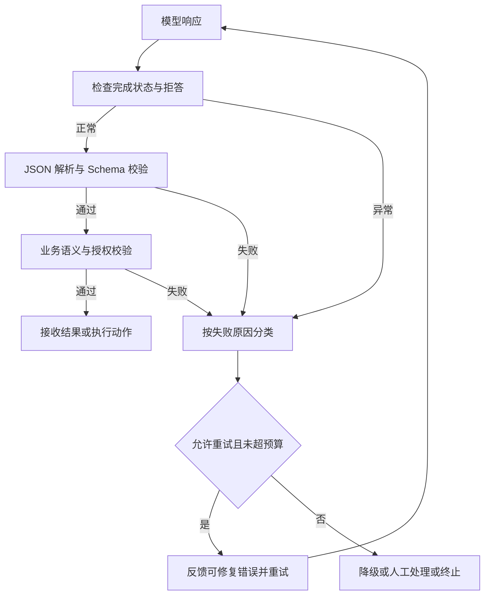

# Agent 开发题库

- 首次整理：2026-11-09
- 最近更新：2026-11-09
- 类型：原创学习笔记（长期维护题库）
- 来源：用户提供的问题与答案、学习讨论整理及 OpenAI 官方文档；不是逐字面试记录或官方保证的面试答案。
- 标签：Agent、面试、工程可靠性、JSON、JSON Schema、Structured Outputs、Function Calling、校验、重试、降级

本题库持续收录 Agent（智能体）开发中的原理、设计与工程追问。先给可口述的答案，再展开依据、案例和边界；同题持续修订，新增题目继续编号。

## 导航

1. [维护方式与题目索引](#maintenance)
2. [结构化输出与工程可靠性](#structured-output)
3. [术语、来源与核验边界](#sources)

<a id="maintenance"></a>
## 1. 维护方式与题目索引

| 题号 | 主题 | 问题 | 最近核对 |
| --- | --- | --- | --- |
| AGENT-001 / Q1 | 结构化输出、可靠性 | [如何让模型稳定输出 JSON 格式？](#q001-json) | 2026-11-09 |

后续维护约定：

1. 题号与显式锚点保持稳定，新增问题使用下一个 Q 编号和 `AGENT-NNN` 标识；补充同题追问时融入原题，不重复建档。
2. 每题保留原始问题、面试简答、原理与取舍、例子、失败处理、常见追问及官方来源；涉及动态 API 时标明产品、接口和核对日期。
3. 面试简答服务于表达，不能替代实现边界。示例、文档确认和真实执行分别标注，不能把“代码看起来能跑”当成已完成端到端测试。
4. 与既有专题重叠时链接相应章节，保留一份主答案；首页、知识索引和追加日志随本题库一起更新。

<a id="structured-output"></a>
## 2. 结构化输出与工程可靠性

<a id="q001-json"></a>
### Q1. 如何让模型稳定地输出 JSON 格式？

- 固定题号：**AGENT-001**
- 场景：工单分类、信息抽取、结构化报告、工具参数生成。
- 核心区分：JSON 能解析、符合字段结构、业务事实正确、允许执行，是不同层次。
- 接口范围：通用思路适用于多种模型；以下参数示例采用 OpenAI API（Application Programming Interface，应用程序接口），核对日期为 2026-11-09，不直接套用到其他供应商。

#### 面试简答

> 我会把它拆成生成约束和应用保障两部分。简单场景用 Prompt 和 Few-shot 提示格式，但它只是软约束；最终结果需要结构化数据时，优先使用支持严格 JSON Schema 的 Structured Outputs；需要选择工具、执行动作时用 Function Calling，并启用严格参数约束。无论哪种方案，都要先检查拒答和截断，再做 JSON 解析、Schema 和业务校验；失败按原因有限重试，仍失败就降级或人工处理，写操作不猜测执行。格式正确并不代表内容真实或动作已获授权。

可以记成：**Prompt 说明“写什么”，Schema 约束“长什么样”，应用代码判断“能否相信和执行”。**

#### 2.1 三种使用方案，加一层应用保障

本题按使用入口整理为“**三种生成方案 + 一层应用侧保障**”，不是严格递进的四个等级，也不代表三个彼此独立的底层约束机制：

| 方案 | 主要目的 | 约束方式 | 适用场景 | 主要边界 |
| --- | --- | --- | --- | --- |
| Prompt + Few-shot | 通过指令和示例表达格式与业务意图 | 软约束 | 原型、兼容性优先、低风险任务 | 可能夹解释、代码块、缺字段或类型错误 |
| Structured Outputs | 直接得到指定结构的最终数据 | 在支持范围内约束生成符合 Schema | 分类、抽取、结构化答案 | 不保证业务事实；需处理拒答、截断和接口兼容性 |
| Function Calling | 产生工具选择和动作参数 | 函数声明；可对参数启用 strict | 工具调用、动作编排 | 参数合规不等于函数已执行或有权限 |
| 应用侧保障 | 决定结果是否可接收、是否可执行 | 检查、校验、有限重试、兜底 | 上述每一种生产方案 | 不能被前三者替代 |

Structured Outputs（结构化输出）可用于直接回答，也可用于严格函数参数。OpenAI 的严格 Function Calling 底层使用 Structured Outputs，因此虚拟函数不是比直接结构化输出更高的“第四级能力”。[S1][S2]

#### 2.2 方案一：Prompt 约束与 Few-shot

Prompt（提示词）规定目标与输出要求，Few-shot（少样本示例）展示期望的输入/输出关系。例如：

```text
任务：将客服消息分类。
只输出一个 JSON 对象，不要解释或 Markdown 代码块。
category 只能是“退款”“咨询”“其他”。
priority 只能是 low、medium、high。

示例输入：同一笔订单扣了两次款，请退款。
示例输出：{"category":"退款","priority":"high"}

现在分类以下消息：……
```

这种方法不要求专用的结构化输出接口，对多数能遵循指令的对话模型都可使用；但模型是否遵守仍依赖具体能力，不能把“兼容”说成“任何模型都保证成功”。

典型失败包括：在 JSON 前加一句解释、使用单引号、返回代码块、缺少 `priority`，或写出未声明的枚举值。降低采样随机性可以改善部分场景，但不能把软约束变成 Schema 保证，也不能通过设置温度代替校验。

使用 Structured Outputs 或 Function Calling 后，Prompt 仍需要说明分类标准、摘要要求、信息不足时如何处理；Schema 只规定结构，不能独自告诉模型业务上该选哪个类别。

#### 2.3 方案二：Structured Outputs 约束最终回答

JSON（JavaScript Object Notation，JavaScript 对象表示法）是一种数据表示格式；JSON Schema（JSON 结构模式）描述允许哪些字段、类型、枚举及嵌套结构。以下在工单例子中额外加入 `summary`，便于展示应用侧非空检查。

**OpenAI Responses API 请求体示意：**模型名为占位符，应换成已确认支持该功能的模型；本例未发送真实 API 请求。

```json
{
  "model": "YOUR_SUPPORTED_MODEL",
  "input": "把这条客服消息分类并概括：同一笔订单扣了两次款，请退款。",
  "text": {
    "format": {
      "type": "json_schema",
      "name": "ticket_result",
      "strict": true,
      "schema": {
        "type": "object",
        "properties": {
          "category": {"type": "string", "enum": ["退款", "咨询", "其他"]},
          "priority": {"type": "string", "enum": ["low", "medium", "high"]},
          "summary": {"type": "string"}
        },
        "required": ["category", "priority", "summary"],
        "additionalProperties": false
      }
    }
  }
}
```

示例期望的数据形状：

```json
{"category":"退款","priority":"high","summary":"用户要求退还同一订单的重复扣款。"}
```

参数位置要准确：Responses 使用 **`text.format.type = "json_schema"`**，Schema 放在 `text.format.schema`，严格开关放在 `text.format.strict`。不能按字面发出一个不存在于此配置结构的 `text.format.json_schema` 字段。[S1]

Chat Completions API 的对应入口则是 `response_format`，其 `type` 为 `json_schema`，再由嵌套的 `json_schema` 对象承载 `name`、`schema`、`strict`；不能混拼两种 API 的包裹结构。[S3]

```json
{
  "response_format": {
    "type": "json_schema",
    "json_schema": {
      "name": "priority_only",
      "strict": true,
      "schema": {
        "type": "object",
        "properties": {"priority": {"type": "string", "enum": ["low", "medium", "high"]}},
        "required": ["priority"],
        "additionalProperties": false
      }
    }
  }
}
```

该片段只展示 Chat Completions 的配置位置，不是完整请求。严格模式支持的是 JSON Schema 子集；示例将字段列入 `required`，并为对象关闭 `additionalProperties`。可空值与可缺字段不同：需要表达“未知”时，可在模型/接口支持范围内让必填字段接受 `null`。非支持的 Schema 应修正请求，不能靠反复提示模型解决。[S1]

约束的边界也要说清楚：本题 Schema 可以约束 `priority` 只能选三个字符串，却不能证明选择 `high` 的业务理由正确；`summary` 是字符串也不表示它忠实于原消息。正常完成的 Schema 约束不替代拒答、输出截断等分支的检查。[S1]

#### 2.4 方案三：Function Calling 约束工具参数

Function Calling（函数调用）通常用于模型选择工具，由应用执行查询或动作。声明一个函数不会使它自动获得执行权限；模型产生参数，Host（宿主）校验并决定是否执行。

第二种用法是声明虚拟 `submit_result`，将 `arguments` 当结构化结果消费。以下是 **Responses API** 的完整请求体示意；函数声明是平铺的 `name/parameters/strict` 结构：

```json
{
  "model": "YOUR_SUPPORTED_MODEL",
  "input": "分类并概括：同一笔订单扣了两次款，请退款。通过 submit_result 提交结果。",
  "tools": [
    {
      "type": "function",
      "name": "submit_result",
      "description": "提交工单分类结果，不执行退款或其他写操作。",
      "strict": true,
      "parameters": {
        "type": "object",
        "properties": {
          "category": {"type": "string", "enum": ["退款", "咨询", "其他"]},
          "priority": {"type": "string", "enum": ["low", "medium", "high"]},
          "summary": {"type": "string"}
        },
        "required": ["category", "priority", "summary"],
        "additionalProperties": false
      }
    }
  ],
  "tool_choice": {"type": "function", "name": "submit_result"},
  "parallel_tool_calls": false
}
```

模型可能返回如下调用项，省略其他响应外壳字段：

```json
{
  "type": "function_call",
  "call_id": "call_demo_001",
  "name": "submit_result",
  "arguments": "{\"category\":\"退款\",\"priority\":\"high\",\"summary\":\"用户要求退还重复扣款。\"}"
}
```

应用读取并解析 `arguments`，不能把它当成普通最终文本，也不能因为看见“退款”就真正发起退款。对于虚拟提交函数，应用可以验证后直接接收数据；它并没有一个必须执行的退款函数。

`strict: true` 约束函数参数；`tool_choice` 控制工具选择，`parallel_tool_calls` 控制是否允许并行调用，三者职责不同。上面的配置面向单个虚拟提交函数；正常多工具 Agent 是否强制某函数，应由任务策略决定。应用仍需确认响应完整、没有拒答、确实返回预期函数与允许的调用数量。[S2]

纯粹为了最终 JSON 数据时，虚拟函数通常不会获得比直接 Structured Outputs 更强的结构保证。需要工具选择或动作编排时，Function Calling 才有额外的流程意义。不能把“更像工具调用”误解成“业务结果更真实”。

#### 2.5 字段完全未知时：固定外壳与动态 name/value 数组

严格 Schema 需要预先明确允许的对象结构。若字段名来自运行时，可把未知字段变成**数组元素的值**，例如：

```json
{
  "attributes": [
    {"name": "颜色", "value": "红色"},
    {"name": "重量_克", "value": 120},
    {"name": "是否支持退货", "value": true}
  ]
}
```

可用下面这个固定 Schema 描述它，示例仅支持字符串、数字、布尔和 null 这些标量值：

```json
{
  "type": "object",
  "properties": {
    "attributes": {
      "type": "array",
      "items": {
        "type": "object",
        "properties": {
          "name": {"type": "string"},
          "value": {"anyOf": [{"type":"string"},{"type":"number"},{"type":"boolean"},{"type":"null"}]}
        },
        "required": ["name", "value"],
        "additionalProperties": false
      }
    }
  },
  "required": ["attributes"],
  "additionalProperties": false
}
```

`anyOf`（任一分支匹配）放在嵌套字段中，顶层仍是对象。外壳结构固定，但 `name` 是否属于业务允许的属性、名称是否重复、数值单位是否正确，仍由应用检查。需要支持数组或对象值时，应再明确允许的类型与嵌套深度，不宣称这个标量示例已经覆盖任意 JSON。

#### 2.6 一层应用侧保障：先分状态，再分格式与业务



程序中的检查应区分以下层次：

| 层次 | 需要检查什么 | 本题例子 |
| --- | --- | --- |
| 响应完整性 | 是否正常完成、截断、拒答；函数场景是否有目标调用 | 未完成的字符串不能直接进入业务执行 |
| JSON 语法 | 数据是否能按规定的 JSON 语法解析 | 解释文字、单引号或未闭合对象不能当成功结果 |
| Schema | 字段、类型、枚举、嵌套结构和额外字段 | `priority="urgent"` 不属于枚举 |
| 业务语义 | 内容与事实、业务规则是否一致 | `summary` 不能为空白；金额是否大于零；开始时间是否晚于结束时间 |
| 实体与授权 | ID 指向的实体是否真实存在；当前用户是否获准访问/修改 | 用户 ID、订单、产品与配置应向可信数据源核验 |

“ID 存在”和“这个 ID 属于当前用户”也不是同一检查。部分数值范围可以写进接口支持的 Schema，但外部实体是否存在、是否有权限、摘要是否忠实，不能靠固定结构自动得到保证。

拒答可能不是目标 Schema 的正常数据，截断也可能产生半个对象。应先识别这些状态，而不是把拒答文本强行转成业务 JSON，或补几个括号后直接执行。[S1]

#### 2.7 有限重试：反馈错误，但不能无限重新生成

可修复的结构或语义失败，可以把校验错误反馈给模型：

```text
上次结果校验失败：
- priority 必须是 low、medium 或 high
- summary 不能为空

请依据原始客服消息重新生成，并遵守原 Schema。
```

通常可先配置 **1—2 次额外重试**，并同时限制总时长、Token 与费用；这是工程初始策略，不是 API 规定，也不是成功保证。重试应由校验结果触发，不必为本来正确的结果额外调用模型。

| 失败原因 | 处理方向 | 不宜采用的方式 |
| --- | --- | --- |
| Prompt 输出夹解释或不合法 JSON | 反馈具体错误，重新生成或切换受支持的结构化入口 | 不加限制地反复要求“只输出 JSON” |
| Schema 本身不受接口支持 | 修正请求结构或能力配置 | 期待相同非法请求多试几次就成功 |
| 截断 | 在预算允许时调整输出长度或任务大小，再重新获取完整结果 | 将半个结果补齐后视为已验证 |
| 缺少真实订单等必要事实 | 重新获取可信上下文，或返回信息不足 | 让模型反复猜一个“看起来存在”的 ID |
| 拒答、越权或明确禁止的动作 | 按原因终止、提供合规替代或人工处理 | 用重试绕过拒答或权限控制 |
| 写操作执行结果不明 | 先确认状态，结合幂等设计处理 | 把网络失败等同于未执行并直接重做 |

#### 2.8 兜底：返回什么，以及什么时候必须停止

重试仍失败时，可按业务规则采取：

- 使用**预先约定且业务允许的默认值**，不把默认值冒充模型已核实结论。
- 返回部分结果并在应用响应中标明不完整，说明缺失字段或失败原因。
- 切换规则程序、其他已评估模型或人工处理。
- 对退款、转账、删除、权限变更等写操作，在关键事实或授权未确认时终止，禁止猜测执行。

默认值不是伪造金额、订单 ID 或用户身份的理由。若要标注 `status`、`errors` 等字段，应事先定义应用的返回外壳；不要临时向一个关闭额外字段的模型 Schema 中混入未声明字段。

#### 2.9 常见面试追问

**“Structured Outputs 已经 strict，为什么还要校验？”** 结构约束是系统的一层保障；应用仍要处理拒答、截断、错误响应、版本或网关差异，并判断内容与业务事实是否一致。

**“JSON mode 算不算另一种方案？”** JSON mode（JSON 模式）是应知道的兼容选项：它约束输出为有效 JSON，但不保证符合指定 Schema。可作为支持能力有限时的选择，不能与严格 Schema 保证等同，也不必把它硬塞进本题的递进等级。[S1]

**“temperature 设成 0 就稳定了吗？”** 它不能取代生成时结构约束，更不能保证业务事实正确；不同模型对采样参数的支持也要单独确认。

**“虚拟 submit_result 比直接 JSON Schema 更强吗？”** 严格参数沿用结构化输出能力，没有额外的事实保证。优先按“最终数据”还是“工具动作”的需求选入口，而不是追求更绕的包装。

**“业务校验失败，也反馈给模型吗？”** 先判断失败是否可修复。摘要为空可以反馈；实体不存在要查可信数据；无权限不能要求模型换一个 ID 再试。

**“怎么证明输出变稳定了？”** 对同一测试集分别统计解析通过率、Schema 通过率、业务正确率，以及拒答、截断、重试和降级占比；同时记录最终任务成功率、时延和成本。不要只在已成功样本上报告一个很高的格式通过率。

<a id="sources"></a>
## 3. 术语、来源与核验边界

| 术语 | 英文与中文 | 在本题中的含义 |
| --- | --- | --- |
| Prompt / Few-shot | 提示词／少样本示例 | 说明业务意图和期望输出 |
| JSON | JavaScript Object Notation，JavaScript 对象表示法 | 数据表示格式 |
| JSON Schema | JSON 结构模式 | 字段、类型、枚举和嵌套约束 |
| Structured Outputs | 结构化输出 | 按受支持 Schema 约束生成 |
| Function Calling | 函数调用 | 让模型提出工具选择与参数 |
| Strict mode | 严格模式 | 启用对应接口的严格结构约束 |
| Refusal / Truncation | 拒答／截断 | 需要单独处理的非正常目标数据分支 |
| Fallback | 兜底或降级 | 重试无效后采取规则、默认值、人工或终止策略 |
| Idempotency | 幂等性 | 避免重试导致业务副作用重复 |

- **[S1]** [OpenAI：Structured model outputs](https://developers.openai.com/api/docs/guides/structured-outputs)：结构化输出、JSON mode、Schema 支持范围与异常分支。
- **[S2]** [OpenAI：Function calling](https://developers.openai.com/api/docs/guides/function-calling)：工具选择、严格参数与并行调用控制。
- **[S3]** [OpenAI：Create chat completion](https://developers.openai.com/api/reference/resources/chat/subresources/completions/methods/create)：Chat Completions 的 `response_format` 配置位置。

资料核对日期：2026-11-09。本文以用户提供的答案为基础整理，补充接口入口、严格约束与业务验证的边界；重试次数与降级建议属于工程策略，不冒充协议强制要求。

核验范围：请求和 Schema 示例做本地语法、结构与反例检查；未发送真实模型 API 请求，不宣称已验证某模型的线上格式成功率、事实正确率或费用。模型名 `YOUR_SUPPORTED_MODEL` 是占位符。

关联阅读：[Agent 与 MCP 接入原理：模型决定与宿主执行](2026-11-02-Agent与MCP接入原理.md#tool-decision) · [结果、错误与中间状态](2026-11-02-Agent与MCP接入原理.md#result-errors) · [完整 HTTP 工具调用案例](2026-11-02-Agent与MCP接入原理.md#claude-code-case)。
