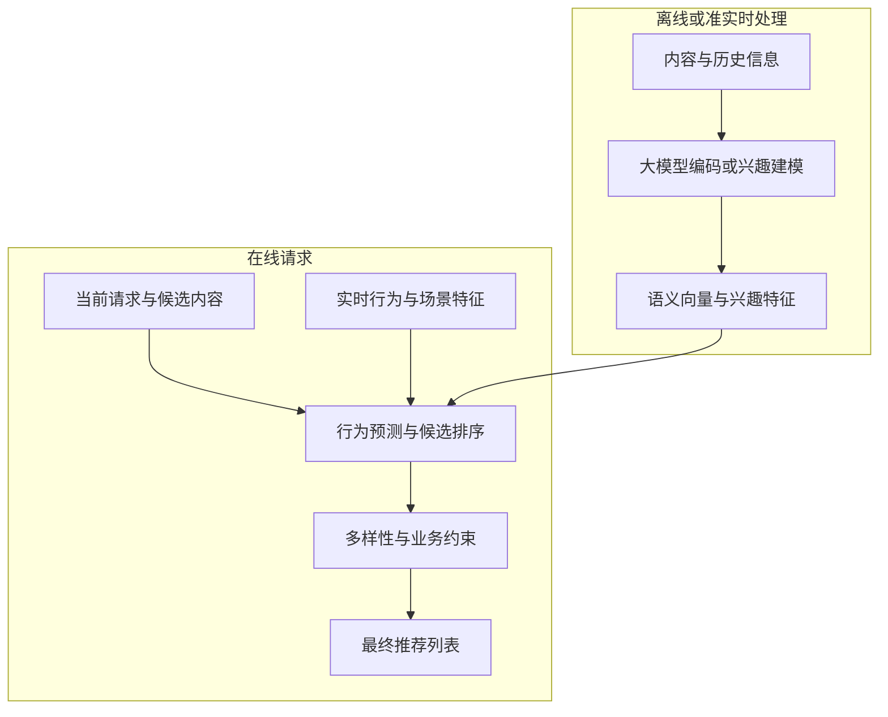

# 信息流推荐中传统模型与大模型排序对比

首次整理：2026-11-12

最近更新：2026-11-12

类型：原创学习笔记

来源：2026-11-12 的学习对话，以及文末列出的原始论文和厂商工程文章。本文保留原问题，按实现原理、效果、通用性和工程验证重新组织；案例与数值另有标注。

标签：信息流推荐、CTR、CVR、LLM、排序、协同信号、长序列、概率校准、生成式推荐、HSTU、HLLM、OneRec、GEM、蒸馏、评测

核对日期为 2026-11-12，时区 Asia/Shanghai。工业指标属于来源在特定版本、业务和实验条件下报告的结果，不是本文复现结果；本文未训练或部署排序模型，未执行线上对照实验。路线建议属于工程分析。

## 阅读导航

| 学习问题 | 阅读入口 |
| --- | --- |
| CTR/CVR 与大模型是不是互相替代的两类东西？ | [1. 问题与三类路线](#problem) |
| 传统模型怎样从日志学到点击和转化？ | [2. 行为预测原理](#traditional) |
| 语言模型参与排序，增加了什么能力？ | [3. 语义与意图](#llm-ranking) |
| 行为推荐大模型与聊天模型有何区别？ | [4. 推荐大模型](#behavior-foundation) |
| 排序分、Softmax 概率为什么不等于 CTR？ | [5. 概率与校准](#calibration) |
| 哪些场景更可能产生收益？ | [6. 效果与案例](#effects) |
| 通用性、成本与服务链路怎样比较？ | [7. 通用性与工程架构](#engineering) |
| 怎样验证收益来自哪里？ | [8. 评测与选型](#evaluation) |
| 复习问题、中英文术语和原始资料 | [9. 复习与来源](#review) |

相关基础：[搜索中的双塔与交叉编码器](2026-11-01-大模型基础学习笔记.md#ch10)、[Sigmoid 与二分类](2026-11-01-大模型基础学习笔记.md#sec2-11)、[Logits 与 Softmax](2026-11-01-大模型基础学习笔记.md#sec6-7)、[检索融合与重排](2026-11-04-RAG检索原理与工程实践.md#hybrid)。搜索相关性和个性化行为预测的目标不同，不能直接套用某个检索重排器的分数作为信息流点击率。

## 1. 保留原问题，先区分目标与架构

> 目前信息流推荐领域，传统的模型（如 CTR/CVR 模型）和大模型的排序模型，在效果、实现原理、通用性等方面，最主要的区别是什么？

最主要的区别，在于能力来源、用户偏好的学习方式，以及输出与业务目标的对应关系。大模型增加了内容理解、知识迁移和复杂序列建模能力；理解内容与预测用户行为之间，仍需要数据、目标和训练建立联系。

- **CTR（Click-Through Rate，点击率）**是曝光条件下发生点击的概率。
- **CVR（Conversion Rate，转化率）**的分母依业务定义；本文专指点击后转化率，预测时须注明点击条件、转化事件及统计窗口。
- **LLM（Large Language Model，大语言模型）**是一类模型，不是另一种业务指标。它也能通过训练预测点击或转化。

短视频自动播放信息流未必以点击为核心目标，还可能预测观看时长、完播、快速划走、负反馈和长期留存。比较时先确定具体任务。

| 比较维度 | 传统行为预测模型 | 通用大语言模型参与排序 | 基于行为训练的推荐大模型 |
| --- | --- | --- | --- |
| 主要输入 | 用户、内容、场景特征及历史行为 | 内容文本、用户描述、历史记录、自然语言要求 | 长行为序列、内容表示、场景及任务信号 |
| 能力来源 | 大量曝光、点击、观看、转化日志 | 通用语料预训练，再做推荐任务适配 | 大规模行为训练，可能结合语言、图像等预训练 |
| 主要优势 | 个性化行为预测、实时反馈、概率校准的成熟实践 | 内容语义、明确意图、复杂约束、知识迁移 | 长序列建模、跨任务共享、规模化学习 |
| 常见输出 | 点击概率、转化概率、预期观看时长 | 相关性分数、候选顺序，也可训练成业务概率 | 行为概率、候选分数，或内容标识序列 |
| 通用性 | 架构可复用，模型一般需要业务适配 | 任务表达灵活，语义能力容易复用 | 可统一多场景，但依赖训练数据覆盖 |
| 主要挑战 | 冷启动、复杂语义、特征与链路维护 | 个性化不足、概率语义、推理成本 | 训练及服务基础设施、实时更新、业务对齐 |

这里是典型路线的比较，不是严格互斥的分类。传统系统也能接入文本或视频编码器，也能使用注意力与 Transformer（变换器架构）；参数很多的模型也不一定是大语言模型。[S1](#s1) [S4](#s4) [S6](#s6)

## 2. 传统模型：从业务反馈学习条件行为概率

### 2.1 输入与预测

以一次候选内容曝光为例：

$$
\widehat p_{\mathrm{CTR}}=P_\theta(C=1\mid E=1,u,i,h,c)
$$

其中，$E$ 表示曝光，$C$ 表示点击，$u$ 是用户特征，$i$ 是候选内容，$h$ 是截至请求时已发生的历史行为，$c$ 是当前场景。点击后转化的预测定义为：

$$
\widehat p_{\mathrm{CVR}}=P_\theta(V=1\mid C=1,E=1,u,i,h,c)
$$

训练与服务常用以下输入：

| 输入 | 教学例子 | 提供的信息 |
| --- | --- | --- |
| 用户与内容标识 | 用户编号、作者编号、视频编号 | 与历史交互关联的统计信息 |
| 用户行为序列 | 最近观看、停留、点赞和划走 | 长短期偏好及近期变化 |
| 内容特征 | 主题、时长、文本或视频向量 | 内容属性及语义 |
| 交叉特征 | 用户与作者的历史互动 | 当前用户与候选的具体关系 |
| 场景特征 | 时间、入口、设备及网络 | 当前行为发生的条件 |

**Embedding（嵌入向量）**将离散标识等输入映射为可学习的向量；特征交互和行为序列网络再学习预测函数。一个简化二分类模型可以写成：

$$
z=f_\theta(u,i,h,c),\qquad \widehat p=\sigma(z)
$$

$$
\mathcal L_{\mathrm{BCE}}=-[y\log\widehat p+(1-y)\log(1-\widehat p)]
$$

其中，$\sigma$ 为 Sigmoid（S 形映射函数），BCE 为 Binary Cross-Entropy（二元交叉熵）。这是教学简化；实际可使用多任务、成对或列表训练目标，数据采样也会影响概率校准。

### 2.2 不只是给用户算一个静态向量

DIN（Deep Interest Network，深度兴趣网络）会根据当前候选，从用户历史行为中提取相关兴趣。面对亲子路线与相机评测，同一用户可以得到不同的候选条件兴趣表示。这说明注意力、动态兴趣和深度交互并非大语言模型专属。[S1](#s1)

### 2.3 协同信号为什么重要

**Collaborative Signal（协同信号）**来自群体交互规律。例如 A、B 两条内容在字面上不相似，但许多行为相近的用户看完 A 后会观看 B。平台可以利用真实交互学习这种关系，不需要先解释出一个自然语言理由。

因此，数据丰富的成熟业务中，细粒度协同关系、用户与作者关系、实时反馈等信息，可以构成很强的预测基线。传统系统也能融合语义向量，实际差异需要在相同信息条件下验证。

### 2.4 CVR 的困难不会随模型变大自动消失

点击后转化样本少，且转化可能延迟回传。只在点击样本上训练、却对全部曝光候选推断，还会引入样本选择问题。ESMM（Entire Space Multi-Task Model，全空间多任务模型）利用曝光、点击和转化的顺序关系建模，是针对这些问题的一条代表性路线。[S2](#s2)

无论采用小模型还是大模型，都要正确处理转化窗口、尚未成熟的标签、曝光机制及采样；不能把暂未回传的转化直接当作最终负例。

## 3. 语言模型排序：增加语义、意图和约束理解

### 3.1 用一个信息流需求理解能力增量

**原创教学场景：**用户最近关注近郊旅行，并明确表示：“周末带孩子出去，不要太累，也不想看露营装备广告。”候选包括亲子近郊路线、高强度登山路线和露营装备测评。

语言模型可以利用已有语义能力理解：

- “不要太累”会降低高强度登山内容的匹配度。
- “带孩子”使交通便利、亲子设施等属性更相关。
- 露营装备广告与近郊旅行主题相关，但不符合当前表达的诉求。

对于只使用内容标识和粗标签的基线，这些条件通常需要额外特征、内容理解和训练。语言模型能让自然语言条件更容易进入系统，但是否必须由它直接负责最终排序，需要另做实验。

### 3.2 内容匹配与行为偏好还要对齐

模型可以理解“亲子路线很适合”，但不能仅凭通用知识知道这个用户实际会不会点击、看多久、是否产生负反馈。用户的真实行为还受内容呈现、作者关系、观看场景等因素影响。

因此，“理解更好”提供了可用信息，业务训练负责把这些信息与具体反馈建立关系。对完全没有行为、画像或明确偏好的新用户，大模型也没有凭空知道其个体偏好的依据。

### 3.3 大模型不必生成长篇理由

| 方式 | 中文解释与执行方式 | 适用边界 |
| --- | --- | --- |
| Pointwise | 逐项打分：分别预测每个候选的分数或概率 | 容易并行；传统模型和大模型都能采用 |
| Pairwise | 两两比较：判断 A、B 哪个更适合 | 需控制比较次数与排序一致性，不要求所有候选全量两两比较 |
| Listwise | 列表级排序：联合考虑一组候选 | 可利用列表关系，需处理输入长度、位置偏差和输出完整性 |
| Generative Recommendation | 生成式推荐：根据历史生成内容标识或推荐序列 | 需约束有效内容、可用性及业务规则，可能融合召回与排序 |

前三者也可以描述训练目标，并非大模型独有。生成式推荐与前三者也不是完全互斥的分类。

LlamaRec 使用候选对应的输出分数进行排序，避免生成长文本。因此，“使用语言模型”和“在线逐条生成解释”可以分开设计。[S5](#s5)

### 3.4 零样本能力的边界

Zero-shot（零样本）排序研究发现，未针对该任务训练的语言模型可能受到提示中候选位置、流行度等因素影响，对历史交互顺序的利用也可能不足。该论文的模型、数据集和实验条件有明确范围，不能把结果直接推广到全部新模型。[S3](#s3)

## 4. 行为推荐大模型：用大规模训练学习推荐任务

### 4.1 与通用语言模型的区别

聊天模型主要在语言等数据上学习预测和交互能力；行为推荐大模型可以围绕内容标识、时间、反馈和用户行为序列训练。二者可以共享架构思想、预训练能力或表示，也可以具有不同的输入、损失和服务方式。

HSTU（Hierarchical Sequential Transduction Unit，分层序列转导单元）是为高基数、非平稳推荐数据设计的架构。其论文将推荐建模为序列转导任务，报告了工业部署和随计算量增长的效果收益；不能据此把所有推荐大模型归为自然语言聊天模型。[S6](#s6)

### 4.2 内容表示与用户行为可以联合学习

HLLM（Hierarchical Large Language Model，分层大语言模型）采用内容与用户两层建模：内容模型提取语义表示，用户模型基于交互历史学习未来兴趣。论文同时强调推荐任务微调的作用。[S4](#s4)

这条路线把内容语义和行为监督结合起来。使用预训练参数并不等于不再需要业务数据；有无预训练、是否微调、历史长度和模型容量，都应该独立做消融实验。

### 4.3 直接生成内容序列与预测点击率不同

一种简化的生成式目标是：

$$
P_\theta(i_1,\ldots,i_K\mid h,c)=\prod_{t=1}^{K}P_\theta(i_t\mid h,c,i_{<t})
$$

这里表示序列生成的条件分布；具体系统可能生成内容标识或其编码，不一定生成标题文本。这个概率也不会自动等于每条内容曝光后的点击率。

OneRec 技术报告研究了统一召回与排序的生成式路线。其 2025-09-16 修订版报告：在所述部署条件下，服务快手与快手极速版部分流量，并使 App 停留时长分别提升 0.54%、1.24%。这些是作者报告的特定系统收益，本文未复现；停留时长收益也不能改写成 CTR 或 CVR 收益。[S7](#s7)

## 5. 排序分、候选概率与点击概率的区别

### 5.1 高分不等于高点击率

**原创教学数值，非模型实测：**模型给亲子路线 9.2 分、装备测评 8.6 分，只能先按定义解释为排序分数，不能读成 92% 和 86% 点击率。

对这两个分数做 Softmax（归一化指数函数）：

$$
q_A=\frac{e^{9.2}}{e^{9.2}+e^{8.6}}\approx0.645656,\qquad q_B\approx0.354344
$$

它得到候选之间和为 1 的分布。但曝光后用户可能一个都不点，也可能点击多条；两个候选的独立点击率并不要求相加为 1。

此外，候选 A 的分数不变，加入新的候选也会改变它的 Softmax 归一化值。因此，该值必须结合训练目标和选择机制解释，不能仅因位于 0 与 1 之间就视为 CTR。

如果模型明确对“下一次选择哪个候选”训练，它可以表示相应选择分布；如果显式建模不点击、曝光机制和行为反馈，也可构造其他概率模型。关键在事件定义与监督方式，Softmax 本身不完成这种业务对齐。

### 5.2 排序质量与校准质量是两个维度

**Calibration（概率校准）**要求：被预测为约 10% 点击率的一组曝光，实际点击率也应接近 10%。这是分组统计意义的说明，不是单次曝光必然发生什么。

**原创教学反例：**模型甲预测 A 为 0.12、B 为 0.08；模型乙预测 A 为 0.90、B 为 0.80。两者排序相同，如果真实点击率接近 0.12 和 0.08，则其校准质量明显不同。

广告出价、预算分配和收益预估不仅关心名次，还依赖概率尺度。大模型可通过行为训练与校准输出业务概率；传统模型也会因负采样、分布变化和反馈延迟而失准。

### 5.3 搜索重排器不能直接视为信息流 CTR 模型

| 分数 | 直接回答的问题 | 不能自动推导的结论 |
| --- | --- | --- |
| 查询与内容相关性 | 这条内容能否满足当前查询 | 这个用户一定会点击 |
| 候选间选择分布 | 在特定候选与条件下更倾向哪个 | 各内容曝光后的绝对点击率 |
| 曝光条件下 CTR | 展示后发生点击的概率 | 一定转化，或具有更高长期价值 |
| 点击条件下 CVR | 点击后在定义窗口内转化的概率 | 任意曝光直接转化的概率 |

同一编码架构可以用不同数据和损失训练为不同任务模型；开源相关性重排器的分数，需要经过业务验证与适配。

## 6. 效果：分场景判断，结合案例解释

### 6.1 哪些因素决定收益

| 场景 | 主要决定因素 | 应如何判断 |
| --- | --- | --- |
| 老用户、热门内容、日志充分 | 协同关系、实时兴趣、用户与作者关系 | 成熟行为模型是强基线，大模型需要证明额外收益 |
| 新内容、曝光很少 | 内容语义和已有知识迁移 | 预训练内容表示值得验证，但语义准确不保证受欢迎 |
| 新用户且提供明确偏好 | 对需求和约束的理解 | 语言模型可减少偏好表达与系统特征之间的距离 |
| 新用户且没有额外信息 | 个体偏好不可观测 | 两类模型都受限，仍需探索及后续反馈 |
| 复杂自然语言要求 | 意图、否定、范围和条件组合 | 可在召回、特征或末端筛选引入语言模型 |
| 长短期兴趣交织 | 长序列、时间及行为权重 | 行为大模型有潜力，须与增强后的基线比较 |
| 高并发、低延迟服务 | 吞吐、缓存、批处理和更新效率 | 比较完整链路成本及业务收益 |

### 6.2 回到亲子路线案例

用户口头表达偏好之后，系统至少要解决三件事：找到符合条件的候选，预测个体行为和价值，再处理多样性及业务约束。

| 阶段 | 可利用的大模型能力 | 仍需保留的行为与系统信息 |
| --- | --- | --- |
| 召回 | 把“不太累的亲子近郊路线”映射到相关内容 | 内容是否可用、地理范围及候选覆盖 |
| 排序 | 理解路线、适龄条件和内容表达 | 用户与作者关系、历史反馈、当前场景 |
| 列表控制 | 检查否定偏好或重复主题 | 多样性、频控、明确的业务规则 |
| 反馈学习 | 分析误解及表示不足 | 曝光、位置、观看、负反馈和转化窗口 |

如果只把相同文字主题排得更靠前，却增加重复内容、快速划走或负反馈，语义匹配提升未必转化为产品收益。显式偏好如何与推断兴趣融合，需要产品目标和实验共同确定。

### 6.3 当前工业实践的两种例子

- **跨场景行为基础模型：**Meta 于 2026-10-13 公布 GEM（Generative Ads Recommendation Model，生成式广告推荐模型）进展，描述跨场景联合预测点击与转化，再将能力传给线上模型的做法。它表明“大模型”与 CTR/CVR 预测可以融合。[S8](#s8)
- **语言模型增强信息流：**Meta 于 2026-11-10 公布 Your Algorithm，介绍把明确表达的兴趣接入推荐，并在末端利用经过适配的语言模型检查需要排除的内容。它体现的是与推荐链路配合的方案，不是用通用聊天模型替换全部排序。[S9](#s9)

以上是两个公开工程案例，不代表行业普及率，也不能据此给全部产品做统一效果排名。

## 7. 通用性、成本与工程链路

### 7.1 通用性需要区分任务与业务

| 维度 | 含义 | 大模型的增量与边界 |
| --- | --- | --- |
| 任务通用性 | 理解不同内容、新约束及自然语言要求 | 预训练语义可复用，仍须检验指令和输出是否可靠 |
| 跨业务泛化 | 换用户群、流量入口或反馈机制仍然有效 | 需要数据适配、任务覆盖和校准 |
| 跨场景共享 | 多入口或多目标共享表示与训练 | 有机会迁移信息，仍需控制负迁移和目标冲突 |

**原创教学例子：**同一条视频在搜索结果、首页推荐和关注页中的点击率可能不同。内容语义没有变，用户意图、信任关系和曝光机制却发生了变化。理解视频不能代替学习入口中的行为规律。

### 7.2 参数量不能单独决定服务成本

通用语言模型对大量候选逐条生成长文本，成本可能很高。但大模型系统也可以预计算内容向量、缓存用户历史表示、批量打分，或采用 Knowledge Distillation（知识蒸馏）将教师能力转给较小的线上模型。

完整的生成式推荐方案还可能合并原有多级链路，改变通信、存储和候选处理成本。因此，不能从“参数更多”直接推导“端到端一定更贵”，也不能从单个优化案例推导所有架构都更便宜。[S5](#s5) [S7](#s7) [S8](#s8)

### 7.3 一种可实验的增强链路

下图为**原创教学架构**：大模型先提供内容与兴趣表示，在线排序继续融合实时行为与场景。该图不声称对应某家平台的完整生产实现。

曝光及延迟反馈应进入样本处理、训练和评测，经过验证后再发布新版本。用户历史状态更新、特征更新和模型参数更新具有不同时间尺度，不能混写为每次反馈都立即重新训练大模型。

另一类方案是直接在线运行适配后的大模型排序，或生成内容序列。能否采用取决于候选规模、质量收益、服务预算和恢复能力，而非路线名称。

## 8. 评测与选型：拆开信息增量和架构收益

### 8.1 用三组实验回答不同问题

| 实验 | 方案 | 回答的问题 |
| --- | --- | --- |
| A | 当前行为排序系统 | 成熟业务基线是什么 |
| B | A 加入大模型内容向量、兴趣等特征 | 更好的信息表示能带来多少收益 |
| C | 大模型直接排序，或行为推荐大模型 | 改变架构后是否还有额外收益 |

三组实验只是起点，仍需消融数据覆盖、内容字段、历史长度、预训练、训练算力和推理预算。若 C 多使用了长历史和完整文本，其收益不能全部归因于模型架构。

### 8.2 先确定比较的是排序器还是整套系统

- **比较排序器：**尽量固定可用候选、特征时效和标签定义，观察排序及概率质量。
- **比较完整系统：**允许召回、候选生成和多级架构改变，评估用户最终看到的结果及总成本，另行分析各阶段贡献。
- **比较跨场景能力：**按入口、用户活跃度、新老内容分别观察，避免整体均值掩盖退化。

重排只能处理进入候选的内容。端到端系统的候选覆盖改变了，不能把全部收益都写成精排收益。

### 8.3 指标必须对应问题

| 维度 | 指标或检查方式 | 回答的问题 |
| --- | --- | --- |
| 排序区分能力 | AUC（Area Under the Receiver Operating Characteristic Curve，受试者工作特征曲线下面积） | 正负样本是否具有较好的分数区分 |
| 列表排序质量 | NDCG（Normalized Discounted Cumulative Gain，归一化折损累计增益） | 具有较高目标增益的内容是否排在前面 |
| 概率质量 | Log Loss（对数损失）、分桶预测与实测对照 | 输出概率是否符合真实反馈 |
| 线上用户效果 | 观看、完播、转化、负反馈及留存 | 是否改善产品目标，是否存在副作用 |
| 系统成本 | 每请求资源、训练成本、QPS 和 P95/P99 延迟 | 收益是否适合规模化服务 |
| 约束遵守 | 有效候选比例、偏好违反和规则违反情况 | 列表能否正确交付 |

QPS 为 Queries Per Second（每秒查询数）；P95/P99 是第 95/99 百分位延迟，用于观察尾部请求。不同业务的标签和指标窗口需要明确定义，不能只比较名称相同但口径不同的数字。

线上应进行稳定分流的 A/B Test（随机对照实验），结合实验单位、反馈延迟、置信区间和观察窗口判断。离线历史反馈受原曝光策略影响，不能无条件当作未展示内容的真实反应；同时防止未来信息进入训练特征。

### 8.4 工程决策的着力点

先定位瓶颈：内容语义、明确意图、行为序列、候选覆盖，还是概率校准与实时性。成熟系统可先实验增强内容和兴趣表示，再依据证据决定是否更换排序架构。已有大规模行为训练和服务基础设施的团队，也可以直接验证推荐基础模型或统一生成式链路。

## 9. 复习问答、术语与原始来源

### Q1. 传统 CTR 模型与大模型是不是完全不同的任务？

不是。CTR 是预测目标，大模型是实现方式。大模型也可以通过业务训练预测 CTR/CVR，见[第 1 章](#problem)。

### Q2. 传统模型只会用标识和标签，不能理解内容吗？

不是。可以融合文本、图像、视频向量，也可使用注意力与序列网络。实际比较要核实输入、目标及训练，见[第 2 章](#traditional)。

### Q3. 语言模型理解了内容，为什么仍可能排不准？

语义匹配没有覆盖个体协同关系、作者关系、实时场景和曝光机制。仍需把表示与具体行为监督对齐，见[第 3 章](#llm-ranking)。

### Q4. 协同信号与内容语义有什么区别？

语义描述内容含义；协同信号来自用户与内容的交互规律。字面不相似的内容也可能被相近用户共同喜欢，见[2.3 节](#traditional)。

### Q5. 推荐大模型就是聊天模型吗？

不是。可以围绕行为标识和序列训练，也可以结合语言预训练。HSTU、HLLM 和 OneRec 展示了不同路线，见[第 4 章](#behavior-foundation)。

### Q6. 大模型排序必须生成理由或标题吗？

不必须。可以读取候选分数、输出头或业务预测；LlamaRec 展示了避免长文本生成的排序方案，见[3.3 节](#llm-ranking)。

### Q7. Softmax 输出为什么不能直接当 CTR？

它的事件含义取决于目标与监督。候选归一化分布和曝光后点击事件不同，见[第 5 章](#calibration)。

### Q8. 排序一样，模型效果就一样吗？

不一定。概率校准、跨人群表现、成本和线上约束可能不同，见[5.2 节](#calibration)与[评测](#evaluation)。

### Q9. 新内容、新用户时大模型一定更强吗？

新内容可利用语义迁移；新用户若提供明确偏好也有帮助。完全没有个体信息仍存在冷启动限制，见[第 6 章](#effects)。

### Q10. 通用性强，是否不再需要业务训练？

不是。任务语义可迁移，但入口、用户分布和反馈机制改变后仍需适配、校准和实验，见[第 7 章](#engineering)。

### Q11. 模型越大，线上成本一定越高吗？

单次昂贵计算可能更高，但预计算、缓存、蒸馏与链路合并会改变端到端成本，应在相同质量及服务要求下评估，见[7.2 节](#engineering)。

### Q12. 怎样确认收益来自大模型架构？

比较现有系统、语义增强系统和架构替换系统，再控制内容字段、历史长度、算力及候选变化，见[第 8 章](#evaluation)。

### 中英文术语速查

| 术语 | 英文全称与中文解释 |
| --- | --- |
| CTR | Click-Through Rate，点击率，本文指曝光条件下点击概率 |
| CVR | Conversion Rate，转化率，本文专指点击后转化率 |
| LLM | Large Language Model，大语言模型 |
| ID | Identifier，标识符，例如内容或用户编号 |
| Embedding | 嵌入向量，可用于表示离散标识、内容或行为 |
| Collaborative Signal | 协同信号，来自群体交互规律的信息 |
| Calibration | 概率校准，预测概率与实际频率的对应程度 |
| Cold Start | 冷启动，新用户或新内容的历史反馈不足 |
| Zero-shot | 零样本，未针对目标任务训练的使用方式 |
| Pointwise / Pairwise / Listwise | 逐项、成对、列表级建模或排序方式 |
| Generative Recommendation | 生成式推荐，通过生成内容编码或序列进行推荐 |
| BCE | Binary Cross-Entropy，二元交叉熵 |
| DIN | Deep Interest Network，深度兴趣网络 |
| ESMM | Entire Space Multi-Task Model，全空间多任务模型 |
| HSTU | Hierarchical Sequential Transduction Unit，分层序列转导单元 |
| HLLM | Hierarchical Large Language Model，分层大语言模型 |
| GEM | Generative Ads Recommendation Model，生成式广告推荐模型 |
| Knowledge Distillation | 知识蒸馏，将教师模型能力迁移给学生模型 |
| AUC | Area Under the Receiver Operating Characteristic Curve，受试者工作特征曲线下面积 |
| NDCG | Normalized Discounted Cumulative Gain，归一化折损累计增益 |
| Log Loss | 对数损失，用于衡量概率预测与标签的差异 |
| QPS | Queries Per Second，每秒查询数 |
| A/B Test | 随机对照实验，用于比较不同策略的实际效果 |

### 原始来源与核实边界

均于 2026-11-12 核对。以下是原论文、会议收录页或厂商工程文章；本文对机制的解释与原创场景不冒充论文实验结果。

- S1 [Deep Interest Network for Click-Through Rate Prediction](https://arxiv.org/abs/1706.06978)，2017 年提交、2018 年修订。用于说明候选条件下的兴趣建模和行为预测，不代表当前所有传统模型的结构。

- S2 [Entire Space Multi-Task Model](https://arxiv.org/abs/1804.07931)，2018。用于说明点击后转化建模中的样本选择及稀疏问题；不把单个模型的结果推广为全部问题均已解决。

- S3 [Large Language Models are Zero-Shot Rankers for Recommender Systems](https://arxiv.org/abs/2305.08845)，2023。用于说明零样本推荐排序、历史顺序和位置及流行度偏差，适用范围限定在论文实验条件。

- S4 [HLLM: Enhancing Sequential Recommendations via Hierarchical Large Language Models for Item and User Modeling](https://arxiv.org/abs/2409.12740)，2024。用于说明内容与用户分层建模、预训练与任务微调的结合。

- S5 [LlamaRec: Two-Stage Recommendation using Large Language Models for Ranking](https://arxiv.org/abs/2311.02089)，2023。用于说明先取候选、再用语言模型分数排序，以及避免长文本生成的实现。

- S6 [Actions Speak Louder than Words: Trillion-Parameter Sequential Transducers for Generative Recommendations](https://proceedings.mlr.press/v235/zhai24a.html)，ICML 2024。用于说明 HSTU、行为序列转导及推荐模型规模化路线，不将其等同通用聊天模型。

- S7 [OneRec Technical Report，固定 v4](https://arxiv.org/abs/2506.13695v4)，2025-09-16 修订。App 停留时长 0.54% / 1.24% 为作者报告的特定部署收益，本文未复现，也不转换成点击或转化收益。

- S8 [Meta’s Generative Ads Model: Scaling the Central Model and Compute Engine for Frontier Ads AI](https://engineering.fb.com/2026/10/13/ml-applications/generative-ads-model-gem-scaling-frontier-ads-ai/)，2026-10-13。用于说明跨场景行为基础模型、点击与转化目标、能力迁移及预计算实践，不作为独立横评。

- S9 [Your Algorithm: Giving People More Ways to Personalize Facebook Recommendations](https://engineering.fb.com/2026/11/10/ml-applications/your-algorithm-giving-people-more-ways-to-personalize-facebook-recommendations/)，2026-11-10。用于说明自然语言偏好进入信息流推荐和末端筛选的工程案例，不推导全行业采用率。
