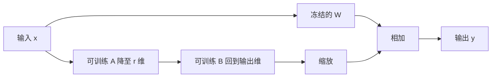
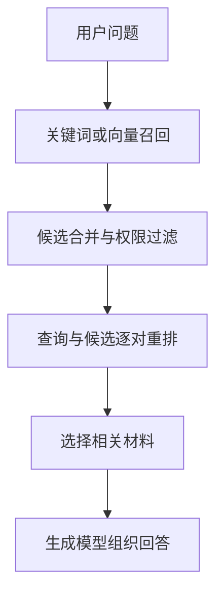

# 模型微调、适配器、LoRA 与矩阵秩：从通用原理到 BGE 案例

首次整理：2026-11-16

最近更新：2026-11-16

类型：原创学习笔记

来源：2026-11-16 关于模型派生、Adapters、Finetunes、LoRA 和秩的学习对话，以及原始论文、框架文档和模型卡。按用户纠正，以通用知识为主线，BGE 仅在后半部分作为实例。

标签：模型微调、Adapters、Finetunes、LoRA、PEFT、线性代数、矩阵秩、训练、部署、BGE、模型选型

本文要回答的是：**如何改变一个预训练模型的行为，怎样少训练一些参数，训练产物如何使用，以及“低秩”到底意味着什么？**这些问题适用于文本生成、分类、检索、重排等多种任务，不属于 BGE 专有知识。

组织原则：先讲通用概念与相互关系，再建立数学直觉，继而解释训练、保存、部署与选型，最后用 BGE 走一遍。所有数字矩阵均为原创教学例子，不是模型真实权重；框架行为与模型配置核对日期为 2026-11-16，Asia/Shanghai。

## 阅读导航

| 知识层次 | 需要回答的问题 | 阅读入口 |
| --- | --- | --- |
| 问题与选择 | 为什么需要微调，是否有更简单的方法？ | [1. 改行为的几种手段](#adaptation) |
| 概念关系 | 微调、全参、PEFT、Adapter、LoRA 是并列关系吗？ | [2. 方法、产物与派生关系](#model-tree) |
| 数学直觉 | 四个不同二维向量为什么秩只有二？ | [3. 秩与线性独立](#rank) |
| 方法原理 | 为什么用 A、B 表示权重变化？ | [4. LoRA 的低秩分支](#lora) |
| 手算 | r=1、r=2 怎样计算，A 四行是什么？ | [5. 矩阵与前向例子](#matrices) |
| 注入位置 | 选的是层、矩阵还是隐藏状态？ | [6. 目标模块选择](#targets) |
| 训练产物 | 参数怎样学出来，保存了什么？ | [7. 训练和保存](#training) |
| 推理部署 | 怎样加载、切换、合并、检查兼容性？ | [8. 使用适配器](#deployment) |
| 成本口径 | 可训练参数、文件、显存为何不同？ | [9. 参数与资源](#cost) |
| 工程决策 | 怎样选择方法、r、位置和模型？ | [10. 选型与验证](#selection) |
| 具体实例 | 上述知识如何映射到 BGE 重排器？ | [11. BGE 实战案例](#bge) |
| 复习 | 原问题、公式、术语与资料 | [12. 复习与来源](#review) |

相关基础：[Transformer 与注意力](2026-11-01-大模型基础学习笔记.md#ch4)、[张量与向量维度](2026-11-01-大模型基础学习笔记.md#sec3-5)、[RAG 检索链路](2026-11-04-RAG检索原理与工程实践.md#pipeline)。正文只维护一份；原 BGE 主题路径保留为兼容入口。

<a id="adaptation"></a>
## 1. 先问要改什么，再决定是否微调

预训练模型已经学到一套参数。面对新任务，我们可能要改变输出格式、适应业务词汇、学习判别边界，或者让模型利用新资料。它们不一定都需要更新权重。

| 手段 | 改变什么 | 适合解决什么 | 不应期待什么 |
| --- | --- | --- | --- |
| Prompt（提示词）与示例 | 本次输入上下文 | 说明目标、格式和临时规则 | 不是永久更新模型参数 |
| RAG（Retrieval-Augmented Generation，检索增强生成） | 本次可读取的外部材料 | 时效知识、可引用证据、私有资料 | 检索到材料不保证模型正确使用 |
| Fine-tuning（微调） | 通过训练优化模型参数或适配参数 | 稳定任务行为、领域表达、分类/排序边界 | 不是可靠地把全部文档写成可查询数据库 |
| 应用侧规则/校验 | 模型外的程序行为 | 权限、数据格式、业务约束 | 不能代替模型本身的理解能力 |

例如：要让回答引用今天的公告，首先考虑检索；要让分类器学会区分企业自定义的投诉类别，可以考虑微调；必须禁止越权访问，则必须由权限系统控制。手段可以组合，不是互斥选项。

微调的一般过程是：输入样本 → 模型前向计算 → 用训练目标计算损失 → 反向传播求梯度 → 优化器更新允许训练的参数。生成任务、分类任务、重排任务可以采用不同的目标和损失，但都需要真实的参数更新，不能把“保存一个文件”当成“完成训练”。

<a id="model-tree"></a>
## 2. 从三个角度区分微调、适配器和模型树

这些概念首先是通用模型工程概念；模型托管平台的标签只是其中一个观察窗口。

需要分别问三个问题：**怎么训练、保存什么、与谁存在派生关系？**

| 角度 | 概念 | 回答的问题 |
| --- | --- | --- |
| 训练过程 | Fine-tuning（微调） | 在已有模型基础上，用新数据继续优化什么？ |
| 更新范围 | Full fine-tuning（全参数微调） | 是否更新全部基座参数？ |
| 更新方法 | PEFT（Parameter-Efficient Fine-Tuning，参数高效微调） | 能否只训练少量参数？ |
| 具体方法 | LoRA（Low-Rank Adaptation，低秩适配） | 用低秩变化量怎样调整已有线性变换？ |
| 交付物 | Adapter（适配器） | 是否只发布需要依附基座的额外参数与配置？ |
| 派生关系 | HF（Hugging Face，模型托管平台）模型树 | 仓库声明由哪个基座、以什么关系派生？ |

**LoRA 训练本身也是微调。**“Adapter vs Finetune”不能简单理解成“一个微调、另一个不微调”。在广义工程用法中，LoRA 产物称为适配器；早期论文中 Adapter 也常特指插入小型非线性模块的方法，不能把两种语境混为一谈。

| 模型树标签 | 一般含义 | 不能仅凭标签推断的事 |
| --- | --- | --- |
| Adapters | 依赖基座加载的适配参数 | 不保证一定是 LoRA，也不保证文件只含 A、B |
| Finetunes | 声明为微调派生模型 | 不保证全参数微调；可能是 LoRA 合并后的完整权重 |
| Merges | 来自多个模型的合并关系 | 不等同于“一套 LoRA 合并回基座”这个保存动作 |
| Quantizations | 低比特表示的派生版本 | 不等于领域训练，也不等于减少参数个数 |

HF 模型树主要依赖模型卡元信息。它是发现线索，不是平台逐一审核训练过程的质量认证。[模型卡元信息说明](https://huggingface.co/docs/hub/model-cards)


### 训练方法不等于保存格式

- 全参数微调：更新整个基座，通常保存完整更新权重，成本较高但可调整范围广。
- 部分参数微调：只解冻一些原有层或任务头，不一定增加新模块。
- 参数高效微调：仅优化少量参数。可以是低秩分支、插入小模块、学习提示向量等，不只 LoRA 一种。
- 经典瓶颈 Adapter：在网络内插入小型模块，常带降维、非线性和升维。它与 LoRA 的线性低秩增量并不是同一个计算结构。[Adapter 原论文](https://arxiv.org/abs/1902.00751)

因此，“适配器”有两个常见语境：广义是可挂接的适配产物；狭义可能指特定的瓶颈模块方法。读论文和工具说明时先识别语境。LoRA 可以单独保存成适配器，也可以合并回完整模型。**同一训练方法可以有不同交付形式，同一交付形式也不能唯一反推出训练方法。**

文件核验顺序：模型卡 → 基座/修订信息 → 配置 → 权重文件 → 调用方式。典型适配器包含 `adapter_config.json` 和 `adapter_model.safetensors`；完整模型常有 `config.json`、完整权重、分词器文件。文件名仍不是绝对保证，须检查配置和实际权重键。

<a id="rank"></a>
## 3. 秩：先分清不同、维度和线性独立

### 3.1 从四个点开始

用户最关键的疑问是：“`[0,0] [0,1] [1,0] [1,1]` 不能表示 4 个方向吗？”

用 `[向右多少, 向上多少]` 表示移动：

| 向量 | 日常含义 | 是否需要新的基础移动方式 |
| --- | --- | --- |
| [0,0] | 不动，零向量没有方向 | 不需要 |
| [0,1] | 向上 | 需要向上 |
| [1,0] | 向右 | 需要向右 |
| [1,1] | 向右上 | 不需要，可由向右＋向上组成 |

它们是四个不同向量、三个非零朝向，但只要两个基础向量就能表示全部：

$$
[1,1]=[1,0]+[0,1],\qquad [0,0]=0[1,0]+0[0,1].
$$

“不同”只是数值不一样；“线性独立”要求一个不能由其他向量的倍数与相加组合出来。线性组合允许正、负、零和小数系数，不只允许正整数步数。

平面上有无数个朝向，但平面的独立自由度只有两个。不要把秩解释为“能表示几个不同结果”，也不要把它等同于向量个数。

### 3.2 正式一点的定义

矩阵的秩是其列空间的维数，也等于其行空间的维数；直观上是最多能找到多少个线性独立的列或行。对 m×n 矩阵，秩不超过 `min(m,n)`。全零矩阵秩为 0。[MIT 线性代数课程：列空间与零空间](https://ocw.mit.edu/courses/18-06-linear-algebra-spring-2010/resources/lecture-6-column-space-and-nullspace/)

不是只检查是否互为倍数。例如 `[1,0]`、`[0,1]`、`[1,1]` 两两不互为倍数，但第三个可由前两个相加，所以三者仍线性相关。

### 3.3 用矩阵乘积理解维度限制

先看一个一般线性代数事实，不依赖任何模型：A 为 4×2，B 为 2×4 时，它们可以相乘得到一个 4×4 矩阵。这为下一章 LoRA 提供基础。

**A 有四行，为什么不提供四个独立方向？**

当 A 为 4×2，四行都是二维向量，最多有两个独立方向；行数多不改变每行只有两个坐标。

在乘积 `AB` 中，看行：

$$
(AB)_{i,:}=A_{i,1}B_{1,:}+A_{i,2}B_{2,:}.
$$

A 的每一行是两个组合系数，乘积的四行都在 B 的两行所张成的空间中。

换成看列：`AB` 的每一列都是 A 的两列的组合。此时 A 的两列提供基础方向，B 给系数。两种视角一致，不是 B 天生有“方向”、A 天生没有。

$$
\operatorname{rank}(AB)\leq\min(\operatorname{rank}(A),\operatorname{rank}(B))\leq r.
$$

这里 r 表示两个矩阵相接的中间维度。r=2 只保证乘积的实际秩不超过 2，不保证一定等于 2。下一章会把这个一般性质用于模型权重的变化量。

<a id="lora"></a>
## 4. LoRA：用低秩变化量调整原有线性变换

为什么需要它？全参数微调让每个权重都能变化，但需要为大量可训练参数维护梯度和优化器状态。LoRA 把目标收窄为：冻结原权重，只学习一个受低秩约束的增量。它不是先训练完整增量再压缩，而是从一开始就训练两个小矩阵。

先统一本文符号。为了与对话中的 `xW` 一致，正文采用**行向量约定**：

$$
x\in\mathbb{R}^{1\times d_{in}},\quad W\in\mathbb{R}^{d_{in}\times d_{out}},\quad y=xW.
$$

普通 LoRA 在选中的线性权重旁添加可训练分支，冻结原 W：

$$
A\in\mathbb{R}^{d_{in}\times r},\quad B\in\mathbb{R}^{r\times d_{out}},\quad
\Delta W=sAB,\quad y=xW+s(xA)B.
$$

其中 `r` 是配置的中间维度，`s` 是缩放系数。标准 LoRA 常取 `s=α/r`；其他变体可能不同，不能把该公式强加给全部方法。[LoRA 论文](https://arxiv.org/abs/2106.09685)



A、B 都是数字参数矩阵，由训练学习，不是两个独立大模型，也不是一个存金融知识、另一个存语言知识。它们的分解通常不唯一：对可逆矩阵 R，`(AR)(R⁻¹B)=AB`，因此不要强行给某一列贴固定语义标签。

**与 PyTorch/论文常用写法的关系：**`torch.nn.Linear` 的权重存为 `[d_out,d_in]`；PEFT 常见 LoRA A 为 `[r,d_in]`、B 为 `[d_out,r]`，合并量写 `BA`。对应本文矩阵转置后就是同一计算。本文教学 A 等于该实现 A 的转置，教学 B 等于实现 B 的转置；不要直接拿本文形状当权重文件形状。[PyTorch Linear](https://docs.pytorch.org/docs/stable/generated/torch.nn.Linear.html)

**低秩约束只限制 ΔW。** 原来的 W 可以仍是满秩，W+ΔW 也可以满秩。r 是超参数，A/B 是学习得到的参数；r 越大代表允许更丰富的调整，不保证测试效果一定提高。

<a id="matrices"></a>
## 5. r=1 与 r=2：从矩阵形状走到输出数值

以下忽略缩放，即令 s=1，所有数字都是教学示例。

### 5.1 r=1

```text
A = [[1],         B = [[2, -1, 0, 3]]
     [0],
     [1],
     [0]]

A: 4×1，B: 1×4
AB = [[2,-1,0,3],
      [0, 0,0,0],
      [2,-1,0,3],
      [0, 0,0,0]]
```

所有非零行均是同一行的倍数，实际秩为 1。令 `x=[1,2,0,1]`：`xA=[1]`，`(xA)B=[2,-1,0,3]`。若原分支 `xW=[10,20,30,40]`，相加得到 `[12,19,30,43]`。

### 5.2 r=2：保留用户的四组系数

```text
A = [[0,0],       B = [[1,2,0,0],
     [0,1],            [0,0,3,4]]
     [1,0],
     [1,1]]

A: 4×2，B: 2×4
AB = [[0,0,0,0],
      [0,0,3,4],
      [1,2,0,0],
      [1,2,3,4]]
```

最后一行等于第 2、3 行之和，第 1 行为零；第 2、3 行独立，所以 AB 的实际秩为 2。四行不同不代表四个独立方向。

r 从 1 变成 2，只是中间表示从一个数变成两个数；输出仍是四个数，ΔW 仍为 4×4，才能加回 W。LoRA 的两次线性变换之间通常不插入非线性激活，否则不能简单合并成一个 AB 权重更新。

<a id="targets"></a>
## 6. LoRA 的位置：模型中的层与参数模块

不是给某个动态隐藏状态加几个数，而是选择模型内的参数模块。

```text
Transformer 第 i 层
├── 注意力
│   ├── Query 查询投影 Wq
│   ├── Key 键投影 Wk
│   ├── Value 值投影 Wv
│   └── 输出投影 Wo
└── FFN（Feed-Forward Network，前馈网络）
    ├── 第一线性变换
    └── 第二线性变换
```

选位置有两维：①哪些层；②每层哪些矩阵。每个被选中的矩阵有独立的 A、B，不是全模型共享一组。

| 实验选择 | 意图 | 边界 |
| --- | --- | --- |
| 所有层的 Q、V | 低参数量起点 | 不是保证最优的规律 |
| 所有注意力投影 | 扩大注意力适配范围 | 更多参数与未合并计算 |
| 再加 FFN 线性层 | 扩大变换能力 | 需要业务验证，不一定更好 |
| 只选最后几层 | 降低可训练参数量 | “后层只管业务知识”不是定律 |
| 分类/打分头 | 保留或改变最终任务 | 必须明确是否训练、怎样保存 |

“隐藏层”这个说法过于宽泛：Transformer 块内部包含多个线性变换、归一化与非线性运算；动态隐藏状态是输入经过这些模块得到的数据，并不是要保存到适配器里的权重。选择位置通常是选择某些块中的某些权重模块。

实际操作要先列出模块完整路径、输入/输出维度，再配置目标、注入适配器，最后检查实际命中清单与可训练参数。不同架构可能叫 query、q_proj，或采用合并 QKV；不能按概念名字照抄。第 11 章给出 BGE 的具体映射。[PEFT LoRA 配置](https://huggingface.co/docs/peft/v0.21.0/package_reference/lora)

<a id="workflow"></a>
<a id="training"></a>
## 7. 训练如何产生适配器文件

### 7.1 “输出适配器”是一次保存动作

1. 加载兼容的基座权重和分词器，记录精确修订。
2. 根据模块路径选择位置，创建各自的 A、B；冻结基座参数。
3. 默认常见初始化让一矩阵随机、另一矩阵为零，使初始 ΔW 为零。不要同时全零初始化，否则标准乘积分支的两侧梯度都可能为零。
4. 用任务数据前向计算，得到分数或其他任务输出并计算损失，反向传播；优化器更新 A、B，以及明确允许训练的其他模块。
5. 保存检查点时，将适配器权重和配置写盘。这不是模型生成了一段“适配器文本”。

```text
adapter/
├── adapter_config.json         # 基座、目标模块、秩、缩放等
├── adapter_model.safetensors   # 各目标位置的 LoRA 参数等
└── README.md                   # 训练和使用说明
```

上面的目录是 Hugging Face PEFT 的典型格式，并非所有框架的统一标准。如果训练了分类头、偏置或其他 `modules_to_save`，适配器文件不一定只有 A、B。只有适配器通常不足以独立推理，仍要匹配基座架构、版本、分词器与目标任务。[PEFT 检查点格式](https://huggingface.co/docs/peft/developer_guides/checkpoint)

### 7.2 训练数据与任务头必须配套

生成模型可学习目标回复；分类器可学习类别标签；重排器可学习查询－文档相关性或相对顺序。LoRA 是“怎样更新参数”的方法，不替你定义任务目标。数据质量、标签口径、损失函数和验证集划分仍然决定训练是否有效。

如果把单分数重排改为三分类，最终头的输出形状和损失也要改变；仅在旧头下面加 LoRA 不能自动完成任务定义。记录哪些参数冻结、哪些更新、哪些保存，并在重载后验证它们都存在。

<a id="deployment"></a>
## 8. 推理与部署：加载、切换、合并与兼容性

### 8.1 基座和适配器共同加载

模型服务先加载兼容基座，再按配置把适配器挂到对应模块。普通前向计算中同时使用原权重分支与低秩分支。一份基座可以服务多个任务适配器，但共享、并发、切换速度及显存管理取决于推理后端，不是适配器文件自动保证的能力。

兼容性至少核对：基座精确修订、架构与模块路径、分词器、词表、目标头、数值精度和框架支持。相同文件大小、相同参数量或同属一个模型家族，都不保证适配器兼容。

### 8.2 合并成完整权重

按本文行向量约定，合并为 `W_merged=W+sAB`。理想精确算术下与两分支相加等价；有限精度、量化、丢弃分支或不受支持的变体可能导致差异。比较前应使用推理模式关闭训练期随机性，并用同一批输入检查分数或输出的容差。

合并之后通常可按普通模型部署，但不再只是切换一个小文件。保留原基座与适配器用于回滚和复现。这个“写回增量”动作不等同于模型托管页面上“多个基座的模型合并关系”。[PEFT 模型合并指南](https://huggingface.co/docs/peft/developer_guides/model_merging)

### 8.3 两种交付方式

| 交付方式 | 优点 | 代价 |
| --- | --- | --- |
| 基座＋独立适配器 | 多业务共用基座文件，易切换版本 | 需严格匹配基座；未合并推理通常有额外计算 |
| 合并后的完整权重 | 普通模型形式部署，支持条件下移除 LoRA 分支开销 | 每套保存完整权重；切换不再只是小文件 |

冻结参数不等于冻结计算：基座仍参与前向，梯度传播通常仍需经过其运算。LoRA 不等于只运行 A、B，更不等于无须加载基座。

<a id="cost"></a>
## 9. 参数量、文件大小与显存不是同一回事

对于 `d_in × d_out` 的权重矩阵：

$$
N_W=d_{in}d_{out},\quad N_{LoRA}=r(d_{in}+d_{out}).
$$

| 原矩阵 | r | 原权重参数 | LoRA 参数 |
| --- | --- | --- | --- |
| 4×4 | 1 | 16 | 8 |
| 4×4 | 2 | 16 | 16 |
| 4×4 | 3 | 16 | 24 |
| 4096×4096 | 2 | 16,777,216 | 16,384 |
| 4096×4096 | 8 | 16,777,216 | 65,536 |

所以不是“两个小矩阵永远省参数”。须让 r 相对输入/输出维度足够小。小矩阵示例主要为了讲清乘法。

FP16（16-bit Floating Point，16 位浮点数）每个参数占 2 字节。约 6 亿参数全用 FP16 保存，理论权重体积为 `600,000,000×2=1.2×10^9` 字节，即 1.2 GB，约 1.12 GiB。权重文件大小不是推理显存，训练还包含激活、梯度、优化器状态和工作区；LoRA 主要减少可训练参数及相关状态，不让总训练显存按同样比例缩小。

<a id="selection"></a>
<a id="evaluation"></a>
## 10. 选型：先控制变量，再比较效果与成本

先建立不微调的基线；任务已经达标就不必增加训练维护成本。若明确需要改变行为，再比较全参数微调、只训任务头/部分原有层、LoRA 等方法。评测目标应先于方法选择。

对 LoRA，再比较：全层 Q/V、全注意力投影、加 FFN、仅后几层。r 可以从小规模候选开始，但 r=8、16 等仅是实验配置，不是通用最优值。比较 r 时记录缩放规则，否则 r 与有效缩放变化会混在一起。

固定训练/验证/测试划分，禁止在测试集上反复选阈值；按文档、用户、实体或时间隔离高度相似样本，避免泄漏。重排数据可包含查询、正例与困难负例；“看起来相似但不回答问题”的负例尤其有用，同时要避免把真实相关文档误标成负例。

评测指标必须随任务变化，不能把检索指标用于所有微调：

| 任务 | 主要检查 |
| --- | --- |
| 分类 | 每类精确率/召回率、混淆矩阵、类别不平衡、概率校准 |
| 检索/重排 | Recall@K（前 K 项召回率）、nDCG（Normalized Discounted Cumulative Gain，归一化折损累计增益）、MRR（Mean Reciprocal Rank，平均倒数排名） |
| 文本生成 | 任务完成、事实依据、格式约束、安全与域外能力，必要时人工盲评 |
| 实体匹配/去重 | 错合并与漏匹配的业务代价、阈值与不同来源的泛化 |

所有任务还应记录延迟、吞吐、显存、长输入截断、域外退化和许可。训练损失下降不证明业务泛化提升。

| 常见误解 | 更准确的说法 |
| --- | --- |
| r=2 表示模型只能给两种答案 | r 限制某个变化矩阵的线性独立方向，不限制结果数量 |
| A 有四行，因此秩为四 | 四行可能相关；4×2 的秩最多为二 |
| LoRA 是先求出完整 ΔW，再压缩 | 标准训练直接优化低秩因子，不先训练完整 ΔW |
| 每个通道就是一个明确领域 | 分解不唯一，不能把通道稳定解释为语义标签 |
| Adapter 与 Finetune 二选一 | LoRA 微调可以输出适配器，也可以合并后输出完整权重 |
| 放在 Finetunes 中就更强 | 标签不是训练质量认证，可能仅转换或缺少说明 |
| 训练头变了仍可按原分数用 | 输出形状、标签、激活与任务目标必须重新核对 |
| 合并后一定毫无误差 | 数学上等价不等于有限精度/量化下逐位一致 |

### 模型托管平台上的选择顺序

先确定任务、目标语言、领域、输入长度和部署预算，再看模型卡、许可、训练数据与评测。任务标签、下载量、点赞数用于发现候选，不是适合你业务的质量证明。优先建立原版基线，确认派生版本究竟改了参数、格式还是输出任务。

保存形式与部署需求也要一起选：多租户多业务可能重视独立适配器的小体积与切换；单一固定任务可能更适合合并完整权重；低比特部署还须单独检查量化与适配器组合支持。没有一套固定 r、目标层或“最好版本”适用于所有任务。

<a id="bge"></a>
## 11. 实战案例：把通用知识映射到 BGE 重排器

### 11.1 先识别基座与任务

BGE（BAAI General Embedding，智源通用向量表示）是检索相关模型系列。BAAI（Beijing Academy of Artificial Intelligence，北京智源人工智能研究院）是发布机构，不是一个叫 BGE 的商业公司。FlagEmbedding 是相关开源工具库。[官方项目](https://github.com/FlagOpen/FlagEmbedding)

| 名称 | 主要作用 | 输入与输出 |
| --- | --- | --- |
| BGE Embedding（向量表示模型） | 从大量内容中召回候选 | 文本 → 向量或其他检索表示 |
| BGE Reranker（重排模型） | 精细比较已经召回的候选 | 查询＋候选文档 → 相关性分数 |
| 生成模型 | 根据资料组织回答 | 问题＋资料 → 回答文本 |

[BGE-M3](https://huggingface.co/BAAI/bge-m3) 支持稠密、稀疏和多向量检索表示；它和 [bge-reranker-v2-m3](https://huggingface.co/BAAI/bge-reranker-v2-m3) 不是同一模型的两个别名。



bge-reranker-v2-m3 是 Cross-Encoder（交叉编码器）：查询和文档一起输入，让两侧词元相互作用，再输出分数。常见用法中，每个查询－文档对独立打分；一次传入候选列表只是批处理，不代表模型让候选彼此交互。训练中使用列表级损失，也不等于推理时同时读取所有候选。

重排无法找回召回阶段漏掉的文档。原始分数经 Sigmoid（S 形函数）映射到 0～1 后，也不自动成为“答案正确概率”。对同一批候选，单调变换不改变排序；拒答阈值要单独校准。

BGE v2-m3 官方配置采用 XLM-RoBERTa 序列分类结构，24 个隐藏层、隐藏维度 1024、中间维度 4096。概念名称 Wq/Wv 不能直接当代码中的路径。[官方配置](https://huggingface.co/BAAI/bge-reranker-v2-m3/blob/main/config.json)

### 11.2 把“选位置”落到真实模块

具体模块名应打印核对，例如：

```python
import torch
from transformers import AutoModelForSequenceClassification
model = AutoModelForSequenceClassification.from_pretrained("BAAI/bge-reranker-v2-m3")
for name, layer in model.named_modules():
    if isinstance(layer, torch.nn.Linear):
        print(name, layer.in_features, layer.out_features)
```

这是检查模板，本文没有加载完整 BGE 执行此代码。不要跨架构照抄 `q_proj`、`query`；有的模型还合并了 QKV 投影。注入后检查 `requires_grad`、可训练参数数目和实际匹配模块。[PEFT LoRA 配置](https://huggingface.co/docs/peft/v0.21.0/package_reference/lora)

对 BGE 的一个 1024×1024 投影，r=8 时为 `8×(1024+1024)=16,384` 个 LoRA 参数。如果假设 24 层都选 Q、V，共 48 组，则为 `786,432` 个；这是配置假设下的 A/B 计数，**不含可训练分类头、偏置或其他模块**，不代表所有 BGE LoRA 都如此。

### 11.3 从通用流程到 PEFT 操作模板

下面是使用 PEFT 框架的操作模板，省略数据集、损失和训练循环，**不是可直接宣称已完成微调的完整训练脚本**。正式项目应固定依赖版本与基座提交，并先运行本章 11.2 节的模块检查。

```python
from transformers import AutoModelForSequenceClassification
from peft import LoraConfig, TaskType, get_peft_model, PeftModel

base_id = "BAAI/bge-reranker-v2-m3"
base = AutoModelForSequenceClassification.from_pretrained(base_id)
cfg = LoraConfig(
    task_type=TaskType.SEQ_CLS,
    r=8, lora_alpha=16, lora_dropout=0.05,
    target_modules=["query", "value"],  # 必须与当前模型实际模块名核对
    bias="none",
    modules_to_save=["classifier"],    # 本例选择训练并保存分类头
)
model = get_peft_model(base, cfg)
model.print_trainable_parameters()

# 此处必须执行真实训练：前向、任务损失、反向、优化器更新、独立评估。
# 没有这一步就只是保存初始化的适配器，而不是领域微调成果。
model.save_pretrained("adapter")

fresh_base = AutoModelForSequenceClassification.from_pretrained(base_id)
loaded = PeftModel.from_pretrained(fresh_base, "adapter")
loaded.eval()
# 路线一：直接使用 loaded，基座 + 适配器共同推理。
# 路线二：在支持合并且精度/设备条件合适时：
merged = loaded.merge_and_unload()
merged.save_pretrained("merged-model")
# 配套分词器也应保存/记录；并验证重载后分数一致性。
```

`merge_and_unload()` 是将学习到的变化加回权重，得到不再依赖这套 LoRA 分支的模型；不是多模型知识融合。合并后仍应保留原始基座与适配器，避免失去可切换性。量化模型、某些变体与部署后端有额外限制。[PEFT 模型合并指南](https://huggingface.co/docs/peft/developer_guides/model_merging)

<a id="directions"></a>
### 11.4 派生模型案例：方法与任务不是一回事

以下是本轮模型卡核验后的代表分类，不是全量排名。数据量、用途和效果声明属于作者报告；“样例推断”仅表示公开样例支持该判断，不证明完整数据集都属于该领域。

| 方向 | 代表模型 | 已知边界 |
| --- | --- | --- |
| 韩语检索 | [dragonkue/bge-reranker-v2-m3-ko](https://huggingface.co/dragonkue/bge-reranker-v2-m3-ko) | 韩语优化；金融是所列评测场景，不能当成已证实的金融训练集 |
| 越南语检索 | [AITeamVN/Vietnamese_Reranker](https://huggingface.co/AITeamVN/Vietnamese_Reranker) | 作者称约 110 万三元组；Legal Zalo 是评测，不是训练来源 |
| 土耳其语适配 | [seroe/bge-reranker-v2-m3-turkish-triplet](https://huggingface.co/seroe/bge-reranker-v2-m3-turkish-triplet) | 公开三元组样例偏电信套餐，不能外推任意土耳其语任务 |
| 中文笔记匹配 | [steerrec/bge-reranker-v2-m3-query-note](https://huggingface.co/steerrec/bge-reranker-v2-m3-query-note) | 约 77 万训练样本；中文社交笔记方向来自样例，不等同企业知识 |
| 法律领域 | [Nalyd1908/bge-reranker-v2-m3-luatvn](https://huggingface.co/Nalyd1908/bge-reranker-v2-m3-luatvn) | 越南法律重排；不等于中文法律模型 |
| 多跳问答 | [OloriBern/musique-bge-m3-2000](https://huggingface.co/OloriBern/musique-bge-m3-2000) | 同作者多个数据集/规模/组合实验，不是多个行业 |
| 地点搜索 | [amazon/poiss-bge-m3-reranker](https://huggingface.co/amazon/poiss-bge-m3-reranker) | 把地点距离、质量等信号加入输入；业务相关性不止语义相似 |
| 多语言上下文裁剪 | [naver/xprovence-reranker-bgem3-v1](https://huggingface.co/naver/xprovence-reranker-bgem3-v1) | 保留句子并维持重排；需单独核查衍生许可，不继承“基座可商用”的结论 |
| 中英高亮/裁剪 | [zilliz/semantic-highlight-bilingual-v1](https://huggingface.co/zilliz/semantic-highlight-bilingual-v1) | 已移除原重排头，不能当同接口重排器直接替换 |
| 地址匹配 | [pujithapsx/address-crossencoder-bge-reranker-v2-m3-finetuned](https://huggingface.co/pujithapsx/address-crossencoder-bge-reranker-v2-m3-finetuned) | 判断是否同一地址，不是问答相关性 |
| 姓名匹配 | [kallilikhitha123/bge-reranker-name-finetuned-2403](https://huggingface.co/kallilikhitha123/bge-reranker-name-finetuned-2403) | 姓名变体匹配，不是文档排序 |
| 新闻去重 | [afafos/trade-news-dedup-bge-reranker-v2-m3](https://huggingface.co/afafos/trade-news-dedup-bge-reranker-v2-m3) | 事件级匹配；作者披露评测集调阈值会使成绩偏乐观 |
| 回答忠实度 | [jismsy/ko-hallucheck-v3](https://huggingface.co/jismsy/ko-hallucheck-v3) | 对上下文的支持关系分类，不是可靠的世界事实验证 |
| 数据库结构匹配 | [treprepr/reranker-bird-evidence-finetuned](https://huggingface.co/treprepr/reranker-bird-evidence-finetuned) | 样例是问题与表结构/字段匹配；BIRD 具体数据版本未核实 |

还有一组不能算“新领域微调”：

- [qilowoq/en-ru](https://huggingface.co/qilowoq/bge-reranker-v2-m3-en-ru)：英俄词表裁剪，不是证实的英俄继续训练。
- [sridhariyer/openvino](https://huggingface.co/sridhariyer/bge-reranker-v2-m3-openvino)：OpenVINO 推理格式转换。
- [netandreus/bge-reranker-v2-m3](https://huggingface.co/netandreus/bge-reranker-v2-m3)：作者明确没有微调，主要适配部署。
- [Jarbas/m2v-256](https://huggingface.co/Jarbas/m2v-256-bge-reranker-v2-m3)：静态向量蒸馏，任务与架构已经变化。
- [kkresearch/korean-finance](https://huggingface.co/kkresearch/bge-reranker-v2-m3-korean-finance)：名称提示韩语金融，但模型卡训练信息是占位内容，不能确认训练方向和效果。

结论：模型数不等于独立方向数；同一作者的五折交叉验证、多个检查点、转载和格式转换会使仓库数量膨胀。

### 11.5 针对 RAG 的组件选型

RAG（Retrieval-Augmented Generation，检索增强生成）需要分别选召回、重排和生成组件，而不是搜索一个万能“RAG 模型”。

1. 明确任务、语言、领域、输入长度、许可与资源预算。
2. 找召回模型时看 sentence-similarity/feature-extraction；找重排时看 text-ranking，并同时搜索 reranker。任务标签不统一，BGE 卡片可能标为 text-classification。
3. 先识别原作者基座，再检查派生版本的新增数据、训练目标和输出形式。
4. 下载量与点赞用于发现候选，不等于中文业务质量排行榜。
5. 公开榜单看目标语言、检索子任务和测试条件；最终用独立业务数据比较。
6. 固定切分、候选池和评测方式，分别替换 Embedding 与 Reranker，避免同时改很多变量。

最低限度检查：相关文档能否进入召回前列、重排是否把答案排前、延迟/显存是否可接受、权限与过期过滤是否正确。查询和文档向量应使用兼容的模型版本与编码配置；重排模型则不要求与召回模型来自同一机构。

<a id="review"></a>
## 12. 原问题回顾、公式与术语

### Q1. 适配器就是微调出来的额外参数吗？

对 LoRA 大体如此，但交付物还包括配置，也可能包含额外训练的分类头等；不是独立完整模型。

### Q2. LoRA 位置是某一个隐藏层吗？

应同时确定第几层、层内哪个参数模块；每个目标矩阵分别挂一组 A/B。[选位置](#targets)

### Q3. A、B 是什么，为什么不是一个矩阵？

两个可训练线性映射，以低维中间通道表示权重变化。小 r 约束表达范围，换取更少参数。[公式](#lora)

### Q4. r=2 时 A、B 长什么样？

本文行向量约定下，原 W 为 4×4 时，A 为 4×2、B 为 2×4，相乘仍为 4×4。[手算](#matrices)

### Q5. 四个不同向量不是四个方向吗？

可以是不同朝向，但秩数的是独立方向。零向量无方向，右上可以由右＋上构成。[核心反例](#rank)

### Q6. A 有四行，为什么不是四个基础方向？

每行只有两个坐标，最多两个独立方向；乘积的每行是 B 两行的组合。看列则由 A 两列提供基础。[行列对偶](#rank)

### Q7. r 与实际秩一定相等吗？

不一定，实际秩≤r。参数退化、重复或初始化为零都会使实际秩更小；约束的是 ΔW。

### Q8. A×B 与 B×A 哪个正确？

要看向量及存储约定。本文用 xW 与 AB；PyTorch 权重转置存储常写 BA。维度一致才有意义。

### Q9. 保存适配器就是完成微调了吗？

不是。没有损失、反向与参数更新，保存的是初始化参数；需验证训练、重载与效果。[训练和保存](#training)

### Q10. 为什么基座相同的派生模型可能不是同一种任务？

可以改变输出头和目标，成为高亮、实体匹配或忠实度分类器。基座相同不保证任务与接口相同。

### Q11. 合并 LoRA 后仍需要适配器吗？

合并权重用于推理时通常不再需要该独立适配器；但保留原适配器有利于复现和切换。

### Q12. 微调、量化、裁剪、蒸馏有何区别？

微调优化任务参数；量化降低数值表示位数；裁剪移除部分结构或词表；蒸馏把教师行为转移给学生模型。它们可以组合，不能仅凭仓库名字互相等同。

### 公式速查

- 行向量：`y=xW+s(xA)B`，`ΔW=sAB`。
- 形状：`A[d_in,r]`，`B[r,d_out]`。
- 参数：`r(d_in+d_out)`，不含其他可训练模块。
- 秩：`rank(AB)≤min(rank(A),rank(B))≤r`。
- 存储：参数数目 × 每参数字节数；不等于运行显存。

### 术语速查

| 术语 | 中文理解 |
| --- | --- |
| Base model | 基座模型，适配的起点 |
| Adapter | 适配器，依赖基座的适配参数/模块 |
| Fine-tuning | 微调，在已有模型上继续优化 |
| LoRA | Low-Rank Adaptation，低秩适配 |
| PEFT | Parameter-Efficient Fine-Tuning，参数高效微调 |
| Rank | 秩，行/列空间中独立方向的数量 |
| Linear combination | 线性组合，向量乘系数后相加 |
| Target modules | 目标模块，实际注入适配参数的位置 |
| Checkpoint | 检查点，训练状态或权重快照；适配器保存不一定含完整优化器状态 |
| Merge | 合并，将适配变化写回权重；与模型树多源合并关系应区分 |
| Hard negative | 困难负例，表面相似但不应排前的候选 |

### 来源与验证边界

概念依据：[瓶颈 Adapter 原论文](https://arxiv.org/abs/1902.00751)、[LoRA 原论文](https://arxiv.org/abs/2106.09685)、[PEFT LoRA 配置](https://huggingface.co/docs/peft/v0.21.0/package_reference/lora)、[检查点格式](https://huggingface.co/docs/peft/developer_guides/checkpoint)、[合并指南](https://huggingface.co/docs/peft/developer_guides/model_merging)、[PyTorch Linear](https://docs.pytorch.org/docs/stable/generated/torch.nn.Linear.html)、[MIT 线性代数](https://ocw.mit.edu/courses/18-06-linear-algebra-spring-2010/resources/lecture-6-column-space-and-nullspace/)。社区用途依据第 11 章各模型卡，不替作者补造数据。

本文完成本地矩阵乘法、秩、参数计数、代码语法和仓库链接/锚点校验；没有下载完整模型、训练适配器、验证 PEFT 模板在指定硬件上的端到端行为，也没有独立重现社区模型评分。实践前应锁定模型修订和依赖版本，核查 LICENSE、输出契约和数据使用权限。
