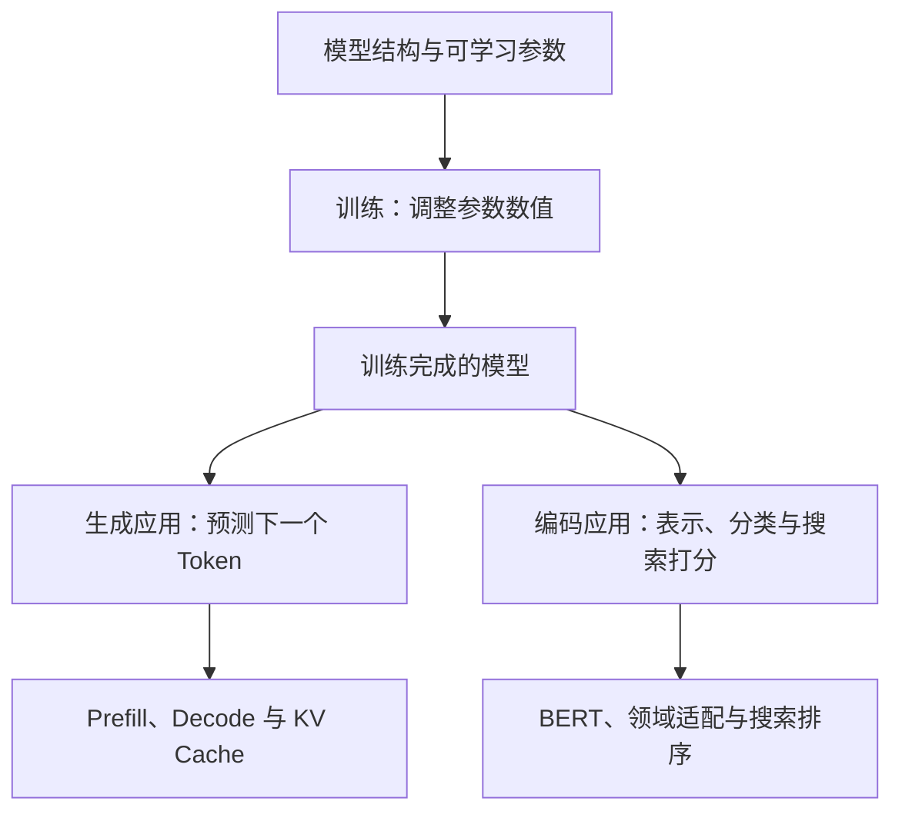
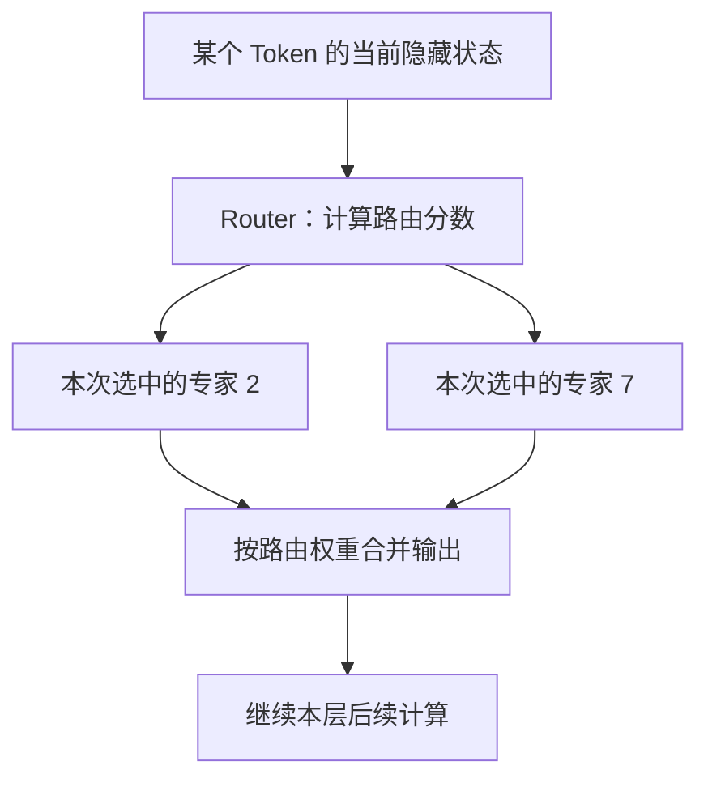
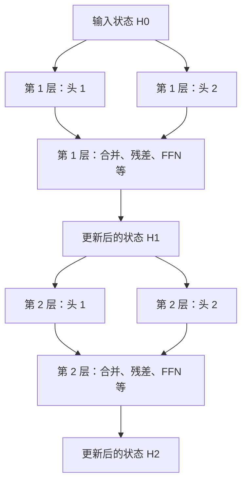
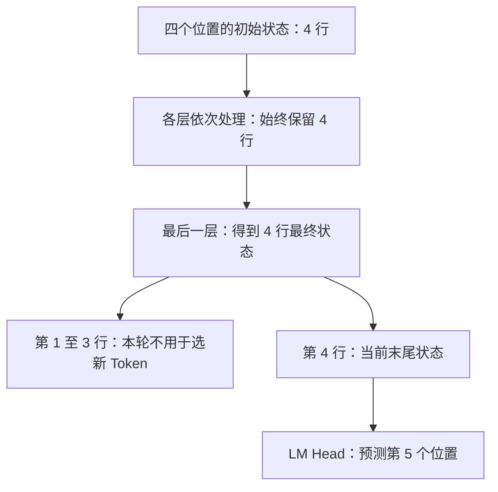
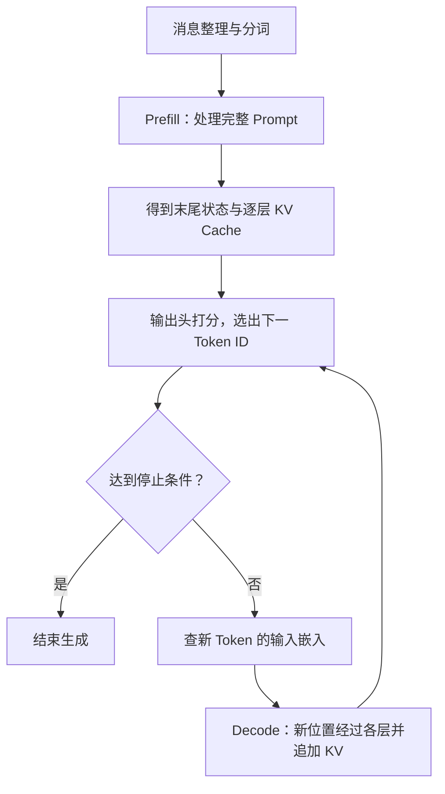
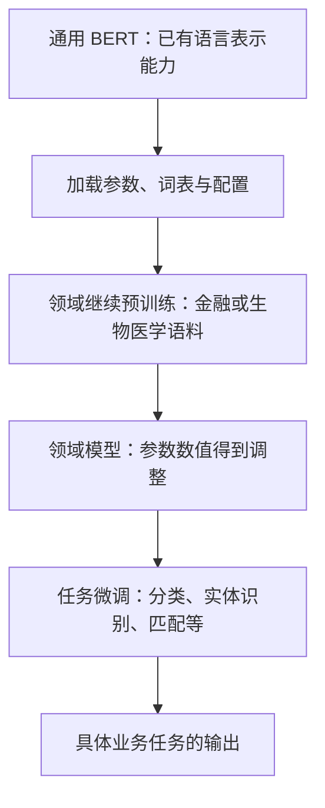
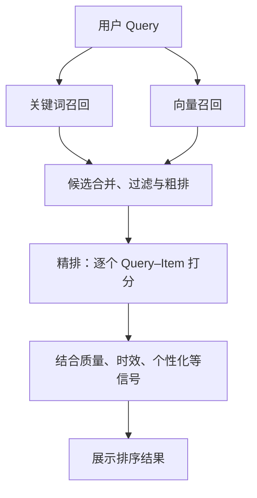

# 大模型学习笔记：从参数、注意力到完整推理流程

> 整理范围：本次会话中关于 BERT、领域模型、搜索排序、M6、参数规模、MoE、QKV、多头、多层、下一 Token 预测、Prefill 和 KV Cache 的全部学习问题。  
> 整理日期：2026-11-01。模型规模使用明确版本的公开资料作为例子，不代表当前性能排名。  
> 格式说明：流程图使用 Mermaid，公式使用 LaTeX；在支持 Mermaid 与数学公式的 Markdown 阅读器中可渲染。  
> 阅读目标：能说清楚“哪些东西提前训练好，哪些东西现场计算；一个 Prompt 如何变成第一个 Token，再变成完整回答”。

## 阅读导航

第一次阅读建议按章节顺序；复习时可以先看第 12 章的问答，再回到对应章节。

| 章节 | 解决的问题 |
| --- | --- |
| [1. 模型、参数与训练](#ch1) | 参数到底是什么？数量和数值分别由谁决定？ |
| [2. 总参数、激活参数与激活函数](#ch2) | 为什么总参数很多，每个 Token 只用一部分？ |
| [3. Token、位置与五种容易混淆的对象](#ch3) | Token ID、嵌入向量、隐藏状态和输出向量有什么区别？ |
| [4. QKV 与注意力](#ch4) | Q 在找什么？融合出的向量是什么？ |
| [5. 多头、多层与残差连接](#ch5) | 头和层怎样分工？层与层到底传什么？ |
| [6. 从最终状态到下一个 Token](#ch6) | 如何给整个词表打分？选出 ID 后怎样变成文字？ |
| [7. Prefill 的完整过程](#ch7) | Prompt 如何并行经过所有层，得到第一个 Token？ |
| [8. Decode 与 KV Cache](#ch8) | 后续 Token 如何逐个生成？为什么不用重算整个前缀？ |
| [9. BERT、FinBERT 与 BioBERT](#ch9) | BERT 开源了什么？领域模型怎么训练出来？ |
| [10. BERT 在搜索中的使用](#ch10) | 双塔召回和交叉编码排序怎样给 Item 打分？ |
| [11. M6 与 BERT 的关系](#ch11) | “基于 BERT”到底可能指什么？ |
| [12. 学习过程中的问答归档](#ch12) | 逐题复盘本次会话的疑问 |
| [13. 公式与术语速查](#ch13) | 忘记符号和术语时快速定位 |
| [14. 来源与后续学习](#ch14) | 查阅原始论文、官方实现和文档 |

这套知识可以归成两条相连的线：



**贯穿全文的一条边界：训练改变模型参数；普通推理主要改变当前输入对应的中间状态。** 后文说一个位置“吸收了前文信息”，指它的表示被计算更新，并不表示模型当场修改了权重。

<a id="ch1"></a>
## 1. 模型、参数与训练

<a id="sec1-1"></a>
### 1.1 一个模型不只是一份代码

可以把模型理解为：**一套计算结构，加上一组训练得到的数值。** 真正运行还需要分词器和配置信息等。

| 对象 | 通俗解释 | 例子 |
| --- | --- | --- |
| 模型架构 Architecture | 规定有哪些部件、怎样连接 | 多少层、隐藏维度多大、是否使用 MoE |
| 实现代码 | 把结构变成可执行程序 | Attention、训练循环、推理循环 |
| 参数 Parameters | 计算中可通过训练调整的数值 | 权重矩阵、偏置、嵌入表中的数值 |
| 配置 Configuration | 描述结构和运行约定 | 层数、头数、词表大小 |
| 分词器 Tokenizer | 文字与 Token ID 之间的转换规则 | 一段文字对应哪些 ID |
| 训练数据 | 用来学习的样本 | 通用文本、金融新闻、医学文献 |
| 当前输入与中间状态 | 本次计算现场产生的数据 | Prompt、QKV、隐藏状态、KV Cache |

代码公开、权重公开、训练数据公开，是不同的问题；许可证也可能分别适用。

<a id="sec1-2"></a>
### 1.2 参数是一个个可学习的数

先看一个只有三个参数的小模型：

$$
z=w_1x_1+w_2x_2+b
$$

其中，$x_1,x_2$ 是输入；$w_1,w_2$ 是权重；$b$ 是偏置。假设训练之后：

$$
w_1=2,\quad w_2=-1,\quad b=0.5
$$

输入 $x_1=3,x_2=4$，得到：

$$
z=2\times3-1\times4+0.5=2.5
$$

这里有 **3 个参数**。把 $w_1$ 从 2 调成 200，参数仍然是 3 个，只是其中一个数的值改变了。

大模型做的是大量矩阵计算。一个有 $a$ 行、$b$ 列的可学习矩阵，就包含 $a\times b$ 个标量参数。所谓“70 亿参数”，可以先理解成“模型里存着约 70 亿个可学习的数”。

但不能理解成“一参数对应一个知识点”：知识与能力通常分布在许多参数以及它们的组合中，同一组参数也会参与许多任务。

<a id="sec1-3"></a>
### 1.3 B、M、T 是数量单位

| 单位 | 英文 | 数量 | 中文读法示例 |
| --- | --- | --- | --- |
| M | Million | $10^6$ | 110M = 1.1 亿 |
| B | Billion | $10^9$ | 7B = 70 亿；70B = 700 亿 |
| T | Trillion | $10^{12}$ | 1T = 1 万亿 |

参数数量不是文件大小。只计算权重的原始存储量时，可以粗略估算：

$$
\text{权重字节数}\approx\text{参数数量}\times\frac{\text{每个参数的位数}}8
$$

例如，7B 个参数按每个 2 字节存储，约为 14 GB，使用十进制单位。实际运行还需要 KV Cache、临时张量等空间；量化和文件格式也会影响大小。

<a id="sec1-4"></a>
### 1.4 参数在训练前设计，还是训练时学到？

**参数的数量与形状，通常由训练前选定的架构决定；参数的具体数值，主要在训练中学到。**

例如，一个输入 8 维、输出 4 维、带偏置的线性层：

$$
y=xW+b
$$

权重 $W$ 包含 $8\times4=32$ 个数，偏置包含 4 个数，所以共 36 个参数。开始训练之前，就能算出这个数量。

整个模型的参数量，就是把各部件中独立的可学习数值加起来。若两个部件共享同一组权重，计数时不重复计算。

| 项目 | 什么时候确定 | 训练时通常发生什么 |
| --- | --- | --- |
| 层数、隐藏维度、FFN 宽度 | 架构设计时 | 标准训练中保持不变 |
| 注意力头数、专家数、路由设置 | 架构设计时 | 标准训练中保持不变 |
| 权重矩阵的形状 | 创建模型时 | 标准训练中保持不变 |
| 权重矩阵中的数值 | 初始化，然后训练 | 通过梯度持续调整 |
| 当前文本的 QKV、隐藏状态 | 每次前向计算时 | 随输入、位置、层而变化 |

从零预训练时，许多权重会随机初始化，另一些按固定规则初始化；继续训练已有模型时，则加载已有权重作为起点。

训练的简化过程是：用当前参数预测，计算与正确目标的差距，再调整参数。用公式表示一次最基础的梯度更新：

$$
\theta\leftarrow\theta-\eta\nabla_\theta\mathcal L
$$

$\theta$ 表示所有可学习参数，$\mathcal L$ 是损失函数 Loss，$\eta$ 是学习率 Learning Rate。真实训练通常使用更复杂的优化器，但“利用误差调整参数”这个核心不变。

<a id="sec1-5"></a>
### 1.5 事先怎样决定训练多少参数？

这是一项受约束的设计工作，通常要一起考虑：

1. **用途与部署目标**：做轻量搜索编码器，还是通用生成模型？最终部署硬件能承受多大模型？
2. **训练预算**：GPU 数量、训练时间和资金能支持多大的计算量？
3. **数据**：有多少高质量训练 Token，覆盖什么领域，是否足以把模型训练好？
4. **结构选择**：深度、宽度、稠密或 MoE、共享参数等怎样搭配？
5. **小规模实验与预测**：先做较小模型的实验，结合 Scaling Laws（缩放规律）估计更大规模的效果，再确定方案。

因此，通常不是“模型发现知识装不下，于是在训练中自动多长几层”。训练更多样本，也不等于自动增加参数数量。

Chinchilla 的研究提供了一个值得记住的例子：在特定训练预算下，70B 模型通过更充分的数据训练，表现可以超过训练不足的更大模型。它说明参数、数据与算力要协调，不能只看参数越大越好。[S16](#s16)

<a id="sec1-6"></a>
### 1.6 怎样理解“目前最先进模型有多少参数”？

这是一个带日期、带评测口径的问题。“最先进”不能只用参数量定义，不少闭源模型也不公开准确参数。

下面只记录**有明确版本的规模例子**，用于建立数量感；它们不构成 2026 年的最新模型榜单。

| 模型版本 | 结构或用途 | 公开的规模信息 | 阅读时要注意 |
| --- | --- | --- | --- |
| BERT-Base | 编码器 | 约 110M，即 1.1 亿 | 原始经典配置 |
| BERT-Large | 编码器 | 约 340M，即 3.4 亿 | 原始经典配置 |
| Llama 3.1 405B | 稠密生成模型 | 405B，即 4050 亿 | 公开权重，使用其专门许可证 |
| DeepSeek-V3 主模型 | MoE 生成模型 | 总计 671B，每 Token 激活约 37B | 总参数与激活参数是两种口径 |
| GPT-4，原始技术报告 | 闭源模型 | 未披露精确参数规模 | 不能把网络传闻写成官方数值 |

来源：[S1](#s1)、[S14](#s14)、[S17](#s17)、[S18](#s18)。以后复习或比较新模型时，至少同时记下：**模型版本、公开日期、总参数、每 Token 激活参数、是否公开权重及许可证**。

<a id="ch2"></a>
## 2. 总参数、激活参数与激活函数

<a id="sec2-1"></a>
### 2.1 稠密模型与 MoE

在常见的稠密模型 Dense Model 中，每个 Token 基本都经过同一套主要网络。

MoE 的全称是 **Mixture of Experts，混合专家模型**。在一些层里，模型设置多个专家网络，由 Router（路由器）根据当前输入，选择少数专家参与计算。专家常用于替换或扩展 FFN 部分；Attention 等部分仍可能共享使用。

“专家”是一个个可学习的子网络，不必对应人类预先命名的“金融专家”“医学专家”。它们的分工是在训练中形成的，而且可能不容易用一个领域标签描述。



图中专家编号只是例子。下一 Token、下一层，都可能选择其他专家。

<a id="sec2-2"></a>
### 2.2 总参数 X、激活参数 Y 分别是什么意思？

**总参数 Total Parameters**：整个模型拥有的参数数量，包括本次没有使用的专家参数。

**激活参数 Active / Activated Parameters**：通常指处理一个 Token 时，其所走计算路径涉及的参数规模。准确统计仍要看发布方的口径。

用一个简化模型理解。假设全部 MoE 层合计可以抽象为：

- 共享部分：20B 参数；
- 专家部分：8 份，每份 100B；
- 每个 Token 在相应路由中使用其中 2 份。

那么：

$$
N_{\text{total}}=20+8\times100=820\text{B}
$$

$$
N_{\text{active}}\approx20+2\times100=220\text{B}
$$

更一般的玩具公式是：

$$
N_{\text{total}}\approx S+EP,\qquad
N_{\text{active}}\approx S+kP
$$

$S$ 是共享部分参数量，$E$ 是专家总份数，$P$ 是每份专家参数量，$k$ 是每 Token 选中的份数。真实模型需要逐层统计，可能还有共享专家、不同类型层以及不同统计约定。

这里的“激活”通常是**按 Token**说的。整段 Prompt 包含很多 Token，它们合起来可能使用更多专家，甚至覆盖全部专家。

DeepSeek-V3 公布的 671B 总参数、37B 每 Token 激活参数，就是理解这两个口径的真实例子。[S14](#s14)

<a id="sec2-3"></a>
### 2.3 激活少，是否只需存那一小部分参数？

不能这样直接推断。

不同 Token 可能调用不同专家，所以服务系统需要能访问模型的全部相关权重。权重可以分布在多张 GPU、多个节点，或通过卸载等方式管理，具体显存占用取决于部署方案。

因此：

- **总参数**有助于理解模型总体存储规模；
- **每 Token 激活参数**有助于理解一次 Token 计算的规模；
- **实际速度与成本**还受显存带宽、跨设备通信、批处理和实现影响，不能简单按两者比例换算。

对稠密模型说“基本全部参数参与”也是工程上的概括，并不表示每个 Token 都会逐项使用嵌入表中每一行。

<a id="sec2-4"></a>
### 2.4 激活参数和激活函数有关系吗？

这是两个不同层面的概念。

**激活函数 Activation Function** 是对中间数值进行变换的函数，用来引入非线性。例如：

$$
\operatorname{ReLU}(z)=\max(0,z)
$$

输入 $-2$，输出 0；输入 3，输出 3。Transformer 的 FFN 中也会使用 GELU、SiLU 等激活函数或相应的门控结构。

| 概念 | 在回答什么问题 | 例子 |
| --- | --- | --- |
| 激活参数 | 这次 Token 的路径涉及多少模型参数？ | MoE 只调用部分专家 |
| 激活函数 | 怎样变换一个中间数值？ | ReLU、GELU、SiLU |
| 激活值 Activations | 当前输入计算出了什么中间结果？ | 隐藏状态、FFN 中间输出 |

一个 ReLU 输出变成 0，并不代表前面用到的权重突然不算参数，也不能据此说这个位置“激活参数为 0”。

<a id="ch3"></a>
## 3. Token、位置与五种容易混淆的对象

<a id="sec3-1"></a>
### 3.1 先约定全文的例子

我们用下面这句话解释生成过程：

> 法国 的 首都 是

为了看清四个位置，**假设**分词结果恰好是：

| 位置 | 1 | 2 | 3 | 4 | 待生成的位置 5 |
| --- | --- | --- | --- | --- | --- |
| Token | 法国 | 的 | 首都 | 是 | 未知，可能是“巴黎” |

这只是教学分词。真实 Tokenizer 不一定这样切分，“巴黎”也不一定是一个 Token。

**Token（词元）不是“一个完整汉字或一个完整单词”的同义词。** 它可能是一个字、一个词、词的一部分、标点、字节片段或特殊标记。

<a id="sec3-2"></a>
### 3.2 五种对象要分开记

| 对象 | 本文符号 | 它是什么 | 是否随当前上下文改变 |
| --- | --- | --- | --- |
| Token ID | $x_i$ 或 $j$ | 词表中某个 Token 的整数编号 | 选定 Token 后，其 ID 固定 |
| 输入嵌入向量 | $e_j=E[j,:]$ | 从输入嵌入表按 ID 查出的一行数 | 普通固定嵌入表中，同一 ID 查出同一行 |
| 某层隐藏状态 | $h_i^{(\ell)}$ | 位置 $i$ 经过第 $\ell$ 层后的表示 | 会，取决于输入、位置和层 |
| Q、K、V 向量 | $q_i,k_i,v_i$ | 从本层输入投影出的注意力计算材料 | 会，而且每层、每头不同 |
| 输出层候选向量 | $u_j=U[j,:]$ | 输出头中，用来给候选 Token $j$ 打分的权重行 | 推理时通常固定 |

最容易混的是 **输入嵌入 $e_j$** 和 **上下文隐藏状态 $h_i^{(\ell)}$**。

例如，“银行”作为 Token ID 输入时，可以查出一个固定的初始嵌入；它出现在“去银行取钱”或“河边的银行大楼”中，经过上下文计算后的隐藏状态会不同。模型对具体语境的处理，体现在这些动态表示中。

<a id="sec3-3"></a>
### 3.3 层与层之间传递的是隐藏状态矩阵

设 Prompt 有 $n$ 个 Token，模型隐藏维度是 $d$。忽略批次维度后，一层的主要输入、输出通常都是：

$$
H^{(\ell)}\in\mathbb R^{n\times d}
$$

每一行对应一个位置的向量。为了书写方便，本文把单个位置向量视作行向量。

四个位置、每个向量 8 维时：

| 阶段 | 主要状态的形状 | 含义 |
| --- | --- | --- |
| 嵌入后的初始状态 $H^{(0)}$ | $4\times8$ | 四个位置各有一个初始表示 |
| 第一层输出 $H^{(1)}$ | $4\times8$ | 四个位置各更新了一次 |
| 第二层输出 $H^{(2)}$ | $4\times8$ | 利用上一层结果继续处理 |
| 最后一层输出 $H^{(L)}$ | $4\times8$ | 四个位置各有最终状态 |

**Attention 会混合信息，但不会因此把四个位置压缩成一个位置。** 每个位置分别发起自己的读取，分别得到自己的输出向量。

<a id="sec3-4"></a>
### 3.4 模型怎样知道顺序？

模型还需要位置信息 Position Information。

有的模型把位置嵌入加到 Token 嵌入上；有的使用 RoPE（Rotary Position Embedding，旋转位置编码）等方式，在注意力计算中体现位置关系。因此，不能把“所有模型都先做词向量加位置向量”当成统一规则。

后文用 $H^{(0)}$ 表示准备好输入后的初始状态，具体位置机制按模型而定。

<a id="ch4"></a>
## 4. QKV 与注意力

<a id="sec4-1"></a>
### 4.1 Q、K、V 各是什么？

Q、K、V 的全称分别是：

- **Query，查询向量**：这个位置此次读取其他位置时，使用什么匹配条件？
- **Key，键向量**：这个位置提供什么用于被匹配的特征？
- **Value，值向量**：如果读到这个位置，取走什么信息？

可以借用资料检索的比喻：Q 像检索条件，K 像可供检索的线索，V 像读到的内容。但在模型里，它们都是数值向量，不是三句自然语言。

对一个位置的本层输入向量 $r_i$，简化写成：

$$
q_i=r_iW_Q,\qquad k_i=r_iW_K,\qquad v_i=r_iW_V
$$

$W_Q,W_K,W_V$ 是训练得到的权重；$q_i,k_i,v_i$ 是本次输入现场算出来的结果。真实实现可能先做归一化，并在 Q、K 上施加位置变换，式子省略了这些细节。

**可学习的是投影矩阵 $W_Q,W_K,W_V$；当前文本对应的 Q、K、V 不是提前训练好的固定表。**

<a id="sec4-2"></a>
### 4.2 预测未知的下一个 Token，用谁的 Q？

对于“法国 / 的 / 首都 / 是”，当前位置是第 4 个已知 Token“是”。模型先计算这个已知位置的表示，用它预测第 5 个位置。

因此，计算中使用的是：

> 已知位置“是”的 Q，与本层中“法国、的、首都、是”的 K 计算匹配分数，再读取它们的 V。

这里包括“是”自己的 K、V。标准因果自注意力允许读自身和此前位置。

未知的第 5 个 Token 此时还没有选出来，没有它的输入嵌入，也就没有它在这一轮的 QKV。词表里的候选 Token 也不是此处注意力要检索的 K 表。

<a id="sec4-3"></a>
### 4.3 注意力的完整公式

对一个头，位置 $t$ 读取位置 $i$ 的分数为：

$$
s_{ti}=\frac{q_tk_i^\top}{\sqrt{d_k}}+m_{ti}
$$

其中 $d_k$ 是该头的 Q、K 维度。因果掩码 Causal Mask 为：

$$
m_{ti}=\begin{cases}
0,&i\le t\\
-\infty,&i>t
\end{cases}
$$

然后在**可见的上下文位置之间**做 Softmax：

$$
\alpha_{ti}=\frac{\exp(s_{ti})}{\sum_{r\le t}\exp(s_{tr})}
$$

最后对 V 加权求和：

$$
a_t=\sum_{i\le t}\alpha_{ti}v_i
$$

批量矩阵形式是：

$$
\operatorname{Attention}(Q,K,V)
=\operatorname{softmax}\left(\frac{QK^\top}{\sqrt{d_k}}+M\right)V
$$

点积得到匹配分数；除以 $\sqrt{d_k}$ 有助于控制分数尺度；Mask 限制可见范围；Softmax 把分数变成加权比例。这些比例的和为 1。

<a id="sec4-4"></a>
### 4.4 融合出的新向量，到底是什么？

它是**这个注意力头针对当前位置，从可见上下文读回的一份信息表示**。

例如，假设某一层某一个头，在“是”这个位置算出了以下权重：

| 被读取的位置 | 法国 | 的 | 首都 | 是 |
| --- | --- | --- | --- | --- |
| 注意力权重 | 0.40 | 0.05 | 0.40 | 0.15 |

取一组便于手算的二维 V，纯属教学示意：

$$
v_1=[2,0],\quad v_2=[0,0],\quad v_3=[0,4],\quad v_4=[1,1]
$$

那么读回的向量是：

$$
\begin{aligned}
a_4
&=0.40[2,0]+0.05[0,0]+0.40[0,4]+0.15[1,1]\\
&=[0.95,1.75]
\end{aligned}
$$

这个新向量是两个数字组成的**中间结果**。它把不同位置提供的信息按本次读取需要合成了一份消息，尚不是“巴黎”的 Token ID，也不是一份已经能直接显示的文字。

在真实模型中，向量往往有很多维，特征也分布在多个维度中。我们不能把上例第一维直接宣称为“国家知识”，第二维直接宣称为“首都知识”。这些维度如何配合，取决于训练得到的数值结构。

它接下来还会经过：多头合并、输出投影、残差连接、FFN 等本层计算，再作为后续层输入的一部分。经过全部层，才得到用于下一 Token 打分的最终状态。

<a id="sec4-5"></a>
### 4.5 两次 Softmax，分别在不同对象之间分配权重

| 所在位置 | Softmax 的对象 | 结果含义 |
| --- | --- | --- |
| 注意力内部 | 当前可见的上下文位置 | 读取每个位置的 V 时给多少权重 |
| 语言模型输出端 | 整个词表的候选 Token | 下一个 Token 的预测概率分布 |

“更关注‘法国’”不等于“下一 Token 是‘法国’的概率更大”。前者是读取上下文的比例，后者要经过后续网络和词表打分才能得到。

<a id="ch5"></a>
## 5. 多头、多层与残差连接

<a id="sec5-1"></a>
### 5.1 多头：同一轮并行进行多种读取

**Multi-Head Attention，多头注意力**，是在同一层中，使用多组投影分别计算注意力。

每个头都可以访问同一批位置的本层输入表示，但使用自己的 $W_Q,W_K,W_V$，因此能形成不同的匹配方式和读取结果。

可以把多头粗略理解为“同时从多个角度读取内容”。但“头 1 专门看语法、头 2 专门看地名”通常只是教学比喻，不能当成预先固定的真实分工。

对于标准多头注意力：

$$
\operatorname{head}_r
=\operatorname{Attention}(Q_r,K_r,V_r)
$$

$$
\operatorname{MHA}(H)
=\operatorname{Concat}(\operatorname{head}_1,\ldots,\operatorname{head}_A)W_O
$$

$A$ 是头数，$W_O$ 是把各头输出重新组合的可学习投影。

例如，隐藏维度 8，两个头各输出 4 维；拼接后是 8 维，再通过 $W_O$ 得到 8 维结果。四个位置一起处理时，主要状态仍然保持 $4\times8$。

标准实现中，每个头的投影可从完整输入向量中提取信息，不能简单理解为“头 1 只看原向量的前四个数字，头 2 只看后四个”。GQA、MQA 等变体会改变 Q 头与 KV 头的关系，本文不展开。

在隐藏维度不变的标准多头结构中，增加头数通常会相应减小每头维度，并不等于把完整的注意力网络复制多份、让参数量按头数成倍增长。

<a id="sec5-2"></a>
### 5.2 层：在上一轮结果上继续计算

**Layer / Transformer Block，层或 Transformer 块**，通常包含注意力、FFN、残差连接和归一化等部件。

多头与多层的关系：

| 比较项 | 多头 Heads | 多层 Layers |
| --- | --- | --- |
| 组织方式 | 同一层内并行 | 层与层顺序依赖 |
| 接收的表示 | 同一版本的本层输入 | 上一层处理后的新版本 |
| 做什么 | 同时形成不同读取与组合 | 对已有组合结果继续变换 |
| 参数关系 | 各头有自己的投影，具体变体可能共享 KV | 各层通常有各自的参数 |
| 便于记忆的比喻 | 同一轮的多个观察角度 | 接续进行的多轮加工 |

下面只画两层、每层两头，突出并行和串行的区别：



<a id="sec5-3"></a>
### 5.3 层与层之间，到底交付什么？

概念上，第 $\ell$ 层接收 $H^{(\ell-1)}$，产生 $H^{(\ell)}$：

$$
H^{(\ell)}=\operatorname{Block}_{\ell}(H^{(\ell-1)})
$$

不是每层都把“原始 Prompt”和“上一层输入”当两份独立材料重新拼接。上一层的处理结果已经成为下一层的当前输入。

不过，Transformer 中还有 **Residual Connection，残差连接**。以一种常见的 Pre-LN 结构简化表示：

$$
R=H+\operatorname{MHA}(\operatorname{LN}(H))
$$

$$
H'=R+\operatorname{FFN}(\operatorname{LN}(R))
$$

这里是“保留当前状态，再加上本次计算的更新”。注意力读回的内容会与原来已有的表示结合，FFN 再做进一步变换。

**残差中的“原来”是当前子层接收到的状态。** 到第二层时，这个状态已经包含第一层的处理结果，并不是每次都重新附加一份最初的嵌入。

不同模型的归一化位置可能不同；这里用于解释数据怎样交接，不代表所有 Transformer 的逐项实现完全一致。

一个经典 FFN 可以写成：

$$
\operatorname{FFN}(r)=\phi(rW_1+b_1)W_2+b_2
$$

$\phi$ 是激活函数。Attention 负责跨位置读取与混合；FFN 通常对每个位置分别做非线性变换，并在各位置共享同一组 FFN 参数。现代模型可能使用门控 FFN 或 MoE 等变体。

<a id="sec5-4"></a>
### 5.4 多轮处理为什么可能更有用？

因为后一层能够使用前一层形成的组合特征。

例如文本包含：

> 小明的主管是小王。小王的主管是小李。问题：小明的上上级是谁？

可以用“先组织局部人物关系，再组合关系”理解多轮变换的用途。后面的层读取的 K、V，已经由前一层加工过，可能带有更丰富的上下文信息。

这不表示真实模型一定“第一层只找人物、第二层只找主管、第三层就做推理”，也不表示每增加一层，理解能力就必然提高一档。

需要同时区分两种说法：

- **训练时**：所有层通过端到端优化共同学出参数，知识通常分布在整个网络中。
- **推理时**：输入表示逐层被处理，后一层利用前一层的结果；参数通常不变。

所以，“多层能够支持更复杂的组合计算”比“每层装一点知识，堆够层数就装下全部知识”更准确。

<a id="sec5-5"></a>
### 5.5 层数越多越好吗？

不一定。增加深度可能增加表达能力，也会带来训练、推理和部署成本。

| 考虑因素 | 增加层数可能带来的影响 |
| --- | --- |
| 表达能力 | 能进行更多轮组合与变换，但收益可能递减 |
| 训练稳定性 | 优化更困难，需要合适的归一化、初始化和残差设计 |
| 推理延迟 | 层间存在依赖，单个 Token 需要经过更多处理步骤 |
| 存储与缓存 | 通常会增加权重和逐层 KV Cache 的需求 |
| 固定预算 | 更多层可能意味着需要减少宽度、数据量或其他资源 |

在正常的预训练方案里，层数是在开始训练前选好的。是否增加层数，要结合模型宽度、训练数据、算力预算和目标任务评估。

<a id="ch6"></a>
## 6. 从最终状态到下一个 Token

<a id="sec6-1"></a>
### 6.1 最终隐藏状态 h 是什么？

当“是”这个已知位置经过全部 Transformer 层，得到最终隐藏状态。若模型还有末尾归一化，也要包含这一步。

下文把这个准备送入输出头的向量简写为 $h_t$，其中 $t=4$。

它可以理解为：**模型基于截至当前位置的内容，为预测下一个 Token 形成的内部表示。** 它仍然是一串数值，并不是已经选中的下一词向量。

<a id="sec6-2"></a>
### 6.2 输出头怎样给词表里的每个 Token 打分？

设词表有 $N$ 个 Token，最终状态为 $d$ 维。一个常见的 LM Head（Language Modeling Head，语言模型输出头）具有权重：

$$
U\in\mathbb R^{N\times d}
$$

第 $j$ 行 $u_j$ 对应候选 Token $j$ 的打分权重：

$$
z_j=h_tu_j^\top+b_j
$$

向量形式：

$$
z=h_tU^\top+b
$$

有的模型没有输出偏置。这里的 $z_j$ 叫 **Logit，未归一化预测分数**。

可以把点积理解为“当前状态对这个候选 Token 的支持分数”。但它不必是归一化的余弦相似度，也不等于在输入嵌入表里寻找最近邻。

**Attention 检索的是上下文位置；LM Head 打分的是词表候选项。** 两个步骤用途不同。

<a id="sec6-3"></a>
### 6.3 从分数到 Token ID

对全部候选分数做 Softmax：

$$
p_j=\frac{\exp(z_j)}{\sum_{r=1}^{N}\exp(z_r)}
$$

得到条件分布：

$$
p_\theta(x_{t+1}=j\mid x_1,\ldots,x_t)
$$

之后由 Decoding Strategy（解码策略）决定选谁，例如：

- **Greedy Decoding，贪心解码**：选分数最高的 ID，$j^*=\arg\max_jz_j$。
- **Sampling，采样**：按经过温度、Top-k、Top-p 等规则处理后的分布抽取一个 ID。

因此，并不是每次生成都必然选概率最高的 Token。贪心时，实际也可以直接对 Logits 取最大值，不必显式算出所有概率。

<a id="sec6-4"></a>
### 6.4 对最初理解的关键修正

下面这句话前半段接近正确，最后一步需要改：

> “得到最终 h，和输出表里 N 个向量计算分数，选出向量 M，再把 M 转回词。”

更准确的过程是：

1. 最终状态 $h_t$ 通过输出头，得到 N 个候选 Token 的分数。
2. 解码策略选出一个 **Token ID $j^*$**。
3. Tokenizer 根据 ID 和相应规则，恢复可显示的文本片段。
4. 要继续生成时，使用这个 ID 查输入嵌入表，再处理这个新位置。

**选中的结果首先是 ID，不需要把一个任意向量“反向翻译”成词。** 输出权重行只是给这个 ID 打分时使用的参数。

<a id="sec6-5"></a>
### 6.5 e 下标 j* 到底是什么？

选出的 Token ID 假设是“巴黎”对应的编号 $j^*$。下一轮需要给这个新 Token 准备输入，于是查输入嵌入表：

$$
e_{j^*}=E[j^*,:]
$$

这就是 $e_{j^*}$：**编号为 $j^*$ 的 Token 的输入嵌入向量**。

| 写法 | 用一句话解释 |
| --- | --- |
| $j^*$ | 这轮选中了词表中的哪个编号 |
| $u_{j^*}$ | 输出头为这个候选编号打分时使用的权重行 |
| $e_{j^*}$ | 下一轮把这个编号当输入时，查出的初始嵌入 |
| $h_t$ | 上一个已知位置的最终状态，用于预测这个编号 |
| $h_{t+1}$ | 新 Token 被真正送入模型后，在新位置算出的最终状态 |

有的模型把输入嵌入表 $E$ 和输出权重 $U$ 共享，这叫 **Weight Tying，权重绑定**；有的模型不共享。即使共享，输入查表和输出打分仍是两个不同用途，$h_t$ 也不会因此等于某一行嵌入。

<a id="sec6-6"></a>
### 6.6 为什么末尾位置适合预测下一个 Token？

自回归语言模型训练时，通常学习：用前缀预测其后的 Token。

$$
\mathcal L=-\sum_t\log p_\theta(x_{t+1}\mid x_1,\ldots,x_t)
$$

第 $t$ 个位置的输出与第 $t+1$ 个 Token 的目标对应。于是，对已知 Prompt 的末尾位置做预测，正好得到第一个未知位置的分布。

训练时，一条完整样本的许多位置都可以同时计算预测损失；生成时，只需要使用当前末尾位置的预测来决定接下来追加什么。

<a id="ch7"></a>
## 7. Prefill 的完整过程

<a id="sec7-1"></a>
### 7.1 从用户输入到模型输入

在聊天场景中，送入模型的内容通常比用户刚输入的文字更多：

- 系统或应用层指令；
- 先前对话内容；
- 本轮用户内容；
- 模型所需的角色分隔标记、特殊 Token 或助手生成前缀。

它们通常按 Chat Template（聊天模板）整理为序列，再分词为 Token ID。[S13](#s13)

不同模型的格式不同。全文的“法国 / 的 / 首都 / 是”省略了这些模板细节；真实聊天中，触发第一个回答 Token 预测的末尾位置，也可能是某个助手前缀或特殊标记，而非用户句子的最后一个字。

<a id="sec7-2"></a>
### 7.2 Prefill 不是训练 QKV 表

**Prefill，预填充阶段**，是让已有 Prompt 完整地经过模型，计算它的上下文表示，同时建立后续生成可复用的逐层 KV Cache。

开始时，模型权重已经加载好。Prefill 不负责把 $W_Q,W_K,W_V$ 训练出来。

更准确的说法是：

> 用训练好的参数，计算当前 Prompt 在每一层的状态、QKV 和注意力；保存其中之后还要用的 K、V，并从末尾状态预测第一个新 Token。

<a id="sec7-3"></a>
### 7.3 四个位置怎样经过每一层？

以四个 Token、隐藏维度 $d$、总共 $L$ 层为例：

| 步骤 | 计算内容 | 主要输出 |
| --- | --- | --- |
| 1 | 四个 Token ID 分别查嵌入表，配合位置机制准备输入 | $H^{(0)}$，形状 $4\times d$ |
| 2 | 第一层用全部四个输入位置计算自己的 QKV、注意力、FFN 等 | $H^{(1)}$；缓存第 1 层 K、V |
| 3 | 第二层接收全部四行 $H^{(1)}$，用第二层自己的参数继续计算 | $H^{(2)}$；缓存第 2 层 K、V |
| … | 每层重复同类结构，但参数和输入状态各不相同 | 每层都有自己的状态和缓存 |
| L | 最后一层完成四个位置的处理 | $H^{(L)}$，仍是 $4\times d$ |
| 输出 | 取最后一行，经过必要的末尾归一化和 LM Head | 第一个新 Token 的分布 |

**四个位置一直一起向后传递；不是每层只保留末尾一个位置。**

<a id="sec7-4"></a>
### 7.4 并行计算和“不能看未来”为什么不矛盾？

Prompt 已经全部给定，所以同一层可以批量计算四个位置的 QKV，再通过 Mask 限制各位置的读取范围。

| 发起读取的位置 | 可读“法国” | 可读“的” | 可读“首都” | 可读“是” |
| --- | --- | --- | --- | --- |
| 法国，位置 1 | 是 | 否 | 否 | 否 |
| 的，位置 2 | 是 | 是 | 否 | 否 |
| 首都，位置 3 | 是 | 是 | 是 | 否 |
| 是，位置 4 | 是 | 是 | 是 | 是 |

**因果约束限制的是信息能从哪里流入，不要求把这一层的四个位置按顺序一个个执行。**

关键在于：同一层各位置的 K、V 来自这一层的输入状态，而不是“等这个位置在本层先算完，再供下一个位置读取”。本层的输入已经齐备，因此可以用矩阵运算一起处理。

但是，第 2 层需要第 1 层输出，第 3 层需要第 2 层输出，层间依赖仍然存在。

| 计算范围 | 能否并行 | 原因 |
| --- | --- | --- |
| 同一层中的已知 Prompt 位置 | 通常可以批量并行 | 本层输入都已给定，Mask 保证因果性 |
| 同一层的多个头 | 通常可以并行 | 分别投影与读取，再合并 |
| 同一个位置连续经过不同层 | 存在顺序依赖 | 后层需要前层处理结果 |
| 尚未选出的多个回答 Token | 普通自回归生成中不能直接全部并行确定 | 后续输入依赖前面选出的 ID |

实际服务可能使用分块 Prefill、流水线或缓存前缀复用等技术；这些会改变执行安排，但不改变上述数据依赖。

<a id="sec7-5"></a>
### 7.5 最后一个位置需要再走一次网络吗？

不需要。

最后一层已经算出了四行状态；最后一行就是“是”这个位置的最终结果。直接取这一行做输出打分即可。



前面三个位置并非没有作用：它们的中间状态会影响后续层的 K、V，供末尾等位置读取。只是到最后决定“接下来追加什么”时，只需要末尾位置的词表分数。

若去计算前面各位置的输出分数，它们预测的是对应位置后面的 Token。例如“法国”的输出预测“的”，这些 Token 已经在 Prompt 里，生成回答时不需要再选一遍。

<a id="sec7-6"></a>
### 7.6 第一个回答 Token，从哪里来？

仍用教学例子：

1. Prefill 处理“法国 / 的 / 首都 / 是”。
2. 第 4 个位置经过所有层，得到最终状态 $h_4$。
3. 输出头计算 $p(x_5\mid x_1,x_2,x_3,x_4)$。
4. 解码策略选出第 5 个 Token，假设为“巴黎”。

**不需要先给模型一个未知位置的初始 Q，也不需要预先猜出“巴黎”再把它送入网络，才能预测它。**

<a id="ch8"></a>
## 8. Decode 与 KV Cache

<a id="sec8-1"></a>
### 8.1 Prefill 后，怎样继续预测？

**Decode，逐步解码阶段**，在普通自回归生成中，每步处理一个新追加的位置，利用缓存预测再下一个位置。

假设“巴黎”和“。”都各自是一个 Token：

| 这一步 | 本次送入网络的新内容 | 本次可复用的缓存 | 本次选出的下一 Token |
| --- | --- | --- | --- |
| Prefill | 法国 / 的 / 首都 / 是 | 初始没有此前缀的缓存 | 巴黎 |
| Decode 第 1 步 | 巴黎 | 四个 Prompt 位置的逐层 K、V | 。 |
| Decode 第 2 步 | 。 | Prompt 加“巴黎”的逐层 K、V | 结束标记，假设如此 |

表中的一个细节很重要：**刚选出的“巴黎”，要到下一步真正送入网络后，才会计算并缓存它的各层 K、V。**

<a id="sec8-2"></a>
### 8.2 一次 Decode 内部做什么？

以输入新 Token“巴黎”为例：

1. 根据它的 ID 查输入嵌入，并设置新位置所需的位置相关信息。
2. 到第一层，计算这个新位置的 $q,k,v$。
3. 用新 $q$ 读取“第一层已缓存的前缀 K、V，加上当前新位置的 K、V”。
4. 完成本层其他计算，把新位置的隐藏状态交给第二层；同时把第一层新 K、V 加入缓存。
5. 第二层使用第二层自己的前缀缓存继续处理；依次走完所有层。
6. 用新位置的最终状态预测下一 Token。

每层有独立的缓存。不能拿第一层缓存的 K、V，直接当成第二层的 K、V。

对某一层而言，可以简写为：

$$
K_{\text{all}}=\operatorname{Concat}(K_{\text{past}},k_t)
$$

$$
V_{\text{all}}=\operatorname{Concat}(V_{\text{past}},v_t)
$$

$$
a_t=\operatorname{Attention}(q_t,K_{\text{all}},V_{\text{all}})
$$

这就是“只算新位置，再读取旧缓存”的核心。[S12](#s12)

<a id="sec8-3"></a>
### 8.3 为什么旧 K、V 可以复用？

对于固定参数、相同位置设置的标准因果自注意力，旧位置只能读取自己及此前的位置。未来追加的 Token 不会反过来改变旧位置的计算结果。

因此，旧位置之前已经计算出的逐层 K、V，可以在追加新 Token 时继续使用。

不过，它们并不是“某个词天生固定的 K、V”。它们依赖**这次输入的前缀、该位置、该层以及模型参数**。换一段上下文，就不能仅按词相同直接复用。

KV Cache 是本次上下文的计算缓存，不等于模型的长期知识，也不意味着模型在与用户聊天时更新了权重。

<a id="sec8-4"></a>
### 8.4 为什么通常缓存 KV，不缓存过去的 Q？

因为下一步需要用的是**新位置的 Q**。旧位置的 Q 已经完成了它当时的读取任务，后续读取主要需要旧位置提供的 K 和 V。

| 对象 | 后续生成是否通常还要用 | 原因 |
| --- | --- | --- |
| 旧 Q | 通常不需要 | 不再重新计算旧位置的读取 |
| 旧 K | 需要 | 新 Q 要与它匹配 |
| 旧 V | 需要 | 新位置要从中读回信息 |

这描述的是标准生成所需的主要缓存；具体框架可能还有其他辅助状态。

<a id="sec8-5"></a>
### 8.5 把整个流程连起来



Token ID 在生成过程中可以增量解码为文字，供界面流式显示；特殊标记和不完整字节片段的显示方式由分词器及服务处理。到结束标记、长度上限或其他停止条件时，生成终止。

普通自回归生成具有：

$$
p(x_{1:T})=\prod_{t=1}^{T}p(x_t\mid x_{<t})
$$

“每次预测下一个 Token”与“能形成复杂回答”并不矛盾：复杂的上下文计算发生在每一步的网络内部，而整段回答由这些条件预测逐步构成。

本文解释的是标准 GPT 类 Decoder-only 自回归 Transformer 的机制，不据此断言某个闭源 ChatGPT 版本的全部内部结构与服务实现。

<a id="ch9"></a>
## 9. BERT、FinBERT 与 BioBERT

<a id="sec9-1"></a>
### 9.1 BERT 是开源的吗？

**原始 BERT 是公开了代码和预训练权重的模型。** Google 官方仓库提供实现、训练与微调相关代码、模型配置、词表及预训练检查点，并说明所发布模型使用与代码相同的 Apache 2.0 许可。[S1](#s1)

但“BERT 开源”不意味着任何训练数据都以同样许可证完整公开，也不能推断所有后续 BERT 衍生模型都采用相同许可证。

BERT 的全称是 **Bidirectional Encoder Representations from Transformers，基于 Transformer 的双向编码表示**。

<a id="sec9-2"></a>
### 9.2 BERT 与生成式 GPT 类模型的核心区别

| 比较项 | 原始 BERT | 标准自回归 GPT 类模型 |
| --- | --- | --- |
| 主要结构 | Transformer Encoder，编码器 | Decoder-only，纯解码器结构 |
| 同一文本中的可见范围 | 通常可双向读取左右上下文 | 通过因果掩码读取自身及左侧上下文 |
| 典型预训练目标 | MLM；原始 BERT 还使用 NSP | Next Token Prediction，下一 Token 预测 |
| 常见使用方式 | 表示、分类、标注、匹配、排序 | 持续追加 Token 生成文本 |
| 前文 Prefill 教学例子的下三角 Mask | 不直接套用于标准 BERT 编码 | 用于标准因果生成模型 |

两者都使用 Transformer 的核心计算，但“用了 Transformer”不等于“都是 BERT”。原始 Transformer 还包含编码器—解码器结构，后续模型根据任务选择或修改部件。[S2](#s2)[S3](#s3)

MLM 是 **Masked Language Modeling，掩码语言建模**。简化例子：

> 原文：The company reported higher profits.  
> 输入：The company reported higher [MASK].  
> 训练目标：预测被遮住的 profits。

目标来自原始文本本身，所以这是一种 Self-supervised Learning（自监督学习）。原始 BERT 的遮掩策略还有随机替换、保留原词等细节，此处只展示核心。

NSP 是 **Next Sentence Prediction，下一句预测**，用于原始 BERT 的训练；不能泛化为所有后续 BERT 类模型都使用 NSP。

<a id="sec9-3"></a>
### 9.3 为什么能在 BERT 基础上得到领域模型？

因为可以加载 BERT 已有权重，继续训练，而不必从一组随机数重新开始。



其中两种训练要分清：

| 训练阶段 | 常见名称 | 使用什么数据 | 主要目的 |
| --- | --- | --- | --- |
| 领域继续预训练 | DAPT，Domain-Adaptive Pretraining | 大量领域原始文本，未必需要人工任务标签 | 适应专业用词、表达与领域分布 |
| 下游任务微调 | Fine-tuning | 与任务对应的标注样本 | 学会输出业务需要的标签或分数 |

领域模型仍可能有与原始 BERT 相同的层数和参数形状；“继续学习专业领域”并不要求一定增加参数。

具体项目不一定严格经历图中每一步，也可以直接做任务微调，或选择从零训练。应以该版本论文与模型卡为准。

<a id="sec9-4"></a>
### 9.4 FinBERT 是怎样训练的？

“FinBERT”并不是一个在所有项目中都指向同一模型的唯一名称。

以 **ProsusAI/finBERT** 为明确例子：它在 BERT 基础上利用金融文本继续训练，并针对金融情感分类进行微调，输出正面、负面或中性等类别。[S4](#s4)[S5](#s5)

例如：

| 金融句子，教学示例 | 情感分类示意 |
| --- | --- |
| 公司利润高于此前预期 | 正面 |
| 公司下调全年利润指引 | 负面 |
| 公司将于周五召开股东大会 | 中性 |

这不是让模型只凭普通语言中的“高”“低”判断，而是通过训练适应具体领域和任务。

**许可证要按具体项目分别看。** 截至本笔记核对日期，ProsusAI 仓库明确区分了代码、权重与数据的授权；仓库 Apache 2.0 不自动覆盖权重和 Financial PhraseBank。其权重模型卡当时标注 CC BY-NC-SA 4.0。实际使用前需查对应版本页面。[S4](#s4)[S5](#s5)

<a id="sec9-5"></a>
### 9.5 BioBERT 是怎样训练的？

原始 BioBERT 的代表性版本，加载 BERT 权重后，在 PubMed 摘要、PMC 全文等生物医学语料上继续预训练，再用于命名实体识别、关系抽取、问答等任务。[S6](#s6)[S7](#s7)

| 任务 | 全称 | 简化例子 |
| --- | --- | --- |
| NER | Named Entity Recognition，命名实体识别 | 标出一段摘要中的疾病、药物、基因名称 |
| RE | Relation Extraction，关系抽取 | 判断文本是否表达某药物与某疾病的关系 |
| QA | Question Answering，问答 | 基于文献回答一个问题 |

原始常见 BioBERT 版本沿用 BERT 的 WordPiece 词表。不要把“BioBERT”理解为所有医学语言模型的统称，也不要把它与其他从零预训练的生物医学模型混为一谈。

<a id="sec9-6"></a>
### 9.6 如果基础模型不开源，还能继续训练吗？

需要看具体开放了什么能力：

- 有可用权重和训练实现，可以在许可允许范围内自行继续训练。
- 只有公开架构，可以按架构从零训练自己的权重，但不能凭空获得原模型已学到的参数。
- 只有 API，可能由提供方支持托管微调；没有公开权重时，不能据此在本地继续训练它的原始权重。

Prompt 中临时加入专业资料，是让推理利用上下文；继续预训练、任务微调则会调整可学习参数。RAG（Retrieval-Augmented Generation，检索增强生成）通常是先检索外部资料，再作为上下文交给生成模型，和“把资料训练进权重”也应区分。

<a id="ch10"></a>
## 10. BERT 在搜索中的使用

<a id="sec10-1"></a>
### 10.1 先认识搜索链路

**Query** 是用户查询，**Item** 是候选条目，可以是网页、商品、文章或文档。

一个常见的多阶段搜索流程如下。实际系统会根据业务合并或拆分步骤。



模型并不一定直接给全库每个 Item 做昂贵打分。通常先用较便宜的方法拿到候选，再用更强的模型精排。[S8](#s8)

<a id="sec10-2"></a>
### 10.2 双塔：把 Query 和 Item 分别变成向量

**Bi-Encoder，双编码器，也常称双塔模型**，分别编码 Query 和 Item：

$$
v_q=E_q(q),\qquad v_i=E_i(i)
$$

然后计算分数，例如点积：

$$
s(q,i)=v_qv_i^\top
$$

或余弦相似度：

$$
s(q,i)=\frac{v_qv_i^\top}{\lVert v_q\rVert\lVert v_i\rVert}
$$

这里的 $E_q,E_i$ 表示编码网络，不是前文输入嵌入表 $E$。两塔可以共享参数，也可以采用不同参数。

Item 的向量通常可以离线预先计算，放进向量索引；在线只编码 Query，再利用 ANN（Approximate Nearest Neighbor，近似最近邻）检索相近 Item。

这适合大规模召回。Sentence-BERT 是让 BERT 类模型产生可比较句向量的代表性工作。[S10](#s10)

**不能直接假设，未经适配的原始 BERT 的 [CLS] 向量就天然适合向量检索。** 通常需要合适的池化、对比学习或检索训练。

<a id="sec10-3"></a>
### 10.3 交叉编码器：把 Query 与一个 Item 一起读

**Cross-Encoder，交叉编码器**，把 Query 和 Item 拼在一起输入：

```text
[CLS] 用户 Query [SEP] Item 的标题、摘要或正文片段 [SEP]
```

在 BERT 的双向注意力里，Query 和 Item 的 Token 可以直接相互读取，形成更细致的匹配表示。

一种简单打分方式是取最终的 [CLS] 表示：

$$
h_{\text{CLS}}=\operatorname{BERT}(q,i)_{\text{CLS}}
$$

$$
s(q,i)=h_{\text{CLS}}w+b
$$

排序模型也可能使用更复杂的输出头。这些参数通过相关性任务训练得到，而不是预先给每个 Item 固定一个永远不变的分数。[S9](#s9)

同一 Item 面对不同 Query，分数通常不同。

<a id="sec10-4"></a>
### 10.4 模型如何学会这个分数？

假设训练样本包含：Query、Item 和相关性标签。标签可以是相关／不相关，也可以是多个相关性等级。

在简单二分类方案中，可以先把分数转为：

$$
p=\sigma(s)=\frac1{1+e^{-s}}
$$

再使用二元交叉熵：

$$
\mathcal L=-\big[y\log p+(1-y)\log(1-p)\big]
$$

训练会调整 BERT 和打分头的参数，让更相关的 Query–Item 组合获得更符合目标的分数。也有 Pairwise（成对）和 Listwise（列表）训练方法，直接学习偏好顺序或整个结果列表。

点击记录可以作为训练信号，但点击还受曝光、展示位置等因素影响，不能无条件视为纯粹的相关性真值。

<a id="sec10-5"></a>
### 10.5 推理时怎样对 Item 排序？

例如 Query 是“提前还房贷划算吗”，对三个候选分别打分：

| 候选 Item | 示例原始分数 | 排序理由示意 |
| --- | --- | --- |
| 分析贷款利率、剩余期限与资金机会成本 | 4.2 | 直接回答“是否划算” |
| 提前还贷的操作流程 | 1.7 | 相关，但侧重“怎么做” |
| 某银行贷款申请材料清单 | -0.6 | 与当前意图距离较远 |

这些数只是教学示例，不是实际模型输出。排序时，按同一 Query 下各候选的分数排序即可。

**不必在推理时把所有 Item 两两比较一遍。** 可以分别计算各个 Query–Item 的分数，并将多对输入组成批次计算。

一个原始排序分数也不自动等于校准后的点击概率或业务收益。最终系统还可能融合质量、时效、多样性、用户偏好等信号。

<a id="sec10-6"></a>
### 10.6 双塔与交叉编码器怎样配合？

| 比较项 | 双塔 Bi-Encoder | 交叉编码器 Cross-Encoder |
| --- | --- | --- |
| 输入方式 | Query 与 Item 分开编码 | Query 与 Item 一起编码 |
| Query–Item 的 Token 级直接交互 | 通常没有 | 有 |
| Item 表示能否预计算复用 | 通常可以 | 联合表示依赖当前 Query |
| 在线主要成本 | 编码 Query 与向量检索 | 为每个候选做联合编码 |
| 常见位置 | 大规模向量召回 | 较少候选的精排 |

常见搭配是：**先用双塔较快找出可能相关的候选，再用交叉编码器更细地评分。**

<a id="ch11"></a>
## 11. M6 与 BERT 的关系

<a id="sec11-1"></a>
### 11.1 “基于 BERT”至少有三种含义

| 可能的含义 | 判断标准 |
| --- | --- |
| 使用相近基础部件 | 是否使用 Transformer 自注意力、FFN 等 |
| 使用相同或相近整体架构 | 是否仍是标准双向 BERT 编码器结构 |
| 在 BERT 已有权重上继续训练 | 是否明确加载了 BERT 预训练检查点作为初始化 |

这三种含义不能互相替代。尤其不能因为一个模型使用自注意力，就推断它是加载 Google BERT 权重训练出来的。

<a id="sec11-2"></a>
### 11.2 原始 M6 是什么？

这里讨论的是 2021 年论文 **M6: A Chinese Multimodal Pretrainer** 中的模型。[S11](#s11)

M6 展开为 **Multi-Modality to Multi-Modality Multitask Mega-transformer**。它面向中文多模态、多任务预训练，把文本和图像等信息纳入统一建模。

原论文使用与 BERT、GPT 相同类型的 Transformer 基础部件，并利用注意力可见范围等设计支持编码和生成，涉及文本去噪、语言建模、图像描述等训练任务。

<a id="sec11-3"></a>
### 11.3 应该怎样回答“阿里 M6 基于 BERT 吗”？

准确的表述是：

> 原始 M6 属于 Transformer 路线，与 BERT、GPT 共享一些基础计算部件和训练思想；其多模态、多任务设计超出了标准 BERT 编码器。仅据这些关系，不能推断它就是加载 Google BERT 权重、再做一次领域继续训练。

因此，M6 与 BERT 的关系，不能直接套用“BERT → BioBERT”的权重继承关系。若讨论 M6 的某个后续版本或内部系统，需要单独查那个版本的论文或官方说明。

<a id="ch12"></a>
## 12. 学习过程中的问答归档

本章按提问脉络保留疑问；答案使用全文统一后的术语，避免把早期不够精确的理解固化下来。

### Q1. BERT 是开源的吗？如果不是，怎么有 FinBERT、BioBERT？

原始 BERT 公开了实现与预训练权重，所以可以加载已有参数，在金融、生物医学文本上继续训练。随后还可以针对情感分类、实体识别等任务微调。代码、权重和数据的授权需要分别看；FinBERT 还需要明确具体项目。详见[第 9 章](#ch9)。

### Q2. BERT 如何在搜索中给 Item 打分排序？

常见两条路径：双塔分别编码 Query、Item，再计算向量分数；交叉编码器把 Query 和一个 Item 联合输入，用训练好的打分头输出分数。先召回候选，再逐个打分排序，是常见做法。详见[第 10 章](#ch10)。

### Q3. 阿里 M6 是基于 BERT 吗？

要区分“共享 Transformer 部件”“采用标准 BERT 架构”“加载 BERT 权重继续训练”。原始 M6 是多模态、多任务 Transformer，不能直接等同于 BERT 的领域微调版本。详见[第 11 章](#ch11)。

### Q4. 最先进的闭源、开源模型参数规模多大？

需要说明日期、版本和“最先进”的评测标准。闭源模型未公开参数时，准确答案就是“未公开”；不能用传闻填空。公开权重模型则应同时看总参数、激活参数与许可证。本文给出可核验的历史版本规模作为例子，不把它们当作当前排名。详见[1.6 节](#sec1-6)。

### Q5. 参数到底是什么？一个参数是不是一个知识点？

一个参数是模型里可通过训练调整的一个标量数值。很多参数组成矩阵参与计算。知识与能力分布在参数组合中，不存在一般性的“一参数对应一条事实”。详见[第 1 章](#ch1)。

### Q6. 总参数 X B、激活参数 Y B，是什么意思？和激活函数有关吗？

总参数统计整个模型；MoE 的激活参数通常统计每 Token 路径涉及的参数。激活函数则对中间数值进行非线性变换。两者名字相近，所说的对象不同。详见[第 2 章](#ch2)。

### Q7. 预测未知 Token X，是拿 X 的 Q 去匹配前缀 K 吗？

不是。X 尚未选出时，没有它的本轮输入 Q。模型使用**末尾已知位置**的 Q，读取本层已知上下文位置的 K、V。等 X 被选出并作为下一轮输入，才为 X 所在的新位置计算 QKV。详见[4.2 节](#sec4-2)。

### Q8. 或者是拿前缀的 Q 去词表里匹配 K？

也不是。Attention 中的 K、V 对应上下文位置。最后用状态 $h$ 给词表候选打分，是 LM Head 的另一步计算。详见[第 4 章](#ch4)与[第 6 章](#ch6)。

### Q9. “是”的 Q 读取前文后，融合出的向量是什么？

它是一个注意力头为“是”这个位置读回的信息表示，即 V 的加权和。它是中间消息，不是新 Token、不是“巴黎”的固定嵌入，也通常不是直接可读的知识列表。它会参与本层后续计算，再传给后续层。详见[4.4 节](#sec4-4)。

### Q10. 得到最终 h 后，选出最相似的向量 M，再把 M 转成词，对吗？

应改成：输出头给词表中的每个 ID 打分，解码策略选出 ID，Tokenizer 把 ID 序列解码成文字。常见打分是点积，不必是余弦相似度；生成也不必总选最高分。详见[6.2—6.4 节](#sec6-2)。

### Q11. e 下标 j* 是什么，为什么又冒出一个向量？

$j^*$ 是刚选出的 Token ID，$e_{j^*}$ 是下一轮把这个 ID 当输入时，从输入嵌入表查出的一行。它与上一位置的最终状态 $h_t$ 不同。详见[6.5 节](#sec6-5)。

### Q12. 用户输入 Prompt 后，怎么得到第一个回答 Token？

消息先按模板整理并分词；Prefill 让全部已知位置经过模型；取末尾位置的最终状态，经过输出头与解码策略，选出第一个回答 Token。然后把新 Token 作为下一轮输入继续。详见[第 7 章](#ch7)与[第 8 章](#ch8)。

### Q13. Prefill 是为了初始化每层的 QKV 表吗？

它使用已训练好的投影参数，计算这次 Prompt 对应的 QKV 和隐藏状态，同时建立逐层 KV Cache，并产生首个新 Token 的分布。通常不需要为以后缓存旧 Q，也不更新投影权重。详见[7.2 节](#sec7-2)。

### Q14. Prefill 中四个 Token 在层与层之间传的是什么？

传的是四个位置各自的隐藏状态，概念上是一张 $4\times d$ 的矩阵。下一层用自己的参数从这张矩阵继续计算 QKV。QKV 与逐层 KV Cache 不能取代这条隐藏状态传递主线。详见[3.3 节](#sec3-3)。

### Q15. Q 到底是什么？K 到底是什么？

它们都是当前层输入经过不同可学习投影后得到的向量。Q 用于发起匹配，K 用于被匹配；二者点积得到读取分数。名字表达角色，不意味着向量里存着自然语言问句或一条固定标签。详见[4.1 节](#sec4-1)。

### Q16. 多头的结果会融合到本层输出，再交下一层吗？

会。各头分别产生读取结果，通常先拼接并经过输出投影，再结合残差、归一化、FFN 等形成该层输出。下一层收到的是更新后的隐藏状态。详见[第 5 章](#ch5)。

### Q17. 四个位置都并行传到下一层，末尾还需要重走一遍网络吗？

不需要。最后一层已经有四个位置的最终状态，直接取末尾那一行做输出打分。详见[7.5 节](#sec7-5)。

### Q18. 为什么前面三个位置也有最终状态，但预测时不用它们各自的词表分数？

因为当前要选的是 Prompt 后面紧接着的 Token，对应末尾位置的预测。末尾状态在各层中可以读取此前信息；前面各位置的词表分数则对应已经存在于 Prompt 中的后续 Token。要说“读取、融合了信息”，不要误解成推理时又训练了参数。详见[6.6 节](#sec6-6)与[7.5 节](#sec7-5)。

### Q19. 多头可以理解成多个角度；多层又是什么？

多头是在同一轮用多组投影并行读取，多层是在上一轮结果上继续变换。后一层读到的表示已经包含前一层的加工，所以可以继续组合已有信息。详见[5.1—5.4 节](#sec5-1)。

### Q20. 是不是一层学到的知识有限，堆多层就能学到足够知识？

可以用“更多层支持更多轮复杂计算”理解，但不要把每层当成独立知识仓库。整个模型端到端训练，能力分布在多层参数及其组合中，堆层不保证效果一直提高。详见[5.4—5.5 节](#sec5-4)。

### Q21. 每层输入除了原始数据，还会收到上一层输入吗？

通常下一层直接接收上一层的**输出状态**，不是每层重新拼接原始输入和上一层输入。残差连接是在当前子层内把已有状态加上更新，所以早期信息可以沿计算路径继续保留、变换。详见[5.3 节](#sec5-3)。

### Q22. 预训练前，先设计层数吗？参数是提前设计还是学到的？

通常先选层数、宽度等架构，决定参数形状和数量；然后初始化并通过训练学习数值。架构超参数与可学习参数不要混为一谈。详见[1.4 节](#sec1-4)。

### Q23. 怎么决定要多少参数？

根据任务、硬件与延迟目标、训练预算、数据规模和质量做选择，并利用小规模实验与缩放规律估计。不会只凭“知识多就多堆层”决定。详见[1.5 节](#sec1-5)。

### Q24. 整个过程都能并行吗？

已知 Prompt 在同一层通常可以批量并行处理；头之间也可以并行。层与层存在依赖；普通自回归生成的未知 Token 则依赖先前选出的 ID。详见[7.4 节](#sec7-4)。

### Q25. 为什么需要 KV Cache？缓存里的 K、V 是提前训练好的吗？

缓存避免为每个新 Token 重算已知前缀。里面的 K、V 是这次前缀现场计算的中间状态，每层各有一份，不是模型发布时就有的固定词向量表。详见[第 8 章](#ch8)。

<a id="ch13"></a>
## 13. 公式与术语速查

<a id="sec13-1"></a>
### 13.1 五条容易混淆的边界

| 容易记混的说法 | 统一后的理解 |
| --- | --- |
| 参数和中间向量都只是数字，所以是同一种东西 | 参数是训练调整并保存的计算规则；中间向量是当前输入经过规则得到的结果 |
| QKV 是预先训练好的三张词表 | 投影参数预先训练好；QKV 随本层输入现场计算 |
| Attention 已经在选下一个词 | Attention 在读上下文；最终选词由输出头和解码策略完成 |
| 输入嵌入、最终 h、输出权重向量都代表同一个词 | 它们分别承担输入查表、上下文表示、候选打分的角色 |
| Prefill 并行意味着可以看到未来 | 并行是执行方式；Mask 约束信息可见范围 |

<a id="sec13-2"></a>
### 13.2 公式速查

| 用途 | 公式 |
| --- | --- |
| 输入查表 | $e_j=E[j,:]$ |
| QKV 投影，省略部分实现细节 | $Q=HW_Q,\ K=HW_K,\ V=HW_V$ |
| 一个注意力头 | $\operatorname{softmax}(QK^\top/\sqrt{d_k}+M)V$ |
| 多头合并 | $\operatorname{Concat}(\operatorname{head}_1,\ldots,\operatorname{head}_A)W_O$ |
| 一种 Pre-LN 子层残差 | $H'=H+\operatorname{Sublayer}(\operatorname{LN}(H))$ |
| 输出词表打分 | $z=h_tU^\top+b$ |
| 词表概率 | $p_j=\exp(z_j)/\sum_r\exp(z_r)$ |
| 贪心选 Token | $j^*=\arg\max_jz_j$ |
| 自回归训练损失 | $\mathcal L=-\sum_t\log p_\theta(x_{t+1}\mid x_{1:t})$ |
| MoE 玩具计数 | $N_{\text{total}}\approx S+EP,\ N_{\text{active}}\approx S+kP$ |
| 双塔点积分数 | $s(q,i)=v_qv_i^\top$ |
| 简单交叉编码排序头 | $s(q,i)=h_{\text{CLS}}w+b$ |

<a id="sec13-3"></a>
### 13.3 符号约定

| 符号 | 含义 |
| --- | --- |
| $n$ | 当前输入序列长度 |
| $N$ | 词表大小 |
| $d$ | 模型隐藏维度 |
| $L$ | Transformer 层数 |
| $A$ | 注意力头数 |
| $d_k$ | 一个头中 Q、K 的维度 |
| $x_i$ | 第 $i$ 个位置的 Token ID |
| $H^{(\ell)}$ | 第 $\ell$ 层输出的全部位置状态 |
| $h_t$ | 当前末尾位置准备送入输出头的最终状态 |
| $E$、$U$ | 输入嵌入表、输出打分权重；具体章节的玩具公式另行定义 |
| $W_Q,W_K,W_V,W_O$ | 注意力模块中的可学习投影矩阵 |
| $M$ | 注意力 Mask 矩阵 |
| $j^*$ | 本轮选出的 Token ID |
| $\theta$ | 全部可学习参数的统称 |

<a id="sec13-4"></a>
### 13.4 专业术语表

| 英文或缩写 | 中文 | 本文中的用途 |
| --- | --- | --- |
| Transformer | Transformer 架构 | 以注意力等部件处理序列的模型架构 |
| Token / Tokenizer | 词元／分词器 | 文字与模型输入 ID 之间的转换 |
| Embedding | 嵌入 | 把离散 ID 映射为向量 |
| Hidden State | 隐藏状态 | 某位置在网络中的动态表示 |
| Parameter / Weight | 参数／权重 | 训练调整的数值；权重是参数的一类 |
| Hyperparameter | 超参数 | 训练或架构设计设置，例如层数、学习率 |
| Forward Pass | 前向计算 | 用输入与当前参数计算输出 |
| Backpropagation | 反向传播 | 利用链式法则计算参数梯度 |
| Loss | 损失函数 | 衡量预测与训练目标之间的差距 |
| Attention / Self-Attention | 注意力／自注意力 | 基于匹配权重读取同一序列等信息 |
| Q / K / V | 查询／键／值 | 匹配、被匹配、被读回的向量 |
| Causal Mask | 因果掩码 | 防止生成模型读取未来位置 |
| Softmax | 归一化指数函数 | 将一组分数变为和为 1 的权重 |
| Multi-Head Attention | 多头注意力 | 同一层中多组投影与读取 |
| FFN / MLP | 前馈网络／多层感知机 | 对各位置表示做进一步非线性变换 |
| Residual Connection | 残差连接 | 把已有状态与计算更新相加 |
| LN / LayerNorm | 层归一化 | 调整中间数值尺度；部分模型使用其他归一化 |
| LM Head | 语言模型输出头 | 将最终状态映射为词表分数 |
| Logits | 未归一化预测分数 | Softmax 前的候选分数 |
| Autoregressive | 自回归 | 根据已知前缀逐步预测后续 Token |
| Prefill | 预填充 | 批量处理已知 Prompt，并建立缓存 |
| Decode | 解码／逐步生成 | 利用新 Token 和缓存继续预测 |
| KV Cache | 键值缓存 | 保存前缀各层 K、V，供新位置读取 |
| Dense Model | 稠密模型 | Token 经过同一套主要网络 |
| MoE / Router | 混合专家／路由器 | 按输入选择部分专家网络 |
| Activation Function | 激活函数 | 提供非线性变换 |
| Activations | 激活值 | 当前前向计算的中间数值 |
| Pretraining | 预训练 | 大规模学习通用或领域表示 |
| DAPT | 领域自适应继续预训练 | 在领域文本上继续调整已有模型 |
| Fine-tuning | 微调 | 为特定任务或用途调整模型 |
| MLM / NSP | 掩码语言建模／下一句预测 | 原始 BERT 的训练任务 |
| [CLS] / [SEP] | 分类标记／分隔标记 | BERT 中的特殊 Token |
| Bi-Encoder / Cross-Encoder | 双编码器／交叉编码器 | 分开编码匹配／联合编码评分 |
| ANN | 近似最近邻 | 大规模向量检索 |
| Reranking | 重排序／精排 | 对召回的候选进一步评分排序 |
| RAG | 检索增强生成 | 检索资料后作为生成上下文使用 |
| Weight Tying | 权重绑定 | 多个用途共享同一组参数 |

<a id="ch14"></a>
## 14. 来源与后续学习

<a id="sec14-1"></a>
### 14.1 来源说明

本文按本次会话的问题重新组织与讲解，不逐字复刻对话。所有手算向量、注意力权重、搜索分数和简化 MoE 规模均为教学示例，不冒充真实模型内部数据。

以下优先列原论文、项目官方仓库、发布方模型卡和框架官方文档。链接核对日期为 2026-11-01；许可证、文档和模型发布信息可能继续变化。

| 编号 | 原始资料 | 查阅用途 |
| --- | --- | --- |
| <a id="s1"></a>S1 | [Google Research：BERT 官方仓库](https://github.com/google-research/bert) | 代码、模型发布、配置、参数量和许可 |
| <a id="s2"></a>S2 | [BERT: Pre-training of Deep Bidirectional Transformers for Language Understanding](https://arxiv.org/abs/1810.04805) | BERT 架构、MLM、NSP 和任务适配 |
| <a id="s3"></a>S3 | [Attention Is All You Need](https://arxiv.org/abs/1706.03762) | QKV、缩放点积注意力、多头和 Transformer 基础 |
| <a id="s4"></a>S4 | [ProsusAI：FinBERT 官方仓库](https://github.com/ProsusAI/finBERT) | FinBERT 项目与代码、权重、数据许可范围 |
| <a id="s5"></a>S5 | [ProsusAI/finbert 模型卡](https://huggingface.co/ProsusAI/finbert)；[FinBERT 论文](https://arxiv.org/abs/1908.10063) | 金融领域训练、情感分类与权重使用条款 |
| <a id="s6"></a>S6 | [BioBERT 论文](https://arxiv.org/abs/1901.08746) | 生物医学继续预训练与下游任务 |
| <a id="s7"></a>S7 | [BioBERT 官方微调仓库](https://github.com/dmis-lab/biobert)；[官方预训练权重仓库](https://github.com/naver/biobert-pretrained) | 版本、权重、语料与实现 |
| <a id="s8"></a>S8 | [Sentence Transformers：Retrieve & Re-Rank](https://sbert.net/examples/sentence_transformer/applications/retrieve_rerank/README.html) | 多阶段召回与精排 |
| <a id="s9"></a>S9 | [Passage Re-ranking with BERT](https://arxiv.org/abs/1901.04085) | BERT 联合编码 Query 与段落进行排序 |
| <a id="s10"></a>S10 | [Sentence-BERT: Sentence Embeddings using Siamese BERT-Networks](https://arxiv.org/abs/1908.10084) | 句向量、双编码与相似度 |
| <a id="s11"></a>S11 | [M6: A Chinese Multimodal Pretrainer](https://arxiv.org/abs/2103.00823) | 原始 M6 的多模态、多任务架构 |
| <a id="s12"></a>S12 | [Hugging Face Transformers：How caching works](https://huggingface.co/docs/transformers/cache_explanation) | 因果注意力、逐层 KV Cache 与生成复用 |
| <a id="s13"></a>S13 | [Hugging Face Transformers：Chat templates](https://huggingface.co/docs/transformers/chat_templating) | 消息、角色与模型输入序列的关系 |
| <a id="s14"></a>S14 | [DeepSeek-V3 官方仓库](https://github.com/deepseek-ai/DeepSeek-V3)；[技术报告](https://arxiv.org/abs/2412.19437) | 671B 总参数、37B 每 Token 激活参数 |
| <a id="s15"></a>S15 | [PyTorch：Build the Neural Network](https://docs.pytorch.org/tutorials/beginner/basics/buildmodel_tutorial.html) | 网络层、参数、线性变换与激活函数 |
| <a id="s16"></a>S16 | [Training Compute-Optimal Large Language Models](https://arxiv.org/abs/2203.15556) | 参数量、训练数据与预算之间的取舍 |
| <a id="s17"></a>S17 | [Meta：Llama 3.1 405B 模型卡](https://huggingface.co/meta-llama/Llama-3.1-405B) | 明确版本的公开权重模型规模与许可 |
| <a id="s18"></a>S18 | [GPT-4 Technical Report](https://arxiv.org/abs/2303.08774) | 闭源技术报告未披露精确模型规模这一边界 |
| <a id="s19"></a>S19 | [Hugging Face Transformers：GPT-2](https://huggingface.co/docs/transformers/model_doc/gpt2) | 隐藏状态、语言模型输出、输入输出权重绑定的公开实现例子 |
| <a id="s20"></a>S20 | [Hugging Face：Mixture of Experts Explained](https://huggingface.co/blog/moe) | MoE、路由和部署成本的补充说明 |

<a id="sec14-2"></a>
### 14.2 自测：能回答这六题，就抓住了主线

1. 为什么训练好的 $W_Q$ 固定，同一个 Token 的 $q$ 却可能不同？
2. 注意力权重是对上下文位置归一化，还是对词表归一化？
3. 末尾最终状态 $h$ 与下一 Token 的输入嵌入 $e$ 为什么不是同一个对象？
4. 四个 Prompt Token 并行计算时，怎样同时保证不看未来？
5. 第一个 Token 选出之后，什么时候才产生它的逐层 K、V？
6. 为什么把层数翻倍，不等于效果翻倍；为什么只激活一部分专家，不等于只需存这一部分权重？

建议复习方式：先只看问题，用自己的话回答，再检查第 12 章和对应原理章节。能够把“谁是参数、谁是本次状态、谁负责读取、谁负责选词”说清楚，比记住某个模型的参数数字更有助于继续学习。

<a id="sec14-3"></a>
### 14.3 本次之后可以继续展开的主题

以下属于后续学习方向，本文没有把它们当作本次已经完整讲过的内容：

- **分词与编码**：BPE、WordPiece、字节级分词，以及文本与 Token ID 怎样对应。
- **训练细节**：反向传播、优化器、预训练与指令微调、偏好优化。
- **模型与显存**：FP32、BF16、FP16、FP8、量化、权重文件与训练状态。
- **注意力变体**：RoPE、GQA、MQA、滑动窗口以及 KV Cache 内存计算。
- **推理系统**：分块 Prefill、连续批处理、前缀缓存和推测解码。
- **领域与搜索实践**：对比学习、难负样本、排序损失、召回与排序评估，以及 DAPT、微调、RAG 的选用。
